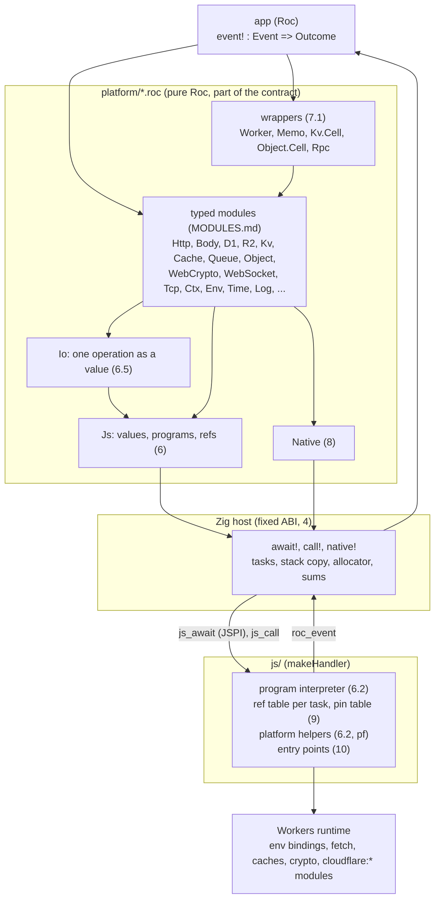

# App and platform API

| Item | Value |
| --- | --- |
| Status | Draft 4, 2026-10-15 (draft 3, plus CBOR as the bridge format and for typed data, AQ8 to AQ10 settled) |
| Scope | The API between a Roc app and this platform: the events that the app gets, the modules that it calls, and the fixed ABI under them. The signatures and rules of each module are in `MODULES.md`. The memory, trap and check rules of the host are in `PLAN.md`. |
| Replaces | `PLAN.md` problem 8 steps 8a to 8e (draft 1 of the API: kind numbers, a `Worker` record), and the rows "One wait primitive" and "Capability record" of `../DESIGN-REGISTRY.md` 8 |
| Evidence | `research/api-probe/` (workerd features, codec cost, the CBOR format `cbor/`, the module prototype `modules-check/`), `../research/core-shape/` (effects in `expect`) |

Section 1 is an audit of the registry server: what it needs from the platform, and the problems in the registry design that the audit found. Sections 2 to 11 are the API. Section 7 lists the modules, and `MODULES.md` gives their signatures and rules. Section 12 lists the alternatives. Section 13 has the open questions.

## 1. Audit: the registry server

Sources: `../DESIGN-REGISTRY.md` (Registry), `../DESIGN.md` 6 and 8, `../DESIGN-CLI.md` 6.2 and 7.3, `../DESIGN-RESOLUTION.md` 11.

### 1.1 What the registry needs

| # | Registry function | Workers feature | Platform part | Phase |
| --- | --- | --- | --- | --- |
| RN1 | HTTP API (Registry 4): 13 routes in P2 (R-AP1 to R-AP14), and in P3 2 yank routes (Registry 7.2, R-YK1) and 2 move routes (Registry 7.3, R-AP31). Methods `GET`, `POST`, `PUT`, `DELETE`. JSON bodies, RFC 9457 errors (`application/problem+json`, R-AP21), ETag and 304 (R-AP24), `Cache-Control`, `Retry-After` (R-AP25) | `fetch` handler. Method, URL, headers, raw body bytes. Status, headers, body. | `Fetch` event, `Http` | P2 |
| RN2 | Reads: the releases of a repo and of a group (R-AP1, R-AP13), the releases after a log index (R-AP14), the artifact record (R-AP2), the closure (recursive CTE) with its compat rows, sweeps and `log_size` (R-AP16 to R-AP18), compat rows, toolchains, the short-name match (R-SN1) and the ranked search (R-SN5), the `checked` age of each repository from `repo_checks` (R-AP29, R-RE14). A read that gives a 64-bit id back has `CAST(id AS TEXT)`, also in `RETURNING` (Registry R-IK2) | D1 `prepare`, `bind`, `raw`, `all`. FTS5 for the ranked search. Read replicas with the Sessions API: all reads of one closure query in one session (R-AP18). | `D1` | P2 |
| RN3 | Writes (Registry 7): artifact, release, log leaf and the `names` rows of the release (R-IK3) in one transaction. Provenance rows with `INSERT OR IGNORE` (R-PU15), `withdrawn` (R-PU17), the `repos` binding (R-TP5). Compat rows and the sweep, all or nothing (R-MX4). P3: the yank fields and the `yanks` rows (R-YK4). | D1 `batch` (atomic). D1 has no `BEGIN` from a Worker: it runs in auto-commit. | `D1` | P2 |
| RN4 | Log tiles and the signed checkpoint (Registry 3) | R2 `get`, `put` with `onlyIf` (compare and swap on the etag). WebCrypto Ed25519 `sign`. The key is a secret. | `R2`, `WebCrypto`, `Env` | P2 |
| RN5 | Edge cache of immutable and short-lived answers | Cache API `match`, `put`, `delete`. `ctx.waitUntil` for a put after the response. | `Cache`, `Ctx` | P2 |
| RN6 | Trusted publishing with GitHub OIDC (Registry 7.1): the signature, then the claim checks of R-TP3 (publish), R-TP7 (compat bot) and R-TP8 (yank, P3) | Outbound `fetch` of the JWKS. WebCrypto `importKey` (JWK) and RS256 `verify`. A cache of the JWKS across requests. The claims: base64url and JSON decode in Roc. | `Http`, `WebCrypto` (the key is imported in the same crossing as `verify`), `Memo` (`MODULES.md` 9) | P2 |
| RN7 | GitHub reads: the release (read again for each webhook event and each retry, R-PU12, R-PU13), the asset, `.roc-version`, compiler releases with `digest`, the repository ids with `GET /repos/{owner}/{repo}` (R-TP5), the release lists of the reconcile with an ETag (R-PU23, RN17), a repository by its id with `GET /repositories/{id}` (R-TP10, R-TP11). A read of a renamed repository answers 301 to `/repositories/{id}`. `Http.send!` sets no `redirect` option, so `fetch` uses `follow`, and the Worker gets the 200 answer of the new location. The Worker does not read the 301 itself: it compares `full_name` and `id` of the answer with the name that it asked for, and a different `full_name` with the same `id` is a rename (R-TP10). The visibility of the repository (`private`) comes from the same reads, on each path that indexes (RN19). | Outbound `fetch` with a token header, redirects (`follow`, the `fetch` default), a body as bytes or a stream | `Http`, `Body` | P2 |
| RN8 | Archive checks: BLAKE3 hash of the asset, read `main.roc` from the `.tar.zst` | BLAKE3: Roc builtin. zstd: not in Workers (`research/api-probe/`). tar: plain Roc. | `Native` (8) | P2 |
| RN9 | GitHub App webhook (`POST /v1/webhooks/github`, R-AP12, R-PU11), and the App's own token | HMAC-SHA256 of the raw body, compared in constant time. RS256 `sign` (PKCS#8 key) for the App JWT. | `WebCrypto` (`hmac_sha256` in Roc, `timing_safe_equal!`), `Body` | P2 |
| RN10 | Requests with no token from anyone: an ingest (`POST /v1/releases`, R-AP9) and user hints (`POST /v1/compat`, R-MX6). 429 with `Retry-After` (R-AP25). | Rate limiting binding. Optional: a queue that moves the work out of the request (Q30). | `RateLimit`, `Queue` | P2 |
| RN11 | Tile catch-up after a failed write, cleanup | Cron trigger | `Scheduled` event | P2 |
| RN12 | Provenance: in-toto attestation, Sigstore bundle (Design 8) | ECDSA P-256 `verify`. X.509 parse in Roc. | `WebCrypto` | P3 |
| RN13 | Logs and counters (M11 of `PLAN.md`) | `console.log` (Workers Logs), optional Analytics Engine | `Log`, `Analytics` | P2 |
| RN14 | Settings and keys: `AUDIENCE` (R-TP3), `BOT_REPOSITORY_ID` and `BOT_WORKFLOW_REF` (R-TP7), the checkpoint key (RN4), the App key (RN9), the App id and the installation id (RN18), `ISSUES_URL` (R-TP12: `https://github.com/roc-talon/talon/issues`, a plain var and not a secret). P3: the secret `OPERATOR_KEY` (R-YK2), compared in constant time. | Vars and secrets. `timingSafeEqual`. | `Env`, `WebCrypto` (`timing_safe_equal!`) | P2 |
| RN15 | Leaf time, token expiry | `Date.now()`. On the edge it moves only at I/O. | `Time` | P2 |
| RN16 | Webhook work after the 202 answer, and reads again after 1, 5, 15 and 60 min for a release with no asset yet (R-PU11, R-PU13) | `ctx.waitUntil` for the first read. For the later reads: Queues `send` with `delaySeconds` and a `queue` consumer, or a D1 row for each pending release and the cron of RN11. | `Ctx` (`respond!`, 10.2). `Queue` (`send_with!` with `delay_ms`, phase B), or the `Scheduled` event (phase A). | P2 |
| RN17 | Reconcile (Registry 7, R-PU21 to R-PU27): a cron every 5 min reads the release lists of the due repositories, at most 500, with `If-None-Match`. New candidates go to the index job of RN16. | Cron trigger. Outbound `fetch` with an ETag. D1 reads and a batch of writes (`repo_checks`, `withdrawn`). Workers Paid limits: 30 s of CPU for a cron with an interval under 1 h, 10,000 subrequests per run, 6 open connections at one time (Cloudflare Workers limits). The cron does no archive work, so it stays in these limits. | `Scheduled` event, `Http`, `D1` | P2 |
| RN18 | The installation token of the GitHub App `Talon Indexer` (organization `roc-talon`) for the reconcile and for the reads of RN7 (R-PU25) | RS256 `sign` of the App JWT (as RN9), then `POST /app/installations/{id}/access_tokens`. The token lives 1 h. A cache across requests until 5 min before its end. Settings: the App id and the installation id (RN14). | `WebCrypto`, `Http`, `Memo` (`MODULES.md` 9), `Env` | P2 |
| RN19 | Repository identity (Registry 7.1 and 7.3, R-TP9 to R-TP15, R-PU28 to R-PU30, R-AP31 to R-AP33): the id compare of each write and read (R-TP9), renames (R-TP10), the states `active`, `missing` and `moved` (R-TP11), a `repo_events` row in the same batch as each change of a `repos` row (R-TP13), the `repos` items in the read answers (R-AP32), the successor chain in the short-name set (R-AP33). Each path that indexes (publish, webhook, ingest, reconcile) reads the visibility of the repository and indexes only a public one (Registry R-PU31 to R-PU33). P3: the move route `PUT` and `DELETE /v1/packages/{owner}/{repo}/successor` (R-AP31), with its checks: the `exposes` of the newest artifacts of both names (R-RE1, no compiler), and the chain of up to 4 links with no cycle (R-TP14). | D1 `batch` (the `repos` change and its event, atomic). D1 reads with a recursive CTE for the chain. Outbound `fetch` for the repository reads (RN7). OIDC claims as RN6. | `D1`, `Http`, `WebCrypto` | P2. The move route: P3. |
The registry does not use KV, Durable Objects, WebSockets, email, AI or TCP sockets. The platform exposes them anyway (section 7), because it is a generic platform (Design 6.1).

### 1.2 Problems found in the registry design

These are problems in the registry design, not in the platform. Each one is a new open question in `../DESIGN.md` 9. They do not block the platform work.

| # | Problem | Why | Question |
| --- | --- | --- | --- |
| RF1 | "Purge cache for the group" on publish (Registry 7) cannot be done with the Cache API | `cache.delete` purges only the data center that runs the Worker (Cloudflare docs, Cache API). A global purge needs the zone purge API with an API token and a custom domain. | Q25 |
| RF2 | Two publishes in two isolates can write the checkpoint at the same time. The older one can overwrite the newer one, so the log seems to go back. | Registry 3 says "one writer is enough", but without a Durable Object there is no single writer. D1 orders the leaves. Nothing orders the R2 writes. | Q26 |
| RF3 | A failure after the D1 commit and before the R2 writes leaves leaves with no tile and no checkpoint | The D1 batch and the R2 writes are not one transaction | Q26 |
| RF4 | "One transaction: artifact, release, log leaf; reject if label exists with other hash" needs a branch, but a D1 batch cannot branch | D1 has no interactive transaction. A batch is a fixed list of statements. | Q27. A trigger with `RAISE(ABORT)` rolls back the whole batch on local D1, which gives the branch (`../research/d1-sweep/`, `../DESIGN-REGISTRY.md` R-MX8). |
| RF5 | A platform archive can be large (basic-cli: 21 MB packed, 70 MB unpacked). The body, the BLAKE3 input and the zstd output all go through wasm memory, which never gets smaller. The isolate has 128 MB. | `PLAN.md` problem 4. Roc `Crypto.BLAKE3` has `hash_chunks(Iter)` but no state that takes one chunk at a time from an effect. | Q28 |
| RF6 | A publish needs more CPU than the free plan gives | BLAKE3 of 21 MB and a zstd decode of 70 MB take much more than 10 ms of CPU. The registry needs the paid plan. | Q28 |
| RF7 | Large reads cost much CPU in Roc when they are decoded and encoded again | 200 rows cost about 84 µs to send from JS into typed Roc rows with the host decoder of 5.1 (`research/api-probe/`), next to 200 to 280 µs for a whole bench request. `POST /v1/closure` returns the rows to the client almost unchanged. | Q29 |
| RF8 | An ingest (`POST /v1/releases` with no token, Registry 4 R-AP9) has no auth. Each call can make the Worker download and unpack an archive. | Registry 7, R-PU4: "Anyone, with a public URL" | Q30 |
| RF9 | `PLAN.md` step 8c ("`roc test` of a handler with a scripted record") cannot work | An `expect` cannot run a function with `!`, also with a pure fake (`../research/core-shape/`) | Fixed here: section 11 |
| RF10 | `../DESIGN.md` Q12 and Q14 and Registry 8 still describe a pool of instances (16 requests each, 32 MB) | `PLAN.md` problem 12 changed this to one instance per isolate | `PLAN.md` order of work row 12 updates them |

## 2. Goals

| # | Goal |
| --- | --- |
| AG1 | The app sees typed Roc modules only: no kind numbers, no byte formats, no JS. |
| AG2 | Every Workers API is reachable from Roc. A new Workers API needs a new Roc module at most, and no change to the Zig host. The app can reach an API that has no module yet (the `Js` module, 6.4). |
| AG3 | The ABI between Roc and the host is small and fixed: 3 hosted functions and 1 entry point. |
| AG4 | One I/O operation costs one JSPI wait. Each wait costs a stack copy and a sum (`PLAN.md` 12), so a module never waits twice for one operation. A sync JS API costs no wait. |
| AG5 | Large bodies stay in JS until Roc asks for their bytes (`PLAN.md` problem 10). |
| AG6 | The platform and an app can be developed apart. The contract is the public Roc modules of a platform release (section 11). |

## 3. Layers



| Layer | Changes when | Who sees it |
| --- | --- | --- |
| Wrappers (7.1) | A new convenience is added | The app |
| Typed modules | A Workers API is added or changes | The app |
| `Js` module | Rarely: a new value kind | The app (escape hatch) and the modules |
| Host ABI (3 hosted functions, `roc_event`) | Almost never | The platform only |
| JS program interpreter | A new op kind or a new conversion rule | The platform only |
| JS entry points | A new Workers handler kind (10) | The platform only |
| JS platform helpers (root `pf`, OP3) | A module needs a loop in JS (for example, a stream read to a limit) | The platform only |

## 4. The fixed ABI

Hosted functions (`platform/Host.roc`, not in `exposes`):

| Function | Type | JS import | Waits |
| --- | --- | --- | --- |
| `await!` | `Js => { status : U8, value : Js }` | `js_await`, wrapped in `WebAssembly.Suspending` | Yes, one JSPI wait |
| `call!` | `Js => { status : U8, value : Js }` | `js_call`, a plain import | No |
| `native!` | `U32, List(U8) => { status : U8, bytes : List(U8) }` | none: Zig code in the host | No |

Apps and modules reach them through `Io.await!(ops)` and `Io.call!(ops)` (`platform/Io.roc`, built in `PLAN.md` 8a), not `Js.await!` and `Js.call!` (6.4): `Host.roc` imports `Js`, and Roc has no import cycles (`research/bridge-check/`), so `Js.roc` cannot call `Host`.

The argument of `await!` and `call!` is a program (6.2) as a `Js` value. The result is a `Js` value (5). Roc never sees the byte format: the Zig host encodes the argument into a host block for JS (4.1), and decodes the bytes that JS writes back into Roc values (5.1). JS reads the argument before its first `await` (`../DESIGN-REGISTRY.md` 8). The host frees the argument (glue `decref`), because a hosted function owns its arguments.

| Status | Meaning | Value |
| --- | --- | --- |
| 0 | Ok | The value of the last op |
| 1 | JS threw, a promise rejected, or a value broke a conversion rule (J1, J3) | `Error(name, message)` |
| 2 | A promise in `call!` (the program needs `await!`) | `Error("PromiseInCall", message)` |
| 3 | Bad program: a slot out of range, an unknown root or op | `Error("BadProgram", message)`. This is a platform bug: the module crashes. |

Built in 8a, two more cases: a program deeper than 64 containers (J3) is status 1 with `Error("RangeError", ...)` from the host, with no crossing. A result block that is not one value of the profile (5) is status 3 with `Error("BadResult", "CBOR: <what> at byte <n>")` from the host.

Roc sees only statuses 0 to 3. Statuses 4 and 5 (4.1) stay in the host.

Entry point (`provides`):

| Export | Type | Use |
| --- | --- | --- |
| `roc_event` | `Js => Js` | The JS shim gives the host the event as bytes. The host decodes them into a `Js` value (5.1) and calls `roc_event`. Platform Roc code turns the `Js` value into a typed `Event`, calls `event!`, and turns the `Outcome` into a `Js` value, which the host encodes for JS. The host wraps the call with the task table (`handle`, `task_abort`, `task_cancel`). |

The host exports are the production list of `PLAN.md` 7a. `Wait.wait!` (`kind, num, a, b, c`) is removed, so bugs B2 and B3 of `PLAN.md` 6 go away with it.

### 4.1 Wasm level

The hosted functions are Roc functions in the Zig host. Under them, the host and the JS shim use these wasm imports and exports. All addresses and lengths are `u32`.

| Import (JS gives) | Signature | Use |
| --- | --- | --- |
| `js_await` | `(task_id, arg_ptr, arg_len, out_ptr) -> status`, wrapped in `WebAssembly.Suspending` | `await!` |
| `js_call` | same, a plain import | `call!` |
| `js_grow` | `(pages) -> ok` | `PLAN.md` M4 |

| Step | Rule |
| --- | --- |
| Argument | The host encodes the program (5) into a block of the task (8a: the owner is the task, not 0). So `freeOwner` frees it at `task_abort` and `task_cancel`, with the pages of the task, and the `Wait` record does not hold it. JS reads the block before its first `await`. The host frees it after the import returns. |
| Task | The host gives the id of the task that runs as `task_id`. JS cannot know it: the engine resumes a suspended stack when its promise settles, and other promise jobs can run before that (found in `PLAN.md` 2c, 2026-10-16). |
| Result | JS encodes the value (5) into a block from `js_alloc` and writes `[ptr, len]` at `out_ptr`. After the resume, the host checks the block (`PLAN.md` 12b), decodes it into Roc values with the owner of the task (5.1), and frees it. |
| Status 4: no memory | `js_alloc` gave 0 (`PLAN.md` 2a), or it threw (8a: a trap in `js_alloc`). There is no result block. The host makes a clean OOM trap for the task (`PLAN.md` M6), the same as a failed `roc_alloc`. |
| Grow | `poolGrow` (`hostlib/alloc.zig`) calls `js_grow(pages)` before each `memory.grow` and grows only on 1. A 0 is pressure (`PLAN.md` M7): the host gives its page reserve back and tries again, then the task gets a clean OOM trap with the cause `oom` (`trap_cause()` 2). JS counts the memory of all instances (`PLAN.md` M3, M10). |
| Status 5: cancelled | The task was cancelled (`PLAN.md` 3c). The host runs `unreachable` before it reads memory or a global. |
| Event | JS writes the event bytes into a `js_alloc` block and calls `handle(ptr, len, id)`. `handle` decodes them, calls `roc_event`, encodes the `Js` result into a host block and returns its address. JS reads it and calls `res_free` at once. Built in 8b: the task adopts the event block and the host frees it when `roc_event` returns (a trap frees it with the task), so it is in the sums of the waits of the task (`PLAN.md` 12a), as the request block was before 8b. A block that is not one value is a log line and a clean trap of the task. |

## 5. Values: `Js`

One Roc type holds each value that crosses the bridge:

```roc
Js := [
	Undefined, Null, Bool(Bool), Num(F64), Int(I64), Text(Str), Bytes(List(U8)),
	Arr(List(Js)), Obj(List((Str, Js))), Ref(Js.Ref), Error(Str, Str),
	Packed(List(U8)),   # one value as CBOR, for typed data (5.2)
].{
	Ref :: { id : U32 }.{ is_eq : _ }   # the id of a JS object in the ref table of the task (9). `==` compares ids (RS1). A record backing, so a ref has no codec (MC13, MODULES.md 15).
}
```

`Js.Ref` is the type of a ref in the other modules: `Body.Stream(Js.Ref)`, `Response.web_socket`, `WebCrypto.Key.Imported(Js.Ref)`, the result of `Io.start!` (6.5).

The byte format is CBOR (RFC 8949), with this profile (decided 2026-10-15, AQ8):

| `Js` | CBOR | Rule |
| --- | --- | --- |
| `Undefined`, `Null`, `Bool` | simple values 23, 22, 20, 21 | |
| `Int(I64)` | major type 0 or 1 | An integer. JS writes a `Number` that is a safe integer, and a `BigInt` in the i64 range, as an integer. JS reads an integer as a `Number` up to 2^53, else as a `BigInt`. |
| `Num(F64)` | major type 7, f64 | Any other `Number` (a fraction, NaN, an infinity). A decoder also reads f16 and f32. |
| `Text`, `Bytes` | major types 3 and 2 | |
| `Arr`, `Obj` | major types 4 and 5 | `Obj` keys are text, in the key order of JS |
| `Ref(id)` | tag 27 (a generic object, a registered tag) with `["Ref", id]` | 9 |
| `Error(name, message)` | tag 27 with `["Error", name, message]` | |
| `Packed(bytes)` | tag 24 (encoded CBOR data item, RFC 8949 3.4.5.1) with a byte string | 5.2 |

| Rule | |
| --- | --- |
| Lengths | Definite only. An indefinite length, a reserved value (28 to 30) or another tag is an error. A decoder reads any width of an argument. An encoder writes the shortest width, except a container head, which can be wider (an encoder that does not know the count first). |
| Depth | 64 or less, in both directions (J3) |
| Why CBOR | `research/api-probe/README.md` (AQ8): a standard with test vectors (RFC 8949 Appendix A) and tools (diagnostic notation), the same data model as JSON plus bytes, `undefined`, 64-bit integers and tags, and a format that the derived codecs of Roc can read (5.2) |

JS to `Js` conversion (rule J1 to J7):

| # | JS value | Becomes |
| --- | --- | --- |
| J1 | Primitive, `null`, `undefined` | Same kind. A `Number` that is a safe integer is `Int`. A string with a lone surrogate gets U+FFFD (`TextEncoder`). A `BigInt` outside 64 bits is status 1 (`RangeError`): the value comes from data, so it is not a platform bug. In a `Js` tree, a `BigInt` above the i64 range is status 1 too. In a `Packed` value, it reads into a `U64`. |
| J2 | `Uint8Array`, `ArrayBuffer`, other typed arrays | `Bytes` (a copy) |
| J3 | Array, plain object (prototype `Object.prototype` or `null`) | `Arr`, `Obj`, converted deep, to a depth of at most 64. Deeper, or a cycle, is status 1 (`RangeError`). |
| J4 | `Date` | `Int` or `Num`: milliseconds since 1970 |
| J5 | `Headers`, `Map`, `URLSearchParams` | `Arr` of `[key, value]` pairs |
| J6 | `Error`, `DOMException` | `Error(name, message)` |
| J7 | Any other object: a class instance, a function, a stream, a `Response`, a binding | `Ref`: the id of the object in the ref table of the task (9) |

`Js` to JS is the reverse: `Ref(id)` gives back the object of that id, `Bytes` gives a `Uint8Array`, `Int` gives a `Number` up to 2^53 and a `BigInt` above, `Packed` gives the value that its bytes encode. Some Workers APIs do not take a `BigInt` (D1 `bind` throws `D1_TYPE_ERROR`), so their modules send an integer outside ±(2^53 - 1) as decimal text (7).

### 5.1 The host encodes and decodes

Decided 2026-10-15, from `research/api-probe/README.md` (200 D1 rows, native, best of 7 rounds). The numbers are for the first byte format. The CBOR profile has the same work: a head, then a length and the bytes. It writes integers big-endian and with a variable width, which costs a byte swap and a branch. JS encodes the same rows (as objects) as CBOR in 79 to 90 µs, against 67 to 78 µs in the first format (5 runs).

| Step | In Roc | In the Zig host |
| --- | --- | --- |
| Bytes to a `Js` tree | 85 µs | 25 µs |
| `Js` tree to typed rows (a match in the module) | 14 µs | 14 µs (stays in Roc) |
| JS encode (same in both) | 45 µs | 45 µs |
| Total | 144 µs | 84 µs |

85 % of the Roc decode is the building of the tree: one allocation for each long string and each list. The Zig decoder makes the same allocations, but with no `Try` for each byte and with `memcpy` for strings. The format stays the same. Only the place of the decoder changes.

The Zig code writes Roc values, so it must match the Roc layout of `Js`. `roc glue` gives that layout (`research/api-probe/glue-check/`): on wasm32 a `Js` is 32 B, with 24 B of payload and a 1-byte tag at offset 24. The tags are numbered in alphabetical order. The glue also gives `RocStr.fromSlice`, `RocList.allocate`, `incref`, `decref`, and `comptime` checks of size, align and tag offset.

Tests that keep the Zig code and Roc in step:

| # | Test | Finds |
| --- | --- | --- |
| HD1 | The `comptime` checks of the glue | A layout change: the host build fails |
| HD2 | CI makes the glue again on each nightly and fails on a diff with the committed file (`PLAN.md` 7c) | A changed tag order or a new field, before a release |
| HD3 | Round trip in the conformance app: Roc builds a set of `Js` fixtures (each tag, empty and long strings, strings of 11 and 12 bytes at the wasm32 small-string limit, deep nesting, 2^53 + 1 as `Int`), the host encodes, JS decodes and encodes again, the host decodes, and Roc compares with `==` | A wrong tag number, a wrong small-string flag, a lost field |
| HD4 | Differential: the Roc decoder of `research/api-probe/Js.roc` stays as a test oracle. The same random byte strings go to both decoders. Both must give the same value or both an error. | A difference in the error cases (a bad length, bad UTF-8, trailing bytes) |
| HD5 | Fuzz the Zig decoder with random and cut bytes (Zig `std.testing.fuzz`). It must give an error or a value, never a trap or a read past the block. The native fuzz run uses the 64-bit layout, so the corpus that it finds also runs through the wasm32 host build in Node (12-byte `RocStr`, small strings of 11 B or less). | Bounds bugs. A trap in the host is unclean (`PLAN.md` 12c). |
| HD6 | Leaks, in the wasm32 build: after 10,000 decodes of the fixtures and a drop in Roc, live bytes return to 0 (`track_live`) | A refcount that is wrong by one |
| HD7 | The vectors of RFC 8949 Appendix A that are in the profile, and the cases that are not (an indefinite length, tag 1, a cut input), in the Zig decoder and in the JS codec (as `research/api-probe/cbor/cbor-test.mjs`) | A wrong head width, a sign error in major type 1, a profile check that is missing |

Each test must fail when its change is reverted (for example, swap two tag numbers, or turn off the small-string flag).

As built in 8a (`PLAN.md` 8a status has the files and the revert results):

| # | Built as |
| --- | --- |
| HD3 | `bench/app_bridge.roc` (request `hd3`), not the conformance app (8c) |
| HD4 | The oracle is `bench/hd4/oracle.roc`, a new decoder of the CBOR profile. `research/api-probe/Js.roc` stays as the record of the first byte format. |
| HD5 | A seeded random fuzz (random, mutated and cut inputs), not `std.testing.fuzz` (a guided run needs a fuzz build). The wasm32 run uses its own seeded corpus (`bench/cbor-wasm-test.mjs`), not the native one. |
| HD6 | Also in a task: `leaked_at_end` stays 0, because a leak in a task goes back with its pages and live bytes do not show it |

The host decoder (`host/cbor.zig`) does not read the content of a `Packed` value: `Cbor.parse` reads it in Roc. An integer outside the i64 range is a decode error (`Int` holds an I64).

HD4 uses the `Js` decoder in Roc as the oracle. It changes to the CBOR profile with the format (8a).

JS cannot write Roc values itself with less cost. Each heap block needs its own allocation, so JS would call `js_alloc` once for each string and list. One large block for all values does not work, because Roc frees each block alone when its refcount goes to 0.

### 5.2 Typed values

Typed data of the app (`MODULES.md` MC5) does not become a `Js` tree. It crosses as one `Packed` value, and Roc reads it with the codecs that it derives for the `Cbor` format:

| Direction | Steps |
| --- | --- |
| JS to Roc (a D1 row set, an RPC argument, a queue message) | The last op of the program is `Call(Root("pf"), "pack", [Slot(n)])`. The shim writes tag 24 and the CBOR of the value straight into the result block. The Zig host copies the bytes into one `List(U8)` (`Packed`). The module calls `Cbor.parse` into the type of the caller. |
| Roc to JS (an RPC reply, a queue message, an argument) | The module calls `Cbor.encode` and puts `Packed(bytes)` in an op argument. The host copies the bytes into the program. JS reads the value in place. |

`Cbor` is a format of the Roc codec protocol: an encoding type with `parse_str`, `parse_record_start`, `encode_record` and the other methods that the derived `parser_for` and `encoder_for` call (`research/api-probe/cbor/Cbor.roc`). It reads records as maps with text keys, and tags as `Json` does (a text, or a map of one entry), so JS sees the same objects as from `JSON.parse`. It is a generic package: it goes in its own repository (`roc-cbor`), as the generic packages of talon (`../DESIGN.md` 6.1, GP1 to GP6). The platform uses it by release URL, and wraps it in its own module `Cbor` (`platform/Cbor.roc`: aliases and thin functions), so an app writes `import pf.Cbor` and needs no `cbor` entry in its header.

Cost, 200 D1 rows into typed records (`research/api-probe/cbor/`, native, best of 7 rounds of 300, same binary):

| Path | JS | Roc | Total |
| --- | --- | --- | --- |
| JSON text (`JSON.stringify`, `Json.parse`), the design before AQ8 | 23 µs | 242 to 340 µs (the input text changes it) | 265 to 363 µs |
| CBOR (`pf.pack`, `Cbor.parse`) | 79 µs | 137 µs | 216 µs |
| CBOR, rows as arrays with one list of column names (AQ9) | 52 µs | 146 µs | 198 µs |
| CBOR, rows as arrays into tuples (a lower bound, not typed records) | 52 µs | 67 µs | 119 µs |
| `rows!`: a `Js` tree in Zig, then a match, no types (5.1) | 43 µs | 25 + 14 µs | 82 µs |

| Direction of a write | Roc | JS | Total |
| --- | --- | --- | --- |
| JSON (`Json.to_str`, `JSON.parse`) | about 200 µs | 52 µs | about 250 µs |
| CBOR (`Cbor.encode`, the shim decoder) | about 155 µs | 90 µs | about 245 µs |

Typed records cost 70 µs more than tuples of the same values: that is the record matching of the derived parser, not the format. A compiler that matches field names faster makes every format faster (the Roc design for small-string field dispatch). These are native numbers. wasm32 numbers come in `PLAN.md` 8g.

## 6. Programs

### 6.1 Why programs

A Workers operation is often 3 or 4 JS calls: `env.DB.prepare(sql).bind(...args).raw()`. One wait per call would cost 4 stack copies and sums. A program is a list of ops that JS runs in one crossing. Each op puts its result in the next slot, and a later op can use it. This is promise pipelining, as in Cap'n Proto.

### 6.2 Ops

```roc
Target : [Root(Str), Slot(U32), Ref(Js.Ref)]
Arg : [Lit(Js), Slot(U32)]
Op : [
	Get(Target, Str),               # target[name]
	Set(Target, Str, Arg),          # target[name] = arg, the slot gets undefined
	Call(Target, Str, List(Arg)),   # target[name](...args)
	Start(Target, Str, List(Arg)),  # the same call, but the slot keeps the promise (OP1)
	New(Target, Str, List(Arg)),    # new target[name](...args)
	Fields(Target, List(Str)),      # an Obj with these properties (reads getters on class instances)
	Keep(Target),                   # a Ref, also for a plain value or a promise
	Array(List(Arg)),               # a JS array, for example of slots: db.batch([s1, s2])
	Record(List((Str, Arg))),       # a plain JS object, for example with a slot as a field
	Par(List(List(Op))),            # branches that run at the same time (OP6)
	Race(List(List(Op))),           # branches that run at the same time, the first to settle wins (OP8)
]
```

| # | Rule |
| --- | --- |
| OP1 | In `await!`, JS awaits each op result that is a thenable before the next op, except the result of `Start`. In `call!`, a thenable result of an op other than `Start` is status 2. A `Start` slot holds a pending promise: a later op can give it to `Promise.all` or `ctx.waitUntil`, or `Keep` it. |
| OP2 | The result of the program is the last slot, converted by J1 to J7. Other slots are not converted, so a module can chain a JS object with no ref. |
| OP3 | Roots, resolved for the task that runs: `env`, `ctx`, `event` (the object that started the task), `global` (`globalThis`: `fetch`, `caches`, `crypto`, `console`, constructors), `pf` (the platform helpers, 6.4), `ops` (JS functions that the app adds, 6.4), `signal` (8a: an `AbortSignal` that aborts at the end of the task, and in a `Race` branch also when the branch loses, OP8), and the `cloudflare:*` modules that the shim imports (`cloudflare:sockets`, `cloudflare:email`, `cloudflare:workers`; not built in 8a). An unknown root is status 3. |
| OP4 | A program has no branch and no loop. A module that must branch runs 2 programs or calls a platform helper (`pf`, 6.4). An app adds a JS op (6.4). A result that can be `null` needs no branch (OP7). |
| OP5 | The op encoder in Roc (ops to a `Js` array) and the interpreter in JS are the only code that knows the op format. The byte format (5) is only in the Zig host and the JS shim. |
| OP6 | `Par` runs each branch as its own program, with its own slots from 0, and awaits all of them (`Promise.allSettled`). Its slot gets an `Arr` with one `Arr([Int(status), value])` for each branch, in order, with the statuses of 4. A status 3 in a branch makes the whole program status 3. Workers lets 6 connections wait at the same time and queues the others, so a large `Par` is slower, but it does not fail. `Par` always gives a promise, so a program with `Par` runs with `await!`, also when each branch is sync (`Io.both!` of two `Io.sync` values). In `call!`, `Par` is status 2 (OP1). |
| OP7 | `Get` and `Fields` on `null` or `undefined` give `undefined`, as `?.` in JS. `Call`, `Start`, `New` and `Set` on them still throw (status 1). So a module reads a result that can be `null` with no branch: `R2.get!` and `R2.head!` read `Fields` of the result of `get` or `head`, and `Undefined` is `NotFound`. `Cache.get!` does the same with the result of `match`. `WebSocket.connect!` reads `Fields(res, ["status", "webSocket"])` in its wait, gives `NotUpgrade` for a `Null` socket, and calls `accept()` on the ref in a second program with `call!` (no wait). As built (`PLAN.md` 8f, part 3): one program with one wait, `fetch`, then `Get(Slot(0), "webSocket")`, then `Call(Root("pf"), "wsAccept", [Slot(1)])`: the helper gives `undefined` for a `null` socket (`NotUpgrade`), so the function has an `Io` twin (MC3). |
| OP8 | `Race` runs each branch as `Par` does, and settles when the first branch settles (`Promise.race`). Its slot gets `Arr([Int(index), Arr([Int(status), value])])` for that branch. The interpreter gives each branch an `AbortSignal` (the root `signal` in the branch) and aborts the other branches. They go on in JS until they see the abort, and their results are dropped. A platform helper that takes a value from a queue (a WebSocket message, a TCP read) stops its wait on the abort and leaves the value for the next call, so a branch that lost takes nothing. As built (`PLAN.md` 8f, part 3, SO3): a branch can take a value in the same turn as the end of the race (the value was there, or it came before the abort). So a helper that takes a value also gives a give-back to `onLoss(signal, back)` of `js/program.js`. When a branch loses, its give-backs run, the last take first. A branch that wins gives its give-backs to the branch around its race. At the top (the signal of the task), a take is final. `Time.sleep` stops its timer (`scheduler.wait` with the signal). `Race` gives a promise, so it needs `await!` (as OP6). |

Example, inside `D1` (all names are module code, not app code). Each function that waits has a pure twin that gives an `Io` (6.5):

```roc
rows : D1, Str, List(Sql) -> Io(Sql.Rows, [D1Err(Thrown)])
rows = |db, sql, params| Io.new(
	[
		Get(Root("env"), db.name),                                            # slot 0: the binding
		Call(Slot(0), "prepare", [Lit(Text(sql))]),                           # slot 1
		Call(Slot(1), "bind", params.map(|v| Lit(v.to_js()))),                # slot 2: no BigInt (5)
		Call(Slot(2), "raw", [Lit(Obj([("columnNames", Bool(Bool.True))]))]), # slot 3: awaited
	],
	|result| match result {
		Ok(value) => Sql.rows_from_js(value)    # ["col", ...] then rows as arrays
		Err(thrown) => Err(D1Err(thrown))
	},
)

rows! : D1, Str, List(Sql) => Try(Sql.Rows, [D1Err(Thrown)])
rows! = |db, sql, params| Io.run!(rows(db, sql, params))
```

`D1.batch!` uses the same start, then `prepare` and `bind` for each statement, then `Array` of their slots, then `Call(Slot(0), "batch", [Slot(n)])`, then `Call(Root("pf"), "packEach", [Slot(n + 1), Lit(Text("results"))])` (6.4): one crossing for the whole transaction, and each `D1.Result` gets its `meta` and its rows as one `Packed` value. `D1.all` uses `all` in place of `raw`, then `Get(Slot(3), "results")` (slot 4: `all()` gives `{ results, meta }`), then `Call(Root("pf"), "pack", [Slot(4)])`, so the rows come back as one `Packed` value for `Cbor.parse` (5.2). As built (`PLAN.md` 8c): `batch!` calls `packEach` a second time for `meta`, which the module reads with `Cbor.parse_with` (MODULES.md 5.1, `last_row_id : F64`), and `rows!` ends with `Call(Root("pf"), "limit", [Slot(n), Lit(Int(max))])` in place of a `pack`. A `D1.Session` program starts at its ref, with no `Get` of `env`.

### 6.3 Binding values are names

A binding value holds the name of the binding: `D1 :: { name : Str }`, made with `D1.binding("DB")`. Each program starts with `Get(Root("env"), name)`. So a binding value is plain data: an app can keep it in a constant, and a test can compare it. A typed binding (`Kv.json("PREFS")`, `MODULES.md` MC6) also holds the two functions of its format, so it can be a constant, but `==` does not apply to it. The `env` of each task is in the task context of the shim (`PLAN.md` 9b).

### 6.4 JS helpers and the escape hatch

| Need | Use |
| --- | --- |
| A platform module needs a loop or a branch in JS: a stream read to a limit, the pin table (9) | A platform helper in the shim: `Call(Root("pf"), "readUpTo", [Slot(n), Lit(Num(max))])`. The helpers are part of the platform release, like the modules that call them. |
| A Workers API that has no module yet | `Io.await!(ops)`, `Io.call!(ops)` or an `Io` (6.5) in the app. Same rules as in a module. (Was `Js.await!` and `Js.call!`: see 4.) |
| JS logic with a branch, a loop or a callback (HTMLRewriter, a library from npm) | The app adds JS functions: `makeHandler(module, { ops: { name: async (...args) => ... } })`. Roc calls them with `Call(Root("ops"), "name", args)`. A value of `ops` can also be an object (a library): Roc calls its methods with `Get(Root("ops"), "lib")`, then `Call` (`PLAN.md` 8c, C11). A Roc package that needs JS code tells the app to add its functions to `ops`. |

The platform helpers (root `pf`) that this file names. Each one is a loop or a branch that a program cannot have (OP4).

| Helper | Does | Used by |
| --- | --- | --- |
| `readUpTo(stream, max)` | Reads a stream to `max` bytes. Past `max`, it gives an error that the module turns into `TooLarge`. Built in `PLAN.md` 8b: no byte goes into wasm past `max` (the check is in JS, before the copy), and it reads on from where `chunk` stopped. A `null` stream (the body of a 204 response) gives no bytes (8c). | `Body.bytes!`, `text!`, `json!`, `Http.send!` |
| `pack(value, maxBytes)` | Writes the value as one `Packed` CBOR value (5.2). Above `maxBytes` (no default: the module gives it, 8c): a `TooLarge`, status 1. | `D1.all!`, `first!`, RPC, queue reads |
| `packEach(array, key, maxBytes)` | Gives the array with the field `key` of each item as a `Packed` value. The other fields stay. `maxBytes` is the limit of all the packed fields together (built in `PLAN.md` 8c: the rows of a whole batch, MC11). | `D1.batch!` (6.2): `results` and `meta` of each `D1Result` |
| `limit(value, maxBytes)` | Gives the value as a `Js` tree (J1 to J7), with a limit of its CBOR size: above it, a `TooLarge` (status 1), before any copy into wasm (built in `PLAN.md` 8c) | `D1.rows!`: rows with no types do not go through `pack` |
| `findById(array, id)` | Gives the item whose `id` is `id`, else `undefined` (OP7) | `Queue.Message.ack!`, `retry!`: `Get(Root("event"), "messages")`, then `findById`, then `Call` of `ack` |
| `spawn(ops)` | Runs the ops as an async program of the task. A throw goes to the log. The task context stays until it settles (RS1). | `Io.start!` (6.5) |
| `writer()` | Makes a `TransformStream`, and records its writable side in the task table, so the task stays until the stream closes or is cancelled (10.2). Built in `PLAN.md` 8b: it gives `{ readable, writer }` (the writer of `getWriter()`, so `write!` is a `Call` of `write` on its ref). | `Body.writer!` (`MODULES.md` 4) |
| `close(writer)` | Closes a writer of `writer()`. The response body is complete now when it is the stream of `respond` (10.2). | `Body.Writer.close!` |
| `chunk(stream, max)` | The next chunk, at most `max` bytes (the rest comes next), or `undefined` at the end. It shares the reader of `readUpTo`. | `Body.chunk!` |
| `sha256(stream)` | `crypto.DigestStream`: the SHA-256 with no copy into wasm | `Body.sha256!` |
| `transform(body, kind, format)` | The body (a stream, bytes, text or `null`) through a `CompressionStream` or a `DecompressionStream` | `Body.compress!`, `decompress!` |
| `respond(outcome)` | The outcome `Respond` as a Workers `Response`, given to the entry now (10.2). An `InvalidStateError` when the entry gave no hook, or on a second call. | `Ctx.respond!` |
| `passThrough()` | `ctx.passThroughOnException()` in the `fetch` of a Worker, else an `InvalidStateError` | `Ctx.pass_through!` |
| `r2list(result)` | The result of `bucket.list()` as `{ objects: [{ meta, checksums }], prefixes, truncated, cursor }`, all plain data (built in `PLAN.md` 8c). A list has one object for each key, and a program has no loop (OP4). A class instance for each object would be a ref for each. | `R2.list!` |
| `wsPair()`, `wsAccept(ws)`, `wsReceive(ws, signal)` | Built in `PLAN.md` 8f, part 3. `wsPair` makes a `WebSocketPair` and accepts its server end, `wsAccept` accepts a socket (`undefined` for `null`, OP7). Both set `binaryType` to `arraybuffer` and keep a queue of the messages that come before a `receive`. `wsReceive` gives the next message (text or bytes) or `{ code, reason, clean }` after the close. It stops its wait on the abort of `signal` and leaves the message for the next call. A message that a lost branch took goes back to the front of the queue (`onLoss`, OP8). A wait in `wsReceive` has no deadline (10.2). | `WebSocket.accept!`, `connect!`, `receive!` (`MODULES.md` 12.2) |
| `tcpConnect(host, port, tls)`, `tcpOpen(socket)`, `tcpRead(socket, max, signal)`, `tcpWrite(socket, bytes)`, `tcpStartTls(socket)`, `tcpClose(socket)` | Built in `PLAN.md` 8f, part 3. `connect` of `cloudflare:sockets` (a dynamic import), a wait for `opened`, a read of at most `max` bytes (`undefined` at the end; on an abort the read stays for the next call, and bytes that a lost branch took go back to the front, OP8), a write (the text `closed` for a closed socket), `startTls`, `close` with no wait. A wait in `tcpRead` has no deadline (10.2). | `Tcp` (`MODULES.md` 12.3), `Hyperdrive.connect!` (`tcpOpen`) |
| `keys(entries, maxBytes)` | The keys of an iterator of `[key, value]` entries as a `Js` tree, with the limit of `limit` (built in `PLAN.md` 8f). The values stay in JS. | `Object.Self.list!` (a program has no loop, OP4) |
| `pin(name, value, maxAgeMs)`, `pinned(name)`, `unpin(name)` | The pin table (RS2). `pinned` gives `undefined` for a name with no entry or an entry past its age (8a; `Js.pinned!` makes it `NotPinned` in 8c). | `Js.pin!`, `pinned!`, `unpin!` (built as `Io.pin!`, `Io.pinned!`, `Io.unpin!`, RS2), `Memo` |

The app is trusted code: it is the developer's own Worker. A program can reach only the roots of OP3, and Workers does not allow `eval` or `new Function`.

### 6.5 `Io`: one operation as a value

```roc
## A program and the function that reads its result. Pure data: it does nothing until a run.
Io(a, e) := { ops : List(Op), waits : Bool, read : Try(Js, Thrown) -> Try(a, e) }
Thrown : { name : Str, message : Str }
```

| Function | Crossings | Use |
| --- | --- | --- |
| `Io.new(ops, read)`, `Io.sync(ops, read)` | none | Make an `Io` that uses `await!` or `call!` |
| `Io.map(io, f)` | none | Change the result |
| `Io.run!(io) => Try(a, e)` | 1 | The usual call. Each module function `f!` is `Io.run!(f(...))`. |
| `Io.both!(Io(a, e), Io(b, e)) => Try((a, b), e)` | 1 (`Par`) | Two operations at the same time |
| `Io.all!(List(Io(a, e))) => List(Try(a, e))` | 1 (`Par`) | Many operations at the same time: R2 tiles, cache reads |
| `Io.start!(Io(a, e)) => Js.Ref` | 1, no wait | Start an operation and get its promise as a ref, for `Ctx.wait_until!`. It is `call!` of `Start(Root("pf"), "spawn", [Lit(ops)])` and `Keep`: the helper runs the ops as an async program of the task. The result is dropped: the Roc reader of the `Io` does not run, so a Roc-level `Err` (`PreconditionFailed`, `BadData`) is not seen. A JS throw goes to the log (`Log`). The context of the task (its ref table and its roots) stays alive until each started program settles, or until the 30 s limit of `waitUntil` (RS1). Work whose result matters runs in the task after `respond!` (10.2). |
| `Io.race!(List(Io(a, e))) => { index : U64, result : Try(a, e) }` | 1 (`Race`, OP8) | The first operation to settle wins (`Promise.race`). `index` is its place in the list. The others are aborted. A timeout is a race with `Time.sleep(ms)` (`MODULES.md` 11): `Io.race!([ws.receive().map(Got), Time.sleep(5_000).map(\|_\| TimedOut)])`. `Promise.race([])` never settles, so a `Race` with no branch is a bad program (status 3). |

The error types join as tag unions, so `Io.both!(D1.rows(db, sql, []), Http.get(jwks_url))` gives `Try((Sql.Rows, Response), [D1Err(_), HttpErr(_), TooLarge])`.

## 7. Modules

The full surface. Each module is pure Roc over `Js` (6) or `Native` (8). `MODULES.md` gives the signatures, the rules that all modules follow (MC1 to MC13) and a prototype. "Event" means the module is also a payload of an event (10). Each function `f!` that waits has a pure twin `f` that gives an `Io` (6.5), so an app can run it with others at the same time.

| Module | Workers API | Main functions (`MODULES.md`) | Waits | Platform phase |
| --- | --- | --- | --- | --- |
| `Request`, `Response` | `Request`, `Response`, `Headers` | One type for each, in both directions, with a `Body`. `segments` for routing, `header`, `query`, `json!`. `from_text`, `from_json`, `from_body`. `Method` and `Header` from `roc-lang/http` (AQ2). (4) | Reads of a stream body | A |
| `Http` | `fetch` | `send!` (the body read in the same crossing, to 1 MiB), `open!` (the body stays a stream), `get!` (4) | Yes | A |
| `Body` | `ReadableStream`, `crypto.DigestStream` | `text!`, `json!`, `bytes!` (one wait: the helper `pf.readUpTo`), `chunk!`, `tee!`, `sha256!` (no copy into wasm), `writer!` (a stream that the task writes, 10.2), `compress!`, `decompress!` (gzip, deflate) (4) | Yes | A |
| `Env`, `Secret` | `env` vars, secrets | `var!`, `json!`, `secret!`. A `Secret` does not show in `Str.inspect` and has no codec. `Secret.from_str` makes one (8c). (10) | No | A |
| `Ctx` | `ctx.waitUntil`, `ctx.passThroughOnException` | `respond!(Response)` (10.2), `wait_until!(Io)` (a JS throw goes to the log, 6.5), `pass_through!` (only in a Worker `Fetch`) (11) | No | A |
| `D1`, `Sql` | `D1Database`, `D1PreparedStatement`, Sessions API | `all!` and `first!` into the type of the call (rows as objects, CBOR, AQ9), `run!`, `rows!` (no types, for columns that are not known at compile time), `batch!` (one crossing, 6.2, a typed `D1.Result` for each statement), `exec!`, `with_session!` (gives a `D1.Session` with the same query functions and `bookmark!`). Reads stop at 1 MiB (`TooLarge`), and the `_with` forms take `max_bytes`. A constraint failure is `Constraint({ kind, message })`, with the kind from the extended code in the message text. A parameter is a `Sql` value. D1 takes no BigInt, so an `Int` in ±(2^53 - 1) goes as a number, and an `Int` outside it as decimal text. A text parameter becomes an integer only where it meets an INTEGER column (an insert, a compare), arithmetic or a `CAST`: `? = ? + 0` is false. D1 gives an INTEGER of size 2^53 or more back as a rounded number, so a query that reads one uses `CAST(x AS TEXT)`, and an integer field reads that text. A typed read of a rounded value is `BadData` with the column name. (5.1) | Yes | A |
| `R2` | `R2Bucket`, `R2Object`, multipart | `get!`, `get_with!` (range, condition), `put!`, `put_with!` (a failed `only_if` is `PreconditionFailed`; HTTP metadata, a checksum, `length_bytes` for a stream of unknown length), `head!`, `delete!`, `list!` (`include`, `start_after`), `create_multipart_upload!`, `resume_multipart_upload` (pure), and on the `R2.Upload` data `upload_part!`, `complete!`, `abort!`, so an upload can span requests (5.3) | Yes | A |
| `Cache` | `caches.default`, `caches.open` | `get!` (`match`), `put!`, `delete!`, local to the data center (RF1) (5.4) | Yes | A |
| `WebCrypto` | `crypto.subtle`, `getRandomValues`, `randomUUID`, `timingSafeEqual` | `sign!`, `verify!`, `encrypt!`, `decrypt!`, `derive_bits!` with the key as data (imported in the same crossing), `import_key!`, `export_key!`, `generate_key!` (the key as data), `hmac_sha256` (pure Roc), `timing_safe_equal!`, `random!`, `random_uuid!` (10). Each function that waits has an `Io` twin. `Cipher.RsaOaep` has a `hash`, and `export_key!` of a key that is data gives only its own form (as built, `MODULES.md` 10). Not `Crypto`: that is a builtin module of Roc, and it stays useful next to `WebCrypto`: SHA-256 and BLAKE3 of small values in wasm memory, with no wait (`MODULES.md` 10). | Each `crypto.subtle` function: yes. `timing_safe_equal!`, `random!`, `random_uuid!`: no. `hmac_sha256`: no crossing. | A |
| `Time` | `Date.now`, `scheduler.wait` | `now_ms!` (coarse on the edge), `sleep!` and its twin `sleep` (a timeout with `Io.race!`, 6.5), `seconds_up` (MC10: ms to whole seconds, rounded up) (11) | `sleep!`: yes | A |
| `Log` | `console.info`, `console.warn`, `console.error` (was `console.log`: the level of the line goes to Workers Logs, `PLAN.md` 8c) | `info!`, `warn!`, `error!` with a record of fields: one JSON line (11) | No | A |
| `Js` | everything (6.4) | `await!`, `call!`, `Js` value helpers, `pin!`, `pinned!`, `unpin!` (9, RS2). As built: `await!`, `call!`, `pin!`, `pinned!` and `unpin!` are in `Io` (4: no import cycles). | per program | A |
| `Io` | none: one operation as a value (6.5) | `new`, `sync`, `map`, `run!`, `both!`, `all!`, `race!`, `start!` | per call | A |
| `Worker` | none: a wrapper (7.1, 10.1) | `Worker.{ fetch!, scheduled!, ... }` with optional fields, each with its own result type, and `event!` (`MODULES.md` 3) | | A |
| `Memo` | none: a wrapper over the pin table | `new(name, { max_age_ms, load! })`, `get!`, `clear!`. The value is data, kept as CBOR bytes. (`MODULES.md` 9) | the first `get!` in an isolate runs `load!` | A |
| `RateLimit` | Rate limiting binding | `limit!(key) => Try({}, [RateLimited, _])` (RN10) | Yes | A |
| `Native` | none: Zig `std` in the host | `zstd_decode!`, `Blake3` and `Sha256` with state across chunks (8) | No | A (the registry hashes archives in chunks, RF5) |
| `Kv` | `KVNamespace` | A typed namespace: `Kv.json`, `Kv.text`, `Kv.bytes`. `get!` (to 1 MiB, `TooLarge`), `get_with!`, `get_with_metadata!` (typed metadata), `put!`, `put_with!`, `delete!`, `list!`, `cell` (5.2) | Yes | B |
| `Queue` | Queue producer; consumer batch (event) | A typed queue: `Queue.json`. `send!`, `send_with!`, `send_batch!`, `send_batch_with!` (`delay_ms`, rounded up to whole seconds); `each!` (gives the `Queue.Message` and the body; ack on `Ok`, retry on `Err`); `Batch.retry_all_with!`, `Message.ack!`, `retry!` (6) | send: yes | B |
| `Object` | Durable Object namespace and stub; inside: `ctx.storage` (SQL, KV, alarm), the WebSocket hibernation API (`acceptWebSocket`, `getWebSockets`, `getTags`, auto responses, attachments) | Outside: `namespace`, `named` (pure), `jurisdiction`, `id!`, `fetch!` (a 101 response passes through), `call!` with an `Rpc` constant. Inside: `class` (a record of handlers, also `init!`, `alarm!`, `web_socket_message!`, `web_socket_close!`, `web_socket_error!`), `Self.sql!` (sync), `set_alarm!`, `get_alarm!`, `list!`, `delete_all!`, `accept!`, `accept_with!`, `sockets!`, `set_auto_response!`, `cell`, `Socket` with typed attachments (7, 12.1). SQLite-backed classes only. | Stub calls, alarm calls, `delete_all!`: yes. SQL, cells, `list!` and sockets: no. | B |
| `Rpc`, `Service` | Service bindings and `WorkerEntrypoint` methods | `Rpc.method` gives a typed constant for both sides: `call!` on a `Service` or an `Object`, `on` for the callee (8) | Yes | B |
| `WebSocket`, `Tcp` | `WebSocketPair`, `WebSocket`, a `fetch` with `Upgrade` for a client; `connect` of `cloudflare:sockets` (TCP, also for Hyperdrive) | `is_upgrade`, `accept!`, `connect!`, `send!`, `send_json!`, `receive!`, `close!`, `Message.json`; `Tcp.connect!`, `read!`, `write!`, `start_tls!` (12.2, 12.3). Built in `PLAN.md` 8f part 3, with the twins `connect`, `connect_with`, `receive` and `Tcp.connect`, `connect_with`, `read`, `write`, `start_tls` (`MODULES.md` 12.4). | `receive!`, `read!`, connects | B |
| `Email` | `send_email` binding, `EmailMessage` (`cloudflare:email`); incoming mail (event) | `send!`; `Mail.forward!`, `forward_with!`, `reply!`, `set_reject!` (13) | Yes | B |
| `Ai`, `Vectorize`, `Analytics`, `Assets`, `SecretsStore`, `Hyperdrive`, `Version`, `Workflows` (binding side) | The binding of the same name | One function per binding method. Most are one `Call`. Built in `PLAN.md` 8f part 4 (`Hyperdrive.connect!` and its twin `connect` in part 3, over `Tcp`): `Ai.run!` and `stream!` (typed in and out as `Packed`, the output with `pf.pack`), `Vectorize` (`pf.limit`, then a `Js` tree), `Analytics.write!`, `Hyperdrive.config!`, `Version.metadata!` (no wait), `Assets.fetch!` (the body stays a stream), `SecretsStore.get!`, the client of `Workflows` (`Instance` is data, `get(id)` and the method in one program). (13, 13.1) | Mostly yes. `Analytics.write!`, `Hyperdrive.config!`, `Version.metadata!`: no. | B |
| `Tail` | Tail Worker events | Event only (the `tail!` field) | | B |
| `Workflow` | `WorkflowEntrypoint.run(event, step)`, `step.do`, `step.sleep` | Needs callbacks (13, AQ1) | | C |

Platform phases:

| Phase | Content | Needed by |
| --- | --- | --- |
| A | The ABI (4), `Js` and `Io` (5, 6), the platform helpers (6.4), the full `Event` and `Outcome` types (10.1) with JS entry points for `fetch` and `scheduled`, modules marked A, the wrappers of 7.1 that use phase A modules, the ref and pin tables (9) | Registry v1 (RN1 to RN19). RN13 uses `Log` only. `Analytics` (B) is optional. RN10 and RN16 use `Queue` (B) only if Q30 selects a queue. Else RN16 uses the cron of RN11 (phase A). |
| B | All other modules, and the JS entry points of the other events, with the class exports (`objectClass`, `entrypointClass`) and the event `Manifest` (AQ10). Each module is pure Roc over phase A. The tags of these events are already in `Event` (phase A), so phase B does not change its type (10.1). But the entry points of `queue`, `email` and `tail` move these kinds from `Other` to their own tags, so `other!` stops getting them: the release that adds them is a major release (10.1, 11). | Other apps |
| C | Callbacks from JS into Roc (AQ1): `Workflow`, HTMLRewriter handlers, `transactionSync`, `blockConcurrencyWhile` in a handler. (In the constructor it is the event `Init` of phase B, 10.1: no callback.) | Other apps |

### 7.1 Declarations and wrappers

An app declares what it uses as constants at the top of a module, then calls typed functions. It does not handle binding names, refs, pins or codecs. This is the same idea as a TypeScript wrapper over `localStorage`, which an app declares once (`const prefs = stored<Prefs>("prefs", defaults)`) and then uses as a typed value.

Rules that let a wrapper be written in the platform or outside it:

| # | Rule | Why a wrapper needs it |
| --- | --- | --- |
| WR1 | A declaration is a pure constant: a binding (`D1.binding("DB")`, 6.3), a typed binding (`Kv.json("PREFS")`), a `Memo`, a cell, an `Rpc` method, a handler record. Effects run only when a function with `!` uses it. | A declaration can be at the top of a module, with no init step |
| WR2 | Each function that waits has an `Io` twin (6.5) | A wrapper can join operations into one crossing, or run them at the same time |
| WR3 | An optional record field can hold an effectful function (AQ6) | Records of handlers or hooks, with defaults: `Worker`, `Object.class`, `Memo` |
| WR4 | A wrapper uses only the public modules (`Js`, `Io`, the typed modules). A wrapper outside the platform is a normal Roc package with the same reach as a platform module. | Wrappers can ship with the platform or come from anyone |
| WR5 | Typed values use the codecs that Roc derives for the `Cbor` format (5.2, `MODULES.md` MC5). A declaration that has one type for all its values keeps the two functions of its format (MC6). The app writes a type, never a codec. | Typed storage in the pin table, KV, a queue or a Durable Object, with no codec code |
| WR6 | A wrapper that needs JS code adds its functions to `ops` (6.4), and its docs tell the app to add them | Rare. The platform wrappers need none. |

Wrappers:

| Wrapper | Declaration | Use | Under it | Phase |
| --- | --- | --- | --- | --- |
| `Worker` | `worker = Worker.{ fetch!, scheduled! }`, then `event! = \|e\| worker.event!(e)` | One field for each event kind, all optional, each with its own result type. A new kind is a new optional field, so it does not change the app (10.1). | `event!` | A |
| `Memo` | `jwks = Memo.new("github-jwks", { max_age_ms: 3_600_000, load!: load_jwks! })` | `keys = jwks.get!()?`: a value kept in the isolate across requests (`MODULES.md` 9) | the pin table (RS2) | A |
| `Kv.Cell` | `theme = prefs.cell("theme")`, where `prefs : Kv(Prefs)` | `theme.get!()`, `theme.set!(p)`: the `localStorage` wrapper, but shared by all isolates, and it stays | `Kv` | B |
| `Object.Cell` | `count : Object.Cell(I64)`, `count = Object.cell("count")` | `count.get!(self)`, `count.set!(self, n)`: strong consistency, inside one object | `Object` | B |
| `Rpc` | `increment : Rpc({ by : I64 }, I64)`, `increment = Rpc.method("increment")` | The caller: `stub.call!(increment, { by: 1 })`. The callee: `increment.on(\|self, { by }\| ...)`. One constant, so both sides have the same types. | `Object`, `Service` | B |

## 8. Native

Some work has no Workers API and is slow or missing in Roc. The host does it with Zig `std` through `native!(op, bytes)`. Each op is a pure function with a size limit. State that crosses calls (a hash state, a decoder window) is a host block owned by the task, so `freeOwner` frees it after a trap. The typed Roc side is `platform/Native.roc` (`Native.zstd_decode!`, `Native.ZstdStream`, `Native.Blake3`, `Native.Sha256`). The Zig side is `hostlib/native/` (`native.zig`, `zstd.zig`). It was built in `research/native/` and wired in `PLAN.md` 8e.

| Op | Zig `std` | Why not in Workers or Roc |
| --- | --- | --- |
| `zstd_decode(bytes, max_out)` | `std.compress.zstd` | `DecompressionStream` has gzip and deflate only (`research/api-probe/`). No Roc library. Design 6.2 already puts it in the host. |
| `zstd_stream_*` (open, push a chunk, close) | same | For archives larger than the memory budget (RF5) |
| `blake3_*`, `sha256_*` (new, update, final) | `std.crypto.hash` | Roc `Crypto` has no state that takes one chunk at a time (RF5). WebCrypto has no BLAKE3. |

The op number is the `U32` argument of `native!`. All integers in the bytes are little-endian.

| Op | Name | Bytes in | Bytes out (status 0) |
| --- | --- | --- | --- |
| 1 | `zstd_decode` | u32 `max_out`, then the frames | The output |
| 2 | `zstd_stream_open` | nothing, or u32 `window_limit`, or u32 `window_limit` and u32 `push_limit` (0 is the default) | u32 handle |
| 3 | `zstd_stream_push` | u32 handle, then a chunk | The output of the whole blocks in the chunk (can be empty) |
| 4 | `zstd_stream_close` | u32 handle | Nothing. The handle is freed, also when the status is 1. |
| 5 | `blake3_new` | nothing | u32 handle |
| 6 | `blake3_update` | u32 handle, then a chunk | Nothing |
| 7 | `blake3_final` | u32 handle | 32 bytes. The handle is freed. |
| 8, 9, 10 | `sha256_new`, `sha256_update`, `sha256_final` | as 5, 6, 7 | as 5, 6, 7 (32 bytes) |

A handle is `gen << 8 | (slot + 1)`. It is never 0. Roc treats it as an opaque `U32`. A handle belongs to the task that made it. A closed handle, a handle of another task, a handle of an old task and a wrong number give status 1. `zstd_decode` also decodes many frames and skippable frames. It refuses a frame with a dictionary.

Statuses. On status 1 the bytes are a short ASCII code. Roc sees status 0 and 1. Status 4 stays in the host.

| Status | Code | Cause | Tag in `Native` |
| --- | --- | --- | --- |
| 1 | `output_limit` | The output is more than `max_out` (op 1), or more than `push_limit` in one push (op 3) | `OutputLimit` |
| 1 | `window_too_large` | The frame header needs a window over the limit (stream only) | `WindowTooLarge` |
| 1 | `bad_frame` | Not a zstd frame, or a damaged frame, or bytes after the last frame | `BadFrame` |
| 1 | `truncated` | The input is empty or stops inside a frame | `Truncated` |
| 1 | `unsupported` | A frame with a dictionary | `Unsupported` |
| 1 | `bad_handle` | Closed handle, wrong number, or a handle that an old task made | `BadHandle` |
| 1 | `wrong_task` | The handle belongs to another task | `WrongTask` |
| 1 | `wrong_kind` | The handle is a stream, a BLAKE3 state or a SHA-256 state, and the op wants another. The typed handles of `Native` cannot do this: a crash if it happens. | none |
| 1 | `too_many_handles` | More than 16 handles for the task, or more than 4 streams, or no free slot (64 in the instance) | `TooManyHandles` |
| 1 | `no_task` | A handle op with owner 0 (the host, no task runs) | `NoTask` |
| 1 | `bad_argument` | Bytes too short, unknown op, or `window_limit` over 8 MiB | `BadArgument` (`open_with!` only) |
| 4 | `out_of_memory` | The allocator gave 0. The host makes a clean OOM trap for the task (4.1), as for a failed `roc_alloc`. | none |

A code that `Native.roc` does not know is a platform bug: a crash.

Limits:

| Limit | Value |
| --- | --- |
| Output of `zstd_decode` | `max_out`, a u32 of the caller (`Native.zstd_decode!` takes a `U64` and clamps it). The decode stops after the block that passes it (at most 128 KB over). A content size in the header over the limit stops before the first block. The result is an error with no bytes. |
| Window of `zstd_decode` | None. The buffer is the whole output, so the window costs no memory. |
| Window of a stream | 8 MiB by default, and 8 MiB is the hard limit (the size that the zstd standard tells all decoders to take: `roc bundle` makes 2 MiB, `zstd -19` from a pipe makes 8 MiB). A frame over the limit is `window_too_large`. An open with a larger `window_limit` is `bad_argument`. |
| `push_limit` | The most output of one push. 16 MiB by default. One block (128 KB) can pass it. After `output_limit` the stream is dead: each push gives the same error, and `close` frees it. |
| Handles | 64 in the instance, 16 for a task, 4 zstd streams for a task |
| Stack | zstd needs about 274 KB of stack while a block decodes (std keeps two 128 KB arrays on the stack). Before `zstd_decode` and `zstd_stream_push` the host reserves 300 KB (`canary.reserve`): when the task has less stack left, the task gets a clean trap (the stack canary is not touched). The other ops need 16 KB. |
| Frame checksum | Not checked (std panics on `verify_checksum`). The registry checks the BLAKE3 of the asset (`../DESIGN-REGISTRY.md`). |

The memory of an op: `zstd_decode` holds the output and the input at once, and the result is a copy into a Roc list, so a one-shot decode of a large archive needs about twice its output plus the input (161 MB for a 70 MB output and a 21 MB archive). The stream holds the window (at most 8 MiB, plus a slack of at most 2 MB) and one push. Use the stream for an archive over a few MB of output (RF5).

Cleanup. `alloc.taskEnd` calls `native.endTask(allocator, owner, .forget)` first, so a return, a trap and a cancel drop the handles of the task. The blocks are blocks of the task, so the allocator frees them in the same call.

A Native op that Roc gets in its builtins later moves to Roc, and the op stays for one platform release.

## 9. Refs and memory

| # | Rule |
| --- | --- |
| RS1 | A ref is a u32 id in the table of the task that made it. The table gives one id to one JS object (a `Map` from object to id), so two refs of the same object are equal in Roc: a Durable Object finds the sender among its sockets with `==` (`MODULES.md` 12.1). JS frees all refs of a task at its end, its trap and its cancel (`PLAN.md` 8a). A program that `Io.start!` started (6.5) uses the context of its task: the ref table and the roots. So at the end of the task, JS keeps that context until each started program settles, or until the 30 s limit of `waitUntil`, and frees it then. So a ref never outlives its task and its started programs, and Roc never has to free one. |
| RS2 | The pin table keeps JS values for later tasks of the same isolate, by name. A later task cannot get an id from an earlier one, because Roc keeps no state across events, so a name is the key. `Js.pin!(Str, Js, { max_age_ms })` stores the value (each `Ref` in it becomes its object). `Js.pinned!(Str) => Try(Js, [NotPinned])` gives it back by J1 to J7, so each object in it gets a new ref of the task. `Js.unpin!(Str)` removes it. All three are one `call!` to a platform helper (6.4), with no wait. The table has a limit of entries (default 1,000, shim option `pinLimit`). A pin over the limit is status 1. Each pin and unpin is counted (`PLAN.md` M11). In a stateless Worker, only objects that are not I/O objects can be used from a later request (a `CryptoKey` can). Workers throws for a stream, a body, a socket or a `Response` of another request. Inside a Durable Object, all events share one context, so a `WebSocket` can be pinned. `Memo` (`MODULES.md` 9) is the typed wrapper for data: it pins the CBOR bytes, so JS does not parse them. `Js.pin!` is for JS objects. As built (`PLAN.md` 8c): `Io.pin! : Str, Js, { max_age_ms : U64 } => Try({}, [PinErr(Io.Thrown)])` (a full table is `PinErr`), `Io.pinned! : Str => Try(Js, [NotPinned])`, `Io.unpin! : Str => {}`. They are in `Io`, not in `Js`, for the reason of `Io.await!` (4). |
| RS3 | A `Body` is `[Empty, Bytes(List(U8)), Text(Str), Stream(Ref)]`. A request body, a fetch response body and an R2 body arrive as `Stream(Ref)`, with no copy. `Body.bytes!` copies with a `max`, and gives an error past it. A `Stream` given to a `Response` or an R2 `put` goes back to JS with no copy (`PLAN.md` 10a, 10b). A stream can be read once. A copy of the `Body` value in Roc points to the same stream, so a second read gives status 1. `Body.tee!` gives two streams. |
| RS4 | JS writes its result bytes into a `js_alloc` block (4.1). The host decodes them into Roc values that it allocates with the owner of the task, then frees the block (5.1). So the sums and `freeOwner` cover the values (`PLAN.md` 2a, 12a). |

## 10. Events

### 10.1 The entry

```roc
platform "cloudflare-workers"
	requires { event! : Event => Outcome }
```

One function takes every kind of event. An app that does not handle a kind returns `Unhandled`. Reason for one function, and not one field for each handler: an app that uses 1 kind writes 1 match arm (the cost table below).

`Event` is a closed tag union, so a new tag breaks an app that has an exhaustive `match` with no `_` arm. So:

| Rule | Effect |
| --- | --- |
| Phase A defines all the tags below, with their payload types. The functions of the payload modules come in phase B. | Phase B does not change the type |
| A Workers handler kind with no tag comes as `Other({ kind, payload })` | A new Workers kind needs no new tag |
| A new tag is a major release of the platform (11) | Semver holds |
| A kind that moves from `Other` to its own tag (an entry point that phase B adds for `queue`, `email` or `tail`) is a major release too. A minor release cannot do it. | An app whose `other!` gets the kind sees the change only in a major release |
| An app that uses `Worker` (7.1) gets a new kind as a new optional field | Such an app does not break, except an app whose `other!` got that kind before (the row above) |

```roc
Event : [
	Fetch(Request),
	Scheduled(Worker.Scheduled),                           # { cron, time_ms } with no_retry! (MODULES.md 3)
	Queue(Queue.Batch),
	Email(Email.Mail),
	Rpc({ entrypoint : Str, method : Str, arg : List(U8) }),   # arg: the one argument as CBOR (5.2, MODULES.md 8)
	EntrypointFetch({ entrypoint : Str, request : Request }),  # fetch of a named entry point (MODULES.md 8)
	Object({ class : Str, id : Str, event : Object.Event }),
	Tail(List(Worker.TraceItem)),                          # typed items of a Tail Worker (MODULES.md 3)
	Other({ kind : Str, payload : Js }),
	Manifest,                                              # once, at load: the names of classes and methods (AQ10)
]

Object.Event : [
	Init,                                                  # in the constructor, in blockConcurrencyWhile (MODULES.md 7)
	Fetch(Request), Alarm({ retry_count : U32, is_retry : Bool }), Rpc({ method : Str, arg : List(U8) }),
	SocketMessage(Object.Socket, WebSocket.Message),
	SocketClose(Object.Socket, WebSocket.Closed), SocketError(Object.Socket, Thrown),
]

Outcome : [
	Respond(Response),   # the body is a Body: bytes, text, a stream; a 101 carries a socket
	Reply(Js),           # Rpc: the reply as Packed (5.2). Manifest: the names (AQ10).
	Done,
	Failed(Str),         # the handler gave Err: a log line, then a 500 response for fetch (a throw after pass_through!), a throw for the others
	Unhandled,
]
```

`Request` and `Response` are the platform types of `MODULES.md` 4: nominal records with a `Body`, for both directions. `Method` and `Header` come from `roc-lang/http` (AQ2).

| Workers entry | Event | Outcome that it takes | Other outcomes |
| --- | --- | --- | --- |
| `fetch` | `Fetch` | `Respond` | `Failed`: a log line and a 500 response with no body. After `Ctx.pass_through!`, the shim throws, so Workers sends the request to the origin. `Unhandled`: a 500 response and a log line. |
| `scheduled` | `Scheduled` | `Done` | `Failed`, `Unhandled`: a throw, so the cron run fails and shows in Past Events. The shim never calls `controller.noRetry()` by itself: only the app does, with `no_retry!` (`MODULES.md` 3). workerd keeps a retry flag, and the docs do not say what production does with it (AQ12). |
| `queue` | `Queue` | `Done`. Messages with no ack or retry follow the queue default. | The whole batch is retried |
| `email` | `Email` | `Done` | The mail is rejected |
| `tail` | `Tail` | `Done` | ignored |
| `WorkerEntrypoint` method (service binding RPC), of the default export or of a named entry point | `Rpc` | `Reply` with the reply as `Packed` CBOR | The caller gets an exception |
| `fetch` of a named `WorkerEntrypoint` (a service binding with `entrypoint`) | `EntrypointFetch` | `Respond` | As for `fetch` |
| Durable Object class methods | `Object` | `Respond` (fetch), `Reply` (RPC), `Done` | as above |
| Durable Object constructor, in `ctx.blockConcurrencyWhile` (only for a class with `init!`) | `Object` with `Init` | `Done` | `Failed`, `Unhandled`: a throw. Workers resets the object, and the event that started it fails. |
| Durable Object `alarm` (only for a class with `alarm!`) | `Object` with `Alarm` | `Done` | `Failed`: a throw, and Workers retries the alarm (6 times or less, `MODULES.md` 7) |
| None: the shim, once at load | `Manifest` | `Reply` with the names of classes and methods | `Unhandled`: the app has no classes |
| A kind with no tag, or with no entry point yet. In phase A: `queue`, `email`, `tail`, when the app names them in `makeHandler(module, { other: ["queue"] })`. A later release that gives such a kind its entry point is a major release (rules above). Done in 8f, part 2: `queue`, `email` and `tail` have their own entry points, and `makeHandler` refuses them in `other`. | `Other` | `Reply` with the value for JS (the `Ok` of `other!`) | `Failed`: a throw |

Cost of one entry for all kinds, against one export for each kind:

| Item | One `event!` | One export for each kind |
| --- | --- | --- |
| CPU of the choice | One `match` on the tag: a few ns | none |
| CPU of the payload | The same: the host decodes it, Roc matches it into the typed event. A fetch request with 20 headers is about 40 strings: about 0.6 µs in the Zig decoder (5.1). | The same |
| Memory | The `Event` value lives for the call: its largest payload, about 32 to 80 B, plus the strings that both forms need | The same |
| Module size | The code for all kinds is in the module | The same: the platform Roc code for all kinds is linked in either form |
| App code | One function. A kind that the app does not use costs one `_ => Unhandled` arm. | `requires` has no optional field, so the app must write each function, also the ones it does not use |

So one export for each kind gives no measurable gain. The cost of a request is in its I/O waits and its data, not in the entry. For better ergonomics, the `Worker` wrapper (7.1, `MODULES.md` 3) builds `event!` from a record of handlers. Each handler is an optional field with the result type of its kind, and a missing one gives `Unhandled`. An `Err` of a handler gives `Failed` (`research/api-probe/handlers-check/`: an optional field can hold an effectful function on nightly 10-12, and a call through it runs).

Durable Object classes and RPC entry points are JS classes in Workers, and an ES module must name its exports in its source. So the entry file has one line for each class: `export const Room = objectClass("Room")`, `export const Admin = entrypointClass("Admin")` (`MODULES.md` 3). The names of the methods come from Roc: at load, `makeHandler` makes the instance, sends `Manifest`, and gets `{ default: [methods], objects: { Room: { handlers, methods } }, entrypoints: { Admin: { handlers, methods } } }` from the `Worker` wrapper (`MODULES.md` 3). `handlers` names the handlers that the class has (`init`, `fetch`, `alarm`, `webSocketMessage`, ...), and the shim defines a JS method only for those: a class with no `alarm!` has no `alarm` method, so an alarm cannot throw and retry for nothing, and a class with no `init!` has no `blockConcurrencyWhile`. `makeHandler` gives a subclass of `WorkerEntrypoint`, not a plain object, because Workers sends RPC to the default export only when it extends `WorkerEntrypoint`. Its `fetch`, `scheduled`, `queue`, `email` and `tail` methods send the events above, with `this.env` and `this.ctx` as roots, and the `default` methods are on its prototype. It defines each method on the prototype of its class, because workerd finds an RPC method only on the class prototype (an own property gives "The RPC receiver does not implement the method"). Each method call becomes an event. A class in the manifest with no export, or an export that is not in the manifest, is a throw at load, so `wrangler deploy` fails and names the class. An app with no `Worker` wrapper answers `Unhandled`: no classes. Wrangler names the classes as usual, and workerd checks them against the exports.

Rule (`PLAN.md` 8f, FO3, decided 2026-10-17): the export lines (`export const Room = objectClass("Room")`, `export const Admin = entrypointClass("Admin")`) come before `export default makeHandler(...)`. An ES module runs its lines in order, and `makeHandler` checks the classes that exist when it runs: a class of the manifest whose export line comes after `makeHandler` stops the load with "has no export", although the line is in the file. An export line after `makeHandler` that has no class in Roc is still a throw at load (its class is checked when the line runs).

As built in `PLAN.md` 8b (first half). The status there has the files, the tests and the choices.

| Item | Built as | Why |
| --- | --- | --- |
| Header | `requires { event! : Worker.Event => Worker.Outcome }`. `Event` and `Outcome` are in the block of `Worker` (`MODULES.md` 3). | A platform header names the module of a type. |
| Payload types of phase B | `Queue.Batch`, `Queue.Message`, `Email.Mail`, `Object.Event`, `Object.Socket`, `WebSocket.Message`, `WebSocket.Closed`, `Worker.TraceItem` exist as types only. | The type of `Event` is final in phase A (rules above). |
| Entry points | `makeHandler` gives a class (a subclass of `WorkerEntrypoint`) with `fetch`, `scheduled`, and a method on the prototype for each name of the option `other`. 8f (part 1) adds `Rpc`, `EntrypointFetch`, `Object` and `Manifest`, the exports `objectClass` and `entrypointClass`, and the `default` methods (`MODULES.md` 3, "As built in 8f"). | |
| `queue`, `email`, `tail` (8f, part 2) | The class has these three methods when the manifest has the handler (the app gives `queue!`, `email!`, `tail!` of `Worker`; `PLAN.md` 8f, QO5), and always for an app with no `Worker` wrapper (its `event!` answers `Unhandled` to `Manifest`, so the manifest cannot say; `PLAN.md` 8f, part 3), and they send the events `Queue`, `Email` and `Tail`. So the option `other` refuses these three names now (a major release, the rules of 10.1: an app that had `other: ["queue"]` must move to `queue!`). `queue` and `email`: each outcome but `Done`, and a trap, are a log line and a throw (the batch is retried, the mail is rejected). `tail`: a log line only. | The rules of 10.1 |
| First instance | At the first event (or the first read of the static `runner`), not in `makeHandler`. `resumeCheck: "off"` on a production host still throws in `makeHandler`: the shim reads the export list. A module that is not stack-first makes the first event throw: the platform has no fallback (`PLAN.md` 1b). | workerd forbids random values at global scope, and the free mark of an instance is random (`PLAN.md` 12). |
| Log lines | `<entry>: failed: <message>`, `<entry>: unhandled: ...`, `<entry>: trap: <the text of a Roc crash, or the error>` through the option `log` (default `console.warn`) | `PLAN.md` 8a O2: the host writes the text of a `crash` to its log before the trap. |
| Outcomes that an entry does not take | `fetch`: a log line and a 500 with no body. `scheduled`: each outcome but `Done` is a log line and a throw. A method of `other`: each outcome but `Reply` is a log line and a throw. | |

The event and the outcome cross as `Js` trees (5) with these shapes (`platform/Entry.roc`, `js/events.js`). Typed data as `Packed` (5.2) waits for the `Cbor` module (`PLAN.md` 8c).

| Value | Shape |
| --- | --- |
| `Fetch` | `{ kind: "fetch", request: { method, url, headers: [[name, value], ...], body, cf } }` |
| `Scheduled` | `{ kind: "scheduled", cron, time_ms }`: `controller.cron`, `controller.scheduledTime` |
| `Queue` | `{ kind: "queue", queue, messages: [{ id, timestamp_ms, attempts, body }] }`: `body` is a `Packed` value (CBOR), or `undefined` when CBOR cannot write it (a class instance) |
| `Email` | `{ kind: "email", from, to, headers: [[name, value], ...], raw, raw_size_bytes, can_be_forwarded }`: `raw` is a stream (a ref) |
| `Tail` | `{ kind: "tail", items }`: `items` is one `Packed` value with the items of `Worker.TraceItem`. A `Try` field is the value, or no key (MODULES.md 3). |
| `Other` | `{ kind: "other", name, payload }`: the handler name and its first argument (J1 to J7) |
| `Rpc` | `{ kind: "rpc", entrypoint, method, arg }`: `arg` is the JS argument of the caller as one `Packed` value (5.2). `entrypoint` is `"default"` for the default export (`PLAN.md` 8f). A JS call with no argument (`stub.method()`) sends `{}`, so a method whose argument type is `{}` takes it (`PLAN.md` 8f, FO6). |
| `EntrypointFetch` | `{ kind: "entrypointFetch", entrypoint, request }`: `request` as in `Fetch` |
| `Object` | `{ kind: "object", class, id, event }` with `id` = `ctx.id.toString()` and `event` one of `{ kind: "init" }`, `{ kind: "fetch", request }`, `{ kind: "alarm", retry_count, is_retry }` (0 and false when Workers gives no `alarmInfo`), `{ kind: "rpc", method, arg }` (`arg` as in `Rpc`; a JS call with no argument sends `{}`, `PLAN.md` 8f FO6). The socket events of the hibernation API (`PLAN.md` 8f, part 3): `{ kind: "socketMessage", socket, message }` (`socket` a ref, `message` text or bytes), `{ kind: "socketClose", socket, code, reason, clean }`, `{ kind: "socketError", socket, error }` (`error` an `Error`, J6). |
| `Manifest` | `{ kind: "manifest" }`. The reply: `{ default: [methods], objects: { Name: { handlers, methods } }, entrypoints: { Name: { handlers, methods } } }`. `makeHandler` sends it to an instance of its own, at load (`MODULES.md` 3, "As built in 8f"). |
| `body` | absent (`Empty`), bytes, text, or a ref (`Stream`). The request body of `fetch` is always a ref (second half of 8b, `PLAN.md` 10a). |
| `cf` | absent, or an object with each field of `Request.Cf` as `{ Ok: v }` or `{ Err: "Missing" }` (never `null`), and `is_eu_country` as a boolean |
| Outcome | `{ outcome: "respond", status, headers, body, webSocket? }`, `{ outcome: "reply", value }`, `{ outcome: "done" }`, `{ outcome: "failed", message }`, `{ outcome: "unhandled" }` |

### 10.2 Respond now, work after

`Ctx.respond!(response)` gives the response to Workers at once, and the task goes on. The return value of `event!` is then ignored. It works in the `Fetch` of a Worker, in the `EntrypointFetch` of a named entry point, and in the `Fetch` of a Durable Object:

| Event | How the task stays alive after `respond!` |
| --- | --- |
| `Fetch` of a Worker, `EntrypointFetch` | JS calls `ctx.waitUntil` on the promise of the task |
| `Fetch` of a Durable Object (`Object.Event`) | JS resolves the promise of the `fetch` method of the object with the response. It does not call `waitUntil`: an object does not need it to finish its work (Cloudflare docs, Context API, "`DurableObjectState.waitUntil()` exists for API compatibility"). `PLAN.md` 8f checks that the work after `respond!` runs. |

Deadlines (`PLAN.md` 3b). The shim cancels a task at its deadline (`PLAN.md` 3c). The deadline depends on the event kind and on the state of the response:

| Task state | Deadline | Why |
| --- | --- | --- |
| A `Fetch` task (of a Worker or of an object) or an `EntrypointFetch` task, before `respond!` | Each wait: 120 s (shim option `taskDeadlineMs`) | A wait that never settles (`PLAN.md` 3) |
| A `Scheduled`, `Queue` or `Alarm` task | The whole task: 15 min from its start. One wait has no deadline of its own. | The wall time limit of Workers for a cron run, a queue consumer and an alarm handler (Cloudflare docs, limits) |
| The `Init` task of an object | The whole task: 30 s from its start | Workers resets the object when `blockConcurrencyWhile` runs longer than 30 s (Cloudflare docs, Durable Object state). The shim cancels first, so the error names the task. |
| A task of another kind (`Email`, `Tail`, `Rpc`, the other object events) | Each wait: 120 s (`taskDeadlineMs`), as before `respond!` | The default of `PLAN.md` 3b |
| After `respond!` | 30 s after the response body is complete. The body is complete at `respond!` for `Empty`, `Text`, `Bytes` and a `Stream` that the task does not write. A stream of `Body.writer!` (`MODULES.md` 4) is complete at its `close!`, so the task stays while it writes. A 101 response is complete when its socket closes. | Workers: "`waitUntil()` can extend execution for up to 30 seconds after the response is sent", and "A Worker that is still streaming a response body remains active" (Cloudflare docs, limits) |
| A wait on a socket (`WebSocket.receive!`, `Tcp.read!`), in any state | No deadline | A socket can be idle for a long time. Its close gives `Closed` to the wait (below). |

In each state, the task also ends (a cancel, `PLAN.md` 3c: at once for a task that waits, else at its next wait) when:

| Signal | Note |
| --- | --- |
| `request.signal` aborts (the client went away) | Needs the compatibility flag `enable_request_signal` (`PLAN.md` 3.0). The docs do not say if it fires when the client goes away after the body is complete. `PLAN.md` 11c checks it on the edge. |
| Workers cancels the response stream (the client stopped reading) | A stream of `Body.writer!` |

The close of a socket does not cancel the task (decided 2026-10-17, `PLAN.md` 8f, part 3, SO1):

| Socket | At its close |
| --- | --- |
| The socket of a 101 response (`WebSocket.accept!`, then `respond!`) | The response is complete. The row "After `respond!`" applies: the task has 30 s more. |
| A socket of `WebSocket.connect!` or `Tcp.connect!` | Nothing changes for the task. |
| Each socket | A `receive!` or `read!` that waits gets `Closed`. The next one gets `Closed` at once. |

The task ends when its handler returns. Why: a close that cuts the handler short loses its cleanup work (a log line, a write to storage, a message to other sockets after `Closed`). Also, a cancel at the close wins the race against the `Closed` of a `receive!` that waits (the cancel promise of the bridge settles first), so the handler never sees `Closed`. A handler that does not stop after `Closed` stays to its deadline: 30 s after the close for a 101 response, else the deadline of its state.

| Rule | |
| --- | --- |
| Second call | A second `respond!`, or a `respond!` in an event that is not the `Fetch` of a Worker, an `EntrypointFetch` or the `Fetch` of a Durable Object, is status 1 (`Error("InvalidStateError", ...)`) |
| Request body | Read the request body before `respond!`. workerd ends the request body when the response is sent, so a later read gives `BodyErr` (`MODULES.md` 4). |

This one function covers 3 needs:

| Need | How |
| --- | --- |
| Work after the response (cache put, tile catch-up, RN5, RN11) | `respond!`, then the work |
| A streaming response (SSE, a long export) | `{ body, writer } = Body.writer!()?`, `respond!(Response.from_body(200, "text/event-stream", body))`, then `writer.write!(chunk)` for each chunk and `writer.close!()` at the end (`MODULES.md` 4). No `Js`. |
| A WebSocket | `WebSocket.accept!(req)`, `respond!` with its 101 response, then `receive!` and `send!` (`MODULES.md` 12) |

As built in `PLAN.md` 8b (second half). Measured in local workerd (`research/stream-cancel/`, `bench/stream-workerd.mjs`):

| Fact | Result |
| --- | --- |
| A read of the request body after `respond!` | `TypeError: Can't read from request stream after response has been sent.`: `BodyErr` |
| The client goes away while a `Body.writer!` stream is open (a TCP reset or a FIN after the first chunk) | With `enable_request_signal`: `request.signal` aborts at once, so the shim cancels the task. The response stream is not cancelled, and a pending `write` never settles (5 s checked). With no flag: nothing ends the task. Open point of `PLAN.md` 3. |
| The client goes away after the body is complete | `request.signal` does not abort, and the work in `ctx.waitUntil` runs to its end |
| A timer after the response with no `ctx.waitUntil` | It never fires. With `ctx.waitUntil`, it fires. |

`respond!` works in the `Fetch` of a Worker, in the `EntrypointFetch` of a named entry point and in the `Fetch` of an object (built in `PLAN.md` 8f, part 1). In the two new kinds `pass_through!` is `InvalidState`: `passThroughOnException` is for the `fetch` of a Worker only. The `Init` deadline is a timer of the constructor (`MODULES.md` 7, "As built"), because no other event of the object can come while `blockConcurrencyWhile` runs.

## 11. Tests and the contract

| Part | Test | Where |
| --- | --- | --- |
| Byte format (5) | HD1 to HD7 (5.1): the Zig host (wasm32 build, in Node) and the JS shim give the same bytes for the same fixtures | `host/`, `js/test/` |
| Ops and `Io` (6) | `roc test`: each op encodes to a fixed `Js` array. Node: the interpreter runs each op, `Par`, `Race`, `Start`, `Array` and `Record` against fakes, `Get` and `Fields` on `null` (OP7), with statuses 0 to 3 (as `research/api-probe/program-test.mjs`). | `platform/`, `js/test/` |
| Wrappers (7.1) | Conformance routes: a `Memo` loads once, and a second request gets the value with no load. `Worker` sends each kind to its field, and an `Err` gives `Failed`. A `Queue(a)` constant sends and reads one type. An `Rpc` constant calls an object and a service. | `conformance/` |
| Module conventions (`MODULES.md` 1) | `research/api-probe/modules-check/` until `platform/` exists: `roc check`, a run against `expected.txt`, and two files that must not compile (a `Secret` in a JSON encode and in a CBOR encode) | `platform/`, `conformance/` |
| Each module | The conformance app: one route for each module function, run in workerd with local bindings (Miniflare gives local D1, R2, KV, Queues and Durable Objects). Each test fails when its function sends a wrong method name. | `conformance/` of this repository |
| Events | One test for each Workers entry kind (10.1). `scheduled` runs through `GET /cdn-cgi/local/scheduled?cron=...&time=...&format=json` of Miniflare, which gives the outcome and the `noRetry` flag (`MODULES.md` 3). Until Miniflare is installed (`PLAN.md` 8b): a small entry service in a workerd config serves the same path, as the entry worker of Miniflare does (`Fetcher.scheduled` with the flag `service_binding_extra_handlers`). | `conformance/`; 8b: `bench/entry-test.mjs`, `bench/entry-workerd.mjs` |
| Host rules (traps, sums, memory) | As now | `bench/`, `PLAN.md` |

The registry app does not fake the platform in Roc. An `expect` cannot run an effect (RF9), and a fake in Roc would test the fake. The registry tests:

| Layer | What | How |
| --- | --- | --- |
| Pure logic: routes, records, the publish checks, the tile math | `roc test` in `packages/` and `worker/` | `../TESTING.md` L0, L1 |
| Handlers | Each route of Registry 4 against Miniflare: local D1 with the real schema (`../sql/`), local R2. GitHub is a fake service (an outbound fetch handler that serves fixtures). | `worker/tests/`, run with Node |
| Cron (RN11): tile catch-up and cleanup | A publish whose R2 tile write fails (a fake R2 error), then `GET /cdn-cgi/local/scheduled?cron=<the cron of the Wrangler config>&format=json` against Miniflare. The outcome is `ok`, and the tile and the checkpoint are then in local R2. A second run changes nothing. Revert (the handler does no catch-up): the tile is missing. | `worker/tests/`, run with Node |

The contract between the platform and the registry is the public Roc modules of a platform release: the types and the functions of sections 6.5, 7 (with the wrappers of 7.1) and 10, with the signatures and rules of `MODULES.md`. The ABI (4) and the format (5, 6) are inside the platform: a platform release changes them with its Roc modules, so an app never sees the change. The platform follows semver on its public modules. A change of the event that a Workers kind gives (from `Other` to its own tag, 10.1) is a breaking change too, so only a major release makes it.

Work apart:

| Work | Needs |
| --- | --- |
| Registry pure packages | Nothing from the platform |
| Registry handlers | Platform phase A |
| Platform phases A, B, C | Nothing from the registry. Conformance replaces the registry as the first user. |

## 12. Alternatives

| Option | A new Workers API needs | Waits per operation | Typed for the app | Verdict |
| --- | --- | --- | --- | --- |
| Kind numbers (`PLAN.md` 8b, draft 1): one `io` case in JS and one Roc function for each effect | A JS change, a Roc change and a kind number that both sides must agree on | 1 | Yes | Rejected: the JS shim grows with each API, and an API with no kind cannot be reached |
| Generated bindings from TypeScript types (as wasm-bindgen and workers-rs) | A generator run | 1 per JS call, or a hand-made wrapper | Yes | Rejected: Roc has no macros. A generator is a large tool to keep in step with `@cloudflare/workers-types`. |
| One reflective call per JS call | A Roc module | 3 to 4 | Yes, in modules | Rejected: AG4 |
| Programs over refs (this design) | A Roc module, and JS only for a new event kind or a platform helper (6.4) | 1 | Yes, in modules | Chosen |
| WebAssembly components (WIT) | | | | Not in Workers |

Cost of the chosen design, from `research/api-probe/` (native, Node), 200 D1 rows: typed records through CBOR cost 216 µs (JS 79, Roc 137), against 265 to 363 µs through JSON (5.2). Rows with no types (`rows!`) cost 82 µs (JS 43, Zig 25, Roc 14). Q29 (RF7) asks if large reads should pass through as JSON that SQLite makes, with no decode in Roc.

## 13. Open questions

| # | Question | How to settle |
| --- | --- | --- |
| AQ1 | Callbacks from JS into Roc (`step.do` of Workflows, HTMLRewriter, `transactionSync`, `blockConcurrencyWhile` in a handler: the one in the constructor is the event `Init`, 10.1). A hosted function can take a `Box` of a Roc closure, and a `provides` entry can call it. While the outer task waits, the callback runs as a new task on the same instance. Does this work with JSPI and the stack copy? | A probe in `research/`: a Roc closure boxed, given to JS, called from a JS callback while the caller waits |
| AQ4 | The cost of one crossing, for programs of 1, 4 and 16 ops, on the edge | `PLAN.md` step 8g |
| AQ5 | A decoder in the host straight into typed records. Typed data already skips the `Js` tree (`Packed`, 5.2). What is left is `Cbor.parse` in Roc: 137 µs for 200 rows, 70 µs of it the record matching of the derived parser. The host would need the layout of each record type, which `roc glue` does not give for app types. | Only if 8g shows that `Cbor.parse` costs much in wasm. First see if a newer compiler matches fields faster. Checked 2026-10-16 (wasm32, 200 rows): no gain today. A host decoder into app types is blocked: the host is built before any app exists, `roc glue` gives only the platform types, and a hosted type variable must be in a `Box` that the host does not read. The one host path that can be built (a `Js` tree in Zig, then a Roc match) costs about 102 µs, against about 85 µs for `Packed` plus `Cbor.parse`. Of the 85 µs, about 52 µs is record matching, which a host tree does not remove. |
| AQ12 | What does production do with the retry flag of a failed cron run? workerd keeps a flag (`ScheduledResult.retry`): it is true unless the handler calls `controller.noRetry()`. The Cloudflare docs do not name `noRetry` and say nothing about a retry of a cron run. The shim never calls `noRetry` by itself (`MODULES.md` 3), so an app that gives `Err` can get a second run of the same `time_ms`, or none. | The edge test of `PLAN.md` 11c: count the runs for each `time_ms` of a cron that gives `Err`, with and without `no_retry!`. Write the answer in `MODULES.md` 3. |

Settled:

| # | Question | Answer |
| --- | --- | --- |
| AQ2 | Use `roc-lang/http`? | Yes, for `Method` and `Header`, as basic-webserver does. Version 2.0.0 builds on nightlies 10-09 and 10-12 (`research/api-probe/http-check/`). Its `Request` and `Response` (opaque, body `List(U8)`) are not the types of the API: the platform has one `Request` and one `Response` with a `Body` for both directions (`MODULES.md` 4), because a body can be a stream (RS3) and `http` has no stream. `Response.from_http` and `to_http!` convert for packages that use `http`. (Draft 2 used the `http` types for buffered bodies, and a second type for streams.) |
| AQ3 | State in Roc memory across events of one Durable Object? | No. The state of a Durable Object is its storage: SQLite in the same thread as the object, up to 10 GB, read with sync calls (`Object.sql!` uses `call!`, so no JSPI wait). Workers can evict an idle object from memory at any time, so memory is only a cache of the storage. If an app needs such a cache, it uses `Memo` (7.1) or the pin table (RS2). Typed storage is `Object.Cell` (`MODULES.md` 7). |
| AQ6 | Can an optional record field hold an effectful function, for the handler record of 10.1? | Yes. `research/api-probe/handlers-check/`: `roc check`, `roc test` and a run on nightly 10-12. |
| AQ7 | Can `Io` (6.5) and `Memo` (7.1) be nominal types with function fields and two type variables, called as `jwks.get!()`, with the error unions of two `Io`s joined? | Yes. `research/api-probe/wrappers-check/`: `roc check` and a run on nightlies 10-09 and 10-12. The crossing and the pin table are fakes there. |
| AQ8 | A codec format for the typed data of `MODULES.md` MC5, in place of JSON text? | Yes: CBOR (RFC 8949), also as the byte format of the bridge (5, 5.2). Compared: JSON, the first byte format, CBOR, MessagePack, BSON, Postgres JSONB, SQLite JSONB, Arrow, Protocol Buffers, FlatBuffers, Cap'n Proto, bincode, the V8 serializer, Ion (`research/api-probe/README.md`). The JS side has no Roc types, so the format must describe itself, which rules out the formats with a schema. CBOR is a standard with test vectors, has the JSON data model plus bytes, `undefined`, 64-bit integers and tags, and fits the counted containers of the Roc codec protocol. `research/api-probe/cbor/`: 2.5 times faster than `Json.parse` in Roc on the same rows, 216 µs against 265 to 363 µs with JS. |
| AQ9 | Rows of `D1.all!` as objects or as arrays? | Objects. Arrays with one list of column names save 8 %, only in JS (5.2), and need a column mode in the format. `rows!` gives arrays with no types, for columns that are not known at compile time. |
| AQ10 | A Durable Object class name is given twice: in `makeHandler(module, { objects })` and in `Object.class`. | The names of classes and methods come from Roc, through the event `Manifest` at load (10.1). The entry file exports each class with one line, because an ES module must name its exports, and the shim checks the exports against the manifest at load. A mismatch stops `wrangler deploy`. The method lists in JS are gone. |
| AQ11 | Can the module API be typed with no codec code in the app: typed bindings, rows into the type of the call, typed RPC on both sides, handlers with `?`? | Yes. `research/api-probe/modules-check/` (`MODULES.md` 15): 21 modules and an app that sends 52 fake events, `roc check` and a run on nightlies 10-09 and 10-12. A `Secret` must have a record backing: an opaque type over a bare `Str` gets the codecs of `Str`. With CBOR for typed data (AQ8), the same prototype passes, and a socket room of `MODULES.md` 12.1 runs too. |
