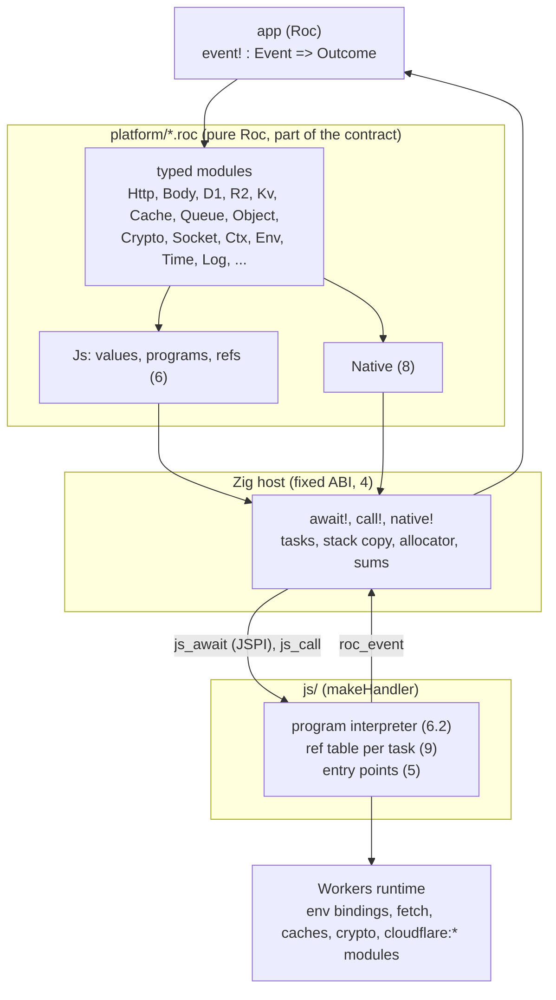

# App and platform API

| Item | Value |
| --- | --- |
| Status | Draft 1, 2026-10-15 |
| Scope | The API between a Roc app and this platform: the events that the app gets, the modules that it calls, and the fixed ABI under them. The memory, trap and check rules of the host are in `PLAN.md`. |
| Replaces | `PLAN.md` problem 8 steps 8a to 8e (draft 1 of the API: kind numbers, a `Worker` record), and the rows "One wait primitive" and "Capability record" of `../DESIGN-REGISTRY.md` 8 |
| Evidence | `research/api-probe/` (workerd features, codec cost), `../research/core-shape/` (effects in `expect`) |

Section 1 is an audit of the registry server: what it needs from the platform, and the problems in the registry design that the audit found. Sections 2 to 11 are the API. Section 12 lists the alternatives. Section 13 has the open questions.

## 1. Audit: the registry server

Sources: `../DESIGN-REGISTRY.md` (Registry), `../DESIGN.md` 6 and 8, `../DESIGN-CLI.md` 6.2 and 7.3, `../DESIGN-RESOLUTION.md` 11.

### 1.1 What the registry needs

| # | Registry function | Workers feature | Platform part | Phase |
| --- | --- | --- | --- | --- |
| RN1 | HTTP API (Registry 4): 11 routes, JSON bodies, ETag, `Cache-Control` | `fetch` handler. Method, URL, headers, raw body bytes. Status, headers, body. | `Fetch` event, `Http` | P2 |
| RN2 | Reads: labels of a group, hash record, closure (recursive CTE), compat rows, toolchains, search | D1 `prepare`, `bind`, `raw`, `all`. FTS5 for search. Read replicas with the Sessions API. | `D1` | P2 |
| RN3 | Publish: artifact, release and log leaf in one transaction (Registry 7) | D1 `batch` (atomic). D1 has no `BEGIN` from a Worker: it runs in auto-commit. | `D1` | P2 |
| RN4 | Log tiles and the signed checkpoint (Registry 3) | R2 `get`, `put` with `onlyIf` (compare and swap on the etag). WebCrypto Ed25519 `sign`. The key is a secret. | `R2`, `Crypto`, `Env` | P2 |
| RN5 | Edge cache of immutable and short-lived answers | Cache API `match`, `put`, `delete`. `ctx.waitUntil` for a put after the response. | `Cache`, `Ctx` | P2 |
| RN6 | Trusted publishing with GitHub OIDC (Registry 7) | Outbound `fetch` of the JWKS. WebCrypto `importKey` (JWK) and RS256 `verify`. A key cache across requests. | `Http`, `Crypto`, pinned refs (9) | P2 |
| RN7 | GitHub reads: the release, the asset, `.roc-version`, compiler releases with `digest` | Outbound `fetch` with a token header, redirects, a body as bytes or a stream | `Http`, `Body` | P2 |
| RN8 | Archive checks: BLAKE3 hash of the asset, read `main.roc` from the `.tar.zst` | BLAKE3: Roc builtin. zstd: not in Workers (`research/api-probe/`). tar: plain Roc. | `Native` (8) | P2 |
| RN9 | GitHub App webhook, and the App's own token | HMAC-SHA256 of the raw body, compared in constant time. RS256 `sign` (PKCS#8 key) for the App JWT. | `Crypto`, `Body` | P2 |
| RN10 | `POST /v1/ingest` from anyone | Rate limiting binding. Optional: a queue that moves the work out of the request. | `RateLimit`, `Queue` | P2 |
| RN11 | Tile catch-up after a failed write, cleanup | Cron trigger | `Scheduled` event | P2 |
| RN12 | Provenance: in-toto attestation, Sigstore bundle (Design 8) | ECDSA P-256 `verify`. X.509 parse in Roc. | `Crypto` | P3 |
| RN13 | Logs and counters (M11 of `PLAN.md`) | `console.log` (Workers Logs), optional Analytics Engine | `Log`, `Analytics` | P2 |
| RN14 | Settings and keys | Vars and secrets | `Env` | P2 |
| RN15 | Leaf time, token expiry | `Date.now()`. On the edge it moves only at I/O. | `Time` | P2 |

The registry does not use KV, Durable Objects, WebSockets, email, AI or TCP sockets. The platform exposes them anyway (section 7), because it is a generic platform (Design 6.1).

### 1.2 Problems found in the registry design

These are problems in the registry design, not in the platform. Each one is a new open question in `../DESIGN.md` 9. They do not block the platform work.

| # | Problem | Why | Question |
| --- | --- | --- | --- |
| RF1 | "Purge cache for the group" on publish (Registry 7) cannot be done with the Cache API | `cache.delete` purges only the data center that runs the Worker (Cloudflare docs, Cache API). A global purge needs the zone purge API with an API token and a custom domain. | Q25 |
| RF2 | Two publishes in two isolates can write the checkpoint at the same time. The older one can overwrite the newer one, so the log seems to go back. | Registry 3 says "one writer is enough", but without a Durable Object there is no single writer. D1 orders the leaves. Nothing orders the R2 writes. | Q26 |
| RF3 | A failure after the D1 commit and before the R2 writes leaves leaves with no tile and no checkpoint | The D1 batch and the R2 writes are not one transaction | Q26 |
| RF4 | "One transaction: artifact, release, log leaf; reject if label exists with other hash" needs a branch, but a D1 batch cannot branch | D1 has no interactive transaction. A batch is a fixed list of statements. | Q27 |
| RF5 | A platform archive can be large (basic-cli: 21 MB packed, 70 MB unpacked). The body, the BLAKE3 input and the zstd output all go through wasm memory, which never gets smaller. The isolate has 128 MB. | `PLAN.md` problem 4. Roc `Crypto.BLAKE3` has `hash_chunks(Iter)` but no state that takes one chunk at a time from an effect. | Q28 |
| RF6 | A publish needs more CPU than the free plan gives | BLAKE3 of 21 MB and a zstd decode of 70 MB take much more than 10 ms of CPU. The registry needs the paid plan. | Q28 |
| RF7 | Large reads cost much CPU in Roc when they are decoded and encoded again | 200 rows cost about 84 µs to send from JS into typed Roc rows with the host decoder of 5.1 (`research/api-probe/`), next to 200 to 280 µs for a whole bench request. `POST /v1/closure` returns the rows to the client almost unchanged. | Q29 |
| RF8 | `POST /v1/ingest` has no auth. Each call can make the Worker download and unpack an archive. | Registry 7: "Anyone, with a public URL" | Q30 |
| RF9 | `PLAN.md` step 8c ("`roc test` of a handler with a scripted record") cannot work | An `expect` cannot run a function with `!`, also with a pure fake (`../research/core-shape/`) | Fixed here: section 11 |
| RF10 | `../DESIGN.md` Q12 and Q14 and Registry 8 still describe a pool of instances (16 requests each, 32 MB) | `PLAN.md` problem 12 changed this to one instance per isolate | `PLAN.md` order of work row 12 updates them |

## 2. Goals

| # | Goal |
| --- | --- |
| AG1 | The app sees typed Roc modules only: no kind numbers, no byte formats, no JS. |
| AG2 | Every Workers API is reachable from Roc. A new Workers API needs a new Roc module at most, and no change to the Zig host. The app can reach an API that has no module yet (the `Js` module, 6.4). |
| AG3 | The ABI between Roc and the host is small and fixed: 3 hosted functions and 1 entry point. |
| AG4 | One I/O operation costs one JSPI wait. Each wait costs a stack copy and a sum (`PLAN.md` 12), so a module never waits twice for one operation. A sync JS API costs no wait. |
| AG5 | Large bodies stay in JS until Roc asks for their bytes (`PLAN.md` problem 10). |
| AG6 | The platform and an app can be developed apart. The contract is the public Roc modules of a platform release (section 11). |

## 3. Layers



| Layer | Changes when | Who sees it |
| --- | --- | --- |
| Typed modules | A Workers API is added or changes | The app |
| `Js` module | Rarely: a new value kind | The app (escape hatch) and the modules |
| Host ABI (3 hosted functions, `roc_event`) | Almost never | The platform only |
| JS program interpreter | A new op kind or a new conversion rule | The platform only |
| JS entry points | A new Workers handler kind (5) | The platform only |

## 4. The fixed ABI

Hosted functions (`platform/Host.roc`, not in `exposes`):

| Function | Type | JS import | Waits |
| --- | --- | --- | --- |
| `await!` | `Js => { status : U8, value : Js }` | `js_await`, wrapped in `WebAssembly.Suspending` | Yes, one JSPI wait |
| `call!` | `Js => { status : U8, value : Js }` | `js_call`, a plain import | No |
| `native!` | `U32, List(U8) => { status : U8, bytes : List(U8) }` | none: Zig code in the host | No |

The argument of `await!` and `call!` is a program (6.2) as a `Js` value. The result is a `Js` value (5). Roc never sees the byte format: the Zig host encodes the argument into a scratch block for JS, and decodes the bytes that JS writes back into Roc values (5.1). JS reads the argument before its first `await` (`DESIGN-REGISTRY.md` 8). The host frees the argument (glue `decref`), because a hosted function owns its arguments.

| Status | Meaning | Value |
| --- | --- | --- |
| 0 | Ok | The value of the last op |
| 1 | JS threw or a promise rejected | `Error(name, message)` |
| 2 | A promise in `call!` (the program needs `await!`) | `Error` |
| 3 | Bad program: a slot out of range, an unknown root, a value that cannot be encoded | `Error`. This is a platform bug: the module crashes. |

A cancelled task (`PLAN.md` 3c) never sees a status: the host traps before it reads memory.

Entry point (`provides`):

| Export | Type | Use |
| --- | --- | --- |
| `roc_event` | `Js => Js` | The JS shim gives the host the event as bytes. The host decodes them into a `Js` value (5.1) and calls `roc_event`. Platform Roc code turns the `Js` value into a typed `Event`, calls `event!`, and turns the `Outcome` into a `Js` value, which the host encodes for JS. The host wraps the call with the task table (`handle`, `task_abort`, `task_cancel`). |

The host exports of `PLAN.md` 7a (production list) stay as they are. `Wait.wait!` (`kind, num, a, b, c`) is removed, so bugs B2 and B3 of `PLAN.md` 6 go away with it.

## 5. Values: `Js`

One Roc type holds each value that crosses the bridge (`research/api-probe/Js.roc`):

```roc
Js := [
	Undefined, Null, Bool(Bool), Num(F64), Int(I64), Text(Str), Bytes(List(U8)),
	Arr(List(Js)), Obj(List((Str, Js))), Ref(U32), Error(Str, Str),
]
```

Byte format, little-endian:

| Tag byte | Value | Then |
| --- | --- | --- |
| 0, 1 | `undefined`, `null` | nothing |
| 2, 3 | `false`, `true` | nothing |
| 4 | number | f64 |
| 5 | BigInt | i64 |
| 6 | string | u32 length, UTF-8 bytes |
| 7 | bytes | u32 length, bytes |
| 8 | array | u32 count, values |
| 9 | plain object | u32 count, (string key, value) pairs, in key order of JS |
| 10 | ref | u32 id (9) |
| 11 | error | name string, message string |

JS to `Js` conversion (rule J1 to J7):

| # | JS value | Becomes |
| --- | --- | --- |
| J1 | Primitive, `null`, `undefined` | Same kind. A BigInt outside i64 is status 3. |
| J2 | `Uint8Array`, `ArrayBuffer`, other typed arrays | `Bytes` (a copy) |
| J3 | Array, plain object (prototype `Object.prototype` or `null`) | `Arr`, `Obj`, converted deep |
| J4 | `Date` | `Num`: milliseconds since 1970 |
| J5 | `Headers`, `Map`, `URLSearchParams` | `Arr` of `[key, value]` pairs |
| J6 | `Error`, `DOMException` | `Error(name, message)` |
| J7 | Any other object: a class instance, a function, a stream, a `Response`, a binding | `Ref`: a new id in the ref table of the task (9) |

`Js` to JS is the reverse: `Ref(id)` gives back the object of that id, `Bytes` gives a `Uint8Array`, `Int` gives a BigInt.

### 5.1 The host encodes and decodes

Decided 2026-10-15, from `research/api-probe/README.md` (200 D1 rows, native, best of 7 rounds):

| Step | In Roc | In the Zig host |
| --- | --- | --- |
| Bytes to a `Js` tree | 85 µs | 25 µs |
| `Js` tree to typed rows (a match in the module) | 14 µs | 14 µs (stays in Roc) |
| JS encode (same in both) | 45 µs | 45 µs |
| Total | 144 µs | 84 µs |

85 % of the Roc decode is the building of the tree: one allocation for each long string and each list. The Zig decoder makes the same allocations, but with no `Try` for each byte and with `memcpy` for strings. The format stays the same. Only the place of the decoder changes.

The Zig code writes Roc values, so it must match the Roc layout of `Js`. `roc glue` gives that layout (`research/api-probe/glue-check/`): on wasm32 a `Js` is 32 B, with 24 B of payload and a 1-byte tag at offset 24. The tags are numbered in alphabetical order. The glue also gives `RocStr.fromSlice`, `RocList.allocate`, `incref`, `decref`, and `comptime` checks of size, align and tag offset.

Tests that keep the Zig code and Roc in step:

| # | Test | Finds |
| --- | --- | --- |
| HD1 | The `comptime` checks of the glue | A layout change: the host build fails |
| HD2 | CI makes the glue again on each nightly and fails on a diff with the committed file (`PLAN.md` 7c) | A changed tag order or a new field, before a release |
| HD3 | Round trip in the conformance app: Roc builds a set of `Js` fixtures (each tag, empty and long strings, strings of 11 and 12 bytes at the wasm32 small-string limit, deep nesting, 2^53 + 1 as `Int`), the host encodes, JS decodes and encodes again, the host decodes, and Roc compares with `==` | A wrong tag number, a wrong small-string flag, a lost field |
| HD4 | Differential: the Roc decoder of `research/api-probe/Js.roc` stays as a test oracle. The same random byte strings go to both decoders. Both must give the same value or both an error. | A difference in the error cases (a bad length, bad UTF-8, trailing bytes) |
| HD5 | Fuzz the Zig decoder with random and cut bytes (Zig `std.testing.fuzz`). It must give an error or a value, never a trap or a read past the block. | Bounds bugs. A trap in the host is unclean (`PLAN.md` 12c). |
| HD6 | Leaks: after 10,000 decodes of the fixtures and a drop in Roc, live bytes return to 0 (`track_live`) | A refcount that is wrong by one |

Each test must fail when its change is reverted (for example, swap two tag numbers, or turn off the small-string flag).

JS cannot write Roc values itself with less cost. Each heap block needs its own allocation, so JS would call `js_alloc` once for each string and list. One large block for all values does not work, because Roc frees each block alone when its refcount goes to 0.

## 6. Programs

### 6.1 Why programs

A Workers operation is often 3 or 4 JS calls: `env.DB.prepare(sql).bind(...args).raw()`. One wait per call would cost 4 stack copies and sums. A program is a list of ops that JS runs in one crossing. Each op puts its result in the next slot, and a later op can use it. This is promise pipelining, as in Cap'n Proto.

### 6.2 Ops

```roc
Target : [Root(Str), Slot(U32), Ref(U32)]
Arg : [Lit(Js), Slot(U32)]
Op : [
	Get(Target, Str),              # target[name]
	Set(Target, Str, Arg),         # target[name] = arg, the slot gets undefined
	Call(Target, Str, List(Arg)),  # target[name](...args)
	New(Target, Str, List(Arg)),   # new target[name](...args)
	Fields(Target, List(Str)),     # an Obj with these properties (reads getters on class instances)
	Keep(Target),                  # a Ref, also for a plain value
]
```

| # | Rule |
| --- | --- |
| OP1 | In `await!`, JS awaits each op result that is a thenable before the next op. In `call!`, a thenable result is status 2. |
| OP2 | The result of the program is the last slot, converted by J1 to J7. Other slots are not converted, so a module can chain a JS object with no ref. |
| OP3 | Roots, resolved for the task that runs: `env`, `ctx`, `event` (the object that started the task), `global` (`globalThis`: `fetch`, `caches`, `crypto`, `console`, constructors), `ops` (JS functions that the app adds, 6.4), and the `cloudflare:*` modules that the shim imports (`cloudflare:sockets`, `cloudflare:email`, `cloudflare:workers`). An unknown root is status 3. |
| OP4 | A program has no branch and no loop. A module that must branch runs 2 programs, or adds a JS op (6.4). |
| OP5 | The encoder in Roc and the interpreter in JS are the only code that knows the format. |

Example, inside `D1` (all names are module code, not app code):

```roc
query! : Db, Str, List(Js) => Try(Rows, [D1Err(Problem)])
query! = |db, sql, params| {
	value = Js.await!([
		Get(Root("env"), db.binding),                                   # slot 0: the binding
		Call(Slot(0), "prepare", [Lit(Text(sql))]),                     # slot 1
		Call(Slot(1), "bind", params.map(|v| Lit(v))),                         # slot 2
		Call(Slot(2), "raw", [Lit(Obj([("columnNames", Bool(True))]))]), # slot 3: awaited
	]).map_err(|e| D1Err(Problem.from_js(e)))?
	Rows.from_js(value)    # ["col", ...] then rows as arrays
}
```

### 6.3 Binding values are names

A typed binding value holds only the name of the binding: `D1.Db :: { binding : Str }`, made with `D1.db("DB")`. Each program starts with `Get(Root("env"), name)`. So a binding value is plain data: an app can keep it in a constant, and a test can compare it. The `env` of each task is in the task context of the shim (`PLAN.md` 9b).

### 6.4 The escape hatch

| Need | Use |
| --- | --- |
| A Workers API that has no module yet | `Js.await!(program)` and `Js.call!(program)` in the app. Same rules as in a module. |
| JS logic with a branch, a loop or a callback (HTMLRewriter, a library from npm) | The app adds JS functions: `makeHandler(module, { ops: { name: async (...args) => ... } })`. Roc calls them with `Call(Root("ops"), "name", args)`. |

The app is trusted code: it is the developer's own Worker. A program can reach only the roots of OP3, and the shim has no `eval`.

## 7. Modules

The full surface. Each module is pure Roc over `Js` (6) or `Native` (8). "Event" means the module is also a payload of an event (10).

| Module | Workers API | Main functions | Waits | Platform phase |
| --- | --- | --- | --- | --- |
| `Http` | `fetch`, `Request`, `Response`, `Headers` | `send!(http.Request) => Try(http.Response, HttpErr)` with the buffered types of `roc-lang/http` (AQ2); `open!` for a response whose body stays a `Body` stream | Yes | A |
| `Body` | `ReadableStream`, `Request.body`, `Response.body`, `crypto.DigestStream` | `bytes!(Body, { max })`, `text!`, `chunks!(Body, size) => Stream(List(U8))`, `sha256!` (no copy into wasm), `tee!` | Yes | A |
| `Env` | `env` vars, secrets | `var!(Str)`, `secret!(Str)` | No | A |
| `Ctx` | `ctx.waitUntil`, `ctx.passThroughOnException`, `request.signal` | `respond!(Outcome)` (answer now, the task goes on, 10.2), `wait_until!(Ref)`, `pass_through!` | No | A |
| `D1` | `D1Database`, `D1PreparedStatement`, Sessions API | `query!`, `first!`, `run!`, `batch!`, `exec!`, `session!(Db, [Primary, Any, Bookmark(Str)])`, `bookmark!` | Yes | A |
| `R2` | `R2Bucket`, `R2Object`, multipart | `get!(Bucket, key, { range, only_if })` (the body stays a `Body`), `put!(Bucket, key, Body, { only_if, http_metadata })`, `head!`, `delete!`, `list!`, multipart functions | Yes | A |
| `Cache` | `caches.default`, `caches.open` | `match!`, `put!`, `delete!` (local to the data center, RF1) | Yes | A |
| `Crypto` | `crypto.subtle`, `crypto.getRandomValues`, `crypto.randomUUID`, `timingSafeEqual` | `import_key!` (JWK, PKCS#8, SPKI, raw), `sign!`, `verify!`, `digest!`, `encrypt!`, `decrypt!`, `derive_bits!`, `random!(n)`, `uuid!`, `equal_in_time!` | sign, verify, digest: yes. Random, equal: no. | A |
| `Time` | `Date.now`, `performance.now` | `now_ms!` (coarse on the edge), `since!` | No | A |
| `Log` | `console.log`, `console.error` | `info!`, `warn!`, `error!` with fields (Workers Logs takes JSON lines) | No | A |
| `Js` | everything (6.4) | `await!`, `call!`, `Js` value helpers, `pin!`, `unpin!` (9) | per program | A |
| `Native` | none: Zig `std` in the host | `zstd_decode!`, `Blake3` and `Sha256` with state across chunks (8) | No | A (zstd), B (hash state) |
| `Kv` | `KVNamespace` | `get!` (text, bytes, JSON, stream), `get_with_metadata!`, `put!` (`expiration_ttl`, metadata), `delete!`, `list!` | Yes | B |
| `Queue` | Queue producer; consumer batch (event) | `send!`, `send_batch!`; `Message.ack!`, `retry!(delay)`; `Batch.ack_all!`, `retry_all!` | send: yes | B |
| `Object` | Durable Object namespace and stub; inside an object: `ctx.storage` (SQL, KV, alarm), `ctx.acceptWebSocket`, `ctx.getWebSockets`, `blockConcurrencyWhile` (13, AQ1) | Outside: `id_from_name`, `get!`, `fetch!`, `call!` (RPC). Inside: `sql!` (sync), `get!`, `put!`, `set_alarm!`, `accept_socket!`, `sockets!` | Stub calls: yes. SQL: no. | B |
| `Socket` | `WebSocketPair`, `WebSocket`; `connect` from `cloudflare:sockets` (TCP, also for Hyperdrive) | `pair!`, `accept!`, `send!`, `close!`; `connect!(host, port, { tls })` gives a `Body` in and a writer out | some | B |
| `Rpc` | Service bindings and `WorkerEntrypoint` methods | `call!(binding, method, List(Js))`; incoming calls are an event | Yes | B |
| `Email` | `send_email` binding, `EmailMessage` (`cloudflare:email`); incoming mail (event) | `send!`; `Mail.forward!`, `reply!`, `reject!` | Yes | B |
| `Ai`, `Vectorize`, `Analytics`, `RateLimit`, `Images`, `Assets`, `SecretsStore`, `Hyperdrive`, `Version`, `Workflows` (binding side: `create!`, `get!`, `status!`) | The binding of the same name | One function per binding method. Most are one `Call`. | Mostly yes. `Analytics.write!`: no. | B |
| `Tail` | Tail Worker events | Event only | | B |
| `Workflow` | `WorkflowEntrypoint.run(event, step)`, `step.do`, `step.sleep` | Needs callbacks (13, AQ1) | | C |

Platform phases:

| Phase | Content | Needed by |
| --- | --- | --- |
| A | The ABI (4), `Js` (5, 6), events `Fetch`, `Scheduled`, `Other` (10), modules marked A, the ref table (9) | Registry v1 (RN1 to RN15) |
| B | All other modules and events. Each one is pure Roc over phase A, plus a JS entry point for a new event kind. | Other apps |
| C | Callbacks from JS into Roc (AQ1): `Workflow`, HTMLRewriter handlers, `transactionSync`, `blockConcurrencyWhile` | Other apps |

## 8. Native

Some work has no Workers API and is slow or missing in Roc. The host does it with Zig `std` through `native!(op, bytes)`. Each op is a pure function with a size limit. State that crosses calls (a hash state, a decoder window) is a host block owned by the task, so `freeOwner` frees it after a trap.

| Op | Zig `std` | Why not in Workers or Roc |
| --- | --- | --- |
| `zstd_decode(bytes, max_out)` | `std.compress.zstd` | `DecompressionStream` has gzip and deflate only (`research/api-probe/`). No Roc library. Design 6.2 already puts it in the host. |
| `zstd_stream_*` (open, push a chunk, take output, close) | same | For archives larger than the memory budget (RF5) |
| `blake3_*`, `sha256_*` (new, update, final) | `std.crypto.hash` | Roc `Crypto` has no state that takes one chunk at a time (RF5). WebCrypto has no BLAKE3. |

A Native op that Roc gets in its builtins later moves to Roc, and the op stays for one platform release.

## 9. Refs and memory

| # | Rule |
| --- | --- |
| RS1 | A ref is a u32 id in the table of the task that made it. JS frees all refs of a task at its end, its trap and its cancel (`PLAN.md` 10c). So a ref never outlives its task, and Roc never has to free one. |
| RS2 | `Js.pin!(Ref) => Pinned` moves an object to the isolate table, for use by later tasks: a `CryptoKey` from the JWKS (RN6), a socket of a Durable Object. `unpin!` frees it. The table has a limit (default 1,000, shim option `pinLimit`). A pin over the limit is status 1. Each pin and unpin is counted (M11). |
| RS3 | A `Body` is `[Empty, Bytes(List(U8)), Text(Str), Stream(Ref)]`. A request body, a fetch response body and an R2 body arrive as `Stream(Ref)`, with no copy. `Body.bytes!` copies with a `max`, and gives an error past it. A `Stream` given to a `Response` or an R2 `put` goes back to JS with no copy (`PLAN.md` 10a, 10b). |
| RS4 | JS writes its result bytes into a scratch block (`js_alloc`). The host decodes them into Roc values that it allocates with the owner of the task, then frees the block (5.1). So the sums and `freeOwner` cover the values (`PLAN.md` 2a, 12a). |


## 10. Events

### 10.1 The entry

```roc
platform "cloudflare-workers"
	requires { event! : Event => Outcome }
```

One function takes every kind of event. An app that does not handle a kind returns `Unhandled`. Reasons for one function, and not one field for each handler: an app that uses 1 kind writes 1 match arm, and a new kind in a new platform release does not break an app (it gets `Unhandled`).

```roc
Event : [
	Fetch(Request),
	Scheduled({ cron : Str, time_ms : U64 }),
	Queue(Queue.Batch),
	Email(Email.Mail),
	Rpc({ method : Str, args : List(Js) }),
	Object({ class : Str, id : Str, event : Object.Event }),
	Tail(List(Js)),
	Other({ kind : Str, payload : Js }),
]

Object.Event : [
	Fetch(Request), Alarm({ retry_count : U32 }), Rpc({ method : Str, args : List(Js) }),
	SocketMessage(Socket.Ws, Body), SocketClose(Socket.Ws, { code : U16, reason : Str, clean : Bool }), SocketError(Socket.Ws, Js),
]

Outcome : [
	Respond(Response),           # http.Response (roc-lang/http): a buffered body
	RespondBody(BodyResponse),   # a Body stream, an R2 object or a socket
	Reply(Js), Done, Unhandled,
]

# Method, Header and Response come from roc-lang/http (AQ2).
Request : { method : Method, url : Str, headers : List(Header), body : Body, cf : Js }
BodyResponse : { status : U16, headers : List(Header), body : Body, socket : [None, Socket(Socket.Ws)] }
```

| Workers entry | Event | Outcome that it takes | Other outcomes |
| --- | --- | --- | --- |
| `fetch` | `Fetch` | `Respond`, `RespondBody` | 500 and a log line |
| `scheduled` | `Scheduled` | `Done` | The cron run fails (it shows in the dashboard) |
| `queue` | `Queue` | `Done`. Messages with no ack or retry follow the queue default. | The whole batch is retried |
| `email` | `Email` | `Done` | The mail is rejected |
| `tail` | `Tail` | `Done` | ignored |
| `WorkerEntrypoint` method (service binding RPC) | `Rpc` | `Reply` | The caller gets an exception |
| Durable Object class methods | `Object` | `Respond` or `RespondBody` (fetch), `Reply` (RPC), `Done` | as above |
| A future kind | `Other` | any | as above |

Cost of one entry for all kinds, against one export for each kind:

| Item | One `event!` | One export for each kind |
| --- | --- | --- |
| CPU of the choice | One `match` on the tag: a few ns | none |
| CPU of the payload | The same: the host decodes it, Roc matches it into the typed event. A fetch request with 20 headers is about 40 strings: about 0.6 µs in the Zig decoder (5.1). | The same |
| Memory | The `Event` value lives for the call: its largest payload, about 32 to 80 B, plus the strings that both forms need | The same |
| Module size | The code for all kinds is in the module | The same: the platform Roc code for all kinds is linked in either form |
| App code | One function. A kind that the app does not use costs one `_ => Unhandled` arm. | `requires` has no optional field, so the app must write each function, also the ones it does not use |

So one export for each kind gives no measurable gain. The cost of a request is in its I/O waits and its data, not in the entry. For better ergonomics, a platform module builds `event!` from a record of handlers: `event! = |e| Worker.event!(Worker.{ fetch!: handle_fetch! }, e)`. Each handler is an optional field, and a missing one gives `Unhandled` (`research/api-probe/handlers-check/`: an optional field can hold an effectful function on nightly 10-12, and a call through it runs).

Durable Object classes and RPC entry points are JS classes in Workers. The shim makes them: `makeHandler(module, { objects: ["Counter"], entrypoints: ["Admin"] })` exports classes of those names, and each method call becomes an event. Wrangler names the classes as usual.

### 10.2 Respond now, work after

`Ctx.respond!(outcome)` gives a `Respond` or `RespondBody` to Workers at once, and the task goes on. JS keeps the task alive with `ctx.waitUntil` on the promise of the task. The return value of `event!` is then ignored. This one function covers 3 needs:

| Need | How |
| --- | --- |
| Work after the response (cache put, tile catch-up, RN5, RN11) | `respond!`, then the work |
| A streaming response | Make a `TransformStream` (`Js`), `respond!` with its readable side, then write chunks |
| A WebSocket | `Socket.pair!`, `respond!` with status 101 and the socket, then read and send |

## 11. Tests and the contract

| Part | Test | Where |
| --- | --- | --- |
| `Js` codec | The same fixtures in Roc (`roc test`) and in JS (Node) give the same bytes | `platform/Js.roc`, `js/test/` |
| Each module | The conformance app: one route for each module function, run in workerd with local bindings (Miniflare gives local D1, R2, KV, Queues and Durable Objects). Each test fails when its function sends a wrong method name. | `conformance/` of this repository |
| Events | One test for each Workers entry kind (10.1) | `conformance/` |
| Host rules (traps, sums, memory) | As now | `bench/`, `PLAN.md` |

The registry app does not fake the platform in Roc. An `expect` cannot run an effect (RF9), and a fake in Roc would test the fake. The registry tests:

| Layer | What | How |
| --- | --- | --- |
| Pure logic: routes, records, the publish checks, the tile math | `roc test` in `packages/` and `worker/` | `../TESTING.md` L0, L1 |
| Handlers | Each route of Registry 4 against Miniflare: local D1 with the real schema (`../sql/`), local R2. GitHub is a fake service (an outbound fetch handler that serves fixtures). | `worker/tests/`, run with Node |

The contract between the platform and the registry is the public Roc modules of a platform release: the types and the functions of sections 7 and 10. The ABI (4) and the format (5, 6) are inside the platform: a platform release changes them with its Roc modules, so an app never sees the change. The platform follows semver on its public modules.

Work apart:

| Work | Needs |
| --- | --- |
| Registry pure packages | Nothing from the platform |
| Registry handlers | Platform phase A |
| Platform phases A, B, C | Nothing from the registry. Conformance replaces the registry as the first user. |

## 12. Alternatives

| Option | A new Workers API needs | Waits per operation | Typed for the app | Verdict |
| --- | --- | --- | --- | --- |
| Kind numbers (`PLAN.md` 8b, draft 1): one `io` case in JS and one Roc function for each effect | A JS change, a Roc change and a kind number that both sides must agree on | 1 | Yes | Rejected: the JS shim grows with each API, and an API with no kind cannot be reached |
| Generated bindings from TypeScript types (as wasm-bindgen and workers-rs) | A generator run | 1 per JS call, or a hand-made wrapper | Yes | Rejected: Roc has no macros. A generator is a large tool to keep in step with `@cloudflare/workers-types`. |
| One reflective call per JS call | A Roc module | 3 to 4 | Yes, in modules | Rejected: AG4 |
| Programs over refs (this design) | A Roc module, and JS only for a new event kind | 1 | Yes, in modules | Chosen |
| WebAssembly components (WIT) | | | | Not in Workers |

Cost of the chosen design, from `research/api-probe/` (native, Node): 200 D1 rows cost 45 µs to encode in JS (as arrays, 89 µs as objects), 25 µs to decode in the Zig host and 14 µs to match into typed rows in Roc: 84 µs. JSON costs 20 µs (`JSON.stringify`) and 229 to 238 µs (`Json.parse`). So modules ask D1 for arrays (`raw`), and Q29 (RF7) asks if large reads should pass through as JSON that SQLite makes.

## 13. Open questions

| # | Question | How to settle |
| --- | --- | --- |
| AQ1 | Callbacks from JS into Roc (`step.do` of Workflows, HTMLRewriter, `transactionSync`, `blockConcurrencyWhile`). A hosted function can take a `Box` of a Roc closure, and a `provides` entry can call it. While the outer task waits, the callback runs as a new task on the same instance. Does this work with JSPI and the stack copy? | A probe in `research/`: a Roc closure boxed, given to JS, called from a JS callback while the caller waits |

| AQ4 | The cost of one crossing, for programs of 1, 4 and 16 ops, on the edge | `PLAN.md` step 8g |
| AQ5 | A decoder straight into typed records with no `Js` tree, after the Zig decoder (5.1). It would save the 14 µs match and the tree allocations, but the host would need the layout of each record type. | Only if 8g shows that the tree still costs much in wasm |

Settled:

| # | Question | Answer |
| --- | --- | --- |
| AQ2 | Use `roc-lang/http`? | Yes, as basic-webserver does. Version 2.0.0 builds on nightlies 10-09 and 10-12 (`research/api-probe/http-check/`). `Method` and `Header` are used in all request and response types. Its `Request` and `Response` (opaque, body `List(U8)`) are the buffered types of `Http.send!` and of `Outcome.Respond`. The incoming request and a streaming response use the platform types of 10.1, because there the body is a `Body` stream (RS3), and `http` has no stream. |
| AQ6 | Can an optional record field hold an effectful function, for the handler record of 10.1? | Yes. `research/api-probe/handlers-check/`: `roc check`, `roc test` and a run on nightly 10-12. |
| AQ3 | State in Roc memory across events of one Durable Object? | No. The state of a Durable Object is its storage: SQLite in the same thread as the object, up to 10 GB, read with sync calls (`Object.sql!` uses `call!`, so no JSPI wait). Workers can evict an idle object from memory at any time, so memory is only a cache of the storage. If an app needs such a cache, it can keep a JS `Map` through a pinned ref (RS2). |
