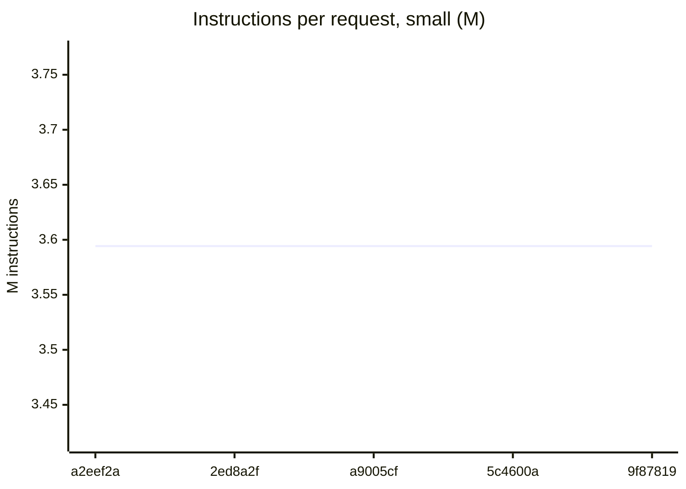
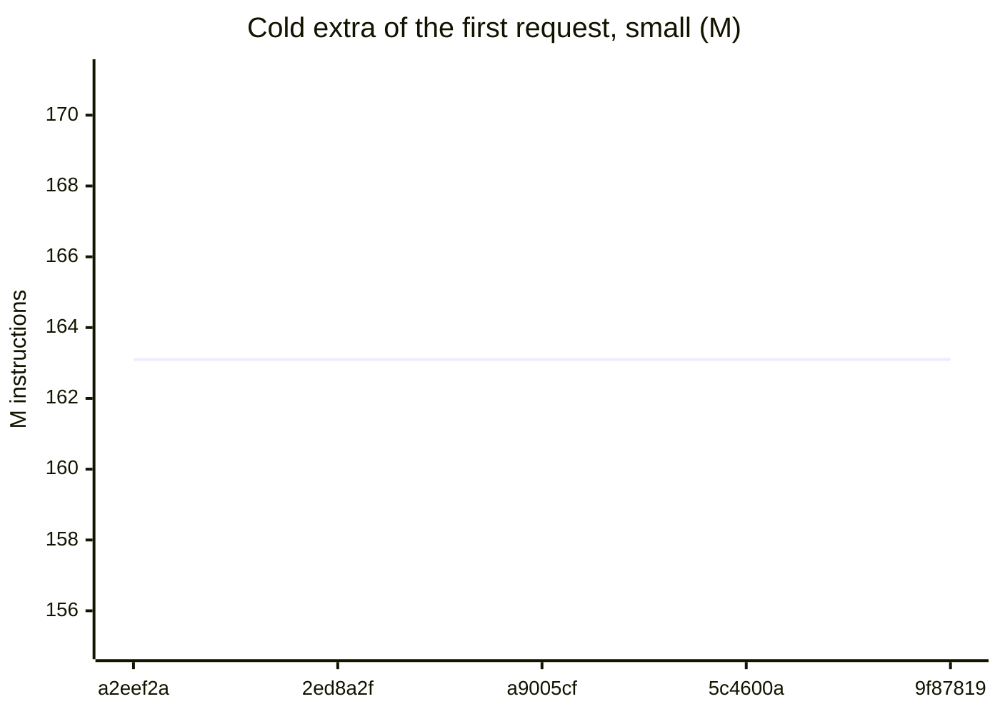
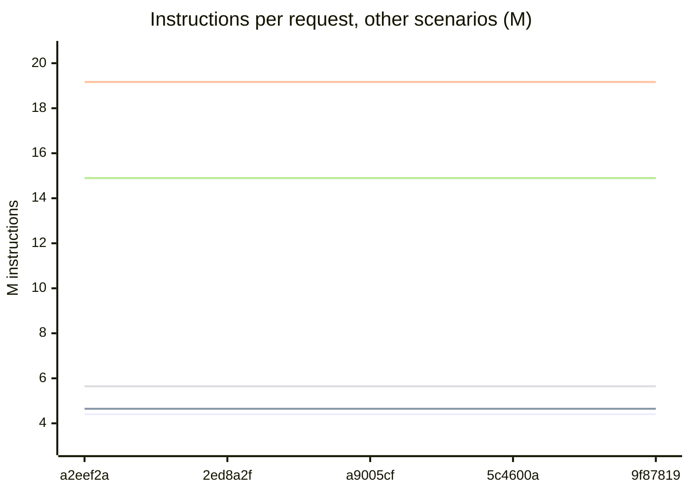
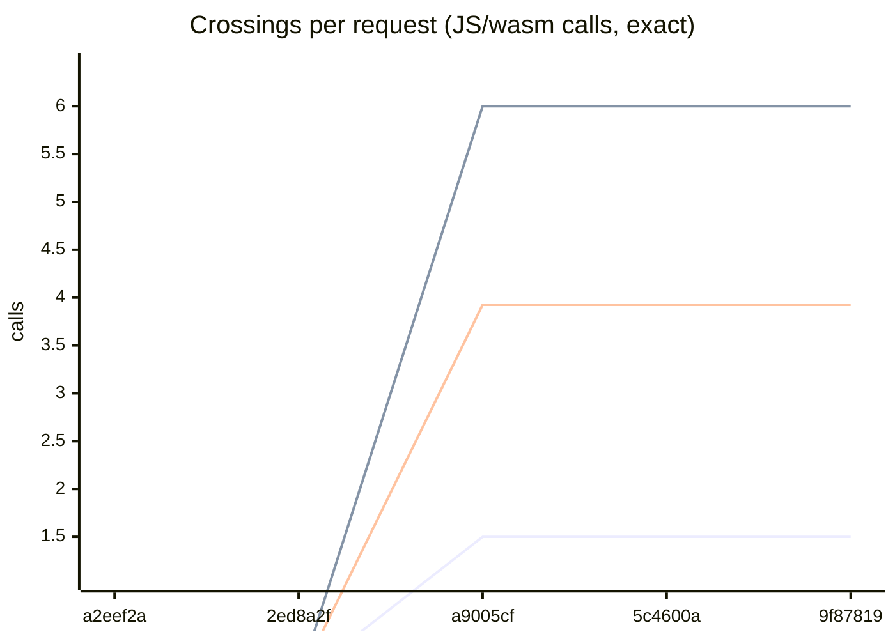
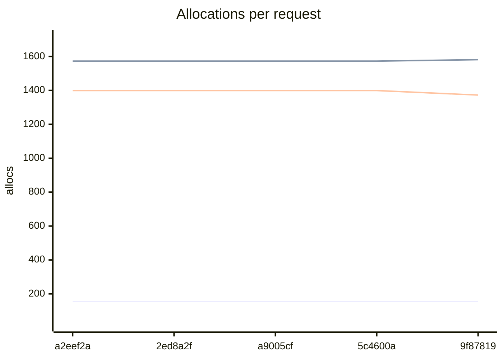
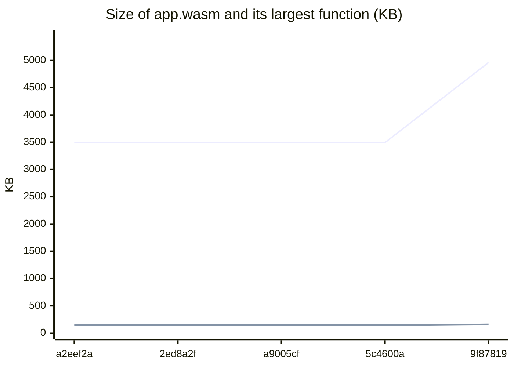
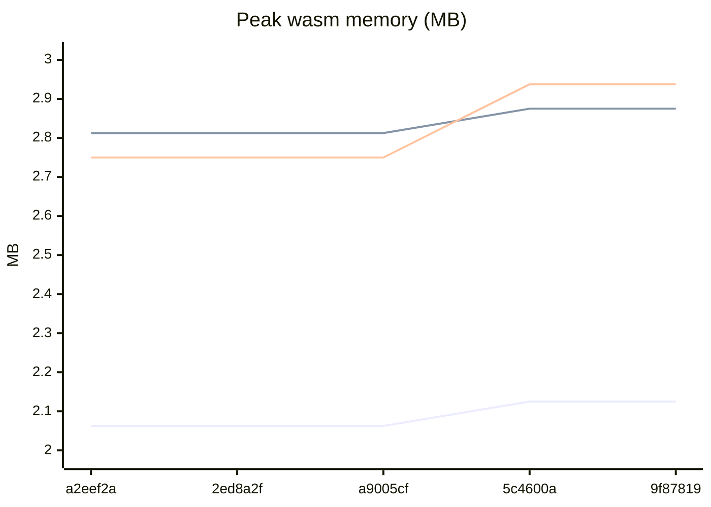

# Platform performance bench

Runs: 5 (a2eef2a4 to 9f878196). Source rows: `bench/perf/results/rows.jsonl`. Charts of the local rows use one point for each commit. The edge chart has the edge rows of the post-merge job (CPU time of the real runtime). The instruction charts are workerd instructions for each request with the idle rate subtracted.

### Instructions per request, small (M)

- Line 1: small, steady

### Cold extra of the first request, small (M)

- Line 1: first request minus steady

### Instructions per request, other scenarios (M)

- Line 1: search
- Line 2: releases
- Line 3: closure
- Line 4: compat
- Line 5: mixed-ro

### Crossings per request (JS/wasm calls, exact)

- Line 1: small
- Line 2: closure
- Line 3: mixed-ro

### Allocations per request

- Line 1: small
- Line 2: closure
- Line 3: mixed-ro

### Size of app.wasm and its largest function (KB)

- Line 1: app.wasm
- Line 2: largest function

### Peak wasm memory (MB)

- Line 1: small
- Line 2: closure
- Line 3: mixed-ro

### Latest run (9f878196, 2026-11-11T10:49:34Z, nightly nightly-2026-11-06-34f137a)

| Scenario | M ins (perf) or Ir (vg) per request | Cold extra, M ins | Allocs per request | Peak memory, MB |
| --- | --- | --- | --- | --- |
| small |  |  | 154.5 | 2.1 |
| search |  |  | 203.6 | 2.1 |
| releases |  |  | 206.2 | 2.6 |
| closure |  |  | 1581.0 | 2.9 |
| compat |  |  | 365.7 | 2.1 |
| mixed-ro |  |  | 1372.4 | 2.9 |

app.wasm 4961 KB, largest function 160 KB.
