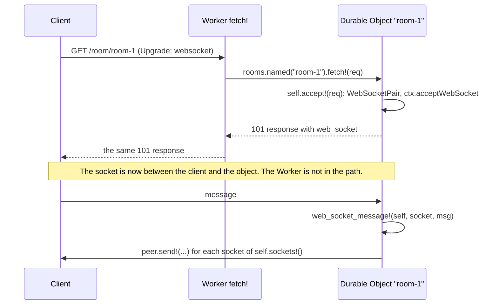

# Module API

| Item | Value |
| --- | --- |
| Status | Draft 2, 2026-10-15 (draft 1, plus typed data as CBOR, the WebSocket API, `D1.Result`, class names from Roc) |
| Scope | The Roc modules that an app uses: their types, their functions and the rules that they all follow. The layers under them (the ABI, `Js`, programs, `Io`, refs) are in `API.md`. |
| Evidence | `research/api-probe/modules-check/`: the conventions and 13 modules over a fake JS side, and an app that uses all of them, with typed data as CBOR. `research/api-probe/cbor/`: the `Cbor` format and its cost. `roc check` and a run pass on nightlies 10-09 and 10-12 (section 15). The Workers facts were checked on 2026-10-15 against the Cloudflare docs and the workerd source. |

Section 1 gives the rules. Section 2 shows an app. Sections 3 to 13 give the modules. Section 14 lists what this file changes in `API.md`. Section 15 is the prototype.

In the signatures, `a.Encodable` stands for `a.Cbor.Encodable([])` and `a.Parseable` for `a.Cbor.Parseable([InvalidCbor(U64), ..errs])` (typed data that crosses to JS, MC5). `a.JsonEncodable` and `a.JsonParseable` stand for the `Json` forms (data that is JSON at rest or on the wire). `Thrown` is `Io.Thrown`, `{ name : Str, message : Str }`. `Method` and `Header` come from `roc-lang/http`.

## 1. Conventions

| # | Rule | Example |
| --- | --- | --- |
| MC1 | A binding is a constant, made from its name in the Wrangler config. It holds names, and for a typed binding its codec functions. It never holds a ref. So it can be at the top of a module (WR1). | `db = D1.binding("DB")` |
| MC2 | Functions are methods of their type, called by static dispatch. A module with no value type is a void module (`Http :: [].{ ... }`). | `db.all!(sql, params)`, `Http.send!(req)` |
| MC3 | Each function `f!` that waits has a pure twin `f` that gives an `Io` (WR2). | `db.all(sql, params)` gives an `Io` |
| MC4 | The short function has no options. If the Workers method has options, a second function with the suffix `_with` takes them as a last record with optional fields. The caller writes only the fields that it needs. | `kv.put!(k, v)`, `kv.put_with!(k, v, { ttl_ms: 60_000 })` |
| MC5 | Typed data: the values that the app defines (D1 rows, queue messages, RPC arguments and results, cells, attachments, `Memo` values) cross as CBOR, the format of the bridge (`API.md` 5), through the codecs that Roc derives for the `Cbor` format. JS sees plain objects, the same as from `JSON.parse`. Data that is JSON at rest or on the wire (HTTP bodies, `Kv.json` values, JSON vars, log lines) uses `Json`. The app writes a type, never a codec. | `pkgs : List(Pkg)` |
| MC6 | When all values of a binding have one type, the declaration gives the type and the format. The same constant writes and reads. | `jobs : Queue(Job)`, `jobs = Queue.json("JOBS")` |
| MC7 | When the type changes from call to call (a D1 query), the annotation at the call gives it. | `pkg : Pkg`, `pkg = db.first!(sql, params)?` |
| MC8 | There is no null. A missing value is `Err(NotFound)`, so `?` returns it and `??` gives a default. | `theme.get!() ?? default_prefs` |
| MC9 | Errors are open tag unions, so the errors of two modules join (`?`, `Io.both!`). A throw in JS is `<Module>Err(Thrown)`. A value that does not fit its type is `BadData(Str)`. A known result has its own tag. | `D1Err(t)`, `PreconditionFailed`, `RateLimited`, `TooLarge`, `BadSignature` |
| MC10 | A time or a duration is a `U64` of milliseconds, in a field whose name ends in `_ms`. A size is in bytes, in a field whose name ends in `_bytes`. The module converts (KV `expirationTtl` is in seconds). | `{ ttl_ms: 60_000 }` |
| MC11 | A read into wasm memory has a limit, because wasm memory never gets smaller (`PLAN.md` problem 4). The default limit is 1 MiB (`Body.default_max`). A larger read names its limit. Large data stays a `Body` stream in JS. | `req.json!()`, `req.bytes_with!({ max_bytes: 30_000_000 })` |
| MC12 | Names are the Workers names in snake_case, so the Workers docs apply. A name changes only for a Roc reason. | `cache.get!` for `match` (a keyword), `WebCrypto` (`Crypto` is a builtin module), `named` for `idFromName` (it gives a stub, MC1) |
| MC13 | A value that holds a ref (a `Body` stream, a D1 session, a socket, an imported key) is good for one task (RS1). All other module values are plain data: a test can make them and compare them. | |

Limits of MC5:

| Item | Rule |
| --- | --- |
| Large integers | CBOR keeps 64-bit integers exact in both directions. JS gets an integer above 2^53 as a `BigInt`. Two places lose them: D1 gives every number as an f64 (use `CAST(x AS TEXT)` in SQL), and `Queue.json` cannot send a `BigInt` (`JSON.stringify` throws, use `Queue.v8`). |
| Cost | 200 D1 rows into typed records, native (`research/api-probe/cbor/`): JSON 265 to 363 µs (JS 23, Roc `Json.parse` 242 to 340), CBOR 216 µs (JS 79, Roc `Cbor.parse` 137). About 70 µs of the 137 is the record matching of the derived parser. `db.rows!` (no types, a `Js` tree from the Zig host) costs about 82 µs, but it is for columns that are not known at compile time, not for speed (5.1). |
| Field names | A record field is a column name or a JSON key. Roc fields are snake_case, so SQL columns are too. `Cbor.parse_camel` reads camelCase keys, for a JS peer. |
| Bytes | A `List(U8)` field reads a CBOR byte string or an array. It writes an array, because the codec protocol has no hook for bytes. |

## 2. An app

```roc
app [event!] { pf: platform "https://.../cloudflare-workers.tar.zst" }

import pf.Worker
import pf.Request
import pf.Response
import pf.D1
import pf.Kv
import pf.Queue

Pkg : { name : Str, version : Str }
Job : { pkg : Str }

db = D1.binding("DB")

prefs : Kv({ theme : Str })
prefs = Kv.json("PREFS")

jobs : Queue(Job)
jobs = Queue.json("JOBS")

fetch! : Request => Try(Response, _)
fetch! = |req| match (req.method, req.segments()) {
	(GET, ["v1", "pkg", owner, name]) => {
		pkg : Pkg
		pkg = db.first!("select name, version from pkg where name = ?", [Text("${owner}/${name}")])?
		Ok(Response.from_json(200, pkg))
	}
	(POST, ["v1", "jobs"]) => {
		job : Job
		job = req.json!()?
		jobs.send!(job)?
		Ok(Response.from_status(202))
	}
	_ => Ok(Response.from_status(404))
}

queue! = |batch| {
	_ = jobs.each!(batch, |job| build!(job))    # build! : Job => Try({}, _) is app code
	Ok({})
}

worker = Worker.{ fetch!, queue! }

event! = |e| worker.event!(e)
```

## 3. Entry: `Worker`

```roc
Worker(e) := {
	fetch! ?: Request => Try(Response, e),
	scheduled! ?: Scheduled => Try({}, e),
	queue! ?: Queue.Batch => Try({}, e),
	email! ?: Email.Mail => Try({}, e),
	tail! ?: List(Js) => Try({}, e),
	other! ?: Str, Js => Try(Js, e),
	rpc ?: List(Rpc.Handler({})),         # methods of the default entry point
	entrypoints ?: List(Rpc.Entrypoint),  # named WorkerEntrypoint classes
	objects ?: List(Object.Class),        # Durable Object classes
}.{
	event! : Worker(e), Worker.Event => Worker.Outcome
}

Scheduled := { cron : Str, time_ms : U64 }.{
	no_retry! : Scheduled => {}    # controller.noRetry(): in workerd, not in the docs
}
```

Each handler gives the result of its own kind, so a handler cannot give a wrong outcome. `e` is one error type for all handlers: their tag unions join. `Worker.Event` and `Worker.Outcome` are the types of `API.md` 10.1.

| Field | Workers entry | `Ok` gives | `Err(e)` gives | A missing field gives |
| --- | --- | --- | --- | --- |
| `fetch!` | `fetch` | The response | Status 500 with no body, and a log line with `Str.inspect(e)`. To answer an error with another status, match it in the handler. | `Unhandled`: 500 and a log line |
| `scheduled!` | `scheduled` | A good run | A failed run (Past Events) | A failed run |
| `queue!` | `queue` | Messages with no ack or retry follow the queue default | A retry of the batch. An explicit ack or retry stands. | A retry of the batch |
| `email!` | `email` | The mail is accepted | The mail is rejected | The mail is rejected |
| `tail!` | `tail` | Done | A log line | Ignored |
| `other!` | A kind with no field (`makeHandler(module, { other: [...] })`) | The value for JS | A throw | A throw |
| `rpc`, `entrypoints` | `WorkerEntrypoint` methods (8) | The reply | A throw on the caller side | "no method" throw |
| `objects` | Durable Object classes (7) | as the field of the class | | `Unhandled` |

A new Workers kind is a new optional field, so it does not break an app (`API.md` 10.1).

Names of classes and methods come from Roc only (`API.md` AQ10). At load, the shim sends the event `Manifest`, and `Worker` answers with the names of its `objects`, `entrypoints` and their `Rpc` methods. The JS entry file has one line for each class, because Workers needs a named export:

```js
import app from "./app.wasm";
import { makeHandler, objectClass, entrypointClass } from "cloudflare-workers-roc";
export const Room = objectClass("Room");          // a Durable Object class of Object.class("Room", ...)
export const Admin = entrypointClass("Admin");    // a WorkerEntrypoint of Rpc.entrypoint("Admin", ...)
export default makeHandler(app, {});
```

`makeHandler` puts the methods of the manifest on each class. A class in Roc with no export, or an export with no class in Roc, is a throw at load, so `wrangler deploy` fails with the name. The Wrangler config names the classes too (Workers needs it), and workerd checks it against the exports.

## 4. HTTP: `Request`, `Response`, `Body`, `Http`

One request type and one response type, for both directions: the request of a `fetch` handler and the request of `Http.send!`, the response of a handler and the response of `Http.send!` or `Cache.get!`. The body is a `Body`, so a stream stays in JS (RS3).

```roc
Request := {
	method : Method,
	url : Str,
	headers : List(Header) ?? [],
	body : Body ?? Empty,
	cf : Js ?? Undefined,                 # incoming: request.cf. Outgoing: the cf options of fetch.
}.{
	get : Str -> Request
	post : Str, Body -> Request
	post_json : Str, a -> Request where [a.JsonEncodable]
	with_header : Request, Str, Str -> Request

	segments : Request -> List(Str)       # "https://x/v1/pkg/a?q=1" gives ["v1", "pkg", "a"]
	query : Request, Str -> Try(Str, [NotFound])
	header : Request, Str -> Try(Str, [NotFound])   # caseless
	cookie : Request, Str -> Try(Str, [NotFound])

	text! : Request => Try(Str, [TooLarge, BadData(Str), BodyErr(Thrown)])
	json! : Request => Try(a, [TooLarge, BadData(Str), BodyErr(Thrown)]) where [a.JsonParseable]
	bytes! : Request => Try(List(U8), [TooLarge, BodyErr(Thrown)])
	bytes_with! : Request, { max_bytes : U64 } => Try(List(U8), [TooLarge, BodyErr(Thrown)])
}

Response := { status : U16, headers : List(Header) ?? [], body : Body ?? Empty, web_socket ?: Js.Ref }.{
	from_status : U16 -> Response
	from_text : U16, Str -> Response                  # text/plain; charset=utf-8
	from_json : U16, a -> Response where [a.JsonEncodable]
	from_bytes : U16, Str, List(U8) -> Response       # the Str is the content type
	from_body : U16, Str, Body -> Response            # a stream: an R2 body, a fetch body
	redirect : U16, Str -> Response
	with_header : Response, Str, Str -> Response
	header : Response, Str -> Try(Str, [NotFound])
	text!, json!, bytes!, bytes_with!                 # as for Request

	from_http : http.Response -> Response             # for packages that use roc-lang/http
	to_http! : Response => Try(http.Response, [TooLarge, BodyErr(Thrown)])
}

Body := [Empty, Text(Str), Bytes(List(U8)), Stream(Js.Ref)].{
	default_max : U64                                  # 1 MiB (MC11)
	text!, json!, bytes!, bytes_with!                  # one wait for a stream, none for the others
	chunk! : Body => Try([Chunk(List(U8)), End], [BodyErr(Thrown)])
	tee! : Body => Try((Body, Body), [BodyErr(Thrown)])
	sha256! : Body => Try(List(U8), [BodyErr(Thrown)]) # crypto.DigestStream: no copy into wasm
}

Http :: [].{
	send! : Request => Try(Response, [HttpErr(Thrown), TooLarge])
	send_with! : Request, { max_bytes ?: U64, timeout_ms ?: U64 } => Try(Response, [HttpErr(Thrown), TooLarge])
	open! : Request => Try(Response, [HttpErr(Thrown)])
	get! : Str => Try(Response, [HttpErr(Thrown), TooLarge])
}
```

| Item | Rule |
| --- | --- |
| Routing | `match (req.method, req.segments())` with list patterns: `(GET, ["v1", "pkg", owner, name])`. No router module. A router is a package. |
| `Http.send!` | Reads the body in the same crossing, to 1 MiB (one wait, AG4). So `res.json!()` after it needs no wait. `open!` keeps the body a stream. |
| Status codes | `send!` gives `Ok` for each status. The handler looks at `res.status`. Only a network error is `HttpErr`. |
| A `Stream` body | Can be read once (RS3). `tee!` gives two. |
| Build | A nominal record with defaults: `Request.{ method: PUT, url, body: Bytes(b) }` is also a request. |
| `web_socket` | The client end of a WebSocket, in a 101 response (`webSocket` of the Workers `Response`), as a ref (MC13). A response from `Object.fetch!` or `Service.fetch!` keeps it, so a Worker can give the 101 response of a Durable Object to the client (12). It is a ref and not a `WebSocket`, because `WebSocket.accept!` gives a `Response`, and two modules cannot import each other. The app does not read it: `accept!` sets it. |

## 5. Data: `D1`, `Sql`, `Kv`, `R2`, `Cache`

### 5.1 `D1` and `Sql`

```roc
D1 :: { name : Str, session : ... }.{
	binding : Str -> D1
	all! : D1, Str, List(Sql) => Try(rows, [D1Err(Thrown), BadData(Str)]) where [rows.Parseable]
	first! : D1, Str, List(Sql) => Try(row, [NotFound, D1Err(Thrown), BadData(Str)]) where [row.Parseable]
	run! : D1, Str, List(Sql) => Try(Sql.Info, [D1Err(Thrown)])
	rows! : D1, Str, List(Sql) => Try(Sql.Rows, [D1Err(Thrown)])
	batch! : D1, List(Sql.Stmt) => Try(List(D1.Result), [D1Err(Thrown)])
	exec! : D1, Str => Try({}, [D1Err(Thrown)])
	session! : D1, [Primary, Any, After(Str)] => D1
	bookmark! : D1 => Try(Str, [NoSession])

	Result :: { info : Sql.Info, rows : List(U8) }.{      # rows: the row objects as CBOR
		info : D1.Result -> Sql.Info
		all : D1.Result -> Try(rows, [BadData(Str)]) where [rows.Parseable]
		first : D1.Result -> Try(row, [NotFound, BadData(Str)]) where [row.Parseable]
	}
}

Sql := [Null, Int(I64), Real(F64), Text(Str), Blob(List(U8))].{
	stmt : Str, List(Sql) -> Sql.Stmt
	Stmt : { sql : Str, params : List(Sql) }
	Info : { changes : U64, last_row_id : I64, rows_read : U64, rows_written : U64, duration_ms : F64 }
	Rows : { columns : List(Str), rows : List(List(Sql)) }
}
```

| Item | Rule |
| --- | --- |
| `all!`, `first!` | D1 `all()`, rows as objects. JS sends them as CBOR in the same crossing, and `Cbor.parse` reads them into the type of the call (MC7). A `where` clause cannot name `List(a)`, so `all!` takes the type of the whole result: the caller writes `List(Pkg)` (section 15). |
| Objects, not arrays (`API.md` AQ9) | Rows as arrays with one list of column names (`raw()`) were measured (`research/api-probe/cbor/`): 198 µs in total into the same records (JS 52, Roc 146), against 216 µs as objects (JS 79, Roc 137). The Roc side is not faster: its cost is in the record matching, not in the keys. The 8 % gain is in JS only, and it needs a column mode in the format in which a row value must be a scalar. So the typed functions read objects. |
| `rows!` | D1 `raw({ columnNames: true })` as `Sql` values, with no types. For columns that are not known at compile time: an admin tool, a SQL console, a generic export. |
| `batch!` | One transaction and one crossing (`API.md` 6.2). One `D1.Result` for each statement, in order. A write batch uses only `info`. A read in a batch gives its rows with `result.all()` or `result.first()`, typed by the annotation at the use (MC7), because each statement can have another row type. A batch has no branch (`API.md` RF4). |
| Parameters | `Sql` values. D1 takes no BigInt, so `Int` goes as a number, and as text above 2^53 (`API.md` 7). |
| `session!` | `withSession`. The result holds a ref, so it is good for the task (MC13). The other functions take it as a `D1`. |
| Same types for objects | `Object.Self` uses `Sql`, `Sql.Info` and `Sql.Rows` (7). |

```roc
results = db.batch!([
	Sql.stmt("insert into release (grp, version, hash) values (?, ?, ?)", [Text(grp), Text(version), Text(hash)]),
	Sql.stmt("insert into leaf (grp, version) values (?, ?)", [Text(grp), Text(version)]),
	Sql.stmt("select count(*) as n from release where grp = ?", [Text(grp)]),
])?
match results {
	[_, _, counted] => {
		count : { n : U64 }
		count = counted.first()?
		Ok(Response.from_json(201, count))
	}
	_ => Ok(Response.from_status(500))
}
```

### 5.2 `Kv`

```roc
Kv(a) :: { ... }.{
	json : Str -> Kv(a) where [a.JsonEncodable, a.JsonParseable]
	text : Str -> Kv(Str)
	bytes : Str -> Kv(List(U8))

	get! : Kv(a), Str => Try(a, [NotFound, KvErr(Thrown), BadData(Str)])
	get_with! : Kv(a), Str, { cache_ttl_ms ?: U64 } => Try({ value : a, metadata : Js }, [NotFound, KvErr(Thrown), BadData(Str)])
	put! : Kv(a), Str, a => Try({}, [KvErr(Thrown)])
	put_with! : Kv(a), Str, a, { ttl_ms ?: U64, expires_ms ?: U64, metadata ?: Js } => Try({}, [KvErr(Thrown)])
	delete! : Kv(a), Str => Try({}, [KvErr(Thrown)])
	list! : Kv(a), { prefix ?: Str, cursor ?: Str, limit ?: U32 } => Try({ keys : List(Kv.Key), next : [More(Str), Done] }, [KvErr(Thrown)])

	cell : Kv(a), Str -> Kv.Cell(a)
	Cell(a) := { ... }.{ get!, set!, set_with!, delete! }
	Key : { name : Str, expires_ms : [Never, At(U64)], metadata : Js }
}
```

| Item | Rule |
| --- | --- |
| Format | Picked by the declaration (MC6). `Kv.json` stores JSON text, so a JS Worker reads it with `get(key, "json")`. The module reads the text and parses it in Roc, so an integer above 2^53 stays exact. `Kv.text` and `Kv.bytes` store the value as it is. |
| Consistency | Eventual: a write can take 60 s or more to show in other places (Cloudflare docs). |
| `ttl_ms` | KV takes 60 s or more. Less is `KvErr`. |

### 5.3 `R2`

```roc
R2 :: { name : Str }.{
	binding : Str -> R2
	get! : R2, Str => Try(R2.Object, [NotFound, R2Err(Thrown)])
	get_with! : R2, Str, { range ?: R2.Range, only_if ?: R2.Cond } => Try(R2.Object, [NotFound, PreconditionFailed, R2Err(Thrown)])
	head! : R2, Str => Try(R2.Meta, [NotFound, R2Err(Thrown)])
	put! : R2, Str, Body => Try(R2.Meta, [R2Err(Thrown)])
	put_with! : R2, Str, Body, { only_if ?: R2.Cond, content_type ?: Str, custom ?: List((Str, Str)), sha256 ?: List(U8) } => Try(R2.Meta, [PreconditionFailed, R2Err(Thrown)])
	delete! : R2, List(Str) => Try({}, [R2Err(Thrown)])
	list! : R2, { prefix ?: Str, cursor ?: Str, limit ?: U32, delimiter ?: Str } => Try({ objects : List(R2.Meta), prefixes : List(Str), next : [More(Str), Done] }, [R2Err(Thrown)])
	upload! : R2, Str => Try(R2.Upload, [R2Err(Thrown)])   # multipart: part!, complete!, abort!

	Object : { meta : R2.Meta, body : Body }
	Meta : { key : Str, size : U64, etag : Str, uploaded_ms : U64, content_type : Str, custom : List((Str, Str)) }
	Cond : [EtagIs(Str), EtagIsNot(Str), Absent, UploadedBefore(U64), UploadedAfter(U64)]
	Range : [Part({ offset : U64, length : U64 }), Suffix(U64)]
}
```

| Item | Rule |
| --- | --- |
| Compare and swap | `put_with!(key, body, { only_if: EtagIs(old) })`. A failed condition is `Err(PreconditionFailed)`, not a null. `Absent` writes only a new key (`etagDoesNotMatch: "*"`). The wildcard is in the workerd source, not in the R2 docs, so `PLAN.md` 8c tests it on the edge. This is the checkpoint write of RN4. |
| Body | `obj.body` is a stream. `Response.from_body(200, obj.meta.content_type, obj.body)` sends it with no copy into wasm. |

### 5.4 `Cache`

```roc
Cache :: { ... }.{
	default : Cache
	named : Str -> Cache                                     # caches.open, in the same crossing as the op
	get! : Cache, Str => Try(Response, [NotFound, CacheErr(Thrown)])   # cache.match
	put! : Cache, Str, Response => Try({}, [CacheErr(Thrown)])
	delete! : Cache, Str => Try({}, [NotFound, CacheErr(Thrown)])
}
```

| Item | Rule |
| --- | --- |
| Key | A URL. Workers caches only GET. |
| Scope | One data center (RF1). |
| Put after the response | `Ctx.wait_until!(cache.put(url, res))`: no wait in the handler. A `Stream` body is read by the put, so give it a `tee!` copy or a `Bytes` body. |

## 6. Messages: `Queue`

```roc
Queue(a) :: { ... }.{
	json : Str -> Queue(a) where [a.Encodable, a.Parseable]   # content type "json"
	v8 : Str -> Queue(a) where [a.Encodable, a.Parseable]     # content type "v8": also BigInt and bytes
	text : Str -> Queue(Str)
	bytes : Str -> Queue(List(U8))

	send! : Queue(a), a => Try({}, [QueueErr(Thrown)])
	send_with! : Queue(a), a, { delay_ms ?: U64 } => Try({}, [QueueErr(Thrown)])
	send_all! : Queue(a), List(a) => Try({}, [QueueErr(Thrown)])   # sendBatch: 100 messages or less

	each! : Queue(a), Queue.Batch, (a => Try({}, e)) => { acked : U64, retried : U64 }

	Batch := { queue : Str, messages : List(Queue.Message) }.{ ack_all!, retry_all! }
	Message := { id : Str, timestamp_ms : U64, attempts : U32, body : List(U8) }.{ ack!, retry!, retry_with! }   # body: CBOR
}
```

| Item | Rule |
| --- | --- |
| One constant, both sides | The producer and the consumer use the same `Queue(Job)` (MC6), so the types agree. |
| Format | The message crosses as CBOR, and JS sends it as an object with the content type of the declaration. A JS consumer gets the same object. `Queue.json` cannot hold a `BigInt` (an integer above 2^53), `Queue.v8` can. |
| `each!` | Reads each message as `a`. `Ok` acks it. `Err(e)` retries it and logs `Str.inspect(e)`. A body that is not an `a` is logged and retried, so after `max_retries` it goes to the dead letter queue, if the queue has one. |
| Many queues | One `queue!` handler. Match on `batch.queue`, the queue name (not the binding name). |
| Low level | `batch.messages` with `Message.ack!` and `retry!` for an app that decides alone. |

## 7. Durable Objects: `Object`

Outside: a stub is plain data, like a binding.

```roc
Object :: { ... }.{
	namespace : Str -> Object.Namespace
	Namespace := { ... }.{
		named : Object.Namespace, Str -> Object             # idFromName is a pure function: no crossing
		from_id : Object.Namespace, Str -> Object
		unique! : Object.Namespace => Object                 # newUniqueId, sync
	}
	fetch! : Object, Request => Try(Response, [ObjectErr(Thrown)])
	call! : Object, Rpc(arg, ret), arg => Try(ret, [RpcErr(Thrown), BadData(Str)]) where [arg.Encodable, ret.Parseable]
	id : Object -> Str
}
```

Inside: a class is a record of handlers, all optional, as for `Worker`.

```roc
	class : Str, {
		fetch! ?: Object.Self, Request => Try(Response, e),
		rpc ?: List(Rpc.Handler(Object.Self)),
		alarm! ?: Object.Self => Try({}, e),
		web_socket_message! ?: Object.Self, Object.Socket, WebSocket.Message => Try({}, e),
		web_socket_close! ?: Object.Self, Object.Socket, WebSocket.Closed => Try({}, e),
		web_socket_error! ?: Object.Self, Object.Socket, Thrown => Try({}, e),
	} -> Object.Class

	Self := { ... }.{
		id : Object.Self -> Str
		sql! : Object.Self, Str, List(Sql) => Try(rows, [SqlErr(Thrown), BadData(Str)]) where [rows.Parseable]
		sql_run! : Object.Self, Str, List(Sql) => Try(Sql.Info, [SqlErr(Thrown)])
		sql_rows! : Object.Self, Str, List(Sql) => Try(Sql.Rows, [SqlErr(Thrown)])
		set_alarm! : Object.Self, U64 => Try({}, [StorageErr(Thrown)])
		alarm! : Object.Self => Try(U64, [NotFound, StorageErr(Thrown)])
		clear_alarm! : Object.Self => Try({}, [StorageErr(Thrown)])
		accept! : Object.Self, Request => Try({ socket : Object.Socket, response : Response }, [NotUpgrade])
		accept_with! : Object.Self, Request, { tags ?: List(Str) } => Try({ socket : Object.Socket, response : Response }, [NotUpgrade, TooLarge])
		sockets! : Object.Self => List(Object.Socket)                                  # getWebSockets()
		sockets_with! : Object.Self, { tag : Str } => List(Object.Socket)              # getWebSockets(tag)
		set_auto_response! : Object.Self, { request : Str, response : Str } => Try({}, [TooLarge])
		clear_auto_response! : Object.Self => {}
	}

	cell : Str -> Object.Cell(a) where [a.Encodable, a.Parseable]
	Cell(a) := { ... }.{ get!, set!, delete! }               # each takes the Object.Self

	## A WebSocket that the object accepted with the hibernation API (12).
	Socket := { ... }.{
		send! : Object.Socket, WebSocket.Message => Try({}, [Closed])
		send_json! : Object.Socket, a => Try({}, [Closed]) where [a.JsonEncodable]
		close! : Object.Socket, U16, Str => {}
		tags! : Object.Socket => List(Str)                                          # getTags
		attach! : Object.Socket, a => Try({}, [TooLarge]) where [a.Encodable]       # serializeAttachment: CBOR bytes
		attachment! : Object.Socket => Try(a, [NotFound, BadData(Str)]) where [a.Parseable]
		auto_response_ms! : Object.Socket => Try(U64, [NotFound])                   # getWebSocketAutoResponseTimestamp
	}
```

```roc
counters = Object.namespace("COUNTERS")
increment : Rpc({ by : I64 }, I64)
increment = Rpc.method("increment")
count : Object.Cell(I64)
count = Object.cell("count")

counter = Object.class("Counter", {
	rpc: [
		increment.on(|self, { by }| {
			n = (count.get!(self) ?? 0) + by
			count.set!(self, n)?
			Ok(n)
		}),
	],
})

# A caller in any Worker:
n = counters.named("global").call!(increment, { by: 1 })?
```

| Item | Rule |
| --- | --- |
| Storage is sync | SQL, cells, `sockets!` and the socket calls use `call!`: no JSPI wait (AQ3). |
| Transactions | Between two waits, an object runs one event at a time, and Workers commits the writes of that time together (input and output gates, Cloudflare docs "Rules of Durable Objects"). So a handler that makes all its storage calls with no wait between them is atomic. A wait (`Http.send!`, R2, a call to another object) lets other events in. `sql!` reads all rows before it returns, so no cursor stays open across a wait. |
| WebSockets | The hibernation API: section 12. |
| Class names | Only in `Object.class("Counter", ...)` and the Wrangler config. The JS entry file exports the class with one line, and a missing or extra export stops the load (3, `API.md` AQ10). |
| Errors | Each class can have its own error type: `Object.class` turns errors into log text. |

## 8. RPC: `Rpc` and `Service`

One constant names a method and its types. Both sides use it: the caller with `call!`, the callee with `on`.

```roc
Rpc(arg, ret) :: { name : Str }.{
	method : Str -> Rpc(arg, ret)
	on : Rpc(arg, ret), (self, arg => Try(ret, e)) -> Rpc.Handler(self) where [arg.Parseable, ret.Encodable]
	entrypoint : Str, List(Rpc.Handler({})) -> Rpc.Entrypoint
	Handler(self) : { ... }                                  # types erased: CBOR in, CBOR out
}

Service :: { name : Str }.{
	binding : Str -> Service
	fetch! : Service, Request => Try(Response, [ServiceErr(Thrown)])
	call! : Service, Rpc(arg, ret), arg => Try(ret, [RpcErr(Thrown), BadData(Str)]) where [arg.Encodable, ret.Parseable]
}
```

| Item | Rule |
| --- | --- |
| Interface | A package of `Rpc` constants is the interface of a service. The caller and the callee import the same package, so their types agree. |
| On the wire | One argument. The module sends it as CBOR, and JS gives the callee the JS value, so a JS callee gets a plain object (a `BigInt` above 2^53, a `Uint8Array` for a byte string). JS sends the reply of a JS callee back as CBOR. |
| Errors | An `Err(e)` of the callee is a throw with the text `Str.inspect(e)`. The caller gets `RpcErr(Thrown)`. A bad argument is a throw with "bad argument". |
| A JS method with many arguments | `Js` (`API.md` 6.4) |
| `self` | `Object.Self` in a Durable Object, `{}` in a Worker entry point |

## 9. State: `Memo`, `Kv.Cell`, `Object.Cell`

Three declarations of a typed value with the same shape: a name and a type at the top of a module, then `get!` and `set!`.

| Wrapper | Where the value is | Readers | Consistency | Cost of `get!` | Lost when |
| --- | --- | --- | --- | --- | --- |
| `Memo` | The pin table of the isolate (RS2), as CBOR bytes | The same isolate | None: a cache | One `call!`, no wait, plus `Cbor.parse` | Workers evicts the isolate, or `max_age_ms` passes |
| `Kv.Cell` | KV | All Workers, all places | Eventual (60 s) | One wait | `ttl_ms` passes |
| `Object.Cell` | The storage of one Durable Object, as CBOR bytes | That object | Strong | One `call!`, no wait | The object is deleted |

```roc
Memo(a, e) := { ... }.{
	new : Str, { max_age_ms : U64, load! : {} => Try(a, e) } -> Memo(a, e) where [a.Encodable, a.Parseable]
	get! : Memo(a, e) => Try(a, e)
	clear! : Memo(a, e) => {}
}

jwks : Memo(Jwks, _)
jwks = Memo.new("github-jwks", { max_age_ms: 3_600_000, load!: load_jwks! })

keys = jwks.get!()?    # the first call in an isolate runs load_jwks!, later calls do not
```

| Item | Rule |
| --- | --- |
| Content | CBOR bytes (MC5). JS does not parse them. No JS objects. A key needs no `Memo`: `WebCrypto` imports it in the same crossing as its use (10), so RN6 keeps the JWKS as data. For a JS object, use `Js.pin!` (RS2). |
| Two tasks at once | Both can run `load!`. The second pin replaces the first. So `load!` must give an equal value each time. |
| Instance replace (`PLAN.md` M1) | The pin table is in JS, so the values stay. |

## 10. Security: `WebCrypto`, `Env`, `Secret`, `RateLimit`

```roc
WebCrypto :: [].{
	sign! : { alg : WebCrypto.Alg, key : WebCrypto.Key, data : List(U8) } => Try(List(U8), [CryptoErr(Thrown)])
	verify! : { alg : WebCrypto.Alg, key : WebCrypto.Key, signature : List(U8), data : List(U8) } => Try({}, [BadSignature, CryptoErr(Thrown)])
	encrypt! : { cipher : WebCrypto.Cipher, key : WebCrypto.Key, data : List(U8) } => Try(List(U8), [CryptoErr(Thrown)])
	decrypt! : { cipher : WebCrypto.Cipher, key : WebCrypto.Key, data : List(U8) } => Try(List(U8), [CryptoErr(Thrown)])
	derive_bits! : { alg : WebCrypto.Derive, key : WebCrypto.Key, length : U32 } => Try(List(U8), [CryptoErr(Thrown)])
	import! : WebCrypto.Alg, WebCrypto.Key => Try(WebCrypto.Key, [CryptoErr(Thrown)])   # gives Imported, for many ops in one task
	hmac_sha256 : List(U8), List(U8) -> List(U8)            # pure Roc over the builtin SHA-256: no crossing
	equal! : List(U8), List(U8) => Bool                    # timingSafeEqual, sync
	random! : U64 => List(U8)                              # getRandomValues, sync
	uuid! : {} => Str                                      # randomUUID, sync

	Key : [Jwk(Str), Raw(List(U8)), Pkcs8(List(U8)), Spki(List(U8)), Imported(Js.Ref)]
	Alg : [Hmac(Hash), RsaPkcs1(Hash), RsaPss(Hash, U32), Ecdsa(Curve, Hash), Ed25519]
	Cipher : [AesGcm({ iv : List(U8) }), AesCbc({ iv : List(U8) }), AesCtr({ counter : List(U8), length : U32 })]
	Derive : [Pbkdf2({ salt : List(U8), iterations : U32, hash : Hash }), Hkdf({ salt : List(U8), info : List(U8), hash : Hash })]
	Hash : [Sha256, Sha384, Sha512]
	Curve : [P256, P384]
}

Env :: [].{
	var! : Str => Try(Str, [MissingEnv(Str)])
	json! : Str => Try(a, [MissingEnv(Str), BadData(Str)]) where [a.JsonParseable]   # a JSON var of the Wrangler config
	secret! : Str => Try(Secret, [MissingEnv(Str)])
}

Secret :: { text : Str }.{
	reveal : Secret -> Str
	to_inspect : Secret -> Str                             # "Secret(...)"
}

RateLimit :: { name : Str }.{
	binding : Str -> RateLimit
	limit! : RateLimit, Str => Try({}, [RateLimited, LimitErr(Thrown)])
}
```

| Item | Rule |
| --- | --- |
| A key is data | `Jwk(text)`, `Pkcs8(bytes)` and the others are the key material. Each operation runs `importKey` and the operation in one program: one crossing, as for the operation alone. A loop of many operations in one task can `import!` once and use `Imported`. |
| Webhook HMAC (RN9) | `hmac_sha256(secret, body)` in Roc, then `equal!` with the header value. No wait. |
| `Secret` | `Str.inspect` shows `Secret(...)`. `Secret` has no codec, so a `Log` line with a secret in its fields is a compile error, and so is a secret in typed data that goes to JS (an RPC argument, a queue message). Only `reveal` gives the text. The backing is a record: an opaque type over a bare `Str` gets the codecs of `Str`, for `Json` and for `Cbor` (section 15). |
| `limit!` | `Ok({})` or `Err(RateLimited)`, so `limiter.limit!(ip)?` stops the handler. |

The builtin `Crypto` of Roc and `WebCrypto` do different work:

| Need | Use | Why |
| --- | --- | --- |
| SHA-256 of a small value in wasm memory: an id, an ETag, a cache key, a hash of a record | `Crypto.SHA256.hash` (builtin) | Pure Roc: no crossing, no wait. `crypto.subtle.digest` is a promise, so one JSPI wait. |
| HMAC-SHA256 (webhooks, RN9) | `WebCrypto.hmac_sha256` | Pure Roc over the builtin SHA-256 |
| BLAKE3 (archive hashes, RN8) | `Crypto.BLAKE3` (builtin), `Native` for chunks (`API.md` 8) | Workers has no BLAKE3 |
| SHA-256 of a body | `Body.sha256!` | `crypto.DigestStream`: the bytes do not go into wasm memory |
| SHA-256 of a large value already in wasm memory | Measure (`PLAN.md` 8g) | The builtin runs in wasm, and `digest` runs native code after a copy and a wait. 8g finds the size where `digest` is faster. |
| Signatures, encryption, key derivation, random bytes, UUIDs | `WebCrypto` | The builtin has none of them |

So `Crypto` is useful on Workers, and `WebCrypto` is not a replacement for it. The two names must stay different: a module named `Crypto` hides the builtin (section 15).

## 11. Context: `Ctx`, `Time`, `Log`

```roc
Ctx :: [].{
	respond! : Response => Try({}, [InvalidState])   # API.md 10.2
	wait_until! : Io(a, e) => {}                      # starts the operation now; an Err goes to the log
	pass_through! : {} => {}
}

Time :: [].{
	now_ms! : {} => U64                               # coarse on the edge: it moves at I/O
}

Log :: [].{
	info! : Str, a => {} where [a.JsonEncodable]      # one JSON line: {"level":"info","msg":...,<fields>}
	warn! : Str, a => {} where [a.JsonEncodable]
	error! : Str, a => {} where [a.JsonEncodable]
}
```

`Log.info!("published", { pkg: name, ms: 12 })`. The fields are a record, so Workers Logs can filter on them. A record with a `Secret` in it does not compile here (10).

## 12. Sockets: `WebSocket`, `Tcp`

Three forms of WebSocket:

| Form | Where the socket lives | Use |
| --- | --- | --- |
| A Durable Object with the hibernation API (12.1) | One object, which can leave memory between messages | Many clients that share state: chat, a game, a live document. The form that Cloudflare gives. |
| A Worker (12.2) | One task of one Worker, for the life of the socket | One short connection with no shared state: a proxy, a stream of results |
| A client (12.2) | The task that opened it | A connection from a Worker or an object to another server |

### 12.1 A Durable Object (hibernation)



```roc
rooms = Object.namespace("ROOMS")

User : { name : Str }
Said : { text : Str }

# The Worker: give the upgrade request to the object, and its 101 response to the client.
fetch! = |req| match (req.method, req.segments()) {
	(GET, ["room", name]) if WebSocket.is_upgrade(req) => rooms.named(name).fetch!(req)
	(GET, ["room", _]) => Ok(Response.from_status(426))
	_ => Ok(Response.from_status(404))
}

# The object.
room = Object.class("Room", {
	fetch!: |self, req| {
		{ socket, response } = self.accept!(req)?
		user : User
		user = { name: req.query("user") ?? "anon" }
		socket.attach!(user)?                                  # kept while the object sleeps
		Ok(response)
	},
	web_socket_message!: |self, socket, msg| {
		user : User
		user = socket.attachment!()?
		said : Said
		said = msg.json()?
		for peer in self.sockets!() {
			_ = peer.send_json!({ user: user.name, text: said.text })
		}
		Ok({})
	},
	web_socket_close!: |_self, socket, closed| {
		socket.close!(closed.code, closed.reason)
		Ok({})
	},
})
```

| Item | Rule |
| --- | --- |
| Hibernation | Workers can take the object out of memory while its sockets are open, and wakes it for the next message. Roc keeps no state across events, so nothing is lost. State that a socket needs is in its attachment (`attach!`, CBOR, 16,384 bytes or less) or in the storage of the object. |
| The Worker | Gives the request to the object with `fetch!` and the 101 response back with no change: `Response.web_socket` carries the client end (4). It checks `WebSocket.is_upgrade(req)` first and answers 426, as in the Cloudflare example. An RPC call cannot carry the socket: use `fetch!`. |
| `accept!` | `new WebSocketPair()`, `ctx.acceptWebSocket(server, tags)` and a 101 response with the client end, in one `call!`. `NotUpgrade` when the request has no `Upgrade: websocket`. |
| Tags | `accept_with!(req, { tags })`: 10 tags or less, 256 characters or less each, else `TooLarge`. `sockets_with!(self, { tag })` finds the sockets of a tag, for example of one user. |
| Find the sender | The ref table gives one id to one JS object in a task (`API.md` RS1), so `peer == socket` is true for the socket of the message. |
| Ping without a wake | `set_auto_response!(self, { request: "ping", response: "pong" })`: Workers answers with no event, and the object can stay asleep. 2,048 characters or less each. `socket.auto_response_ms!()` gives the time of the last one. |
| Limits | 32,768 sockets for each object (Cloudflare docs). |
| Errors | `web_socket_error!` gets what JS threw. An `Err` of a handler is a log line, as for the other handlers. |

### 12.2 A Worker and a client

```roc
WebSocket :: { ... }.{
	is_upgrade : Request -> Bool                                 # Upgrade: websocket
	accept! : Request => Try({ socket : WebSocket, response : Response }, [NotUpgrade])
	connect! : Str => Try(WebSocket, [NotUpgrade, SocketErr(Thrown)])
	connect_with! : Str, { headers ?: List(Header), protocols ?: List(Str) } => Try(WebSocket, [NotUpgrade, SocketErr(Thrown)])
	send! : WebSocket, WebSocket.Message => Try({}, [Closed])
	send_json! : WebSocket, a => Try({}, [Closed]) where [a.JsonEncodable]
	receive! : WebSocket => Try(WebSocket.Message, [Closed(WebSocket.Closed)])
	close! : WebSocket, U16, Str => {}

	Message := [Text(Str), Bytes(List(U8))].{
		json : WebSocket.Message -> Try(a, [BadData(Str)]) where [a.JsonParseable]
	}
	Closed : { code : U16, reason : Str, clean : Bool }
}
```

```roc
# A Worker that answers each message, for the life of the socket.
fetch! = |req| {
	{ socket, response } = WebSocket.accept!(req)?
	Ctx.respond!(response)?
	while Bool.True {
		match socket.receive!() {
			Ok(Text(t)) => socket.send!(Text("echo ${t}")) ?? {}
			Ok(Bytes(_)) => {}
			Err(Closed(_)) => break
		}
	}
	Ok(response)                                              # ignored after respond!
}
```

| Item | Rule |
| --- | --- |
| A Worker | `accept!`, `Ctx.respond!(response)`, then a loop of `receive!`. Each `receive!` is one wait: JS keeps the messages that come before it in a queue. A 101 response keeps the task until the socket closes: the 30 s limit of `API.md` 10.2 does not apply. The docs do not say if the CPU limit of the request counts over the whole connection, and a runtime update gives a connection 20 minutes to finish (Cloudflare docs, limits). So a socket that lives long goes in a Durable Object (12.1). |
| A client | `connect!(url)`: a `fetch` with `Upgrade: websocket`, then `accept()` of the `webSocket` of the response, in one crossing. `NotUpgrade` when the server does not answer 101. It counts as an outbound connection (6 at the same time). In an object, a client socket keeps the object in memory: it has no hibernation. |
| One API | `Object.Socket` and `WebSocket` have the same `send!`, `send_json!` and `close!`, so a function with a `where` clause on `send!` takes both. Only `WebSocket` has `receive!`: an object gets messages as events. |
| Text or bytes | `Message` is the frame. `msg.json()` parses a text frame as JSON, the format of most WebSocket clients. |

### 12.3 `Tcp`

```roc
Tcp :: { ... }.{
	connect! : Str, U16 => Try(Tcp, [SocketErr(Thrown)])
	connect_with! : Str, U16, { tls ?: [Off, On, StartTls] } => Try(Tcp, [SocketErr(Thrown)])
	read! : Tcp => Try(List(U8), [Closed, SocketErr(Thrown)])
	write! : Tcp, List(U8) => Try({}, [Closed, SocketErr(Thrown)])
	start_tls! : Tcp => Try(Tcp, [SocketErr(Thrown)])
	close! : Tcp => {}
}
```

`connect` of `cloudflare:sockets`. A database client (Postgres through `Hyperdrive`) is a package over `Tcp`.

## 13. Other bindings

Each follows MC1 to MC13. Most functions are one `Call` op.

| Module | Declaration | Functions | Phase |
| --- | --- | --- | --- |
| `Email` | `Email.binding("EMAIL")`; incoming mail is the `email!` field | `send!({ from, to, subject, text ?, html ?, cc ?, bcc ?, reply_to ? })` (the structured send that the docs recommend), `send_raw!({ from, to, raw })` (`EmailMessage`, MIME). `Email.Mail`: `from`, `to`, `header`, `raw : Body`, `raw_size`, `can_forward`, `forward!(to)`, `reply!(raw)`, `reject!(reason)` | B |
| `Ai` | `Ai.binding("AI")` | `run!(model, input) => Try(out, [AiErr(Thrown), BadData(Str)])`, typed in and out (MC5). `stream!(model, input) => Try(Body, _)` | B |
| `Vectorize` | `index : Vectorize(Meta)`, `Vectorize.json("INDEX")` | `query!(values, { top_k ?, filter ?, return_metadata ? })`, `upsert!`, `insert!`, `get!(ids)`, `delete!(ids)` | B |
| `Analytics` | `Analytics.binding("STATS")` | `write!({ blobs, doubles, indexes })`, sync | B |
| `Hyperdrive` | `Hyperdrive.binding("PG")` | `connect!() => Try(Tcp, _)` (the `connect` of the binding), `config!() => { connection_string : Secret, host, port, user, password : Secret, database }` | B |
| `Workflows` | `Workflows(Params)`, `Workflows.json("PUBLISH")` | `create!(params)`, `create_with!(params, { id ? })`, `get!(id)`. `Instance`: `status!`, `pause!`, `resume!`, `terminate!`, `send_event!(type, payload)` | B. The workflow class is phase C (AQ1). |
| `Assets` | `Assets.binding("ASSETS")` | `fetch!(req)` | B |
| `Version` | `Version.binding("CF_VERSION_METADATA")` | `metadata!() => { id, tag, timestamp_ms }`, sync | B |
| `SecretsStore` | `SecretsStore.binding("KEY")` | `get!() => Try(Secret, _)` | B |
| Images, Browser Rendering, mTLS, dispatch namespaces | | `Js` (`API.md` 6.4) until a module exists (AG2) | |

## 14. Changes to `API.md`

| Item | Before | Now | Reason |
| --- | --- | --- | --- |
| `Outcome` | `Respond(http.Response)`, `RespondBody(BodyResponse)` | `Respond(Response)`, with a `Body` | One response type for handlers, `Http.send!` and `Cache` |
| `Request`, `Response` (AQ2) | `roc-lang/http` types for buffered bodies, platform types for streams | Platform types, both directions. `Method` and `Header` stay from `roc-lang/http`. `Response.from_http` and `to_http!` convert. | A body can always be a stream (RS3). |
| Codecs (WR5) | Records `{ to_js, from_js }`, `Js.Codec`, `Crypto.key_codec` | The derived codecs (MC5). The declaration picks the format (MC6). | The app writes a type, never a codec. |
| `Memo` | A `codec` field. Values can hold JS objects. | Data only, as CBOR bytes. JS objects through `Js.pin!`. | `WebCrypto` imports a key in the same crossing as its use, so RN6 keeps data only. |
| `Crypto` | `Crypto` | `WebCrypto` | `Crypto` is a builtin module of Roc (section 15) |
| Handlers | `Worker` fields give an `Outcome` | Each kind gives its own result. `Err` is logged. | `?` works in handlers. A wrong outcome cannot be written. |
| WebSocket after `respond!` | 30 s, then cancel (10.2) | A 101 response keeps the task until the socket closes | Workers keeps a request with an open WebSocket |
| Typed data (AQ8) | JSON text | CBOR, the format of the bridge (MC5). HTTP bodies, `Kv.json`, JSON vars and logs stay JSON. | 2.5 times faster in Roc, exact 64-bit integers, bytes as bytes (section 15) |
| Rows (AQ9) | An open question: objects or arrays | Objects. `rows!` is for unknown columns. | Arrays save 8 % (JS only), for a special mode of the format (5.1) |
| Class names (AQ10) | In `makeHandler` with their method lists, and in Roc | In Roc. The shim gets the names from the event `Manifest` and checks the JS exports at load (3). | One list of methods, and a mismatch stops the deploy |
| `D1.batch!` | `List({ info, rows : Sql.Rows })` | `List(D1.Result)`, with typed `all` and `first` | The rows of a batch are typed at the use |
| Object sockets | `message!`, `close!`, `accept!(req, { tags })` | `web_socket_message!`, `web_socket_close!`, `web_socket_error!` (MC12), `accept!(req)` and `accept_with!` (MC4), `sockets_with!`, auto responses, typed attachments (12.1) | The Workers names, and the short form with no options |

## 15. Prototype

`research/api-probe/modules-check/` has `Io`, `Body`, `Request`, `Response`, `Http`, `Env`, `Secret`, `Sql`, `D1`, `Kv`, `R2`, `Queue`, `Rpc`, `Object`, `Memo`, `WebCrypto`, `WebSocket`, `Ctx` and `Worker` with the signatures of this file, over a fake JS side (`Io.cross`), and a copy of `Cbor`. The fake JS side gives CBOR, so typed data goes through `Cbor.parse` and `Cbor.encode` as in the platform. `app.roc` uses all of them and sends 26 fake events through `Worker.event!`, also a WebSocket room (12.1) and a Worker echo loop (12.2). `run.sh` compares the output with `expected.txt`, and checks that `secret_log.roc` (a JSON encode of a record with a `Secret`) and `secret_cbor.roc` (the same in CBOR) do not compile.

`research/api-probe/cbor/` has the format: `Cbor.roc` (28 `expect`s, with the RFC 8949 vectors of the profile), `CborRows.roc` (the rows-as-arrays variant of AQ9), `cbor.mjs` and `cbor-test.mjs` (the JS side, 37 RFC vectors), and `bench.roc` (`API.md` 5.2).

Lessons from the compiler (nightlies 10-09 and 10-12):

| Found | Effect on the design |
| --- | --- |
| A nested type and a public helper must be in the `.{ }` block of the module type. At the top level they are private. | Types of a module are `Kv.Cell`, `R2.Meta`, `Object.Self` |
| A generic decode cannot add `NotFound` to the `..errs` of `Json.Parseable` (type mismatch) | Modules turn a parse error into `BadData(Str)` (MC9) |
| A function stored in a declaration has a closed error type | The stored reader gives `Try(a, Str)`, and the module wraps it at the use |
| A `where` clause cannot name `List(a)` | `all!` takes the type of the whole result. The caller writes `List(Pkg)`. |
| A type module `Crypto` shadows the builtin module (`clash/`) | `WebCrypto` |
| The tags of the nominal `Method` of `roc-lang/http` match in a tuple with a list pattern, from another module | Routing by `match (req.method, req.segments())` |
| A phantom type variable on an opaque type (`Rpc(arg, ret) :: { name : Str }`) fixes the types of both sides | Typed RPC with one constant |
| An optional field of a structural record can hold an effectful function with an error type variable | `Object.class` takes a plain record |
| `Str.inspect` works on the type variable `e` of `Worker(e)` | `Err(e)` becomes a log line |
| An opaque type over a bare `Str` (`Secret :: Str`) gets the codecs of `Str`: `Json.to_str` and `Cbor.encode` write the hidden text. A hand-written `encoder_for` does not compile (type mismatch on `encode_str`). With a record backing (`Secret :: { text : Str }`), an encode is a compile error, as the Roc docs say for nominal types. | `Secret` has a record backing. A compiler bug to report. |
| A one-field record pun needs a comma: `{ binding, }` | none |
| A format in a module of the app (`Cbor`, with its own `Parseable` and `Encodable` aliases) works with derived codecs, also through a `where` clause in another module (`D1.all!`, `Rpc.call!`) | The platform ships `Cbor` as an ordinary module |
| A function with no annotation that gives a value parsed by `Json` (`res.json!()`), given to a function that needs `Cbor` on the same type (`Memo.new`), is "type not determined". An annotation on the function fixes it. | The `Memo` example in the docs has an annotated `load!`. A compiler issue to report. |
| Two modules cannot import each other | `Response.web_socket` is a ref, not a `WebSocket` (4) |
| A nominal record with an optional field (`web_socket ?: U32`) can be built with or without the field | `Response` keeps its short forms |

Revert checks (each makes `run.sh` fail):

| Revert | Changed line |
| --- | --- |
| `D1.first` does not turn null into `NotFound` | `failed: NotFound` |
| `Queue.each!` acks a body that is not an `a` | `acked 1, retried 2` |
| `Rpc.serve!` takes the first handler, not the one with the name | `reply -1` |
| `Secret :: Str` | `secret_log.roc` and `secret_cbor.roc` compile: "a Secret can be encoded as JSON", and as CBOR |
| The room sends to each socket, also the sender | `sent to socket 7` |
| `Object.Socket` with an `is_eq` that is always false | `sent to socket 7` |
