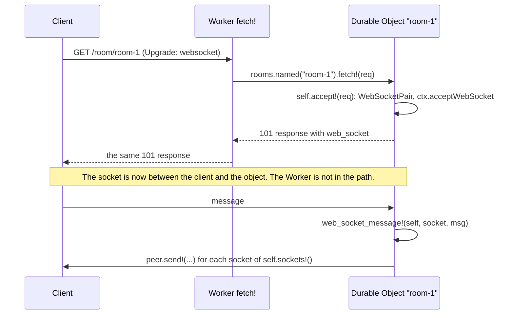

# Module API

| Item | Value |
| --- | --- |
| Status | Draft 2, 2026-10-15 (draft 1, plus typed data as CBOR, the WebSocket API, `D1.Result`, class names from Roc) |
| Scope | The Roc modules that an app uses: their types, their functions and the rules that they all follow. The layers under them (the ABI, `Js`, programs, `Io`, refs) are in `API.md`. |
| Evidence | `research/api-probe/modules-check/`: the conventions and 21 modules over a fake JS side, and an app that uses all of them in 52 fake events, with typed data as CBOR. `research/api-probe/cbor/`: the `Cbor` format and its cost. `roc check` and a run pass on nightlies 10-09 and 10-12 (section 15). The Workers facts were checked on 2026-10-15 against the Cloudflare docs and the workerd source. |

Section 1 gives the rules. Section 2 shows an app. Sections 3 to 13 give the modules. Section 14 lists what this file changes in `API.md`. Section 15 is the prototype.

In the signatures, `a.Encodable` stands for `a.Cbor.Encodable([])` and `a.Parseable` for `a.Cbor.Parseable([InvalidCbor(U64), ..errs])` (typed data that crosses to JS, MC5). `a.JsonEncodable` and `a.JsonParseable` stand for the `Json` forms (data that is JSON at rest or on the wire). `Thrown` is `Io.Thrown`, `{ name : Str, message : Str }`. `Method` and `Header` come from `roc-lang/http`.

## 1. Conventions

| # | Rule | Example |
| --- | --- | --- |
| MC1 | A binding is a constant, made from its name in the Wrangler config. It holds names, and for a typed binding its codec functions. It never holds a ref. So it can be at the top of a module (WR1). | `db = D1.binding("DB")` |
| MC2 | Functions are methods of their type, called by static dispatch. A module with no value type is a void module (`Http :: [].{ ... }`). | `db.all!(sql, params)`, `Http.send!(req)` |
| MC3 | Each function `f!` that waits has a pure twin `f` that gives an `Io` (WR2). | `db.all(sql, params)` gives an `Io` |
| MC4 | The short function has no options. If the Workers method has options, a second function with the suffix `_with` takes them as a last record with optional fields. The caller writes only the fields that it needs. An option never changes the type of the result: a call with another result shape is its own function. | `kv.put!(k, v)`, `kv.put_with!(k, v, { ttl_ms: 60_000 })` |
| MC5 | Typed data: the values that the app defines (D1 rows, queue messages, RPC arguments and results, cells, attachments, `Memo` values) cross as CBOR, the format of the bridge (`API.md` 5), through the codecs that Roc derives for the `Cbor` format. JS sees plain objects, the same as from `JSON.parse`. Data that is JSON at rest or on the wire (HTTP bodies, `Kv.json` values, JSON vars, log lines) uses `Json`. The app writes a type, never a codec. | `pkgs : List(Pkg)` |
| MC6 | When all values of a binding have one type, the declaration gives the type and the format. The same constant writes and reads. | `jobs : Queue(Job)`, `jobs = Queue.json("JOBS")` |
| MC7 | When the type changes from call to call (a D1 query), the annotation at the call gives it. | `pkg : Pkg`, `pkg = db.first!(sql, params)?` |
| MC8 | There is no null. A missing value is `Err(NotFound)`, so `?` returns it and `??` gives a default. | `theme.get!() ?? default_prefs` |
| MC9 | Errors are open tag unions, so the errors of two modules join (`?`, `Io.both!`). A throw in JS is `<Module>Err(Thrown)`. A value that does not fit its type is `BadData(Str)`. A known result has its own tag. A known throw has its own tag too: the module maps it by the `name` and `message` of the JS error (table "Named error tags" below). Each other throw stays `<Module>Err(Thrown)`. | `D1Err(t)`, `Constraint(msg)`, `Network(t)`, `PreconditionFailed`, `RateLimited`, `TooLarge`, `BadSignature` |
| MC10 | A time or a duration is a `U64` of milliseconds, in a field whose name ends in `_ms`. A size, an offset or a length of data is in bytes, in a field whose name ends in `_bytes`. A length that the Workers API gives in bits (WebCrypto) stays in bits, in a field whose name ends in `_bits`. The module converts (KV `expirationTtl` is in seconds). Exceptions: table "Exceptions to MC10 and MC12" below. | `{ ttl_ms: 60_000 }`, `size_bytes`, `length_bits` |
| MC11 | A read into wasm memory has a limit, because wasm memory never gets smaller (`PLAN.md` problem 4). The default limit is 1 MiB (`Body.default_max`). A larger read names its limit. Large data stays a `Body` stream in JS. Each typed read has the default limit: a body, `Kv.get!`, `D1.all!`, `first!`, `rows!` and `batch!`, `Object.Self.sql!` and `sql_rows!`. JS checks the size before the copy, and a read above the limit is `Err(TooLarge)`. The `_with` form takes `max_bytes`. A queue batch has the limit of the Queues config (6). A tail batch drops log lines past the limit (3). | `req.json!()`, `req.bytes_with!({ max_bytes: 30_000_000 })`, `db.all_with!(sql, params, { max_bytes: 8_000_000 })` |
| MC12 | Names are the Workers names in snake_case, so the Workers docs apply. A name changes only for a Roc reason. Each name that changes is in the table "Exceptions to MC10 and MC12" below, with its reason. | `kv.get_with_metadata!` for `getWithMetadata`, `queue.send_batch!` for `sendBatch`, `cache.get!` for `match` (a keyword) |
| MC13 | A value that holds a ref (a `Body` stream, a `D1.Session`, a socket, an imported key) is good for one task (RS1). All other module values are plain data: a test can make them and compare them. A value that holds a ref has its own type. It is never a binding (MC1). | `db.with_session!(Primary)` gives a `D1.Session`, not a `D1` |

Limits of MC5:

| Item | Rule |
| --- | --- |
| Large integers | CBOR keeps 64-bit integers exact in both directions. JS gets an integer above 2^53 as a `BigInt`. Two places lose them: D1 gives every number as an f64 (use `CAST(x AS TEXT)` in SQL), and `Queue.json` cannot send a `BigInt` (`JSON.stringify` throws, use `Queue.v8`). |
| Cost | 200 D1 rows into typed records, native (`research/api-probe/cbor/`): JSON 265 to 363 µs (JS 23, Roc `Json.parse` 242 to 340), CBOR 216 µs (JS 79, Roc `Cbor.parse` 137). About 70 µs of the 137 is the record matching of the derived parser. `db.rows!` (no types, a `Js` tree from the Zig host) costs about 82 µs, but it is for columns that are not known at compile time, not for speed (5.1). |
| Field names | A record field is a column name or a JSON key. Roc fields are snake_case, so SQL columns are too. `Cbor.parse_camel` reads camelCase keys, for a JS peer. |
| Bytes | A `List(U8)` field reads a CBOR byte string or an array. It writes an array of numbers, because the derived encoder has no hook for bytes. So JS gets an `Array`, not a `Uint8Array`. A field that must reach JS as bytes (a `Uint8Array` for a JS callee, a binary queue message) has the type `Cbor.Bytes` (`Cbor.Bytes := List(U8)`). Its hand-written `parser_for` and `encoder_for` use `parse_bytes` and `encode_bytes` of the `Cbor` format: CBOR major type 2 in both directions (`research/api-probe/cbor/Cbor.roc`). `Cbor.Bytes.(list)` makes one, and `bytes.to_list()` gives the list. It reads only a byte string, and it has no `Json` codec. |

Exceptions to MC10 and MC12 (each other name is the Workers name in snake_case, and each other unit follows MC10):

| Name | Workers name | Reason |
| --- | --- | --- |
| `Sql.Info.duration_ms : F64` | D1 `meta.duration` | A fraction of a millisecond is the usual value of a D1 query. A `U64` would give 0. |
| `cache.get!` | `match` | `match` is a keyword of Roc |
| `WebCrypto` | `crypto` | A module named `Crypto` hides the builtin module of Roc (15) |
| `WebCrypto.random!` | `getRandomValues` | Roc has no shared mutable array: the function gives new bytes, so its name is its result |
| `Cache.named` | `caches.open` | It gives data (MC1), not a promise: each operation runs `caches.open` in its own program |
| `Http.send!`, `open!` | `fetch` | Two functions for one Workers call: the body read in the same crossing (MC11), or kept a stream |
| `Object.Namespace.named`, `from_id`, `unique!` | `getByName`; `idFromString`, then `get`; `newUniqueId`, then `get` | One function gives a stub, which is data (MC1): an `Object`, not an id |
| `Object.Self.accept!`, `accept_with!` | `new WebSocketPair()`, `acceptWebSocket`, a 101 `Response` | One `call!` does three Workers steps and gives a socket and a response |
| `sockets!`, `sockets_with!`, `Socket.tags!`, `D1.Session.bookmark!` | `getWebSockets()`, `getWebSockets(tag)`, `getTags()`, `getBookmark()` | A reader with no argument has no `get`: Roc names a function that reads by its result, as the builtins do (`List.len`, `Dict.keys`). `sockets_with!` is MC4: the tag is an option. |
| `Socket.auto_response_ms!` | `getWebSocketAutoResponseTimestamp` | The reader rule above, and MC10 (a time ends in `_ms`) |
| `Socket.attach!`, `attachment!` | `serializeAttachment`, `deserializeAttachment` | The module serializes (CBOR, MC5): the app gives and gets a typed value, so the name says what the app sees |
| `set_auto_response!`, `clear_auto_response!` | `setWebSocketAutoResponse(pair)`, `setWebSocketAutoResponse()` | Roc has no optional argument, so the call with no argument has its own name. The pair is a record `{ request, response }`. `Object.Self` has no other auto response, so the name has no `web_socket`. |
| `Email.Mail.raw_size_bytes` | `rawSize` | MC10 |

Named error tags (MC9). The read function of the `Io` of the module maps the `Error(name, message)` of a throw, in Roc:

| Module | JS throw | Tag | Source of the text |
| --- | --- | --- | --- |
| `D1`, `D1.Session`, `Object.Self` SQL | The message has `constraint failed` | `Constraint(message)` | SQLite text after `D1_ERROR: ` (workerd source, `d1-api.ts`). Local D1 gives `UNIQUE constraint failed: t.k: SQLITE_CONSTRAINT (extended: SQLITE_CONSTRAINT_PRIMARYKEY)` (wrangler 4.151.0). |
| `Http` | `name` is `TypeError` | `HttpErr(Thrown)`: the request is bad (URL, scheme, header) | workerd source, `api/http.c++`, `api/headers.c++` |
| `Http` | Any other throw of `fetch` | `Network(Thrown)`: no response | workerd source, `jsg/util.c++` ("Network connection lost."). The Cloudflare docs name only this text. |
| Each module | Any other throw | `<Module>Err(Thrown)` | |

`PLAN.md` 8d tests each row locally and on the edge, because the docs do not give the texts.

## 2. An app

```roc
app [event!] { pf: platform "https://.../cloudflare-workers.tar.zst" }

import pf.Worker
import pf.Request
import pf.Response
import pf.D1
import pf.Kv
import pf.Queue

Pkg : { name : Str, version : Str }
Job : { pkg : Str }

db = D1.binding("DB")

prefs : Kv({ theme : Str })
prefs = Kv.json("PREFS")

jobs : Queue(Job)
jobs = Queue.json("JOBS")

fetch! : Request => Try(Response, _)
fetch! = |req| match (req.method, req.segments()) {
	(GET, ["v1", "pkg", owner, name]) => {
		pkg : Pkg
		pkg = db.first!("select name, version from pkg where name = ?", [Text("${owner}/${name}")])?
		Ok(Response.from_json(200, pkg))
	}
	(POST, ["v1", "jobs"]) => {
		job : Job
		job = req.json!()?
		jobs.send!(job)?
		Ok(Response.from_status(202))
	}
	_ => Ok(Response.from_status(404))
}

queue! = |batch| {
	_ = jobs.each!(batch, |_msg, job| build!(job))    # build! : Job => Try({}, _) is app code
	Ok({})
}

worker = Worker.{ fetch!, queue! }

event! = |e| worker.event!(e)
```

## 3. Entry: `Worker`

```roc
Worker(e) := {
	fetch! ?: Request => Try(Response, e),
	scheduled! ?: Worker.Scheduled => Try({}, e),
	queue! ?: Queue.Batch => Try({}, e),
	email! ?: Email.Mail => Try({}, e),
	tail! ?: List(Worker.TraceItem) => Try({}, e),
	other! ?: Str, Js => Try(Js, e),
	rpc ?: List(Rpc.Handler({})),         # methods of the default entry point
	entrypoints ?: List(Rpc.Entrypoint),  # named WorkerEntrypoint classes
	objects ?: List(Object.Class),        # Durable Object classes
}.{
	event! : Worker(e), Worker.Event => Worker.Outcome

	## The payload of a cron run. The same type is in `Worker.Event` (`API.md` 10.1).
	Scheduled := { cron : Str, time_ms : U64 }.{
		no_retry! : Worker.Scheduled => {}    # controller.noRetry(), one call!: in workerd, not in the docs
	}

	## One item of the batch of a Tail Worker (TraceItem): plain data, read as CBOR (MC5). Rules below.
	TraceItem := {
		script_name : Try(Str, [Missing]),
		outcome : Str,                                   # "ok", "exception", "exceededCpu", ... (Cloudflare docs)
		event_timestamp_ms : Try(U64, [Missing]),
		event : Try({ request : { method : Str, url : Str, headers : List(Header), cf : Try(Request.Cf, [Missing]) }, response : Try({ status : U16 }, [Missing]) }, [Missing]),
		logs : List({ timestamp_ms : U64, level : Str, message : Str }),       # message: the console arguments as JSON text
		exceptions : List({ timestamp_ms : U64, name : Str, message : Str }),
	}.{
		parser_for : _                                   # a nominal type opts in to the derived parser (15)
	}
}
```

Each handler gives the result of its own kind, so a handler cannot give a wrong outcome. `e` is one error type for all handlers: their tag unions join. `Worker.Event` and `Worker.Outcome` are the types of `API.md` 10.1. `Worker.Scheduled` is in the `.{ }` block of `Worker`, because a type at the top level of a type module is private (section 15).

| Field | Workers entry | `Ok` gives | `Err(e)` gives | A missing field gives |
| --- | --- | --- | --- | --- |
| `fetch!` | `fetch` | The response | A 500 response with no body, and a log line with `Str.inspect(e)`. After `Ctx.pass_through!`, a throw, so Workers sends the request to the origin (11, `API.md` 10.1). To answer an error with another status, match it in the handler. | `Unhandled`: 500 and a log line |
| `scheduled!` | `scheduled` | A good run | A failed run (Past Events) and a log line with `Str.inspect(e)`. The shim does not call `noRetry` (cron rules below). | A failed run. The shim does not call `noRetry`. |
| `queue!` | `queue` | Messages with no ack or retry follow the queue default | A retry of the batch. An explicit ack or retry stands. | A retry of the batch |
| `email!` | `email` | The mail is accepted | The mail is rejected | The mail is rejected |
| `tail!` | `tail` | Done | A log line | Ignored |
| `other!` | A kind with no field (`makeHandler(module, { other: [...] })`) | The value for JS (the outcome `Reply`) | A throw | A throw |
| `rpc`, `entrypoints` | `WorkerEntrypoint` methods (8). For `entrypoints`, also the `fetch` of a named entry point (a service binding with `entrypoint`). | The reply, or the response of the `fetch!` of the entry point | A throw on the caller side. For `fetch!`, as for the `fetch!` of the Worker. | "no method" throw. A named entry point with no `fetch!` has no `fetch` method in JS. |
| `objects` | Durable Object classes (7) | as the field of the class | | `Unhandled` |

A new Workers kind is a new optional field, so it does not break an app (`API.md` 10.1).

Cron rules (`scheduled!`):

| Item | Rule |
| --- | --- |
| Payload | `cron` is `controller.cron`, the cron expression that started the run. `time_ms` is `controller.scheduledTime`, the planned time of the run, not the start time. |
| Annotation | A `scheduled!` that calls `no_retry!` needs the annotation `Worker.Scheduled => Try({}, e)`: the type of the argument does not come from the later use in `Worker.{ ... }`, and `Try({}, _)` gives a closed `[]` that does not join the other handlers (15). |
| Retry | The shim never calls `noRetry` by itself, also not for `Err` or a missing field. `Err(e)` is a failed run. To stop a retry, the app calls `no_retry!` on its `Worker.Scheduled`, then gives `Err`. What production does with the retry flag is not in the Cloudflare docs (`API.md` AQ12). Until AQ12 is settled, a handler must give the same result when it runs twice for one `time_ms`. |
| Time | A cron run can last 15 min (Cloudflare docs). The deadlines of the task: `API.md` 10.2. |
| Local test | `wrangler dev` and Miniflare serve `GET /cdn-cgi/local/scheduled?cron=<cron>&time=<ms>&format=json` (Cloudflare docs, and the Miniflare source). It runs `scheduled` with that `cron` and `scheduledTime`, and answers `{ "outcome": ..., "noRetry": ... }`, status 200 for the outcome `ok` and 500 for the others. The conformance app and the registry handler tests use it (`API.md` 11). |

Tail rules (`tail!`):

| Item | Rule |
| --- | --- |
| Fields | The fields of `TraceItem` in the Cloudflare docs (Tail Workers), in snake_case (MC12), with times in ms (MC10). A field that is null or absent is `Err(Missing)`, as in `Request.Cf` (MC8). `event` is the `FetchEventInfo` of a fetch, and `Err(Missing)` for each other kind ("null, currently", Cloudflare docs). `response` is `Err(Missing)` when the producer gave no response. |
| `outcome`, `level` | Text with the Workers values (`ok`, `exception`, `exceededCpu`, `exceededMemory`, `scriptNotFound`, `canceled`, `responseStreamDisconnected`, `unknown`; `debug`, `info`, `log`, `warn`, `error`), not tags: Workers can add a value, and a closed tag union would then fail to parse each batch. |
| `message` of a log | The array of the console arguments, as `JSON.stringify` gives it in JS. The arguments can be any JS value, and a Tail Worker usually sends logs on as JSON. A value that `JSON.stringify` cannot write (a `BigInt`, a cycle) gives its `String(value)`. |
| `message` of an exception | Text. The docs give the type "object", but their example is text, so JS writes `String(message)`. |
| Not typed | `workerd` also gives `entrypoint`, `scriptVersion`, `scriptTags`, `dispatchNamespace`, `cpuTime`, `wallTime` and `truncated`. The docs do not list them, so `TraceItem` does not have them. A field added later is a change of the payload type, so a major release (`API.md` 10.1). |
| Crossing | The shim maps each item to these fields in JS and sends the batch as one `Packed` value (`API.md` 5.2). The derived parser reads a `Try` field only in the tag form, so the shim writes `{"Ok": v}` or `{"Err": "Missing"}`, never `null` (15). The batch has the limit of MC11 (1 MiB). Past it, the shim drops log lines, from the last item back, and writes one warning (`console.warn`) in the Tail Worker with the count of dropped lines. A tail handler has no `Err` path for its input, so `TooLarge` would lose the whole batch. |

Names of classes and methods come from Roc only (`API.md` AQ10). At load, the shim sends the event `Manifest`, and `Worker` answers with the names of its `objects`, `entrypoints` and their `Rpc` methods, the `rpc` methods of the default entry point, and the handlers that each class has:

```js
{ default: ["status"],
  objects: { Room: { handlers: ["init", "fetch", "alarm", "webSocketMessage"], methods: ["increment"] } },
  entrypoints: { Admin: { handlers: ["fetch"], methods: ["purge"] } } }
```

The shim defines a JS method only for a handler in the list, so a class with no `alarm!` has no `alarm` method (7). The JS entry file has one line for each class, because Workers needs a named export:

```js
import app from "./app.wasm";
import { makeHandler, objectClass, entrypointClass } from "cloudflare-workers-roc";
export const Room = objectClass("Room");          // a Durable Object class of Object.class("Room", ...)
export const Admin = entrypointClass("Admin");    // a WorkerEntrypoint of Rpc.entrypoint("Admin", ...)
export default makeHandler(app, {});
```

`makeHandler` gives a subclass of `WorkerEntrypoint` (`cloudflare:workers`), not a plain object, because Workers sends RPC to the default export only when it extends `WorkerEntrypoint` (Cloudflare docs, service bindings RPC). Its `fetch`, `scheduled`, `queue`, `email` and `tail` methods send the events of `API.md` 10.1, with `this.env` and `this.ctx` as the roots `env` and `ctx`. `makeHandler` puts the `default` methods of the manifest on its prototype, and the methods of the manifest on each class. A class in Roc with no export, or an export with no class in Roc, is a throw at load, so `wrangler deploy` fails with the name. The Wrangler config names the classes too (Workers needs it), and workerd checks it against the exports.

## 4. HTTP: `Request`, `Response`, `Body`, `Http`

One request type and one response type, for both directions: the request of a `fetch` handler and the request of `Http.send!`, the response of a handler and the response of `Http.send!` or `Cache.get!`. The body is a `Body`, so a stream stays in JS (RS3).

```roc
Request := {
	method : Method,
	url : Str,
	headers : List(Header) ?? [],
	body : Body ?? Empty,
	cf ?: Request.Cf,                     # incoming only: request.cf, typed (table below)
}.{
	Cf : {
		asn : Try(U32, [Missing]), as_organization : Try(Str, [Missing]), colo : Try(Str, [Missing]),
		country : Try(Str, [Missing]), is_eu_country : Bool, city : Try(Str, [Missing]), continent : Try(Str, [Missing]),
		region : Try(Str, [Missing]), region_code : Try(Str, [Missing]), postal_code : Try(Str, [Missing]), metro_code : Try(Str, [Missing]),
		latitude : Try(Str, [Missing]), longitude : Try(Str, [Missing]), timezone : Try(Str, [Missing]),
		http_protocol : Try(Str, [Missing]), tls_version : Try(Str, [Missing]), tls_cipher : Try(Str, [Missing]),
		client_tcp_rtt_ms : Try(U64, [Missing]),
	}

	get : Str -> Request
	post : Str, Body -> Request
	post_json : Str, a -> Request where [a.JsonEncodable]
	with_header : Request, Str, Str -> Request

	segments : Request -> List(Str)       # "https://x/v1/pkg/a?q=1" gives ["v1", "pkg", "a"]
	query : Request, Str -> Try(Str, [NotFound])
	header : Request, Str -> Try(Str, [NotFound])   # caseless
	cookie : Request, Str -> Try(Str, [NotFound])

	text! : Request => Try(Str, [TooLarge, BadData(Str), BodyErr(Thrown)])
	json! : Request => Try(a, [TooLarge, BadData(Str), BodyErr(Thrown)]) where [a.JsonParseable]
	bytes! : Request => Try(List(U8), [TooLarge, BodyErr(Thrown)])
	bytes_with! : Request, { max_bytes : U64 } => Try(List(U8), [TooLarge, BodyErr(Thrown)])
}

Response := { status : U16, headers : List(Header) ?? [], body : Body ?? Empty, web_socket ?: Js.Ref }.{
	from_status : U16 -> Response
	from_text : U16, Str -> Response                  # text/plain; charset=utf-8
	from_json : U16, a -> Response where [a.JsonEncodable]
	from_bytes : U16, Str, List(U8) -> Response       # the Str is the content type
	from_body : U16, Str, Body -> Response            # a stream: an R2 body, a fetch body
	redirect : U16, Str -> Response
	with_header : Response, Str, Str -> Response
	header : Response, Str -> Try(Str, [NotFound])
	text!, json!, bytes!, bytes_with!                 # as for Request

	from_http : http.Response -> Response             # for packages that use roc-lang/http
	to_http! : Response => Try(http.Response, [TooLarge, BodyErr(Thrown)])
}

Body := [Empty, Text(Str), Bytes(List(U8)), Stream(Js.Ref)].{
	default_max : U64                                  # 1 MiB (MC11)
	text!, json!, bytes!, bytes_with!                  # one wait for a stream, none for the others
	chunk! : Body => Try([Chunk(List(U8)), End], [BodyErr(Thrown)])
	tee! : Body => Try((Body, Body), [BodyErr(Thrown)])
	sha256! : Body => Try(List(U8), [BodyErr(Thrown)]) # crypto.DigestStream: no copy into wasm
	writer! : {} => Try({ body : Body, writer : Body.Writer }, [BodyErr(Thrown)])   # pf.writer: a TransformStream, sync
	compress! : Body, Body.Format => Try(Body, [BodyErr(Thrown)])     # pipeThrough(new CompressionStream(format)), sync
	decompress! : Body, Body.Format => Try(Body, [BodyErr(Thrown)])   # pipeThrough(new DecompressionStream(format)), sync
	Format : [Gzip, Deflate]

	## The writable side of a writer! stream. It holds a ref, so it is good for one task (MC13).
	Writer :: { ... }.{
		write! : Body.Writer, List(U8) => Try({}, [BodyErr(Thrown)])   # one wait: until the stream takes the chunk
		write_text! : Body.Writer, Str => Try({}, [BodyErr(Thrown)])   # the text as UTF-8
		close! : Body.Writer => {}                                     # no wait: the body is complete (API.md 10.2)
	}
}

Http :: [].{
	send! : Request => Try(Response, [Network(Thrown), HttpErr(Thrown), TooLarge])
	send_with! : Request, { max_bytes ?: U64, timeout_ms ?: U64, cf ?: Js } => Try(Response, [Network(Thrown), HttpErr(Thrown), TooLarge])   # cf: the cf options of fetch
	open! : Request => Try(Response, [Network(Thrown), HttpErr(Thrown)])
	get! : Str => Try(Response, [Network(Thrown), HttpErr(Thrown), TooLarge])
}
```

| Item | Rule |
| --- | --- |
| Routing | `match (req.method, req.segments())` with list patterns: `(GET, ["v1", "pkg", owner, name])`. No router module. A router is a package. |
| `Http.send!` | Reads the body in the same crossing, to 1 MiB (one wait, AG4). So `res.json!()` after it needs no wait. `open!` keeps the body a stream. |
| Status codes | `send!` gives `Ok` for each status. The handler looks at `res.status`. Only a throw of `fetch` is an `Err`. |
| Errors (MC9) | A `TypeError` from `fetch` is a bad request: `HttpErr(Thrown)` ("Invalid URL", "Fetch API cannot load" for a scheme that is not http or https, "Invalid header name.", "Invalid header value.": workerd source, `api/http.c++`, `api/headers.c++`). Each other throw is `Network(Thrown)`: the request did not get a response. In workerd, a refused or reset connection is `Error: Network connection lost.`, and a DNS failure is `Error: internal error` (workerd source, `jsg/util.c++`). The docs give only "Network connection lost", so `PLAN.md` 8d tests the map locally and on the edge. |
| `cf` | `Request.Cf` is the incoming `request.cf`, read in the same crossing as the event. A field that the docs mark "if known", null or undefined is `Err(Missing)`. The shim writes it in the tag form `{"Err": "Missing"}`, which the derived parser reads (15). `is_eu_country` is `True` only for `"1"` (Cloudflare docs: "otherwise omitted or false"). `latitude` and `longitude` are text in Workers, so they stay `Str`. `client_tcp_rtt_ms` is absent for QUIC. Other fields (`botManagement`, `tlsClientAuth`, `hostMetadata`) are not typed: read them with `Js` (`API.md` 6.4). A request that the app builds has no `cf`. The cf options of an outgoing `fetch` (`cacheTtl`, `cacheEverything`) are the `cf` option of `send_with!`: a `Js` object that the app builds, so it has no null to check. |
| A `Stream` body | Can be read once (RS3). `tee!` gives two. |
| Build | A nominal record with defaults: `Request.{ method: PUT, url, body: Bytes(b) }` is also a request. |
| `web_socket` | The client end of a WebSocket, in a 101 response (`webSocket` of the Workers `Response`), as a ref (MC13). A response from `Object.fetch!` or `Service.fetch!` keeps it, so a Worker can give the 101 response of a Durable Object to the client (12). It is a ref and not a `WebSocket`, because `WebSocket.accept!` gives a `Response`, and two modules cannot import each other. The app does not read it: `accept!` sets it. |
| Request body and `respond!` | Read the request body before `Ctx.respond!`. workerd ends the request body when the response is sent, so a later `text!`, `json!` or `bytes!` gives `BodyErr` (`API.md` 10.2). |
| `Body.writer!` | A stream that the task writes after `respond!`: `Response.from_body(200, "text/event-stream", body)`, then `writer.write!` for each chunk, then `writer.close!()`. The task stays while the stream is open, and the 30 s limit after the response starts at `close!` (`API.md` 10.2). When the client stops reading, Workers cancels the stream, and the shim cancels the task. A `write!` after `close!` gives `BodyErr`. |
| `compress!`, `decompress!` | `CompressionStream` and `DecompressionStream` of Workers: `Gzip` (`"gzip"`) and `Deflate` (`"deflate"`). A `Text` or `Bytes` body becomes a stream first. The result is a `Stream` body, so the bytes stay in JS. zstd is not in Workers: `Native` (`API.md` 8). Set `Content-Encoding` on the response by hand. |
| The client goes away | The shim cancels the task at its next wait (`request.signal`, `API.md` 10.2). That is the abort signal of the app: there is no `aborted!`. While Roc runs, the JS event loop does not run, so a sync read of `request.signal.aborted` cannot change between two waits. |

## 5. Data: `D1`, `Sql`, `Kv`, `R2`, `Cache`

### 5.1 `D1` and `Sql`

```roc
D1 :: { name : Str }.{
	binding : Str -> D1
	all! : D1, Str, List(Sql) => Try(rows, [D1Err(Thrown), Constraint(Str), BadData(Str), TooLarge]) where [rows.Parseable]
	all_with! : D1, Str, List(Sql), { max_bytes : U64 } => Try(rows, [D1Err(Thrown), Constraint(Str), BadData(Str), TooLarge]) where [rows.Parseable]
	first! : D1, Str, List(Sql) => Try(row, [NotFound, D1Err(Thrown), Constraint(Str), BadData(Str), TooLarge]) where [row.Parseable]
	run! : D1, Str, List(Sql) => Try(Sql.Info, [D1Err(Thrown), Constraint(Str)])
	rows! : D1, Str, List(Sql) => Try(Sql.Rows, [D1Err(Thrown), Constraint(Str), TooLarge])
	batch! : D1, List(Sql.Stmt) => Try(List(D1.Result), [D1Err(Thrown), Constraint(Str), TooLarge])
	first_with!, rows_with!, batch_with!                 # as all_with!: the same, with a last { max_bytes : U64 }
	exec! : D1, Str => Try({}, [D1Err(Thrown), Constraint(Str)])
	with_session! : D1, [Primary, Any, After(Str)] => Try(D1.Session, [D1Err(Thrown)])   # withSession, sync

	## A D1 session (Sessions API). It holds a ref, so it is good for one task (MC13).
	Session :: { ... }.{
		all!, all_with!, first!, first_with!, run!, rows!, rows_with!, batch!, batch_with!   # as for D1, on the session
		bookmark! : D1.Session => Try(Str, [NotFound])   # getBookmark, sync: NotFound before the first query
	}

	Result :: { info : Sql.Info, rows : List(U8) }.{      # rows: the row objects as CBOR
		info : D1.Result -> Sql.Info
		all : D1.Result -> Try(rows, [BadData(Str)]) where [rows.Parseable]
		first : D1.Result -> Try(row, [NotFound, BadData(Str)]) where [row.Parseable]
	}
}

Sql := [Null, Int(I64), Real(F64), Text(Str), Blob(List(U8))].{
	stmt : Str, List(Sql) -> Sql.Stmt
	Stmt : { sql : Str, params : List(Sql) }
	Info : { changes : U64, last_row_id : I64, rows_read : U64, rows_written : U64, duration_ms : F64 }
	Rows : { columns : List(Str), rows : List(List(Sql)) }
}
```

| Item | Rule |
| --- | --- |
| `all!`, `first!` | D1 `all()`, rows as objects. JS sends them as CBOR in the same crossing, and `Cbor.parse` reads them into the type of the call (MC7). A `where` clause cannot name `List(a)`, so `all!` takes the type of the whole result: the caller writes `List(Pkg)` (section 15). |
| Objects, not arrays (`API.md` AQ9) | Rows as arrays with one list of column names (`raw()`) were measured (`research/api-probe/cbor/`): 198 µs in total into the same records (JS 52, Roc 146), against 216 µs as objects (JS 79, Roc 137). The Roc side is not faster: its cost is in the record matching, not in the keys. The 8 % gain is in JS only, and it needs a column mode in the format in which a row value must be a scalar. So the typed functions read objects. |
| `rows!` | D1 `raw({ columnNames: true })` as `Sql` values, with no types. For columns that are not known at compile time: an admin tool, a SQL console, a generic export. |
| `batch!` | One transaction and one crossing (`API.md` 6.2). One `D1.Result` for each statement, in order. A write batch uses only `info`. A read in a batch gives its rows with `result.all()` or `result.first()`, typed by the annotation at the use (MC7), because each statement can have another row type. A batch has no branch (`API.md` RF4). |
| Parameters | `Sql` values. D1 takes no BigInt, so `Int` goes as a number, and as text above 2^53 (`API.md` 7). |
| `with_session!` | `withSession("first-primary")` for `Primary`, `"first-unconstrained"` for `Any`, the bookmark for `After(b)`. It gives a `D1.Session`, its own type: a session holds a ref, and a binding never does (MC1, MC13). So `D1` stays a constant, and a `D1.Session` is good for one task. It has the query functions of `D1` (not `exec!`: the session of Workers has only `prepare` and `batch`). A bad bookmark is `D1Err` (`D1_SESSION_ERROR`, workerd source). Keep `bookmark!` in a cookie or a header, and give it to `After` in the next request. |
| Size (MC11) | `all!`, `first!`, `rows!` and `batch!` read at most 1 MiB of rows. `pf.pack` stops at the limit, so a larger result is `TooLarge` with no copy into wasm memory. The `_with` form names the limit. |
| `Constraint(Str)` (MC9) | A throw whose message has `constraint failed` (the SQLite text, after `D1_ERROR: `) is `Constraint(message)`: a `UNIQUE`, `PRIMARY KEY`, `FOREIGN KEY`, `CHECK` or `NOT NULL` failure. Local D1 (wrangler 4.151.0) gives `UNIQUE constraint failed: t.k: SQLITE_CONSTRAINT (extended: SQLITE_CONSTRAINT_PRIMARYKEY)`. The docs give no example, so `PLAN.md` 8d checks the text on the edge. `Object.Self` SQL uses the same tag. |
| Same types for objects | `Object.Self` uses `Sql` and `Sql.Rows` (7). Its `sql_run!` gives `Object.SqlInfo`, because the SQL cursor of an object has fewer fields than D1 `meta`. |

```roc
results = db.batch!([
	Sql.stmt("insert into release (grp, version, hash) values (?, ?, ?)", [Text(grp), Text(version), Text(hash)]),
	Sql.stmt("insert into leaf (grp, version) values (?, ?)", [Text(grp), Text(version)]),
	Sql.stmt("select count(*) as n from release where grp = ?", [Text(grp)]),
])?
match results {
	[_, _, counted] => {
		count : { n : U64 }
		count = counted.first()?
		Ok(Response.from_json(201, count))
	}
	_ => Ok(Response.from_status(500))
}
```

### 5.2 `Kv`

```roc
Kv(a) :: { ... }.{
	json : Str -> Kv(a) where [a.JsonEncodable, a.JsonParseable]
	text : Str -> Kv(Str)
	bytes : Str -> Kv(List(U8))

	get! : Kv(a), Str => Try(a, [NotFound, KvErr(Thrown), BadData(Str), TooLarge])
	get_with! : Kv(a), Str, { cache_ttl_ms ?: U64, max_bytes ?: U64 } => Try(a, [NotFound, KvErr(Thrown), BadData(Str), TooLarge])
	get_with_metadata! : Kv(a), Str => Try({ value : a, metadata : Try(m, [Missing]) }, [NotFound, KvErr(Thrown), BadData(Str), TooLarge]) where [m.Parseable]
	get_with_metadata_with! : Kv(a), Str, { cache_ttl_ms ?: U64, max_bytes ?: U64 } => Try({ value : a, metadata : Try(m, [Missing]) }, [NotFound, KvErr(Thrown), BadData(Str), TooLarge]) where [m.Parseable]
	put! : Kv(a), Str, a => Try({}, [KvErr(Thrown)])
	put_with! : Kv(a), Str, a, { ttl_ms ?: U64, expires_ms ?: U64, metadata ?: m } => Try({}, [KvErr(Thrown)]) where [m.Encodable]
	delete! : Kv(a), Str => Try({}, [KvErr(Thrown)])
	list! : Kv(a), { prefix ?: Str, cursor ?: Str, limit ?: U32 } => Try({ keys : List(Kv.Key), next : [More(Str), Done] }, [KvErr(Thrown)])

	cell : Kv(a), Str -> Kv.Cell(a)
	Cell(a) := { ... }.{ get!, set!, set_with!, delete! }
	Key : { name : Str, expires_ms : [Never, At(U64)], metadata : Try(Kv.Metadata, [Missing]) }
	Metadata :: { cbor : List(U8) }.{
		parse : Kv.Metadata -> Try(m, [BadData(Str)]) where [m.Parseable]   # typed at the use (MC7)
	}
}
```

| Item | Rule |
| --- | --- |
| Format | Picked by the declaration (MC6). `Kv.json` stores JSON text, so a JS Worker reads it with `get(key, "json")`. The module reads the text and parses it in Roc, so an integer above 2^53 stays exact. `Kv.text` and `Kv.bytes` store the value as it is. |
| Consistency | Eventual: a write can take 60 s or more to show in other places (Cloudflare docs). |
| `ttl_ms` | KV takes 60 s or more. Less is `KvErr`. |
| Seconds (MC10) | KV takes whole seconds. The module rounds `ttl_ms`, `expires_ms` and `cache_ttl_ms` up to the next whole second. `cache_ttl_ms` is 30 s or more (Cloudflare docs, KV limits), else `KvErr`. |
| Size (MC11) | A KV value can be 25 MiB (Cloudflare docs, KV limits). `get!` reads at most 1 MiB: JS reads the value as a stream (`type: "stream"`) with `pf.readUpTo`, so a larger value is `TooLarge` with no copy into wasm memory. `get_with!` takes `max_bytes`. |
| Metadata | `getWithMetadata` and the `metadata` of `put`, typed. The type of `get_with_metadata!` comes from the annotation at the call (MC7). A key with no metadata gives `Err(Missing)` in the `metadata` field, not an error of the call. `list!` cannot take a type: a type variable that only a `where` clause names, with no annotation at the call, is a compile error ("type not determined", checked on nightly 10-12). So a `Kv.Key` holds the metadata as CBOR, and `(key.metadata ? |_| Missing).parse()?` reads it with the type of the use (a bare `?` on a `Try(_, [Missing])` field does not compile, section 15). Metadata crosses as CBOR (MC5), and KV stores it as JSON, 1,024 bytes or less (Cloudflare docs), else `KvErr`. An integer above 2^53 in metadata is a `BigInt` that `JSON.stringify` cannot write, so it is `KvErr`. |
| `get_with_metadata!` | Its own function, because its result has another shape than `get!` (MC4: an option does not change the result) |

### 5.3 `R2`

```roc
R2 :: { name : Str }.{
	binding : Str -> R2
	get! : R2, Str => Try(R2.Object, [NotFound, R2Err(Thrown)])
	get_with! : R2, Str, { range ?: R2.Range, only_if ?: R2.Cond } => Try(R2.Object, [NotFound, PreconditionFailed, R2Err(Thrown)])
	head! : R2, Str => Try(R2.Meta, [NotFound, R2Err(Thrown)])
	put! : R2, Str, Body => Try(R2.Meta, [R2Err(Thrown)])
	put_with! : R2, Str, Body, { only_if ?: R2.Cond, http ?: R2.Http, custom ?: List((Str, Str)), checksum ?: R2.Checksum, length_bytes ?: U64 } => Try(R2.Meta, [PreconditionFailed, R2Err(Thrown)])
	delete! : R2, List(Str) => Try({}, [R2Err(Thrown)])
	list! : R2, { prefix ?: Str, cursor ?: Str, limit ?: U32, delimiter ?: Str, start_after ?: Str, include ?: List([Http, Custom]) } => Try({ objects : List(R2.Meta), prefixes : List(Str), next : [More(Str), Done] }, [R2Err(Thrown)])

	create_multipart_upload! : R2, Str => Try(R2.Upload, [R2Err(Thrown)])
	create_multipart_upload_with! : R2, Str, { http ?: R2.Http, custom ?: List((Str, Str)) } => Try(R2.Upload, [R2Err(Thrown)])
	resume_multipart_upload : R2, Str, Str -> R2.Upload      # key, upload id: data, no crossing

	## A multipart upload as data, so a later request can go on with it (MC1: no ref).
	Upload := { bucket : Str, key : Str, upload_id : Str }.{
		parser_for : _
		encoder_for : _
		is_eq : _
		upload_part! : R2.Upload, U32, Body => Try(R2.Part, [R2Err(Thrown)])                    # part number 1 to 10,000
		upload_part_with! : R2.Upload, U32, Body, { length_bytes ?: U64 } => Try(R2.Part, [R2Err(Thrown)])
		complete! : R2.Upload, List(R2.Part) => Try(R2.Meta, [R2Err(Thrown)])
		abort! : R2.Upload => Try({}, [R2Err(Thrown)])
	}
	Part : { part_number : U32, etag : Str }

	Object : { meta : R2.Meta, body : Body, range ?: R2.Range }   # range: the bytes that R2 read (a 206 response)
	Meta : { key : Str, version : Str, size_bytes : U64, etag : Str, http_etag : Str, uploaded_ms : U64, http : R2.Http, custom : List((Str, Str)), checksums : R2.Checksums }
	Http : { content_type ?: Str, content_language ?: Str, content_disposition ?: Str, content_encoding ?: Str, cache_control ?: Str, cache_expiry_ms ?: U64 }
	Checksums : { md5 ?: List(U8), sha1 ?: List(U8), sha256 ?: List(U8), sha384 ?: List(U8), sha512 ?: List(U8) }
	Checksum : [Md5(List(U8)), Sha1(List(U8)), Sha256(List(U8)), Sha384(List(U8)), Sha512(List(U8))]
	Cond : { etag_matches ?: Str, etag_does_not_match ?: Str, uploaded_before_ms ?: U64, uploaded_after_ms ?: U64 }
	absent : R2.Cond                                           # { etag_does_not_match: "*" }: only a new key
	Range : [From({ offset_bytes : U64, length_bytes ?: U64 }), Suffix(U64)]
}
```

| Item | Rule |
| --- | --- |
| Compare and swap | `put_with!(key, body, { only_if: { etag_matches: old } })`. A failed condition is `Err(PreconditionFailed)`, not a null. `R2.absent` writes only a new key (`etagDoesNotMatch: "*"`). The wildcard is in the workerd source, not in the R2 docs, so `PLAN.md` 8c tests it on the edge. This is the checkpoint write of RN4. |
| Conditions | `Cond` is the `R2Conditional` of Workers, with each field optional. R2 checks each field that is there: the workerd source sets each one on one condition, and the docs do not say how they join, so `PLAN.md` 8c tests two fields at once. An etag has no quotes (a quoted etag is `R2Err`, workerd source). |
| Body | `obj.body` is a stream. `Response.from_body(200, obj.meta.http.?content_type ?? "application/octet-stream", obj.body)` sends it with no copy into wasm. |
| HTTP metadata | `R2.Http` is `R2HTTPMetadata` (Cloudflare docs), each field optional. A field that the object does not have is absent, so `meta.http.?content_type` gives an `Err`, not an empty text (MC8). |
| Known length | R2 takes a stream body only with a known length: "Provided readable stream must have a known length (request/response body or readable half of FixedLengthStream)" (workerd source, `api/r2-rpc.c++`; the R2 docs do not say). A `Text` or `Bytes` body, and the body of a request or a response, have one. A stream that the app makes (`Body.writer!`, `compress!`) does not: `put_with!` and `upload_part_with!` with `length_bytes` pipe it through `new FixedLengthStream(length_bytes)`. A stream of another length is `R2Err`. |
| Checksums | `checksum` sends one hash for R2 to check: the docs allow "only a single hashing algorithm" at once, so the option is one tag. A wrong hash is `R2Err`. `meta.checksums` has MD5 for each object that is not multipart, and the hash that the put gave (Cloudflare docs). |
| `list!` | 1,000 objects or less (the default and the maximum). `include: [Http, Custom]` fills `http` and `custom` of each `Meta`. With no `include`, they are empty. `start_after` gives the keys after a key: it is in the workerd source, not in the R2 docs, so `PLAN.md` 8c tests it on the edge. `include` needs a compatibility date of 2022-08-04 or later (Cloudflare docs). |
| Range | `get_with!(key, { range: From({ offset_bytes: 0, length_bytes: 1024 }) })`, or `Suffix(n)` for the last `n` bytes. `obj.?range` is the range that R2 read, for the `Content-Range` of a 206 response. |
| Multipart | `R2.Upload` is data: a `Kv` value or a D1 row can keep it, with the `Part` values that `upload_part!` gave. `resumeMultipartUpload` is sync and checks nothing (Cloudflare docs), so `resume_multipart_upload` is pure, and each function of `Upload` calls `resumeMultipartUpload` in its own program. A wrong upload id is `R2Err` at `upload_part!`, `complete!` or `abort!`. Limits (Cloudflare docs, multipart objects): part numbers 1 to 10,000, each part except the last 5 MiB or more and of one size, 5 GiB at most. R2 aborts an upload that is not complete after 7 days (the default). |

### 5.4 `Cache`

```roc
Cache :: { ... }.{
	default : Cache
	named : Str -> Cache                                     # caches.open, in the same crossing as the op
	get! : Cache, Str => Try(Response, [NotFound, CacheErr(Thrown)])   # cache.match
	put! : Cache, Str, Response => Try({}, [CacheErr(Thrown)])
	delete! : Cache, Str => Try({}, [NotFound, CacheErr(Thrown)])   # false from delete: NotFound
}
```

| Item | Rule |
| --- | --- |
| Key | A URL. Workers caches only GET. The module makes the key a GET request for the URL, so `match` and `delete` need no `ignoreMethod` (it makes a request of another method count as GET): `get!` and `delete!` have no `_with` form (MC4). |
| `put!` | A 206 response or a response with `Vary: *` is `CacheErr` (a throw, Cloudflare docs). A response with `Set-Cookie` is not cached and gives `Ok`, and a response that is too large or has `Cache-Control: no-store` also gives `Ok`: `put` resolves "regardless of whether the cache successfully stored the response" (Cloudflare docs). |
| Scope | One data center (RF1). |
| Put after the response | `Ctx.wait_until!(cache.put(url, res))`: no wait in the handler. A `Stream` body is read by the put, so give it a `tee!` copy or a `Bytes` body. |

## 6. Messages: `Queue`

```roc
Queue(a) :: { ... }.{
	json : Str -> Queue(a) where [a.Encodable, a.Parseable]   # content type "json"
	v8 : Str -> Queue(a) where [a.Encodable, a.Parseable]     # content type "v8": also BigInt, and bytes in a Cbor.Bytes field
	text : Str -> Queue(Str)
	bytes : Str -> Queue(List(U8))

	send! : Queue(a), a => Try({}, [QueueErr(Thrown)])
	send_with! : Queue(a), a, { delay_ms ?: U64 } => Try({}, [QueueErr(Thrown)])
	send_batch! : Queue(a), List(a) => Try({}, [QueueErr(Thrown)])   # sendBatch: 100 messages and 256 KB or less
	send_batch_with! : Queue(a), List(a), { delay_ms ?: U64 } => Try({}, [QueueErr(Thrown)])

	each! : Queue(a), Queue.Batch, (Queue.Message, a => Try({}, e)) => { acked : U64, retried : U64 }

	Batch := { queue : Str, messages : List(Queue.Message) }.{ ack_all!, retry_all!, retry_all_with! }   # retry_all_with!(batch, { delay_ms })
	Message := { id : Str, timestamp_ms : U64, attempts : U32, body : List(U8) }.{ ack!, retry!, retry_with! }   # body: CBOR
}
```

| Item | Rule |
| --- | --- |
| One constant, both sides | The producer and the consumer use the same `Queue(Job)` (MC6), so the types agree. |
| Format | The message crosses as CBOR, and JS sends it as an object with the content type of the declaration. A JS consumer gets the same object. `Queue.json` cannot hold a `BigInt` (an integer above 2^53), `Queue.v8` can. |
| `each!` | Reads each message as `a`, and gives the handler the `Queue.Message` too (`id`, `timestamp_ms`, `attempts`, which starts at 1), so it can decide by the number of attempts: `jobs.each!(batch, \|msg, job\| build!(job, msg.attempts))`. `Ok` acks it. `Err(e)` retries it and logs `Str.inspect(e)`. A body that is not an `a` is logged and retried, so after `max_retries` it goes to the dead letter queue, if the queue has one. |
| Many queues | One `queue!` handler. Match on `batch.queue`, the queue name (not the binding name). |
| Low level | `batch.messages` with `Message.ack!` and `retry!` for an app that decides alone. |
| Delays (MC10) | `delay_ms` of `send_with!`, `send_batch_with!`, `retry_with!` and `retry_all_with!` goes to `delaySeconds`, which takes whole seconds from 0 to 86,400 (24 h, Cloudflare docs). The module rounds up to the next whole second, so a message never comes before its delay. More than 24 h is `QueueErr` for a send. A retry is sync and has no `Try`, so the module gives Workers at most 86,400 s. |
| Limits | A message is 128 KB or less, and a `send_batch!` is 100 messages and 256 KB or less (Cloudflare docs, Queues limits). More is `QueueErr`. |
| Size of a batch (MC11) | A batch crosses into wasm memory with the event, with no `max_bytes`: its limit is the Queues config. A consumer batch is `max_batch_size` messages (100 or less) of 128 KB or less, so 12.8 MB at most. Set `max_batch_size` in the Wrangler config to keep a batch in the memory budget of the app (`PLAN.md` problem 4). |

## 7. Durable Objects: `Object`

Outside: a stub is plain data, like a binding.

```roc
Object :: { ... }.{
	namespace : Str -> Object.Namespace
	Namespace := { ... }.{
		named : Object.Namespace, Str -> Object             # data: getByName runs in the program of each call
		named_with : Object.Namespace, Str, { location_hint ?: Object.Location } -> Object
		from_id : Object.Namespace, Str -> Object
		from_id_with : Object.Namespace, Str, { location_hint ?: Object.Location } -> Object
		unique! : Object.Namespace => Object                 # newUniqueId, sync
		unique_with! : Object.Namespace, { jurisdiction ?: Object.Jurisdiction, location_hint ?: Object.Location } => Try(Object, [ObjectErr(Thrown)])
		jurisdiction : Object.Namespace, Object.Jurisdiction -> Object.Namespace   # namespace.jurisdiction(j), data
	}
	Jurisdiction : [Eu, Us, Fedramp]                                     # "eu", "us", "fedramp"
	Location : [Wnam, Enam, Sam, Weur, Eeur, Apac, ApacNe, ApacSe, Oc, Afr, Me]   # "apac-ne" for ApacNe
	fetch! : Object, Request => Try(Response, [ObjectErr(Thrown)])
	call! : Object, Rpc(arg, ret), arg => Try(ret, [RpcErr(Thrown), BadData(Str)]) where [arg.Encodable, ret.Parseable]
	id! : Object => Try(Str, [ObjectErr(Thrown)])         # one call!: idFromName(name).toString() for a named object
}
```

| Item | Rule |
| --- | --- |
| A stub is data | `named`, `from_id` and `jurisdiction` hold names and options, no ref (MC1). Each `fetch!` and `call!` starts its program with `Get(Root("env"), ns)`, then `jurisdiction(j)` if the namespace has one, then `getByName(name, { locationHint })` or `get(idFromString(id), { locationHint })`. |
| `id!` | The runtime makes the id of a named object from the name and the namespace (and its jurisdiction), so Roc cannot make it: one `call!`. `from_id` and `unique!` already hold the id, so `id!` of them makes no crossing. `id!` gives a `Try`, because `idFromName` can throw (a jurisdiction in local workerd, next row). Inside the object, `Self.id` is pure: the event carries the id. |
| Jurisdiction | `ns.jurisdiction(Eu)` is the form that the Cloudflare docs recommend. The same name gives another object in another jurisdiction. `unique_with!` with `jurisdiction` is `newUniqueId({ jurisdiction })`, which works but which the docs do not recommend. Local workerd (Miniflare) throws "Jurisdiction restrictions are not implemented in workerd." (workerd source `server/actor-id-impl.c++`), so a jurisdiction is tested on the edge (`PLAN.md` 11c). |
| Location hint | Best effort, and only the first `get` of an object uses it (Cloudflare docs, data location). The id comes from the name or the id string only, so `id!` does not send the hint. |

Inside: a class is a record of handlers, all optional, as for `Worker`.

```roc
	class : Str, {
		init! ?: Object.Self => Try({}, e),                     # in blockConcurrencyWhile, in the constructor
		fetch! ?: Object.Self, Request => Try(Response, e),
		rpc ?: List(Rpc.Handler(Object.Self)),
		alarm! ?: Object.Self, { retry_count : U32, is_retry : Bool } => Try({}, e),
		web_socket_message! ?: Object.Self, Object.Socket, WebSocket.Message => Try({}, e),
		web_socket_close! ?: Object.Self, Object.Socket, WebSocket.Closed => Try({}, e),
		web_socket_error! ?: Object.Self, Object.Socket, Thrown => Try({}, e),
	} -> Object.Class

	Self := { ... }.{
		id : Object.Self -> Str
		sql! : Object.Self, Str, List(Sql) => Try(rows, [SqlErr(Thrown), Constraint(Str), BadData(Str), TooLarge]) where [rows.Parseable]
		sql_with! : Object.Self, Str, List(Sql), { max_bytes : U64 } => Try(rows, [SqlErr(Thrown), Constraint(Str), BadData(Str), TooLarge]) where [rows.Parseable]
		sql_run! : Object.Self, Str, List(Sql) => Try(Object.SqlInfo, [SqlErr(Thrown), Constraint(Str)])
		sql_rows! : Object.Self, Str, List(Sql) => Try(Sql.Rows, [SqlErr(Thrown), Constraint(Str), TooLarge])
		sql_rows_with! : Object.Self, Str, List(Sql), { max_bytes : U64 } => Try(Sql.Rows, [SqlErr(Thrown), Constraint(Str), TooLarge])
		set_alarm! : Object.Self, U64 => Try({}, [StorageErr(Thrown)])                 # setAlarm: a promise, one wait
		get_alarm! : Object.Self => Try(U64, [NotFound, StorageErr(Thrown)])           # getAlarm: a promise, one wait
		delete_alarm! : Object.Self => Try({}, [StorageErr(Thrown)])                   # deleteAlarm: a promise, one wait
		list! : Object.Self => Try(List(Str), [TooLarge, StorageErr(Thrown)])          # kv.list(): the keys, sync
		list_with! : Object.Self, { prefix ?: Str, start ?: Str, start_after ?: Str, end ?: Str, limit ?: U32, reverse ?: Bool } => Try(List(Str), [TooLarge, StorageErr(Thrown)])
		delete_all! : Object.Self => Try({}, [StorageErr(Thrown)])                     # deleteAlarm and deleteAll: one wait
		accept! : Object.Self, Request => Try({ socket : Object.Socket, response : Response }, [NotUpgrade])
		accept_with! : Object.Self, Request, { tags ?: List(Str) } => Try({ socket : Object.Socket, response : Response }, [NotUpgrade, TooLarge])
		sockets! : Object.Self => List(Object.Socket)                                  # getWebSockets()
		sockets_with! : Object.Self, { tag : Str } => List(Object.Socket)              # getWebSockets(tag)
		set_auto_response! : Object.Self, { request : Str, response : Str } => Try({}, [TooLarge])
		clear_auto_response! : Object.Self => {}
	}

	## What a SQL cursor of a Durable Object gives (rowsRead, rowsWritten). D1 also gives changes and last_row_id (Sql.Info).
	SqlInfo : { rows_read : U64, rows_written : U64 }

	cell : Str -> Object.Cell(a) where [a.Encodable, a.Parseable]
	Cell(a) := { ... }.{ get!, set!, delete! }               # each takes the Object.Self

	## A WebSocket that the object accepted with the hibernation API (12).
	Socket := { ... }.{
		send! : Object.Socket, WebSocket.Message => Try({}, [Closed])
		send_json! : Object.Socket, a => Try({}, [Closed]) where [a.JsonEncodable]
		close! : Object.Socket, U16, Str => {}
		tags! : Object.Socket => List(Str)                                          # getTags
		attach! : Object.Socket, a => Try({}, [TooLarge]) where [a.Encodable]       # serializeAttachment: CBOR bytes
		attachment! : Object.Socket => Try(a, [NotFound, BadData(Str)]) where [a.Parseable]
		auto_response_ms! : Object.Socket => Try(U64, [NotFound])                   # getWebSocketAutoResponseTimestamp
	}
```

```roc
counters = Object.namespace("COUNTERS")
increment : Rpc({ by : I64 }, I64)
increment = Rpc.method("increment")
count : Object.Cell(I64)
count = Object.cell("count")

counter = Object.class("Counter", {
	rpc: [
		increment.on(|self, { by }| {
			n = (count.get!(self) ?? 0) + by
			count.set!(self, n)?
			Ok(n)
		}),
	],
})

# A caller in any Worker:
n = counters.named("global").call!(increment, { by: 1 })?
```

| Item | Rule |
| --- | --- |
| Storage is sync | SQL (`ctx.storage.sql`), cells and `list!` (the sync KV API, `ctx.storage.kv`), `sockets!` and the socket calls use `call!`: no JSPI wait (AQ3). |
| Calls that wait | `set_alarm!`, `get_alarm!`, `delete_alarm!` and `delete_all!` give promises (Cloudflare docs, Storage API), so each uses `await!`: one wait. Each has an `Io` twin (MC3). The input gate stays closed during a storage operation (Cloudflare docs, Rules of Durable Objects), so these waits do not let other events in. |
| SQLite only | Cells and `list!` need the sync KV API, which only a SQLite-backed object has (Cloudflare docs, Storage API). So each class must be SQLite-backed: `new_sqlite_classes` in the migration of the Wrangler config. On a KV-backed class, workerd throws at the first use of `ctx.storage.sql` or `ctx.storage.kv`. The shim reads `ctx.storage.sql.databaseSize` in the constructor, and on a throw it throws an error that names the class and `new_sqlite_classes`. |
| `init!` | The constructor of the class runs `init!` as the event `Init` (`API.md` 10.1) inside `ctx.blockConcurrencyWhile`, so no other event of the object runs before it ends. It is a new task that calls `roc_event`, not a Roc callback, so it does not need `API.md` AQ1. It can wait. It runs each time the object starts: the first event, and the first event after Workers evicts the object or after a hibernation. So it must be idempotent: `create table if not exists`, or a schema version in a cell. A class with no `init!` has no `blockConcurrencyWhile`. |
| `init!` fails | `Err(e)` gives a log line, and the callback of `blockConcurrencyWhile` throws. Workers then terminates and resets the object (Cloudflare docs, State API). The event that started the object fails: the caller of `fetch!` or `call!` gets `ObjectErr` or `RpcErr`. The next event runs the constructor and `init!` again. Workers also resets the object when the callback takes more than 30 s (Cloudflare docs, State API). The deadlines of the task: `API.md` 10.2. |
| `alarm!` | The event `Alarm` carries `retryCount` and `isRetry` of the `alarmInfo` of Workers (0 and false when Workers gives none). `Ok` ends the alarm. `Err(e)` gives a log line and a throw, and Workers runs the alarm again: up to 6 retries, with a backoff that starts at 2 s and doubles (Cloudflare docs, Alarms). Only the alarm of the last `set_alarm!` is retried. To stop the retries, the handler gives `Ok`, for example when `retry_count` is 3. `delete_alarm!` in the handler stops a retry only on a best-effort basis (Cloudflare docs). In the handler, `get_alarm!` gives `NotFound` unless the handler called `set_alarm!` (Cloudflare docs). The deadlines: `API.md` 10.2. |
| A class with no `alarm!` | It has no `alarm` method in JS (the manifest, 3). If the shim always defined one, an alarm with no handler would give `Unhandled`, a throw, and 6 retries. With no method, `set_alarm!` gives `StorageErr` (`TypeError`: "Your Durable Object class must have an alarm() handler in order to call setAlarm()", workerd source `io/worker.c++`), except in `init!`: workerd does not check in the constructor, and the alarm then runs with no handler and no retry. |
| `list!` | The keys of the sync KV storage (the cells), in UTF-8 order. The values stay in JS: read one with its cell, a `call!` with no wait. `list_with!` takes the options of `kv.list` (Cloudflare docs). A list with no `limit` reads all keys, so the read limit of MC11 applies: `TooLarge` past it. A `pf` helper takes the keys from the iterator (a loop, `API.md` 6.4). |
| `delete_all!` | Deletes all storage of the object: the SQL tables, the cells and the alarm. One program calls `deleteAlarm`, then `deleteAll`. Since the compatibility date 2026-02-24, `deleteAll` also deletes the alarm (Cloudflare docs), but with an earlier date it does not, so the module calls `deleteAlarm` too. On a SQLite-backed object `deleteAll` is atomic. |
| SQL size (MC11) | `sql!` and `sql_rows!` read at most 1 MiB of rows, as `D1.all!` (5.1): `pf.pack` stops at the limit, so a larger result is `TooLarge` with no copy into wasm memory. `sql_with!` and `sql_rows_with!` name the limit. `sql_run!` reads no rows. |
| `sql_run!` | Gives `Object.SqlInfo`: the `rowsRead` and `rowsWritten` of the cursor. A cursor of an object has no `changes` and no last row id, so `Sql.Info` of D1 does not apply. For the id of a new row, use `insert ... returning id` with `sql!`. |
| Transactions | Between two waits, an object runs one event at a time, and Workers commits the writes of that time together (input and output gates, Cloudflare docs "Rules of Durable Objects"). So a handler that makes all its storage calls with no wait between them is atomic. A wait (`Http.send!`, R2, a call to another object) lets other events in. `sql!` reads all rows before it returns, so no cursor stays open across a wait. |
| WebSockets | The hibernation API: section 12. |
| Class names | Only in `Object.class("Counter", ...)` and the Wrangler config. The JS entry file exports the class with one line, and a missing or extra export stops the load (3, `API.md` AQ10). |
| Errors | Each class can have its own error type: `Object.class` turns errors into log text. |

## 8. RPC: `Rpc` and `Service`

One constant names a method and its types. Both sides use it: the caller with `call!`, the callee with `on`.

```roc
Rpc(arg, ret) :: { name : Str }.{
	method : Str -> Rpc(arg, ret)
	on : Rpc(arg, ret), (self, arg => Try(ret, e)) -> Rpc.Handler(self) where [arg.Parseable, ret.Encodable]
	entrypoint : Str, { fetch! ?: Request => Try(Response, e), rpc ?: List(Rpc.Handler({})) } -> Rpc.Entrypoint
	Handler(self) : { ... }                                  # types erased: CBOR in, CBOR out
}

Service :: { name : Str }.{
	binding : Str -> Service
	fetch! : Service, Request => Try(Response, [ServiceErr(Thrown)])
	call! : Service, Rpc(arg, ret), arg => Try(ret, [RpcErr(Thrown), BadData(Str)]) where [arg.Encodable, ret.Parseable]
}
```

| Item | Rule |
| --- | --- |
| Interface | A package of `Rpc` constants is the interface of a service. The caller and the callee import the same package, so their types agree. |
| On the wire | One argument. The module sends it as CBOR, and JS gives the callee the JS value, so a JS callee gets a plain object (a `BigInt` above 2^53, a `Uint8Array` for a `Cbor.Bytes` field, an `Array` of numbers for a `List(U8)` field, MC5). JS sends the reply of a JS callee back as CBOR. |
| Errors | An `Err(e)` of the callee is a throw with the text `Str.inspect(e)`. The caller gets `RpcErr(Thrown)`. A bad argument is a throw with "bad argument". |
| A JS method with many arguments | `Js` (`API.md` 6.4) |
| `self` | `Object.Self` in a Durable Object, `{}` in a Worker entry point |
| The default entry point | The `rpc` field of `Worker` (3). `makeHandler` gives a subclass of `WorkerEntrypoint`, because Workers sends RPC only to a class that extends it (Cloudflare docs, service bindings RPC). |
| A named entry point | `Rpc.entrypoint("Admin", { rpc: [...] })` and `export const Admin = entrypointClass("Admin")` (3). A service binding with `entrypoint = "Admin"` reaches it. Its `fetch!` gets the requests of `Service.fetch!` on that binding, as the event `EntrypointFetch` with the name (`API.md` 10.1), so they do not go to the `fetch!` of the Worker. With no `fetch!`, the class has no `fetch` method. `Rpc.Entrypoint` turns errors into log text, as `Object.class` does. |

Limits: Workers RPC can carry more than this module. The module keeps to typed data (MC5):

| Workers RPC can carry | This module | Why |
| --- | --- | --- |
| Structured clone values, many arguments | One argument and one reply, as CBOR data (MC5). A record holds many values. | One type on both sides (`Rpc(arg, ret)`) |
| Stubs: a function, an `RpcTarget`, a Durable Object stub, a service binding | No. Send the name of the object or the binding, and make the stub on the other side (`named`, `Service.binding`). | A stub is a ref, and a ref is good for one task (MC13). A Roc function cannot be a JS function (`API.md` AQ1). |
| Callbacks to the caller (a function in the argument) | No | The same: a callback is a stub |
| `ReadableStream`, `WritableStream`, `Request`, `Response` | No. Use `fetch!` of the `Object` or the `Service`: a `Body` stream passes with no copy. | CBOR has no stream |
| Promise pipelining | No. Each `call!` is one wait. | A pipelined call needs a stub |
| An error with its name, message and own properties (Cloudflare docs, RPC error handling) | Text only: the caller gets `RpcErr({ name, message })`. An `Err(e)` of a Roc callee is the message `Str.inspect(e)`. To give a typed error, put it in the reply type: `Rpc(arg, Try(ret, err))`. | A thrown error crosses as `Error(name, message)` (`API.md` 5, J6) |
| 32 MiB for one call (Cloudflare docs) | The same limit. The reply is a read into wasm memory (MC11). | |

## 9. State: `Memo`, `Kv.Cell`, `Object.Cell`

Three declarations of a typed value with the same shape: a name and a type at the top of a module, then `get!` and `set!`.

| Wrapper | Where the value is | Readers | Consistency | Cost of `get!` | Lost when |
| --- | --- | --- | --- | --- | --- |
| `Memo` | The pin table of the isolate (RS2), as CBOR bytes | The same isolate | None: a cache | One `call!`, no wait, plus `Cbor.parse` | Workers evicts the isolate, or `max_age_ms` passes |
| `Kv.Cell` | KV | All Workers, all places | Eventual (60 s) | One wait | `ttl_ms` passes |
| `Object.Cell` | The sync KV storage (`ctx.storage.kv`) of one SQLite-backed Durable Object (7), as CBOR bytes | That object | Strong | One `call!`, no wait | `cell.delete!`, or `self.delete_all!()` (7) |

```roc
Memo(a, e) := { ... }.{
	new : Str, { max_age_ms : U64, load! : {} => Try(a, e) } -> Memo(a, e) where [a.Encodable, a.Parseable]
	get! : Memo(a, e) => Try(a, e)
	clear! : Memo(a, e) => {}
}

jwks : Memo(Jwks, _)
jwks = Memo.new("github-jwks", { max_age_ms: 3_600_000, load!: load_jwks! })

keys = jwks.get!()?    # the first call in an isolate runs load_jwks!, later calls do not
```

| Item | Rule |
| --- | --- |
| Content | CBOR bytes (MC5). JS does not parse them. No JS objects. A key needs no `Memo`: `WebCrypto` imports it in the same crossing as its use (10), so RN6 keeps the JWKS as data. For a JS object, use `Js.pin!` (RS2). |
| Two tasks at once | Both can run `load!`. The second pin replaces the first. So `load!` must give an equal value each time. |
| Instance replace (`PLAN.md` M1) | The pin table is in JS, so the values stay. |

## 10. Security: `WebCrypto`, `Env`, `Secret`, `RateLimit`

```roc
WebCrypto :: [].{
	sign! : { alg : WebCrypto.Alg, key : WebCrypto.Key, data : List(U8) } => Try(List(U8), [CryptoErr(Thrown)])
	verify! : { alg : WebCrypto.Alg, key : WebCrypto.Key, signature : List(U8), data : List(U8) } => Try({}, [BadSignature, CryptoErr(Thrown)])
	encrypt! : { cipher : WebCrypto.Cipher, key : WebCrypto.Key, data : List(U8) } => Try(List(U8), [CryptoErr(Thrown)])
	decrypt! : { cipher : WebCrypto.Cipher, key : WebCrypto.Key, data : List(U8) } => Try(List(U8), [CryptoErr(Thrown)])
	derive_bits! : { alg : WebCrypto.Derive, key : WebCrypto.Key, length_bits : U32 } => Try(List(U8), [CryptoErr(Thrown)])
	import_key! : WebCrypto.KeyAlg, WebCrypto.Key => Try(WebCrypto.Key, [CryptoErr(Thrown)])   # gives Imported, for many ops in one task
	export_key! : WebCrypto.Key, [Raw, Pkcs8, Spki, Jwk] => Try(WebCrypto.Key, [CryptoErr(Thrown)])   # an Imported key as data
	generate_key! : WebCrypto.KeyAlg => Try(WebCrypto.Generated, [CryptoErr(Thrown)])
	generate_key_with! : WebCrypto.KeyAlg, { modulus_bits ?: U32, length_bits ?: U32 } => Try(WebCrypto.Generated, [CryptoErr(Thrown)])
	hmac_sha256 : List(U8), List(U8) -> List(U8)            # pure Roc over the builtin SHA-256: no crossing
	timing_safe_equal! : List(U8), List(U8) => Bool        # timingSafeEqual, sync
	random! : U64 => List(U8)                              # getRandomValues, sync
	random_uuid! : {} => Str                               # randomUUID, sync

	Key : [Jwk(Str), Raw(List(U8)), Pkcs8(List(U8)), Spki(List(U8)), Imported(Js.Ref)]
	Generated : [One(WebCrypto.Key), Pair({ private : WebCrypto.Key, public : WebCrypto.Key })]
	Alg : [Hmac(Hash), RsaPkcs1(Hash), RsaPss({ hash : Hash, salt_length_bytes : U32 }), Ecdsa(Curve, Hash), Ed25519]
	Cipher : [AesGcm({ iv : List(U8) }), AesCbc({ iv : List(U8) }), AesCtr({ counter : List(U8), length_bits : U32 }), RsaOaep({ label : List(U8) })]
	Derive : [Pbkdf2({ salt : List(U8), iterations : U32, hash : Hash }), Hkdf({ salt : List(U8), info : List(U8), hash : Hash }), Ecdh({ curve : Curve, public : WebCrypto.Key }), X25519({ public : WebCrypto.Key })]
	KeyAlg : [Hmac(Hash), RsaPkcs1(Hash), RsaPss(Hash), RsaOaep(Hash), Ecdsa(Curve), Ecdh(Curve), Ed25519, X25519, AesGcm, AesCbc, AesCtr, Pbkdf2, Hkdf]
	Hash : [Sha256, Sha384, Sha512]
	Curve : [P256, P384, P521]
}

Env :: [].{
	var! : Str => Try(Str, [MissingEnv(Str)])
	json! : Str => Try(a, [MissingEnv(Str), BadData(Str)]) where [a.JsonParseable]   # a JSON var of the Wrangler config
	secret! : Str => Try(Secret, [MissingEnv(Str)])
}

Secret :: { text : Str }.{
	reveal : Secret -> Str
	to_inspect : Secret -> Str                             # "Secret(...)"
}

RateLimit :: { name : Str }.{
	binding : Str -> RateLimit
	limit! : RateLimit, Str => Try({}, [RateLimited, LimitErr(Thrown)])
}
```

| Item | Rule |
| --- | --- |
| A key is data | `Jwk(text)`, `Pkcs8(bytes)` and the others are the key material. Each operation runs `importKey` and the operation in one program: one crossing, as for the operation alone. A loop of many operations in one task can `import_key!` once and use `Imported`. |
| Waits | Each `crypto.subtle` method gives a promise (Cloudflare docs), so `sign!`, `verify!`, `encrypt!`, `decrypt!`, `derive_bits!`, `import_key!`, `export_key!` and `generate_key!` each wait once (`await!`), with `importKey` in the same program. Only `timingSafeEqual`, `getRandomValues` and `randomUUID` are sync: `timing_safe_equal!`, `random!` and `random_uuid!` use `call!`. |
| Algorithms | The table of the Workers docs: sign and verify with RSASSA-PKCS1-v1_5, RSA-PSS, ECDSA, HMAC and Ed25519; encrypt and decrypt with AES-GCM, AES-CBC, AES-CTR and RSA-OAEP; derive with PBKDF2, HKDF, ECDH and X25519. The curves of ECDSA and ECDH are P-256, P-384 and P-521 (workerd source, `api/crypto/ec.c++`: the docs do not list them). AES-KW, `wrapKey`, `unwrapKey` and `deriveKey` have no function: use `Js` (`API.md` 6.4). |
| `generate_key!` | `generateKey` with `extractable: true`, then `exportKey` of each key, in one program, so the key is data: `One(Raw(bytes))` for an AES or HMAC key, `Pair({ private: Pkcs8(...), public: Spki(...) })` for the others. `modulus_bits` is for RSA (default 2048, public exponent 65537). `length_bits` is for AES (default 256) and HMAC (default: the block size of the hash). PBKDF2 and HKDF have no `generateKey` (Cloudflare docs), so they give `CryptoErr`. |
| `export_key!` | `exportKey` of an `Imported` key (`import_key!` imports with `extractable: true`). A key that is already data gives the same key in the other form (one import and one export). |
| `derive_bits!` | `length_bits` is in bits, as in `deriveBits` (MC10). For `Ecdh` and `X25519`, `key` is the private key of the app and `public` the public key of the peer. |
| Webhook HMAC (RN9) | `hmac_sha256(secret, body)` in Roc, then `timing_safe_equal!` with the header value. No wait. |
| `Secret` | `Str.inspect` shows `Secret(...)`. `Secret` has no codec, so a `Log` line with a secret in its fields is a compile error, and so is a secret in typed data that goes to JS (an RPC argument, a queue message). Only `reveal` gives the text. The backing is a record: an opaque type over a bare `Str` gets the codecs of `Str`, for `Json` and for `Cbor` (section 15). |
| `limit!` | `Ok({})` or `Err(RateLimited)`, so `limiter.limit!(ip)?` stops the handler. |

The builtin `Crypto` of Roc and `WebCrypto` do different work:

| Need | Use | Why |
| --- | --- | --- |
| SHA-256 of a small value in wasm memory: an id, an ETag, a cache key, a hash of a record | `Crypto.SHA256.hash` (builtin) | Pure Roc: no crossing, no wait. `crypto.subtle.digest` is a promise, so one JSPI wait. |
| HMAC-SHA256 (webhooks, RN9) | `WebCrypto.hmac_sha256` | Pure Roc over the builtin SHA-256 |
| BLAKE3 (archive hashes, RN8) | `Crypto.BLAKE3` (builtin), `Native` for chunks (`API.md` 8) | Workers has no BLAKE3 |
| SHA-256 of a body | `Body.sha256!` | `crypto.DigestStream`: the bytes do not go into wasm memory |
| SHA-256 of a large value already in wasm memory | Measure (`PLAN.md` 8g) | The builtin runs in wasm, and `digest` runs native code after a copy and a wait. 8g finds the size where `digest` is faster. |
| Signatures, encryption, key derivation, random bytes, UUIDs | `WebCrypto` | The builtin has none of them |

So `Crypto` is useful on Workers, and `WebCrypto` is not a replacement for it. The two names must stay different: a module named `Crypto` hides the builtin (section 15).

## 11. Context: `Ctx`, `Time`, `Log`

```roc
Ctx :: [].{
	respond! : Response => Try({}, [InvalidState])   # API.md 10.2
	wait_until! : Io(a, e) => {}                      # starts the operation now; a JS throw goes to the log, a Roc Err is not seen
	pass_through! : {} => Try({}, [InvalidState])     # only in the Fetch of a Worker
}

Time :: [].{
	now_ms! : {} => U64                               # coarse on the edge: it moves at I/O
	sleep! : U64 => {}                                # scheduler.wait(ms): one wait
	sleep : U64 -> Io({}, e)                          # the twin, for a timeout with Io.race! (API.md 6.5)
}

Log :: [].{
	info! : Str, a => {} where [a.JsonEncodable]      # one JSON line: {"level":"info","msg":...,<fields>}
	warn! : Str, a => {} where [a.JsonEncodable]
	error! : Str, a => {} where [a.JsonEncodable]
}
```

| Item | Rule |
| --- | --- |
| `respond!` | In the `Fetch` of a Worker or of a Durable Object. Elsewhere, and on a second call, `InvalidState`. The deadlines after it and the rule for the request body are in `API.md` 10.2. |
| `wait_until!` | `Io.start!` and `ctx.waitUntil` in one `call!`, with no wait. The Roc reader of the `Io` does not run, so a Roc-level `Err` (`PreconditionFailed`, `BadData`) is not seen. Only a JS throw goes to the log. The context of the task (refs and roots) stays until the operation settles, or until the 30 s limit of `waitUntil` (`API.md` 6.5, RS1). Work whose result matters (a write that can fail, a check) runs in the task after `respond!`. |
| `pass_through!` | `ctx.passThroughOnException()`. Only in the `Fetch` of a Worker. Elsewhere the shim gives status 1, and the function gives `InvalidState`. After it, an `Err` of `fetch!` makes the shim throw, and Workers sends the request to the origin (`API.md` 10.1). Workers cannot send a request body that the handler already read (Cloudflare docs, Context API). |
| `sleep!`, `sleep` | `scheduler.wait(ms)`. On the edge, a timer does not move during CPU work, only at I/O (Cloudflare docs, scheduler). A sleep is a wait, so the deadlines of `API.md` 10.2 apply. A timeout is a race: `Io.race!([op.map(Done), Time.sleep(ms).map(\|_\| TimedOut)])` (`API.md` 6.5). |

`Log.info!("published", { pkg: name, ms: 12 })`. The fields are a record, so Workers Logs can filter on them. A record with a `Secret` in it does not compile here (10).

## 12. Sockets: `WebSocket`, `Tcp`

Three forms of WebSocket:

| Form | Where the socket lives | Use |
| --- | --- | --- |
| A Durable Object with the hibernation API (12.1) | One object, which can leave memory between messages | Many clients that share state: chat, a game, a live document. The form that Cloudflare gives. |
| A Worker (12.2) | One task of one Worker, for the life of the socket | One short connection with no shared state: a proxy, a stream of results |
| A client (12.2) | The task that opened it | A connection from a Worker or an object to another server |

### 12.1 A Durable Object (hibernation)



```roc
rooms = Object.namespace("ROOMS")

User : { name : Str }
Said : { text : Str }

# The Worker: give the upgrade request to the object, and its 101 response to the client.
fetch! = |req| match (req.method, req.segments()) {
	(GET, ["room", name]) if WebSocket.is_upgrade(req) => rooms.named(name).fetch!(req)
	(GET, ["room", _]) => Ok(Response.from_status(426))
	_ => Ok(Response.from_status(404))
}

# The object.
room = Object.class("Room", {
	fetch!: |self, req| {
		{ socket, response } = self.accept!(req)?
		user : User
		user = { name: req.query("user") ?? "anon" }
		socket.attach!(user)?                                  # kept while the object sleeps
		Ok(response)
	},
	web_socket_message!: |self, socket, msg| {
		user : User
		user = socket.attachment!()?
		said : Said
		said = msg.json()?
		for peer in self.sockets!() {
			_ = peer.send_json!({ user: user.name, text: said.text })
		}
		Ok({})
	},
	web_socket_close!: |_self, socket, closed| {
		socket.close!(closed.code, closed.reason)
		Ok({})
	},
})
```

| Item | Rule |
| --- | --- |
| Hibernation | Workers can take the object out of memory while its sockets are open, and wakes it for the next message. Roc keeps no state across events, so nothing is lost. State that a socket needs is in its attachment (`attach!`, CBOR, 16,384 bytes or less) or in the storage of the object. A wake runs the constructor, so `init!` runs before the message (7). |
| The Worker | Gives the request to the object with `fetch!` and the 101 response back with no change: `Response.web_socket` carries the client end (4). It checks `WebSocket.is_upgrade(req)` first and answers 426, as in the Cloudflare example. An RPC call cannot carry the socket: use `fetch!`. |
| `accept!` | `new WebSocketPair()`, `ctx.acceptWebSocket(server, tags)` and a 101 response with the client end, in one `call!`. `NotUpgrade` when the request has no `Upgrade: websocket`. |
| Tags | `accept_with!(req, { tags })`: 10 tags or less, 256 characters or less each, else `TooLarge`. `sockets_with!(self, { tag })` finds the sockets of a tag, for example of one user. |
| Find the sender | The ref table gives one id to one JS object in a task (`API.md` RS1), so `peer == socket` is true for the socket of the message. |
| Ping without a wake | `set_auto_response!(self, { request: "ping", response: "pong" })`: Workers answers with no event, and the object can stay asleep. 2,048 characters or less each. `socket.auto_response_ms!()` gives the time of the last one. |
| Limits | 32,768 sockets for each object (Cloudflare docs). |
| Errors | `web_socket_error!` gets what JS threw. An `Err` of a handler is a log line, as for the other handlers. |

### 12.2 A Worker and a client

```roc
WebSocket :: { ... }.{
	is_upgrade : Request -> Bool                                 # Upgrade: websocket
	accept! : Request => Try({ socket : WebSocket, response : Response }, [NotUpgrade])
	connect! : Str => Try(WebSocket, [NotUpgrade, SocketErr(Thrown)])
	connect_with! : Str, { headers ?: List(Header), protocols ?: List(Str) } => Try(WebSocket, [NotUpgrade, SocketErr(Thrown)])
	send! : WebSocket, WebSocket.Message => Try({}, [Closed])
	send_json! : WebSocket, a => Try({}, [Closed]) where [a.JsonEncodable]
	receive! : WebSocket => Try(WebSocket.Message, [Closed(WebSocket.Closed)])
	close! : WebSocket, U16, Str => {}

	Message := [Text(Str), Bytes(List(U8))].{
		json : WebSocket.Message -> Try(a, [BadData(Str)]) where [a.JsonParseable]
	}
	Closed : { code : U16, reason : Str, clean : Bool }
}
```

```roc
# A Worker that answers each message, for the life of the socket.
fetch! = |req| {
	{ socket, response } = WebSocket.accept!(req)?
	Ctx.respond!(response)?
	while Bool.True {
		match socket.receive!() {
			Ok(Text(t)) => socket.send!(Text("echo ${t}")) ?? {}
			Ok(Bytes(_)) => {}
			Err(Closed(_)) => break
		}
	}
	Ok(response)                                              # ignored after respond!
}
```

| Item | Rule |
| --- | --- |
| A Worker | `accept!`, `Ctx.respond!(response)`, then a loop of `receive!`. Each `receive!` is one wait: JS keeps the messages that come before it in a queue. A 101 response keeps the task until the socket closes: the 30 s limit of `API.md` 10.2 does not apply. The docs do not say if the CPU limit of the request counts over the whole connection, and a runtime update gives a connection 20 minutes to finish (Cloudflare docs, limits). So a socket that lives long goes in a Durable Object (12.1). |
| A client | `connect!(url)`: a `fetch` with `Upgrade: websocket`, then `accept()` of the `webSocket` of the response: one wait for the `fetch`, then one `call!` with no wait for `accept()` (`API.md` OP7). `NotUpgrade` when the server does not answer 101. It counts as an outbound connection (6 at the same time). In an object, a client socket keeps the object in memory: it has no hibernation. |
| One API | `Object.Socket` and `WebSocket` have the same `send!`, `send_json!` and `close!`, so a function with a `where` clause on `send!` takes both. Only `WebSocket` has `receive!`: an object gets messages as events. |
| Text or bytes | `Message` is the frame. `msg.json()` parses a text frame as JSON, the format of most WebSocket clients. |
| Timeout, proxy | `Io.race!` (`API.md` 6.5): a `receive` with `Time.sleep(ms)` (11) is a receive with a timeout, and the `receive` of two sockets is a proxy. A branch that lost takes no message (`API.md` OP8). |

### 12.3 `Tcp`

```roc
Tcp :: { ... }.{
	connect! : Str, U16 => Try(Tcp, [SocketErr(Thrown)])
	connect_with! : Str, U16, { tls ?: [Off, On, StartTls] } => Try(Tcp, [SocketErr(Thrown)])
	read! : Tcp => Try(List(U8), [Closed, SocketErr(Thrown)])
	write! : Tcp, List(U8) => Try({}, [Closed, SocketErr(Thrown)])
	start_tls! : Tcp => Try(Tcp, [SocketErr(Thrown)])
	close! : Tcp => {}
}
```

`connect` of `cloudflare:sockets`. A database client (Postgres through `Hyperdrive`) is a package over `Tcp`.

## 13. Other bindings

Each follows MC1 to MC13. Most functions are one `Call` op.

| Module | Declaration | Functions | Phase |
| --- | --- | --- | --- |
| `Email` | `Email.binding("EMAIL")`; incoming mail is the `email!` field | `send!({ from, to, subject, text ?, html ?, cc ?, bcc ?, reply_to ? })` (the structured send that the docs recommend), `send_raw!({ from, to, raw })` (`EmailMessage`, MIME). `Email.Mail`: `from`, `to`, `header`, `raw : Body`, `raw_size_bytes` (MC10), `can_be_forwarded`, `forward!(to)`, `forward_with!(to, { headers ? })` (Workers keeps only `X-` headers, Cloudflare docs), `reply!(raw)`, `set_reject!(reason)` | B |
| `Ai` | `Ai.binding("AI")` | `run!(model, input) => Try(out, [AiErr(Thrown), BadData(Str)])`, typed in and out (MC5). `run_with!(model, input, { gateway ? })` with `gateway : { id : Str, skip_cache ?: Bool, cache_ttl_ms ?: U64, cache_key ?: Str }` (AI Gateway, Cloudflare docs; `cacheTtl` is in seconds, rounded up, MC10). `stream!(model, input) => Try(Body, _)` | B |
| `Vectorize` | `index : Vectorize(Meta)`, `Vectorize.json("INDEX")` | `query!(values, { top_k ?, filter ?, return_metadata ? })`, `upsert!`, `insert!`, `get!(ids)`, `delete!(ids)` | B |
| `Analytics` | `Analytics.binding("STATS")` | `write!({ blobs, doubles, indexes })`, sync | B |
| `Hyperdrive` | `Hyperdrive.binding("PG")` | `connect!() => Try(Tcp, _)` (the `connect` of the binding), `config!() => { connection_string : Secret, host, port, user, password : Secret, database }` | B |
| `Workflows` | `Workflows(Params)`, `Workflows.json("PUBLISH")` | `create!(params)`, `create_with!(params, { id ? })`, `get!(id)`. `Instance`: `status!`, `pause!`, `resume!`, `terminate!`, `send_event!(type, payload)` | B. The workflow class is phase C (AQ1). |
| `Assets` | `Assets.binding("ASSETS")` | `fetch!(req)` | B |
| `Version` | `Version.binding("CF_VERSION_METADATA")` | `metadata!() => { id, tag, timestamp_ms }`, sync | B |
| `SecretsStore` | `SecretsStore.binding("KEY")` | `get!() => Try(Secret, _)` | B |
| Images, Browser Rendering, mTLS, dispatch namespaces | | `Js` (`API.md` 6.4) until a module exists (AG2) | |

## 14. Changes to `API.md`

| Item | Before | Now | Reason |
| --- | --- | --- | --- |
| `Outcome` | `Respond(http.Response)`, `RespondBody(BodyResponse)` | `Respond(Response)`, with a `Body` | One response type for handlers, `Http.send!` and `Cache` |
| `Request`, `Response` (AQ2) | `roc-lang/http` types for buffered bodies, platform types for streams | Platform types, both directions. `Method` and `Header` stay from `roc-lang/http`. `Response.from_http` and `to_http!` convert. | A body can always be a stream (RS3). |
| Codecs (WR5) | Records `{ to_js, from_js }`, `Js.Codec`, `Crypto.key_codec` | The derived codecs (MC5). The declaration picks the format (MC6). | The app writes a type, never a codec. |
| `Memo` | A `codec` field. Values can hold JS objects. | Data only, as CBOR bytes. JS objects through `Js.pin!`. | `WebCrypto` imports a key in the same crossing as its use, so RN6 keeps data only. |
| `Crypto` | `Crypto` | `WebCrypto` | `Crypto` is a builtin module of Roc (section 15) |
| Handlers | `Worker` fields give an `Outcome` | Each kind gives its own result. `Err` is logged. | `?` works in handlers. A wrong outcome cannot be written. |
| WebSocket after `respond!` | 30 s, then cancel (10.2) | A 101 response keeps the task until the socket closes | Workers keeps a request with an open WebSocket |
| Typed data (AQ8) | JSON text | CBOR, the format of the bridge (MC5). HTTP bodies, `Kv.json`, JSON vars and logs stay JSON. | 2.5 times faster in Roc, exact 64-bit integers, bytes as a byte string for a `Cbor.Bytes` field (a `List(U8)` field is an array, MC5) (section 15) |
| Rows (AQ9) | An open question: objects or arrays | Objects. `rows!` is for unknown columns. | Arrays save 8 % (JS only), for a special mode of the format (5.1) |
| Class names (AQ10) | In `makeHandler` with their method lists, and in Roc | In Roc. The shim gets the names from the event `Manifest` and checks the JS exports at load (3). | One list of methods, and a mismatch stops the deploy |
| `D1.batch!` | `List({ info, rows : Sql.Rows })` | `List(D1.Result)`, with typed `all` and `first` | The rows of a batch are typed at the use |
| Object sockets | `message!`, `close!`, `accept!(req, { tags })` | `web_socket_message!`, `web_socket_close!`, `web_socket_error!` (MC12), `accept!(req)` and `accept_with!` (MC4), `sockets_with!`, auto responses, typed attachments (12.1) | The Workers names, and the short form with no options |
| `WebCrypto` waits (7) | sign, verify, encrypt wait. The others do not. | Each `crypto.subtle` function waits once. Only `timing_safe_equal!`, `random!` and `random_uuid!` are sync. Also `generate_key!`, `export_key!`, RSA-OAEP, ECDH, X25519 and P-521 (10). | Each `crypto.subtle` method gives a promise (Cloudflare docs) |
| Error tags | `D1Err(Thrown)`, `HttpErr(Thrown)` only | Also `Constraint(Str)` for D1 and object SQL, and `Network(Thrown)` for `Http` (MC9, "Named error tags") | RF4 and `PLAN.md` 8d need a constraint tag |
| R2 multipart (5.3) | `upload!` gives a ref | `R2.Upload` is data: `create_multipart_upload!`, `resume_multipart_upload`, `upload_part!`, `complete!`, `abort!` | An upload can span requests |
| D1 sessions (5.1) | `session!` gives a `D1` with a ref | `with_session!` gives a `D1.Session` | A binding never holds a ref (MC1, MC13) |
| Names (MC12) | `send_all!`, `session!`, `upload!`, `import!`, `equal!`, `uuid!` | `send_batch!`, `with_session!`, `create_multipart_upload!`, `import_key!`, `timing_safe_equal!`, `random_uuid!`. The other changed names are in the table "Exceptions to MC10 and MC12". | The Workers names, so the Workers docs apply |
| Bytes in typed data (MC5) | "bytes as bytes" | A `List(U8)` field is an array of numbers. A `Cbor.Bytes` field is a byte string, so JS gets a `Uint8Array`. | The derived encoder has no hook for bytes |
| Deadlines (10.2) | One 30 s limit after `respond!` | A table by event kind and response state. `Init` has 30 s for the whole task. | A cron run, an alarm and a queue batch have longer Workers limits |
| Spawned work (D2) | `Io.start!` drops the context at the end of the task | The context stays until each started program settles (`pf.spawn`) | A ref of the task was freed under the program that used it |
| Races (D4) | None | `Io.race!` (op `Race`, OP8) and `Time.sleep` (11) | A timeout on a socket read or a fetch |
| Streams (G5) | A body stream from JS only | `Body.writer!`, `compress!`, `decompress!` (4) | A response that Roc writes in parts |
| `Ctx.pass_through!` (11) | `{}` | `Try({}, [InvalidState])` | It is only for `Fetch`, before `respond!` |
| `Scheduled` (3) | `{ cron, time_ms }` | `Worker.Scheduled` with `no_retry!` | The app controls the retry (AQ12) |
| Object events (7) | `Alarm`, no `init!` | `Init` in `blockConcurrencyWhile`, `Alarm({ retry_count, is_retry })`, `id!` as one `call!` | Schema setup before the first event, and an end to alarm retries |
| Named entry points (8) | RPC methods only | `EntrypointFetch`, and `makeHandler` gives a `WorkerEntrypoint` subclass | Workers sends RPC only to a `WorkerEntrypoint` |
| Tail (3) | `Tail(List(Js))` | `Tail(List(Worker.TraceItem))`, typed (MC8) | No untyped `Js` that can be null in a handler (AG1) |
| Object SQL (7) | `sql!` with no limit, `SqlErr` only | `sql_with!`, `sql_rows_with!`, `TooLarge`, `Constraint(Str)` | MC11 and MC9, as for `D1` |

## 15. Prototype

`research/api-probe/modules-check/` has 21 modules with the signatures of this file: `Js` (only `Js.Ref`), `Io`, `Body`, `Request`, `Response`, `Http`, `Env`, `Secret`, `Sql`, `D1`, `Kv`, `R2`, `Queue`, `Rpc`, `Object`, `Memo`, `WebCrypto`, `WebSocket`, `Ctx`, `Time` and `Worker`, over a fake JS side (`Io.cross`), and copies of `Cbor` and `Method`. A module has the functions that the app uses and the signatures that are a compile risk, not all functions of this file. The fake JS side gives CBOR, so typed data goes through `Cbor.parse` and `Cbor.encode` as in the platform. `app.roc` uses all of them and sends 52 fake events through `Worker.event!`: also a WebSocket room (12.1), a Worker echo loop (12.2), a receive with a timeout (`Io.race!`), a Tail batch, cron runs, alarms with retries and `Init`. `run.sh` compares the output with `expected.txt`, and checks that `secret_log.roc` (a JSON encode of a record with a `Secret`), `secret_cbor.roc` (the same in CBOR) and `ref_cbor.roc` (a CBOR encode of a record with a `Js.Ref`) do not compile.

`run.sh` is also the fake shim. A type module has no `echo!`, so the fake JS side writes the ops that a test must see (`ctx.respond`, `ctx.pass_through`, `scheduled.no_retry`, `queue.ack`, `queue.retry`, `queue.retry_all`) with `dbg`, which goes to stderr in order with the output. After `ctx.respond`, `run.sh` prints the response that `respond!` got, and drops the outcome of the handler (`API.md` 10.2). The `publish` handler responds 202 and returns 200, so the check sees the difference.

The prototype differs from this file:

| Item | This file | Prototype | Why |
| --- | --- | --- | --- |
| `Js.Ref` | `Ref :: { id : U32 }.{ is_eq : _ }` (`API.md` 5) | The same, and the fake helpers `fake` and `to_str` | In the platform, the host makes refs |
| `Worker.Event` | Also `Email`, `EntrypointFetch`, `Other`, `Manifest`. `Rpc({ entrypoint, method, arg })`. | Not these four. `Rpc(Str, List(U8))`. | The prototype has no `Email`, no named entry points and no manifest |
| `Header` | From `roc-lang/http` | `(Str, Str)` | The prototype has no copy of `roc-lang/http` |
| A second `respond!` | `InvalidState` | Not checked | The fake JS side has no state |
| Reads that the platform does as a `Js` tree (`Http.send!`, `Object.fetch!`, `R2.put_with!`, `D1.run!`, `unique_with!`) | No `BadData` | A fake value that does not fit is the throw "BadData" in the tag of the module | The fake JS side gives CBOR for all results |
| `Sql` codecs | None: `rows!` reads a `Js` tree (5.1) | `parser_for : _` and `encoder_for : _` | The fake JS side sends `Sql.Rows` as CBOR |
| The limit throw of `pf.pack` and `readUpTo` | An error that the module turns into `TooLarge` (`API.md` 6.4) | The throw name `TooLarge`. Each limited read sends `max:<bytes>`. | `API.md` 6.4 does not give the name |
| Modules | `Cache`, `Service`, `Log`, `Tcp`, `RateLimit`, `Email` and the bindings of 13 | Not in the prototype | Their signatures are not a compile risk that the other modules do not already show |

`research/api-probe/cbor/` has the format: `Cbor.roc` (33 `expect`s, with the RFC 8949 vectors of the profile, and `Cbor.Bytes` of MC5), `CborRows.roc` (the rows-as-arrays variant of AQ9), `cbor.mjs` and `cbor-test.mjs` (the JS side, 37 RFC vectors), and `bench.roc` (`API.md` 5.2).

Lessons from the compiler (nightlies 10-09 and 10-12):

| Found | Effect on the design |
| --- | --- |
| A nested type and a public helper must be in the `.{ }` block of the module type. At the top level they are private. | Types of a module are `Kv.Cell`, `R2.Meta`, `Object.Self` |
| A generic decode cannot add `NotFound` to the `..errs` of `Json.Parseable` (type mismatch) | Modules turn a parse error into `BadData(Str)` (MC9) |
| A function stored in a declaration has a closed error type | The stored reader gives `Try(a, Str)`, and the module wraps it at the use |
| A `where` clause cannot name `List(a)` | `all!` takes the type of the whole result. The caller writes `List(Pkg)`. |
| A type module `Crypto` shadows the builtin module (`clash/`) | `WebCrypto` |
| The tags of the nominal `Method` of `roc-lang/http` match in a tuple with a list pattern, from another module | Routing by `match (req.method, req.segments())` |
| A phantom type variable on an opaque type (`Rpc(arg, ret) :: { name : Str }`) fixes the types of both sides | Typed RPC with one constant |
| An optional field of a structural record can hold an effectful function with an error type variable | `Object.class` takes a plain record |
| `Str.inspect` works on the type variable `e` of `Worker(e)` | `Err(e)` becomes a log line |
| An opaque type over a bare `Str` (`Secret :: Str`) gets the codecs of `Str`: `Json.to_str` and `Cbor.encode` write the hidden text. A hand-written `encoder_for` does not compile (type mismatch on `encode_str`). With a record backing (`Secret :: { text : Str }`), an encode is a compile error, as the Roc docs say for nominal types. The bug is only in the encoder, for a nominal type over `Str` or a number type in a record, a tuple or a tag; a bare value is rejected. Over `Bool`, the same encode crashes the compiler. Repro: `research/roc-bugs/` (also on nightly 10-14). | `Secret` has a record backing. Reported: roc-lang/roc#12309. |
| A one-field record pun needs a comma: `{ binding, }` | none |
| A nominal type nested in the block of the format (`Cbor.Bytes := List(U8)`) takes a hand-written `parser_for` and `encoder_for` with `where` clauses on `parse_bytes` and `encode_bytes`, and the derived codec of a record uses them for a field (`research/api-probe/cbor/`) | Bytes cross as a CBOR byte string (MC5) |
| An optional field with a type variable of a `where` clause (`metadata ?: m`) compiles when the caller leaves it out. A parsed type variable with no annotation at the call is "type not determined" (`research/api-probe/options-check/`). | `put_with!` takes typed metadata. `Kv.Key` keeps it as CBOR, parsed at the use (5.2). |
| A format in a module of the app (`Cbor`, with its own `Parseable` and `Encodable` aliases) works with derived codecs, also through a `where` clause in another module (`D1.all!`, `Rpc.call!`) | The platform ships `Cbor` as an ordinary module |
| A function with no annotation that gives a value parsed by `Json` (`res.json!()`), given to a function that needs `Cbor` on the same type (`Memo.new`), is "type not determined". An annotation on the function fixes it. The trigger is a `parser_for` constraint of two formats on one value. Repro: `research/roc-bugs/` (also on nightly 10-14). | The `Memo` example in the docs has an annotated `load!`. Reported: roc-lang/roc#12310. |
| Two modules cannot import each other | `Response.web_socket` is a ref, not a `WebSocket` (4) |
| A nominal record with an optional field (`web_socket ?: U32`) can be built with or without the field | `Response` keeps its short forms |
| `Time.sleep : U64 -> Io({}, [])` does not compile in `Io.race!([ws.receive().map(...), Time.sleep(ms).map(...)])`: the closed `[]` does not join the errors of the other branch. `U64 -> Io({}, e)` compiles and runs. | Done: `Io({}, e)` in 11 |
| `?` on a field of the type `Try(a, [Missing])` (`Kv.Key.metadata`, the fields of `Request.Cf` and `Worker.TraceItem`) does not compile in a function whose error union is larger: the `[Missing]` of a type annotation is closed, and `?` cannot add its tags to another union. `(key.metadata ? \|_\| Missing).parse()?` compiles: it makes a new tag. | Done: the example of 5.2. The other `Try(_, [Missing])` fields have the same rule. |
| A nominal record (`Worker.TraceItem := { ... }`) has no derived parser until its block has `parser_for : _` ("missing method parser_for") | Done: `TraceItem` has `.{ parser_for : _ }` in 3 |
| An opaque type over a bare `U32` (`Js.Ref :: U32`) gets the codecs of `U32`, as `Secret :: Str` gets the codecs of `Str`: `Cbor.encode` writes a ref as a number, so a ref can go into typed data (against MC13). With a record backing (`Js.Ref :: { id : U32 }`), the encode is a compile error (`ref_cbor.roc`), and the derived `is_eq` still works (`peer == socket`). | Done: `Js.Ref :: { id : U32 }` in `API.md` 5. The same compiler bug: roc-lang/roc#12309. |
| A handler that calls a method of its argument (`job.no_retry!()`, `batch.retry_all_with!(...)`) needs an annotation: the type of the argument does not come from the later use in `Worker.{ ... }`. A handler that gives only `Ok`, annotated `Try({}, _)`, gets the closed `[]`, which does not join the errors of the other handlers in `Worker(e)`: `Try({}, e)` compiles. | Done: the row "Annotation" of the cron rules (3) |
| The derived CBOR parser reads a record with optional fields when keys are absent (`R2.Meta.http`, `checksums`), and a `Try(a, [Missing])` field from the tag form (`{"Ok": v}`, `{"Err": "Missing"}`) | `R2.Meta` and `Worker.TraceItem` are typed data. The shim writes each `Try` field in the tag form, not as `null` (3, "Crossing"; also `Request.Cf`, 4). |
| These compile and run as written: a nested opaque type with methods in an opaque type (`D1.Session`), a constant of a record type with optional fields (`R2.absent : R2.Cond`), `opts.?only_if` then `cond.?etag_matches`, a nested record of optional fields as an option (`http ?: R2.Http`), optional fields in `unique_with!`, a field and a method with the same name (`Object.Self.id` and `self.id()`), `metadata ?: m` with the caller that gives it, a nominal record of a nested block in a handler argument (`Queue.Message`), and `Reply(Js)` with a `Packed` value | none |
| A type module has no `echo!`. `dbg` works in a type module and writes to stderr in order with stdout. `roc check` exits with 2 on a warning, and a `match` on a value that the compiler can evaluate (a parse of a constant) is the warning "unconditional condition". | Prototype only: the fake JS side writes visible ops with `dbg`, and its fake data comes from `Io.cross`, not from constants of the app |

Revert checks (each makes `run.sh` fail):

| Revert | Changed line |
| --- | --- |
| `D1.first` does not turn null into `NotFound` | `failed: NotFound` |
| `Queue.each!` acks a body that is not an `a` | `js queue.retry 3 0s`, `acked 1, retried 2` |
| `Rpc.serve!` takes the first handler, not the one with the name | `reply -1` |
| `Secret :: Str` | `secret_log.roc` and `secret_cbor.roc` compile: "a Secret can be encoded as JSON", and as CBOR |
| The room sends to each socket, also the sender | `sent to socket 7` |
| `Object.Socket` with an `is_eq` that is always false | `sent to socket 7` |
| The shim prints the returned response after `respond!` (`run.sh`: `responded = 0` in the `ctx.respond` rule) | `200 returned` and two more `101  (web_socket 21)` lines |
| `Queue.each!` gives the handler the first message of the batch, not its own (`Queue.roc`: `handle!(m, v)`) | `job b: message 2, attempts 3` becomes `message 1, attempts 1`, and `js queue.retry 2 0s` becomes `js queue.ack 2` |
| `Worker.event!` gives `tail!` no items (`Worker.roc`: `f!(items)`) | `tail api ok: GET https://r.dev/v1/pkg 200 cf WAW; ...` and `tail ? exception: ...` |
| `Object.class` gives `alarm!` a `retry_count` of 0 (`Object.roc`: `f!(self, info)`) | `failed: Retry(1, True)`, and the `done` of the third retry becomes `failed: Retry(0, True)` |
| `Object.class` does not run `init!` (`Object.roc`: `Init` arm) | `init name:global: 0 rows written`, `done` |
| `Http` maps `Error`, not `TypeError`, to `HttpErr` (`Http.roc`: `throw`) | `failed: HttpErr(... TypeError ...)` and `failed: Network(... Network connection lost. ...)` swap their tags |
| `Sql.throw` does not find `constraint failed` (`Sql.roc`) | `failed: Constraint(...)` becomes `D1Err(...)` and `SqlErr(...)` |
| The fake read limit is 1,000 times larger (`Io.roc`: `limit`) | Both `failed: TooLarge` lines |
| The fake `ws.receive` settles at once (`Io.roc`: `latency`) | `wait: timed out, branch 1` becomes `wait: closed, branch 0` |
| `Js.Ref :: U32` (`Js.roc`) | `ref_cbor.roc` compiles: "a Js.Ref can be encoded as CBOR" |
| `R2.absent` with another etag (`R2.roc`) | `201 etag-1 3 text/plain [1, 2] no cache_control` becomes `failed: PreconditionFailed` |
| The delay is rounded down (`Queue.roc`: `delay`) | `js queue.retry 9 3s` becomes `2s` |
| `no_retry!` calls another op (`Worker.roc`) | `js scheduled.no_retry 0 * * * *` |
