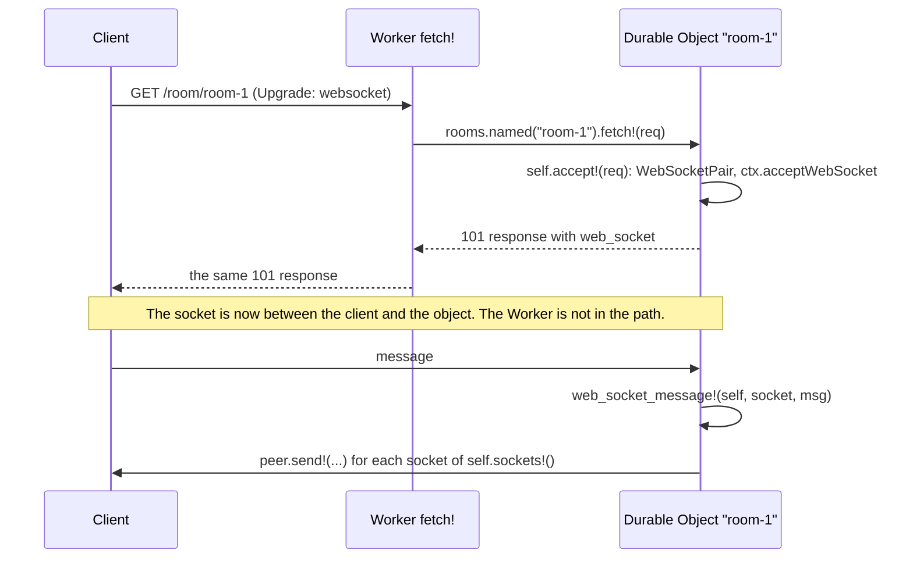

# Module API

| Item | Value |
| --- | --- |
| Status | Draft 2, 2026-10-15 (draft 1, plus typed data as CBOR, the WebSocket API, `D1.Result`, class names from Roc) |
| Scope | The Roc modules that an app uses: their types, their functions and the rules that they all follow. The layers under them (the ABI, `Js`, programs, `Io`, refs) are in `API.md`. |
| Evidence | `research/api-probe/modules-check/`: the conventions and 21 modules over a fake JS side, and an app that uses all of them in 52 fake events, with typed data as CBOR. `research/api-probe/cbor/`: the `Cbor` format and its cost. `roc check` and a run pass on nightlies 10-09 and 10-12 (section 15). The Workers facts were checked on 2026-10-15 against the Cloudflare docs and the workerd source. |

Section 1 gives the rules. Section 2 shows an app. Sections 3 to 13 give the modules. Section 14 lists what this file changes in `API.md`. Section 15 is the prototype.

In the signatures, `a.Encodable` stands for `a.Cbor.Encodable([])` and `a.Parseable` for `a.Cbor.Parseable([InvalidCbor(U64), ..errs])` (typed data that crosses to JS, MC5). `a.JsonEncodable` stands for `a.Json.Encodable(enc)` and `a.JsonParseable` for the `Json` parse form (data that is JSON at rest or on the wire). `enc` is an open error type: any type with a JSON encoder fits, also a record with an `F64` field (the encoder of an `F64` can fail for `NaN` and infinity). A function that must take any value of this kind writes `where [a.Json.Encodable(enc)]` (a `where` clause cannot be in a type alias, so there is no shorter name). A value that does not encode is `BadData(Str)` of the call, or, where the call has no error (`Response.from_json`, `Log`), a 500 response or a `fields_error` field (see 15). `Thrown` is `Io.Thrown`, `{ name : Str, message : Str }`. `Method` and `Header` come from `roc-lang/http`.

## 1. Conventions

| # | Rule | Example |
| --- | --- | --- |
| MC1 | A binding is a constant, made from its name in the Wrangler config. It holds names, and for a typed binding its codec functions. It never holds a ref. So it can be at the top of a module (WR1). | `db = D1.binding("DB")` |
| MC2 | Functions are methods of their type, called by static dispatch. A module with no value type is a void module (`Http :: [].{ ... }`). | `db.all!(sql, params)`, `Http.send!(req)` |
| MC3 | Each function `f!` that waits has a pure twin `f` that gives an `Io` (WR2). | `db.all(sql, params)` gives an `Io` |
| MC4 | The short function has no options. If the Workers method has options, a second function with the suffix `_with` takes them as a last record with optional fields. The caller writes only the fields that it needs. An option never changes the type of the result: a call with another result shape is its own function. | `kv.put!(k, v)`, `kv.put_with!(k, v, { ttl_ms: 60_000 })` |
| MC5 | Typed data: the values that the app defines (D1 rows, queue messages, RPC arguments and results, cells, attachments, `Memo` values) cross as CBOR, the format of the bridge (`API.md` 5), through the codecs that Roc derives for the `Cbor` format. JS sees plain objects, the same as from `JSON.parse`. Data that is JSON at rest or on the wire (HTTP bodies, `Kv.json` values, JSON vars, log lines) uses `Json`. The app writes a type, never a codec. An app that names `Cbor` (`Cbor.Bytes`, a `where` clause, `Cbor.parse`) writes `import pf.Cbor`: the platform module `Cbor` wraps the package `roc-cbor`, so the app needs no `cbor` entry in its header. | `pkgs : List(Pkg)` |
| MC6 | When all values of a binding have one type, the declaration gives the type and the format. The same constant writes and reads. | `jobs : Queue(Job)`, `jobs = Queue.json("JOBS")` |
| MC7 | When the type changes from call to call (a D1 query), the annotation at the call gives it. | `pkg : Pkg`, `pkg = db.first!(sql, params)?` |
| MC8 | There is no null. A missing value is `Err(NotFound)`, so `?` returns it and `??` gives a default. | `theme.get!() ?? default_prefs` |
| MC9 | Errors are open tag unions, so the errors of two modules join (`?`, `Io.both!`). A throw in JS is `<Module>Err(Thrown)`. A value that does not fit its type is `BadData(Str)`. A known result has its own tag. A known throw has its own tag too: the module maps it by the `name` and `message` of the JS error (table "Named error tags" below). Each other throw stays `<Module>Err(Thrown)`. | `D1Err(t)`, `Constraint({ kind: Unique, message })`, `Network(t)`, `PreconditionFailed`, `RateLimited`, `TooLarge`, `BadSignature` |
| MC10 | A time or a duration is a `U64` of milliseconds, in a field whose name ends in `_ms` (a module converts to seconds with `Time.seconds_up`, rounded up). A size, an offset or a length of data is in bytes, in a field whose name ends in `_bytes`. A length that the Workers API gives in bits (WebCrypto) stays in bits, in a field whose name ends in `_bits`. The module converts (KV `expirationTtl` is in seconds). Exceptions: table "Exceptions to MC10 and MC12" below. | `{ ttl_ms: 60_000 }`, `size_bytes`, `length_bits` |
| MC11 | A read into wasm memory has a limit, because wasm memory never gets smaller (`PLAN.md` problem 4). The default limit is 1 MiB (`Body.default_max`). A larger read names its limit. Large data stays a `Body` stream in JS. Each typed read has the default limit: a body, `Kv.get!`, `D1.all!`, `first!`, `rows!` and `batch!`, `Object.Self.sql!` and `sql_rows!`. JS checks the size before the copy, and a read above the limit is `Err(TooLarge)`. The `_with` form takes `max_bytes`. A queue batch has the limit of the Queues config (6). A tail batch drops log lines past the limit (3). | `req.json!()`, `req.bytes_with!({ max_bytes: 30_000_000 })`, `db.all_with!(sql, params, { max_bytes: 8_000_000 })` |
| MC12 | Names are the Workers names in snake_case, so the Workers docs apply. A name changes only for a Roc reason. Each name that changes is in the table "Exceptions to MC10 and MC12" below, with its reason. | `kv.get_with_metadata!` for `getWithMetadata`, `queue.send_batch!` for `sendBatch`, `cache.get!` for `match` (a keyword) |
| MC13 | A value that holds a ref (a `Body` stream, a `D1.Session`, a socket, an imported key) is good for one task (RS1). All other module values are plain data: a test can make them and compare them. A value that holds a ref has its own type. It is never a binding (MC1). | `db.with_session!(Primary)` gives a `D1.Session`, not a `D1` |

Limits of MC5:

| Item | Rule |
| --- | --- |
| Large integers | CBOR keeps 64-bit integers exact in both directions. JS gets an integer above 2^53 as a `BigInt`. Two places lose them: D1 gives every number as an f64 (use `CAST(x AS TEXT)` in SQL: a typed read gives `BadData` for a rounded value, and reads the text into an integer field, 5.1), and `Queue.json` cannot send a `BigInt` (`JSON.stringify` throws, use `Queue.v8`). |
| Cost | 200 D1 rows into typed records, native (`research/api-probe/cbor/`): JSON 265 to 363 µs (JS 23, Roc `Json.parse` 242 to 340), CBOR 216 µs (JS 79, Roc `Cbor.parse` 137). About 70 µs of the 137 is the record matching of the derived parser. `db.rows!` (no types, a `Js` tree from the Zig host) costs about 82 µs, but it is for columns that are not known at compile time, not for speed (5.1). |
| Field names | A record field is a column name or a JSON key. Roc fields are snake_case, so SQL columns are too. `Cbor.parse_camel` reads camelCase keys, for a JS peer. |
| Bytes | A `List(U8)` field reads a CBOR byte string or an array. It writes an array of numbers, because the derived encoder has no hook for bytes. So JS gets an `Array`, not a `Uint8Array`. A field that must reach JS as bytes (a `Uint8Array` for a JS callee, a binary queue message) has the type `Cbor.Bytes` (`Cbor.Bytes := List(U8)`). Its hand-written `parser_for` and `encoder_for` use `parse_bytes` and `encode_bytes` of the `Cbor` format: CBOR major type 2 in both directions (`research/api-probe/cbor/Cbor.roc`). `Cbor.bytes(list)` makes one (the platform `Cbor.Bytes` is an alias of the package type, so it has no constructor `Cbor.Bytes.(list)` in an app), and `bytes.to_list()` gives the list. It reads only a byte string, and it has no `Json` codec. |

Exceptions to MC10 and MC12 (each other name is the Workers name in snake_case, and each other unit follows MC10):

| Name | Workers name | Reason |
| --- | --- | --- |
| `Sql.Info.duration_ms : F64` | D1 `meta.duration` | A fraction of a millisecond is the usual value of a D1 query. A `U64` would give 0. |
| `cache.get!` | `match` | `match` is a keyword of Roc |
| `WebCrypto` | `crypto` | A module named `Crypto` hides the builtin module of Roc (15) |
| `WebCrypto.random!` | `getRandomValues` | Roc has no shared mutable array: the function gives new bytes, so its name is its result |
| `Cache.named` | `caches.open` | It gives data (MC1), not a promise: each operation runs `caches.open` in its own program |
| `Http.send!`, `open!` | `fetch` | Two functions for one Workers call: the body read in the same crossing (MC11), or kept a stream |
| `Object.Namespace.named`, `from_id`, `unique!` | `getByName`; `idFromString`, then `get`; `newUniqueId`, then `get` | One function gives a stub, which is data (MC1): an `Object`, not an id |
| `Object.Self.accept!`, `accept_with!` | `new WebSocketPair()`, `acceptWebSocket`, a 101 `Response` | One `call!` does three Workers steps and gives a socket and a response |
| `sockets!`, `sockets_with!`, `Socket.tags!`, `D1.Session.bookmark!` | `getWebSockets()`, `getWebSockets(tag)`, `getTags()`, `getBookmark()` | A reader with no argument has no `get`: Roc names a function that reads by its result, as the builtins do (`List.len`, `Dict.keys`). `sockets_with!` is MC4: the tag is an option. |
| `Socket.auto_response_ms!` | `getWebSocketAutoResponseTimestamp` | The reader rule above, and MC10 (a time ends in `_ms`) |
| `Object.Attachment`: `set!`, `get!` | `serializeAttachment`, `deserializeAttachment` | The module serializes (CBOR, MC5). A constant `Object.attachment(name)` has the type, like `Object.Cell`: one constant writes and reads, so the stored type and the read type are one |
| `set_auto_response!`, `clear_auto_response!` | `setWebSocketAutoResponse(pair)`, `setWebSocketAutoResponse()` | Roc has no optional argument, so the call with no argument has its own name. The pair is a record `{ request, response }`. `Object.Self` has no other auto response, so the name has no `web_socket`. |
| `Email.Mail.raw_size_bytes` | `rawSize` | MC10 |
| `D1.all_tuples!` (and `all_tuples_with!`, the twins, the `D1.Session` forms) | `raw()` | Two functions read one D1 call with two result shapes, and `rows!` already has `raw({ columnNames: true })`: the name says what the app gets (all rows, as tuples), as `Http.send!` and `open!` do for `fetch` |
| `WebCrypto.sha256!` | `crypto.subtle.digest('SHA-256', ...)` | The algorithm is in the name, and the function picks the builtin or `digest` by size (section 10) |

Named error tags (MC9). The read function of the `Io` of the module maps the `Error(name, message)` of a throw, in Roc:

| Module | JS throw | Tag | Source of the text |
| --- | --- | --- | --- |
| `D1`, `D1.Session`, `Object.Self` SQL | The message ends in `: SQLITE_CONSTRAINT`, or in `: SQLITE_CONSTRAINT (extended: <code>)` | `Constraint({ kind, message })`, with `kind` from the extended code (5.1, table "Constraint kinds") | SQLite text after `D1_ERROR: ` (workerd source, `d1-api.ts`). The error has no code field: its own properties are `message` and `cause` (an `Error` with the text after `D1_ERROR: `). Local D1 gives `UNIQUE constraint failed: t.k: SQLITE_CONSTRAINT (extended: SQLITE_CONSTRAINT_PRIMARYKEY)` (wrangler 4.151.0), and for a trigger `RAISE(ABORT, 'label-conflict')` it gives `label-conflict: SQLITE_CONSTRAINT (extended: SQLITE_CONSTRAINT_TRIGGER)` (Miniflare 5.20261012.0-beta, 2026-10-16). |
| `Http` | `name` is `TypeError` | `HttpErr(Thrown)`: the request is bad (URL, scheme, header) | workerd source, `api/http.c++`, `api/headers.c++` |
| `Http` | Any other throw of `fetch` | `Network(Thrown)`: no response | workerd source, `jsg/util.c++` ("Network connection lost."). The Cloudflare docs name only this text. Local (Miniflare 5, workerd 2026-10-12, `PLAN.md` 8d): a closed port is `Error: Network connection lost.`, a host that does not exist is `Error: internal error; reference = <id>`, `timeout_ms` is `TimeoutError: The operation was aborted due to timeout`, and `"not a url"` is `TypeError: Invalid URL: not a url` (`HttpErr`). Edge, 2026-10-17 (`PLAN.md` 11c, E17 to E21): a DNS failure and a blocked address do not throw. `fetch` gives a Cloudflare error response, so `send!` gives `Ok`: a host that does not exist is status 530 with the body `error code: 1016`, a closed port of `127.0.0.1` and a private address are status 403 with `error code: 1003`. An app that must tell these from an answer of the origin checks the status and the body. `TimeoutError` and `TypeError` are as local. A host that never answers keeps `fetch` waiting: the task deadline (`API.md` 10.2) ends it. A `fetch` of a Worker of the same account on workers.dev is 404 `error code: 1042` unless the flag `global_fetch_strictly_public` is set. |
| `Workflows` | The message has `instance.not_found` | `NotFound` (`get!`, each function of an `Instance`) | Local (Miniflare 5): `Error: instance.not_found` |
| `Workflows` | The message has `instance.already_exists` | `AlreadyExists` (`create_with!`) | Local: `Error: (instance.already_exists) Workflow instance with id "x" already exists`. The edge text is for 11c. |
| Each module | Any other throw | `<Module>Err(Thrown)` | |

`PLAN.md` 8d tests each row locally and on the edge, because the docs do not give the texts.

## 2. An app

```roc
app [event!] { pf: platform "https://.../cloudflare-workers.tar.zst" }

import pf.Worker
import pf.Request
import pf.Response
import pf.D1
import pf.Kv
import pf.Queue

Pkg : { name : Str, version : Str }
Job : { pkg : Str }

db = D1.binding("DB")

prefs : Kv({ theme : Str })
prefs = Kv.json("PREFS")

jobs : Queue(Job)
jobs = Queue.json("JOBS")

fetch! : Request => Try(Response, _)
fetch! = |req| match (req.method, req.segments()) {
	(GET, ["v1", "pkg", owner, name]) => {
		pkg : Pkg
		pkg = db.first!("select name, version from pkg where name = ?", ["${owner}/${name}"])?
		Ok(Response.from_json(200, pkg))
	}
	(POST, ["v1", "jobs"]) => {
		job : Job
		job = req.json!()?
		jobs.send!(job)?
		Ok(Response.from_status(202))
	}
	_ => Ok(Response.from_status(404))
}

queue! = |batch| {
	_ = jobs.each!(batch, |_msg, job| build!(job))    # build! : Job => Try({}, _) is app code
	Ok({})
}

worker = Worker.new({ fetch!, queue! })

event! = |e| worker.event!(e)
```

## 3. Entry: `Worker`

```roc
Worker :: { handlers : List(Str), own! : Worker.Event => Worker.Outcome, rpc : ..., entrypoints : ..., objects : ... }.{
	new : {
		fetch! ?: Request => Try(Response, e1),
		scheduled! ?: Worker.Scheduled => Try({}, e2),
		queue! ?: Queue.Batch => Try({}, e3),
		email! ?: Email.Mail => Try({}, e4),
		tail! ?: List(Worker.TraceItem) => Try({}, e5),
		other! ?: Str, Js => Try(Js, e6),
		rpc ?: List(Rpc.Handler({})),         # methods of the default entry point
		entrypoints ?: List(Rpc.Entrypoint),  # named WorkerEntrypoint classes
		objects ?: List(Object.Class),        # Durable Object classes
	} -> Worker
	event! : Worker, Worker.Event => Worker.Outcome

	## The payload of a cron run. The same type is in `Worker.Event` (`API.md` 10.1).
	Scheduled := { cron : Str, time_ms : U64 }.{
		no_retry! : Worker.Scheduled => {}    # controller.noRetry(), one call!: in workerd, not in the docs
	}

	## One item of the batch of a Tail Worker (TraceItem): plain data, read as CBOR (MC5). Rules below.
	TraceItem := {
		script_name : Try(Str, [Missing]),
		outcome : Str,                                   # "ok", "exception", "exceededCpu", ... (Cloudflare docs)
		event_timestamp_ms : Try(U64, [Missing]),
		event : Try({ request : { method : Str, url : Str, headers : List({ name : Str, value : Str }), cf : Try(Request.Cf, [Missing]) }, response : Try({ status : U16 }, [Missing]) }, [Missing]),   # headers: records, not Header (PLAN.md 8f, O1 of 8b)
		logs : List({ timestamp_ms : U64, level : Str, message : Str }),       # message: the console arguments as JSON text
		exceptions : List({ timestamp_ms : U64, name : Str, message : Str }),
	}.{
		parser_for : _                                   # a nominal type opts in to the derived parser (15)
	}
}
```

Each handler gives the result of its own kind, so a handler cannot give a wrong outcome. Each handler has its own error type: `Worker.new` turns an `Err(e)` into text (`Str.inspect(e)`) when it makes the `Worker`, so `Worker` has no type parameter. A `fetch!` with `Try(Response, [])` and a `scheduled!` with `Try({}, [UnknownCron(Str)])` go in one `Worker`. `Worker.Event` and `Worker.Outcome` are the types of `API.md` 10.1. `Worker.Scheduled` is in the `.{ }` block of `Worker`, because a type at the top level of a type module is private (section 15).

| Field | Workers entry | `Ok` gives | `Err(e)` gives | A missing field gives |
| --- | --- | --- | --- | --- |
| `fetch!` | `fetch` | The response | A 500 response with no body, and a log line with `Str.inspect(e)`. After `Ctx.pass_through!`, a throw, so Workers sends the request to the origin (11, `API.md` 10.1). To answer an error with another status, match it in the handler. | `Unhandled`: 500 and a log line |
| `scheduled!` | `scheduled` | A good run | A failed run (Past Events) and a log line with `Str.inspect(e)`. The shim does not call `noRetry` (cron rules below). | A failed run. The shim does not call `noRetry`. |
| `queue!` | `queue` | Messages with no ack or retry follow the queue default | A retry of the batch. An explicit ack or retry stands. | A retry of the batch |
| `email!` | `email` | The mail is accepted | The mail is rejected | The mail is rejected |
| `tail!` | `tail` | Done | A log line | Ignored |
| `other!` | A kind with no field (`makeHandler(module, { other: [...] })`) | The value for JS (the outcome `Reply`) | A throw | A throw |
| `rpc`, `entrypoints` | `WorkerEntrypoint` methods (8). For `entrypoints`, also the `fetch` of a named entry point (a service binding with `entrypoint`). | The reply, or the response of the `fetch!` of the entry point | A throw on the caller side. For `fetch!`, as for the `fetch!` of the Worker. | "no method" throw. A named entry point with no `fetch!` has no `fetch` method in JS. |
| `objects` | Durable Object classes (7) | as the field of the class | | `Unhandled` |

A new Workers kind is a new optional field, so it does not break an app (`API.md` 10.1).

Cron rules (`scheduled!`):

| Item | Rule |
| --- | --- |
| Payload | `cron` is `controller.cron`, the cron expression that started the run. `time_ms` is `controller.scheduledTime`, the planned time of the run, not the start time. |
| Annotation | A `scheduled!` that calls `no_retry!` needs the annotation `Worker.Scheduled => Try({}, _)`: the type of the argument does not come from the later use in `Worker.new({ ... })` (15). |
| Retry | The shim never calls `noRetry` by itself, also not for `Err` or a missing field. `Err(e)` is a failed run (outcome `exception`). Edge, 2026-10-17 (`PLAN.md` 11c, E13, settles `API.md` AQ12): production does not retry a failed cron run. In 1 hour, each planned time of a cron that gave `Err` had exactly 1 run, with and without `no_retry!`. So `no_retry!` has no effect today; it stays, because workerd keeps the flag. The next run of a cron is its next planned time. |
| Time | A cron run can last 15 min (Cloudflare docs). The deadlines of the task: `API.md` 10.2. |
| Local test | `wrangler dev` and Miniflare serve `GET /cdn-cgi/local/scheduled?cron=<cron>&time=<ms>&format=json` (Cloudflare docs, and the Miniflare source). It runs `scheduled` with that `cron` and `scheduledTime`, and answers `{ "outcome": ..., "noRetry": ... }`, status 200 for the outcome `ok` and 500 for the others. The conformance app and the registry handler tests use it (`API.md` 11). |

Tail rules (`tail!`):

| Item | Rule |
| --- | --- |
| Fields | The fields of `TraceItem` in the Cloudflare docs (Tail Workers), in snake_case (MC12), with times in ms (MC10). A field that is null or absent is `Err(Missing)`, as in `Request.Cf` (MC8). `event` is the `FetchEventInfo` of a fetch, and `Err(Missing)` for each other kind ("null, currently", Cloudflare docs). `response` is `Err(Missing)` when the producer gave no response. |
| `outcome`, `level` | Text with the Workers values (`ok`, `exception`, `exceededCpu`, `exceededMemory`, `scriptNotFound`, `canceled`, `responseStreamDisconnected`, `unknown`; `debug`, `info`, `log`, `warn`, `error`), not tags: Workers can add a value, and a closed tag union would then fail to parse each batch. |
| `message` of a log | The array of the console arguments, as `JSON.stringify` gives it in JS. The arguments can be any JS value, and a Tail Worker usually sends logs on as JSON. A value that `JSON.stringify` cannot write (a `BigInt`, a cycle) gives its `String(value)`. |
| `message` of an exception | Text. The docs give the type "object", but their example is text, so JS writes `String(message)`. |
| Not typed | `workerd` also gives `entrypoint`, `scriptVersion`, `scriptTags`, `dispatchNamespace`, `cpuTime`, `wallTime` and `truncated`. The docs do not list them, so `TraceItem` does not have them. A field added later is a change of the payload type, so a major release (`API.md` 10.1). |
| Crossing | The shim maps each item to these fields in JS and sends the batch as one `Packed` value (`API.md` 5.2). The derived parser of `roc-cbor` 0.1.0 reads a `Try(a, [Missing])` field as the value, and as `Err(Missing)` when the key is absent, so the shim writes the value, or no key (never `null`, never `{"Ok": v}`: `research/f2-queue/try_shape.roc`). The batch has the limit of MC11 (1 MiB, the shim option `tailMaxBytes`). Past it, the shim drops log lines, from the last line back and over all items, and writes one warning (`console.warn`) in the Tail Worker with the count of dropped lines. Local workerd cuts the logs of one trace to about 200 kB before the shim sees them, so the 1 MiB limit is tested with a smaller `tailMaxBytes` (`PLAN.md` 8f). A tail handler has no `Err` path for its input, so `TooLarge` would lose the whole batch. |

Names of classes and methods come from Roc only (`API.md` AQ10). At load, the shim sends the event `Manifest`, and `Worker` answers with the names of its `objects`, `entrypoints` and their `Rpc` methods, the `rpc` methods of the default entry point, and the handlers that each class has (for the default export: the fields `fetch!`, `scheduled!`, `queue!`, `email!` and `tail!` that the app gives):

```js
{ default: { handlers: ["fetch", "queue"], methods: ["status"] },
  objects: { Room: { handlers: ["init", "fetch", "alarm", "webSocketMessage"], methods: ["increment"] } },
  entrypoints: { Admin: { handlers: ["fetch"], methods: ["purge"] } } }
```

The shim defines a JS method only for a handler in the list, so a class with no `alarm!` has no `alarm` method (7), and a default export with no `queue!` has no `queue` method (the same for `email` and `tail`; `fetch` and `scheduled` are always there). The JS entry file has one line for each class, because Workers needs a named export:

```js
import app from "./app.wasm";
import { makeHandler, objectClass, entrypointClass } from "cloudflare-workers-roc";
export const Room = objectClass("Room");          // a Durable Object class of Object.class("Room", ...)
export const Admin = entrypointClass("Admin");    // a WorkerEntrypoint of Rpc.entrypoint("Admin", ...)
export default makeHandler(app, {});
```

`makeHandler` gives a subclass of `WorkerEntrypoint` (`cloudflare:workers`), not a plain object, because Workers sends RPC to the default export only when it extends `WorkerEntrypoint` (Cloudflare docs, service bindings RPC). Its `fetch`, `scheduled`, `queue`, `email` and `tail` methods (the last three only when the manifest has the handler; an app with a raw `event!` answers `Unhandled` to `Manifest` and keeps all three, `PLAN.md` 8f part 3) send the events of `API.md` 10.1, with `this.env` and `this.ctx` as the roots `env` and `ctx`. `makeHandler` puts the `default` methods of the manifest on its prototype, and the methods of the manifest on each class. A class in Roc with no export, or an export with no class in Roc, is a throw at load, so `wrangler deploy` fails with the name. The Wrangler config names the classes too (Workers needs it), and workerd checks it against the exports.

As built in `PLAN.md` 8b (first half) (`platform/Worker.roc`):

| Item | Built as | Why |
| --- | --- | --- |
| Fields | `fetch!`, `scheduled!`, `queue!`, `email!`, `tail!`, `other!`. Since `PLAN.md` 8f (part 1): also `rpc`, `entrypoints`, `objects`. | An optional field added later does not break an app. |
| `event!` | 8f (part 1): `Rpc` runs the handler of the method in `rpc` (entry point `"default"`) or in the `rpc` of the named entry point, `EntrypointFetch` the `fetch!` of the entry point, `Object` the class of the name, `Manifest` gives `Reply` with the names. A name with no handler gives `Unhandled`. | API.md 10.1 |
| `no_retry!` | One `call!` of `noRetry` on the root `event` (the controller). A throw is dropped. | The type is `=> {}`. Only a `Scheduled` event has a controller. |
| `TraceItem` | The type above, with `parser_for : _`. Built in 8f part 2: `Entry` parses the `Packed` batch with `Cbor.parse`. The request headers are `{ name, value }` records, because `Header` of `roc-lang/http` has no `parser_for` (`PLAN.md` 8b, O1). | The type of the field changed from `List(Header)` (`PLAN.md` 8f, part 2). |
| `other` methods | A method on the prototype of the class for each name. `makeHandler` refuses `fetch`, `scheduled`, `constructor` and a name twice. | Workers finds a handler on the prototype. |
| Local test of a cron | No Miniflare yet: a workerd config with an entry service that serves `/cdn-cgi/local/scheduled` as Miniflare does (`bench/entry-worker.js`) | `PLAN.md` 8b |

As built in `PLAN.md` 8f, part 1 (`platform/Worker.roc`, `js/index.js`, `js/runner.js`), where the code differs from the text above or adds to it:

| Item | Built as | Why |
| --- | --- | --- |
| The manifest at load | `makeHandler` makes an instance of its own for the event `Manifest` (no task table, no budget, the default free mark), calls `handle` as a plain call (the event makes no crossing, so no JSPI), reads the reply and drops the instance (`manifestOf`). An app that answers `Unhandled` has no classes. A module that is not stack-first is not run (`manifestOf` gives `undefined`): `makeHandler` accepts it at load, and each event throws the layout error (`PLAN.md` 1b), also the constructor of each object class. | workerd forbids random values at global scope, so the instance of the runner starts at the first event (C3 of `PLAN.md` 8b). The check of the exports must stop the load, so it cannot wait for the first event. |
| Order in the entry file | The `objectClass` and `entrypointClass` lines come before `export default makeHandler(...)`. `makeHandler` checks both directions: a class of the manifest with no export, and an export with no class. An `objectClass` line after `makeHandler` is checked against the manifest at once, but a missing export is found only by `makeHandler`. | An ES module runs its lines in order, and `makeHandler` cannot see the exports of the module |
| Event names | `Rpc` of the default export has the entry point `"default"`. A class named `default` is a throw at load. | `default` is the name of the default export |
| Method names | The manifest refuses a method twice in a class, a name that is not a JS name, and the names of handlers: `fetch`, `scheduled`, `queue`, `email`, `tail`, `alarm`, `constructor`, `webSocketMessage`, `webSocketClose`, `webSocketError`, `then` (a stub with `then` is a thenable). A default method with the name of an `other` handler is a throw too. | The JS method of a handler and of an RPC method is the same property |
| `rpc` methods | A method on the prototype of the class (default export, object, entry point): `Reply` gives the value, a `Reply` of `Rpc.roc` (`{ Ok: value }` or `{ Err: tag }`), also for an `Err` of the handler; `Failed(text)` (an argument that does not parse) is a log line `<class>.<method>: failed: <text>` and `throw new Error(text)`, so the caller gets `RpcErr({ name: "Error", message: text })`; `Unhandled` and a trap are a log line and a throw | MODULES.md 8, "Errors" |
| `Worker.new`, not `Worker.{ ... }` | A function that takes the record of handlers. The literal `Worker.{ ... }` must match the backing type, so the backing type would need a type variable for each error. The function turns each error into text first, and the backing type has no variables. One field needs `Worker.new({ fetch!: fetch! })`: `{ fetch! }` with one field is a block, not a record (`research/e1-errors/one_field.roc`). | Step 8h |

## 4. HTTP: `Request`, `Response`, `Body`, `Http`

One request type and one response type, for both directions: the request of a `fetch` handler and the request of `Http.send!`, the response of a handler and the response of `Http.send!` or `Cache.get!`. The body is a `Body`, so a stream stays in JS (RS3).

```roc
Request := {
	method : Method,
	url : Str,
	headers : List(Header) ?? [],
	body : Body ?? Empty,
	cf ?: Request.Cf,                     # incoming only: request.cf, typed (table below)
}.{
	Cf : {
		asn : Try(U32, [Missing]), as_organization : Try(Str, [Missing]), colo : Try(Str, [Missing]),
		country : Try(Str, [Missing]), is_eu_country : Bool, city : Try(Str, [Missing]), continent : Try(Str, [Missing]),
		region : Try(Str, [Missing]), region_code : Try(Str, [Missing]), postal_code : Try(Str, [Missing]), metro_code : Try(Str, [Missing]),
		latitude : Try(Str, [Missing]), longitude : Try(Str, [Missing]), timezone : Try(Str, [Missing]),
		http_protocol : Try(Str, [Missing]), tls_version : Try(Str, [Missing]), tls_cipher : Try(Str, [Missing]),
		client_tcp_rtt_ms : Try(U64, [Missing]),
	}

	get : Str -> Request
	post : Str, Body -> Request
	post_json : Str, a -> Try(Request, [BadData(Str)]) where [a.JsonEncodable]
	with_header : Request, Str, Str -> Request

	segments : Request -> List(Str)       # "https://x/v1/packages/a/b/releases?q=1" gives ["v1", "packages", "a", "b", "releases"]
	query : Request, Str -> Try(Str, [NotFound])
	header : Request, Str -> Try(Str, [NotFound])   # caseless
	cookie : Request, Str -> Try(Str, [NotFound])

	text! : Request => Try(Str, [TooLarge, BadData(Str), BodyErr(Thrown)])
	json! : Request => Try(a, [TooLarge, BadData(Str), BodyErr(Thrown)]) where [a.JsonParseable]
	bytes! : Request => Try(List(U8), [TooLarge, BodyErr(Thrown)])
	bytes_with! : Request, { max_bytes : U64 } => Try(List(U8), [TooLarge, BodyErr(Thrown)])
}

Response := { status : U16, headers : List(Header) ?? [], body : Body ?? Empty, web_socket ?: Js.Ref }.{
	from_status : U16 -> Response
	from_text : U16, Str -> Response                  # text/plain; charset=utf-8
	from_json : U16, a -> Response where [a.JsonEncodable]
	from_bytes : U16, Str, List(U8) -> Response       # the Str is the content type
	from_body : U16, Str, Body -> Response            # a stream: an R2 body, a fetch body
	redirect : U16, Str -> Response
	with_header : Response, Str, Str -> Response
	header : Response, Str -> Try(Str, [NotFound])
	text!, json!, bytes!, bytes_with!                 # as for Request

	from_http : http.Response -> Response             # for packages that use roc-lang/http
	to_http! : Response => Try(http.Response, [TooLarge, BodyErr(Thrown)])
}

Body := [Empty, Text(Str), Bytes(List(U8)), Stream(Js.Ref)].{
	default_max : U64                                  # 1 MiB (MC11)
	text!, json!, bytes!, bytes_with!                  # one wait for a stream, none for the others
	chunk! : Body => Try([Chunk(List(U8)), End], [BodyErr(Thrown)])
	tee! : Body => Try((Body, Body), [BodyErr(Thrown)])
	sha256! : Body => Try(List(U8), [BodyErr(Thrown)]) # crypto.DigestStream: no copy into wasm
	writer! : {} => Try({ body : Body, writer : Body.Writer }, [BodyErr(Thrown)])   # pf.writer: a TransformStream, sync
	compress! : Body, Body.Format => Try(Body, [BodyErr(Thrown)])     # pipeThrough(new CompressionStream(format)), sync
	decompress! : Body, Body.Format => Try(Body, [BodyErr(Thrown)])   # pipeThrough(new DecompressionStream(format)), sync
	Format : [Gzip, Deflate]

	## The writable side of a writer! stream. It holds a ref, so it is good for one task (MC13).
	Writer :: { ... }.{
		write! : Body.Writer, List(U8) => Try({}, [BodyErr(Thrown)])   # one wait: until the stream takes the chunk
		write : Body.Writer, List(U8) -> Io({}, [BodyErr(Thrown)])      # the twin (MC3), built in PLAN.md 8c
		write_text! : Body.Writer, Str => Try({}, [BodyErr(Thrown)])   # the text as UTF-8
		write_text : Body.Writer, Str -> Io({}, [BodyErr(Thrown)])
		close! : Body.Writer => {}                                     # no wait: the body is complete (API.md 10.2)
	}
}

Http :: [].{
	send! : Request => Try(Response, [Network(Thrown), HttpErr(Thrown), TooLarge])
	send_with! : Request, { max_bytes ?: U64, timeout_ms ?: U64, cf ?: Js } => Try(Response, [Network(Thrown), HttpErr(Thrown), TooLarge])   # cf: the cf options of fetch
	open! : Request => Try(Response, [Network(Thrown), HttpErr(Thrown)])
	get! : Str => Try(Response, [Network(Thrown), HttpErr(Thrown), TooLarge])
}
```

| Item | Rule |
| --- | --- |
| Routing | `match (req.method, req.segments())` with list patterns: `(GET, ["v1", "pkg", owner, name])`. No router module. A router is a package. |
| `Http.send!` | Reads the body in the same crossing, to 1 MiB (one wait, AG4). So `res.json!()` after it needs no wait. `open!` keeps the body a stream. |
| Status codes | `send!` gives `Ok` for each status. The handler looks at `res.status`. Only a throw of `fetch` is an `Err`. On the edge a DNS failure and a blocked address are no throw but a status: 530 with the body `error code: 1016` (a host that does not exist), 403 with `error code: 1003` (a closed port of `127.0.0.1`, a private address). So `send!` gives `Ok` for them, not `Network` (1, "Named error tags", `Http` row; `PLAN.md` 11c, EP1). `Http.cloudflare_error(res)` tells these from an answer of the origin: `Ok({ status, code })` for a status of 400 or more with a body of the form `error code: <digits>` (also 1042, 1102 and the other pages of this form), else `Err(NotCloudflareError)`. It is a pure function on the `Response`. It reads the body of `send!` (always bytes) or a `Text` body, and only when the body is 64 bytes or less: a body that is longer, an HTML page, or a `Stream` body of `open!` is `NotCloudflareError` (the stream stays unread, so the app can still pass it on). |
| Errors (MC9) | A `TypeError` from `fetch` is a bad request: `HttpErr(Thrown)` ("Invalid URL", "Fetch API cannot load" for a scheme that is not http or https, "Invalid header name.", "Invalid header value.": workerd source, `api/http.c++`, `api/headers.c++`). Each other throw is `Network(Thrown)`: the request did not get a response. In workerd, a refused or reset connection is `Error: Network connection lost.`, and a DNS failure is `Error: internal error` (workerd source, `jsg/util.c++`). The docs give only "Network connection lost", so `PLAN.md` 8d tests the map locally and on the edge. Local only: on the edge a DNS failure and a blocked address are not a throw but a status (530 `error code: 1016`, 403 `error code: 1003`), so they are `Ok`, not `Network`. `Network` there is a reset connection or `TimeoutError`. |
| `cf` | `Request.Cf` is the incoming `request.cf`, read in the same crossing as the event. A field that the docs mark "if known", null or undefined is `Err(Missing)`. The shim writes it in the tag form `{"Err": "Missing"}`, which the derived parser reads (15). `is_eu_country` is `True` only for `"1"` (Cloudflare docs: "otherwise omitted or false"). `latitude` and `longitude` are text in Workers, so they stay `Str`. `client_tcp_rtt_ms` is absent for QUIC. Other fields (`botManagement`, `tlsClientAuth`, `hostMetadata`) are not typed: read them with `Js` (`API.md` 6.4). A request that the app builds has no `cf`. The cf options of an outgoing `fetch` (`cacheTtl`, `cacheEverything`) are the `cf` option of `send_with!`: a `Js` object that the app builds, so it has no null to check. |
| A `Stream` body | Can be read once (RS3). `tee!` gives two. |
| Build | A nominal record with defaults: `Request.{ method: PUT, url, body: Bytes(b) }` is also a request. |
| `web_socket` | The client end of a WebSocket, in a 101 response (`webSocket` of the Workers `Response`), as a ref (MC13). A response from `Object.fetch!` or `Service.fetch!` keeps it, so a Worker can give the 101 response of a Durable Object to the client (12). It is a ref and not a `WebSocket`, because `WebSocket.accept!` gives a `Response`, and two modules cannot import each other. The app does not read it: `accept!` sets it. |
| Response of an R2 object | `R2.to_response(obj)` and `R2.respond!(bucket, key, req)` (5.3). `Response` has no `from_r2`: it would import `R2`, and `R2` imports `Response`. |
| Request body and `respond!` | Read the request body before `Ctx.respond!`. workerd ends the request body when the response is sent, so a later `text!`, `json!` or `bytes!` gives `BodyErr` (`API.md` 10.2). |
| `Body.writer!` | A stream that the task writes after `respond!`: `Response.from_body(200, "text/event-stream", body)`, then `writer.write!` for each chunk, then `writer.close!()`. The task stays while the stream is open, and the 30 s limit after the response starts at `close!` (`API.md` 10.2). When the client stops reading, Workers cancels the stream, and the shim cancels the task. A `write!` after `close!` gives `BodyErr`. |
| `compress!`, `decompress!` | `CompressionStream` and `DecompressionStream` of Workers: `Gzip` (`"gzip"`) and `Deflate` (`"deflate"`). A `Text` or `Bytes` body becomes a stream first. The result is a `Stream` body, so the bytes stay in JS. zstd is not in Workers: `Native` (`API.md` 8). Set `Content-Encoding` on the response by hand. |
| The client goes away | The shim cancels the task at its next wait (`request.signal`, `API.md` 10.2). That is the abort signal of the app: there is no `aborted!`. While Roc runs, the JS event loop does not run, so a sync read of `request.signal.aborted` cannot change between two waits. |

As built in `PLAN.md` 8b (first half and second half) (`platform/Request.roc`, `Response.roc`, `Body.roc`):

| Item | Built as | Why |
| --- | --- | --- |
| `Method`, `Header` | From the `roc-lang/http` 2.0.0 release URL, a package of the platform (`packages` of both headers) | AQ2 |
| Bodies | The request body arrives as `Stream` (a ref of the task), with no copy (second half of 8b, `PLAN.md` 10a). Each function of the table above is built. A read of a `Stream` (`text!`, `json!`, `bytes!`, `bytes_with!`) is one wait: `pf.readUpTo` stops at the limit before a copy into wasm. | RS3 |
| `chunk!` | The next chunk as JS gives it, cut to `default_max` (the rest comes at the next call). `Empty` is `End`, and `Text` and `Bytes` are one `Chunk` with no crossing. `chunk!` and a later `bytes!` of the same stream share one reader: `bytes!` gives the rest. | MC11: each read into wasm has a limit. The table above gives no limit for `chunk!`, and a JS chunk can be large (a stream made from one big array). |
| A second read | A stream that a read took to its end, or that `tee!` or another reader holds, gives `BodyErr` (`TypeError`) | RS3 |
| `sha256!` | A stream: `crypto.DigestStream` (one wait, no byte in wasm). Where it is missing (Node tests), the chunks in JS and `crypto.subtle.digest`. `Empty`, `Text`, `Bytes`: the builtin `Crypto.SHA256` in wasm, no crossing. | No crossing for bytes that are in wasm already |
| `writer!` | `pf.writer()` gives the readable side and the writer (`getWriter()`) of a `TransformStream`. `Body.Writer :: { writer : Js.Ref }`. `write!` waits on `writer.write(chunk)`: it settles when the reader takes the chunk, so a `write!` before `respond!` waits for the response. `write_text!` sends UTF-8 bytes. `close!` is `pf.close` (no wait). The twins `write` and `write_text` give an `Io` (MC3, `PLAN.md` 8c RO1). A `write` is queued in JS at once and settles when the reader takes the chunk, so `Io.start!` of writes, then `close!`, then a read in the same task (`R2.put_with!` with `length_bytes`) feeds a stream with the public API. A branch of `Io.both!` or `Io.race!` with a `write` cannot also `close!`: a branch has no sequence of two `Io` values. | A response stream of Workers takes bytes only |
| An open writer at the end of the task | Closed when the task returned, aborted after a trap or a cancel | The client sees the end of the body. The table above does not say. |
| `compress!`, `decompress!` | `pf.transform(body, kind, format)`. The output of a writer stream counts as a stream of that writer, so a response with it is complete at `close!`. | API.md 10.2 |
| Limits | `text!`, `json!`, `bytes!` apply `default_max` to `Text` and `Bytes` too: `TooLarge` over it | MC11, one rule for each body |
| `query` | Percent-decoded, `+` is a space | Query strings of forms |
| `cookie` | The value of a pair of the `Cookie` header | |
| `from_http`, `to_http!` | Not built | No package of the platform uses `http` types yet |
| `cf` | Crosses in the event as a `Js` tree in the tag form (`{ "Ok": v }`, `{ "Err": "Missing" }`), not as `Packed` | Built before the platform had `Cbor` (`PLAN.md` 8b). The shim format stays the same for `Packed`. |

As built in `PLAN.md` 8c, wave 1 (`platform/Http.roc`):

| Item | Built as | Why |
| --- | --- | --- |
| Twins | `send`, `send_with`, `open`, `get` give an `Io` (MC3) | WR2 |
| One program | The `RequestInit` as a `Record` op (method, headers as pairs, body, `cf`, and `signal` of `AbortSignal.timeout(timeout_ms)`), `fetch`, then for `send`: `pf.readUpTo` of the body, the status and the headers in one `Record`; for `open`: `Fields` of the status, the headers and the body (a ref) | One crossing. No new helper: `Headers` cross as pairs (J rules), and `readUpTo` gives no bytes for a `null` body (a 204) |
| The task signal | Not given to `fetch` | The stream of `open!` can be the body of the response, which Workers reads after the task ends |
| `timeout_ms` | `AbortSignal.timeout`: a timeout is `Network(TimeoutError)` | It is a throw that is not a `TypeError` |
| An empty body | `send!` gives `Empty` | |

## 5. Data: `D1`, `Sql`, `Kv`, `R2`, `Cache`

### 5.1 `D1` and `Sql`

```roc
D1 :: { name : Str }.{
	binding : Str -> D1
	all! : D1, Str, params => Try(rows, [D1Err(Thrown), Constraint(Sql.Constraint), BadData(Str), TooLarge]) where [rows.Parseable, params.Encodable([])]
	all_with! : D1, Str, params, { max_bytes : U64 } => Try(rows, [D1Err(Thrown), Constraint(Sql.Constraint), BadData(Str), TooLarge]) where [rows.Parseable, params.Encodable([])]
	first! : D1, Str, params => Try(row, [NotFound, D1Err(Thrown), Constraint(Sql.Constraint), BadData(Str), TooLarge]) where [row.Parseable, params.Encodable([])]
	run! : D1, Str, params => Try(Sql.Info, [D1Err(Thrown), Constraint(Sql.Constraint)]) where [params.Encodable([])]
	rows! : D1, Str, params => Try(Sql.Rows, [D1Err(Thrown), Constraint(Sql.Constraint), TooLarge]) where [params.Encodable([])]
	batch! : D1, List(Sql.Stmt) => Try(List(D1.Result), [D1Err(Thrown), Constraint(Sql.Constraint), TooLarge])
	all_tuples! : D1, Str, params => Try(rows, [D1Err(Thrown), Constraint(Sql.Constraint), BadData(Str), TooLarge]) where [rows.Parseable, params.Encodable([])]   # rows as tuples (`raw()`)
	first_with!, rows_with!, batch_with!, all_tuples_with!   # as all_with!: the same, with a last { max_bytes : U64 }
	exec! : D1, Str => Try({}, [D1Err(Thrown), Constraint(Sql.Constraint)])
	with_session! : D1, [Primary, Any, After(Str)] => Try(D1.Session, [D1Err(Thrown)])   # withSession, sync

	## A D1 session (Sessions API). It holds a ref, so it is good for one task (MC13).
	Session :: { ... }.{
		all!, all_with!, all_tuples!, all_tuples_with!, first!, first_with!, run!, rows!, rows_with!, batch!, batch_with!   # as for D1, on the session
		bookmark! : D1.Session => Try(Str, [NotFound])   # getBookmark, sync: NotFound before the first query
	}

	Result :: { info : Sql.Info, rows : List(U8) }.{      # rows: the row objects as CBOR
		info : D1.Result -> Sql.Info
		all : D1.Result -> Try(rows, [BadData(Str)]) where [rows.Parseable]
		first : D1.Result -> Try(row, [NotFound, BadData(Str)]) where [row.Parseable]
	}
}

Sql := [Null, Int(I64), Real(F64), Text(Str), Blob(List(U8))].{   # the value of a row of `rows!`, and a parameter built at run time
	stmt : Str, params -> Sql.Stmt where [params.Encodable([])]
	Stmt : { sql : Str, params : List(U8) }   # the parameters as the CBOR of an array
	none : List(Sql)                            # no parameters
	null : Sql.Null                             # NULL
	or_null : Try(a, _) -> Sql.OrNull(a)        # Ok(x) is x, Err(_) is NULL
	blob : List(U8) -> Cbor.Bytes               # a blob
	Info : { changes : U64, last_row_id : Try(I64, [Rounded]), rows_read : U64, rows_written : U64, duration_ms : F64 }
	Rows : { columns : List(Str), rows : List(List(Sql)) }
	Constraint : { kind : [PrimaryKey, Unique, ForeignKey, Check, NotNull, Trigger, Datatype, Other], message : Str }
}
```

| Item | Rule |
| --- | --- |
| `all!`, `first!` | D1 `all()`, rows as objects. JS sends them as CBOR in the same crossing, and `Cbor.parse` reads them into the type of the call (MC7). A `where` clause cannot name `List(a)`, so `all!` takes the type of the whole result: the caller writes `List(Pkg)` (section 15). |
| Integers in rows | D1 gives each number as a JS `Number`. So an INTEGER of size 2^53 or more comes back rounded, with no error: 2^53 + 1 and -(2^53 + 1) come back as 2^53 and -2^53, and `meta.last_row_id` is rounded too (Talon `research/d1-int-keys/` K3 and K10, local D1 2026-10-16). `pf.pack` writes each `Number` that is not a safe integer as an f64 (`js/values.js:63`). The typed reads (`all!`, `first!`, `D1.Result.all`, `D1.Result.first`, `Object.Self.sql!`) parse with `Cbor.parse_with(bytes, { fields: Snake, int_from_text: Bool.True })` of `roc-cbor`. (1) An integer field reads a float only when it has no fraction and a size of 2^53 - 1 or less (the default of `roc-cbor`), so a rounded value is an error. (2) An integer field also reads text that is a canonical decimal integer in the range of its type, so `CAST(x AS TEXT)` goes straight into an `I64` field. The module turns `InvalidCbor(pos)` into `BadData`, with the column name from `Cbor.path_at(bytes, pos)`: `BadData("column x: integer of 2^53 or more, read it with CAST(x AS TEXT) into an I64, U64 or Id64 field")` when the item at `pos` is an f64 with no fraction and a size of 2^53 or more, else `BadData("column x: the value does not fit the type")`. `MissingRequiredField(x)` is `BadData("column x: missing")`. So a 64-bit id is a plain `I64` field, read with `CAST(id AS TEXT)`. A read with no cast is `BadData` for each id of size 2^53 or more, and an id below that is exact. `rows!` (no types) gives such a value as `Real(F64)`. `Info.last_row_id` is `Err(Rounded)` when `meta.last_row_id` has a size of 2^53 or more: the module reads `meta` with `last_row_id : F64` and makes the `I64` itself (decision 2026-10-16). |
| Objects, not arrays (`API.md` AQ9) | Rows as arrays with one list of column names (`raw()`) were measured (`research/api-probe/cbor/`): 198 µs in total into the same records (JS 52, Roc 146), against 216 µs as objects (JS 79, Roc 137). The Roc side is not faster: its cost is in the record matching, not in the keys. The 8 % gain is in JS only, and it needs a column mode in the format in which a row value must be a scalar. So the typed functions read objects, except `all_tuples!` (8g, P1), which reads arrays into tuples and has no column mode: `raw()` sends no names. |
| `all_tuples!` | PLAN.md 8g, P1 (2026-10-17). D1 `raw()` (rows as arrays, no column names), `pf.pack`, then `Cbor.parse_with` into the tuple type of the call: `rows : List((Str, I64))`, one tuple item for each column of the SELECT, in its order. The rows type must be a list of tuples: a record type is `BadData("row 0: the row does not fit the type")`. Same limit (MC11, `all_tuples_with!`), same errors, and the same integer rules as `all!` (`int_from_text`, a float above 2^53 - 1 into an integer item is `BadData`). The column has no name in an array, so the text names its index from 0: `BadData("column 1 (from 0): integer above 2^53, use CAST(... AS TEXT)")` and `"column 1 (from 0): the value does not fit the type"`. A row of another length is `BadData("row 0: the row does not fit the type")`. Measured in the platform, 200 rows: 91.4 against 196 us for `all!` in Node (2.14 times), 102.3 against 231.7 us in workerd (2.26 times), and cheaper than `rows!` (`bench/README.md` "Step 8g", `PLAN.md` 8g P1). No `first_tuple!` (D1 `first()` gives an object, so a tuple read of one row is `all_tuples!` with `LIMIT 1`) and no `D1.Result` form (`batch()` gives the rows as objects, and `raw()` has no batch form). The record form `all!` stays the default: it keeps the names in the type. |
| `rows!` | D1 `raw({ columnNames: true })` as `Sql` values, with no types. For columns that are not known at compile time: an admin tool, a SQL console, a generic export. |
| `batch!` | One transaction and one crossing (`API.md` 6.2). One `D1.Result` for each statement, in order. A write batch uses only `info`. A read in a batch gives its rows with `result.all()` or `result.first()`, typed by the annotation at the use (MC7), because each statement can have another row type. A batch has no branch (`API.md` RF4). |
| Parameters | Any value that encodes to a CBOR array, in place of `List(Sql)`: `[x]` for one parameter, `(a, b)` for two or more, `Sql.none` for none (a bare `[]` does not compile: its item type has no encoder). The app does not see CBOR. The module encodes the value (`Cbor.encode`) and the JS helper `pf.bind` (`pf.sqlExec` for an object) reads the decoded array (`js/helpers.js`, `sqlParams`). Each item binds as in the table "SQL parameter items". D1 takes no `BigInt` (`D1_TYPE_ERROR`), so an integer in ±(2^53 - 1) goes as a number, and an integer of size 2^53 or more goes as decimal text (`API.md` 7). A text parameter is text in SQL. It becomes an integer only where SQLite converts it: an insert into an INTEGER column, a compare with an INTEGER column, arithmetic (`id = ? + 0`), or `CAST(? AS INTEGER)`. A compare with no column (`? = ? + 0`) compares text with an integer, and it is false (Talon K10, local D1 2026-10-16). |
| SQL parameter items | See the table below. | Each item of the array binds as shown. |
| `with_session!` | `withSession("first-primary")` for `Primary`, `"first-unconstrained"` for `Any`, the bookmark for `After(b)`. It gives a `D1.Session`, its own type: a session holds a ref, and a binding never does (MC1, MC13). So `D1` stays a constant, and a `D1.Session` is good for one task. It has the query functions of `D1` (not `exec!`: the session of Workers has only `prepare` and `batch`). A bad bookmark is `D1Err` (`D1_SESSION_ERROR`, workerd source). Keep `bookmark!` in a cookie or a header, and give it to `After` in the next request. |
| Size (MC11) | `all!`, `first!`, `rows!` and `batch!` read at most 1 MiB of rows. `pf.pack` stops at the limit, so a larger result is `TooLarge` with no copy into wasm memory. The `_with` form names the limit. |
| `Constraint(Sql.Constraint)` (MC9) | A throw whose message ends in `: SQLITE_CONSTRAINT` or in `: SQLITE_CONSTRAINT (extended: <code>)` is `Constraint({ kind, message })`. `kind` comes from the extended code in the message text (table "Constraint kinds"): the D1 error has no code field. `message` is the SQLite text with no `D1_ERROR: ` at the start and no `: SQLITE_CONSTRAINT ...` at the end. For `Trigger`, it is the `RAISE` text. A `RAISE` text that looks like another failure (`UNIQUE constraint failed: x`) still gives `Trigger`. `exec!` gives `D1_EXEC_ERROR: Error in line <n>: <sql>: <text>: SQLITE_CONSTRAINT (extended: <code>)`, so its `message` starts with `Error in line <n>: <sql>: `. The docs give no example, so `PLAN.md` 8d checks the texts on the edge. `Object.Self` SQL uses the same tag. Its message has no `D1_ERROR: ` and the error has no `cause`. |
| Same types for objects | `Object.Self` uses `Sql` and `Sql.Rows` (7). Its `sql_run!` gives `Object.SqlInfo`, because the SQL cursor of an object has fewer fields than D1 `meta`. |

SQL parameter items (items of the array that is the parameter value):

| Roc item | CBOR | JS binds | Note |
| --- | --- | --- | --- |
| `Sql.null` | null | `null` | A value of the type `Sql.Null`, which has its own encoder |
| `Sql.or_null(t)` | the value, or null | the value, or `null` | `Ok(x)` is `x`, `Err(_)` is NULL |
| `Sql.blob(list)` | byte string | `Uint8Array` | The same as `Cbor.bytes(list)` |
| `Str` | text | string | |
| `F64` | f64 | number | A NaN needs an explicit `F64`: `0.0.F64 / 0.0.F64`. An untyped `0.0 / 0.0` is a `Dec` and traps, and a Roc trap gives a 500, which can hide in a test. |
| an integer type | integer | number, or decimal text from 2^53 | Roc types with no CBOR encoder (`U128`, `I128`) do not compile. A `U64` above 2^63 - 1 is `BadParam` (never a wrap). |
| `Id64` | text (the I64 decimal) | string | SQLite stores the exact integer in an INTEGER column ("Ids: `Id64`") |
| a `Sql` value | per tag | as above | For SQL built at run time: `Null`, `Int`, `Real`, `Text`, `Blob` |
| anything else | map or array | none | `BadParam` |

A value that does not encode to an array (a record, `{}`) is `BadParam("SQL parameters must be a list or a tuple ...")`. A tag with a payload (`Hit(3)` of a `[Hit(I64), Miss]`) encodes as a map: the JS binder refuses a map item with `BadParam` and says to use `Sql.null` or `Sql.or_null`. An `Err(Null)` of an annotated `Try(a, [Null])` is not a map: roc-cbor encodes it as CBOR null, so it binds and stores NULL. `Sql.or_null` is the clear form. `BadParam` is the `name` of the `Thrown` in `D1Err` (and `SqlErr`): the call stops before D1 sees the statement. The integer 2^53 as an exact `Number` binds as a number (JS cannot tell it from an f64).

Column types: JS has one number type, so an integer parameter below 2^53 binds as a JS `Number`. D1 binds a `Number` as REAL, so in a column with no type affinity (`CREATE TABLE t (v)`) an integer parameter is stored as REAL (`typeof(v)` is `real`), and an integer of size 2^53 or more stays text. A column with the type INTEGER (or a STRICT table) converts it back to an integer. Use typed or STRICT columns for integers.

As built (`PLAN.md` 8c, "Status of step 8c, D1, Sql and Memo"), where the code differs from the table above or adds to it:

| Item | Built | Reason |
| --- | --- | --- |
| `first!` | D1 `first()`, then `pf.pack`: a `null` (CBOR `f6`) is `NotFound` | `first()` sends one row to wasm, not all rows |
| `rows!` | `raw({ columnNames: true })` as a `Js` tree, with the limit of the new helper `pf.limit` (API.md 6.4), not `pf.pack` | `rows!` has no types, so no `Cbor.parse` (section 15). A blob comes as an array of numbers (local D1) and is `Blob`. Edge, 2026-10-17 (`PLAN.md` 11c, E34): the same on the edge. For `SELECT x'00ff10' AS b`, `all()`, `raw()`, `first('b')` and `first()` give `b` as `[object Array]` of numbers, also for a BLOB parameter bound as a `Uint8Array` and read back (SQLite `typeof` is `blob`). So in `all!` and `first!` a BLOB column reads into a `List(U8)` field, not into a `Cbor.Bytes` field (`BadData`), on the edge too. |
| `batch!` | `pf.packEach` twice: `results`, then `meta`. The limit is for the rows of all statements together. | `meta` reads with `Cbor.parse_with` (`last_row_id : F64`), as for `run!`. MC11 counts the bytes that go into wasm. |
| `D1.Result.first` | The module cuts the first row out of the CBOR array (a loop over the heads) and parses it as a `row` | A `where` clause cannot name `List(row)` (section 15), so `Cbor.parse` of `List(row)` does not compile |
| `MissingRequiredField(x)` | Read from its `Str.inspect` text | A `match` on the tag closes the error union of the `where` clause (`[InvalidCbor(U64), ..errs]`): the type of the function does not compile ("type mismatch") |
| `run!` | A `meta` that does not fit `{ changes : U64, last_row_id : F64, rows_read : U64, rows_written : U64, duration : F64 }` is `D1Err` with the name `BadData` | `run!` has no `BadData` tag. A shape that D1 changes is a `D1Err`, not a crash. |
| Twins | Each function that waits has its twin, also `exec`. `with_session!` and `bookmark!` do not wait, so they have none (MC3). | MC3 |
| `D1.Session` | `Session :: { ref : Js.Ref }`: each program starts at the ref (no `Get` of `env`) | MC13 |
| `bookmark!` | A JS throw is a crash: the type has only `NotFound` | |
| `with_session!(After(b))` with a bad bookmark | Local D1 does not throw, also not at the next query (`research/d1-shapes/`). The edge is 11c. | |
| `Object.Self` SQL | Not built (phase B, 8f). The map of `Constraint` is the pure function `constraint_of` of `platform/D1.roc`, with 8 `expect`s. | |

Constraint kinds. The messages are from local D1 (Miniflare 5.20261012.0-beta, 2026-10-16), after `D1_ERROR: `. `run!` and `batch!` give the same text. `Object.Self` SQL gives the same text with no `D1_ERROR: `.

| Extended code | `kind` | Message | `message` of the tag |
| --- | --- | --- | --- |
| `SQLITE_CONSTRAINT_PRIMARYKEY` | `PrimaryKey` | `UNIQUE constraint failed: t.id: SQLITE_CONSTRAINT (extended: SQLITE_CONSTRAINT_PRIMARYKEY)` | `UNIQUE constraint failed: t.id` |
| `SQLITE_CONSTRAINT_UNIQUE` | `Unique` | `UNIQUE constraint failed: t.u: SQLITE_CONSTRAINT (extended: SQLITE_CONSTRAINT_UNIQUE)` | `UNIQUE constraint failed: t.u` |
| `SQLITE_CONSTRAINT_FOREIGNKEY` | `ForeignKey` | `FOREIGN KEY constraint failed: SQLITE_CONSTRAINT (extended: SQLITE_CONSTRAINT_FOREIGNKEY)` | `FOREIGN KEY constraint failed` |
| `SQLITE_CONSTRAINT_CHECK` | `Check` | `CHECK constraint failed: c >= 0: SQLITE_CONSTRAINT (extended: SQLITE_CONSTRAINT_CHECK)` | `CHECK constraint failed: c >= 0` |
| `SQLITE_CONSTRAINT_NOTNULL` | `NotNull` | `NOT NULL constraint failed: t.n: SQLITE_CONSTRAINT (extended: SQLITE_CONSTRAINT_NOTNULL)` | `NOT NULL constraint failed: t.n` |
| `SQLITE_CONSTRAINT_TRIGGER` | `Trigger` | `label-conflict: SQLITE_CONSTRAINT (extended: SQLITE_CONSTRAINT_TRIGGER)`, for `RAISE(ABORT, 'label-conflict')` and for `RAISE(FAIL, ...)` | `label-conflict` |
| `SQLITE_CONSTRAINT_DATATYPE` | `Datatype` | `cannot store TEXT value in INTEGER column s.v: SQLITE_CONSTRAINT (extended: SQLITE_CONSTRAINT_DATATYPE)` (a `STRICT` table) | `cannot store TEXT value in INTEGER column s.v` |
| Another code (`ROWID`, `FUNCTION`, `COMMITHOOK`, `VTAB`, `PINNED`), or no extended code | `Other` | Not seen | The text before `: SQLITE_CONSTRAINT` |

```roc
results = db.batch!([
	Sql.stmt("insert into release (grp, version, hash) values (?, ?, ?)", (grp, version, hash)),
	Sql.stmt("insert into leaf (grp, version) values (?, ?)", (grp, version)),
	Sql.stmt("select count(*) as n from release where grp = ?", [grp]),
])?
match results {
	[_, _, counted] => {
		count : { n : U64 }
		count = counted.first()?
		Ok(Response.from_json(201, count))
	}
	_ => Ok(Response.from_status(500))
}
```

#### Ids: `Id64`

`pf.Id64` (`platform/Id64.roc`, prototype `research/id64/`) is the type of a 64-bit id of a D1 INTEGER column. It is opaque over the 64 bits of an `I64`. It has no number methods: `id + 1` and `id < other` do not compile (the signed order of SQL is not the U64 order).

| Group | Functions |
| --- | --- |
| Make | `from_u64`, `from_i64`, `from_bytes` (8 bytes, big-endian, else `Err(BadLength)`), `from_str` (I64 text or U64 text, canonical decimal, else `Err(BadId)`) |
| Read | `to_u64`, `to_i64`, `to_bytes`, `to_str` (I64 text), `to_u64_str` (U64 text) |
| Compare | `==`, hash (a `Dict` key). No order. |
| Browser | `to_web` gives `Id64.Web`, `from_web` gives the `Id64` back |

| Form | Write | Read |
| --- | --- | --- |
| CBOR, a SQL parameter, a row (`Id64`) | The I64 decimal text, so the `Id64` as a SQL parameter (`[id]`, `(id, x)`) binds as text, and it agrees with `CAST(id AS TEXT)` (R-IK2) | I64 or U64 text, or a CBOR integer |
| JSON (`Id64.Web`) | The U64 decimal text, in any format | I64 or U64 text. A number (JSON or CBOR) is an error: an id in JSON must be text, a browser rounds a number above 2^53. |
| A bare `Id64` in JSON | Does not compile: the encoder needs `encode_bytes` and the parser needs `parse_bytes`, which only a binary format has (`conformance/must-not-compile.sh`) | Same |

```roc
import pf.Id64
import pf.D1
import pf.Sql

Row : { id : Id64, name : Str }         # a row: read with CAST(id AS TEXT)
Reply : { id : Id64.Web, name : Str }   # an answer: the U64 text

row : Try(Row, _)
row = db.first!("SELECT CAST(id AS TEXT) AS id, name FROM user WHERE name = ?", [name])

# A SQL parameter: the `Id64` encodes as the I64 text, which binds as text, and SQLite stores the integer exactly.
_ = db.run!("UPDATE user SET seen = ? WHERE id = ?", (1.I64, row.id))

# A Dict key.
by_id : Dict(Id64, Str)
by_id = Dict.empty().insert(row.id, row.name)

# A JSON answer.
Response.from_json(200, { id: row.id.to_web(), name: row.name })
```

### 5.2 `Kv`

```roc
Kv(a) :: { ... }.{
	json : Str -> Kv(a) where [a.JsonEncodable, a.JsonParseable]
	text : Str -> Kv(Str)
	bytes : Str -> Kv(List(U8))

	get! : Kv(a), Str => Try(a, [NotFound, KvErr(Thrown), BadData(Str), TooLarge])
	get_with! : Kv(a), Str, { cache_ttl_ms ?: U64, max_bytes ?: U64 } => Try(a, [NotFound, KvErr(Thrown), BadData(Str), TooLarge])
	get_with_metadata! : Kv(a), Str => Try({ value : a, metadata : Try(m, [Missing]) }, [NotFound, KvErr(Thrown), BadData(Str), TooLarge]) where [m.Parseable]
	get_with_metadata_with! : Kv(a), Str, { cache_ttl_ms ?: U64, max_bytes ?: U64 } => Try({ value : a, metadata : Try(m, [Missing]) }, [NotFound, KvErr(Thrown), BadData(Str), TooLarge]) where [m.Parseable]
	get_or! : Kv(a), Str, a => Try(a, [KvErr(Thrown), BadData(Str), TooLarge])   # the default for a key that is not there
	put! : Kv(a), Str, a => Try({}, [KvErr(Thrown), BadData(Str)])
	put_with! : Kv(a), Str, a, { ttl_ms ?: U64, expires_ms ?: U64, metadata ?: Kv.Metadata } => Try({}, [KvErr(Thrown), BadData(Str)])   # metadata: Kv.Metadata.of(m), see Metadata below
	delete! : Kv(a), Str => Try({}, [KvErr(Thrown)])
	list! : Kv(a), { prefix ?: Str, cursor ?: Str, limit ?: U32 } => Try({ keys : List(Kv.Key), next : [More(Str), Done] }, [KvErr(Thrown)])

	cell : Kv(a), Str -> Kv.Cell(a)
	Cell(a) := { ... }.{ get!, get_or!, set!, set_with!, delete! }
	Key : { name : Str, expires_ms : [Never, At(U64)], metadata : Try(Kv.Metadata, [Missing]) }
	Metadata :: { cbor : List(U8) }.{
		of : m -> Kv.Metadata where [m.Encodable]                          # typed at the use, for put_with!
		parse : Kv.Metadata -> Try(m, [BadData(Str)]) where [m.Parseable]   # typed at the use (MC7)
	}
}
```

| Item | Rule |
| --- | --- |
| Format | Picked by the declaration (MC6). `Kv.json` stores JSON text, so a JS Worker reads it with `get(key, "json")`. The module reads the text and parses it in Roc, so an integer above 2^53 stays exact. `Kv.text` and `Kv.bytes` store the value as it is. |
| Consistency | Eventual: a write can take 60 s or more to show in other places (Cloudflare docs). |
| `ttl_ms` | KV takes 60 s or more and throws `KvErr` for less. The platform raises a `ttl_ms` under 60,000 to 60,000 (`Kv.put_with!`, `Kv.Cell.set_with!` and the `Io` twins), so the call is `Ok`. `expires_ms` and `cache_ttl_ms` are not changed. The doc comment of each signature says it. |
| Seconds (MC10) | KV takes whole seconds. The module rounds `ttl_ms`, `expires_ms` and `cache_ttl_ms` up to the next whole second. `cache_ttl_ms` is 30 s or more (Cloudflare docs, KV limits), else `KvErr`. |
| Size (MC11) | A KV value can be 25 MiB (Cloudflare docs, KV limits). `get!` reads at most 1 MiB: JS reads the value as a stream (`type: "stream"`) with `pf.readUpTo`, so a larger value is `TooLarge` with no copy into wasm memory. `get_with!` takes `max_bytes`. |
| Metadata | `getWithMetadata` and the `metadata` of `put`, typed. The type of `get_with_metadata!` comes from the annotation at the call (MC7). A key with no metadata gives `Err(Missing)` in the `metadata` field, not an error of the call. `list!` cannot take a type: a type variable that only a `where` clause names, with no annotation at the call, is a compile error ("type not determined", checked on nightly 10-12). So a `Kv.Key` holds the metadata as CBOR, and `(key.metadata ? |_| Missing).parse()?` reads it with the type of the use (a bare `?` on a `Try(_, [Missing])` field does not compile, section 15). Metadata crosses as CBOR (MC5), and KV stores it as JSON, 1,024 bytes or less (Cloudflare docs), else `KvErr`. An integer above 2^53 in metadata is a `BigInt` that `JSON.stringify` cannot write, so it is `KvErr`. |
| `get_with_metadata!` | Its own function, because its result has another shape than `get!` (MC4: an option does not change the result) |
| As built (`PLAN.md` 8f, part 2) | `put_with!` takes `metadata ?: Kv.Metadata`, made by `Kv.Metadata.of(m)`, and not `metadata ?: m`: a call with no `metadata` leaves the type of `m` open, and that does not compile ("type not determined", checked on nightly 10-12, the same fault as `list!` above). A read is one program: `get(key, { type: "stream" })`, then `pf.readMaybe(stream, max)` (the stream to the limit, or `undefined` for a key that is not there). `get_with_metadata!` ends with `pf.kvMeta`, `list!` with `pf.kvList` (a program has no loop, OP4). A KV error of the limit is `TooLarge`, each other throw is `KvErr`. `Kv.Cell.set_with!` takes `ttl_ms` and `expires_ms`. Each function has its `Io` twin (MC3). |

### 5.3 `R2`

```roc
R2 :: { name : Str }.{
	binding : Str -> R2
	get! : R2, Str => Try(R2.Object, [NotFound, R2Err(Thrown)])
	get_with! : R2, Str, { range ?: R2.Range, only_if ?: R2.Cond } => Try(R2.Object, [NotFound, PreconditionFailed, R2Err(Thrown)])
	respond! : R2, Str, Request => Try(Response, [R2Err(Thrown)])   # a GET request answered: 200, 206, 304, 404, 412, 416
	to_response : R2.Object -> Response                           # 200, the body, the HTTP metadata and etag
	head! : R2, Str => Try(R2.Meta, [NotFound, R2Err(Thrown)])
	put! : R2, Str, Body => Try(R2.Meta, [R2Err(Thrown)])
	put_with! : R2, Str, Body, { only_if ?: R2.Cond, http ?: R2.Http, custom ?: List((Str, Str)), checksum ?: R2.Checksum, length_bytes ?: U64 } => Try(R2.Meta, [PreconditionFailed, R2Err(Thrown)])
	delete! : R2, List(Str) => Try({}, [R2Err(Thrown)])
	list! : R2, { prefix ?: Str, cursor ?: Str, limit ?: U32, delimiter ?: Str, start_after ?: Str, include ?: List([Http, Custom]) } => Try({ objects : List(R2.Meta), prefixes : List(Str), next : [More(Str), Done] }, [R2Err(Thrown)])

	create_multipart_upload! : R2, Str => Try(R2.Upload, [R2Err(Thrown)])
	create_multipart_upload_with! : R2, Str, { http ?: R2.Http, custom ?: List((Str, Str)) } => Try(R2.Upload, [R2Err(Thrown)])
	resume_multipart_upload : R2, Str, Str -> R2.Upload      # key, upload id: data, no crossing

	## A multipart upload as data, so a later request can go on with it (MC1: no ref).
	Upload := { bucket : Str, key : Str, upload_id : Str }.{
		parser_for : _
		encoder_for : _
		is_eq : _
		upload_part! : R2.Upload, U32, Body => Try(R2.Part, [R2Err(Thrown)])                    # part number 1 to 10,000
		upload_part_with! : R2.Upload, U32, Body, { length_bytes ?: U64 } => Try(R2.Part, [R2Err(Thrown)])
		complete! : R2.Upload, List(R2.Part) => Try(R2.Meta, [R2Err(Thrown)])
		abort! : R2.Upload => Try({}, [R2Err(Thrown)])
	}
	Part : { part_number : U32, etag : Str }

	Object : { meta : R2.Meta, body : Body, range ?: R2.Range }   # range: the bytes that R2 read (a 206 response)
	Meta : { key : Str, version : Str, size_bytes : U64, etag : Str, http_etag : Str, uploaded_ms : U64, http : R2.Http, custom : List((Str, Str)), checksums : R2.Checksums }
	Http : { content_type ?: Str, content_language ?: Str, content_disposition ?: Str, content_encoding ?: Str, cache_control ?: Str, cache_expiry_ms ?: U64 }
	Checksums : { md5 ?: List(U8), sha1 ?: List(U8), sha256 ?: List(U8), sha384 ?: List(U8), sha512 ?: List(U8) }
	Checksum : [Md5(List(U8)), Sha1(List(U8)), Sha256(List(U8)), Sha384(List(U8)), Sha512(List(U8))]
	Cond : { etag_matches ?: Str, etag_does_not_match ?: Str, uploaded_before_ms ?: U64, uploaded_after_ms ?: U64, headers ?: List(Header) }
	from_headers : List(Header) -> R2.Cond                    # { headers }: the conditional headers of a request
	absent : R2.Cond                                           # { etag_does_not_match: "*" }: only a new key
	Range : [From({ offset_bytes : U64, length_bytes ?: U64 }), Suffix(U64)]
}
```

| Item | Rule |
| --- | --- |
| Compare and swap | `put_with!(key, body, { only_if: { etag_matches: old } })`. A failed condition is `Err(PreconditionFailed)`, not a null. `R2.absent` writes only a new key (`etagDoesNotMatch: "*"`). The wildcard is in the workerd source, not in the R2 docs, so `PLAN.md` 8c tests it on the edge. This is the checkpoint write of RN4. |
| Conditions | `Cond` is the `R2Conditional` of Workers, with each field optional. R2 checks each field that is there: the workerd source sets each one on one condition, and the docs do not say how they join, so `PLAN.md` 8c tests two fields at once. An etag has no quotes (a quoted etag is `R2Err`, workerd source). |
| Body | `obj.body` is a stream. `R2.to_response(obj)` sends it with no copy into wasm: status 200, the HTTP metadata of the object and `etag` (below). |
| Conditions of a request | `only_if: R2.from_headers(req.headers)` gives the request headers to R2 as a `Headers` object (`onlyIf` of Workers takes one). R2 reads If-Match, If-None-Match, If-Modified-Since and If-Unmodified-Since as HTTP headers, so a quoted etag is fine and the app does not cut the quotes. A weak etag (`W/"..."`) is fine only in If-None-Match (weak comparison). If-Match uses strong comparison: a weak etag there does not match. Only these four headers are sent. When `headers` is in a `Cond`, its other fields are not used. `Cond` is the same record with one more optional field, so the old calls work. |
| `R2.to_response`, `R2.respond!` | These are in `R2` and not in `Response`: `Response` cannot import `R2` when `R2` imports `Response` (4, "Two modules cannot import each other"). `to_response(obj)`: status 200, `content-type`, `content-language`, `content-disposition`, `content-encoding`, `cache-control`, `expires` (from `cache_expiry_ms`, as an HTTP date) and `etag` (`http_etag`) of the object, and its body. A header that the object does not have is not set. `respond!(key, req)` is the whole GET: 200 (with `accept-ranges: bytes`), 304 for a failed If-None-Match or If-Modified-Since (with `etag`, `cache-control`, `expires`), 412 for a failed If-Match or If-Unmodified-Since, 404 with the text `Not found`, 206 with `content-range` for one `Range` (`bytes=a-b`, `bytes=a-`, `bytes=-n`), 416 for a range after the end. `Err` is only `R2Err`. Not in scope: a `Range` with more than one range (the whole object is sent), `If-Range` (a request with it gets the whole object), the method (the app sends GET and HEAD to it, and Workers drops the body of a HEAD), and a 412 when both If-Match and If-None-Match are in the request (it is 304 if the request has If-None-Match or If-Modified-Since). The app that needs more uses `get_with!` and `to_response`. |
| HTTP metadata | `R2.Http` is `R2HTTPMetadata` (Cloudflare docs), each field optional. A field that the object does not have is absent, so `meta.http.?content_type` gives an `Err`, not an empty text (MC8). |
| Known length | R2 takes a stream body only with a known length: "Provided readable stream must have a known length (request/response body or readable half of FixedLengthStream)" (workerd source, `api/r2-rpc.c++`; the R2 docs do not say). A `Text` or `Bytes` body, and the body of a request or a response, have one. A stream that the app makes (`Body.writer!`, `compress!`) does not: `put_with!` and `upload_part_with!` with `length_bytes` pipe it through `new FixedLengthStream(length_bytes)`. A stream of another length is `R2Err`. |
| Miniflare | Miniflare differs from the edge in these places, which `PLAN.md` 8c lists for 11c: a right `etag_matches` makes `uploaded_before_ms` pass (the HTTP rule of `If-Match`: `_testR2Conditional` in its `bucket.worker.js`), so a right etag with a time in the past is `Ok`, and a right etag with `uploaded_after_ms` in the future is `PreconditionFailed`. It gives each hash (MD5, SHA-1, SHA-256, SHA-384, SHA-512) for an object, and the edge gives MD5 and the hash that the put got. |
| Checksums | `checksum` sends one hash for R2 to check: the docs allow "only a single hashing algorithm" at once, so the option is one tag. A wrong hash is `R2Err`. `meta.checksums` has MD5 for each object that is not multipart, and the hash that the put gave (Cloudflare docs). |
| Built (`PLAN.md` 8c) | Each function has its twin (MC3): `get`, `get_with`, `head`, `put`, `put_with`, `delete`, `list`, `create_multipart_upload`, `create_multipart_upload_with`, and on `R2.Upload` `upload_part`, `upload_part_with`, `complete`, `abort`. `list` takes its options record, with no `_with` form, as above. The platform reads each result as a `Js` tree and decodes `R2.Meta` in Roc (no `Cbor` module in the platform yet), and the list with the helper `pf.r2list` (API.md 6.4). A failed condition of `put_with!` is the `null` result, and of `get_with!` an object with no body: both are `PreconditionFailed`. |
| `list!` | 1,000 objects or less (the default and the maximum). `include: [Http, Custom]` fills `http` and `custom` of each `Meta`. With no `include`, they are empty. `start_after` gives the keys after a key: it is in the workerd source, not in the R2 docs, so `PLAN.md` 8c tests it on the edge. `include` needs a compatibility date of 2022-08-04 or later (Cloudflare docs). |
| Range | `get_with!(key, { range: From({ offset_bytes: 0, length_bytes: 1024 }) })`, or `Suffix(n)` for the last `n` bytes. `obj.?range` is the range that R2 read, for the `Content-Range` of a 206 response. `obj.?range` is there only for a call with a `range` option: Miniflare gives a range (`{ offset: 0, length: size }`) for each read, so the module reads it only when the call asked for one. A `Suffix(n)` call gives `From` with the offset and the length that R2 read (as built in `PLAN.md` 8c, RC2). |
| Multipart, edge (2026-10-17, `PLAN.md` 11c, E28) | The `R2.Meta` that `complete!` gives has no `http` and no `custom` on the edge, also when `create_multipart_upload_with!` gave them (Miniflare gives them). The stored object has them: read them with `head!` of the key, after `complete!` (the doc comment of `R2.Upload.complete` in `platform/R2.roc` says it too). Code that reads `http` or `custom` of the `complete!` result works in Miniflare and fails on the edge. A multipart object has no MD5 (`md5=none`). A whole read gives `range` `{ offset: 0, length: size }` on the edge too, and a put with no checksum has only the MD5. |
| Multipart | `R2.Upload` is data: a `Kv` value or a D1 row can keep it, with the `Part` values that `upload_part!` gave. `resumeMultipartUpload` is sync and checks nothing (Cloudflare docs), so `resume_multipart_upload` is pure, and each function of `Upload` calls `resumeMultipartUpload` in its own program. A wrong upload id is `R2Err` at `upload_part!`, `complete!` or `abort!`. Limits (Cloudflare docs, multipart objects): part numbers 1 to 10,000, each part except the last 5 MiB or more and of one size, 5 GiB at most. R2 aborts an upload that is not complete after 7 days (the default). |

### 5.4 `Cache`

```roc
Cache :: { ... }.{
	default : Cache
	named : Str -> Cache                                     # caches.open, in the same crossing as the op
	get! : Cache, Str => Try(Response, [NotFound, CacheErr(Thrown)])   # cache.match
	put! : Cache, Str, Response => Try({}, [CacheErr(Thrown)])
	delete! : Cache, Str => Try({}, [NotFound, CacheErr(Thrown)])   # false from delete: NotFound
}
```

| Item | Rule |
| --- | --- |
| Key | A URL. Workers caches only GET. The module makes the key a GET request for the URL, so `match` and `delete` need no `ignoreMethod` (it makes a request of another method count as GET): `get!` and `delete!` have no `_with` form (MC4). |
| `put!` | A 206 response or a response with `Vary: *` is `CacheErr` (a throw, Cloudflare docs). A response with `Set-Cookie` is not cached and gives `Ok`, and a response that is too large or has `Cache-Control: no-store` also gives `Ok`: `put` resolves "regardless of whether the cache successfully stored the response" (Cloudflare docs). |
| Scope | One data center (RF1). |
| Built (`PLAN.md` 8c) | `Cache :: { which : [Default, Named(Str)] }`. The key is the URL as a string (the Cache API takes it as a `GET` request). `get!` gives a `Response` with a `Stream` body, so `res.text!()` is a second wait. Each function has its twin (`get`, `put`, `delete`). Locally a response with no `cache-control` is not cached (`match` gives `undefined`). |
| Put after the response | `Ctx.wait_until!(cache.put(url, res))`: no wait in the handler. A `Stream` body is read by the put, so give it a `tee!` copy or a `Bytes` body. |

## 6. Messages: `Queue`

```roc
Queue(a) :: { ... }.{
	json : Str -> Queue(a) where [a.Encodable, a.Parseable]   # content type "json"
	v8 : Str -> Queue(a) where [a.Encodable, a.Parseable]     # content type "v8": also BigInt, and bytes in a Cbor.Bytes field
	text : Str -> Queue(Str)
	bytes : Str -> Queue(List(U8))

	send! : Queue(a), a => Try({}, [QueueErr(Thrown)])
	send_with! : Queue(a), a, { delay_ms ?: U64 } => Try({}, [QueueErr(Thrown)])
	send_batch! : Queue(a), List(a) => Try({}, [QueueErr(Thrown)])   # sendBatch: 100 messages and 256 KB or less
	send_batch_with! : Queue(a), List(a), { delay_ms ?: U64 } => Try({}, [QueueErr(Thrown)])

	each! : Queue(a), Queue.Batch, (Queue.Message, a => Try({}, e)) => { acked : U64, retried : U64 }

	Batch := { queue : Str, messages : List(Queue.Message) }.{ ack_all!, retry_all!, retry_all_with! }   # retry_all_with!(batch, { delay_ms })
	Message := { id : Str, timestamp_ms : U64, attempts : U32, body : List(U8) }.{ ack!, retry!, retry_with! }   # body: CBOR
}
```

| Item | Rule |
| --- | --- |
| One constant, both sides | The producer and the consumer use the same `Queue(Job)` (MC6), so the types agree. |
| Format | The message crosses as CBOR, and JS sends it as an object with the content type of the declaration. A JS consumer gets the same object. `Queue.json` cannot hold a `BigInt` (an integer above 2^53), `Queue.v8` can. |
| `each!` | Reads each message as `a`, and gives the handler the `Queue.Message` too (`id`, `timestamp_ms`, `attempts`, which starts at 1), so it can decide by the number of attempts: `jobs.each!(batch, \|msg, job\| build!(job, msg.attempts))`. `Ok` acks it. `Err(e)` retries it and logs `Str.inspect(e)`. A body that is not an `a` is logged and retried, so after `max_retries` it goes to the dead letter queue, if the queue has one. |
| Many queues | One `queue!` handler. Match on `batch.queue`, the queue name (not the binding name). |
| Low level | `batch.messages` with `Message.ack!` and `retry!` for an app that decides alone. |
| Delays (MC10) | `delay_ms` of `send_with!`, `send_batch_with!`, `retry_with!` and `retry_all_with!` goes to `delaySeconds`, which takes whole seconds from 0 to 86,400 (24 h, Cloudflare docs). The module rounds up to the next whole second, so a message never comes before its delay. More than 24 h is `QueueErr` for a send. A retry is sync and has no `Try`, so the module gives Workers at most 86,400 s. |
| Limits | A message is 128 KB or less, and a `send_batch!` is 100 messages and 256 KB or less (Cloudflare docs, Queues limits). More is `QueueErr`. |
| As built (`PLAN.md` 8f, part 2) | `Queue(a) :: { name, content_type, write, read }`: `json` and `v8` write `Packed(Cbor.encode(v))` (JS gets the object), `text` writes `Text`, `bytes` writes `Bytes`. `Queue.Message` and `Queue.Batch` hold no ref: `ack!` and `retry!` find the message in the batch of the task with `pf.findById` (the root `event` is the `MessageBatch`). `ack`, `retry`, `ack_all` and `retry_all` have no `Try`: a throw is dropped. A delay above 86,400 s is not checked in Roc: Workers gives `QueueErr` for a send, and a retry is cut to 86,400 s. A message body that CBOR cannot write (a class instance) is an empty body in the event, so `each!` retries it. `retry_all_with!` and `retry_with!` take the options record, not an optional one. |
| Size of a batch (MC11) | A batch crosses into wasm memory with the event, with no `max_bytes`: its limit is the Queues config. A consumer batch is `max_batch_size` messages (100 or less) of 128 KB or less, so 12.8 MB at most. Set `max_batch_size` in the Wrangler config to keep a batch in the memory budget of the app (`PLAN.md` problem 4). |

## 7. Durable Objects: `Object`

Outside: a stub is plain data, like a binding.

```roc
Object :: { ... }.{
	namespace : Str -> Object.Namespace
	Namespace := { ... }.{
		named : Object.Namespace, Str -> Object             # data: getByName runs in the program of each call
		named_with : Object.Namespace, Str, { location_hint ?: Object.Location } -> Object
		from_id : Object.Namespace, Str -> Object
		from_id_with : Object.Namespace, Str, { location_hint ?: Object.Location } -> Object
		unique! : Object.Namespace => Object                 # newUniqueId, sync
		unique_with! : Object.Namespace, { jurisdiction ?: Object.Jurisdiction, location_hint ?: Object.Location } => Try(Object, [ObjectErr(Thrown)])
		jurisdiction : Object.Namespace, Object.Jurisdiction -> Object.Namespace   # namespace.jurisdiction(j), data
	}
	Jurisdiction : [Eu, Us, Fedramp]                                     # "eu", "us", "fedramp"
	Location : [Wnam, Enam, Sam, Weur, Eeur, Apac, ApacNe, ApacSe, Oc, Afr, Me]   # "apac-ne" for ApacNe
	fetch! : Object, Request => Try(Response, [ObjectErr(Thrown)])
	call! : Object, Rpc(arg, ret, err), arg => Try(ret, [RpcErr(Thrown), BadData(Str), Remote(err)]) where [arg.Encodable, ret.Parseable, err.Parseable]
	id! : Object => Try(Str, [ObjectErr(Thrown)])         # one call!: idFromName(name).toString() for a named object
}
```

| Item | Rule |
| --- | --- |
| A stub is data | `named`, `from_id` and `jurisdiction` hold names and options, no ref (MC1). Each `fetch!` and `call!` starts its program with `Get(Root("env"), ns)`, then `jurisdiction(j)` if the namespace has one, then `getByName(name, { locationHint })` or `get(idFromString(id), { locationHint })`. |
| `id!` | The runtime makes the id of a named object from the name and the namespace (and its jurisdiction), so Roc cannot make it: one `call!`. `from_id` and `unique!` already hold the id, so `id!` of them makes no crossing. `id!` gives a `Try`, because `idFromName` can throw (a jurisdiction in local workerd, next row). Inside the object, `Self.id` is pure: the event carries the id. |
| Jurisdiction | `ns.jurisdiction(Eu)` is the form that the Cloudflare docs recommend. The same name gives another object in another jurisdiction. `unique_with!` with `jurisdiction` is `newUniqueId({ jurisdiction })`, which works but which the docs do not recommend. Local workerd (Miniflare) throws "Jurisdiction restrictions are not implemented in workerd." (workerd source `server/actor-id-impl.c++`), so a jurisdiction is tested on the edge (`PLAN.md` 11c). |
| Location hint | Best effort, and only the first `get` of an object uses it (Cloudflare docs, data location). The id comes from the name or the id string only, so `id!` does not send the hint. |

Inside: a class is a record of handlers, all optional, as for `Worker`.

```roc
	class : Str, {
		init! ?: Object.Self => Try({}, e),                     # in blockConcurrencyWhile, in the constructor
		fetch! ?: Object.Self, Request => Try(Response, e),
		rpc ?: List(Rpc.Handler(Object.Self)),
		alarm! ?: Object.Self, { retry_count : U32, is_retry : Bool } => Try({}, e),
		web_socket_message! ?: Object.Self, Object.Socket, WebSocket.Message => Try({}, e),
		web_socket_close! ?: Object.Self, Object.Socket, WebSocket.Closed => Try({}, e),
		web_socket_error! ?: Object.Self, Object.Socket, Thrown => Try({}, e),
	} -> Object.Class

	Self := { ... }.{
		id : Object.Self -> Str
		sql! : Object.Self, Str, params => Try(rows, [SqlErr(Thrown), Constraint(Sql.Constraint), BadData(Str), TooLarge]) where [rows.Parseable, params.Encodable([])]
		sql_with! : Object.Self, Str, params, { max_bytes : U64 } => Try(rows, [SqlErr(Thrown), Constraint(Sql.Constraint), BadData(Str), TooLarge]) where [rows.Parseable, params.Encodable([])]
		sql_run! : Object.Self, Str, params => Try(Object.SqlInfo, [SqlErr(Thrown), Constraint(Sql.Constraint)]) where [params.Encodable([])]
		sql_rows! : Object.Self, Str, params => Try(Sql.Rows, [SqlErr(Thrown), Constraint(Sql.Constraint), TooLarge]) where [params.Encodable([])]
		sql_rows_with! : Object.Self, Str, params, { max_bytes : U64 } => Try(Sql.Rows, [SqlErr(Thrown), Constraint(Sql.Constraint), TooLarge]) where [params.Encodable([])]
		set_alarm_at! : Object.Self, U64 => Try({}, [StorageErr(Thrown)])              # setAlarm(epoch_ms): a time of the clock, one wait
		set_alarm_in! : Object.Self, U64 => Try({}, [StorageErr(Thrown)])              # setAlarm(Date.now() + delay_ms), one wait
		get_alarm! : Object.Self => Try(U64, [NotFound, StorageErr(Thrown)])           # getAlarm: a promise, one wait
		delete_alarm! : Object.Self => Try({}, [StorageErr(Thrown)])                   # deleteAlarm: a promise, one wait
		list! : Object.Self => Try(List(Str), [TooLarge, StorageErr(Thrown)])          # kv.list(): the keys, sync
		list_with! : Object.Self, { prefix ?: Str, start ?: Str, start_after ?: Str, end ?: Str, limit ?: U32, reverse ?: Bool } => Try(List(Str), [TooLarge, StorageErr(Thrown)])
		delete_all! : Object.Self => Try({}, [StorageErr(Thrown)])                     # deleteAlarm and deleteAll: one wait
		accept! : Object.Self, Request => Try({ socket : Object.Socket, response : Response }, [NotUpgrade])
		accept_with! : Object.Self, Request, { tags ?: List(Str) } => Try({ socket : Object.Socket, response : Response }, [NotUpgrade, TooLarge])
		sockets! : Object.Self => List(Object.Socket)                                  # getWebSockets()
		sockets_with! : Object.Self, { tag : Str } => List(Object.Socket)              # getWebSockets(tag)
		broadcast! : Object.Self, WebSocket.Message => U64                             # send! to each socket, gives the count sent
		broadcast_with! : Object.Self, { tag : Str }, WebSocket.Message => U64         # the same, for the sockets with the tag
		set_auto_response! : Object.Self, { request : Str, response : Str } => Try({}, [TooLarge])
		clear_auto_response! : Object.Self => {}
	}

	## What a SQL cursor of a Durable Object gives (rowsRead, rowsWritten). D1 also gives changes and last_row_id (Sql.Info).
	SqlInfo : { rows_read : U64, rows_written : U64 }

	cell : Str -> Object.Cell(a) where [a.Encodable, a.Parseable]
	Cell(a) := { ... }.{ get!, set!, delete! }               # each takes the Object.Self

	## A WebSocket that the object accepted with the hibernation API (12).
	Socket := { ... }.{
		send! : Object.Socket, WebSocket.Message => Try({}, [Closed])
		send_json! : Object.Socket, a => Try({}, [Closed, BadData(Str)]) where [a.JsonEncodable]
		close! : Object.Socket, U16, Str => {}
		tags! : Object.Socket => List(Str)                                          # getTags
		# Object.attachment : Str -> Object.Attachment(a) where [a.Encodable, a.Parseable]   (a constant, like Object.cell)
		Attachment.set! : Object.Attachment(a), Object.Socket, a => Try({}, [TooLarge])   # serializeAttachment: CBOR bytes
		Attachment.get! : Object.Attachment(a), Object.Socket => Try(a, [NotFound, BadData(Str)])
		auto_response_ms! : Object.Socket => Try(U64, [NotFound])                   # getWebSocketAutoResponseTimestamp
	}
```

```roc
counters = Object.namespace("COUNTERS")
increment : Rpc({ by : I64 }, I64, [StorageErr(Thrown)])
increment = Rpc.method("increment")
count : Object.Cell(I64)
count = Object.cell("count")

counter = Object.class("Counter", {
	rpc: [
		increment.on(|self, { by }| {
			n = (count.get!(self) ?? 0) + by
			count.set!(self, n)?
			Ok(n)
		}),
	],
})

# A caller in any Worker:
n = counters.named("global").call!(increment, { by: 1 })?
```

| Item | Rule |
| --- | --- |
| Storage is sync | SQL (`ctx.storage.sql`), cells and `list!` (the sync KV API, `ctx.storage.kv`), `sockets!` and the socket calls use `call!`: no JSPI wait (AQ3). |
| Calls that wait | `set_alarm_at!`, `set_alarm_in!`, `get_alarm!`, `delete_alarm!` and `delete_all!` give promises (Cloudflare docs, Storage API), so each uses `await!`: one wait. Each has an `Io` twin (MC3). The input gate stays closed during a storage operation (Cloudflare docs, Rules of Durable Objects), so these waits do not let other events in. |
| SQLite only | Cells and `list!` need the sync KV API, which only a SQLite-backed object has (Cloudflare docs, Storage API). So each class must be SQLite-backed: `new_sqlite_classes` in the migration of the Wrangler config. On a KV-backed class, workerd throws at the first use of `ctx.storage.sql` or `ctx.storage.kv`. The shim reads `ctx.storage.sql.databaseSize` in the constructor, and on a throw it throws an error that names the class and `new_sqlite_classes`. |
| `init!` | The constructor of the class runs `init!` as the event `Init` (`API.md` 10.1) inside `ctx.blockConcurrencyWhile`, so no other event of the object runs before it ends. It is a new task that calls `roc_event`, not a Roc callback, so it does not need `API.md` AQ1. It can wait. It runs each time the object starts: the first event, and the first event after Workers evicts the object or after a hibernation. So it must be idempotent: `create table if not exists`, or a schema version in a cell. A class with no `init!` has no `blockConcurrencyWhile`. |
| `init!` fails | `Err(e)` gives a log line, and the callback of `blockConcurrencyWhile` throws. Workers then terminates and resets the object (Cloudflare docs, State API). The event that started the object fails: the caller of `fetch!` or `call!` gets `ObjectErr` or `RpcErr`. The next event runs the constructor and `init!` again. Workers also resets the object when the callback takes more than 30 s (Cloudflare docs, State API). The deadlines of the task: `API.md` 10.2. |
| `alarm!` | The event `Alarm` carries `retryCount` and `isRetry` of the `alarmInfo` of Workers (0 and false when Workers gives none). `Ok` ends the alarm. `Err(e)` gives a log line and a throw, and Workers runs the alarm again: up to 6 retries, with a backoff that starts at 2 s and doubles (Cloudflare docs, Alarms). Only the alarm of the last `set_alarm_at!` or `set_alarm_in!` is retried. To stop the retries, the handler gives `Ok`, for example when `retry_count` is 3. `delete_alarm!` in the handler stops a retry only on a best-effort basis (Cloudflare docs). In the handler, `get_alarm!` gives `NotFound` unless the handler called `set_alarm!` (Cloudflare docs). The deadlines: `API.md` 10.2. |
| A class with no `alarm!` | It has no `alarm` method in JS (the manifest, 3). If the shim always defined one, an alarm with no handler would give `Unhandled`, a throw, and 6 retries. With no method, `set_alarm_at!` and `set_alarm_in!` give `StorageErr` (`TypeError`: "Your Durable Object class must have an alarm() handler in order to call setAlarm()", workerd source `io/worker.c++`), except in `init!`: workerd does not check in the constructor, and the alarm then runs with no handler and no retry. |
| `list!` | The keys of the sync KV storage (the cells), in UTF-8 order. The values stay in JS: read one with its cell, a `call!` with no wait. `list_with!` takes the options of `kv.list` (Cloudflare docs). A list with no `limit` reads all keys, so the read limit of MC11 applies: `TooLarge` past it. A `pf` helper takes the keys from the iterator (a loop, `API.md` 6.4). |
| `delete_all!` | Deletes all storage of the object: the SQL tables, the cells and the alarm. One program calls `deleteAlarm`, then `deleteAll`. Since the compatibility date 2026-02-24, `deleteAll` also deletes the alarm (Cloudflare docs), but with an earlier date it does not, so the module calls `deleteAlarm` too. On a SQLite-backed object `deleteAll` is atomic. |
| SQL size (MC11) | `sql!` and `sql_rows!` read at most 1 MiB of rows, as `D1.all!` (5.1): `pf.pack` stops at the limit, so a larger result is `TooLarge` with no copy into wasm memory. `sql_with!` and `sql_rows_with!` name the limit. `sql_run!` reads no rows. |
| `sql_run!` | Gives `Object.SqlInfo`: the `rowsRead` and `rowsWritten` of the cursor. A cursor of an object has no `changes` and no last row id, so `Sql.Info` of D1 does not apply. For the id of a new row, use `insert ... returning id` with `sql!`. |
| Transactions | Between two waits, an object runs one event at a time, and Workers commits the writes of that time together (input and output gates, Cloudflare docs "Rules of Durable Objects"). So a handler that makes all its storage calls with no wait between them is atomic. A wait (`Http.send!`, R2, a call to another object) lets other events in. `sql!` reads all rows before it returns, so no cursor stays open across a wait. |
| WebSockets | The hibernation API: section 12. |
| Class names | Only in `Object.class("Counter", ...)` and the Wrangler config. The JS entry file exports the class with one line, and a missing or extra export stops the load (3, `API.md` AQ10). |
| Errors | Each handler of a class has its own error type: `Object.class` turns errors into log text. An RPC method gives its `Err` to the caller (8). |

As built in `PLAN.md` 8f, part 1 (`platform/Object.roc`, `platform/Remote.roc`, `platform/SqlRules.roc`, `js/index.js`), where the code differs from the text above or adds to it. The facts of local workerd are in `research/objects-probe/out.txt`.

| Item | Built as | Why |
| --- | --- | --- |
| Backing | `Object :: { namespace, jurisdiction, target : [Named(Str), Id(Str)], location_hint }`, `Namespace := { binding, jurisdiction }` (`""` for none), `Self :: { class, id }` | Data only (MC1) |
| Twins | `fetch`, `call` (stubs) and `set_alarm_at`, `set_alarm_in`, `get_alarm`, `delete_alarm`, `delete_all` (`Self`) give an `Io`. SQL, cells, `list!` and `id!` do not wait: no twin. | MC3 |
| `unique!` | A throw of `newUniqueId` is a crash | The type has no error |
| `id!` | `idFromName(name).toString()` with `call!`. A stub of an id gives its id with no crossing. | |
| `jurisdiction` | Local workerd throws "Jurisdiction restrictions are not implemented in workerd." at `jurisdiction(j)`, so `id!`, `fetch!` and `call!` of such a stub give `ObjectErr`/`RpcErr` locally | `PLAN.md` 11c checks the edge |
| `location_hint` | The option `{ locationHint }` of `getByName` and `get`. Local workerd takes any text (also `bogus`, `research/objects-probe/hint.txt`), so no local test sees it. | `PLAN.md` 11c |
| The SQL rules | `SqlRules.roc` (not in `exposes`) has the typed rows with the integer rules, the rows with no types and `constraint_of` of `D1` (moved from `D1.roc`). Local object SQL gives the same texts as D1 with no `D1_ERROR: `, also for `ForeignKey` (foreign keys are on) and `Datatype`. A `BigInt` parameter throws "Cannot convert a BigInt value to a number", so an integer of size 2^53 or more goes as text, as for D1. The parameters have the same form and rules as for D1 (5.1, "Parameters"): `pf.sqlExec(sql, text, params)` binds them. An INTEGER of size 2^53 or more comes back rounded, as for D1. | DO4 of `PLAN.md` 8c |
| `sql!` | `pf.sqlExec` (`exec(sql, ...params)`), `.toArray()`, then `pf.pack` with the limit. `sql_rows!`: `columnNames`, `Array.from(raw())`, then `pf.limit`. Both one `call!`. | MC11 |
| `sql_run!` | `exec`, then `toArray()` (the cursor runs to its end), then `Fields` of `rowsRead` and `rowsWritten`. A cursor that gives other values is `SqlErr` with the name `BadData` (the type has no `BadData`). | `rowsWritten` is 2 for an insert of 2 rows before and after the iteration (probe) |
| `list!` | `storage.kv.list(options)`, then the new helper `pf.keys(entries, max)`: the keys as a `Js` tree with the limit of MC11 (`TooLarge`). The values stay in JS. Options: `prefix`, `start`, `startAfter`, `end`, `limit`, `reverse`. | OP4: a program has no loop |
| `Object.Cell` | `get! : Object.Cell(a), Object.Self => Try(a, [NotFound, BadData(Str), StorageErr(Thrown)])`, `get_or! : Object.Cell(a), Object.Self, a => Try(a, [BadData(Str), StorageErr(Thrown)])` (the default for a cell with no value), `set! : Object.Cell(a), Object.Self, a => Try({}, [StorageErr(Thrown)])`, `delete! : Object.Cell(a), Object.Self => Try({}, [StorageErr(Thrown)])` (a key with no value is `Ok`). The value is CBOR bytes (`kv.put(key, Uint8Array)`). | The design gives only the names (9) |
| `class` | The fields `init!`, `fetch!`, `rpc`, `alarm!`, and since `PLAN.md` 8f part 3 `web_socket_message!`, `web_socket_close!`, `web_socket_error!` (12.4). `Object.Class` is `{ name, handlers, methods, run! : Str, Object.Event => Outcome }`: `run!` takes the id, so only `Object` makes a `Self`. | |
| The handlers of one class | Each handler has its own error type (`e1` to `e6` in the record of `class`), so a handler that gives only `Ok` can have `Try(_, [])`. | Step 8h |
| SQLite check | The constructor reads `ctx.storage.sql.databaseSize`. On a throw it throws `Durable Object class <name>: the platform needs a SQLite-backed class: put "<name>" in new_sqlite_classes ...`, with the text of Workers after it. Local workerd already names `new_sqlite_classes`, but not the class. | 7, "SQLite only" |
| `init!` | `ctx.blockConcurrencyWhile` of the task `<class>.init` (the event `Init`). A timer of the constructor sweeps the task table at `initMs` + 50 ms (shim option, default 30 s), so the cancel names the task: the caller gets `ObjectErr` with `<class>.init: cancelled: deadline`. An `Err`: a log line and the throw `<class>.init: failed: <error>`. | The sweep of `PLAN.md` 3b runs only at a new request, and no other event of the object comes in `blockConcurrencyWhile` |
| `alarm!` | `retry_count` is `alarmInfo.retryCount`, `is_retry` is `alarmInfo.isRetry` (0 and false with no `alarmInfo`). Locally the retries come after 2 s and 4 s. | 7, "alarm!" |
| `fetch!` | As the `fetch` of a Worker, with the `respond` hook of `Ctx.respond!` and no `waitUntil` after it (API.md 10.2). `pass_through!` is `InvalidState`. | |


One constant names a method and its types, also the errors that the callee can give. Both sides use it: the caller with `call!`, the callee with `on`.

```roc
Rpc(arg, ret, err) :: { name : Str }.{
	method : Str -> Rpc(arg, ret, err)
	on : Rpc(arg, ret, err), (self, arg => Try(ret, err)) -> Rpc.Handler(self) where [arg.Parseable, ret.Encodable, err.Encodable]
	entrypoint : Str, { fetch! ?: Request => Try(Response, e), rpc ?: List(Rpc.Handler({})) } -> Rpc.Entrypoint
	reply_of : List(U8) -> Try(ret, [BadData(Str), Remote(err)]) where [ret.Parseable, err.Parseable]
	NoErr := []                                               # the err of a method with no errors, with its own codec
	Handler(self) : { ... }                                  # types erased: CBOR in, CBOR out
}

Reply(ret, err) := [Ok(ret), Err(err)]                       # the wire form (private): {"Ok": value} or {"Err": tag}

Service :: { name : Str }.{
	binding : Str -> Service
	fetch! : Service, Request => Try(Response, [ServiceErr(Thrown)])
	call! : Service, Rpc(arg, ret, err), arg => Try(ret, [RpcErr(Thrown), BadData(Str), Remote(err)]) where [arg.Encodable, ret.Parseable, err.Parseable]
}
```

```roc
close_out : Rpc({ id : U64 }, { total : U64 }, [StillOpen, NotFound])
close_out = Rpc.method("close_out")

close_out! : Object.Self, { id : U64 } => Try({ total : U64 }, [StillOpen, NotFound])   # the callee
match auctions.named("a").call!(close_out, { id: 7 }) {                                 # the caller
	Ok({ total }) => ...
	Err(Remote(StillOpen)) => ...
	Err(Remote(NotFound)) | Err(RpcErr(_)) | Err(BadData(_)) => ...
}
```

| Item | Rule |
| --- | --- |
| Interface | A package of `Rpc` constants is the interface of a service. The caller and the callee import the same package, so their types agree. |
| On the wire | One argument. The module sends it as CBOR, and JS gives the callee the JS value, so a JS callee gets a plain object (a `BigInt` above 2^53, a `Uint8Array` for a `Cbor.Bytes` field, an `Array` of numbers for a `List(U8)` field, MC5). JS sends the reply of a JS callee back as CBOR. |
| Errors | `err` is a tag union that the callee can give: a handler that gives another tag does not compile. An `Err(e)` of the callee is a normal reply, and the caller gets `Remote(e)`, the same tag. A method with no errors has `err` `Rpc.NoErr`: `[]` has no derived codec (`research/e1-errors/rpc_empty.roc`). A throw (a crash, a JS throw, a bad argument with "bad argument", a missing method) is `RpcErr(Thrown)`. A reply that does not fit `ret` or `err` is `BadData`. |
| A JS method with many arguments | `Js` (`API.md` 6.4) |
| `self` | `Object.Self` in a Durable Object, `{}` in a Worker entry point |
| The default entry point | The `rpc` field of `Worker` (3). `makeHandler` gives a subclass of `WorkerEntrypoint`, because Workers sends RPC only to a class that extends it (Cloudflare docs, service bindings RPC). |
| A named entry point | `Rpc.entrypoint("Admin", { rpc: [...] })` and `export const Admin = entrypointClass("Admin")` (3). A service binding with `entrypoint = "Admin"` reaches it. Its `fetch!` gets the requests of `Service.fetch!` on that binding, as the event `EntrypointFetch` with the name (`API.md` 10.1), so they do not go to the `fetch!` of the Worker. With no `fetch!`, the class has no `fetch` method. `Rpc.Entrypoint` turns errors into log text, as `Object.class` does. |

Limits: Workers RPC can carry more than this module. The module keeps to typed data (MC5):

| Workers RPC can carry | This module | Why |
| --- | --- | --- |
| Structured clone values, many arguments | One argument and one reply, as CBOR data (MC5). A record holds many values. | One type on both sides (`Rpc(arg, ret, err)`) |
| Stubs: a function, an `RpcTarget`, a Durable Object stub, a service binding | No. Send the name of the object or the binding, and make the stub on the other side (`named`, `Service.binding`). | A stub is a ref, and a ref is good for one task (MC13). A Roc function cannot be a JS function (`API.md` AQ1). |
| Callbacks to the caller (a function in the argument) | No | The same: a callback is a stub |
| `ReadableStream`, `WritableStream`, `Request`, `Response` | No. Use `fetch!` of the `Object` or the `Service`: a `Body` stream passes with no copy. | CBOR has no stream |
| Promise pipelining | No. Each `call!` is one wait. | A pipelined call needs a stub |
| An error with its name, message and own properties (Cloudflare docs, RPC error handling) | A throw is text only: the caller gets `RpcErr({ name, message })`. A typed error is the `Err` of the reply: `Remote(err)`. | A thrown error crosses as `Error(name, message)` (`API.md` 5, J6) |
| 32 MiB for one call (Cloudflare docs) | The same limit. The reply is a read into wasm memory (MC11). | |

As built in `PLAN.md` 8f, part 1 (`platform/Rpc.roc`, `platform/Service.roc`, `platform/Remote.roc`, `js/index.js`, `js/events.js`):

| Item | Built as | Why |
| --- | --- | --- |
| `Rpc.name` | Public: `Rpc(arg, ret, err) -> Str`, the method name | `Object` and `Service` build the call in `Remote` (not exposed), and `Rpc` is opaque |
| `Handler(self)` | `{ name : Str, run! : self, List(U8) => Try(List(U8), Str) }`: `run!` parses the argument with `Cbor.parse`, a parse error is `Err("bad argument: <error>")`. `Ok(r)` and `Err(e)` of the handler are both `Ok(bytes)`: the CBOR of `{"Ok": r}` or `{"Err": e}` | The prototype (15) |
| The reply on the wire | `Reply(ret, err) := [Ok(ret), Err(err)]` with the derived codec, private in `Rpc.roc`. `call!` parses it with `Rpc.reply_of`. `on` writes the first bytes (`{"Ok":` and `{"Err":`, a map of one entry and its key) by hand, then `Cbor.encode` of the value: `Cbor.encode(Reply.Ok(r))` in `on` crashes the compiler when a type module of the app uses `on`, with `Reply` nested in `Rpc` or not (`research/e1-errors/mod`). In JS the reply is a plain object `{ Ok: value }` or `{ Err: tag }` (a tag with no payload is text, `{ Err: "StillOpen" }`), so it passes through to the caller as any reply. A JS callee gives the same shape. | `research/rpc-err-sql-params` (form B) |
| `Rpc.NoErr` | `NoErr := []` with its own `encoder_for` (writes nothing: it has no values) and `parser_for` (always `InvalidCbor(0)`, so a reply `{"Err": ...}` is `BadData`). | The compiler derives no codec for `[]` |
| `Entrypoint` | `{ name, handlers : List(Str), rpc, fetch! : Request => [Respond(Response), Failed(Str), Unhandled] }` | The manifest needs the handlers |
| `call!` | One `await!`: the stub or the binding, `Call(target, name, [Lit(Packed(Cbor.encode(arg)))])` (JS gives the callee the plain value), then `pf.pack` of the reply with the limit 32 MiB. `{"Err": e}` is `Remote(e)`. A reply that does not fit `ret` or `err` is `BadData(Str.inspect(error))`. A throw (of the callee, of Workers, `TooLarge` of `pf.pack`) is `RpcErr`. Twins `call` and `fetch` (MC3). | Locally Workers stops a reply above 32 MiB first: "Serialized RPC arguments or return values are limited to 32MiB, but the size of this value was: 33554440 bytes." |
| `fetch!` | `target.fetch(url, init)` with the method, the headers and the body (a stream is its ref), then `Fields` of `status`, `headers`, `body` and `webSocket` (a 101 keeps its socket). A throw is `ObjectErr` or `ServiceErr`. | The same `RequestInit` as `Http` |
| Typed bytes (MC5) | A `Cbor.Bytes` field reaches a JS callee as a `Uint8Array`, a `List(U8)` field as an `Array` | `checks/rpc.mjs` |

## 9. State: `Memo`, `Kv.Cell`, `Object.Cell`

Three declarations of a typed value with the same shape: a name and a type at the top of a module, then `get!` and `set!`.

`Kv.Cell` and `Object.Cell` also have `get_or!(default)` (`get_or!(self, default)` for `Object.Cell`): the same errors as `get!` without `NotFound`, so a cell that has no value gives the default and no `match` lists the other errors again. `Kv` has `get_or!(key, default)` and an `Io` twin `get_or` (also on `Kv.Cell`). `Memo` has nothing to add: its `load!` is the default. `Memo` across deploys already holds: a pinned value that does not parse as the new type (an older type with the same name) is dropped and `load!` runs again (`Memo.get!`, `platform/Memo.roc`). `Object.Attachment` and `Object.Cell` have no such fallback: a value of an old type that does not parse is `BadData`, and a value of an old type that still parses (a record with more fields) loads. `Object.Attachment` has one slot for each socket: two constants on one socket share it, and the name only shows in the text of `BadData`.

| Wrapper | Where the value is | Readers | Consistency | Cost of `get!` | Lost when |
| --- | --- | --- | --- | --- | --- |
| `Memo` | The pin table of the isolate (RS2), as CBOR bytes | The same isolate | None: a cache | One `call!`, no wait, plus `Cbor.parse` | Workers evicts the isolate, or `max_age_ms` passes |
| `Kv.Cell` | KV | All Workers, all places | Eventual (60 s) | One wait | `ttl_ms` passes |
| `Object.Cell` | The sync KV storage (`ctx.storage.kv`) of one SQLite-backed Durable Object (7), as CBOR bytes | That object | Strong | One `call!`, no wait | `cell.delete!`, or `self.delete_all!()` (7) |

```roc
Memo(a, e) := { ... }.{
	new : Str, { max_age_ms : U64, load! : {} => Try(a, e) } -> Memo(a, e) where [a.Encodable, a.Parseable]
	get! : Memo(a, e) => Try(a, e)
	clear! : Memo(a, e) => {}
}

jwks : Memo(Jwks, _)
jwks = Memo.new("github-jwks", { max_age_ms: 3_600_000, load!: load_jwks! })

keys = jwks.get!()?    # the first call in an isolate runs load_jwks!, later calls do not
```

| Item | Rule |
| --- | --- |
| Content | CBOR bytes (MC5). JS does not parse them. No JS objects. A key needs no `Memo`: `WebCrypto` imports it in the same crossing as its use (10), so RN6 keeps the JWKS as data. For a JS object, use `Js.pin!` (RS2). As built, `Js.pin!` is `Io.pin!` (`API.md` RS2). |
| Two tasks at once | Both can run `load!`. The second pin replaces the first. So `load!` must give an equal value each time. |
| Instance replace (`PLAN.md` M1) | The pin table is in JS, so the values stay. |
| As built (`PLAN.md` 8c) | `Memo(a, e) := { name, max_age_ms, load!, write, read }`: `new` keeps the two functions of the `Cbor` format (MC6). `get!` is one `call!` of `pf.pinned` (no wait); a hit is parsed with `Cbor.parse`. A miss runs `load!`, then one `call!` of `pf.pin(name, bytes, max_age_ms)`. A pinned value that does not parse (an older type with the same name) loads again. A pin that fails (a full pin table, `pinLimit`) does not fail `get!`: the value is a cache. The name is the name in the pin table, with no prefix, so a `Memo` and a `Js.pin!` of the same name share an entry. |

## 10. Security: `WebCrypto`, `Env`, `Secret`, `RateLimit`

```roc
WebCrypto :: [].{
	sign! : { alg : WebCrypto.Alg, key : WebCrypto.Key, data : List(U8) } => Try(List(U8), [CryptoErr(Thrown)])
	verify! : { alg : WebCrypto.Alg, key : WebCrypto.Key, signature : List(U8), data : List(U8) } => Try({}, [BadSignature, CryptoErr(Thrown)])
	encrypt! : { cipher : WebCrypto.Cipher, key : WebCrypto.Key, data : List(U8) } => Try(List(U8), [CryptoErr(Thrown)])
	decrypt! : { cipher : WebCrypto.Cipher, key : WebCrypto.Key, data : List(U8) } => Try(List(U8), [CryptoErr(Thrown)])
	derive_bits! : { alg : WebCrypto.Derive, key : WebCrypto.Key, length_bits : U32 } => Try(List(U8), [CryptoErr(Thrown)])
	import_key! : WebCrypto.KeyAlg, WebCrypto.Key => Try(WebCrypto.Key, [CryptoErr(Thrown)])   # gives Imported, for many ops in one task
	export_key! : WebCrypto.Key, [Raw, Pkcs8, Spki, Jwk] => Try(WebCrypto.Key, [CryptoErr(Thrown)])   # an Imported key as data (a key that is data gives its own form only)
	generate_key! : WebCrypto.KeyAlg => Try(WebCrypto.Generated, [CryptoErr(Thrown)])
	generate_key_with! : WebCrypto.KeyAlg, { modulus_bits ?: U32, length_bits ?: U32 } => Try(WebCrypto.Generated, [CryptoErr(Thrown)])
	hmac_sha256 : List(U8), List(U8) -> List(U8)            # pure Roc over the builtin SHA-256: no crossing
	sha256! : List(U8) => Try(List(U8), [CryptoErr(Thrown)])  # SHA-256 of bytes in wasm: the builtin below 4,096 bytes (no crossing), else `digest` (one wait)
	timing_safe_equal! : List(U8), List(U8) => Bool        # timingSafeEqual, sync
	random! : U64 => List(U8)                              # getRandomValues, sync
	random_uuid! : {} => Str                               # randomUUID, sync

	Key : [Jwk(Str), Raw(List(U8)), Pkcs8(List(U8)), Spki(List(U8)), Imported(Js.Ref)]
	Generated : [One(WebCrypto.Key), Pair({ private : WebCrypto.Key, public : WebCrypto.Key })]
	Alg : [Hmac(Hash), RsaPkcs1(Hash), RsaPss({ hash : Hash, salt_length_bytes : U32 }), Ecdsa(Curve, Hash), Ed25519]
	Cipher : [AesGcm({ iv : List(U8) }), AesCbc({ iv : List(U8) }), AesCtr({ counter : List(U8), length_bits : U32 }), RsaOaep({ label : List(U8), hash : Hash })]
	Derive : [Pbkdf2({ salt : List(U8), iterations : U32, hash : Hash }), Hkdf({ salt : List(U8), info : List(U8), hash : Hash }), Ecdh({ curve : Curve, public : WebCrypto.Key }), X25519({ public : WebCrypto.Key })]
	KeyAlg : [Hmac(Hash), RsaPkcs1(Hash), RsaPss(Hash), RsaOaep(Hash), Ecdsa(Curve), Ecdh(Curve), Ed25519, X25519, AesGcm, AesCbc, AesCtr, Pbkdf2, Hkdf]
	Hash : [Sha256, Sha384, Sha512]
	Curve : [P256, P384, P521]
}

Env :: [].{
	var! : Str => Try(Str, [MissingEnv(Str)])
	json! : Str => Try(a, [MissingEnv(Str), BadData(Str)]) where [a.JsonParseable]   # a JSON var of the Wrangler config
	secret! : Str => Try(Secret, [MissingEnv(Str)])
}

Secret :: { text : Str }.{
	from_str : Str -> Secret                               # Env.secret! makes one; an app can wrap a text that it must not log
	reveal : Secret -> Str
	to_inspect : Secret -> Str                             # "Secret(...)"
}

RateLimit :: { name : Str }.{
	binding : Str -> RateLimit
	limit! : RateLimit, Str => Try({}, [RateLimited, LimitErr(Thrown)])
}
```

| Item | Rule |
| --- | --- |
| A key is data | `Jwk(text)`, `Pkcs8(bytes)` and the others are the key material. Each operation runs `importKey` and the operation in one program: one crossing, as for the operation alone. A loop of many operations in one task can `import_key!` once and use `Imported`. |
| Waits | Each `crypto.subtle` method gives a promise (Cloudflare docs), so `sign!`, `verify!`, `encrypt!`, `decrypt!`, `derive_bits!`, `import_key!`, `export_key!` and `generate_key!` each wait once (`await!`), with `importKey` in the same program. Only `timingSafeEqual`, `getRandomValues` and `randomUUID` are sync: `timing_safe_equal!`, `random!` and `random_uuid!` use `call!`. |
| Algorithms | The table of the Workers docs: sign and verify with RSASSA-PKCS1-v1_5, RSA-PSS, ECDSA, HMAC and Ed25519; encrypt and decrypt with AES-GCM, AES-CBC, AES-CTR and RSA-OAEP; derive with PBKDF2, HKDF, ECDH and X25519. The curves of ECDSA and ECDH are P-256, P-384 and P-521 (workerd source, `api/crypto/ec.c++`: the docs do not list them). AES-KW, `wrapKey`, `unwrapKey` and `deriveKey` have no function: use `Js` (`API.md` 6.4). |
| `generate_key!` | `generateKey` with `extractable: true`, then `exportKey` of each key, in one program, so the key is data: `One(Raw(bytes))` for an AES or HMAC key, `Pair({ private: Pkcs8(...), public: Spki(...) })` for the others. `modulus_bits` is for RSA (default 2048, public exponent 65537). `length_bits` is for AES (default 256) and HMAC (default: the block size of the hash). PBKDF2 and HKDF have no `generateKey` (Cloudflare docs), so they give `CryptoErr`. |
| `export_key!` | `exportKey` of an `Imported` key (`import_key!` imports with `extractable: true`). A key that is data has no algorithm: it gives its own form, and another form is `CryptoErr` (as built, see below). |
| `derive_bits!` | `length_bits` is in bits, as in `deriveBits` (MC10). For `Ecdh` and `X25519`, `key` is the private key of the app and `public` the public key of the peer. |
| Webhook HMAC (RN9) | `hmac_sha256(secret, body)` in Roc, then `timing_safe_equal!` with the header value. No wait. |
| `Secret` | `Str.inspect` shows `Secret(...)`. `Secret` has no codec, so a `Log` line with a secret in its fields is a compile error, and so is a secret in typed data that goes to JS (an RPC argument, a queue message). Only `reveal` gives the text. The backing is a record: an opaque type over a bare `Str` gets the codecs of `Str`, for `Json` and for `Cbor` (section 15). |
| `limit!` | `Ok({})` or `Err(RateLimited)`, so `limiter.limit!(ip)?` stops the handler. |

As built in `PLAN.md` 8c, wave 1 (`platform/Env.roc`, `Secret.roc`, `RateLimit.roc`):

| Item | Built as | Why |
| --- | --- | --- |
| `Env` | Each function is one `call!` of `Get(Root("env"), name)`, no wait, so no `Io` twin (MC3). `var!` of a var that is not text (a JSON var) is `MissingEnv`. `json!` parses a text var as JSON text, and an object var through `JSON.stringify` (a second `call!`). | The Wrangler config gives a JSON var as an object, and a secret as text |
| `Secret.from_str` | Public | `Env` must make a `Secret`, and the type is opaque (`::`) |
| `RateLimit.limit` | The twin of `limit!`: `env[name].limit({ key })`, then `Get "success"`. A `success` that is not a `Bool` is `LimitErr` with the name `BadData`. | MC3. The type has no `BadData`. |
| Must not compile | A `Secret` in `Log` fields and in a CBOR encode: `conformance/must-not-compile/`, with a control that compiles | Each check shows that the error is the secret |

As built in `PLAN.md` 8c, `WebCrypto` (`platform/WebCrypto.roc`):

| Item | Built as | Why |
| --- | --- | --- |
| `Io` twins | `sign`, `verify`, `encrypt`, `decrypt`, `derive_bits`, `import_key`, `export_key`, `generate_key`, `generate_key_with` (MC3). `timing_safe_equal!`, `random!`, `random_uuid!` have none: they do not wait (as `Env`). | MC3 |
| `Cipher.RsaOaep` | `RsaOaep({ label, hash })` | `importKey` of an RSA-OAEP key needs a hash, and a key as data has none |
| `export_key!` of a key as data | Its own form (no crossing), else `CryptoErr` with the name `BadData` | A key as data has no algorithm, so it cannot be imported: "one import and one export" cannot work. Open: `PLAN.md` 8c WebCrypto, Q1 |
| Usages of `import_key!` | By algorithm and key: a private key signs, decrypts or derives, a public key verifies or encrypts. A JWK is private when it has the member `d`. | `importKey` needs the usages, and a wrong one throws `SyntaxError` |
| `timing_safe_equal!` | Lists of different lengths: `False`, no crossing | workerd throws for different lengths |
| `random!` | One `getRandomValues` for each 65,536 bytes | The limit of Workers. A JS throw is a crash. |
| One crossing | `verify!` with a JWK is 1 wait. `import_key!` then `verify!` is 2. | `PLAN.md` 8c WebCrypto, C8 |
| `sha256!` (8g, P2) | `WebCrypto.sha256_crossover_bytes = 4_096`. Below it: the builtin, no crossing. From it: one `js_await` of `crypto.subtle.digest('SHA-256', bytes)`. The twin `sha256` below the crossover is `Io.sync([], ...)`: a `Io.run!` of it is one `js_call` of an empty program (as `export_key` of a key that is data), and it is a branch with no op in `Io.both!`. | 4,096 is the measured point of the edge (about 4 KB, +-20 %), which is the production target. Local workerd: 2.7 KB, Node: 6 KB (test only). Between 2.3 and 4 KB the two cost about the same, so the edge point costs nothing locally. Set 2026-10-17 from the edge run of `PLAN.md` 11c. Only this constant changes. |

The builtin `Crypto` of Roc and `WebCrypto` do different work:

| Need | Use | Why |
| --- | --- | --- |
| SHA-256 of a small value in wasm memory: an id, an ETag, a cache key, a hash of a record | `Crypto.SHA256.hash` (builtin) | Pure Roc: no crossing, no wait. `crypto.subtle.digest` is a promise, so one JSPI wait. |
| HMAC-SHA256 (webhooks, RN9) | `WebCrypto.hmac_sha256` | Pure Roc over the builtin SHA-256 |
| BLAKE3 (archive hashes, RN8) | `Crypto.BLAKE3` (builtin), `Native` for chunks (`API.md` 8) | Workers has no BLAKE3 |
| SHA-256 of a body | `Body.sha256!` | `crypto.DigestStream`: the bytes do not go into wasm memory |
| SHA-256 of bytes in wasm memory, any size | `WebCrypto.sha256!` (twin `sha256`) | The builtin `Crypto.SHA256` below `sha256_crossover_bytes` (4,096 bytes): no crossing, no wait. From 4,096 bytes `crypto.subtle.digest`: one crossing and one wait, the isolate runs other tasks meanwhile. The caller does not need to know the size. Result: the 32 bytes of the digest. Built 2026-10-17 (`PLAN.md` 8g P2). |
| Why 4,096 bytes (the measure behind `sha256!`) | `crypto.subtle.digest` from about 4 KB on the edge (2.7 KB in local workerd), the builtin `Crypto.SHA256.hash` below | Measured in the platform (`PLAN.md` 8g, `bench/README.md` "Step 8g", 2026-10-17): `digest` is faster from 2.7 KB in workerd and 6 KB in Node. The copy from wasm memory and the wait cost 3.3 to 4 us up to 4 KB and 137 us at 1 MB (24 % of `digest`). Builtin in workerd: 0.85 us for 256 B, 2.7 us for 1 KB, 5.3 us for 2 KB, 10.3 us for 4 KB, 161 us for 64 KB, 2,607 us for 1 MB (400 MB/s). `digest` with the copy and the wait: 5.6, 6.1, 6.7, 7.9, 39.8 and 560 us. Between 2 and 4 KB the two cost the same, so pick by what else the task needs: the builtin holds the isolate, `digest` is a wait that lets other tasks run. Edge, 2026-10-17 (`PLAN.md` 11c, `bench/README.md` "Step 8g on the edge"): `digest` is faster from about 4 KB; the builtin takes about 5 ms for 1 MB (210 MB/s), `digest` about 1.6 ms. The time of `digest` counts as CPU time of the request (`wrangler tail` `cpuTime`), so `digest` does not save CPU time, only the time that the isolate is held. |
| Signatures, encryption, key derivation, random bytes, UUIDs | `WebCrypto` | The builtin has none of them |

So `Crypto` is useful on Workers, and `WebCrypto` is not a replacement for it. The two names must stay different: a module named `Crypto` hides the builtin (section 15).

## 11. Context: `Ctx`, `Time`, `Log`

```roc
Ctx :: [].{
	respond! : Response => Try({}, [InvalidState])   # API.md 10.2
	wait_until! : Io(a, e) => {}                      # starts the operation now; a JS throw goes to the log, a Roc Err is not seen
	pass_through! : {} => Try({}, [InvalidState])     # only in the Fetch of a Worker
}

Time :: [].{
	now_ms! : {} => U64                               # coarse on the edge: it moves at I/O
	sleep! : U64 => {}                                # scheduler.wait(ms): one wait
	sleep : U64 -> Io({}, e)                          # the twin, for Io.race! (API.md 6.5). For a timeout use Io.timeout
	seconds_up : U64 -> U64                           # MC10: ms to whole seconds, rounded up (1,001 ms gives 2 s)
}

Log :: [].{
	info! : Str, a => {} where [a.JsonEncodable]      # one JSON line: {"level":"info","msg":...,<fields>}
	warn! : Str, a => {} where [a.JsonEncodable]
	error! : Str, a => {} where [a.JsonEncodable]
}
```

| Item | Rule |
| --- | --- |
| `respond!` | In the `Fetch` of a Worker or of a Durable Object. Elsewhere, and on a second call, `InvalidState`. The deadlines after it and the rule for the request body are in `API.md` 10.2. |
| `wait_until!` | `Io.start!` and `ctx.waitUntil` in one `call!`, with no wait. The Roc reader of the `Io` does not run, so a Roc-level `Err` (`PreconditionFailed`, `BadData`) is not seen. Only a JS throw goes to the log. The context of the task (refs and roots) stays until the operation settles, or until the 30 s limit of `waitUntil` (`API.md` 6.5, RS1). Work whose result matters (a write that can fail, a check) runs in the task after `respond!`. |
| `pass_through!` | `ctx.passThroughOnException()`. Only in the `Fetch` of a Worker. Elsewhere the shim gives status 1, and the function gives `InvalidState`. After it, an `Err` of `fetch!` makes the shim throw, and Workers sends the request to the origin (`API.md` 10.1). Workers cannot send a request body that the handler already read (Cloudflare docs, Context API). |
| `Io.timeout` | `io.timeout(ms)` gives `Io(a, [TimedOut, ..e])`: the operation, or `Err(TimedOut)` when `ms` pass first. It is a `Race` of the operation and the sleep of `Time.sleep` in one program, so the loser is aborted as in `Io.race!`. `ws.receive().timeout(5_000).run!()` replaces `Io.race!([ws.receive().map(Got), Time.sleep(5_000).map(\|_\| TimedOut)])` and its `match`. No `receive_within!`: the call above has the same length and works for each `Io` (a `Tcp` read, a fetch). |
| `sleep!`, `sleep` | `scheduler.wait(ms)`. On the edge, a timer does not move during CPU work, only at I/O (Cloudflare docs, scheduler). A sleep is a wait, so the deadlines of `API.md` 10.2 apply. A timeout is `Io.timeout` (`op.timeout(ms)`, `API.md` 6.5). |

As built in `PLAN.md` 8b (second half) and 9c (`platform/Ctx.roc`, `js/helpers.js`, `js/index.js`). `Time` and `Log` are 8c (the table after this one).

| Item | Built as | Why |
| --- | --- | --- |
| `respond!` | One `call!` of `pf.respond` with the outcome `Respond` of the response (the shape of `Entry`). The shim makes the Workers `Response` at once and gives it to the `fetch` handler, which returns it and gives the rest of the task to `ctx.waitUntil`. Since `PLAN.md` 8f (part 1) the `fetch` of a named entry point gives the hook too (with `ctx.waitUntil`), and the `fetch` of a Durable Object (no `ctx.waitUntil`: the object finishes its work, API.md 10.2). | API.md 10.2 |
| Errors of `respond!` | `InvalidStateError` (no hook, a second call) is `InvalidState`. Any other throw (a status or a header that Workers refuses) is a `crash`, as the same response from `event!` is a 500. | The type has only `InvalidState` |
| After `respond!` | The outcome of `event!` is ignored. `Failed` and `Unhandled` give the log line `fetch: after respond: <reason>`, a trap gives its trap line. | Something must show an error that no client sees |
| `pass_through!` | `pf.passThrough`: `ctx.passThroughOnException()` in the `fetch` of a Worker, else `InvalidState`. After it, `Failed` and a trap make the `fetch` handler throw. A shed and a cancel keep their 503. | A trap is an exception of the handler too |
| `wait_until!` | One `call!`: `Start` of `pf.spawn` with the ops of the `Io`, then `ctx.waitUntil` of that promise. A failed call is a `crash` (a platform bug). | MC3: no wait |
| The context of a started program | The task table keeps it after the task ends, until the last started program settles. The `waitUntil` limit: `afterRespondMs` (30 s) after the response is complete, or after the end of the task when the response was complete then. The deadline sweep of each new request checks it (no timer, `PLAN.md` 3b), frees the context, and writes the log line `task context freed at the waitUntil limit: ...`. The signal of the program aborts then. | RS1, API.md 6.5 |


As built in `PLAN.md` 8c, wave 1 (`platform/Time.roc`, `platform/Log.roc`):

| Item | Built as | Why |
| --- | --- | --- |
| `now_ms!` | `Date.now()`, one `call!` | No wait |
| `sleep!`, `sleep` | `scheduler.wait(ms, { signal })` with the root `signal`: a lost branch of `Io.race!` stops the timer (OP8). `sleep!` gives `{}`, also when the wait is aborted. | OP8 |
| `seconds_up` | Public in `Time`. `roc test` checks 1 ms, 1,000 ms, 1,001 ms, 0 and `U64.highest`. | MC10: `Kv`, `Queue` and `Ai` (phase B) use it, and an app can use it for a `max-age` |
| `Log` | `console.info`, `console.warn` or `console.error` with the line `{"level":..,"msg":..,<fields>}`. The fields are in the order of the derived JSON encoder. A value that is not a record goes in the field `fields`. A throw of `console` is a crash. | Workers Logs takes the level from the console method |

`Log.info!("published", { pkg: name, ms: 12 })`. The fields are a record, so Workers Logs can filter on them. A record with a `Secret` in it does not compile here (10).

## 12. Sockets: `WebSocket`, `Tcp`

Three forms of WebSocket:

| Form | Where the socket lives | Use |
| --- | --- | --- |
| A Durable Object with the hibernation API (12.1) | One object, which can leave memory between messages | Many clients that share state: chat, a game, a live document. The form that Cloudflare gives. |
| A Worker (12.2) | One task of one Worker, for the life of the socket | One short connection with no shared state: a proxy, a stream of results |
| A client (12.2) | The task that opened it | A connection from a Worker or an object to another server |

### 12.1 A Durable Object (hibernation)



```roc
rooms = Object.namespace("ROOMS")

User : { name : Str }
Said : { text : Str }

user_slot : Object.Attachment(User)
user_slot = Object.attachment("user")

# The Worker: give the upgrade request to the object, and its 101 response to the client.
fetch! = |req| match (req.method, req.segments()) {
	(GET, ["room", name]) if WebSocket.is_upgrade(req) => rooms.named(name).fetch!(req)
	(GET, ["room", _]) => Ok(Response.from_status(426))
	_ => Ok(Response.from_status(404))
}

# The object.
room = Object.class("Room", {
	fetch!: |self, req| {
		{ socket, response } = self.accept!(req)?
		user : User
		user = { name: req.query("user") ?? "anon" }
		user_slot.set!(socket, user)?                          # kept while the object sleeps
		Ok(response)
	},
	web_socket_message!: |self, socket, msg| {
		user : User
		user = user_slot.get!(socket)?
		said : Said
		said = msg.json()?
		for peer in self.sockets!() {
			_ = peer.send_json!({ user: user.name, text: said.text })
		}
		Ok({})
	},
	web_socket_close!: |_self, socket, closed| {
		socket.close!(closed.code, closed.reason)
		Ok({})
	},
})
```

| Item | Rule |
| --- | --- |
| Hibernation | Workers can take the object out of memory while its sockets are open, and wakes it for the next message. Roc keeps no state across events, so nothing is lost. State that a socket needs is in its attachment (`Object.Attachment`, CBOR, 16,384 bytes or less) or in the storage of the object. A wake runs the constructor, so `init!` runs before the message (7). |
| The Worker | Gives the request to the object with `fetch!` and the 101 response back with no change: `Response.web_socket` carries the client end (4). It checks `WebSocket.is_upgrade(req)` first and answers 426, as in the Cloudflare example. An RPC call cannot carry the socket: use `fetch!`. |
| `accept!` | `new WebSocketPair()`, `ctx.acceptWebSocket(server, tags)` and a 101 response with the client end, in one `call!`. `NotUpgrade` when the request has no `Upgrade: websocket`. |
| Tags | `accept_with!(req, { tags })`: 10 tags or less, 256 characters or less each, else `TooLarge`. `sockets_with!(self, { tag })` finds the sockets of a tag, for example of one user. |
| Broadcast | `self.broadcast!(message)` sends the message to each open socket. `self.broadcast_with!({ tag }, message)` sends it to the sockets with the tag. Each gives the number of sockets that got it (`U64`). A socket that is closed (its `send!` is `Err(Closed)`) is skipped. The message is a `WebSocket.Message`: `Text(...)` or `Bytes(...)`. For JSON, make the text with `Json.to_str`. |
| Find the sender | The ref table gives one id to one JS object in a task (`API.md` RS1), so `peer == socket` is true for the socket of the message. |
| Ping without a wake | `set_auto_response!(self, { request: "ping", response: "pong" })`: Workers answers with no event, and the object can stay asleep. 2,048 characters or less each. `socket.auto_response_ms!()` gives the time of the last one. |
| Limits | 32,768 sockets for each object (Cloudflare docs). |
| Errors | `web_socket_error!` gets what JS threw. An `Err` of a handler is a log line, as for the other handlers. |

### 12.2 A Worker and a client

```roc
WebSocket :: { ... }.{
	is_upgrade : Request -> Bool                                 # Upgrade: websocket
	accept! : Request => Try({ socket : WebSocket, response : Response }, [NotUpgrade])
	connect! : Str => Try(WebSocket, [NotUpgrade, SocketErr(Thrown)])
	connect_with! : Str, { headers ?: List(Header), protocols ?: List(Str) } => Try(WebSocket, [NotUpgrade, SocketErr(Thrown)])
	send! : WebSocket, WebSocket.Message => Try({}, [Closed])
	send_json! : WebSocket, a => Try({}, [Closed, BadData(Str)]) where [a.JsonEncodable]
	receive! : WebSocket => Try(WebSocket.Message, [Closed(WebSocket.Closed)])
	close! : WebSocket, U16, Str => {}

	Message := [Text(Str), Bytes(List(U8))].{
		json : WebSocket.Message -> Try(a, [BadData(Str)]) where [a.JsonParseable]
	}
	Closed : { code : U16, reason : Str, clean : Bool }
}
```

```roc
# A Worker that answers each message, for the life of the socket.
fetch! = |req| {
	{ socket, response } = WebSocket.accept!(req)?
	Ctx.respond!(response)?
	while Bool.True {
		match socket.receive!() {
			Ok(Text(t)) => socket.send!(Text("echo ${t}")) ?? {}
			Ok(Bytes(_)) => {}
			Err(Closed(_)) => break
		}
	}
	Ok(response)                                              # ignored after respond!
}
```

| Item | Rule |
| --- | --- |
| A Worker | `accept!`, `Ctx.respond!(response)`, then a loop of `receive!`. Each `receive!` is one wait: JS keeps the messages that come before it in a queue. A 101 response keeps the task until the socket closes: the 30 s limit of `API.md` 10.2 does not apply. The docs do not say if the CPU limit of the request counts over the whole connection, and a runtime update gives a connection 20 minutes to finish (Cloudflare docs, limits). So a socket that lives long goes in a Durable Object (12.1). |
| A client | `connect!(url)`: a `fetch` with `Upgrade: websocket`, then `accept()` of the `webSocket` of the response: one wait for the `fetch`, then one `call!` with no wait for `accept()` (`API.md` OP7). `NotUpgrade` when the server does not answer 101. It counts as an outbound connection (6 at the same time). In an object, a client socket keeps the object in memory: it has no hibernation. |
| One API | `Object.Socket` and `WebSocket` have the same `send!`, `send_json!` and `close!`, so a function with a `where` clause on `send!` takes both. Only `WebSocket` has `receive!`: an object gets messages as events. |
| Text or bytes | `Message` is the frame. `msg.json()` parses a text frame as JSON, the format of most WebSocket clients. |
| Timeout, proxy | `ws.receive().timeout(ms).run!()` gives `Err(TimedOut)` after `ms` (`Io.timeout`, `API.md` 6.5). `Io.race!` with `Time.sleep(ms)` (11) does the same with more code, and the `receive` of two sockets is a proxy. A branch that lost takes no message (`API.md` OP8). |

### 12.3 `Tcp`

```roc
Tcp :: { ... }.{
	connect! : Str, U16 => Try(Tcp, [SocketErr(Thrown)])
	connect_with! : Str, U16, { tls ?: [Off, On, StartTls] } => Try(Tcp, [SocketErr(Thrown)])
	read! : Tcp => Try(List(U8), [Closed, SocketErr(Thrown)])
	write! : Tcp, List(U8) => Try({}, [Closed, SocketErr(Thrown)])
	start_tls! : Tcp => Try(Tcp, [SocketErr(Thrown)])
	close! : Tcp => {}
}
```

`connect` of `cloudflare:sockets`. A database client (Postgres through `Hyperdrive`) is a package over `Tcp`.

`start_tls!` rules (`js/helpers.js`, `tcpStartTls`; `PLAN.md` EP11):

| Case | Result |
| --- | --- |
| A read is in flight: a `pending` read, also a read that lost an `Io.race!` branch and has not ended | `SocketErr` ("start_tls! while a read is in flight"). The socket stays plain and usable |
| Bytes were received and are unread (also bytes that a lost race branch gave back) | `SocketErr` ("unread bytes before start_tls!"). The socket stays plain and usable |
| Socket of `tls: Off` | `SocketErr` (the `TypeError` of the table below) |
| Else | The shim releases the reader and the writer, calls `socket.startTls()`, and waits for `opened`. The new `Tcp` gets a new reader and writer at its first `read!` or `write!`. The old `Tcp` is not usable |

Reason for the unread-bytes rule: bytes that came before the upgrade must never be read as if they came over TLS (STARTTLS command injection: a peer in the middle puts a command in the plain stream, and the app would read it as a TLS answer). Reason for the release: `startTls()` needs a socket with no locked reader and no locked writer; with the locks held the new socket never opens and `start_tls!` waits with no end.

Edge, 2026-10-17 (`PLAN.md` 11c, E46, E47):

| Case | Edge |
| --- | --- |
| `connect_with!` with `tls: On` to a TLS service (`imap.gmail.com:993`) | Works: the greeting of the server |
| Port 443 or 80 of an HTTP host | `SocketErr`: "proxy request failed, cannot connect to the specified address. It looks like you might be trying to connect to a HTTP-based service" (use `Http`) |
| A closed port | `SocketErr`: "proxy request failed, cannot connect to the specified address" (as local) |
| `tls: StartTls` (`smtp.gmail.com:587`) | The first `read!` works (the banner). The next `write!` and `read!` wait with no end. Not checked yet: the shim or the runtime (`PLAN.md` 11c, EP6). Do not use `StartTls` until then |
| `start_tls!` on a socket of `tls: Off` | `SocketErr` with the `TypeError` "The `secureTransport` socket option must be set to 'starttls' for startTls to be used." |
| `WebSocket.connect!` to `wss://` (TLS) | Works (`wss://echo.websocket.org`) |

### 12.4 As built (`PLAN.md` 8f, part 3)

The code follows 12.1 to 12.3 with these differences and additions, each with its reason. The facts of local workerd are in `research/sockets-probe/out.txt`.

| Item | Design | Code | Reason |
| --- | --- | --- | --- |
| Twins (MC3) | not listed | `WebSocket.connect`, `connect_with`, `receive`; `Tcp.connect`, `connect_with`, `read`, `write`, `start_tls`; `Hyperdrive.connect` | Each function that waits has a twin |
| `connect!` | A wait for `fetch`, then `accept()` in a second program (`API.md` OP7) | One program, one wait: `fetch`, `Get` of `webSocket`, then `pf.wsAccept`, which gives `undefined` for a `null` socket (`NotUpgrade`) | One program can be an `Io`, so the function has its twin |
| A `ws://` or `wss://` URL | not given | Sent as `http://` or `https://` | The `fetch` of Workers refuses them: "Fetch API cannot load: ws://..." |
| Bytes frames | not given | `pf.wsPair` and `wsAccept` set `binaryType` to `arraybuffer` | With the compatibility date 2026-10-01 the bytes of a socket of a Worker came as a `Blob` (the conformance check found it). A socket of the hibernation API gives an `ArrayBuffer`. |
| `send!`, `send_json!` | `Try({}, [Closed])`, and `send_json!` also `BadData(Str)` | Each throw of `send` is `Closed`. A value that JSON cannot show (`NaN` in an `F64`) is `BadData`, and nothing is sent | `send!` has one tag. Local text: "Can't call WebSocket send() after close()." |
| `close!` | `{}` | A throw is dropped (a code that the app cannot send, as 1005) | The type has no error |
| `receive!` | One wait | One wait with no deadline (`API.md` 10.2): the helper marks the wait as a socket wait. After the close each call gives `Closed`. | |
| A 101 response of `WebSocket.accept!` after `Ctx.respond!` | The task stays until the socket closes, then the task ends | The response is open while the socket is open (no deadline), and complete at the close (30 s more, `afterRespondMs`). No cancel at the close: the task ends when the handler returns (decided 2026-10-17). | A close that cut the handler short would lose its cleanup work, and a cancel would win against the `Closed` of the `receive!` that waits (`API.md` 10.2) |
| `Message` | `[Text(Str), Bytes(List(U8))]` with `json` | Also `is_eq`. `json` of a bytes frame is `BadData` | "`msg.json()` parses a text frame" |
| `WebSocket`, `Object.Socket` | `==` on sockets | `WebSocket :: { ref }` with the derived `is_eq`. `Object.Socket := { ref }` (`:=` as in 7) with `is_eq` that compares the refs. | `Entry` makes an `Object.Socket` from the socket of an event, so its backing must be visible. A ref is good for one task (MC13), and the ref table gives one id to one JS object (RS1): `getWebSockets()` gives the same JS object as the event (probe: `same: true`, also after a hibernation). |
| `Tcp` | `Tcp :: { ... }` | `Tcp := { ref : Js.Ref }`, `Tcp.Tls : [Off, On, StartTls]` | `Hyperdrive.connect!` makes a `Tcp` from the socket of its binding |
| `accept_with!` tags, `set_auto_response!`, `Attachment.set!` | 10 tags, 256 characters, 2,048 characters, 16,384 bytes | No check in Roc: a throw of Workers is `TooLarge`. `accept!` with no tags crashes on a throw. | Workers checks the limits (local: "a Hibernatable WebSocket cannot have more than 10 tags", "A WebSocket 'attachment' cannot be larger than 16384 bytes."). The size of an attachment is its structured clone, not its CBOR bytes. |
| `Attachment.get!` | `Try(a, [NotFound, BadData(Str)])` | `null` is `NotFound`. A throw is `BadData` with the text. | The type has no other tag |
| `auto_response_ms!` | `getWebSocketAutoResponseTimestamp` | A `Date` (J4) in ms, `null` is `NotFound` | |
| `broadcast!`, `broadcast_with!` | not given | `Object.Self`, `{ tag }` for the second (MC4 form of `sockets_with!`), a `WebSocket.Message`. Each is `getWebSockets(...)` and a `send!` for each socket. Gives the count of sockets that got the message. | The app loop dropped the errors and could not count. `sockets_with!` and the auto responses (`set_auto_response!`, `clear_auto_response!`, `auto_response_ms!`) were built in 8f, part 3. |
| The socket events | An `Err` of a handler is a log line | `Err`, `Unhandled` and a trap are a log line `<class>.<handler>: ...`, with no throw | 12.1, "Errors" |
| `Tcp.read!` | `List(U8)` | At most `Body.default_max` bytes (MC11: the rest comes next). `undefined` at the end is `Closed`. In `Io.race!`, a read that a lost branch started stays for the next call, and bytes that a lost branch took go back (OP8). | |
| `Tcp.write!` | `[Closed, SocketErr(Thrown)]` | `Closed` after `close!` or the close of the socket. Each other throw is `SocketErr`. | |
| `Tcp.close!` | `{}` | `socket.close()` with no wait, a rejection dropped | The type has no error and no wait |
| `connect_with!` with `tls: On` | | Built, not tested locally | The local echo server has no TLS: `PLAN.md` 11c |
| `start_tls!` | | Tested locally with a STARTTLS server and a test certificate (`conformance/starttls-server.mjs`) | The rules are in 12.3 (`PLAN.md` EP11) |

Edge, 2026-10-17 (`PLAN.md` 11c, E44 to E50): a socket of a Worker stays open 40 s after its 101 with no traffic, and a message then gets its answer. An object with an open hibernatable socket leaves memory after 90 s with no message: the next message runs the constructor and `init!` again, and the attachment reads back. An auto response answers while the object is out of memory, with no event. A `Tcp.read!` in a `Fetch` task before `respond!` waited 270 s (until the server closed), and the request then got its answer: the edge has no limit there that the shim must copy. `connect!` to `wss://` works. `tls: On` works; `tls: StartTls` does not (12.3).

## 13. Other bindings

Each follows MC1 to MC13. Most functions are one `Call` op.

| Module | Declaration | Functions | Phase |
| --- | --- | --- | --- |
| `Email` | `Email.binding("EMAIL")`; incoming mail is the `email!` field | `send!({ from, to, subject, text ?, html ?, cc ?, bcc ?, reply_to ? })` (the structured send that the docs recommend), `send_raw!({ from, to, raw })` (`EmailMessage`, MIME). `Email.Mail`: `from`, `to`, `header`, `raw : Body`, `raw_size_bytes` (MC10), `can_be_forwarded`, `forward!(to)`, `forward_with!(to, { headers ? })` (Workers keeps only `X-` headers, Cloudflare docs), `reply!(raw)`, `set_reject!(reason)`. As built (`PLAN.md` 8f, part 2): `send!` takes `to : List(Str)`, `cc` and `bcc : List(Str)`, `reply_to : Str`, and gives `{ message_id : Str }`. `send_raw!` gives it too (`raw : Str`, made into an `EmailMessage` by `pf.emailMessage`, a dynamic import of `cloudflare:email`). `Mail := { from, to, headers, raw, raw_size_bytes, can_be_forwarded }` is plain data (MC13): its functions reach the message through the root `event`. `can_be_forwarded` is not in the Workers API: the shim gives `message.canBeForwarded !== false`. `set_reject!` waits (`await!`): the local runtime gives the message as an RPC stub, so a sync call would be status 2. Each function has its `Io` twin. An `Err` of `email!` is a throw: the mail is rejected | B |
| `Ai` | `Ai.binding("AI")` | `run!(model, input) => Try(out, [AiErr(Thrown), BadData(Str), TooLarge])`, typed in and out (MC5), the output to `Body.default_max` (MC11). `run_with!(model, input, { gateway ?, max_bytes ? })` with `gateway : { id : Str, skip_cache ?: Bool, cache_ttl_ms ?: U64, cache_key ?: Str }` (AI Gateway, Cloudflare docs; `cacheTtl` is in seconds, rounded up, MC10). `stream!(model, input) => Try(Body, [AiErr(Thrown)])`: `run` with `stream: true` in the input, the stream stays in JS. Each has an `Io` twin. | B, built (`PLAN.md` 8f part 4) |
| `Vectorize` | `index : Vectorize(Meta)`, `Vectorize.json("INDEX")` (the metadata is JSON at rest) | `query!(values)`, `query_with!(values, { top_k ?, namespace ?, return_values ?, return_metadata ?, filter ?, max_bytes ? })` (MC4: the options are in the `_with` form), `upsert!`, `insert!` (a list of `Vector(Meta)`: `{ id, values, namespace ?, metadata ? }`), `get!(ids)`, `delete!(ids)`. Each has an `Io` twin. A match has `metadata : Try(Meta, [Missing])`. | B, built |
| `Analytics` | `Analytics.binding("STATS")` | `write!({ blobs, doubles, indexes }) => Try({}, [AnalyticsErr(Thrown)])`, sync, so no twin (MC3) | B, built |
| `Hyperdrive` | `Hyperdrive.binding("PG")` | `config!() => Hyperdrive.Config`, sync: `{ connection_string : Secret, host, port : U16, user, password : Secret, database }`. `connect!() => Try(Tcp, _)` (the `connect` of the binding). As built (`PLAN.md` 8f, part 3): `connect! : Hyperdrive => Try(Tcp, [SocketErr(Thrown)])` and its twin `connect` (one wait for `opened`). | B, built |
| `Workflows` | `Workflows(Params)`, `Workflows.json("PUBLISH")` | `create!(params)`, `create_with!(params, { id ? })` (`AlreadyExists`, `BadData` for params that do not encode), `get!(id)` (`NotFound`). `Instance` is data (the binding name and the id, MC13): `id`, `status!` (gives `Workflows.Status`: `state`, `error`, `output_json`, and `output()` typed), `pause!`, `resume!`, `terminate!`, `send_event!(type, payload)`. Each has an `Io` twin. Params and payloads are JSON. | B, built. The workflow class is phase C (AQ1). |
| `Assets` | `Assets.binding("ASSETS")` | `fetch!(req) => Try(Response, [AssetsErr(Thrown)])`: the body of the response is a stream (MC13), so `Assets.fetch!(req)` as the response copies nothing into wasm. Twin `fetch`. | B, built |
| `Version` | `Version.binding("CF_VERSION_METADATA")` | `metadata!() => { id, tag, timestamp_ms }`, sync (a binding that is not in the config is a crash with its name) | B, built |
| `SecretsStore` | `SecretsStore.binding("KEY")` | `get!() => Try(Secret, [SecretsStoreErr(Thrown)])`. Twin `get`. | B, built |
| Images, Browser Rendering, mTLS, dispatch namespaces | | `Js` (`API.md` 6.4) until a module exists (AG2) | |

### 13.1 As built (`PLAN.md` 8f, part 4)

The table above is the design. The code differs in these points, each with its reason:

| Item | Design | Code | Reason |
| --- | --- | --- | --- |
| Option forms (MC4) | `Vectorize.query!(values, { ... })` | `query!(values)` and `query_with!(values, opts)` | MC4: the short function has no options |
| `Ai.run!` errors | `[AiErr, BadData]` | Also `TooLarge`, and `run_with!` has `max_bytes` | MC11: a typed read has a limit |
| `Vectorize.query_with!` options | `top_k`, `filter`, `return_metadata` | Also `namespace`, `return_values`, `max_bytes` | A match has `values` and `namespace`: without these two options an app cannot get them. `max_bytes`: MC11. |
| `filter` | not typed | A `Js` object of the app (as `cf` of `Http.send_with`) | The filter has operators (`$eq`, `$in`, ...) and nested fields. A typed form is a larger design. |
| `return_metadata` | not typed | `[None, Indexed, All]` | The three values of `returnMetadata` |
| `Vectorize` reads | not given | A `Js` tree (`pf.limit`), then Roc: each metadata goes to JSON text, then to `Meta` | A `where` clause cannot name a record with a type variable inside (15) |
| Vectors that go out | not given | One JSON text that JS reads with `JSON.parse` | The derived JSON encoder has no form for a record with optional fields |
| `Workflows.Instance` | not given | Data: `{ name, id }`. Each function runs `env[name].get(id)` and then the method, in one program. | MC13: no ref, so an app can keep an instance across requests |
| `Workflows.Status` | not given | `{ state, error, output_json }`, `output()` reads `output_json` into a type | The output is JSON of the workflow, typed at the use (MC7) |
| `Workflows` errors | `create!`, `get!`: not given | `AlreadyExists` for `instance.already_exists`, `NotFound` for `instance.not_found` (MC9). The codes are in the message of the throw. | Local texts: `(instance.already_exists) Workflow instance with id "x" already exists`, `instance.not_found`. The edge texts are in the 11c list. |
| `Workflows`: `restart`, `createBatch` | not given | Not built | The design lists only the functions above |
| `Version.metadata!`, `Hyperdrive.config!` | A record | A record. A binding that is not in the config is a crash with its name. | Roc has no `undefined`: the program gives `undefined` fields (OP7) and the shape check fails. A `Try` type is a change of the API (open point). |
| `Assets.fetch!` body | not given | A stream, not a read to 1 MiB | The usual use is a pass-through of a file |
| `Analytics.write!` fields | `{ blobs, doubles, indexes }` | All three are required: `List(Str)`, `List(F64)`, `List(Str)` | As in the design |
| `SecretsStore.get!` errors | `_` | `SecretsStoreErr(Thrown)` for each throw | The Cloudflare docs give no text for a missing secret (the local text is `Secret "x" not found`) |

## 14. Changes to `API.md`

| Item | Before | Now | Reason |
| --- | --- | --- | --- |
| `Outcome` | `Respond(http.Response)`, `RespondBody(BodyResponse)` | `Respond(Response)`, with a `Body` | One response type for handlers, `Http.send!` and `Cache` |
| `Request`, `Response` (AQ2) | `roc-lang/http` types for buffered bodies, platform types for streams | Platform types, both directions. `Method` and `Header` stay from `roc-lang/http`. `Response.from_http` and `to_http!` convert. | A body can always be a stream (RS3). |
| Codecs (WR5) | Records `{ to_js, from_js }`, `Js.Codec`, `Crypto.key_codec` | The derived codecs (MC5). The declaration picks the format (MC6). | The app writes a type, never a codec. |
| `Memo` | A `codec` field. Values can hold JS objects. | Data only, as CBOR bytes. JS objects through `Js.pin!`. | `WebCrypto` imports a key in the same crossing as its use, so RN6 keeps data only. |
| `Crypto` | `Crypto` | `WebCrypto` | `Crypto` is a builtin module of Roc (section 15) |
| Handlers | `Worker` fields give an `Outcome` | Each kind gives its own result. `Err` is logged. | `?` works in handlers. A wrong outcome cannot be written. |
| WebSocket after `respond!` | 30 s, then cancel (10.2) | A 101 response keeps the task until the socket closes | Workers keeps a request with an open WebSocket |
| Typed data (AQ8) | JSON text | CBOR, the format of the bridge (MC5). HTTP bodies, `Kv.json`, JSON vars and logs stay JSON. | 2.5 times faster in Roc, exact 64-bit integers, bytes as a byte string for a `Cbor.Bytes` field (a `List(U8)` field is an array, MC5) (section 15) |
| Rows (AQ9) | An open question: objects or arrays | Objects. `rows!` is for unknown columns. | Arrays save 8 % (JS only), for a special mode of the format (5.1) |
| Class names (AQ10) | In `makeHandler` with their method lists, and in Roc | In Roc. The shim gets the names from the event `Manifest` and checks the JS exports at load (3). | One list of methods, and a mismatch stops the deploy |
| `D1.batch!` | `List({ info, rows : Sql.Rows })` | `List(D1.Result)`, with typed `all` and `first` | The rows of a batch are typed at the use |
| Object sockets | `message!`, `close!`, `accept!(req, { tags })` | `web_socket_message!`, `web_socket_close!`, `web_socket_error!` (MC12), `accept!(req)` and `accept_with!` (MC4), `sockets_with!`, `broadcast!`, `broadcast_with!`, auto responses, typed attachments (12.1) | The Workers names, and the short form with no options |
| `WebCrypto` waits (7) | sign, verify, encrypt wait. The others do not. | Each `crypto.subtle` function waits once. Only `timing_safe_equal!`, `random!` and `random_uuid!` are sync. Also `generate_key!`, `export_key!`, RSA-OAEP, ECDH, X25519 and P-521 (10). | Each `crypto.subtle` method gives a promise (Cloudflare docs) |
| Error tags | `D1Err(Thrown)`, `HttpErr(Thrown)` only | Also `Constraint(Sql.Constraint)` (a kind and the message) for D1 and object SQL, and `Network(Thrown)` for `Http` (MC9, "Named error tags") | RF4 and `PLAN.md` 8d need a constraint tag |
| R2 multipart (5.3) | `upload!` gives a ref | `R2.Upload` is data: `create_multipart_upload!`, `resume_multipart_upload`, `upload_part!`, `complete!`, `abort!` | An upload can span requests |
| D1 sessions (5.1) | `session!` gives a `D1` with a ref | `with_session!` gives a `D1.Session` | A binding never holds a ref (MC1, MC13) |
| Names (MC12) | `send_all!`, `session!`, `upload!`, `import!`, `equal!`, `uuid!` | `send_batch!`, `with_session!`, `create_multipart_upload!`, `import_key!`, `timing_safe_equal!`, `random_uuid!`. The other changed names are in the table "Exceptions to MC10 and MC12". | The Workers names, so the Workers docs apply |
| Bytes in typed data (MC5) | "bytes as bytes" | A `List(U8)` field is an array of numbers. A `Cbor.Bytes` field is a byte string, so JS gets a `Uint8Array`. | The derived encoder has no hook for bytes |
| Deadlines (10.2) | One 30 s limit after `respond!` | A table by event kind and response state. `Init` has 30 s for the whole task. | A cron run, an alarm and a queue batch have longer Workers limits |
| Spawned work (D2) | `Io.start!` drops the context at the end of the task | The context stays until each started program settles (`pf.spawn`) | A ref of the task was freed under the program that used it |
| Races (D4) | None | `Io.race!` (op `Race`, OP8) and `Time.sleep` (11) | A timeout on a socket read or a fetch |
| Streams (G5) | A body stream from JS only | `Body.writer!`, `compress!`, `decompress!` (4) | A response that Roc writes in parts |
| `Ctx.pass_through!` (11) | `{}` | `Try({}, [InvalidState])` | It is only for `Fetch`, before `respond!` |
| `Scheduled` (3) | `{ cron, time_ms }` | `Worker.Scheduled` with `no_retry!` | The app controls the retry (AQ12) |
| Object events (7) | `Alarm`, no `init!` | `Init` in `blockConcurrencyWhile`, `Alarm({ retry_count, is_retry })`, `id!` as one `call!` | Schema setup before the first event, and an end to alarm retries |
| Named entry points (8) | RPC methods only | `EntrypointFetch`, and `makeHandler` gives a `WorkerEntrypoint` subclass | Workers sends RPC only to a `WorkerEntrypoint` |
| Tail (3) | `Tail(List(Js))` | `Tail(List(Worker.TraceItem))`, typed (MC8) | No untyped `Js` that can be null in a handler (AG1) |
| Object SQL (7) | `sql!` with no limit, `SqlErr` only | `sql_with!`, `sql_rows_with!`, `TooLarge`, `Constraint(Sql.Constraint)` | MC11 and MC9, as for `D1` |

## 15. Prototype

`research/api-probe/modules-check/` has 21 modules with the signatures of this file: `Js` (only `Js.Ref`), `Io`, `Body`, `Request`, `Response`, `Http`, `Env`, `Secret`, `Sql`, `D1`, `Kv`, `R2`, `Queue`, `Rpc`, `Object`, `Memo`, `WebCrypto`, `WebSocket`, `Ctx`, `Time` and `Worker`, over a fake JS side (`Io.cross`), and copies of `Cbor` and `Method`. A module has the functions that the app uses and the signatures that are a compile risk, not all functions of this file. The fake JS side gives CBOR, so typed data goes through `Cbor.parse` and `Cbor.encode` as in the platform. `app.roc` uses all of them and sends 52 fake events through `Worker.event!`: also a WebSocket room (12.1), a Worker echo loop (12.2), a receive with a timeout (`Io.race!`), a Tail batch, cron runs, alarms with retries and `Init`. `run.sh` compares the output with `expected.txt`, and checks that `secret_log.roc` (a JSON encode of a record with a `Secret`), `secret_cbor.roc` (the same in CBOR) and `ref_cbor.roc` (a CBOR encode of a record with a `Js.Ref`) do not compile.

`run.sh` is also the fake shim. A type module has no `echo!`, so the fake JS side writes the ops that a test must see (`ctx.respond`, `ctx.pass_through`, `scheduled.no_retry`, `queue.ack`, `queue.retry`, `queue.retry_all`) with `dbg`, which goes to stderr in order with the output. After `ctx.respond`, `run.sh` prints the response that `respond!` got, and drops the outcome of the handler (`API.md` 10.2). The `publish` handler responds 202 and returns 200, so the check sees the difference.

The prototype differs from this file:

| Item | This file | Prototype | Why |
| --- | --- | --- | --- |
| `Js.Ref` | `Ref :: { id : U32 }.{ is_eq : _ }` (`API.md` 5) | The same, and the fake helpers `fake` and `to_str` | In the platform, the host makes refs |
| `Worker.Event` | Also `Email`, `EntrypointFetch`, `Other`, `Manifest`. `Rpc({ entrypoint, method, arg })`. | Not these four. `Rpc(Str, List(U8))`. | The prototype has no `Email`, no named entry points and no manifest |
| `Header` | From `roc-lang/http` | `(Str, Str)` | The prototype has no copy of `roc-lang/http` |
| A second `respond!` | `InvalidState` | Not checked | The fake JS side has no state |
| Reads that the platform does as a `Js` tree (`Http.send!`, `Object.fetch!`, `R2.put_with!`, `D1.run!`, `unique_with!`) | No `BadData` | A fake value that does not fit is the throw "BadData" in the tag of the module | The fake JS side gives CBOR for all results |
| `Constraint` | `Constraint(Sql.Constraint)`, the kind from the extended code (5.1) | `Constraint(Str)`, found by `constraint failed` | The kind came after the prototype (2026-10-16) |
| `Sql` codecs | None: `rows!` reads a `Js` tree (5.1) | `parser_for : _` and `encoder_for : _` | The fake JS side sends `Sql.Rows` as CBOR |
| The limit throw of `pf.pack` and `readUpTo` | An error that the module turns into `TooLarge` (`API.md` 6.4) | The throw name `TooLarge`. Each limited read sends `max:<bytes>`. | `API.md` 6.4 does not give the name |
| Modules | `Cache`, `Service`, `Log`, `Tcp`, `RateLimit`, `Email` and the bindings of 13 | Not in the prototype | Their signatures are not a compile risk that the other modules do not already show |

`research/api-probe/cbor/` has the format: `Cbor.roc` (33 `expect`s, with the RFC 8949 vectors of the profile, and `Cbor.Bytes` of MC5), `CborRows.roc` (the rows-as-arrays variant of AQ9), `cbor.mjs` and `cbor-test.mjs` (the JS side, 37 RFC vectors), and `bench.roc` (`API.md` 5.2).

Lessons from the compiler (nightlies 10-09 and 10-12):

| Found | Effect on the design |
| --- | --- |
| A nested type and a public helper must be in the `.{ }` block of the module type. At the top level they are private. | Types of a module are `Kv.Cell`, `R2.Meta`, `Object.Self` |
| A generic decode cannot add `NotFound` to the `..errs` of `Json.Parseable` (type mismatch) | Modules turn a parse error into `BadData(Str)` (MC9) |
| A function stored in a declaration has a closed error type | The stored reader gives `Try(a, Str)`, and the module wraps it at the use |
| A `where` clause cannot name `List(a)` | `all!` takes the type of the whole result. The caller writes `List(Pkg)`. |
| A type module `Crypto` shadows the builtin module (`clash/`) | `WebCrypto` |
| The tags of the nominal `Method` of `roc-lang/http` match in a tuple with a list pattern, from another module | Routing by `match (req.method, req.segments())` |
| A phantom type variable on an opaque type (`Rpc(arg, ret, err) :: { name : Str }`) fixes the types of both sides | Typed RPC with one constant |
| An optional field of a structural record can hold an effectful function with an error type variable | `Object.class` takes a plain record |
| `Str.inspect` works on the type variable `e` of `Worker(e)` (now of each handler in `Worker.new`) | `Err(e)` becomes a log line |
| An opaque type over a bare `Str` (`Secret :: Str`) gets the codecs of `Str`: `Json.to_str` and `Cbor.encode` write the hidden text. A hand-written `encoder_for` does not compile (type mismatch on `encode_str`). With a record backing (`Secret :: { text : Str }`), an encode is a compile error, as the Roc docs say for nominal types. The bug is only in the encoder, for a nominal type over `Str` or a number type in a record, a tuple or a tag; a bare value is rejected. Over `Bool`, the same encode crashes the compiler. Repro: `research/roc-bugs/` (also on nightly 10-14). | `Secret` has a record backing. Reported: roc-lang/roc#12309. |
| A one-field record pun needs a comma: `{ binding, }` | none |
| A record with one field written as a pun is a block: `{ id }` is the value of `id`, not a record. A call `f(x, { id })` gives the type of `id`. | Write `{ id: id }` (a record with one field, or an optional field `{ id ?: Str }` of an option record) |
| A `where` clause cannot name a record with a type variable inside: `Res(m) : { matches : List(Match(m)) }` with `m.Json.Parseable(...)` is "does not have a method parser_for". The same as the row for `List(a)`. | `Vectorize(meta)` keeps the codec of `meta` as a function in the constant, and reads a `Js` tree in Roc (13.1) |
| `Js.Op` and `Response` have no `is_eq`, so an `expect` cannot compare a list of ops. | The `expect`s of `Assets` match a list pattern and check parts |
| `Json.to_str` of an `F64` can fail (`NaN`, infinity): the encoder error type is not empty. As built (`PLAN.md` 8h): the platform takes `a.Json.Encodable(enc)` with an open `enc` and calls `Json.to_str_try`, so a record with an `F64` field compiles. The builtin encoder cannot write `NaN` as `null`, so a value that does not encode is `BadData(Str)` of `Kv.put!` (and `put_with!`, `Kv.Cell.set!`), `WebSocket.send_json!`, `Object.Socket.send_json!`, `Request.post_json`, `Vectorize.upsert!` and `insert!` (the metadata), `Workflows.create!` and `send_event!`; nothing is sent. `Response.from_json` gives a 500 text response, and `Log` writes `"fields_error": "NaN"` in place of the fields: a response and a log line have no error to return. A `where` clause cannot be in a type alias ("where clause not allowed in type declaration"), so a generic helper writes `where [a.Json.Encodable(enc)]`. | `Vectorize` writes the numbers of a vector with `F64.to_str` (`1` for `1.0`, valid JSON) |
| A tag union with a type variable tail does not widen: `Try(a, e) -> Try(a, [TimedOut, ..e])` with `Err(x) => Err(x)` is a type mismatch, also with `[..e]` in the argument. `?` does widen it (`Io.timeout_read`, `platform/Io.roc`). | `Io.timeout : Io(a, e), U64 -> Io(a, [TimedOut, ..e])` compiles with a reader that uses `?` |
| A nominal type nested in the block of the format (`Cbor.Bytes := List(U8)`) takes a hand-written `parser_for` and `encoder_for` with `where` clauses on `parse_bytes` and `encode_bytes`, and the derived codec of a record uses them for a field (`research/api-probe/cbor/`) | Bytes cross as a CBOR byte string (MC5) |
| An optional field with a type variable of a `where` clause (`metadata ?: m`) compiles when the caller leaves it out. A parsed type variable with no annotation at the call is "type not determined" (`research/api-probe/options-check/`). | `put_with!` takes typed metadata. `Kv.Key` keeps it as CBOR, parsed at the use (5.2). |
| A format in a module of the app (`Cbor`, with its own `Parseable` and `Encodable` aliases) works with derived codecs, also through a `where` clause in another module (`D1.all!`, `Rpc.call!`) | The platform ships `Cbor` as an ordinary module. As built (`PLAN.md` 8c, DO1 decided 2026-10-16): `platform/Cbor.roc` is a local platform module that wraps `Cbor` of the package `roc-cbor` 0.1.0 (by release URL, in the `packages` of the platform header). A platform cannot list a module of a package in `exposes` ("package module is private", `research/cbor-in-platform/`), but it can list a module of its own, so an app writes `import pf.Cbor` with no `cbor` entry in its header: `Cbor.Bytes`, `Cbor.bytes`, `Cbor.parse`, `Cbor.parse_camel`, `Cbor.parse_with`, `Cbor.path_at`, `Cbor.encode`, the aliases `Cbor.Parseable`, `Cbor.Encodable`, `Cbor.Options`, `Cbor.Step`, and `Cbor.Format` and `Cbor.State` for a custom `parser_for`. Each type is an alias of the type of the package, so an app that also adds the same URL gets the same types (`research/cbor-in-platform/app_pf_and_pkg.roc`). |
| A function with no annotation that gives a value parsed by `Json` (`res.json!()`), given to a function that needs `Cbor` on the same type (`Memo.new`), is "type not determined". An annotation on the function fixes it. The trigger is a `parser_for` constraint of two formats on one value. Repro: `research/roc-bugs/` (also on nightly 10-14). | The `Memo` example in the docs has an annotated `load!`. Reported: roc-lang/roc#12310. |
| Two modules cannot import each other | `Response.web_socket` is a ref, not a `WebSocket` (4). The response of an R2 object is `R2.to_response` and `R2.respond!`, not `Response.from_r2` (5.3). |
| A nominal record with an optional field (`web_socket ?: U32`) can be built with or without the field | `Response` keeps its short forms |
| `Time.sleep : U64 -> Io({}, [])` does not compile in `Io.race!([ws.receive().map(...), Time.sleep(ms).map(...)])`: the closed `[]` does not join the errors of the other branch. `U64 -> Io({}, e)` compiles and runs. | Done: `Io({}, e)` in 11 |
| A non-empty tag union in the `Io` of a return type is open: the compiler warns that a `..` there is redundant. So `Io.both!(Http.get(url), limiter.limit(key))` compiles and builds (`PLAN.md` 8c, wave 1). Only the empty `[]` does not join. | The modules write closed unions, as in this file |
| An opaque type over a bare `Str` is made with `Secret.(text)` and read with `match s { Secret.(t) => t }` (the revert of `Secret :: Str` in `conformance/reverts.mjs`) | none |
| `?` on a field of the type `Try(a, [Missing])` (`Kv.Key.metadata`, the fields of `Request.Cf` and `Worker.TraceItem`) does not compile in a function whose error union is larger: the `[Missing]` of a type annotation is closed, and `?` cannot add its tags to another union. `(key.metadata ? \|_\| Missing).parse()?` compiles: it makes a new tag. | Done: the example of 5.2. The other `Try(_, [Missing])` fields have the same rule. |
| A nominal record (`Worker.TraceItem := { ... }`) has no derived parser until its block has `parser_for : _` ("missing method parser_for") | Done: `TraceItem` has `.{ parser_for : _ }` in 3 |
| An opaque type over a bare `U32` (`Js.Ref :: U32`) gets the codecs of `U32`, as `Secret :: Str` gets the codecs of `Str`: `Cbor.encode` writes a ref as a number, so a ref can go into typed data (against MC13). With a record backing (`Js.Ref :: { id : U32 }`), the encode is a compile error (`ref_cbor.roc`), and the derived `is_eq` still works (`peer == socket`). | Done: `Js.Ref :: { id : U32 }` in `API.md` 5. The same compiler bug: roc-lang/roc#12309. |
| A handler that calls a method of its argument (`job.no_retry!()`, `batch.retry_all_with!(...)`) needs an annotation: the type of the argument does not come from the later use in `Worker.new({ ... })`. Before step 8h, a handler that gave only `Ok`, annotated `Try({}, _)`, got the closed `[]`, which did not join the errors of the other handlers in `Worker(e)`. Since step 8h each handler has its own error type. | Done: the row "Annotation" of the cron rules (3) |
| The derived CBOR parser reads a record with optional fields when keys are absent (`R2.Meta.http`, `checksums`), and a `Try(a, [Missing])` field from the tag form (`{"Ok": v}`, `{"Err": "Missing"}`) | `R2.Meta` and `Worker.TraceItem` are typed data. The shim writes each `Try` field in the tag form, not as `null` (3, "Crossing"; also `Request.Cf`, 4). |
| These compile and run as written: a nested opaque type with methods in an opaque type (`D1.Session`), a constant of a record type with optional fields (`R2.absent : R2.Cond`), `opts.?only_if` then `cond.?etag_matches`, a nested record of optional fields as an option (`http ?: R2.Http`), optional fields in `unique_with!`, a field and a method with the same name (`Object.Self.id` and `self.id()`), `metadata ?: m` with the caller that gives it, a nominal record of a nested block in a handler argument (`Queue.Message`), and `Reply(Js)` with a `Packed` value | none |
| A type module has no `echo!`. `dbg` works in a type module and writes to stderr in order with stdout. `roc check` exits with 2 on a warning, and a `match` on a value that the compiler can evaluate (a parse of a constant) is the warning "unconditional condition". | Prototype only: the fake JS side writes visible ops with `dbg`, and its fake data comes from `Io.cross`, not from constants of the app |

Revert checks (each makes `run.sh` fail):

| Revert | Changed line |
| --- | --- |
| `D1.first` does not turn null into `NotFound` | `failed: NotFound` |
| `Queue.each!` acks a body that is not an `a` | `js queue.retry 3 0s`, `acked 1, retried 2` |
| `Rpc.serve!` takes the first handler, not the one with the name | `reply -1` |
| `Secret :: Str` | `secret_log.roc` and `secret_cbor.roc` compile: "a Secret can be encoded as JSON", and as CBOR |
| The room sends to each socket, also the sender | `sent to socket 7` |
| `Object.Socket` with an `is_eq` that is always false | `sent to socket 7` |
| The shim prints the returned response after `respond!` (`run.sh`: `responded = 0` in the `ctx.respond` rule) | `200 returned` and two more `101  (web_socket 21)` lines |
| `Queue.each!` gives the handler the first message of the batch, not its own (`Queue.roc`: `handle!(m, v)`) | `job b: message 2, attempts 3` becomes `message 1, attempts 1`, and `js queue.retry 2 0s` becomes `js queue.ack 2` |
| `Worker.event!` gives `tail!` no items (`Worker.roc`: `f!(items)`) | `tail api ok: GET https://r.dev/v1/pkg 200 cf WAW; ...` and `tail ? exception: ...` |
| `Object.class` gives `alarm!` a `retry_count` of 0 (`Object.roc`: `f!(self, info)`) | `failed: Retry(1, True)`, and the `done` of the third retry becomes `failed: Retry(0, True)` |
| `Object.class` does not run `init!` (`Object.roc`: `Init` arm) | `init name:global: 0 rows written`, `done` |
| `Http` maps `Error`, not `TypeError`, to `HttpErr` (`Http.roc`: `throw`) | `failed: HttpErr(... TypeError ...)` and `failed: Network(... Network connection lost. ...)` swap their tags |
| `Sql.throw` does not find `constraint failed` (`Sql.roc`) | `failed: Constraint(...)` becomes `D1Err(...)` and `SqlErr(...)` |
| The fake read limit is 1,000 times larger (`Io.roc`: `limit`) | Both `failed: TooLarge` lines |
| The fake `ws.receive` settles at once (`Io.roc`: `latency`) | `wait: timed out, branch 1` becomes `wait: closed, branch 0` |
| `Js.Ref :: U32` (`Js.roc`) | `ref_cbor.roc` compiles: "a Js.Ref can be encoded as CBOR" |
| `R2.absent` with another etag (`R2.roc`) | `201 etag-1 3 text/plain [1, 2] no cache_control` becomes `failed: PreconditionFailed` |
| The delay is rounded down (`Queue.roc`: `delay`) | `js queue.retry 9 3s` becomes `2s` |
| `no_retry!` calls another op (`Worker.roc`) | `js scheduled.no_retry 0 * * * *` |
