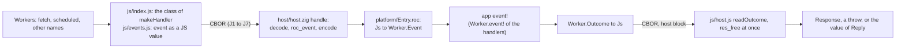
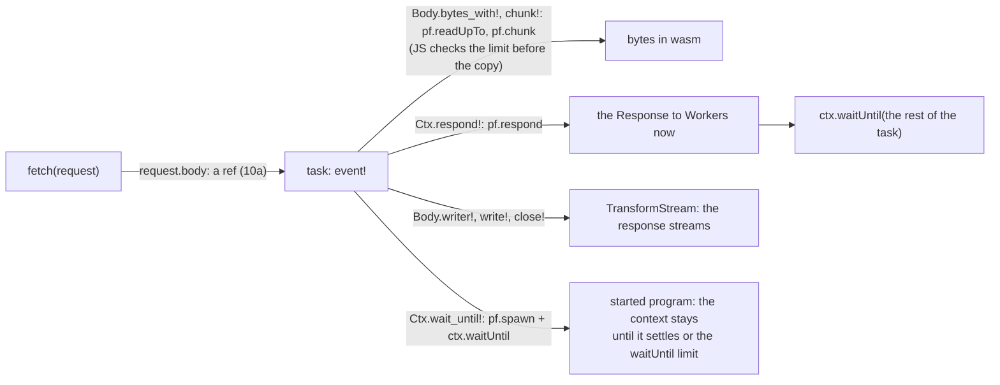
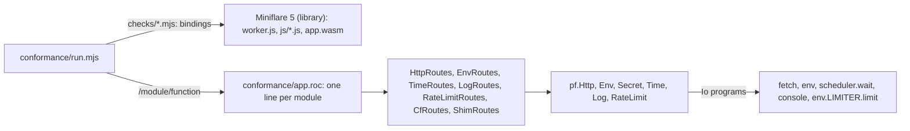
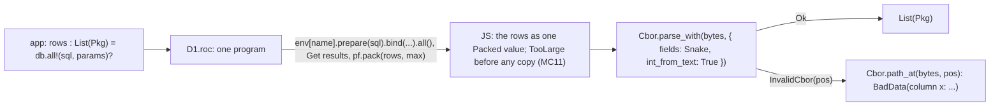
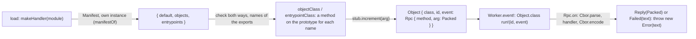
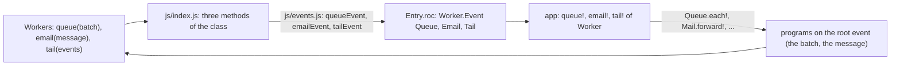
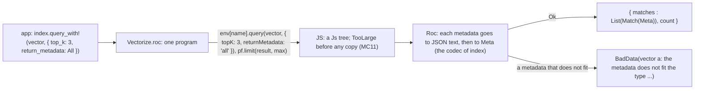
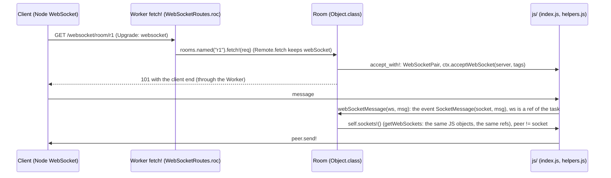

# Plan: fix the gaps found in the audit (2026-10-13)

The audit compared this platform with wasm-bindgen and workers-rs (Rust), workers-zig and Zig std, Go, TinyGo and workers-go, Pyodide and Python Workers, Emscripten, Almide, soli_lang and plumekit. This plan fixes the 5 problems it found (1 to 5).

A second audit (2026-10-13) compared the code with the design in `../DESIGN.md` §6.1 and `../DESIGN-REGISTRY.md` §8. It found 4 bugs, 6 gaps between the design and the code, and 4 design risks. Problems 6 to 11 fix them. The numbers 1 to 5 stay as they are, because other files refer to them.

Problem 12 (2026-10-14) is the goal of problem 4: one wasm instance per isolate. Each task checks at resume that its memory is unchanged, so a host bug does not make the whole instance untrusted. In this plan, a wild write is a write to a wrong address in linear memory, from a host bug or a compiler bug.

| # | Problem | Effect |
|---|---|---|
| 1 | In builds from nightlies before 2026-10-11, data is below the stack. A stack overflow writes over data and globals. | Silent heap corruption. The instance stays in use. |
| 2 | A JS import can throw into a waiting task | The task's owner id and its saved stack copy are lost. Its heap leaks. |
| 3 | A wait that never settles (the client disconnects) | The task's saved stack copy and heap leak forever |
| 4 | Memory: pool rules ("up to 16 per instance", a pool of 3, a retire at 32 MB) and no limit on `memory.grow` | One large request can stop the whole isolate. More instances give more memory and no gain. |
| 5 | The CPU limit stops the instance in a task | `task_abort` does not run. The instance state is stale. |
| 6 | Host bugs: the log buffer has the owner tag of a task (B1), `num` goes to JS as an `f64` (B2), JS does not read `c` and `num` (B3), a failed allocation returns 0 to Roc (B4), large free spans are never joined or split (B5) | B1: heap corruption with no trap after a `dbg` and a `crash`, and a leak for each `dbg`. B2: values above 2^53 change. B3: no effect can send binary data. B4: a write through 0 goes into the bottom of the stack with no trap. B5: a string built in a loop takes memory that grows with the square of its length, and stops the isolate. |
| 7 | The platform ABI has bench exports (R1), the build settings are given by hand (R3), the glue can drift (R4) | `set_copy(0)` breaks requests that run at the same time. A plain `roc build` gives the wrong stack size. An ABI change is not seen. |
| 8 | The platform API is not the designed API: `Str => Str` (G1), raw kind numbers (G2), status 0 on all errors (G3), only a fetch handler (G4). The design is now `API.md` (2026-10-15). | The registry cannot take binary uploads, has no types, no error causes and no cron |
| 9 | The JS shim is bench code, and `io` has no request context (G5) | No entry module for users. No `ctx.waitUntil`, `request.signal` or headers in an effect. |
| 10 | All bodies go through wasm memory (R2) | A large R2 object uses wasm memory that never gets smaller |
| 11 | No release (G6) | Nobody can use the platform by URL |
| 12 | After an unclean trap, any part of the instance's memory can be damaged. Today the only answer is a new instance and a drain of the old one. | Two instances in one isolate (memory), and tasks that resume onto damaged memory return wrong bodies with status 200 |

## Order of work

| Order | Items | Depends on |
|---|---|---|
| 1 | 1a, 1a-ci, 1b to 1d (done) | none |
| 2 | 6e, then 6a and 6d (6b and 6c are replaced by 8a) | none. 6e replaces `hostlib/alloc.zig`, so 6a, 6d and 2a change the new file. 6e also fixes B5, which can stop the isolate with ordinary Roc code. 6a corrupts the heap, so it comes next. |
| 3 | 2a to 2d | none |
| 4 | 3a to 3c (3.0 is done) | the task table (2c) |
| 5 | 4-pre, 4a, then 12-pre, 12a, 12a-stack, 12b, 12d, 12c, 12e, 12f, then 4b to 4j (V1 to V4 are done) | the v7 allocator (6e), the task table (2c), cancel (3c), the clean OOM (6d). 12c needs one instance (4a) and the global check (12d). |
| 6 | 5a to 5c. 5d (edge) waits for a deployed worker in 11. | none |
| 7 | 7a to 7c | none. Before 8, because 8 changes the exports. |
| 8 | 9a and 9b, then 8a, 8b with 9c, 8c with 10a and 10b, 8d, 8e (`API.md` phase A). 10c is part of the test of 8a. | the split ABI (7a), the header settings (7b), the task table (2c), cancel (3c). 8a needs the per-task roots and ref table of 9b, and 8b and 8c need `makeHandler` of 9a. |
| 9 | 8f (`API.md` phase B). Done 2026-10-17: parts 1 to 4 (the status sections of 8f); the edge parts are on the 11c lists. | 8a to 8e |
| 10 | 8g, local. Done 2026-10-17 (the section "Status of step 8g"). The edge part runs after 11: the list "Edge parts for 11c" of that section. | 8a to 8e |
| 11 | 11a to 11c, then 5d on the edge. 11a and 11b: done locally 2026-10-17 (the section "Status of steps 11a, 11b"). The edge run of 11c, 5d and 8g: 2026-10-17, the section "Status of the edge run (11c, 5d, 8g edge)" (after 8g). The example app deployed by CI (11c) is not done. | 7 to 10 |
| 12 | Update DESIGN.md §6.1, Q12 and Q14, DESIGN-REGISTRY.md §8 and `bench/README.md` (API.md RF10) | all |
| 13 | 12g: measure with talon | talon runs on the platform |

Each new test must fail when its change is reverted. Exceptions: moves, releases and edge runs (9a, 11a to 11c, 5d), comparisons (the replay row of 6e) and measurements (8g, 12-pre, 12f, 12g). Their test is that the old tests still pass, or the run gives its numbers.

## 1. Stack overflow corrupts data

### Experiment: can we rely on the linker flag?

Yes. No roc change is needed: nightlies from 2026-10-11 already link stack-first.

Setup:
- `bench/app_deep.roc` recurses with no heap allocation. Each level returns a 16-field record, which uses 176 B of shadow stack.
- 10-09 relinked: the app objects (kept with `roc build --keep-temp`) relinked with `zig wasm-ld --stack-first`.
- The probe is a Node script that uses `bench/core.js`, variant B.

| Build | Layout | Depth 1000 to 4000 | Depth 6000 (about 1.05 MB of shadow stack) | Deeper, or small frames |
|---|---|---|---|---|
| nightly 10-09 (`258ab27`) | data at 1,033, `__stack_pointer` starts at 1,313,168 | ok | The response is "ok". The canary is broken, and the stack wrote into the data and globals below it. Nothing detects it. | V8 `RangeError: Maximum call stack size exceeded` |
| nightly 10-09, relinked with `--stack-first` | stack 0 to 1 MB, then data | ok | `RuntimeError: memory access out of bounds`. `task_abort` returns -1, so the instance is retired. The next request is correct. | same RangeError |
| nightly 10-11 (`7d256b9`) and 10-12 (`2664a27`), no change | stack 0 to 1 MB, data at 1,048,585 | ok | same as the relinked build (checked on 10-12) | not run |

Facts:
- roc passes no layout flag to wasm-ld (`../roc/src/cli/linker.zig:690-750`, roc `9ec02d8c48`). The layout is the LLD default.
- roc `a76bc229ba` (2026-10-07) moved to the LLVM 22 bundles from roc-bootstrap `zig-0.17.0` (`build.zig.zon`). LLD 22 defaults to stack-first (`zig wasm-ld --help`: "--stack-first: Place stack at start of linear memory (default)").
- Nightly 10-09 (`258ab27`) is older than that commit. 10-11 and 10-12 contain it. 10-10 was not checked.
- The pinned nightly moved to 10-19 (`601b54c`, 2026-10-20): it fixes the crash of a `{}` Rpc answer (roc-lang/roc PR 12424), so `Rpc.reply_of` parses the derived `Reply` again. Text in the status sections that says 10-12 is history.
- The relinked 10-09 app passes `bench/node-test.mjs` unchanged.
- `bench/README.md:175` says our layout is stack-first. That is wrong for the 10-09 build.

Conclusion:
- With stack-first, an overflow is a sure out-of-bounds trap, and nothing is below the stack to corrupt.
- The canary stays for one reason: in a recursion that allocates, it gives a clean trap, so the instance stays.
- With data-first, no check can make the layout safe. A check can only find the damage after it happened.
- The layout comes from a linker default, not from a roc decision, so it can change again without notice. The host must check it at run time (1b).

### Upstream: who decides the layout?

Do not hard-code it in roc. Stack-first is already the result, and hard-coding the default would add nothing. If an explicit control is wanted, the platform must own it, because the host code (the canary, `task_abort`) depends on the layout. roc already reads wasm link settings from the platform header (`src/compile/targets_config.zig:64-75`: `import_memory`, `minimum_memory`, `maximum_memory`, `initial_stack_size`, `global_base`).

| Option | Who decides | Upstream fit |
|---|---|---|
| Hard-code `--stack-first` | roc | Poor: no choice, and it repeats the LLD default |
| CLI flag `--wasm-stack-first` | the app user | Poor: the app user does not know the host's needs |
| Field `stack_first : Bool` in the wasm32 target record of the platform header, passed to wasm-ld as `--stack-first` or `--no-stack-first` | the platform author | Good: same pattern as `global_base` and `initial_stack_size` |
| No change. Add a roc test that a wasm32 build is stack-first. | nobody (the default) | Good, and the smallest |

Plan: no PR is needed for this platform. Open an issue that proposes the last row (a test), and offers the header field if they want explicit control.

### Build check: `bench/check-layout.mjs`

A script reads the linked wasm and gives the layout. It does not run the module.

| Reads | How |
|---|---|
| Start value of `__stack_pointer` | The global with that name in the name section (debug builds). Else the first defined mutable i32 global: wasm-ld puts `__stack_pointer` first and `--strip-all` removes the names. |
| Data segments | The `i32.const` offset and length of each active segment |
| Verdict | STACK-FIRST when the stack pointer starts at or below the lowest data segment. Else DATA-FIRST. UNKNOWN when it cannot tell (no such global, a non-constant offset, no data, not wasm). |

Usage: `node bench/check-layout.mjs <app.wasm>...`. Exit 0: all stack-first. 1: one is data-first. 2: one is unknown.

Checked (2026-10-13):

| File | Verdict | Exit |
|---|---|---|
| `bench/out/app.wasm`, `bench/out/app_pad.wasm` (nightly 10-09) | DATA-FIRST (stack pointer 1,313,904 and 3,411,056; data from 1,033) | 1 |
| `app_deep.roc`, nightly 10-09, stripped and `--debug` | DATA-FIRST (found by position, and by name) | 1 |
| `app_deep.roc`, nightly 10-12, stripped and `--debug` | STACK-FIRST (stack pointer 1,048,576; data from 1,048,585) | 0 |
| 10-09 objects relinked with `--stack-first` | STACK-FIRST | 0 |
| `platform/targets/wasm32/host.wasm` (an object, not linked) | UNKNOWN | 2 |
| `README.md` | UNKNOWN (not a wasm module) | 2 |

### What happens when the stack is not first

Removed 2026-10-16: stack-first is guaranteed by the compiler. A module that is not stack-first is refused: `makeHandler` throws at the first instance, and the message names the layout and `bench/check-layout.mjs`. `bench/layout-test.mjs` tests it with a committed data-first fixture (`bench/fixtures/data-first-10-09.wasm`). The text below is measured history.

Was: the platform did not stop. It fell back to variant A: a new instance for each request, and never more than one request in an instance. An overflow can then corrupt only the instance of that one request. The instance is dropped when the request ends. The request that overflowed can still return a wrong body without an error. Only a stack-first build removes that risk.

Cost of variant A (removed) with the v7 allocator (6e), full app (`research/alloc/README.md`, "Benchmarks"):

| | 200 items | 2,000 items |
|---|---|---|
| More CPU per request than variant B | 130 to 160 µs | 400 to 500 µs |
| Memory per request in flight | 2.4 MB (each instance has the 0.9 MB unit tables) | 3.6 MB |
| Memory, 64 requests at once | 152 MB | 232 MB |

The fallback had to limit the instances to the budget (M9, removed).

| Layout | Instances | Requests per instance |
|---|---|---|
| STACK-FIRST | one instance (problem 4, M1) | all requests, at the same time |
| DATA-FIRST or UNKNOWN | one per request | 1 |

### Steps

| Step | Change | Test |
|---|---|---|
| 1a | `bench/check-layout.mjs` (done, see above). `bench/build.sh` runs it on each output and prints a warning when a result is not STACK-FIRST. It did not fail the build. Changed 2026-10-16: it fails the build, because a data-first module is refused. | The table above |
| 1a-ci | CI job on each new nightly: build the bench app and `app_deep.roc`, run the script, run `bench/overflow-test.mjs`. On STACK-FIRST, write the nightly to `compat/last-stack-first-nightly` (the newest nightly that passed). On DATA-FIRST or UNKNOWN, the job fails and notifies us: we open the upstream issue. A data-first nightly cannot be used at all: the platform has no fallback (2026-10-16). A release of the platform and of talon pins the nightly in that file, so a regression in a nightly never blocks a release. | Run the job on 10-09 (must fail) and 10-12 (must pass and record) |
| 1b | Removed 2026-10-16: stack-first is guaranteed by the compiler. JS throws at the first instance when `stack_first()` is 0 (the message names the layout and `bench/check-layout.mjs`). Test: `bench/layout-test.mjs`. The export `stack_first()` and the run time check stay. History: Run time check, the safety net for a module built in some other way. `init` finds the layout: the stack is first when the stack address is below the address of a host global. This is exact for any stack size. ("floor == 0" was wrong for a data-first build with a stack smaller than `STACK_SIZE`.) Add the export `stack_first()`, and list it in `platform/main.roc`. JS uses the fallback above when it returns 0. Cost: one comparison per instance in `init`, and one choice per module load in JS. There is no cost per request. Only the fallback costs, and only when it is used. | 10-09 build: each request gets a new instance. 10-12 build: one shared instance. |
| 1c | A canary trap is clean only when the stack is first. Otherwise it is unclean. | The 10-09 part is removed 2026-10-16 (the test has no data-first run; stack-first is guaranteed by the compiler). History: `bench/overflow-test.mjs` with `app_deep.roc` at depths 1000 to 20000, on the 10-12 build: no request returns a body while the canary is broken. The first trap is unclean (`task_abort` returns -1). After 4-pre (problem 4), an overflow with no alloc on a stack-first build is clean, and the instance is kept. On the 10-09 build with the fallback off, the test must fail. |
| 1d | First pinned nightly: 2026-10-12 (10-11 also passes; there is no 10-10 nightly). Move `bench/build.sh` to nightly 10-12 and rerun `bench/node-test.mjs`. Fix `bench/README.md:175`. Open the upstream issue above. | |

### Status of step 1 (2026-10-13)

| Step | State | Where |
|---|---|---|
| 1a | Done | `bench/build.sh` (uses `bench/get-roc.sh`, builds `app_deep.wasm` too, warns; since 2026-10-16 it fails the build) |
| 1a-ci | Done. Not run on GitHub yet: the repo has no GitHub remote. | `bench/ci-layout.sh`, `.github/workflows/nightly-layout.yml`. Local: 10-09 exit 1, file not changed. 10-12 exit 0, file written. |
| 1b | Removed 2026-10-16: stack-first is guaranteed by the compiler. Now `makeRunner` throws at a module that is not stack-first. History: Done | `hostlib/canary.zig` (`STACK_FIRST`, `stack_first()`), `bench/core.js` (`makeRunner`: fallback, `opts.noFallback`) |
| 1c | Done | `hostlib/canary.zig` (`check`). `bench/core.js` also gives new requests a new instance after `task_abort` returns -1 (before, it only counted it). |
| 1d | Done. Upstream issue: roc-lang/roc#12270 | `compat/last-stack-first-nightly`, `bench/README.md` |

Tests:

| Build | `overflow-test.mjs` | `node-test.mjs` |
|---|---|---|
| 10-12 | PASS. 4500: out of bounds, clean (4-pre), instance kept, live bytes 0, next request correct. 4500 alloc: canary trap, clean, instance kept. A cold V8 RangeError (first request, depth 100000) is clean too. V2: a forced trap at normal depth retires the instance. | PASS |
| Removed 2026-10-16: stack-first is guaranteed by the compiler. 10-09 | PASS with the fallback (one instance per request) | PASS (variant b falls back) |
| Removed 2026-10-16: stack-first is guaranteed by the compiler. 10-09, `--no-fallback` | FAIL: bodies at 4500 and 5000 with a broken canary | |

`app_deep.roc` now takes `<depth> alloc`, so the overflow test covers the canary trap. The test computes each expected body in JS. Depths 4500 and 5000 were added: on 10-09 the silent overwrite happens only while the stack is past the canary and still above the data.

Revert checks (each test must fail):

| Revert | Build | Result |
|---|---|---|
| Removed 2026-10-16: stack-first is guaranteed by the compiler. 1c: the canary trap is always clean | 10-09, `--no-fallback` | FAIL: the unclean trap did not retire the instance |
| 1b: `STACK_FIRST = true` | 10-09 | FAIL: the next request traps |
| 1b: `STACK_FIRST = false` | 10-12, `--expect-shared` | FAIL: the runner fell back |
| No retire in `core.js` | 10-12 | FAIL (after 4-pre, with the forced trap at normal depth, V2): the unclean trap did not retire the instance. Before 4-pre it was the overflow at depth 4500. |

The canary check at each wait from the first version of this plan is dropped. The CI check with the pinned nightly, the run time check and the fallback replace it. The fallback is removed (2026-10-16).

Change after 12c: an unclean trap no longer retires the instance. It gives an alarm and the global check (problem 12). So the tests and revert checks above that look for "retired" or "a new instance" must look for the alarm instead: `task_abort` returns -1 and the alarm counter (M11) goes up. 12c makes this change in `overflow-test.mjs`. Done (2026-10-16): see "Status of steps 12d, 12c, 12e".

## 2. A JS import throws into a waiting task

A throw at the resume point skips `waitEnd`. Then the task's owner id is lost (`OWNER` is 0 while it waits), and so is its `Wait` record with the saved copy.

| Source of the throw | Now |
|---|---|
| io rejects | Caught (`bench/core.js:16-20`) |
| `js_alloc` runs out of memory while the task waits (`hostlib/alloc.zig:279`) | Not caught. `allocOrTrap` also sets the global `TRAP_CLEAN` from a host call while no task runs. |
| A bug in the wrapper | Not caught |
| V8 `RangeError` (engine stack, see the table in problem 1) | Clean when the stack pointer shows an overflow (4-pre, V1). Else unclean: an alarm (12c). |

| Step | Change | Test |
|---|---|---|
| 2a | `js_alloc` returns 0 on out of memory and does not trap. JS returns status 4 (API.md 4.1), and the host makes a clean OOM trap for the task. | Test export `fail_next_alloc` (6d) before a `js_alloc`: the task gets a 503, and the other tasks are correct. Revert (trap): the waiting task is lost. |
| 2b | `makeWait` (`bench/core.js:9-27`) puts one try/catch around all the code after it reads the arguments. It always returns a status and never rejects (as Pyodide `suspenders.c` and the wasm-bindgen `catch` imports do). | io that throws synchronously; io that rejects. Both tasks get an error status. Revert (no try/catch): the sync throw skips `waitEnd`, and live bytes stay. |
| 2c | Task table in the host. JS gives each task an id: `handle(p, l, id)`. The host keeps each `Wait` in a table by id. `task_abort(id)` frees the saved copy and calls `freeOwner(id)`, also when `waitEnd` did not run. Problems 3 and 4 use this table. | Force a throw into a waiting task: live bytes return to 0. Revert (no table): live bytes stay. |
| 2d | `TRAP_CLEAN` is set only while a task runs (`OWNER != 0`), and is cleared when `handle` starts | A trap in a host call from JS is unclean. Revert: it is clean. |

### Status of steps 2a, 2b, 2d (2026-10-16)

| Step | State | Where |
|---|---|---|
| 2a | Done | `hostlib/alloc.zig` (`js_alloc` gives 0), `bench/core.js` (`makeWait` returns 4, `enc0` gives null), `host/host.zig` (`roc_wait`, `STATUS_OOM`) |
| 2b | Done | `bench/core.js` (`makeWait`, now exported for the test) |
| 2c | Done. See "Status of step 2c" below. | |
| 2d | Done | `hostlib/mem.zig` (`trapClean`), `host/host.zig` (`handle`) |

How status 4 uses the old wait path (2a): the import `js_wait` and `Wait.wait!` do not change. `js_wait` already gives a `u32` status, so JS returns 4 and `roc_wait` checks it after `waitEnd` (the task is back on its stack and has its owner again) and calls `mem.trapClean()`. Roc code never sees status 4. 8a replaces this with the check of API.md 4.1. The check of status 5 (3c) must go before `waitEnd`, as 3c says.

Tests (nightly 10-12, Node 26.7):

| Step | Test | Result |
|---|---|---|
| 2a | `node bench/oom-test.mjs bench/out/app.wasm`: `fail_next_alloc` in the io of one wait that has a body, so `js_alloc` gives 0 | PASS: that task traps clean (`task_abort` frees its pages), the other 58 requests are correct, live bytes 0, `dealloc_miss` 0 |
| 2a | `node bench/wait-test.mjs bench/out/app.wasm` (`makeWait` alone, `js_alloc` gives 0) | PASS: status 4 |
| 2b | `node bench/wait-test.mjs bench/out/app.wasm`: io that throws, io that rejects, io that gives a Symbol, `js_alloc` that throws (alone, and in the real instance: a JS error in the code after io) | PASS: each gives status 0, no rejection, 0 lost tasks, live bytes 0, 0 waiting tasks, a throw after the block was made frees the block |
| 2d | `node bench/trapclean-test.mjs bench/out/app.wasm`: a failed allocation in `alloc_bench` called from JS, then `task_abort` | PASS: -1 (not clean) |
| 2d | same file: a crash (clean) with no `task_abort`, then a good task, then `task_abort` | PASS: -1 (the flag was cleared at `handle`) |
| 2d | same file: a crash in a task, then `task_abort` | PASS: clean (the bytes freed, not -1) |
| 2d | `bench/oomclean.mjs` (allocator driver): a failed `roc_alloc` and `roc_realloc` with owner 7 and with owner 0 | PASS: clean for owner 7, not clean for owner 0 |
| All | The old tests (list in step 6a) | PASS |

Revert checks (each test must fail):

| Revert | Test | Result |
|---|---|---|
| 2a: `js_alloc` traps on 0 (as before) | `oom-test.mjs` | FAIL: the trap is inside makeWait and gives status 0, so the task goes on with an empty body: a bad body and no trap |
| 2a: `roc_wait` does not check status 4 | `oom-test.mjs` | FAIL: same bad body |
| 2b: the old `makeWait` (one try/catch around io only) | `wait-test.mjs` | FAIL: `js_alloc` that throws rejects, the real instance loses a task (1 rejected, live bytes 8,576, 1 waiting task) |
| 2d: `trapClean` always sets the flag | `trapclean-test.mjs`, `oomclean.mjs` | FAIL: `task_abort` gives 0 for the trap from JS, owner 0 gives clean |
| 2d: `handle` does not clear the flag | `trapclean-test.mjs` | FAIL: `task_abort` gives 0 after the good task |

Choices for 2a, 2b and 2d:

| Question | Answer |
|---|---|
| Status of an error in `makeWait` | 0, the status of an io error (G3 is open until 8a). |
| `enc0` (the request block) | `js_alloc` gives 0: the runner returns a trap result for the request and starts no task. Nothing to abort. |
| 2d rule | `mem.trapClean` sets the flag only when `alloc.OWNER != 0`. `mem.zig` imports `alloc.zig` for this (files that import each other, no loop in the declarations). |
| Trap of a host call from JS | The one case today is `alloc_bench`, a bench export. The test uses it with `fail_next_alloc`. |
| What 2c must add | The two-step tests use no task table. The case that needs 2c: a throw into a waiting task from outside `makeWait` (for example the V8 `RangeError` at the resume point). There is no way to make it in a test today. |

Open points found:

| Point | Decision (2026-10-16) | State |
|---|---|---|
| Task slots | The JS task table refuses a new task when all slots of the instance are in use: that request gets a 503 (a shed, M7 step 2), and the instance stays. The `mem.trap()` in `taskOf` stays as a guard, and JS cannot reach it. The host has 254 task slots, not 255: slot 0 is the host and slot 255 is JS. The export `task_slots()` gives the number to JS. | Done in 2c. Test 3 of `tasktable-test.mjs`. |
| OOM in `waitBegin` | A clean trap for the task (M6). A failure of the stack copy frees the `Wait` record first. | Done in 2c. Test 2 of `tasktable-test.mjs`. |

### Status of step 2c (2026-10-16)

| Part | State | Where |
|---|---|---|
| JS gives the task id | Done. `handle(p, l, id)`. The host traps (a guard) on id 0 (the host) and maxInt (the owner of the JS slot). `TASK_IDS` is removed. JS ids: 1 to 0xFFFFFFFE, not reused while in flight. | `host/host.zig` (`handle`), `bench/tasks.js` (`nextId`) |
| `Wait` record by id | Done. `WAITS`: 256 entries, a record at `waitBegin`, out at `waitEnd`. `Wait.owner` is the id, `Wait.at` its index. The fixed fields do not change during the wait (12a can sum them). | `host/host.zig` (`waitAdd`, `waitOf`, `waitForget`, `waitDrop`) |
| `task_abort(id)` | Done. A task with a `Wait` record (a throw at its resume point skipped `waitEnd`): free the record and `freeOwner(id)` (the copy is in the task's pages). It does not touch the stack. Else the old path (the clean flag, `freeOwner(OWNER)`). It now sets the stack pointer to `TASK_TOP` before its calls: `abortFree` has a frame now, and after an overflow the stack pointer is wrapped (V1). | `host/host.zig` (`task_abort`, `abortFree`) |
| `task_cancel(id)` (3c), `task_slots()` | Done | `host/host.zig`, `platform/main.roc` (export list) |
| OOM in `waitBegin` | Done. The record is a host block from `allocHostOrTrap` (OWNER stays the task, so the trap is clean). A failed copy frees the record, then `trapClean`. | `host/host.zig` (`waitBegin`) |
| Slot limit in JS | Done. `begin` gives null when the instance has `task_slots()` tasks in flight. The runner answers `{ status: 503, shed: true }`. | `bench/tasks.js` (`begin`), `bench/core.js` (`run`) |
| Test export `fail_alloc_at(n)` | Added: allocation number `n` from now gives 0. `fail_next_alloc()` is `fail_alloc_at(1)`. `FAIL_NEXT` is now the counter `FAIL_AT`. 7a moves it to the bench list. | `hostlib/alloc.zig`, `host/host.zig`, `bench/alloc_driver.zig` |

Tests (nightly 10-12, Node 26.7): `node bench/tasktable-test.mjs bench/out/app.wasm`.

| # | Test | Result |
|---|---|---|
| 1 | 40 tasks, 5 of them get a throw from the import after a wait of 5 ms, with no status (as a V8 `RangeError` at the resume point). JS calls `task_abort(id)`. | PASS: 5 thrown, 0 unclean, 0 bad bodies, the next request correct, live bytes 0, 0 waiting tasks, 0 saved bytes, `dealloc_miss` 0 |
| 2.1 | `fail_alloc_at(1)` in the io of the first wait (empty body, "select <id>" is a small string): the `Wait` record of the second wait fails | PASS: only the victim traps, its second io never starts, clean (instance kept), live bytes 0 |
| 2.2 | Same with `fail_alloc_at(2)`: the stack copy fails | PASS: same |
| 3 | 400 requests at once, each waits 30 ms | PASS: 254 bodies, 146 sheds (503), the instance stays, the next request correct, live bytes 0 |
| All | The old tests (list in the task) | PASS. `wait-test.mjs` and `trapclean-test.mjs` now give an id to `handle` and `task_abort`. |

Revert checks (each test must fail):

| Revert | Test | Result |
|---|---|---|
| No table: `task_abort` does not look for a `Wait` record | test 1 | FAIL: the victims abort unclean (-1), live bytes, waiting tasks and saved bytes stay |
| The `Wait` record traps unclean on OOM (the old `catch trap()`) | test 2.1 | FAIL: the trap is not clean, the instance is replaced |
| A failed stack copy does not free the `Wait` record | test 2.2 | FAIL: live bytes not 0 (the record stays) |
| A failed stack copy traps unclean | test 2.2 | FAIL: the trap is not clean |
| No slot limit in JS | test 3 | FAIL: the 255th task makes `taskOf` trap unclean, the instance is replaced |

## 3. A wait that never settles

When workerd drops a request (for example, the client disconnects), its I/O promises may never settle. The suspended task then keeps its saved copy and its tagged heap blocks forever. plumekit only retires the whole instance after a timeout. Owner tags let us free only that task.

### 3.0 Facts (measured 2026-10-14, local workerd, `research/workerd/`, results in `research/README.md`)

| Question | Why it matters | Answer |
|---|---|---|
| Does the I/O promise ever settle? | If it does, there is no leak | No. After a client reset (TCP RST), the I/O promises and timers of the request never settle. |
| Does `request.signal` fire (compatibility flag `enable_request_signal`)? | A direct cancel signal | Yes, only with the flag |
| Do the timers of the dropped request still fire? | If not, a deadline must be checked from other requests | No. So 3b checks the deadlines from other requests. |
| Is a suspended continuation freed by GC when nothing refers to it? | Step 3c depends on it | No. A suspended JSPI stack is never freed. Each one keeps about 6 KB of RSS and 1 MB of address space, and it keeps its instance from collection. So 3c must resume the stack once, to end it. |
| Does workerd have `FinalizationRegistry`? How long until a dropped instance of 30 MB is collected, under load and when idle? | M10 in problem 4 | Yes. Collected after 5.5 s with 64 requests at once, 20.1 s under memory pressure, and not in 60 s when idle. An instance with a task whose client reset is never collected (fixed by 3c). |
| How large is the JS heap of the shim under load (64 requests at once)? | The default of `jsReserveBytes` in problem 4 | 46 MB in use, 76 MB committed. Default: 48 MB. |
| Cost of a call to JS at each grow | M4 | `js_grow` call 6.2 ns, `memory.grow` 281 ns |

### Steps

| Step | Change | Test |
|---|---|---|
| 3a | JS task table: id to `{instance, waitingSince, cancelled, cancel}`. `cancel` resolves the cancel promise of 3c. | Used by the tests of 3b and 3c |
| 3b | Each new request first checks the table (it runs in a live request context). The table also keeps the event kind of each task, its start time and the state of its response, and each wait records if it waits on a socket. A task is cancelled (3c) at the deadline of API.md 10.2. A `Fetch` task before `Ctx.respond!` (and a task of a kind with no limit of its own): a wait longer than `taskDeadlineMs` (default 120 s). A `Scheduled`, `Queue` or `Alarm` task: 15 min from its start, the wall time limit of Workers, and no deadline for one wait. After `respond!`: 30 s after the response body is complete, the `waitUntil` limit of Workers. A `Body.writer!` stream is complete at its `close!`, and a 101 response when its socket closes. A wait on a socket (`receive!`, `Tcp.read!`): no deadline. Also cancel at once on `request.signal`, on the close of the socket of the task, and on the cancel of its response stream. 3.0: `request.signal` fires only with the compatibility flag `enable_request_signal`, so the shim documents the flag and 11c sets it. The 15 min and 30 s limits are constants of the shim. A test can make them smaller. | Node: deadline 100 ms, io that never resolves for one request. The next request cancels it: it gets a 503, and live bytes return to 0. Abort the signal of a waiting request: it is cancelled at once. Revert (no check of the table): live bytes stay. A `Scheduled` task and a `Queue` task with one wait of 300 ms end with `Done`. With the task limit set to 200 ms, each is cancelled. Revert (the 100 ms wait deadline for all kinds): they are cancelled at 100 ms. A `Fetch` task that waits 300 ms in `receive!` is not cancelled. Revert (a socket wait has the deadline): it is. After `respond!` (the 30 s limit set to 100 ms): a task with a `Bytes` body that then waits 300 ms is cancelled. A task that writes a `Body.writer!` stream for 300 ms is not cancelled, and a wait that starts after its `close!` is cancelled 100 ms later. Revert (the limit starts at `respond!`): the writer task is cancelled at 100 ms. A 101 task stays while its socket is open for 300 ms, and ends when the socket closes. The client cancels a `Body.writer!` stream: the task is cancelled at once. Revert (no cancel on the stream): it waits until its deadline. |
| 3c | Cancel (`task_cancel(id)`): the host frees the saved copy and calls `freeOwner(id)`. Then the import wrapper must end the suspended stack, because a suspended JSPI stack is never freed and keeps its instance (3.0). The wrapper waits on `Promise.race([io, cancelPromise])`. On cancel, it returns status 5, "cancelled" (API.md 4.1). The host checks this status first, before it reads or writes memory or a global, and runs `unreachable`. The trap ends the stack. JS knows that the task was cancelled, so this trap is not an alarm. A replace (M1) cancels all tasks of the old instance in the same way, so the old instance can be collected. | Node: io that never resolves for some ids. Expect live bytes 0, the other requests correct, and flat memory (RSS too) over 10,000 cancels. Replace an instance with 10 waiting tasks (`--expose-gc`): the `FinalizationRegistry` callback reports the old instance collected. Revert (a promise that never settles, as before): RSS grows by about 6 KB per cancel, and the old instance is not collected. |
| 3d | Removed (2026-10-14): no instance drains (problem 12) | |

### Status of steps 3a to 3c (2026-10-16)

| Step | State | Where |
|---|---|---|
| 3a | Done. One entry for each task in flight: `id`, `inst`, `kind`, `startedAt`, `waiting`, `waitingSince`, `socketWait`, `response` (`none`, `open`, `complete`), `completeAt`, `cancelled`, `reason`, `hostFreed`, `ended5`, `wake` (the cancel promise of the wait). It knows no wasm, so 8a and 9a can use it as it is (9b adds the context of a task). | `bench/tasks.js` (`makeTaskTable`) |
| 3b | Done for the rules that the current code can reach. The other rules are in the table, with unit tests. `deadlineOf(t)` is a pure function of the entry and the deadlines. `sweep()` runs first in each `run`. `request.signal`: `run(req, { signal })`, and `bench/worker.js` passes `req.signal`. The deadlines are options of `makeRunner` (`taskDeadlineMs`, `wallMs`, `initMs`, `afterRespondMs`). | `bench/tasks.js` (`DEADLINES`, `deadlineOf`, `sweep`, `begin`, `respond`, `bodyComplete`, `cancel`), `bench/core.js` (`run`), `bench/worker.js`, `bench/config-s.capnp` (the flag `enable_request_signal`) |
| 3c | Done. `task_cancel(id)` frees the `Wait` record and calls `freeOwner(id)`. JS calls it at the cancel of a task that waits (`onCancel`), else at its next wait. The import waits on `Promise.race([io, cancel])` and gives status 5. The host checks status 5 first after `js_wait` and runs `unreachable` (inline asm, so no memory or global access can move before it; checked in the disassembly: the compare is the first instruction after each `call js_wait`). The runner knows the trap is a cancel (`ended5`): no `task_abort`, not counted as a trap, the request gets a 503 with `cancelled: <reason>`. `runner.replace()` (M1) cancels all tasks of the old instance. The unclean-trap path uses it. | `host/host.zig` (`task_cancel`, `trapIfCancelled`, `roc_wait`), `bench/core.js` (`makeWait`, `hostCancel`, `end5`, `replace`), `bench/tasks.js` (`cancelAll`) |

Tests (nightly 10-12, Node 26.7, workerd of wrangler in Node 26.7):

| Step | Test | Result |
|---|---|---|
| 3a, 3b | `node bench/tasks-test.mjs`: the table alone, fake clock, deadlines 100 ms (wait), 200 ms (wall), 150 ms (Init), 100 ms (after respond). Each row of the deadline table of API.md 10.2: Fetch, Scheduled, Queue, Alarm, Init, Email, Tail, Rpc, EntrypointFetch, after `respond!`, `Body.writer!` open and closed, 101 open and closed, socket waits in 3 states, `request.signal` (before and during the task, not after), socket close and stream cancel, `cancelAll`, slots, ids | PASS: 38 of 38 rows |
| 3b | `node bench/deadline-test.mjs bench/out/app.wasm`, 1: `taskDeadlineMs` 100, io that never resolves. The next request cancels it. | PASS: 503 `deadline`, the next request correct, live bytes 0, 0 waiting tasks, 0 traps, no replace |
| 3b | same, 2: abort the signal of a waiting request | PASS: 503 `signal` after 0.3 ms, live bytes 0 |
| 3b | same, 3: a `Scheduled` task and a `Queue` task (the `kind` of the table) with one wait of 300 ms, wait deadline 100 ms, requests every 25 ms | PASS: both end with a correct body at 302 ms. With `wallMs` 200: cancelled at 209 to 210 ms. A `Fetch` task: cancelled at 118 ms. |
| 3b, 3c | `WORKERD=<workerd> node bench/signal-workerd.mjs` (`bench/config-s.capnp`): 20 requests whose fetch answers after 10 min, the client resets each socket (TCP RST) after 300 ms | PASS: 20 cancels by the signal, 0 waiting tasks, live bytes 0, 20 good requests before and 20 after correct, 0 traps |
| 3c | `node --expose-gc bench/cancel-test.mjs bench/out/app.wasm`, 1: 300 batches of 100 tasks whose io never resolves, aborted while they wait, and 10 good tasks that start right after the abort (they reuse the freed wait records). One more task waits for the whole run, so the page of the wait records stays in the host. RSS after `gc()`, over the last 10,000 cancels | PASS: 30,000 cancels, 0 bad bodies, live bytes 0, 0 traps. RSS 136.2 MB to 137.9 MB: 0.14 to 0.22 KB per cancel (4 runs). 30,000 cancels and 3,000 good requests in about 2 s. |
| 3c | same, 2: replace an instance with 10 waiting tasks | PASS: 10 times 503 `replace`, the `FinalizationRegistry` callback reports the old instance collected after the first `gc()` (50 ms), the new instance is correct |
| All | The old tests (list in the task), and the workerd leak test (`bench.mjs leak 2000 0.01`, variants a and b) | PASS |

RSS of `cancel-test.mjs` 1, more data:

| Run | RSS |
|---|---|
| Measured from batch 10 (the first plan of the test) | 3.25 KB per cancel. It is the warm-up: 71 MB at batch 10, 130 MB at batch 300, 127.5 MB at batch 600. |
| Control: the same batches, no abort (the tasks end) | 112.8 MB to 125.0 MB over the last 10,000 requests (1.25 KB per request): the same warm-up |
| Revert: a promise that never settles (below) | 4.4 to 4.7 KB per cancel (213 MB to 259 MB) |

Revert checks (each test must fail):

| Revert | Test | Result |
|---|---|---|
| 3b: `run` does not call `sweep` | `deadline-test.mjs` | FAIL: the task is not cancelled, live bytes and the waiting task stay. Scheduled, Queue and Fetch end at 301 ms. |
| 3b: no `request.signal` in the table | `deadline-test.mjs`, `tasks-test.mjs` | FAIL: not cancelled, live bytes stay |
| 3b: no `request.signal` in `bench/worker.js` | `signal-workerd.mjs` | FAIL: 0 cancels, 20 waiting tasks, live bytes 1,277,120 |
| 3b: the 100 ms wait deadline for all kinds | `deadline-test.mjs`, `tasks-test.mjs` | FAIL: Scheduled and Queue cancelled at 119 ms |
| 3b: a socket wait has the deadline | `tasks-test.mjs` | FAIL: the 3 socket rows are cancelled |
| 3b: the 30 s limit starts at `respond!` (also for an open stream) | `tasks-test.mjs` | FAIL: the writer task is cancelled at 100 ms |
| 3c: a promise that never settles: at a cancel the host frees the task and the runner answers 503, but the import never returns (as before 3c) | `cancel-test.mjs` | FAIL: RSS grows by 4.4 KB per cancel, the old instance is not collected in 5 s |
| 3c: the host does not check status 5 | `cancel-test.mjs` | FAIL: the cancelled tasks run `waitEnd` on the freed records that the new tasks now use: 10 bad bodies in the first batch, an unclean trap, a replace |
| 3c: `task_cancel` frees nothing | `deadline-test.mjs`, `cancel-test.mjs` | FAIL: live bytes and waiting tasks stay. The host slots fill up, and batch 3 fails. |
| 3c: a replace does not cancel the tasks of the old instance | `cancel-test.mjs` 2 | FAIL: the 10 tasks get no 503, the old instance is not collected |

The first version of `cancel-test.mjs` did not catch the revert "the host does not check status 5": each freed record was alone on its page, so the page went back to the reserve, the stale pointer pointed into other data, and `waitEnd` trapped by chance. The anchor task and the start of new tasks right after the abort make the reuse sure.

PLAN tests of 3b that wait for later steps (the table logic is in `bench/tasks.js` and has a unit test now):

| PLAN test | Needs |
|---|---|
| A `Scheduled` and a `Queue` task end with `Done` (today: the `kind` of the table and the body) | 8b (events, `Outcome`) |
| A `Fetch` task that waits 300 ms in `receive!` is not cancelled; revert (a socket wait has the deadline) | 8f (`WebSocket.receive!`), and the import must say that a wait is on a socket (`waitStart(t, true)`) |
| After `respond!` (30 s limit at 100 ms): a `Bytes` body, then a wait of 300 ms, is cancelled | Done in 8b (second half): `bench/stream-test.mjs` `deadline` |
| A `Body.writer!` stream for 300 ms is not cancelled, a wait after `close!` is cancelled 100 ms later; revert (the limit starts at `respond!`) | Done in 8b (second half): `stream-test.mjs` `writer` (cancelled 113 ms after `close!`) |
| A 101 task stays while its socket is open, and ends when it closes | 8f (`WebSocket.accept!`): `respond(t, true)`, `bodyComplete(t)` at the close |
| The client cancels a `Body.writer!` stream: the task is cancelled at once; revert (no cancel on the stream) | Done in 8b (second half) in Node: `stream-test.mjs` `cancel` (the reader cancels the stream). Local workerd does not cancel the stream when the client goes away (the open point below): there `request.signal` ends the task (`stream-workerd.mjs` `away`). |
| The close of the socket of the task cancels it | 8f: `cancel(t, 'socket')` |
| The `Init` deadline of 30 s | 8f (`init!` of an object). API.md 10.2 gives it, so the table has `initMs`. |
| Edge facts of API.md 10.2 | 11c |

Choices for 3a to 3c:

| Question | Answer |
|---|---|
| How the import knows its task | The host gives the id as a 10th argument of `js_wait` (`OWNER` before `waitBegin`). JS cannot know which suspended stack resumes: JSPI resumes in promise-job order, and other jobs run between the end of an import and its resume. See the open questions. |
| When the host frees a cancelled task | At the cancel, when the task waits (the table calls `onCancel`). Else at its next wait, in the import, before it returns 5. Once only (`hostFreed`). So the memory is free at once, for example for the request whose check found the deadline. |
| What JS does after a cancel trap | No `task_abort` (the host freed the task already, and the trap changed no state), no alarm, no replace. The request gets a 503. |
| Task that is cancelled while it runs, and ends with no further wait | It keeps its body. The cancel only stops a wait. |
| When the deadlines are checked | At the start of each `run` only (3.0: the timers of a dropped request do not fire). No timer. |
| After `respond!`, while a `Body.writer!` stream or a 101 socket is open | No deadline: API.md 10.2 gives only "30 s after the response body is complete". The signal, the stream cancel and the socket close still end the task. |
| A socket wait | No deadline in any state, also over the 15 min of `Scheduled` and the 30 s after `respond!` (API.md 10.2: "in any state"). |
| `kind` today | `run(req, { kind })`, only a field of the table. 8b sets it from the event. Default `Fetch`. |
| `bench/worker.js` | Passes `req.signal`, and answers a shed or a cancel with its status 503 (it was 500 for all traps). `/stats` gives `cancels` by reason. |
| `bench/echo.js` | An id that starts with `hang` answers after 10 min (a timer, so workerd does not end the request as hung). |
| `bench/config-s.capnp` | Variant b with `enable_request_signal`, on port 8132 |

Open questions:

| Question | Detail | State |
|---|---|---|
| API.md 4.1: "The import has no task argument. JS knows the task that runs." | JS knows the task at `handle`, but not at a resume: which stack resumes depends on the order of promise jobs, and other jobs can run first. Today the host gives the id as an argument of `js_wait`. 8a must keep an id argument for `js_await` and `js_call`, or change API.md 4.1. | Settled 2026-10-16: API.md 4.1 changed, `js_await` takes `task_id` first. |
| `task_slots` in the production list of 7a | JS needs it. 7a lists `task_cancel` but not `task_slots`. | Settled: added to 7a. |
| An unclean trap keeps its host slot | `task_abort` gives -1 and does not call `freeOwner`, so the task slot of that task stays in use in the host, while JS frees its slot at the end of `run`. Today the instance is replaced, so this has no effect. After 12c the instance stays: then JS and the host count differently, and `taskOf` can trap again. 12c must free the slot (or JS must count it as used). | Settled: 12c frees the slot (12c row). |
| A wait that never settles after `respond!` while a stream is open | Only the signal or the stream cancel ends it (no deadline in API.md 10.2). Is that wanted? | Local part found in 8b (second half, `research/stream-cancel/probe.mjs`, results in `research/stream-cancel/results.json`). The client reads 2 KB of an open stream, then goes away (an abort of `fetch`, a TCP reset, a socket close). With `enable_request_signal`: `request.signal` aborts at once (203 to 307 ms after the start, the client left at about 200 ms), so the shim cancels the task. The response stream is not cancelled: `writer.closed` does not reject, and the pending `write` never settles (checked for 5 s). The request stays while `ctx.waitUntil` holds it. With no flag: no event at all, so the task waits forever (no deadline while the stream is open). When the client goes away after the body is complete, `request.signal` does not abort, and the work in `ctx.waitUntil` runs to its end. So locally the flag is required, and the stream cancel of API.md 10.2 never comes from workerd. Still open: the edge part (11c), and a deadline for one wait while a stream is open when the flag is not set (API.md 10.2 decides). |


## 4. Memory management

Decided on 2026-10-13. This replaces the old pool rules ("up to 16 per instance", a pool of 3, and a retire at 32 MB). Changed on 2026-10-14: one instance per isolate (problem 12), so there is no draining instance.

### Facts

| Fact | Source |
|---|---|
| Cloudflare limits the isolate to 128 MB. The JS heap and the linear memory of all wasm instances count. Over the limit the isolate is replaced. Edge, 2026-10-17 (11c, E8, 2 tries: 160 MB of JS, and 113 MB of wasm plus 64 MB of JS): the requests in flight did not fail. The request that went over and a request in flight on the same isolate finished with 200, and the next request came to a new isolate. Two tries are no proof that no request ever fails: do not rely on it. | Cloudflare Workers limits, and `edge/results/probe-mem-2.txt`. |
| Our modules declare no memory maximum (min 21 pages, max none in `bench/out/app_deep.wasm`). So `memory.grow` does not fail before the isolate limit. | roc adds `--max-memory` only when the header sets `maximum_memory` (`roc:src/cli/linker.zig:732-734`) |
| Almost all heap growth goes through one function: `bumpSpan` (`hostlib/alloc.zig:88-110`), `poolGrow` in v7 (6e). Only the roc boxy runtime takes pages itself, for its own tables, mostly at start (`roc:src/boxy_runtime/main.zig:143`). v7 marks those pages as foreign. | |
| A dropped instance is collected after 5.5 s under load, 20.1 s under pressure, and not in 60 s when idle (3.0) | So a drop cannot free memory for a grow that waits |
| Wasm memory never gets smaller. A dropped instance gives its memory back only when V8 collects it, and workerd cannot force a GC. | `memory.discard` (memory control proposal) is not in V8 |
| Live heap blocks cannot move: Roc values, the shadow stack, the saved stack copies and JS hold raw addresses, and there are no type maps or stack maps. | |
| `roc_alloc` and `roc_realloc` give 0 back to Roc when memory cannot grow (`hostlib/alloc.zig:219-231`). Address 0 is the bottom of the stack. | Fixed in 6d |

### Decisions

| # | Decision |
|---|---|
| M1 | One instance per isolate takes all requests. No instance drains. After an unclean trap, the instance stays when the checks of problem 12 pass. When they fail, the instance is replaced: all its tasks are cancelled (3c, each gets a 503), it is dropped, and a new instance starts. There is no replace for size. The new instance (about 2.4 MB at start) must fit in the budget next to the old one until the old one is collected (M10). If it does not fit, new requests get a 503 (pressure step 2) until the callback reports the old instance collected. |
| M2 | No fixed cap per instance by default. An instance grows as far as the isolate budget allows. |
| M3 | The budget is `isolateBytes` (128 MB) minus `jsReserveBytes`. JS counts `memory.buffer.byteLength` of each live instance, and of each dropped instance until it is collected (M10). The allocator has its own cap, `MAX_UNITS` (`hostlib/alloc.zig:24`): 128 MiB of 4 KB units, the size of the unit tables. `poolGrow` refuses a grow above it before `js_grow` is asked (`hostlib/alloc.zig:247`), so a pool of more than 128 MiB is a clean OOM (M6) with no change of `budget.asked`. The cap is a second limit next to the budget: a budget above 128 MB (`isolateBytes`) does not give a pool above 128 MiB (edge, E7: 113 MB of wasm passed with the budget raised). |
| M4 | Each grow asks JS first. `poolGrow` calls the synchronous import `js_grow(pages)`, and grows only on yes. It grows by `max(needed, growStepBytes)`. The cost is small: a call costs 6.2 ns and a grow 281 ns (3.0), and a grow happens only above the high-water mark. |
| M5 | A developer cap is optional: the shim option `maxInstanceBytes`, checked by `js_grow`. The platform header sets no `maximum_memory`, because the app developer cannot change the platform header. |
| M6 | A grow that cannot be served gives a clean OOM trap to the task that asked (6d). That request gets a 503, its pages are freed (owner tags), and the instance stays in use. Memory never stops the whole isolate on purpose. |
| M7 | Under pressure, the steps below run in order, from the least severe to the most severe. |
| M8 | Removed (2026-10-14): it chose between an active and a draining instance. There is no draining instance. |
| M9 | Removed 2026-10-16: stack-first is guaranteed by the compiler. Fallback (variant A, one instance per request, problem 1): each instance is a live request. An instance that needs memory waits up to `graceMs` for other requests to end, then gets a clean OOM. A new instance starts only when its initial memory fits the budget, or when no instance is live (the dropped ones are garbage: one instance starts although they count). Else the request waits in the queue. With v7, an instance starts at about 2.4 MB (the unit tables are 0.9 MB), so about 33 instances fit in the default budget of 80 MB. A smaller unit table for the fallback build (a lower `MAX_UNITS`) is an option. |
| M10 | A dropped instance counts in the budget until a `FinalizationRegistry` callback reports it collected (workerd has it, 3.0). There is no `collectWaitMs`. An instance with a suspended task is never collected, so a drop first cancels all its tasks (3c). |
| M11 | One log line, with the sizes or the cause, for each: denied grow, shed request, alarm (12c), failed global check (12d, 12e), replace (M1), cancel (3b, 3c), caught double free (`double_frees`), missed free (`dealloc_miss`). Each kind also has a counter export (H3). So the developer can see why the app is slow or fails. |

### Cap of 2 instances (removed 2026-10-14)

The cap of 2 bounded the instances while an old one drained. With one instance per isolate (problem 12), no instance drains. The old open question ("kill an instance at once on an unclean trap, or let its tasks finish") is answered by 12c: tasks whose sums match finish, and tasks whose sums differ get a 503.

V1 to V4 were measured (2026-10-14, `research/traps/`):

| # | Question | Result | Effect |
|---|---|---|---|
| V1 | Value of `__stack_pointer` after an overflow trap | Warm code: an out-of-bounds trap with the stack pointer wrapped (4,294,967,248). Cold (Liftoff) code: a V8 `RangeError`, and the stack pointer can be anywhere. A recursion that allocates: the canary `unreachable` (stack pointer 12,176). | 4-pre also counts a `RangeError` as clean. Safe: the allocator is in a sound state at each call where V8 can throw it. Needs 2c (the js_wait window). |
| V2 | Can a trap that is not an overflow look like one? | Traps at normal depth have the stack pointer between 855,872 and 1,047,872 | The rule holds |
| V3 | Does the rule depend on the layout? | On a data-first build, an overflow writes over data before it traps (problem 1) | The rule is only for stack-first builds |
| V4 | How often does a retire happen while an instance drains? | About 1 - e^(-rate x rps x drain time): 79 to 83 % at a trap rate of 1 %, 5 to 11 % at 0.1 % | With drains, the cap of 2 would act often. Problem 12 removes the drain. |

### Steps under memory pressure

A grow is under pressure when `js_grow` says no. Changed on 2026-10-14: with one instance, nothing can be pushed out, and a dropped instance frees its memory only seconds later (3.0). So the wait, gate and push-out steps are removed.

| Step | What | Applies when |
|---|---|---|
| 1. Reclaim | In the instance: give the page reserve back to the pool (done in v7, 6e), then try again | Always first |
| 2. Shed (refuse new requests) | New requests get a 503 while the instance is under pressure (`js_grow` said no in the last `graceMs`). Requests in flight continue. | After step 1 failed |
| 3. Fail the requester | Clean OOM trap for the task that asked (M6). Its pages go back, so the other tasks can continue. | Step 1 did not free enough |

### Heap optimization on memory pressure

Free space can only be reused in the same instance. It cannot go to another instance or back to the isolate.

To implement:

| # | Option | What it is | Why it is safe |
|---|---|---|---|
| H2 | Idle reset | When no task runs or waits on the instance and `LIVE_BYTES` is 0, the heap starts again: each region becomes empty, and the free lists are cleared. Foreign units (roc runtime) and host blocks stay. | O(number of regions). `LIVE_BYTES` can only be too high (a leak), never too low, so a wrong count stops the reset and never resets over live data. `log_clear` frees the empty `LOG` buffer, so 0 is reachable. Needs `track_live` on in production (it is the default). |
| H3 | Fragmentation counters | Exports for the heap bytes, the peak of `LIVE_BYTES`, the number of reclaim walks and the bytes they gained | Counters only. They give the numbers that the options below need. |

Need measurement (do not implement until the numbers show a gain):

| # | Option | What it is | What to measure |
|---|---|---|---|
| H7 | Replace for fragmentation | Replace the instance (M1) when the heap bytes divided by the peak of `LIVE_BYTES` (H3) go above a limit. Only when no task runs or waits (at an idle check, 12e), so no task is cancelled. | The ratio in long mixed runs and in talon (12g) |
| H8 | Size classes | v7 has 13 classes (16 to 2,048 B). The old 16 classes gave no change. | The waste in each class for real talon handlers (12g) |

Done or not needed:

| # | Option | State |
|---|---|---|
| H1 | Reclaim walk for small blocks | Not needed with v7 (6e): an empty small page goes back at once |
| H4 | Split large free blocks | Done in 6e |
| H5 | Join at each free | Done in 6e (v7 joins free runs at each free, with boundary tags in the unit tables) |
| H6 | Lower the top at each free | Not needed: v7 has no bump top. Free units join the free run at the top. |
| H9 | Grow step | Measured: 64 KB, the `growStepBytes` default (`research/heap-options/h9.jsonl`) |

`memory.discard` would let an instance give pages back. V8 does not have it. Check it again when V8 ships it.

### Shim options (`makeHandler(module, opts)`)

| Option | Default | Use |
|---|---|---|
| `isolateBytes` | 128 MB | The Cloudflare limit. The allocator cap `MAX_UNITS` (128 MiB, M3) is not an option: a change of it is a rebuild of the host |
| `jsReserveBytes` | 48 MB (3.0: the JS heap peaks at 46 MB in use) | The part of the budget for JS |
| `maxInstanceBytes` | none | Optional hard cap per instance (M5) |
| `growStepBytes` | 64 KB (H9) | M4 |
| `graceMs` | 1000 | Pressure step 2 (and M9, removed 2026-10-16) |
| `queueLimit` | 100 | Removed 2026-10-16: stack-first is guaranteed by the compiler. The queue of the fallback (M9) |
| `resumeCheck` | `"always"` | 12b. `"afterAlarm"`: check at resume only after an alarm (sum mode 1). It costs less, but misses a wild write with no trap. |
| `heapCheckEvery` | 100 (12e: from the check time of 12d, `bench/checkcost.mjs`; the first value was 1,000) | 12e. Run the shared-memory check after this many requests. 0: off. |
| `heapCheckWhenIdle` | `true` | 12e. Run the shared-memory check when the instance becomes idle |
| `taskDeadlineMs` | 120,000 | 3b. A wait of a `Fetch` task before `Ctx.respond!` (and of a kind with no Workers limit) that is longer is cancelled. `Scheduled`, `Queue` and `Alarm` tasks, the time after `respond!` and socket waits have other deadlines (API.md 10.2). |
| `pinLimit` | 1,000 | API.md RS2: the number of entries in the pin table |
| `ops` | none | API.md 6.4: JS functions of the app, the root `ops` |
| `other` | none | API.md 10.1: Workers handler names that give the event `Other` |

### Steps

| Step | Change | Test |
|---|---|---|
| 4-pre | `task_abort` counts a trap as clean when the stack pointer shows an overflow (V1) and the layout is stack-first | `overflow-test.mjs`: at depth 4500 with no alloc, the instance is kept, live bytes are 0, and the next request is correct. Revert: the trap is unclean (the instance is replaced; after 12c, an alarm). V2 case: still unclean. |
| 4a | One instance (M1). Remove the "up to 16", the pool of 3, the 32 MB retire and the drain. A replace cancels all tasks of the old instance (3c). Until 12c, each unclean trap replaces the instance. | 1,000 requests with 1 % unclean traps: never more than 1 instance with tasks, 0 bad bodies. Revert (old pool): more than 1. |
| 4b | `js_grow` before each grow, the budget in JS, the grow step (M3, M4) | Node, `isolateBytes` 16 MB, `jsReserveBytes` 0: a request that allocates 20 MB gets a 503. Other requests are correct, live bytes return to 0, the instance stays. Revert (grow with no ask): memory goes over 16 MB. |
| 4c | `maxInstanceBytes` (M5) | Cap 8 MB: the same request fails at 8 MB. No cap: it passes with `isolateBytes` 64 MB and `jsReserveBytes` 0. Revert (no cap check): it passes with the cap. |
| 4d | The steps under pressure (M7): reclaim, shed, fail the requester | `isolateBytes` 16 MB, `jsReserveBytes` 0, 64 requests of 1 MB each: the requests that do not fit get a 503, new requests get a 503 for `graceMs`, the others are correct, live bytes return to 0. Revert the shed: new requests trap with OOM. |
| 4e | Count dropped instances until collected (M10) | workerd: drop an instance of 30 MB (a replace), then grow. The budget shows the 30 MB until the callback. Revert (count only the live instance): the budget drops at once, and the grow goes over `isolateBytes`. |
| 4f | Removed 2026-10-16: stack-first is guaranteed by the compiler. Budget for the fallback (M9) | 10-09 build (data-first): 64 requests at once with `isolateBytes` 32 MB and `jsReserveBytes` 0. Requests wait and then pass. None goes over the budget. Revert (no budget for the fallback): memory goes over 32 MB. |
| 4g | Log lines and counters (M11) | Each case in 3b, 3c, 4b to 4f and 12c to 12e writes its line, and its counter goes up. Revert (remove one line): its test fails. |
| 4h | H3 counters | Values match a manual walk. Revert (a counter that is not updated): no match. |
| 4i | Done by 6e (v7: join, split, empty pages back at once) | |
| 4j | H2 idle reset | 1,000 requests with mixed sizes, then idle: heap bytes return to the base, foreign units and host blocks stay, and `check_heap` (12d) passes after the reset. A test that keeps one live block (a host block): no reset, no damage. Revert: heap bytes stay high. |


### Status of steps 4-pre, 4a (2026-10-16)

| Step | State | Where |
|---|---|---|
| 4-pre | Done | `host/host.zig` (`task_abort(id, rangeError)` reads the stack pointer first), `hostlib/canary.zig` (`overflowed`), `bench/core.js` (`isStackError`), test export `fault_next_wait(kind)` (`host/host.zig`, `platform/main.roc`; 7a moves it to the bench list), `bench/overflow-test.mjs` |
| 4a | Done. The code was already there: 3c made the runner one instance with `replace()`, and the old drain ("tasks that wait on the old one finish there") was gone. There is no pool, no "up to 16" and no 32 MB retire left in `bench/core.js`. 4a adds the test, and `liveInstances()` in the task table. | `bench/oneinstance-test.mjs`, `bench/tasks.js` (`liveInstances`) |

The rule of 4-pre: `task_abort` makes the trap clean when a task ran (`TASK_TOP != 0`, `OWNER != 0`), the layout is stack-first and one of these holds:

| Sign of an overflow | Source |
|---|---|
| The stack pointer is below `STACK_LIMIT` (canary or address 0) or above `TASK_TOP` (wrapped under 0) | The stack pointer at the start of `task_abort`, before `setSP(TASK_TOP)`. Warm code: out-of-bounds trap with a wrapped pointer (V1). |
| JS got a V8 `RangeError` with "call stack" in the message | The second argument of `task_abort`. Cold code: the engine stack ends first and the stack pointer is a normal value (measured 48,672 at depth 4500 to 1,000,000; the pointer "can be anywhere", V1), so only JS can tell. |

Tests (nightly 10-12, Node 26.7):

| Step | Test | Result |
|---|---|---|
| 4-pre | `node bench/overflow-test.mjs bench/out/app_deep.wasm --expect-shared`: depth 4500, no alloc (out of bounds): clean, instance kept, live bytes 0, next request correct. Depth 4500 alloc (canary): same. | PASS |
| 4-pre | same, a cold RangeError: the first request of a fresh module (before any other run), depth 100000 | PASS: `RangeError: Maximum call stack size exceeded`, clean, instance kept, live bytes 0, next request correct |
| 4-pre | same, V2: `fault_next_wait(1)` (out-of-bounds write at normal depth) and `fault_next_wait(2)` (`unreachable`) | PASS: both unclean, the instance is replaced, the next request is correct |
| 4a | `node bench/oneinstance-test.mjs bench/out/app.wasm`, part 1 (variant b): 1,000 requests, 25 at a time, every 100th makes an unclean trap (`fault_next_wait(1)`), then the runner replaces the instance while the other tasks of the wave wait | PASS: max 1 instance with a task (sampled at each wait and each start), 0 bad bodies, 10 own traps, 10 replaces, 367 tasks cancelled by a replace (503 `replace`), 0 other ends, table empty, live bytes 0 |
| 4a | Removed 2026-10-16: stack-first is guaranteed by the compiler. same, part 2 (variant a, the fallback): 1,000 requests with 1 % clean traps | PASS: 0 bad bodies, 10 traps, table empty |
| Removed 2026-10-16: stack-first is guaranteed by the compiler. 10-09 (data-first) | `overflow-test.mjs bench/out09/app_deep.wasm`, `node-test.mjs bench/out09/app.wasm`, `oneinstance-test.mjs` (part 1 is skipped: the runner falls back) | PASS: one instance per request. `overflow-test.mjs --no-fallback`: FAIL (bodies at 4500 and later with a broken canary, and the cold RangeError retired the instance) |
| All | The old tests (list in the task), also `signal-workerd.mjs` | PASS |

Revert checks (each test must fail):

| Revert | Test | Result |
|---|---|---|
| 4-pre: `overflowed` always false | `overflow-test.mjs` | FAIL: depth 4500 retired the instance, and the unclean count is 1 |
| 4-pre: JS passes no RangeError flag | `overflow-test.mjs` | FAIL: the cold RangeError retired the instance |
| 4-pre: `overflowed` always true (each trap of a task is clean) | `overflow-test.mjs` | FAIL: the 2 V2 traps did not retire the instance |
| 4a: a replace does not cancel the tasks of the old instance (the old drain) | `oneinstance-test.mjs` | FAIL: 2 instances with tasks at one time, and no task cancelled |
| 4a: no replace after an unclean trap | `oneinstance-test.mjs` | FAIL: 0 replaces (want 10), live bytes 46,240 at the end |
| No retire in `core.js` (step 1 row) | `overflow-test.mjs` | FAIL: the V2 trap did not retire the instance |

Choices for 4-pre and 4a:

| Question | Answer |
|---|---|
| RangeError | The plan says 4-pre counts a V8 `RangeError` as clean (V1 table), but a cold RangeError leaves a normal stack pointer, so the host cannot see it. Smallest choice: `task_abort` takes a second argument, `1` when JS got a stack `RangeError`. An old caller with one argument passes 0. Only for a stack-first build. |
| A trap in a host call from JS (no task: `TASK_TOP` 0, `OWNER` 0) | Not changed: unclean. |
| Test of the V1 RangeError | The cold case needs the first run of the module in the process (warm code traps out of bounds), so the test does it first. It fails when the error is not a `RangeError`, because it would prove nothing. |
| `fault_next_wait(kind)` | A test export, as `fail_next_alloc`: the next `roc_wait` traps at its start. 1: out-of-bounds write. 2: `unreachable`. 3: `unreachable` with a wrapped stack pointer (used by 5c). |
| Unclean traps in the 4a test | `fault_next_wait(1)` set just before the `run` of the victim: JS runs the task up to its first wait inside that call, so the fault hits the victim. The victim is in the middle of a wave, so the other tasks of the wave still wait at the replace. |
| "Instances with tasks" | `liveInstances()`: instances with a task that is not cancelled. A cancelled task stays in the table until its `run` ends. |

Open points of 4-pre:

| Point | Detail |
|---|---|
| Free path and the canary | Settled (2026-10-16, with 12b): `roc_dealloc` calls `canary.check()` first, so an overflow traps before the free changes a table. Test: the free mode of `overflow-test.mjs`. The internal frees of the host (`hostDealloc`) have no check: they run in host frames at a known depth. |

### Status of steps 4b to 4f (2026-10-16)

Removed 2026-10-16: stack-first is guaranteed by the compiler. The 4f parts below (the queue, `budget.fits`, `queueLimit`, `bench/fallback-budget-test.mjs`) are history. 4b to 4e stay.

| Step | State | Where |
|---|---|---|
| 4b | Done. `poolGrow` calls the import `js_grow(pages)` before each grow and grows only on 1. It grows by `max(needed, growStepBytes)`: `GROW_CHUNKS` is now a variable, set by the new export `set_grow_step(bytes)` before `init`. JS keeps the budget: `isolateBytes - jsReserveBytes` against the `memory.buffer.byteLength` of each live instance and of each dropped instance (4e). A "no" is pressure step 1 (`takeRun` gives the page reserve back and searches again), then step 3: the clean OOM trap. The trap has a cause now: `trap_cause()` 2. The task gets `{ status: 503, cause: 'oom' }`. | `hostlib/alloc.zig` (`poolGrow`, `js_grow`, `set_grow_step`, `ask_js` build option), `hostlib/cpu.zig` (`CAUSE_OOM`, `oom`), `host/host.zig`, `build.zig`, `platform/main.roc`, `bench/budget.js` (new), `bench/core.js` (`importsOf`, `register`, `cleanTrap`), `bench/app.roc` (request field 6: hold N MB across the waits) |
| 4c | Done. `maxInstanceBytes`: `ask` denies a grow when the instance would go over it. | `bench/budget.js` (`ask`) |
| 4d | Done. Step 1 (reclaim) is in the allocator (4b). Step 2 (shed): a new request gets `{ status: 503, shed: true }` while a grow was denied in the last `graceMs`, and while the new instance of a replace does not fit next to the dropped one (M1, `crowded`). Step 3: 4b. | `bench/core.js` (`shedMem`, `run`), `bench/budget.js` (`pressure`, `crowded`) |
| 4e | Done. `drop(memory)` counts the dropped instance until a `FinalizationRegistry` callback reports it collected. `replace()` drops the old instance after it cancels its tasks (3c). The bench worker has `GET /replace` and `GET /h?mb=N`, and reads the options from bindings (`config-m.capnp`). | `bench/budget.js` (`drop`, the registry), `bench/core.js` (`replace`), `bench/worker.js`, `bench/config-m.capnp` |
| 4f | Removed 2026-10-16: stack-first is guaranteed by the compiler. Done. The fallback (variant a) has the budget: a new instance starts only when `budget.fits` says so, else the request waits in a queue (`queueLimit`, a wait of `taskDeadlineMs` at most with a timer, it leaves at the abort of its signal; it starts at the end of an instance, or when no instance is live: "Fallback queue in workerd"). The instance of a finished request is dropped and counts until it is collected (M10). `makeRunner` drops the probe instance of the stack-first check too. | `bench/core.js` (the block `if (!cur)`), `bench/budget.js` (`fits`) |
| M11 | Lines and counters for what is built (the rest was done in 4g: see "Status of steps 4g, 4h, 4j"): `grow denied` (`stats.budget.denied`, `deniedCap`, `deniedBudget`), `request shed` (`stats.shedMem`), `replace` (`stats.replaces[reason]`, `stats.retired`), and `stats.oom`, `stats.queued`, `stats.budget.{asked, dropped, collected, maxTotal}`. A failed heap check still writes its one line (it says "new instance"): `replace(reason, logged)` does not write a second one. | `bench/core.js`, `bench/budget.js` |
| `test-all.sh` | Builds with the pinned nightly and checks the glue (removed 2026-10-16: the 10-09 build in `bench/out09`), runs all tests with `timeout 600`, one line for each, exit 1 when one fails. `ZIG` and `WORKERD` are required. | `bench/test-all.sh` |

Tests (nightly 10-12, Node 26.7, workerd 2026-10-12):

| Step | Test | Result |
|---|---|---|
| 4b | `node --expose-gc bench/budget-test.mjs bench/out/app.wasm`, 4b: `isolateBytes` 16 MB, `jsReserveBytes` 0, `graceMs` 0. 20 good requests, then 10 good requests in flight and one that holds 20 MB, then one that holds 8 MB, then a good one | PASS: the 20 MB request gets 503 with cause `oom`, the other 10 are correct, the 8 MB request passes, live bytes 0, the instance stays (0 retired), memory 10.6 MB (at most 16 MB), 2 denied grows and 2 log lines, `oom` counter 1 |
| 4b | same, step: a request with 3,000 items, `growStepBytes` 64 KB against 4 MB | PASS: 20 asks and 1.8 MB of growth, against 1 ask and 4.2 MB |
| 4b | `bench/grow.mjs` (the driver `alloc_driver_grow.wasm`, which asks JS; `bench/alloc-test.sh` builds it) | PASS: each grow is asked first, for `max(needed, step)` pages (1, 4, 2 pages in the case), memory grows only on yes, a step of 1 MB asks 16 pages, a denied grow gives `js_alloc` 0 and leaves memory as it was, and the reserve of 150 small pages joins into a block of 300 KB when the grow is denied (the ask happens once) |
| 4c | same, 4c: `maxInstanceBytes` 8 MB, `isolateBytes` 64 MB | PASS: the 20 MB request gets 503 `oom` (memory 4.2 MB, the denial counts as `deniedCap`), a 2 MB request passes. No cap: the 20 MB request passes (memory 22.2 MB). |
| 4d | same, 4d: 64 requests of 1 MB at once (60 ms waits), `isolateBytes` 16 MB, `graceMs` 300 | PASS: 13 pass, 1 gets 503 `oom`, 50 get 503 `shed`. A new request 20 ms later and a 20 MB request right after the wave are shed. After `graceMs` a new request passes. Live bytes 0, memory 15.9 MB (at most 16 MB), the instance stays. 52 shed lines and counter 52. |
| 4e | same, 4e (Node): a request holds 30 MB (instance 32.2 MB), `replace()` | PASS: `droppedBytes` = 32.2 MB. A request of 40 MB gets 503 `oom` while the test holds the old instance (the two instances together: 34.4 MB). After the test lets go and runs `gc()`, the callback comes in 40 ms and the same request passes. |
| 4e | same, M1: `isolateBytes` 34 MB, replace after 30 MB | PASS: a new request is shed ("the old instance is not collected", one line) and passes after the callback |
| 4e | `WORKERD=... node bench/budget-workerd.mjs` (config-m: 64 MB, reserve 0) | PASS: instance 32.3 MB, `/replace`: the budget shows 32.3 MB, `/h?mb=40` gets 503 (one denied grow, the line is in the log), the two instances stay at or under 64 MB. Load of 64 requests at once (71 rounds): the callback came after 2.6 s and 2.7 s in 2 runs. The budget showed the dropped instance in all 70 samples before it. Then the request of 40 MB passes (budget 46.3 MB, live bytes 0). |
| 4f | Removed 2026-10-16: stack-first is guaranteed by the compiler. `node --expose-gc bench/fallback-budget-test.mjs bench/out09/app.wasm` (10-09, data-first; `gc()` every 25 ms stands for the GC of workerd), part 1: 64 requests at once, `isolateBytes` 32 MB, reserve 0 | PASS (5 runs): 64 pass, 51 waited in the queue, 0 OOM, 0 denied grows, 65 instances made, at most 14 at once. The memory of the instances that exist (WeakRef of each memory, sampled each ms and at each wait) peaked at 30.6 MB, the budget at 30.6 MB (limit 32 MB). |
| 4f | Removed 2026-10-16: stack-first is guaranteed by the compiler. same, part 2: `queueLimit` 10 | PASS: 23 pass, 41 get 503 (`queue is full`), counter 41 |
| 4f | Removed 2026-10-16: stack-first is guaranteed by the compiler. same, part 3: 40 requests, 20 abort their signal | PASS: 20 left the queue with 503, 20 passed, the queue is empty at the end |
| Old tests | `bench/test-all.sh` (`ZIG`, `WORKERD` set): the build, the 10-09 build and the glue check, `alloc-test.sh`, `node-test.mjs`, `overflow-test.mjs --expect-shared`, `strloop-test.mjs`, `log-test.mjs`, `oom-test.mjs`, `wait-test.mjs`, `trapclean-test.mjs`, `tasktable-test.mjs`, `deadline-test.mjs`, `oneinstance-test.mjs`, `resume-test.mjs`, `wild.mjs` 16, 256, 4096, `checkheap-test.mjs`, `checkevery-test.mjs`, `stack-test.mjs`, `tasks-test.mjs`, `cpu-test.mjs`, `cancel-test.mjs`, `signal-workerd.mjs` and the 3 new tests | PASS (ALL PASS, about 1 minute). After the 10-09 build and the last build, `host/roc_platform_abi.zig` is the same file as before (it differs from the commit by the 7 lines of earlier work, not by this work). |
| 10-09 | Removed 2026-10-16: stack-first is guaranteed by the compiler. `overflow-test.mjs`, `node-test.mjs`, `oneinstance-test.mjs` on `bench/out09`; `overflow-test.mjs --no-fallback` | PASS, PASS, PASS; FAIL as before (the PLAN 1c check) |
| Memory map | `research/memmap/build.sh`, `memmap.mjs` on `app` and `app_deep` | PASS (exit 0). The new global has a rule, and the flip check found 5,097 of 5,097 bytes (4 more). `research/memmap/results/*.md` are not made again. |

Revert checks (each test must fail):

| Revert | Test | Result |
|---|---|---|
| 4b: `poolGrow` grows with no ask | `budget-test.mjs` | FAIL: the 20 MB request passes, memory 22.6 MB (over 16 MB), no denied grow, 4c cap not applied, 4b step: 0 asks |
| 4b: same | `grow.mjs` | FAIL: no ask in any case, the denied grow still grows memory by 7 pages |
| 4b: no reclaim in `takeRun` (no `cacheDrain` after a denied grow) | `grow.mjs` | FAIL: case 4: the block of 300 KB does not fit |
| 4b: `set_grow_step` ignores its argument | `grow.mjs` | FAIL: case 3 asks 1 page, want 16 |
| 4b: JS does not call `set_grow_step` | `budget-test.mjs` | FAIL: 4b step: the same 20 asks for both steps |
| 4b: OOM trap with no cause (`CAUSE_OOM` never set) | `budget-test.mjs` | FAIL: 4b, 4c, 4d and 4e: the trap is a `RuntimeError: unreachable` with no cause |
| 4c: no cap check in `ask` | `budget-test.mjs` | FAIL: 4c: the request passes with the cap, memory 22.2 MB |
| 4d: no shed (`pressure()`) | `budget-test.mjs` | FAIL: 4d: 0 shed, requests after the OOM trap fail in other ways |
| 4e: `drop` does not count the dropped instance (count only the live one) | `budget-test.mjs` | FAIL: `droppedBytes` 0, the 40 MB request passes and the two instances reach 74.4 MB (limit 64 MB), M1 request not shed |
| 4e: same | `budget-workerd.mjs` | FAIL: `dropped` 0, no denied grow, the request of 40 MB gets no 503 |
| 4e, M1: `crowded()` always false | `budget-test.mjs` | FAIL: the new request gets an OOM trap, not a shed |
| Removed 2026-10-16: stack-first is guaranteed by the compiler. 4f: the fallback instance has no budget (no `js_grow` ask) | `fallback-budget-test.mjs` | FAIL: part 1: 142 MB of instances, no request waited |
| Removed 2026-10-16: stack-first is guaranteed by the compiler. 4f: the instance always starts (no `fits`) | `fallback-budget-test.mjs` | FAIL: part 1: 13 pass and 51 get an OOM, 138.9 MB |
| Removed 2026-10-16: stack-first is guaranteed by the compiler. 4f: `fits` keeps no room for the growth of a running instance | `fallback-budget-test.mjs` | FAIL: part 1: 25 pass and 39 get an OOM |
| Removed 2026-10-16: stack-first is guaranteed by the compiler. 4f: no `queueLimit` | `fallback-budget-test.mjs` | FAIL: part 2: all 64 pass (nothing shed) |
| Removed 2026-10-16: stack-first is guaranteed by the compiler. 4f: no abort of a queued request | `fallback-budget-test.mjs` | FAIL: part 3: no request left the queue at its abort |
| M11: no log line at a denied grow, at a shed request, at a replace | `budget-test.mjs` | FAIL each (4b: 2 grows and 0 lines; 4d: 52 shed and 0 lines; 4e: no replace line) |
| M11: no counter of shed requests, of replaces | `budget-test.mjs` | FAIL each |
| 12d: the grow step is not in the sum of constant data | `memmap.mjs` | FAIL (exit 1): 4 flipped bytes not found |

Choices I made:

| Question | Answer |
|---|---|
| The status of an OOM trap | M6 says the requester gets a 503, but a clean trap had no status (a Roc `crash` must stay a 500). The host sets `trap_cause()` 2 at each OOM trap of a task (`cpu.oom`), and the runner turns it into `{ status: 503, cause: 'oom' }`. A failed `js_alloc` for the request block gives the same. |
| `js_grow` cannot wait | Removed 2026-10-16: stack-first is guaranteed by the compiler. M9 says an instance that needs memory waits up to `graceMs`. `js_grow` is a synchronous import, so it cannot wait. In the fallback a denied grow is a clean OOM at once. The queue holds back only the start of an instance. |
| How much a new fallback instance needs (`fits`) | Removed 2026-10-16: stack-first is guaranteed by the compiler. M9: "its initial memory". A request grows the instance after its start, and the admission by the initial size alone gave 39 OOM traps of 64 requests. `fits(n)`: `n` is the largest instance size seen (also after the first synchronous part of a request and at its end). Each live instance keeps at least `n` for itself, and one instance may always start when nothing holds memory. The first request starts with `n` = its initial size. |
| Wait in the queue | Removed 2026-10-16: stack-first is guaranteed by the compiler. A request waits until it fits (an instance ends, or none is live: "Fallback queue in workerd"), at most `taskDeadlineMs`, and it leaves at the abort of its signal. The plan has no limit for the wait. The deadline is a timer of the waiting request: workerd cancels a request with no pending I/O as "hung". |
| Step 2 (shed) for the fallback | Removed 2026-10-16: stack-first is guaranteed by the compiler. Only variant b sheds on pressure. In the fallback the queue is the shed: a full queue gives 503. |
| `replace` and the log line | `replace(reason, logged)` writes one line (M11). The failed heap check already writes its line (it says "new instance"), so it passes `logged` and the test of 12d still sees one line. |
| Instances that wait for a GC in Node | Removed 2026-10-16: stack-first is guaranteed by the compiler. Nothing frees a dropped instance in Node without a GC. The tests that use variant a for correctness (`node-test.mjs`, `log-test.mjs`, `oneinstance-test.mjs` part 2) set `isolateBytes: 2 ** 40`, else 200 requests at once wait for a collection that does not come. `fallback-budget-test.mjs` runs `gc()` every 25 ms. A test that keeps the result of a request keeps `x` and so the instance: it drops `x`. |
| The probe instance of the stack-first check | Removed 2026-10-16: stack-first is guaranteed by the compiler. In the fallback it is dropped and counts until it is collected. |
| Same-tick start after a trap | A task that traps clean in the call of `handle` itself (an OOM at the start) and a `handle` of another request in the same tick, before the catch of the first: the first trap is an alarm (the state of the task is stale, 12c "A check while the catch of a trapped task is still in the job queue"). Workerd starts each request in its own task, so the catch runs first. The 4b test starts the big request after the others. |
| Reclaim in `takeLow` | Not needed: a small page takes a page of the reserve first. Only `takeRun` (large blocks) must give the reserve back. |
| The grow step is in the sum of constant data | JS sets it before `init`, so 12d covers it (`set_grow_step` after `init` fails the check). |
| `ask_js` build option | The allocator driver of `alloc-test.sh` has no JS: `ask_js` false there. A second driver has it true, for `grow.mjs`. |
| Old tests that instantiate the app themselves | `cpu-test`, `trapclean-test`, `wait-test`, `tasktable-test`, `micro` and `research/memmap/memmap.mjs` pass `js_grow: () => 1`: the module has the import now. |
| Files that list the JS modules | `config-{a,b,j,s}.capnp` and `deploy.sh` list `budget.js` (and `deploy.sh` `tasks.js`, which it missed). `.gitignore`: `bench/out09/`. |

Open points:

| Point | Detail |
|---|---|
| Fallback queue and idle collection | Removed 2026-10-16: stack-first is guaranteed by the compiler. Settled 2026-10-16: see "Fallback queue in workerd". When no instance is live, one request starts although the dropped bytes count, and a queued request holds a timer. The RSS check passed. |
| A grow that would pass with a smaller step | A step larger than the room that is left (`growStepBytes` 4 MB, 1 MB free) is denied. The plan does not say to retry with the needed size only. With the default of 64 KB the difference is small. Decided 2026-10-16: retry once with the needed size only. Done in 4g to 4j (`poolGrow`, `bench/grow.mjs` case 5). |
| First wave of the fallback | Removed 2026-10-16: stack-first is guaranteed by the compiler. The first request gives `n`. A later part of a request can grow more than the first part, and then a grow can be denied (an OOM trap). Not seen in the test. |
| JS reserve | `jsReserveBytes` only lowers the budget. Nothing measures the JS heap. |
| 4g | The counters are in `runner.stats` (JS). The counter exports of the host (H3, M11) are 4g and 4h. Done in 4g to 4j: see "Status of steps 4g, 4h, 4j". |
| `research/memmap/results` | The result files are not made again (their addresses move by 8 bytes with the new global). |

### Fallback queue in workerd (2026-10-16)

Removed 2026-10-16: stack-first is guaranteed by the compiler. The whole section is history: variant a, its queue and `bench/fallback-workerd.mjs` are gone.

The defect: with `config-a.capnp` (variant a), 40 requests at once with the default budget: 6 failed in round 1 and all 40 in round 2. workerd logged "detected that your Worker's code had hung". Test: `bench/fallback-workerd.mjs` (variant a, 40 requests at once, 3 rounds, default options; it fails on a bad body, a status other than 200, a client timeout of 30 s, and a "hung" line in the log).

| Item | Result |
|---|---|
| State when it failed (new counters `queueNow`, `liveCount` in `/stats`) | Round 0: 34 instances ran and were dropped (78.6 MB, the budget 80 MB), `collected` 0, `liveCount` 0, `queueNow` 6. The 6 queued requests were the 6 failures. `pump` ran at the end of each request and `fits` said no each time (the dropped bytes). Round 1 and 2: the queue was not empty, so even a new request queued: 40 of 40 failed. |
| Cause 1 (the one that was probable): the wait is for a GC | Confirmed. With no live instance nothing ran `pump` again, and 3.0 says an idle instance is not collected. |
| Cause 2 (found by the test): a queued request is cancelled at once | A request that waits only on a promise of the isolate has no pending I/O. workerd cancels it as "hung" at once, not when the isolate is idle. Evidence: with the dropped bytes not counted, `pump` admitted a waiter while 33 instances were live, and the log had "A promise was resolved or rejected from a different request context than the one it was created in. However, the creating request has already been completed or canceled" and the same 6 "hung" lines. So an admission at the end of another request is too late. The waiter needs I/O of its own. |
| Cause 3: no start of an instance in the callback of the collection | The old `budget.onCollected` called `pump`, and `pump` starts instances. In workerd the callback runs in global scope: `freeMark` (`crypto.getRandomValues`) there throws "Disallowed operation called within global scope". The waiter was removed from the queue and never woke. |

The fix (`js/runner.js` `canStart`, `pump`, `admit`; `js/budget.js` `startIdle`, `lone`):

| Rule | Detail |
|---|---|
| A queued request holds a timer | Its deadline (`taskDeadlineMs`): `setTimeout` in `admit`. This is real I/O for workerd, so the request is not "hung". It also replaces the lazy deadline check of `pump`, so the deadline now works with no new request. The waiter clears the timer after its wait (`done` can run in a GC callback, and `clearTimeout` is refused there). |
| Admit at the end of a live instance and when none is live | `pump` runs at each end of a request (inside a request: I/O-bound) and at each new request. It starts the next waiter when `fits` says yes, or when no instance is live (`budget.startIdle`): one instance starts although the dropped bytes say no. The dropped instances have no task: they are garbage that V8 frees under memory pressure. Only one idle instance is alive at a time, but nothing makes V8 collect between two idle starts: garbage piles up across them, and each idle start puts at most one instance over the limit (8e). |
| The idle instance can grow | While it is the only live instance, `ask` does not count the dropped bytes for it (`lone`). Else its first allocation was denied (an OOM trap "request block": 6 of 40 in round 0). The others start only when `fits` says yes (the dropped bytes count), so a generation of waiters is serial until V8 collects. |
| No wake by the collection | `onCollected` is removed. `pump` never runs in the callback of the registry. A collection gives room, and the next end of a request uses it. Liveness: a waiter exists only while a request is live (it ends and pumps) or a request is just starting (`admit` pumps). |
| Log and counter | One line for each idle start: "no instance is live: an instance starts although N MB of dropped instances are not collected". Counter `stats.budget.idleStarts`. |

The memory check of the rule (decided 2026-10-16: stop if the RSS of workerd passes about 200 MB or keeps growing). `node bench/fallback-workerd.mjs --rss --rounds=10 --items=2000`: 10 rounds of 40 requests, 2,000 items each, workerd 2026-10-12. An idle workerd has an RSS of 60.6 MB.

| Round | 0 | 1 | 2 | 3 | 4 | 5 | 6 | 7 | 8 | 9 |
|---|---|---|---|---|---|---|---|---|---|---|
| RSS (MB) | 129.4 | 146.2 | 142.5 | 193.0 | 186.7 | 183.0 | 186.2 | 188.3 | 192.5 | 142.3 |
| Budget `total` (MB) | 42.8 | 28.5 | 7.1 | 149.6 | 135.4 | 142.5 | 146.1 | 149.6 | 153.2 | 92.6 |
| Dropped, not collected | 12 | 8 | 2 | 42 | 38 | 40 | 41 | 42 | 43 | 26 |
| Collected (total) | 28 | 72 | 118 | 118 | 162 | 200 | 239 | 278 | 317 | 374 |

All 400 requests passed. RSS goes up and down (V8 collects in steps) and stays at or under 193 MB: the rule is accepted. `stats.budget.maxTotal` was 169.6 MB: the counted bytes can pass the limit (80 MB) because an idle start adds an instance next to dropped ones, and its grows do not count them. A longer run (30 rounds, same options) had a plateau of 200 to 203 MB for the last 10 rounds (no more growth), so about 200 MB is the level of this load, not a trend. The worst case is about two times the limit (a full instance next to a full set of garbage). V8 frees the garbage, but nothing in the shim forces it. If a lower level is needed: a smaller `isolateBytes`, or a lower `queueLimit` (it does not change the garbage). Accepted (manager, 2026-10-16): the fallback runs only for a build that is not stack-first, and a release pins a stack-first nightly (1a-ci), so this is a safety net, not the normal path. On the edge, the isolate limit of 128 MB makes V8 collect sooner. 11c runs the fallback once on the edge to check that the isolate is not stopped.

Tests and reverts:

| Test | Result |
|---|---|
| `node bench/fallback-workerd.mjs` (3 rounds of 40) | PASS: 0 bad requests, no "hung" line. Each round 60 to 120 ms. |
| Revert: the old code (no timer, no idle start, `onCollected`) | FAIL: round 0: 6 of 40 failed, round 1 and 2: 40 of 40, 86 "hung" lines. |
| Revert: no idle start (the timer stays) | FAIL: 6 of 40 wait until the client gives up (the queue is not empty, `liveCount` 0). |
| Revert: no timer in the queue (the idle start stays) | FAIL: 86 "hung" lines, all 40 fail in round 1 and 2. |
| `node --expose-gc bench/fallback-budget-test.mjs bench/out09/app.wasm` | PASS. Changed: part 1 allowed the memory to go over 32 MB by one instance (the idle start); the old bound failed with 34.4 MB. New part 4: no GC (the results hold each `x`), 64 requests at once, `isolateBytes` 32 MB: all 64 pass and 51 idle starts (before: the requests wait for ever). A watchdog of 60 s fails the test instead of a hang. All other budget checks stay. |
| Revert: no idle start | `fallback-budget-test.mjs` FAIL: the watchdog fires (part 1 has no wake by the collection any more, part 4 waits). |
| `node bench/context-workerd.mjs` with 40 requests for variant a (was 10) | PASS (4 rounds, 0 bad). |

Open question 1 of 4b to 4f ("Fallback queue and idle collection") is settled: the queue admits one request when no instance is live, and the memory check above accepted it.

Part 1 of `fallback-budget-test.mjs` under load (8a open point O1, settled in 8e, 2026-10-16). The test said that the budget may go over the limit by one instance. It failed at a load average of 2 to 4: 34.9 MB counted against 32 MB and one instance of 2.1 MB. The question: is the bound wrong, or does the code start a second idle instance before the first one ends? `research/fallback-idle/probe.mjs` runs part 1 and records each idle start (the `add`, `drop` and `startIdle` calls of the budget):

| Fact (5 runs, load average 4) | Result |
|---|---|
| Instances live at an idle start (`maxLiveAtIdle`) | 0 in each run. The rule holds: an idle instance starts only when no instance is live. |
| Idle instances alive at the same time (`maxIdleAlive`) | 1 in each run. No second idle start before the first instance ends. |
| What the 4 failing runs have in common | Two idle starts in a row with no collection between them (`collected` the same at both). The first starts next to 30.6 MB of dropped instances (32.7 MB counted). It ends, and it is garbage too: 32.8 MB. The second starts next to that: 34.9 MB counted. |
| The run that passed | The longest run of idle starts with no collection between them was 1 (`longestIdleRunNoGC`), against 2 in each failing run. |
| Real memory | `peakMB` (the weak references of the test) was 32.8 MB in the failing runs. The counted bytes are higher because the budget keeps a dropped instance until the callback of the registry, and that callback comes after the collection. |

So the code is right and the bound was wrong. The rule says "one idle instance next to garbage at a time". It does not say that V8 collects the garbage between two idle starts, and it cannot: a request must not wait for a collection (cause 2 above). Under load the `gc()` of the test (every 25 ms) and the callback of the registry run late, so garbage piles up across idle starts. Each idle start puts at most one instance over the limit. Without idle starts the budget keeps the total at or under the limit (`fits`, `ask`).

The fix is in the test, not in `js/`. Part 1 now checks the rule on each start and uses the right bound:

| Check | Before | After |
|---|---|---|
| Rule | none | `watchIdle` wraps `startIdle`, `add` and `drop` of the budget. At an idle start no instance is live, and at most one idle instance is alive at a time. |
| Memory | `peak` and `maxTotal` at most the limit and one instance | At most the limit and one instance for each idle start (`stats.budget.idleStarts`) |
| Revert: `startIdle` does not look at `live.size` (a second idle start while an instance is live) | not tested | FAIL: "an idle start with an instance live: 13", and the 51 other requests get an OOM |
| Load: `bench/flaky-load.sh` (N runs next to 2 copies of `sumcost.mjs`, load average 1.5 to 5) | 6 of 10 passed: 3 failed the old bound (34.9 MB), 1 hung at exit (see O1 of 8e). With the V8 flags of O1: 8 of 10, then 17 of 20 (5 of 30 failed the old bound). | 9 of 10 passed (the one failure was the hang at exit). With the V8 flags: 20 of 20 |

### Status of steps 4g, 4h, 4j (2026-10-16)

| Step | State | Where |
|---|---|---|
| 4g | Done. Each event of M11 has one log line and one counter (table below). The new parts: the cancel line, the lines for a caught double free and a refused free, the cause `cancel` of an alarm, `runner.counters()` (all counters of the host in one record, also in `/stats` of the bench worker), and `double_frees` in the export list of the platform (it was in the allocator but not in the list). | `bench/core.js` (`hostEvents`, `hostCounters`, `raise`, `due`, `cancelTrap`), `bench/tasks.js` (`cancel`), `bench/worker.js`, `platform/main.roc` |
| 4h | Done. The H3 counters and the leak counter are exports (table below). `handle` ends a task with `taskDone`, which counts the bytes that `taskEnd` had to free. | `hostlib/alloc.zig` (`liveAdd`, `cacheDrain`, `taskDone`, the exports), `host/host.zig` (`handle`) |
| 4j | Done. `idle_reset` (host) and `idleReset` (allocator). JS calls it in `runner.idleDone`, after a passed idle check (12e), which is the one idle point: the check says the heap is sound, and no task is in flight. | `host/host.zig` (`idle_reset`), `hostlib/alloc.zig` (`idleReset`), `bench/core.js` (`idle`, `idleDone`) |
| Decided points | All 5 done: (1) a passed idle check clears `set_suspect` (`idleDone`); (2) a trap in `task_cancel` is an alarm (`hostCancel`, `cancelTrap`); (3) a denied grow is asked again once with the needed pages only (`poolGrow`); (4) `research/memmap/results/app.md` and `app_deep.md` are new runs; (5) the 7a row lists the new exports. | see the rows |
| `test-all.sh` | Two new steps (`events-test.mjs`, `idle-test.mjs`). `counters.mjs` and the new case of `grow.mjs` run in `alloc-test.sh`. | `bench/test-all.sh`, `bench/alloc-test.sh` |

Events of M11 (a line and a counter for each; the event is in JS or in the host):

| Event | Where it is seen | Log line | Counter |
|---|---|---|---|
| Denied grow (4b) | JS, `budget.ask` | `grow denied: <why>` | `stats.budget.denied` (`deniedCap`, `deniedBudget`) |
| Shed request (4d) | JS, `shedMem` | `request shed: <reason>` | `stats.shedMem` |
| Alarm (12c) | JS, `runner.raise` | `alarm <cause>: task <id>: <error>`. Cause: `trap`, `sum`, `block`, and new: `cancel` (a trap in `task_cancel`) | `stats.alarms`, `stats.byAlarm`. Host: `alarms()` for the traps that the host sees. |
| Failed global check (12d, 12e) | JS, `checkHeap` | `heap check failed (<why>): <code> <name>; new instance, <n> tasks cancelled` | `stats.heapFails`, `stats.byCheck` |
| Replace (M1) | JS, `replace` | `replace (<reason>): <n> tasks cancelled, ...` | `stats.replaces[reason]`, `stats.retired` |
| Cancel (3b, 3c) | JS, `tasks.cancel` | new: `task cancelled (<reason>): task <id>, <kind>, in a wait for <ms> ms`. A replace cancels with no line for each task: its own line has the count. | `tasks.stats.cancels`, `tasks.stats.byReason` |
| Caught double free | Host (`double_frees`), JS writes the line after each task and each global check | new: `double free caught: <n> new, <total> in this instance (...)` | Host `double_frees()`, `stats.doubleFrees` |
| Missed free (refused) | Host (`dealloc_miss`), same | new: `free refused: <n> new, <total> in this instance (...)` | Host `dealloc_miss()`, `stats.deallocMiss` |

H3 counters and the leak counter (exports of the host; `hostCounters(x)` in `bench/core.js` reads all of them):

| Export | Value |
|---|---|
| `heap_used()` | Bytes of the units in use: tasks, host and JS blocks, the page reserve. Foreign units are not counted. (Existed.) |
| `heap_bytes()` | New. Bytes of the pool (units in use and free). Memory never gets smaller, so it only grows. For the ratio of H7 (`heap_bytes` / `live_peak`). |
| `live_bytes()` | The live bytes now. (Existed.) |
| `live_peak()` | New. The peak of `live_bytes` since the start (`liveAdd`) |
| `reclaim_walks()`, `reclaim_bytes()` | New. The times that the page reserve gave its pages back to the pool (`cacheDrain`, pressure step 1), and the bytes that it gave back |
| `leaked_at_end()` | New. The bytes that `taskEnd` freed at the end of tasks that ended by their own return (`taskDone`). A task that leaks shows here. 0 in all tests. |
| `idle_resets()`, `idle_reset_bytes()` | New. The idle resets (4j) and the bytes of units in use that they gave back |

The idle reset (H2), in the allocator (`idleReset`):

| Rule | Detail |
|---|---|
| When | JS calls `idle_reset` after a passed idle check, when no task is in flight. The host refuses (0) when `TASK_TOP`, `OWNER` or a waiting task is set. The allocator refuses (0) when `LIVE_BYTES` is not 0, or a task list (the host, JS, a task) holds a block, or a task slot has an owner. The list check is more than the plan says: a count that is too low (a bug) must never reset over a live block. |
| What | The free-run lists are made again. Each region (the units between foreign units) becomes one free run. The page reserve is empty. `CHUNKS_USED` is 0. Foreign units stay. Host and JS blocks: with a live block there is no reset at all, so they stay. |
| Cost | A walk of the unit table of the pool (at most 32,768 units) |

Tests (nightly 10-12, Node 26.7):

| Step | Test | Result |
|---|---|---|
| 4g | `node bench/events-test.mjs bench/out/app.wasm`: each case drives the real path and counts the lines and the counter: denied grow (20 MB request, `isolateBytes` 16 MB), shed (request in `graceMs`), alarm `trap` (`fault_next_wait(2)`, also the host counter `alarms()`) and alarm `sum` (`poke_wait` 1), failed check `every` and `idle` (`break_table` 14), replace, cancel by deadline, by signal and by a replace (the replace line says "2 tasks cancelled"), double free (`bad_free(1)`) and free refused (`bad_free(2)`), the `counters()` record, and a trap in `task_cancel` | PASS: each case has the same number of lines and counter (1 each, 2 alarm lines in all). The trap in `task_cancel` (`break_table` 17 makes the walk of the JS pages loop): the task gets a 503 `signal`, `byAlarm.cancel` 1, the check after the alarm replaces the damaged instance, the next request is correct. A normal cancel is no alarm. |
| 4h | `bench/counters.mjs` 4h-1 (allocator driver): 3,000 random allocs and frees of 11 sizes (16 B to 200 KB) for 6 tasks. The driver gives the unit tables, and the test walks them (free bits, kinds, live counts, classes). A walk after every 250 steps and at the end. | PASS: `heap_bytes` (14,483,456 B), `heap_used` and `live_bytes` equal the walk at 13 walks. `live_peak` 13,964,304 B equals the largest `live_bytes` seen after any single step. A realloc in place and a realloc that moves: `live_bytes` equals the walk. |
| 4h | same, 4h-2 (driver that asks JS): 150 pages in the reserve (the walk counts them), then a denied grow and a block that needs the reserve | PASS: `reclaim_walks` 0 to 1, `reclaim_bytes` 0 to 614,400 (150 pages), the reserve in the walk is 0 after |
| 4h | same, 4h-3: task 9 keeps 24 B and 3,000 B, frees 100 B, then `taskDone`. A task that freed all. `taskEnd` (a trap). | PASS: `leaked_at_end` +4,128 (the live bytes of the walk, 32 + 4,096), +0 for the clean task, +0 for `taskEnd` |
| 4h | `node bench/idle-test.mjs bench/out/app.wasm`, 4h: 200 requests, then `leak_next(100)` and `leak_next(10000)` | PASS: `leaked_at_end` 0 after 200 requests, then +128 and +12,288 (the size classes), live bytes 0 after each, the requests are correct, `live_peak` and `heap_bytes` are set |
| 4j | `bench/counters.mjs` 4j-1: a heap with 32 foreign units (2 pages that `memory.grow` gave outside), 146 reserve pages and 64 fragmented free runs, no live block. `idle_reset`. | PASS: reset done. After: used units 178 to 32 (only the foreign units), reserve 146 to 0, free runs 64 to 2 (= the 2 regions), the largest run 2,303 to 9,824 units, `heap_used` 0, the pool size is the same, `check_tables` 0, `idle_reset_bytes` 598,016. A block of the size of the largest run fits with no grow of memory. 800 new blocks with patterns: no overlap. |
| 4j | same, 4j-2: a live host block (owner 0), then a live JS block | PASS: `idle_reset` gives 0, the tables are byte for byte as before (kinds, free bits, used units, runs, reserve), the block and 1,500 new blocks with patterns are intact, `check_tables` 0. After the block is freed, the reset is done. |
| 4j | same, 4j-3: `break_table` 19 sets `live_bytes` to 0 while a host block is live | PASS: no reset, no damage (1,000 new blocks with patterns) |
| 4j | `idle-test.mjs`, 4j: 1,000 requests (40 at once, items 5 to 2,000, depth 3 to 27), then idle | PASS: 0 bad bodies. `heap_used` before the idle point 954,368 B, after it 0 (the base of the warm instance: 0). `check_heap` 0, the pool is the same (10,878,976 B), the next request is correct, 1 more reset (983,040 B given back), no replace. |
| 4j | same: `js_alloc(100)` stays live, 5 waves, idle, 1 more wave, then the block is freed | PASS: 0 resets (2 skipped), `heap_used` the same after the idle point, the block is intact, `check_heap` 0, 0 bad bodies. After the block is freed: 1 reset. |
| 4j | same: a task waits, `idle_reset()` called from JS | PASS: 0, the task ends with a correct body |
| 12e (1) | same, `resumeCheck: "afterAlarm"`: an alarm (`fault_next_wait(2)`), a request with 2 resumes (control), an idle check, a request with 2 resumes | PASS: `sum_checks` 0, 2 (control: the suspicion is on), 2 (after the passed idle check: +0) |
| 12c (2) | `events-test.mjs`, trap in `task_cancel` | PASS (row of 4g) |
| 4g (3) | `bench/grow.mjs` case 5 (`set_grow_step` 1 MB, `js_grow` says yes for 3 pages at most): a block of 150,000 B (3 pages). Then a block of 400,000 B (7 pages). | PASS: asked [16, 3], the block is given, memory grew 3 pages. Then asked [16, 7], both denied, ptr 0, memory the same. |
| 4g (4) | `research/memmap/build.sh`, `memmap.mjs out/app.wasm --detail` and `out/app_deep.wasm --detail` (new rules for the new globals in `RULES`) | PASS (exit 0 on both): `check_heap` 0 after all 10 and 8 phases, the flip check found 5,097 of 5,097 and 4,606 of 4,606 constant bytes. `results/app.md` and `results/app_deep.md` are written again. |
| All | `bench/test-all.sh` (`ZIG`, `WORKERD` set) | ALL PASS (about 1 minute), 30 steps |

Revert checks (each change was reverted in the source, the build and the test were run, and the source was restored):

| Revert | Test | Result |
|---|---|---|
| 4g: no `grow denied` line | `events-test.mjs` | FAIL: no log line |
| 4g: no `request shed` line | same | FAIL |
| 4g: no `alarm` line | same | FAIL (alarm trap, alarm sum, all alarms, alarm cancel) |
| 4g: no `heap check failed` line | same | FAIL (every and idle) |
| 4g: no `replace` line | same | FAIL (replace, and the count in the replace line of the cancel case) |
| 4g: no `task cancelled` line | same | FAIL (deadline and signal) |
| 4g: no `double free caught` line, no `free refused` line | same | FAIL each |
| 4g: `stats.doubleFrees`, `stats.deallocMiss`, `stats.alarms` not counted | same | FAIL each: lines and counter differ |
| 4g: `double_frees` not in the export list | same | FAIL: `x.double_frees is not a function` |
| 4g: `DOUBLE_FREES` not counted in the host | same | FAIL: host counter 0, no line |
| 4g: `ALARMS` not counted for an unclean trap, and for a trap in the host code of a wait | `events-test.mjs`, `checkheap-test.mjs` C3 | FAIL each: the host counter is 0 |
| 4h: `LIVE_PEAK` not updated | `counters.mjs`, `idle-test.mjs` | FAIL: `live_peak` 0 against 13,964,304 |
| 4h: `heap_bytes` without the unit shift | `counters.mjs` | FAIL: 336 against 1,376,256 at the first walk |
| 4h: reclaim counters not updated | `counters.mjs` | FAIL: `reclaim_walks` 0 (want 1), `reclaim_bytes` 0 (want 614,400) |
| 4h: `taskDone` does not count (`LEAKED`), and `handle` ends with `taskEnd` | `counters.mjs`, `idle-test.mjs` | FAIL each: leak 0 (want 4,128; +128; +12,288) |
| 4j: `idleReset` never resets | `counters.mjs`, `idle-test.mjs` | FAIL: the heap stays high (used units 178, 146 reserve pages, 64 runs; `heap_used` 954,368 B at the idle point) |
| 4j: JS does not call `idle_reset` | `idle-test.mjs` | FAIL: `heap_used` stays 954,368 B (want the base 0), no reset counted |
| 4j: the allocator checks only `LIVE_BYTES` (no list check) | `counters.mjs` 4j-3 | FAIL: reset over a live block, the block is damaged |
| 4j: no check at all | `counters.mjs` 4j-2, 4j-3, `idle-test.mjs` | FAIL: reset with a live block, the tables change, blocks overlap |
| 4j: the host does not refuse when a task waits | `idle-test.mjs` | Does not fail: the allocator check refuses too (a waiting task holds blocks). The host check is a second line of defense with no test of its own. |
| Caught double free lowers `live_bytes` (the old `release`) | `events-test.mjs` | FAIL: `live_bytes` -32 after one caught double free, and the check fails |
| 12e (1): the passed idle check does not clear `set_suspect` | `idle-test.mjs` | FAIL: 2 sum checks after the idle check (want 0) |
| 12c (2): `hostCancel` drops the trap of `task_cancel` | `events-test.mjs` | FAIL: no alarm line, `alarms` 0, the damaged instance is not replaced |
| 4g (3): no retry with the needed size | `grow.mjs` case 5 | FAIL: asked [16] (want [16, 3]), ptr 0 |

New exports (for the lists of 7a; all in `platform/main.roc`):

| Export | Use | List of 7a |
|---|---|---|
| `heap_bytes()`, `live_peak()`, `reclaim_walks()`, `reclaim_bytes()`, `leaked_at_end()`, `idle_resets()`, `idle_reset_bytes()` | H3 counters and the leak counter (4h, 4j) | Production (counter exports) |
| `idle_reset()` | The idle reset (4j). JS calls it. | Production |
| `double_frees()` | Existed in the allocator, now in the export list (M11) | Production (counter exports) |
| `leak_next(n)` | Test: the next task keeps a block of `n` bytes (4h) | Bench |
| `bad_free(kind)` | Test: 1 a double free, 2 a free by a task that is not the owner (4g) | Bench |

Choices I made:

| Question | Answer |
|---|---|
| "Heap bytes" in 4j | `heap_used` (the units in use). The pool size cannot go down: memory never gets smaller. So "heap bytes return to the base" is `heap_used`, and the base is 0 plus the units that foreign code holds (they are not counted). `heap_bytes` (the pool) is the new export for the ratio of H7. |
| "Reclaim walk" in v7 | The only reclaim is the page reserve that gives its pages back (`cacheDrain`, pressure step 1). A walk is one such drain, and its bytes are the pages. The idle reset has its own counters. |
| Leak counter | Only a task that ends by its own return counts (`handle`). A task that trapped is freed by `freeOwner`, and its blocks are not a leak. A JS block that the task adopted is not freed by `taskEnd`, so it shows in `live_bytes`, not here. |
| Where JS calls the reset | After a passed idle check (`runner.idleDone`). So it needs `heapCheckWhenIdle` (default `true`). The same point ends `set_suspect`. With `heapCheckWhenIdle` false, neither happens. |
| A reset with a block that stays | No reset at all, also when the block is far from the free runs. The plan resets "each region" and keeps "host blocks", but a block in a region would split it, and it is cheaper and safer not to reset. A block that nothing frees (a leak) stops the reset for the life of the instance (`stats.idleResetsSkipped` counts it). |
| List check in `idleReset` | Added to the count check (see the table above). `break_table` 19 is the test hook. |
| A caught double free and `LIVE_BYTES` | A bug: `release` took the bytes off `LIVE_BYTES` before `smallFree` found the double free, so one caught double free made the count too low (H2 says it can only be too high), and the check of 12d failed. Fixed: `smallFree` says if it freed. |
| Lines for a host event | The host cannot write a line in the middle of an allocation, so JS reads `double_frees` and `dealloc_miss` after each task and each global check and writes one line when one went up. A host event in a task that is not followed by a task or a check is written at the next one. |
| Cancel lines in a replace | A replace writes its own line with the count, and no line for each task (a replace of an instance with 100 tasks would write 101 lines). The counters count each cancel. |
| Cause `cancel` of an alarm | A trap in `task_cancel` (a damaged instance): `raise` and `due` as for the other alarms. The task is still cancelled and gets its 503. The host `alarms()` counter does not count it (the host cannot count a call that trapped); `stats.alarms` does. |
| The retry of a grow | `poolGrow` asks again once, for the needed pages, only when that is fewer pages than the step. When both are denied, one failed allocation writes 2 `grow denied` lines and counts 2 denied grows. |
| Variant a (an instance per request) | Removed 2026-10-16: stack-first is guaranteed by the compiler. `hostEvents` runs at the end of each request. The idle reset and the end of the suspicion are only for variant b: an instance of variant a ends after its request. |
| `checkevery-test.mjs`, break T | Before this change it failed in about 40 % of the runs (3 of 6 on the tree before this work, 5 of 12 after the other changes of this work): the damage to the free bit of a used page (`break_table` 2) sometimes gave one page to two tasks, a sum differed, and the check of the alarm replaced the instance while requests ran ("a check failed while requests ran"). T is now `break_table` 15 (the count of used units): no task reads it, so no sum differs. 0 of 12 runs failed after. C is the same. |
| `bench/worker.js` | `/stats` has `host`: all counters of the host (`runner.counters()`) |

Open points:

| Point | Detail |
|---|---|
| Reset with no idle check | With `heapCheckWhenIdle` false there is no reset. Should an app that turns the idle check off still get the reset? It would reset a heap that nobody checked. |
| A block that stays live | One live JS or host block stops the reset. If talon (12g) shows such blocks, the reset could keep them and join the free runs between them. That is a different design from H2 (a block in a region, "host blocks stay"), so it needs a measurement first. |
| Cancel lines in a replace | One line with the count, or one line for each task? |
| Cost of `live_peak` | It adds one compare at each allocation. Measured in 12f: not measurable in the full app (-0.8 % to +2.4 %, most cells within 1 %). Kept. |

## 5. The CPU limit stops the instance in a task

When workerd stops a request at its CPU limit, no catch runs. `task_abort` does not run, so `TASK_TOP`, the stack pointer and `OWNER` stay stale.

### What `__instance_signal` and `__instance_terminated` are

workerd registers each wasm instance that exports one or both of these globals. A shim on `WebAssembly.instantiate` and `new WebAssembly.Instance` does this. Each global holds the address of a `u32` in linear memory. Sources: workerd `1fa5622`, `src/workerd/io/wasm-instantiate-shim.js:38-58`, `src/workerd/io/tracked-wasm-instance.h:24-35`.

| Export | The runtime writes | When | Source | Our use |
|---|---|---|---|---|
| `__instance_signal` | 24 (`SIGXCPU`), then 0 to clear it | The CPU time of the request is nearly used up | `tracked-wasm-instance.c++:54-73` | The host checks it on each allocation (next to the canary check) and in `waitBegin`. When it is set, the task gets a clean trap: free its pages, answer 503, keep the instance. |
| `__instance_terminated` | 1 | The isolate was stopped for going over the CPU limit | `tracked-wasm-instance.c++:75-85` | `handle` checks it first. When it is set, JS replaces the instance (M1). |

How others use them:
- workers-rs only shows the signal to the program as `is_near_cpu_limit()` (`worker/src/signal.rs`, workers-rs `b171cb4bdd6f`). It starts the value at 0xFFFF, so a 0 shows that the runtime registered the module.
- wasm-bindgen sets the terminated flag on each abort, and the next export call then makes a new instance (`guide/src/reference/handling-aborts.md:20-63`, wasm-bindgen `f57e205b2bc0`).

Limits:
- The code that writes the flags is not in open-source workerd, which has no CPU limit. A local test can only write the address itself.
- Not verified: does the isolate keep running after the terminated write? The wasm-bindgen reinit design assumes it does. Check this on the real edge.

### Steps

| Step | Change | Test |
|---|---|---|
| 5a | Export both globals from the Zig host, with the 0xFFFF start value. Add them to the `exports` list in `platform/main.roc`. Check that the build exports them as globals. | Read the export section. Revert (no export): the globals are missing. |
| 5b | Check the signal on allocation and in `waitBegin`. Clean trap with the cause "cpu". | Node: write 24 during a request. Expect a 503, live bytes 0, other requests correct. Revert (no check): the request runs to its end. |
| 5c | Check the terminated flag at `handle`, and replace the instance (M1) when it is set | Node: write 1 between requests, with stale `TASK_TOP`. Expect a new instance and a correct next request. Revert (no check): the next request runs on the stale state and traps. |
| 5d | Edge test: a handler that loops past the CPU limit. Does the signal arrive? Does the isolate survive? | Deployed worker |

### Status of steps 5a to 5c (2026-10-16)

| Step | State | Where |
|---|---|---|
| 5a | Done | `hostlib/cpu.zig` (`export var __instance_signal`, `__instance_terminated`, start value 0xFFFF), `hostlib/root.zig`, `platform/main.roc` (export list) |
| 5b | Done | `hostlib/cpu.zig` (`check`, `trap_cause`), `hostlib/alloc.zig` (`roc_alloc`, `roc_realloc`), `host/host.zig` (`waitBegin`, `handle` clears the cause), `bench/core.js` (`trap_cause` after `task_abort`, result `{ status: 503, cause: 'cpu' }`, `stats.cpu`) |
| 5c | Done, in JS | `bench/core.js` (`readFlag`, check at the start of `run`, then `runner.replace('terminated')`, `stats.terminated`) |

Shim form (read in a workerd checkout of the earlier session, `src/workerd/io/wasm-instantiate-shim.js`, commit `fe4ed9a`; the PLAN cites `1fa5622`): the export must be a `WebAssembly.Global` (`instanceof`), `.value` is the address, and the module must have an exported or imported memory. At registration workerd checks that address + 4 is in memory, and writes 0 to the signal address (a stale signal). It does not write the terminated address. The `workerd 2026-10-12` binary has the shim. A Zig `export var` gives exactly this: a global with the address of the variable (checked in the export section).

Tests (nightly 10-12, Node 26.7, workerd 2026-10-12): `node bench/cpu-test.mjs` (`bench/out/*.wasm`), `WORKERD=<workerd> node bench/signal-workerd.mjs`.

| Step | Test | Result |
|---|---|---|
| 5a | `WebAssembly.Module.exports` of `app`, `app_deep`, `app_strloop`, `app_wait`: both names have kind `global`, the value is a 4-aligned address in memory, the two addresses differ, the u32 there is 0xFFFF | PASS (4 builds) |
| 5a | `signal-workerd.mjs`: `/stats` reads both u32 in workerd | PASS: signal 0 (workerd registered the instance and zeroed it), terminated 65535 |
| 5b A | `app_strloop`, signal 24 written before the request, no wait in the app: the allocation check alone | PASS: 503, cause `cpu`, live bytes 0, instance kept, next request correct after the signal is cleared |
| 5b B | `app_wait` (one wait, no allocation by the app), signal 24 before the request: the `waitBegin` check alone | PASS: same |
| 5b C | `app.wasm`, 30 tasks wait, the io of one victim writes 24 and the test clears it after the victim ends | PASS: the victim 503 `cpu`, the 30 other tasks that resumed while it was set also 503 `cpu` (the signal is for the instance), 0 bad bodies, 0 unclean traps, instance kept, live bytes 0, 0 waiting tasks, 30 requests after the clear all correct |
| 5c | `app_deep.wasm`: a task trapped with a wrapped stack pointer (`fault_next_wait(3)`), no `task_abort`, flag 1 written. Control: no flag, no replace. | PASS: the next request is correct on a new instance, 1 replace, no second replace, the new instance starts with 0xFFFF |
| All | The old tests, `bench/oneinstance-test.mjs`, the 10-09 fallback (removed 2026-10-16) | PASS |

Revert checks (each test must fail):

| Revert | Test | Result |
|---|---|---|
| 5a: the two names are not in the export list of `platform/main.roc` | `cpu-test.mjs` | FAIL: not exported as globals (4 builds) |
| 5a: the same | `signal-workerd.mjs` | FAIL: signal null, terminated null |
| 5a: start value 0 for the signal | `cpu-test.mjs` | FAIL: starts as 0, want 65535 |
| 5b: no check in `roc_alloc` and `roc_realloc` | `cpu-test.mjs` | FAIL in A: the request ran to its end. B and C still trap (the `waitBegin` check). |
| 5b: no check in `waitBegin` | `cpu-test.mjs` | FAIL in B: the request ran to its end. A and C trap at the allocation. |
| 5b: no check in both | `cpu-test.mjs` | FAIL in A, B and C |
| 5b: JS does not read `trap_cause` | `cpu-test.mjs` | FAIL: status and cause are undefined in A, B and C |
| 5c: no check of the terminated flag in `run` | `cpu-test.mjs` | FAIL: the next request threw `memory access out of bounds` (the stale stack pointer) |

Choices for 5a to 5c:

| Question | Answer |
|---|---|
| Which values are "set" | Signal: exactly 24 (SIGXCPU). Terminated: exactly 1. 0 and 0xFFFF are not set. The plan gives these values only. |
| Where the signal is checked | `roc_alloc`, `roc_realloc` (the app's allocations) and `waitBegin`. Not in `hostAllocFor`: a host allocation (the Wait record, the stack copy) in `waitBegin` would then hide a missing `waitBegin` check, and no test could fail. A host call from JS (`OWNER` 0, no task) never traps on the signal. |
| Cause to JS | The new export `trap_cause()`: 1 after a clean trap from the signal, then 0. `handle` clears it. In the production list of 7a. For variant a (no `task_abort`), the runner reads it in the catch (variant a removed 2026-10-16). |
| 5c in JS | The plan allows JS before `handle` or the host. JS: `readFlag` at the start of `run`, before the deadlines sweep, so the old tasks are cancelled with `replace('terminated')` (they get a 503). Cost: one `DataView` read for each request. Variant a needs no check: each request has a new instance. |
| Who clears the signal | The runtime ("then 0 to clear it", table above). The host does not. The tests clear it by hand. If the runtime never clears it, each task of the instance traps on its next allocation. |
| `app_wait.roc` | New bench app: one wait, no allocation. `bench/build.sh` builds it. It is the only way to test the `waitBegin` check alone (`app_deep` allocates before its first wait). |
| Stale state in the 5c test | `fault_next_wait(3)`: the task traps with a wrapped stack pointer. The plan says "stale `TASK_TOP`", but a stale `TASK_TOP` alone does not make the next request fail (`handle` sets it again). A real CPU kill can leave any state. |
| `/stats` of `bench/worker.js` | Also gives `signal` and `terminated` (null when the export is missing). |

Open points of 5a to 5c:

| Point | Detail |
|---|---|
| Does the runtime clear the signal? | The source (`tracked-wasm-instance.c++`) has `clearShutdownSignal`, but no caller is in open-source workerd. 5d must show when the signal returns to 0 on the edge. |
| What if the signal comes while a task waits and it does not allocate or wait again | It runs to its end. The check only runs at an allocation and at a wait. |

## 6. Host bugs (second audit)

| Bug | Where | Now |
|---|---|---|
| B1 | `hostlib/roc.zig:13-19`, `hostlib/wordbuf.zig:13-15`, `hostlib/alloc.zig:177` | `logPushCopy` and the growth of the `LOG` buffer allocate with `OWNER` = the task that runs. No JS code calls `log_ptr`, `log_len` or `log_clear`. After a clean trap, `freeOwner` frees the buffer and its entries while `LOG.ptr` still points to them. The next `dbg` writes into a freed span that can be in use by another task. Each `dbg` also leaks, because nothing drains the log. Fixed in 6a (2026-10-16). |
| B2 | `host/host.zig:114,121,123` | The import `js_wait` takes `num` as an `f64` (`@floatFromInt`). Values above 2^53 change with no error. |
| B3 | `bench/core.js:12-13` | `makeWait` reads `a` and `b`, but not `c` (bytes) or `num`. |
| B4 | `hostlib/alloc.zig:219-231` | `roc_alloc` and `roc_realloc` return 0 to Roc when memory cannot grow. Address 0 is the bottom of the stack. Today `memory.grow` does not fail before the isolate is stopped. With `js_grow` (4b) it can fail. Fixed in 6d (2026-10-16): both trap clean on 0. |
| B5 | `hostlib/alloc.zig:126-145`, `189-201` | Spans above 4 KB go on one free list with first fit, and are never split or joined. A string built in a loop (`$s = "${$s},${$i.to_str()}"`) asks at each step for a span a little larger than all freed ones, so each step takes new memory from the top. The free spans are next to each other, but nothing joins them. |

The line numbers in `hostlib/alloc.zig` in this plan are for the old file. 6e replaces the file, so the steps after 6e use the names of the functions.

B5, measured (2026-10-14, nightly 10-12, Node):

| Loop steps | Final string | Wasm memory now | With join and split (arena prototype) |
|---|---|---|---|
| 5,000 | 24 KB | 79 MB | 2.8 MB |
| 10,000 | 59 KB | 202 MB, more than the isolate limit | 2.8 MB |
| 40,000 | 240 KB | 4 GB, then the grow fails and B4 follows | 6.3 MB |

The same loop in the allocator harness of the heap measurements: 596 MB now, 0.4 MB with a join before each grow (H1) and a split of large spans (H4L). So join and split fix it, with or without an arena per task.

| Step | Change | Test |
|---|---|---|
| 6a | Host-owned allocations use owner 0: put `OWNER = 0` around `logPushCopy` and `WordBuf.push` (as `js_alloc` does). JS reads the log after each `handle` and after each `task_abort`, and then calls `log_clear`. | `bench/app.roc` request option `dbg`: a `dbg`, then a `crash`. Run 200 such requests mixed with good requests on one instance. Expect live bytes 0 at the end and 0 bad bodies. Revert the owner change: the test must fail. |
| 6b | Replaced by 8a (2026-10-15): the new ABI has no `num`. Draft: the import takes `num` as `i64`. JS gets a `BigInt` (JS BigInt integration). | io that echoes `num` as text, with 2^53 + 1 and 2^64 - 1. Revert: the echo is wrong. |
| 6c | Replaced by 8a (2026-10-15): the new ABI has no `a`, `b`, `c`. Draft: `makeWait` reads `cp, cl` as bytes and `num` before its first `await`, and gives them to `io`. | io that echoes `c`, with bytes that are not UTF-8 (0x00 to 0xFF). Revert: the bytes are not passed. |
| 6d | `roc_alloc` and `roc_realloc` trap clean on 0 (`trapClean`, as `allocOrTrap`) | Test export `fail_next_alloc` (added here, and 2a uses it too): the task gets a clean trap, `task_abort` frees its pages, the next request is correct. Revert: no clean trap. |
| 6e | Replace `hostlib/alloc.zig` with the v7 allocator (`research/alloc/versions/v7.zig`), without its research switches. See "6e: the v7 allocator" below. It fixes B5 (free runs join and split) and gives the per-task page lists that the sums of problem 12 need. | See the test table below |

### 6e: the v7 allocator

Chosen on 2026-10-14 from 8 versions (`research/alloc/README.md`). The first plan for 6e (the TLSF large island on the old allocator) is dropped: v5 (TLSF large pages) was slower than v6 and v7 on all traces, and used more memory.

Design:

| Part | v7 |
|---|---|
| Unit | 4 KB, up to 128 MB (u16 unit indexes). Tables per unit, outside the units (about 26 B per unit). |
| Small blocks (up to 2,048 B, 13 classes) | One class and one task per 4 KB page. No block header: the page tables give the class and the task. Slot index by a multiply (`(off * ceil(2^32/size)) >> 32`). Per task and class, a list of pages with room. Small pages take the lowest free unit. |
| Large blocks (above 2,048 B) | A run of whole units. Free runs: lists by length (exact below 8, then 8 lists per power of 2), boundary tags, a join with both neighbors at each free, a bounded walk of 8. Best fit at the top end of a run. |
| Realloc | Grows in place into the free run after the block. A moved block goes to the low end of a free run of 2x its size, so the next growth can be in place. Copies only up to the requested end. |
| Empty small page | Goes back at once, to a reserve of at most 256 pages that only small pages use. When memory cannot grow, the reserve goes back to the pool, then the large block tries again. |
| Double free | A freed small block holds a mark (random per instance, set by JS with `set_free_mark`) in word 0. On a match, the free checks the page's free list: on it, the free is ignored and counted; not on it, it is a live block and is freed. |
| JS blocks (`js_alloc`) | Own pages, with an owner word for `adopt` |
| Task end | Frees all pages and runs of the task in O(its pages) (`freeOwner`) |
| Sum of a task (problem 12) | The task record, its small pages up to the bump offset, its large blocks up to the requested end. Fletcher with SIMD (128-bit lanes). |

Measured (replay of recorded allocator calls of the real app, and synthetic traces; `research/alloc/README.md`, "Benchmarks"):

| | old (v0) | v7 |
|---|---|---|
| Real app, 64 tasks, 2,000 items, fresh process: memory MB | 164.4 | 52.9 (live peak 49.2) |
| Replay, 200 items: memory MB | 13.1 | 5.6 |
| Synthetic, buffers that grow to 1 MB: memory MB (live peak 64.4) | 212.2 | 70.8 |
| String loop, 80,000 steps: memory MB | out of memory | 5.3 |
| Replay, 2,000 items: ms per 384 requests, without sums / with a sum at each wait | 57 / 105 (sum by a heap walk) | 75 / 89 |
| Replay, 200 items: same | 29 / 106 | 54 / 65 |
| KB summed per wait, 2,000 items | 1,357 | 752 |
| Wild writes, sum mode 1 or 2: wrong bodies | 0 | 0 |

The small path is slower than the old allocator (one global free list per class) when no sums run. With sums, v7 is faster: the old allocator has no per-task page lists, so its sum must walk the heap.

Known cost: about 0.2 MB more bytes copied per request than v6 (the reserve takes units from the 2x runs of moved blocks). CPU is equal to v6. Tried and dropped: see `research/alloc/README.md`, "Settings tried".

Port:
- Keep the defaults: empty pages back at once, reserve of 256 pages with the drain at out of memory, moved block to a 2x run, grow at the top first.
- Remove the switches `set_keep_empty`, `set_page_cache`, `set_cache_max`, `set_cache_drain`, `set_place`, `set_grow_at_top`, and the counters that only the research uses.
- `poolGrow` is the only place that grows memory. Until 4b, it calls `memory.grow`. 4b makes it call `js_grow` first.
- `TRACK_LIVE` and `LIVE_BYTES` stay (H2, the tests).
- Add back the owner check at free. v7 removed it because the replay saw no cost, but without it a late double free can free a live block of another task. A free of a block whose page belongs to another task (not the task that runs, and not the host) is a miss: it is counted in `dealloc_miss` and not freed.
- `sumTask` must also cover the JS pages that the task adopted (`adopt`), not only its small and large lists. Check this in the port.

| Test | Expect | Revert check |
|---|---|---|
| String loop in a Roc app, 5,000, 10,000, 80,000 steps | Wasm memory under 6 MB | Old allocator: 79 MB, 202 MB, out of memory |
| `research/alloc/scripts/dfree.mjs`, moved to `bench/` | 3 double frees caught, live blocks differ | Without the check: the same block twice |
| `dfree.mjs`, new case: task A frees a block after its page went back and then to task B | B's block stays live, `dealloc_miss` goes up | Without the owner check: B's block is freed and given out again |
| `fmark.mjs` | A live block that starts with the mark is freed | Without the list check: not freed |
| `reserve.mjs` | A 1 MB block at the memory cap uses the reserve | Without the drain: out of memory |
| `adopt.mjs` | After `freeOwner`, only the host bytes stay | JS slot 0: 12,896 B stay |
| Replay (`research/alloc/replay`) of the port against `v7.zig` | Same memory and copies on all 5 traces. CPU within 3 %. | None: a comparison |
| `bench/node-test.mjs`, the leak test, `wild.mjs` with sum modes 1 and 2 | 0 bad bodies, live bytes 0 | Old allocator: the string-loop row fails |

### Status of step 6e (2026-10-16)

| Part of the port | State | Where |
|---|---|---|
| v7 without the research switches | Done. Removed: `set_keep_empty`, `set_page_cache`, `set_cache_max`, `set_cache_drain`, `set_place`, `set_grow_at_top`, `set_grow_chunks`, and the research counters (`cache_drains`, `heap_grows`, `small_pages_taken`, `grown_in_place`, `free_mark`, `mark_false`, `TASK_OVERFLOW`, `LEAKED_AT_END`, `SUM_BYTES`, `sumOwner`). | `hostlib/alloc.zig` |
| Defaults | Kept: empty page back at once, reserve of 256 pages drained only when memory cannot grow, moved block to a 2x run, grow at the top first | `smallGive`, `cacheDrain`, `takeRun`, `hostRealloc` |
| `poolGrow` is the only grow | Done. It calls `memory.grow`. 4b adds `js_grow`. | `poolGrow` |
| `TRACK_LIVE`, `LIVE_BYTES` | Kept | |
| Owner check at free | Done. A free is allowed for a block of the host (slot 0), of JS (the JS slot) or of the task that runs. Else it is counted in `dealloc_miss` and not freed. | `mayFree`, `hostDealloc` |
| `set_free_mark` | Done. JS sets a random odd mark for each instance. | `hostlib/alloc.zig`, `platform/main.roc`, `bench/core.js` |
| `sumTask` covers adopted JS blocks | Done in the allocator (`sumAdopted`: a walk of the JS pages, as `freeAdopted`). The host does not call `sumTask` yet: 12a does. | `hostlib/alloc.zig` |
| Host | `handle` calls `taskEnd` at the end (the task slot and pages go back). The response block and the `Wait` record are host blocks (owner 0). `heap_fill` frees its blocks as their owner. | `host/host.zig` |

Tests (nightly 10-12, Node 26.7):

| Test | Command | Result |
|---|---|---|
| String loop, 5,000, 10,000, 80,000 steps | `node bench/strloop-test.mjs bench/out/app_strloop.wasm` (app `bench/app_strloop.roc`, built by `bench/build.sh`) | PASS: 2.3, 2.4, 5.0 MB. Bodies correct, live bytes 0. |
| `dfree.mjs` case 1 | `bench/alloc-test.sh` (builds `bench/out/alloc_driver.wasm` from `hostlib/` with `bench/alloc_driver.zig`, then runs the 5 scripts below) | PASS: 3 of 3 caught, 3 different live blocks |
| `dfree.mjs` case 2 (new): task A frees after its page went to task B | same | PASS for 24 B and 2,000 B: B's block stays live, `dealloc_miss` 0 to 1 |
| `fmark.mjs` | same | PASS: 3 of 3 sizes freed and used again, 0 double frees counted |
| `reserve.mjs` | same | PASS: memory full at 128 MB after 1,994 blocks of 64 KB, the 1 MB block gets the reserve |
| `adopt.mjs` | same | PASS: 48 B stay (the block of task 8) |
| `sumjs.mjs` (new): a byte changed in an adopted JS block changes the task's sum | same | PASS: small and large block change the sum. A block of another task does not. |
| `bench/node-test.mjs` | `node bench/node-test.mjs bench/out/app.wasm` | PASS: 0 bad bodies, live bytes 0, both variants. `dealloc_miss` stays 0 (also with 300 requests at once, 200 and 2,000 items). |
| Leak test | `WORKERD=<workerd 2026-10-12> node bench/bench.mjs leak 10000 0.01` | PASS: variants A and B, trap rate 0.01 and 0: 0 bad bodies, 0 errors, live bytes 0 |
| `wild.mjs`, sum modes 1 and 2 | Needs the sum at each wait and the wild-write hook in `host/host.zig` (12a). Run instead in the research harness with the port: `research/alloc/build.sh port`, `SUM=<m> node scripts/wild.mjs port <words> 20000 0.005 20` | Sum 1 and 2, 16, 256, 4,096 words: 0 wrong bodies. Sum 0: 24, 302, 314 (as expected with no sums). |
| `bench/overflow-test.mjs` | `node bench/overflow-test.mjs bench/out/app_deep.wasm [--expect-shared]` | PASS |

`handle` calls `taskEnd`, so "live bytes 0" holds also when a task leaks. Check: a build that adds the bytes that `taskEnd` frees back to `LIVE_BYTES` gives live bytes 0 in `node-test.mjs` and `strloop-test.mjs`. So no task leaks today.

Revert checks (each test must fail):

| Revert | Test | Result |
|---|---|---|
| Old allocator (all of 6e reverted) | `strloop-test.mjs` | FAIL: 76.9 MB at 5,000 steps, 321.1 MB at 10,000, out-of-bounds trap at 80,000 (B4) |
| No double-free check (`smallFree` never looks for the mark) | `dfree.mjs` case 1 | FAIL: the same block twice, 3 of 3 sizes |
| No owner check (`mayFree` always true) | `dfree.mjs` case 2 | FAIL: B's block is freed and given out again, `dealloc_miss` stays 0 |
| No free-list check (each mark match is a double free) | `fmark.mjs` | FAIL: not freed, 3 of 3 sizes |
| No drain of the reserve | `reserve.mjs` | FAIL: out of memory |
| JS slot 0 (the JS task record has slot 0) | `adopt.mjs` | FAIL: 12,896 B stay. `sumjs.mjs` also fails. |
| No JS blocks in `sumTask` | `sumjs.mjs` | FAIL: the sum does not change |

Replay of the port against `v7.zig` (`research/alloc/replay/build.sh v7 port`, `node scripts/replay.mjs <trace> <reps> v7 port`, both orders). Memory, peak of pages, copies and MB copied are equal on all 5 traces. CPU: the mean of the runs, ms per trace, no sums:

| Trace | Reps | Memory MB | Copies | MB copied | v7 ms | Port ms | CPU |
|---|---|---|---|---|---|---|---|
| `2000_6` | 7, 2 runs | 49.3 | 2,319,463 | 208 | 74.3 | 74.8 | +0.7 % |
| `200_40` | 7, 2 runs | 5.6 | 1,672,456 | 108 | 51.7 | 52.3 | +1.1 % |
| `synth_med` | 21, 4 runs (fastest rep) | 18.6 | 10,993 | 91 | 10.9 | 11.0 | +1.0 % |
| `synth_mix` | 21, 6 runs (median) | 11.4 | 15,627 | 53 | 6.72 | 6.77 | +0.7 % |
| `synth_grow` | 21, 4 runs (fastest rep) | 70.8 | 18,387 | 367 | 25.6 | 26.1 | +1.8 % |

The small traces (7 to 26 ms) vary by up to 10 % between runs of 7 reps, so they were run again with 21 reps. The first v7 run of each 21-rep batch is left out: it was the first run in the process and was 15 to 30 % slower. The replay has no JS blocks (op 8 is not in the traces), so it does not measure the walk of the JS pages in `sumTask`.

Open points of 6e:

| Point | Detail | Where to settle |
|---|---|---|
| Owner check in realloc | Settled in 12b (2026-10-16): a realloc of a block of another task (a stale pointer) counts in `dealloc_miss` and makes a clean trap, before any change. Test `bench/rowner.mjs`. | Done |
| Leak counter | `handle` calls `taskEnd`, which frees all blocks of the task. So "live bytes 0" also passes when a task leaks. A check build that adds the bytes that `taskEnd` frees to `LIVE_BYTES` gives 0 today. A counter of these bytes shows a leak. | Done in 4h: export `leaked_at_end()` (`taskDone` in `hostlib/alloc.zig`, called by `handle`) |
| `wild.mjs` on the production host | Done in 12a: `bench/wild.mjs`, test exports `set_wild`, `fault_next_wait(4)` and `(5)` | Done |

### Status of step 6a, 6d (2026-10-16)

| Step | State | Where |
|---|---|---|
| 6d | Done | `hostlib/alloc.zig` (`roc_alloc`, `roc_realloc`: `mem.trapClean()` on 0; `FAIL_NEXT` in `allocIn`), `host/host.zig` (test export `fail_next_alloc`, with `set_copy` and the other bench exports), `platform/main.roc` (export list) |
| 6a | Done | `hostlib/alloc.zig` (`hostAllocFor`, `hostReallocFor`, `allocHostOrTrap`, `reallocHostOrTrap`), `hostlib/roc.zig` (`logPushCopy`, `log_clear`), `hostlib/wordbuf.zig` (`push`, `pushCopy`), `host/host.zig` (`handleImpl`), `bench/core.js` (`drainLog`), `bench/app.roc` (request option `dbg`), `platform/main.roc` (exports `log_ptr`, `log_len`, `log_clear`) |

`fail_next_alloc` is a test export: the next call of `allocIn` gives 0 (`roc_alloc`, `roc_realloc` that moves a block, `js_alloc`, the allocations of the host). Step 7a moves it to the bench list.

Tests (nightly 10-12, Node 26.7):

| Test | Command | Result |
|---|---|---|
| 6a: 400 requests in 4 rounds of 100 (200 with `dbg`, 200 good), variants b and a | `node bench/log-test.mjs bench/out/app.wasm` | PASS: 0 bad bodies, 200 of 200 `dbg` requests trap clean, 200 x 200 log lines read, live bytes 0, `dealloc_miss` 0, log empty, no retired instance |
| 6d: `fail_next_alloc` before the next `roc_alloc` of a waiting task | `node bench/oom-test.mjs bench/out/app.wasm` | PASS: the two victims trap (one for the Roc path, one for the JS path), clean, the other 58 requests correct, live bytes 0 |
| 6d: `roc_alloc` and `roc_realloc` on the allocator driver | `bench/alloc-test.sh` (`bench/oomclean.mjs`) | PASS: both trap, clean for owner 7 |
| Old tests | `bench/build.sh`, `node-test.mjs`, `overflow-test.mjs --expect-shared`, `strloop-test.mjs`, `bench/alloc-test.sh` | PASS |

The test uses rounds of 100 because the host has 254 task slots: more tasks at once made `taskOf` trap. Since 2c, JS gives a 503 (a shed) above 254.

Revert checks (each test must fail):

| Revert | Test | Result |
|---|---|---|
| 6a: `allocHostOrTrap` and `reallocHostOrTrap` use `OWNER` (the old owner) | `log-test.mjs` | FAIL: `dealloc_miss` 40,400 (`log_clear` frees blocks that `task_abort` already freed) |
| 6a: no `drainLog` in `core.js` | `log-test.mjs` | FAIL: no log lines, live bytes 1,804,288 |
| 6d: `roc_alloc` does not trap on 0 | `oom-test.mjs` | FAIL: the victim writes through address 0 and returns a bad body, no trap |
| 6d: `roc_alloc` does not trap on 0 | `oomclean.mjs` | FAIL: returns, not clean |
| 6d: `roc_realloc` does not trap on 0 | `oomclean.mjs` | FAIL: returns, not clean |

Choices for 6a and 6d:

| Question | Answer |
|---|---|
| `OWNER = 0` around the calls (the plan) | Not done. The functions take the owner: `hostAllocFor(0, ...)`. `OWNER` is never changed, so an out-of-memory trap in these calls leaves `OWNER` as the task that runs. With a window, the trap would leave `OWNER` 0, `task_abort` would call `freeOwner(0)`, and the task would leak. Same effect on the blocks. |
| `handleImpl` (response block) | Uses `allocHostOrTrap` for the same reason (it had the window). |
| `log_clear` | Frees the entries and the buffer, and resets `LOG`. Needed for "live bytes 0" (H2 says the same). |
| Where JS reads the log | `drainLog` in `bench/core.js`: after each `handle` and after each `task_abort` that is clean (the heap is trusted). Variant a has no `task_abort`: it reads the log after a trap too, in a try/catch (variant a removed 2026-10-16). `opts.onLog(level, text)` gets each line. |
| `dbg` request option | `bench/app.roc`: `<id> <trap> <depth> <items> dbg` writes 200 lines after its waits, then crashes. 200 lines are 600 words: the `LOG` buffer grows once (512 words at first). |
| `bench/build.sh` and `research/alloc/build.sh` | `roc build` exits 2 for warnings (the `dbg` in an optimized build). Both scripts accept exit 2 and still fail on exit 1. |
| Export list | `log_ptr`, `log_len` and `log_clear` were not in the list of `platform/main.roc`: added with `fail_next_alloc`. |

## 7. ABI and build settings

| Risk | Where | Now |
|---|---|---|
| R1 | `platform/main.roc:12` | Done in 7a: `platform/main.roc` lists the production exports only. Before: the list had bench and test functions: `set_copy`, `copy_bench`, `alloc_bench`, `heap_fill`, `walk_bench`, `stats_reset`. `set_copy(0)` on a shared instance made 24 of 64 requests trap (`bench/README.md:182`). |
| R3 | `platform/main.roc` | Done in 7b: the stack size and the memory are in the header. `hostlib/canary.zig` reads the layout from the linker. |
| R4 | `host/roc_platform_abi.zig` | The generated glue (975 lines) is committed. 7c: `bench/ci-layout.sh` fails when a nightly gives other glue. |

| Step | Change | Test |
|---|---|---|
| 7a | Two export lists: production (`init`, `handle`, `task_abort`, `task_cancel` (3c), `task_slots` (2c), `js_alloc`, `res_free`, `stack_first`, `set_free_mark` (6e), `set_grow_step` (4b), `check_heap` (12d), the log exports, the counter exports (M11, H3: `heap_used`, `heap_bytes`, `live_bytes`, `live_peak`, `reclaim_walks`, `reclaim_bytes`, `leaked_at_end`, `idle_resets`, `idle_reset_bytes`, `alarms`, `sum_checks`, `double_frees`, `dealloc_miss`), `idle_reset` (4j), the CPU globals of 5a and `trap_cause` (5b)) and bench (all others, also the test exports `fault_next_wait` (4-pre), `leak_next` (4h) and `bad_free` (4g)). One way: a second platform file `bench/platform/main.roc` that adds the bench exports, and a build option that leaves the bench functions out of the production host. | Read the export section of a production build: no bench export. The bench tests still pass on the bench build. |
| 7b | Put the stack size and the memory settings in the `targets.wasm32` record of the platform header (`initial_stack_size`, `minimum_memory`, `maximum_memory`; read in `roc:src/compile/targets_config.zig:67-74`). `hostlib/canary.zig` gets `STACK_SIZE` from the same build value. Remove the flags from `bench/build.sh`. | Build with a plain `roc build --target=wasm32`. `check-layout.mjs` gives STACK-FIRST with a 1 MB stack. Remove the header field: the stack size changes. |
| 7c | `bench/ci-layout.sh` makes the glue again and fails on a diff with the committed file. | Change one line in the committed glue: CI fails. |

### Status of step 7 (2026-10-16)

| Step | State | Where |
|---|---|---|
| 7a | Done | `build.zig` (`-Dbench`), `hostlib/root.zig` (`BENCH`), `host/host.zig` (the `@export` table at the end, `set_sum`), `hostlib/alloc.zig` (`FAIL_AT`), `hostlib/canary.zig`, `platform/main.roc` (production), `bench/platform/main.roc` and `Wait.roc` (bench), `bench/build.sh` (two hosts, `app_prod.wasm`), `bench/exports-test.mjs`, `bench/core.js` (`set_sum` result), `bench/test-all.sh`, `bench/ci-layout.sh` |
| 7b | Done | `platform/main.roc` (`initial_stack_size: 1048576`, `minimum_memory: 0`), `hostlib/canary.zig` (no `STACK_SIZE`), `bench/build.sh` (no flags), `bench/check-layout.mjs` (`--header`), `bench/mem-limits.mjs` |
| 7c | Done | `bench/ci-layout.sh` (glue check before `bench/build.sh`) |

Choices for 7b:

| Question | Answer |
|---|---|
| Field names and units | `initial_stack_size`, `minimum_memory`, `maximum_memory`: integer literals in bytes (`roc:src/compile/targets_config.zig:584-606`). `roc:src/cli/main.zig:9742-9756` passes them to the linker as `-z stack-size=N` and `--initial-memory=N`. The pinned nightly 10-12 and the nightly 10-09 both read them (checked below). |
| `minimum_memory: 0` | The same as the old `--wasm-memory=0`. The linker sizes memory from the data and the stack: 21 pages, the same file as with no field. The field stays so that a nightly with another default does not change the memory. |
| `maximum_memory` | Not set. M5: the platform header sets no maximum, because the app developer cannot change it. The module has no maximum (`bench/mem-limits.mjs`: initial 21 pages, maximum none), as before. |
| `STACK_SIZE` in `canary.zig` | Removed. Stack first: the floor is 0 and the size is not needed. Data first: the floor is the linker symbol `__data_end` (the stack starts there). One source of truth with no build option, no second file and no generated constant. It is the real layout, not a copy of the request. |
| `research/alloc/build.sh` | Not changed. It builds a harness copy with its own header, so its flags stay. |
| `bench/check-layout.mjs --header platform/main.roc` | A stack-first build must have a stack size (the start of `__stack_pointer`) equal to `initial_stack_size` in the header. A missing field is a failure too. `bench/build.sh` and `bench/ci-layout.sh` pass it. |

Tests (nightly 10-12 unless noted):

| Test | Result |
|---|---|
| Plain `roc build --opt=speed --target=wasm32 bench/app.roc`, `check-layout.mjs` | STACK-FIRST, stack pointer 1,048,576 (1 MB), data from 1,048,585. Memory: initial 21 pages, no maximum. Same file as `minimum_memory` left out. |
| `bench/build.sh` with no stack or memory flags | The 3 apps are STACK-FIRST, stack 1 MB |
| `node bench/node-test.mjs bench/out/app.wasm` | PASS (exit 0) |
| `node bench/overflow-test.mjs bench/out/app_deep.wasm --expect-shared` | PASS |
| Nightly 10-09, header 1 MB, `stack_floor` export added for the test | Data first, stack pointer 1,313,904, floor 273,520 = `__data_end` 265,328 + 8,192 margin. The same as the old `top - 1 MB`. |
| Nightly 10-09, header 512 KB | Stack pointer 789,616 (= 265,328 + 524,288). Floor 273,520: it follows the header. |
| `bench/ci-layout.sh nightly-2026-10-12-2664a27` (with `ROC` set) | PASS |

Revert checks:

| Revert | Result |
|---|---|
| Remove `initial_stack_size` from the header, plain build | The stack pointer is 8,388,608 (8 MB, the roc default). `check-layout.mjs` alone still says STACK-FIRST, but `--header` gives STACK-SIZE, exit 1. `overflow-test.mjs --expect-shared` on that build: FAIL (depth 7000 alloc: a V8 RangeError retired the instance, not a canary trap; the 1 MB stack no longer limits the depth). |
| Old `canary.zig` (`STACK_SIZE` = 1 MB) with header 512 KB, nightly 10-09 | Floor 8,192: wrong (the stack floor is 273,520). The new code gives 273,520. |

Choices and checks for 7c:

| Item | Detail |
|---|---|
| Order | `bench/ci-layout.sh` makes the glue into `.cache/ci/<tag>/glue` and runs `diff -u` with `host/roc_platform_abi.zig` first. Only then does it run `bench/build.sh`, which copies the new glue over the committed file. |
| `ROC` | `bench/ci-layout.sh` uses `ROC` when it is set, else `bench/get-roc.sh <tag>`. |
| Test: change one line of the committed glue | FAIL, exit 1, the diff is printed, and the committed file is not overwritten. |
| Restore the line | PASS |

### Step 7a: two export lists (2026-10-16)

The two lists (`bench/exports-test.mjs` has the production list as its spec):

| Group | Production (33, `platform/main.roc`) | Bench only (20, added in `bench/platform/main.roc`) |
|---|---|---|
| Task | `init`, `handle`, `task_abort`, `task_cancel`, `task_slots`, `res_free`, `js_alloc` | `task_waiting`, `task_saved`, `task_saved_max`, `task_saved_peak`, `task_waits`, `leak_next` |
| Memory settings | `set_free_mark`, `set_grow_step`, `set_sum`, `set_suspect`, `stack_first` | `set_copy`, `stack_canary_ok` |
| Check, reset | `check_heap`, `idle_reset` | `break_table`, `poke_wait` |
| Log | `log_ptr`, `log_len`, `log_clear` | none |
| Counters | `heap_used`, `heap_bytes`, `live_bytes`, `live_peak`, `reclaim_walks`, `reclaim_bytes`, `leaked_at_end`, `idle_resets`, `idle_reset_bytes`, `alarms`, `sum_checks`, `double_frees`, `dealloc_miss` | `stats_reset` |
| CPU | `trap_cause`, `__instance_signal`, `__instance_terminated` | none |
| Fault and wild-write hooks | none | `fail_next_alloc`, `fail_alloc_at`, `fault_next_wait`, `set_wild`, `bad_free` |
| Benches | none | `alloc_bench`, `heap_fill`, `walk_bench`, `copy_bench` |

How it works:

| Part | Detail |
|---|---|
| Header | Two files with the same `targets` record. `platform/main.roc` has the production `exports`. `bench/platform/main.roc` has the production names, then the bench names. A platform header cannot import another, and the platform directory must hold all its files (`roc` refuses a symlink to `Wait.roc`: "import outside package source root"). So `bench/platform/` has its own `Wait.roc`, a copy. `bench/exports-test.mjs` fails when the two headers differ outside the comment lines and the `exports:` line, or when the two `Wait.roc` files differ. |
| Host | `zig build` makes the production host (`platform/targets/wasm32/host.wasm`). `zig build -Dbench=true` makes the bench host (`bench/platform/targets/wasm32/host.wasm`, ignored by git). `hostlib.BENCH` is the option. The bench exports are plain functions with `callconv(.c)`. A `comptime` table at the end of `host/host.zig` (and one in `hostlib/canary.zig`) exports them only when `BENCH` is true. Each use of a hook in shared code is behind `if (BENCH and ...)`: `FAULT_NEXT`, `WILD_TRAP`, `POKE_OUT`, `LEAK_NEXT`, `FILL`, `FILLED` (in `checkHost`), `WILD_SEED` and `WILD_WORDS` (in `rodataEnd`) and `FAIL_AT` (`hostlib/alloc.zig`, `allocIn`). The compiler drops them from the production host: its object has no symbol of a bench name, and `FILL` (256 KB) is gone: the initial memory of `app_prod.wasm` is 30 pages, of `app.wasm` 34. |
| Apps | `bench/app*.roc` use `bench/platform/main.roc`. `bench/build.sh` builds both hosts, and makes `bench/app_prod.roc` (generated, ignored by git: `app.roc` with the production platform) and `bench/out/app_prod.wasm`. The glue is made from `platform/main.roc`: the types are the same in both headers. |
| `set_sum` mode 0 (12b) | `set_sum(m)` now returns a `u32`: 1 when it set the mode, 0 when the host refused it. The production host refuses mode 0 and keeps mode 2. The bench host accepts it. `instanceB` in `bench/core.js` throws at once when `set_sum` gives 0 ("resumeCheck "off" needs the bench host"), so a production runner cannot run with no sums by mistake. |
| The runner and bench exports | `bench/core.js` and `bench/worker.js` call production names only (all 33 of them are used) and no bench name: nothing had to be made optional. The tests that read bench exports (`task_saved_max`, `stack_canary_ok` and others) read them from bench builds only. |

Tests (nightly 10-12, Node 26.7):

| Test | Result |
|---|---|
| `node bench/exports-test.mjs bench/out/app_prod.wasm bench/out/app.wasm` | PASS. Headers: 33 production and 20 bench names. The production build has 33 exports (memory and 33 names), 0 bench names. The production host object has 0 bench names. Requests as `node-test.mjs` on the production build, variants a and b: 400 requests each, `bad` 0, `traps` 4, live bytes 0, 0 alarms, 0 replaces, 0 failed checks, `check_heap` 0 (variant b runs 4 global checks by itself). `resumeCheck: "off"` is refused there. The bench build has 53 exports (memory and 53 names) and accepts "off". |
| `bench/test-all.sh` (new step "exports-test.mjs") | ALL PASS (about 70 s) |

Revert checks:

| Revert | Result |
|---|---|
| A: `break_table` added to the production list in `platform/main.roc` only | The production build fails to link ("symbol exported via --export not found: break_table"). With the old `app_prod.wasm`, `exports-test.mjs` FAIL: "platform/main.roc exports differ from the production list: extra [break_table]" |
| B: A, and the `BENCH` condition of the export table changed to `true` | The build links. `exports-test.mjs` FAIL, 3 lines: header differs, "bench exports in the production build: break_table", "the production build exports differ from the list", and the 19 bench names in the host object |
| C: the header is right, the export table is `true` (the bench code is in the production host) | `exports-test.mjs` FAIL: "bench names in the production host object" (19 names). The linker drops the unlisted exports, so only the host object check sees this. |
| D: `set_sum` accepts mode 0 in the production host | `exports-test.mjs` FAIL: "the production build accepts resumeCheck "off"" |
| Restore | PASS. `app_prod.wasm` is the same file as before the reverts (cmp) |

Choices I made:

| Question | Answer |
|---|---|
| `set_sum` and `set_suspect` in the production list | The 7a row does not name them, and the 12b status table says "Production" for both. JS (`bench/core.js`) calls both, so they are in the production list. |
| `sum_checks` | The 7a row lists it as a counter export (production). The 12b status table said "Bench". The runner reads it in `hostCounters`, so it is production, and the 12b row is changed. |
| `stack_canary_ok`, `task_waiting`, `task_saved*`, `task_waits`, `stack_floor` | Bench (not in the 7a production list). `stack_floor` was in no export list: it is now in the bench host only. |
| The counters `TASK_SAVED_MAX`, `TASK_SAVED_PEAK`, `TASK_WAITS` | Still counted in the production host (3 stores in `waitBegin`). Only their exports are bench. Removing them was not asked. |
| Way to refuse `set_sum(0)` | A return value (1 or 0) and a throw in JS. Not a trap: a trap in a setter at start gives no message. `set_sum(m > 2)` is not refused (`break_table` 27 and the check of 12d use such a value). |
| Two header files with a check, not one generated file | A generated header would hide the bench list from `roc check` and from review. The check keeps both files visible. The price: `Wait.roc` is copied (8a must change both, the test says so). |
| `platform/targets/` and `bench/platform/targets/` | Both ignored by git. Each build has its own `host.wasm`. |
| Production `app_prod` | `bench/app.roc` as the app (same requests as `node-test.mjs`). One app, not all. |
| 7a and `bench/ci-layout.sh` | It checks the layout of `app_prod.wasm` and runs `exports-test.mjs`. |

Research builds:

| Build | State |
|---|---|
| `research/memmap/build.sh`, then `memmap.mjs` on `app` and `app_deep` | Exit 0 and 0. `build.sh` now uses `zig build -Dbench=true` and `bench/platform/main.roc` (the map needs the test exports). `app` and `app_deep` have the same bytes as `bench/out`. |
| `research/alloc/build.sh port` | Built. Before this step it did not build: `hostlib/alloc.zig` reads `ask_js` (4b) and the harness `build.zig` had no such option. The harness `build.zig` now has `ask_js` (false) and `bench` (true). The harness platform header moved to `research/alloc/harness/bench/platform/main.roc` and its host goes to `bench/platform/targets/`, because `bench/app.roc` uses the bench platform now (else the build would link the repo host, not the harness host). The old versions (v0 to v7) were not built. |

Open questions:

| Question | Detail |
|---|---|
| The 7a row and the 12b table disagree on `sum_checks` | I took the 7a row. If `sum_checks` is bench only, `hostCounters` in `bench/core.js` must read it as optional. |
| Production `resumeCheck: "off"` | A throw at the start of a variant b runner. 9a (the real shim) must decide what the user sees. |

## 8. Platform API

The API is `API.md` (2026-10-15). It replaces draft 1 of this section: kind numbers, a `Worker` record and a scripted record for `roc test`. The scripted record cannot work: an `expect` cannot run a function with `!` (`../research/core-shape/`, API.md RF9).

| Gap | Design says (`API.md`) | Code has |
|---|---|---|
| G1 | One entry `event! : Event => Outcome` for all Workers handler kinds (API.md 10) | `requires { handle! : Str => Str }` (`platform/main.roc:2`). No method, headers or status. The body must be UTF-8. |
| G2 | Typed modules over programs of ops (API.md 6, 7). The app never sees a kind number. | The app imports `pf.Wait` and uses raw kind numbers (`bench/app.roc:10,14`) |
| G3 | Effect errors are results: JS errors come back with name and message (API.md 4) | Status 0 on any error. JS drops the message (`bench/core.js:16-20`). |
| G4 | `Scheduled`, `Queue` and the other events (API.md 10) | Only the fetch handler |

| Step | Change | Test |
|---|---|---|
| 8a | The bridge (API.md 4 to 6): hosted `await!`, `call!` and `native!`, the wasm imports and statuses 4 and 5 of API.md 4.1. `Js`, programs and `Io` in Roc (`platform/Js.roc`, `platform/Io.roc`), the encoder and decoder of the CBOR profile (API.md 5) in the Zig host with the glue types (API.md 5.1) and in the shim (from `research/api-probe/cbor/cbor.mjs`), `Packed` values and `pf.pack` (API.md 5.2), the ref table with one id for each object (RS1), the program interpreter (all ops of API.md 6.2, with `Race` and the `null` rule OP7), the platform helpers (`pf`, API.md 6.4), the ref table and the pin table in JS (from `research/api-probe/`). Remove `Wait.wait!`: this also removes B2 and B3 (6b, 6c). | HD1 to HD7 of API.md 5.1 (glue checks, glue diff, round trip, the Roc decoder as an oracle, fuzz, leaks, RFC 8949 vectors). Same bytes in Zig and JS for a set of fixtures. A `Packed` value of 200 rows reaches Roc as one `List(U8)` and `Cbor.parse` reads it. Two refs of one JS object in a task are equal. Revert (a new id for each ref): they are not. A program of 4 ops gives the value of the last op with one wait. A promise in `call!` gives status 2. `Io.both!` of two operations that each wait 100 ms takes one wait and about 100 ms. Revert (`Par` runs the branches one after the other): about 200 ms. A `js_alloc` that fails during a wait gives a clean OOM trap (status 4). After 10,000 tasks with traps and cancels, the ref table is empty (10c). Revert (no ref free at a trap): it is not empty. A pinned `CryptoKey` is used by a later task. `Get` and `Fields` on `null` and on `undefined` give `Undefined`, and `Call` on `null` gives status 1 (OP7). Revert (no `?.`): `Get` on `null` gives status 1. `Io.race!` of two operations that wait 50 ms and 500 ms gives index 0 after about 50 ms and one wait, and the other branch sees its abort (OP8). Revert (`Race` as `Par`): about 500 ms. A `Race` with no branch is status 3. `Io.both!` of two `Io.sync` values gives `Ok`. Revert (`call!` when each branch is sync): status 2. `pf.packEach` gives each item with its field as `Packed`, and `pf.findById` gives the item of the id, and `undefined` for an unknown id (API.md 6.4). Revert (`findById` gives the first item): the test fails. |
| 8b | Events (API.md 10): `requires { event! : Event => Outcome }` with the full `Event` type, `provides` `roc_event`. `makeHandler` gives a subclass of `WorkerEntrypoint` with `fetch` and `scheduled` methods (MODULES.md 3), and `Other` for the handler names in its `other` option. `Worker.Scheduled` with `no_retry!`, and the cron rules of MODULES.md 3 (the shim never calls `noRetry` by itself). `Request`, `Response` and `Body` (MODULES.md 4), with `Body.writer!`, `compress!` and `decompress!`. `Ctx.respond!` with its rules (10.2), and `Ctx.pass_through!` (MODULES.md 11). The `Worker` wrapper with typed handlers (MODULES.md 3). The event `Manifest`, `objectClass` and `entrypointClass` are phase B (8f): objects and RPC are phase B (API.md 7). | Binary body (0x00 to 0xFF) round trip, 100 headers, status 404. `GET /cdn-cgi/local/scheduled?cron=*/5+*+*+*+*&time=1700000000000&format=json` in Miniflare reaches `scheduled!` with the cron `*/5 * * * *` and `time_ms` 1700000000000, and answers the outcome `ok`. Revert (`time_ms` from `Date.now()`): the time differs. A `scheduled!` that gives `Err` answers an outcome that is not `ok` (status 500) and `noRetry: false`. The same handler that calls `no_retry!` before `Err` answers `noRetry: true`. Revert (the shim calls `noRetry` on each `Err`): the first one answers `noRetry: true`. A Worker with no `scheduled!` answers an outcome that is not `ok` and `noRetry: false`. In a Node test of `js/`, the default export of `makeHandler` is a subclass of `WorkerEntrypoint`. A `queue` call in `other` reaches `Other`. `Unhandled` gives a 500 and a log line. A handler that gives `Err` gives `Failed`: a 500 and a log line with the error. Work after `respond!` runs after the response. A second `respond!` gives status 1. A task that runs past 30 s after `respond!` is cancelled. Revert to `Str`: the binary test fails. After `Ctx.pass_through!`, a handler that gives `Err` makes the `fetch` handler throw. Revert (always a 500): the `fetch` handler gives a 500. `pass_through!` in a `Scheduled` event gives `InvalidState`. An `other!` handler that gives `Ok(v)` gives `Reply`, and the JS caller gets `v`. In workerd, a read of the request body after `respond!` gives `BodyErr` (API.md 10.2). A `Body.writer!` response: the client gets the first chunk before the task writes the second. Revert (the shim reads the stream to its end before it responds): the client gets all chunks at once. `compress!` with `Gzip` and `Deflate` gives bytes that Node `zlib` decodes to the input, and `decompress!` of them gives the input. Revert (`decompress!` with the wrong format name): the test fails. |
| 8c | Phase A modules (API.md 7, with the signatures and conventions MC1 to MC13 of MODULES.md): `Http`, `Body`, `Env`, `Secret`, `Ctx`, `D1`, `Sql`, `R2`, `Cache`, `WebCrypto`, `Time`, `Log`, `Js`, `RateLimit`, and the wrapper `Memo`. The `Cbor` format (API.md 5.2): a generic package in its own repository (`roc-cbor`), from `research/api-probe/cbor/Cbor.roc` with its `expect`s. Start from `research/api-probe/modules-check/`. The `conformance/` app: one route for each function and its `Io` twin, run in Miniflare (local D1 and R2). | Each route passes. Revert (a wrong JS method name in one function): its route fails. `D1` with an `Int` of 2^53 + 1 and of -(2^53 + 1) stores the exact value (`CAST(x AS TEXT)` reads it back). Revert (send a BigInt): `D1_TYPE_ERROR`. Revert (text only above 2^53): the negative value gives `D1_TYPE_ERROR`. Integers in typed rows (MODULES.md 5.1): `all!` of `SELECT CAST(id AS TEXT) AS id` into `{ id : I64 }` gives the exact id for 2^63 - 1, -(2^63 - 1) and -2687166099708853831. Revert (the module parses with `Cbor.parse`, no `int_from_text`): `BadData`. The same query with no cast gives `BadData("column id: integer above 2^53, use CAST(id AS TEXT)")`, also for a negative id, and in `D1.Result.first` of a `batch!`. Revert (the module gives `Str.inspect` of the parse error): `BadData` with no column name. The text `'01'` and the text `'9223372036854775808'` into an `I64` field give `BadData`. A missing column gives `BadData("column id: missing")`. An `I64` column of 2^53 - 1 and an `F64` column of 2^60 (no cast) read as numbers. `D1.batch!` is one crossing. `D1.all!` gives rows of the type of the call, and `first!` gives `NotFound` for no row. `D1.all!` of a query with 3 rows gives 3 rows. Revert (no `Get "results"`, API.md 6.2): `BadData`. `R2.get!`, `R2.head!` and `Cache.get!` of a missing key give `NotFound`. Revert (no OP7: `Get` on `null` throws): they give `R2Err` and `CacheErr`. `Time.sleep!(100)` takes one wait and about 100 ms. `D1.batch!` of 2 inserts and a select gives 3 `D1.Result`s, and `first()` of the third reads the count. A `U64` of 2^60 in an RPC argument and in a `Memo` value comes back exact. `R2.put_with!` with a wrong `etag_matches` gives `PreconditionFailed`, and `R2.absent` on a key that exists gives `PreconditionFailed` locally and on the edge (the wildcard is in the workerd source only). `only_if` with a right `etag_matches` and an `uploaded_before_ms` in the past gives `PreconditionFailed`. Revert (the module sends only the first field): `Ok`. R2 multipart (MODULES.md 5.3): request 1 runs `create_multipart_upload!` and `upload_part!(1, 5 MiB)` and gives the `R2.Upload` and the `Part` as JSON. Request 2 runs `upload_part!(2, 1 KB)` on that data, and request 3 runs `complete!` with both parts: `get!` gives 5 MiB + 1 KB with the right bytes. Revert (each function of `Upload` calls `createMultipartUpload` in place of `resumeMultipartUpload`): `complete!` gives `R2Err`. `put_with!` of a `Body.writer!` stream gives `R2Err` with "known length", and with `length_bytes` it stores the bytes. Revert (no `FixedLengthStream`): `R2Err` with `length_bytes` too. `put_with!` with `http: { cache_control: "max-age=60" }`: `head!` gives it, `list!` gives an empty `http`, and `list!` with `include: [Http]` gives it. Revert (`include` not sent): an empty `http`. Keys `a`, `b`, `c`: `list!` with `start_after: "b"` gives `c` locally and on the edge (in the workerd source only). Revert (not sent): `a`, `b`, `c`. `get_with!` with `range: From({ offset_bytes: 2, length_bytes: 3 })` gives 3 bytes, and `obj.?range` is the same range. Revert (the module does not read `range`): `Err`. `put_with!` with a wrong `Sha256` checksum gives `R2Err`, and with the right one `meta.checksums` has it. A put with no checksum has an MD5. `D1.all!` of rows above 1 MiB gives `TooLarge`, and `all_with!` with `max_bytes` of 2 MiB gives the rows. Revert (no limit in `pf.pack`): `all!` gives the rows. `D1.with_session!(Primary)`: `bookmark!` before a query gives `NotFound`, after an insert `Ok`, and a session `After(bookmark)` reads the row. Revert (`getBookmark` of null read as text): `Ok("")`. `WebCrypto` (MODULES.md 10): `generate_key!` of `Ecdh(P256)` and of `X25519` for two sides, then `derive_bits!` on each side gives the same bytes. `generate_key!(Ed25519)`: a signature of the private key verifies with the public key. `RsaOaep` and `AesGcm` encrypt and decrypt round trip. `export_key!` of an `import_key!` of `Raw(b)` gives `Raw(b)`. Revert (`decrypt!` with `call!` in place of `await!`): status 2. `timing_safe_equal!`, `random!` and `random_uuid!` run in `call!`. `Cache.put!` of a 206 response gives `CacheErr`, and `delete!` of a key that is not cached gives `NotFound`. A request in Miniflare has a `Request.Cf` with `colo` `Ok`, and a field that Miniflare does not set gives `Err(Missing)`. Revert (the module reads null as an empty text): `Ok("")`. A pure test (`roc test`) of the conversion of MC10: 1 ms gives 1 s, 1,000 ms gives 1 s, 1,001 ms gives 2 s. Revert (round down): 1,001 ms gives 1 s. `WebCrypto.verify!` with a JWK is one crossing. `Memo`: a second request gets the value with no `load!`. A `Secret` in `Log` fields, and in a CBOR encode, does not compile. |
| 8d | Errors: each phase A module maps `Error(name, message)` to its own tags (MODULES.md MC9, table "Named error tags") | A fetch to a closed port gives `Network(Thrown)`, locally and on the edge (a host that does not answer). A fetch to a host that does not exist gives `Network(Thrown)` too. A fetch of `"not a url"` gives `HttpErr` with `TypeError`. D1 constraint failures give `Constraint({ kind, message })` (MODULES.md 5.1, table "Constraint kinds"), locally and on the edge: a primary key gives `PrimaryKey`, a `UNIQUE` column `Unique`, `NOT NULL` `NotNull`, `CHECK` `Check`, a foreign key `ForeignKey`, a `STRICT` column `Datatype`, each with the `message` of the table. A trigger `RAISE(ABORT, 'label-conflict')` in a `batch!` gives `Trigger` with the message `label-conflict`, and the batch writes nothing. A trigger `RAISE(ABORT, 'UNIQUE constraint failed: x')` gives `Trigger`. The same failures in `Object.Self` SQL give the same kinds. Revert (the old map: `constraint failed` in the message): the trigger cases give `D1Err` and the last gives `Constraint`. Revert (the kind from the first words of the text): the primary key gives `Unique`. Revert (`message` keeps the code at the end): the trigger message is not `label-conflict`. Each test writes the JS `name` and `message` that it got to `bench/README.md`, because the docs do not give them. Revert (no map): `D1Err` and `HttpErr` for all. Revert (`Http` maps by the message "Network connection lost" only): the DNS failure of a host that does not exist gives `HttpErr`. |
| 8e | `Native` (API.md 8): `zstd_decode` with an output limit, the zstd stream ops, and BLAKE3 and SHA-256 with state | Decode a package `.tar.zst`: the bytes match `zstd -d`. A small archive that decodes to more than the limit stops at the limit. Revert (no limit): memory grows past it. BLAKE3 of a file in chunks of 64 KB equals `b3sum`. A handle of another task gives status 1. |
| 8f | Phase B modules and events (API.md 7, 10; MODULES.md 5 to 13). The event `Manifest` at load, `objectClass` and `entrypointClass` in `js/`, and the method names from the manifest (API.md AQ10, moved from 8b). The manifest also gives the `default` RPC methods and the `handlers` of each class: a JS method only for a handler that the class has (MODULES.md 3). Durable Objects (MODULES.md 7): SQLite-backed classes only, `init!` in `blockConcurrencyWhile`, `alarm!` with `retry_count` and `is_retry`, the alarm calls with `await!` and `Io` twins, `list!`, `delete_all!`, `Object.SqlInfo`, `id!`, `jurisdiction`, the `_with` forms with `location_hint`. RPC (MODULES.md 8): `Rpc.entrypoint` with `fetch!`, the event `EntrypointFetch`, the RPC limits. `Ctx.respond!` in the `Fetch` of a Durable Object (API.md 10.2). The entry points of `queue`, `email` and `tail` go in a major release (API.md 10.1). `Worker.TraceItem` of the `tail` entry (MODULES.md 3). | One conformance route or event for each. Revert as in 8c. A `Queue(a)` constant sends a message that `each!` reads as the same type. A body that is not an `a` is retried, not acked. An `Rpc` constant calls an object method and a service method, and an unknown method throws. A WebSocket stays open more than 30 s after its 101 response. A Worker gives an upgrade request to a Durable Object with `fetch!`, and the client gets the 101 response of the object. Two clients in one room: a message of one reaches the other and not the sender. Revert (no `==` on sockets): the sender gets it too. The object leaves memory (hibernation), and the next message reads the attachment of its socket. An auto response answers `ping` with no event. `connect!` to a WebSocket echo server sends and receives one message. A request with no `Upgrade` gets 426 from the Worker and `NotUpgrade` from `accept!`. A class in Roc with no export, and an export with no class in Roc, each stop the load with the name of the class. Revert (no check): the load passes, and the first call fails. An RPC method that is only in the manifest is on the prototype. A class with `alarm!` has an `alarm` method on its prototype, and a class with no `alarm!` has none: there, `set_alarm!` in a `fetch!` gives `StorageErr`. Revert (the shim always defines `alarm`): `set_alarm!` gives `Ok`, and the alarm runs 7 times (one log line each). An `init!` that waits 100 ms (`Time.sleep`), then creates a table: two `fetch!` calls sent at the same time to a new object both read the table. Revert (`Init` runs with no `blockConcurrencyWhile`): one of them fails with "no such table". An `init!` that gives `Err` while the local KV key `fail-init` exists: a `fetch!` to the object gets `ObjectErr`. The test deletes the key, and the next `fetch!` passes (a new constructor runs `init!` again). Revert (the shim does not throw on `Err` of `init!`): the first `fetch!` passes. An `init!` that waits longer than the `Init` deadline (API.md 10.2, made smaller for the test) is cancelled, and the `fetch!` gets `ObjectErr` with the name of the task. Revert (no `Init` deadline): the `fetch!` waits until Workers resets the object. An `alarm!` that gives `Err` while `retry_count` is less than 2 runs 3 times and logs `retry_count` and `is_retry`: 0 and false, 1 and true, 2 and true. Revert (the shim always gives `retry_count` 0): it runs 7 times. `get_alarm!` after `set_alarm!(t)` gives `t`. Revert (`call!` in place of `await!`): status 2. With a compatibility date before 2026-02-24: a table, a cell and an alarm, then `delete_all!`: the table is gone, the cell gives `NotFound` and `get_alarm!` gives `NotFound`. Revert (no `deleteAlarm` in the program): `get_alarm!` gives the time. Cells `a1`, `a2` and `b1`: `list_with!(self, { prefix: "a" })` gives `["a1", "a2"]`. Revert (the prefix is not sent): `b1` too. A class in a `new_classes` migration (KV-backed): its first event fails with a message that names the class and `new_sqlite_classes`. Revert (no check in the constructor): the message has no class name. `sql_run!` of an insert of 2 rows into a table with no index gives `rows_written` 2. Revert (the module reads `changes` as for D1): `BadData` or 0. A Tail Worker that gets the trace of a fetch that logs `console.log("a", 1)` and throws: `outcome` is `exception`, `event` has the method and url, the log `message` is `["a",1]`, and `exceptions` has one item. Revert (`event` read for each kind, not only fetch): a scheduled trace gives `BadData`. A trace with 2 MiB of logs: the handler gets the item with fewer logs, and the Tail Worker logs one warning. Revert (no limit): the handler gets all logs. `sql!` of 2 MiB of rows gives `TooLarge`, and `sql_with!` with `max_bytes` of 4 MiB gives the rows. Revert (no `pf.pack` limit for object SQL): `sql!` gives the rows. `counters.named("x").id!()` equals `self.id` in the object. Revert (an id made in Roc from the name): they differ. `counters.jurisdiction(Eu).named("x").id!()` in Miniflare gives `ObjectErr` with "Jurisdiction restrictions are not implemented in workerd." Revert (the jurisdiction is not sent): it gives an id. A service binding RPC call to an `rpc` method of the default export gives the reply. Revert (`makeHandler` gives a plain object): the call throws. `Service.fetch!` on a binding with `entrypoint = "Admin"` reaches the `fetch!` of `Rpc.entrypoint("Admin", ...)`, and not the `fetch!` of the Worker. Revert (the shim sends `Fetch` with no name): the `fetch!` of the Worker answers. A callee that gives `Err(Nope(3))`: the caller gets `RpcErr` with the message `Nope(3)`. Revert (the shim throws a fixed text): the message is not `Nope(3)`. The `Fetch` of an object calls `respond!`, then writes a cell: the Worker gets the response before the write, and a later read of the cell gives the value. Revert (`respond!` gives `InvalidState` in an object): the test fails. `connect!` to a server that answers 200 gives `NotUpgrade` (OP7). `Io.race!` of `receive` and `Time.sleep(50)`, with the message sent at 100 ms: the sleep wins, and the next `receive!` gets the message. Revert (the lost branch takes the message): the next `receive!` does not get it. `Message.ack!` of the second message of a batch acks only it (`pf.findById`). `Queue` (MODULES.md 6): `each!` gives `msg.attempts` 1, then 2 after an `Err`. Revert (the module gives the handler a fixed `Message`): 1 both times. `send_batch_with!` of 3 messages with `delay_ms: 1_000` and `retry_all_with!(batch, { delay_ms: 1_000 })`: all 3 come again with `attempts` 2. Revert (the delay option is not sent): Miniflare gets no `delaySeconds` (the shim logs the options). `send_batch!` of 101 messages gives `QueueErr`. `Kv` (MODULES.md 5.2): `get!` of a 2 MiB value gives `TooLarge`, and `get_with!` with `max_bytes` of 4 MiB gives it. Revert (no `pf.readUpTo`): `get!` gives the value. `put_with!` with `metadata: { owner: "a" }`: `get_with_metadata!` gives it typed, `(key.metadata ? |_| Missing).parse()?` of `list!` gives it, and a key with no metadata gives `Err(Missing)` in the field. Revert (metadata not sent): `Err(Missing)`. Typed bytes (MODULES.md MC5): an RPC argument `{ data : Cbor.Bytes, list : List(U8) }` to a JS callee: `data` is a `Uint8Array` and `list` an `Array`. A `Queue.v8` message with a `Cbor.Bytes` field reaches a JS consumer with a `Uint8Array`. Revert (`Cbor.Bytes` with the derived `encoder_for`): `data` is an `Array`. Object SQL: an insert that breaks a `UNIQUE` index gives `Constraint`. Revert (no map): `SqlErr`. `Email.Mail.forward_with!` with an `X-Test` header: the forwarded mail has it (Miniflare). |
| 8g | Measure: one crossing with programs of 1, 4 and 16 ops, the decode of 200 D1 rows, `D1.all!` (CBOR, typed) against `D1.rows!` (`Js`, no types) for 20 and 200 rows, and `Crypto.SHA256.hash` (builtin, in wasm) against `crypto.subtle.digest` for 1 KB, 64 KB and 1 MB (the size where `digest` is faster, MODULES.md 10), in the platform (wasm), local and on the edge (AQ4, AQ5). Also (added 2026-10-16 from the AQ5 check): `Cbor.parse` into records against tuples (the cost of record matching), a `roc-cbor` variant whose `parse_record_field` gives `Field` (no key `Str`), and the cost of `track_live` and `owner_tag` in the Zig tree decode (in wasm32 it is 3 times its native time). | None: a measurement. Numbers in `bench/README.md`. |

### Status of step 8a (2026-10-16)

Done. `bench/test-all.sh` runs all tests below (one known flaky test: see "Open points"). G2 and G3 are closed for the bridge: the app uses `Io` programs and gets `Error(name, message)` (the typed modules are 8c).

| Phase | What | Main files |
| --- | --- | --- |
| 1 | `Js` (12 tags, `Js.Ref :: { id : U32 }`, ops, `Js.program`), `Io` (`new`, `sync`, `map`, `run!`, `await!`, `call!`, `both!`, `all!`, `race!`, `start!`), hosted `await!`, `call!`, `native!` in `Host` (not exposed), both headers, the glue with `Js` | `platform/Js.roc:50`, `platform/Io.roc:33`, `platform/Host.roc`, `platform/main.roc`, `host/roc_platform_abi.zig` |
| 2 | The CBOR profile in Zig over the glue types: size, encode, a check pass then a build pass (a bad input allocates nothing), the bridge (encode, `js_await` or `js_call`, decode), statuses 1 to 5 | `host/cbor.zig:120,209,523`, `host/host.zig:376-447` |
| 3 | `js_await` and `js_call` with the task id, the interpreter (all ops, `Race` with abort, OP7), the ref table of each task, the pin table, `pf`, the result straight into a `js_alloc` block (`Writer` with `grow`) | `js/bridge.js:21,61`, `js/program.js:126,157,178`, `js/helpers.js:8,37`, `js/values.js`, `js/cbor.js`, `js/tasks.js` |
| 4 | `Wait.wait!`, `roc_wait`, `js_wait`, `makeWait` and the option `io` are gone. The bench apps use `Io.await!`; the bench runner (`bench/core.js`, `bench/ops.js`) gives the ops `fetch` and `db` that call the `io` of a test | `bench/app*.roc`, `bench/core.js`, `bench/ops.js`, `bench/worker.js` |
| 5 | The tests of this step, in Node and in workerd | `bench/app_bridge.roc`, `bench/bridge-test.mjs`, `bench/bridge-reverts.mjs`, `bench/bridge-workerd.mjs` |

| Test | File | Result | Revert | Revert result |
| --- | --- | --- | --- | --- |
| HD1 | `host/cbor.zig:66` (comptime) | Build passes | Field order of `JsObj` swapped in the glue | Build fails at the assert. With the assert removed too, the build passes (so the check is what catches it) |
| HD2 | `bench/ci-layout.sh` | PASS on the pinned nightly | `Null` and `Undefined` numbers swapped in the committed glue | FAIL: "host/roc_platform_abi.zig is not the glue of this nightly" |
| HD3 | `bridge-test.mjs` `hd3` | 29 fixtures equal after Roc to JS to Roc | Decoder reads 22 as `Undefined` and 23 as `Null` | FAIL: `hd3 false`, 3 fixtures differ |
| HD4 | `hd4-test.mjs`, `hd4/oracle.roc` | 113,306 inputs (every input of 1 and 2 bytes, edge cases, random, mutated, cut): same bytes or both an error | No UTF-8 check in the Zig check pass | FAIL: 336 inputs differ |
| HD5 | `host/cbor_test.zig` (200,000 random and mutated inputs, every prefix), `cbor-wasm-test.mjs` (68,959 inputs in the wasm32 host) | A value or one fault, no trap | The cut check of `need` compares with the whole input, not the rest | FAIL: native panic "index out of bounds" |
| HD6 | `cbor_test.zig`, `cbor-wasm-test.mjs` (10,000 decodes), `bridge-test.mjs` `hd6` (1,000 in a task) | Live bytes 0, `leaked_at_end` 0 | One extra `incref` of each list in the decoder | FAIL in all three: 6 native tests leak; wasm32 live bytes 106,825,360; in a task 3,856,000 B leaked at the end |
| HD7 | `cbor_test.zig`, `cbor-js-test.mjs` | Pass | (in `cbor-js-reverts.mjs`: 61 of 61 caught) | |
| Same bytes in Zig and JS | `cbor-wasm-test.mjs` | 41 fixtures and 5,000 random values: equal bytes | Zig writes `Undefined` as 0xf6 | FAIL |
| Packed of 200 rows, one `List(U8)`, `Cbor.parse` | `bridge-test.mjs` `pack` | `rows=200 ids=19900` | (none asked) | |
| Two refs of one object equal (RS1) | `refs` | `same=true other=false` | A new id for each ref | FAIL: `same=false` |
| 4 ops, last value, one wait | `four` | 1 wait | (none asked) | |
| Promise in `call!`: status 2 | `promise` | `PromiseInCall` | No promise check in `runCall` | FAIL: `ok ref` |
| `Io.both!` of two 100 ms waits | `both` | 1 wait, 104 ms | `Par` runs the branches one after the other | FAIL: 206 to 209 ms |
| `js_alloc` fails in a wait: status 4 | `oom` | 503 `oom`, no alarm, same instance, live bytes 0 | JS gives status 1; or the host ignores status 4 | FAIL: an unclean trap, not `oom` (both) |
| Ref table empty after 10,000 tasks with traps and cancels (10c) | `refs10k` | `refsLive` 0, `contextsLive` 0 (8,000 ok, 1,000 traps, 1,000 cancels) | No ref free at a trap | FAIL: refs left |
| Pinned `CryptoKey` used by a later task | `pin`, `use` | sign and verify ok | (none asked) | |
| OP7 | `null` | `Get`, `Fields` on null and undefined: undefined; `Call` on null: `TypeError` | No `?.` in `Get` | FAIL: `get=err TypeError` |
| OP8 race 50/500 | `race` | index 0, 52 ms, 1 wait, the 500 branch aborted by the race | `Race` as `Par`; or no abort of the losers | FAIL: 505 ms; FAIL: the branch saw only the abort of the task end |
| `Race` with no branch: status 3 | `program-test.mjs` (status 3), `bridge-test.mjs` `race0` (a clean trap of the task) | Pass | (status 3 in `program-test.mjs`) | |
| `Io.both!` of two `Io.sync` | `bothsync` | Ok | `call!` when each branch is sync (`Io.roc`) | FAIL: `PromiseInCall` |
| `pf.packEach`, `pf.findById` | `packeach`, `find` | Pass | `findById` gives the first item; `packEach` does not pack | FAIL (both) |
| `Io.start!` keeps the context | `start` | 1 context live at the response, 0 after | Free the context at the task end | FAIL |
| In workerd | `bridge-workerd.mjs` | All of the above but `start` and `hd6`; 300 tasks with refs, client resets: refs 0 | `Race` as `Par`; no ref free at a trap | FAIL: 502 ms; FAIL: 150 refs left |

`bench/bridge-reverts.mjs` runs the JS reverts above (11 of 11 caught). The Zig and Roc reverts need a build, so they were done by hand (a build into `.cache/revert`, then the source restored).

Tests that changed what they check:

| Test | Change |
| --- | --- |
| `wait-test.mjs` | It tests `js_await` of `bridge.js` (was `makeWait`). Statuses: a throw or a rejection is 1 (was 0), a throw in `js_alloc` is 4 (was 0: a clean OOM trap of that task now), a bad argument block is 3 (new case). Revert (no catch in `js_await`): FAIL |
| `resume-test.mjs` B | The adopted JS block is the request (a long request, so `id` keeps it), not the body of the first wait: the bridge frees each result block before the resume |
| `resume-test.mjs` D | The length of the response block goes up by 1 MB (was 64): a result block is 256 B or more, so a small change stays in its room. A change of 64 is now a status 3 `BadResult` and a crash of that task, not an alarm |
| `checkheap-test.mjs` C2 | The adopted JS block is the request (as B) |
| `tasktable-test.mjs` 2 | `fail_alloc_at` aims at allocation d - 1 and d (the Wait record, the stack copy), with d from a control run (`alloc_count`, a new bench export). Was 1 and 2: the result block and the program now allocate first. Revert (the Wait record not freed): FAIL at d |
| `oom-test.mjs` (roc) | `fail_alloc_at(2)`: allocation 1 is now the result block of the empty body |
| `context-test.mjs` | The ops get `env`, `ctx`, `event` as arguments (the roots of the task), not the task id. Revert (one shared context): FAIL |
| `handler-test.mjs` | `io` is an unknown option now; the cases "io is not a function" and "no io" are gone |
| `cpu-test.mjs` 5b B | Same check. `app_wait.roc` waits with `Io.await!([])`: an empty program, so the app still allocates nothing before the wait |

Choices made in 8a (the plan does not say):

| # | Choice |
| --- | --- |
| C1 | `Io.await!` and `Io.call!` in place of `Js.await!` and `Js.call!` (API.md 4): no import cycles in Roc |
| C2 | The argument block is a block of the task, not a host block in the `Wait` record (API.md 4.1 changed) |
| C3 | A throw in `js_alloc` is status 4. `pf.pinned` gives `undefined` for no entry. `pin` takes `maxAgeMs` as a number. |
| C4 | Root `signal` (OP3, OP8). A started program keeps the task context until it settles; the 30 s limit is 9c. `writer()` is minimal (8b). No `cloudflare:*` roots yet |
| C5 | A result block that is not a value: status 3 `BadResult`. A program deeper than 64: status 1 `RangeError` from the host. An integer outside i64: a decode error |
| C6 | HD4 oracle: a new Roc file `bench/hd4/oracle.roc`; `research/api-probe/Js.roc` stays. HD5: a seeded fuzz, not `std.testing.fuzz` |
| C7 | `native!` gives status 1 for each op; no Roc module calls it until 8e, so it has no Roc test. Done in 8e: see "Status of step 8e". |
| C8 | The bench export `alloc_count` (`hostlib/alloc.zig` `ALLOCS`, bench only) |
| C9 | `bench/app_stack.roc` waits in `wait_n!`, a recursive function, so it is not inlined: `Io.await!` inlined into `down!` made each frame 1,330 B (was 200 B), and 4,000 frames overflowed the 1 MB stack |

Open points:

| # | Point |
| --- | --- |
| O1 | Removed 2026-10-16: stack-first is guaranteed by the compiler. Settled in 8e: the bound of the test was wrong, not the code ("Fallback queue in workerd"). Was: `fallback-budget-test.mjs` part 1 is flaky: it failed 3 of 3 runs at load average 4 and 1 of 5 at load average 2 ("the budget went over 32 MB and one instance": 16 instances). Two idle starts in a row with no collection between them go over by two instances. The JS of the budget did not change in 8a. |
| O2 | Closed in 8b: `LOG_CRASH` is on, and the shim writes the crash text in the log line of the trap. Was: the host does not log the text of a Roc `crash` (`hostlib/roc.zig` `LOG_CRASH` is off), so a status 3 crash ("bad program: ...") shows only as a trap |
| O3 | In workerd, a request that waits only on a promise with no I/O is cancelled as hung with no abort of `request.signal`. The task then stays until the deadline sweep (3b) |
| O4 | Closed in 8c (wave 1): a value of `ops` is a function or an object ("Status of step 8c, wave 1", C11). Was: `ops` must be an object of functions (option check). A D1 binding as an op is an object: give it as a function with methods, or change the check in 8c |
| O5 | The numbers in `bench/README.md` "Results" are from before 8a (the old wait import) |

### Status of step 8e (2026-10-16)

Done. `bench/test-all.sh` has 45 steps (2 new: `native_test.zig` and `native-test.mjs`) and gives ALL PASS (1 minute 54 seconds). C7 of 8a is closed: `native!` runs the ops of `research/native/`. O1 of 8a is settled (below).

| Phase | What | Main files |
| --- | --- | --- |
| 1 | `hostlib/root.zig` imports `native`. `roc_native(op, bytes)` calls `native.call` with the task owner, frees the input list after the call, releases the result block, makes status 4 a clean OOM trap (`cpu.oom()`), and gives the result bytes as a new `List(U8)` of the task. `alloc.taskEnd` calls `native.endTask(allocator, owner, .forget)` first: a return, a trap and a cancel drop the handles. Before an op the host reserves the stack that the op needs (`canary.reserve(native.stackNeed(op))`: 300 KB for zstd, 16 KB for the others). | `host/host.zig` (`roc_native`), `hostlib/alloc.zig` (`taskEnd`), `hostlib/canary.zig` (`reserve`), `hostlib/native/native.zig` (`stackNeed`, `reown`) |
| 2 | The `Native` module: `Native.zstd_decode!`, `Native.ZstdStream` (`open!`, `open_with!`, `push!`, `close!`), `Native.Blake3` and `Native.Sha256` (`new!`, `update!`, `final!`). Handles are opaque types with a record backing (`{ handle : U32 }`, MC13, MODULES.md 15). Errors are closed tag unions for each function (MC9): `OutputLimit`, `WindowTooLarge`, `BadFrame`, `Truncated`, `Unsupported`, `BadHandle`, `WrongTask`, `TooManyHandles`, `NoTask`, `BadArgument`. Exposed from both platform headers, with equal copies in `bench/platform/` (`exports-test.mjs` checks it). | `platform/Native.roc`, `platform/main.roc`, `bench/platform/` |
| 3 | The op table, the codes, the caps, `push_limit`, the window limit of 8 MiB and the stack rule in `API.md` 8 | `API.md` |
| 4 | The tests below | `bench/app_native.roc`, `bench/native-test.mjs`, `bench/native-reverts.mjs`, `bench/test-all.sh`, `bench/build.sh` |
| 5 | Removed 2026-10-16: stack-first is guaranteed by the compiler. The flaky test: see "Fallback queue in workerd". Cause: the bound of the test, not the code. Under load (`bench/flaky-load.sh`): before 6 of 10, then 8 of 10 and 17 of 20 with the exit-hang flags (O1); after 9 of 10, then 20 of 20 with the flags. | `bench/fallback-budget-test.mjs`, `research/fallback-idle/probe.mjs`, `bench/flaky-load.sh` |

Tests (`node bench/native-test.mjs bench/out/app_native.wasm`; the data is `research/native/data/`; `zstd -d` and the `.sha256` and `hashes.txt` files are the references). Each revert is a real edit of the source, a build, a run and a restore: `node bench/native-reverts.mjs` (`ZIG`, `ROC` set) does all of them in turn and ends with a clean build.

| Test | Result | Revert | Revert result |
| --- | --- | --- | --- |
| `decode`: 4 variants of a package and a `roc bundle` package (`roc-parser`) give the bytes of `zstd -d` (SHA-256 and length) | PASS: 122,880 B ×4, 511,488 B | The result copy drops its last byte | FAIL: `decode` (and 10 other tests): the app traps |
| `limit`: a 149 B archive of 4 MiB of zeros, limit 256 KB | `err OutputLimit`, the peak of live bytes grew by 4,656 B. The control (limit 4 MiB) is `ok 4194304`, peak +8.5 MB (the output and its copy in a Roc list). One byte under the size is `OutputLimit`. | No output limit in `zstd_decode` (1 GB) | FAIL: `limit`: "got ok 4194304 ..., want err OutputLimit" |
| `hash`: BLAKE3 and SHA-256 of `pkg.tar`, `multi.tar`, `odd.bin`, `empty.bin` in chunks of 64 KB, 1,000 B and 1 B | PASS: equal to `hashes.txt` (BLAKE3 of the official Python package, `sha256sum`) | BLAKE3 and SHA-256 state reset at each update | FAIL: `hash`, `decode`, `stream` |
| `stream`: chunks of 1, 7, 4,096 and 65,536 B, a pipe archive, `push_limit` 1,000 B | PASS: same bytes as `zstd -d`; `OutputLimit` at the limit | No `push_limit` check in the stream | FAIL: `stream`: "stream push limit: got ok 4194304 ..., want err OutputLimit" |
| `handles` (3 checks): a closed handle, the 17th handle, a window limit of 16 MiB | `BadHandle` for a `final!` and an `update!` after `final!`, `TooManyHandles` after 16, `BadArgument` | No check of `used` and `gen` in `lookup` | FAIL: `twice`: the second `final!` gives a digest |
| | | No cap of 16 handles for a task | FAIL: `many`: "opened 20" |
| | | No window limit check in `zstd_stream_open` | FAIL: `limits`: "window16M=Ok(<opaque>)" |
| `wrongtask`: two tasks wait, the test gives the slots of A to B (`native_reown`), A uses its handle | A: `WrongTask`. B: `Ok`. | No owner check in `lookup` | FAIL: `wrongtask`: A got `Ok` |
| `endtask`: 200 tasks that return with 4 handles open, 100 that trap with handles open, 10 that are cancelled in a wait with 5 handles open | PASS: live bytes 0, no slot, no alarm | No `endTask` call in `taskEnd` | FAIL: `endtask` (and `handles`, `wrongtask`, `oom`): the slots stay (64 after the traps), then each new task fails. Live bytes stay 0: the handle blocks are blocks of the task, so the allocator frees them. Only the slots leak. |
| `oom`: the n-th allocation after a wait fails, n = 1 to 14, in `new!` and `final!` | PASS: 13 clean 503 `oom` traps, no alarm, live bytes 0, no slot, `check_heap` 0 | Status 4 is not a trap | FAIL: `oom`: "k=2: got trap RuntimeError: unreachable, want a 503 oom trap" |
| `deep`: README decision 3 (below) | PASS | No stack reserve before the op | FAIL: `deep`: "deep 1125 pkg.tar.zst: a body with a broken canary" |

The stack test (README decision 3). `down!` of `bench/app_native.roc` is the recursion of `bench/app_deep.roc` (a wide record at each level) and calls `zstd_decode!` of `pkg.tar.zst` at depth 0. The body holds the length and the first 4 bytes of the SHA-256 of the output, so a wrong decode changes it. The test finds the first trap depth, then runs every depth from 100 below to 100 above it. Each result is the right body or a clean trap (no alarm, `check_heap` 0, live bytes 0, no slot, the next request is right, the canary is whole).

| Recursion | First depth that traps | Notes |
| --- | --- | --- |
| Plain (no `native!`) | 1,555 | About 666 B of shadow stack for each level. Bodies at 1,541 to 1,554 come back with a broken canary: no allocation runs at the bottom, so nothing checks it, and nothing is below the stack (stack-first). The platform did that before 8e. `check_heap` gives 12 (constant data) after such a body, and the runner replaces the instance. |
| With `zstd_decode!` at depth 0 and no reserve | 1,126 | Bodies at 1,121 to 1,125 came back right, with a broken canary (the 274 KB frame of the decoder is below the last allocation, so no check ran). `check_heap` gave 12 after each, and the runner replaced the instance. Not clean: the test says never damage. |
| With `zstd_decode!` and `canary.reserve` (300 KB) | 1,066 | Every depth from 966 to 1,166 is right with a whole canary, or a clean trap. 216 right and 211 clean traps in the test. The reserve costs 60 levels (about 40 KB) against the measured 1,126. |

So the 274 KB of stack does not break the platform, with a check of 6 lines before the call (`canary.reserve`). A copy of the std decoder with heap buffers is not needed. The depth of a task that calls `zstd_decode!` is about 490 levels of this recursion (330 KB) less than a task that does not.

Choices made in 8e (the plan does not say):

| # | Choice |
| --- | --- |
| C1 | The functions are `zstd_decode!` and not `zstd_decode`: the hosted `native!` is effectful, so a pure function cannot call it. No `Io` twin (MC3 is for a wait, and Native does not wait). API.md 7 already names `zstd_decode!`. |
| C2 | `Native.zstd_decode!` takes the limit as a `U64` (as in the task) and clamps it to the u32 of the op. Limits of `open_with!` are `window_limit_bytes` and `push_limit_bytes` (MC4, MC10), 0 or absent is the default. |
| C3 | Each function has its own closed error union. A code that `Native.roc` does not expect (`wrong_kind`, `out_of_memory`) is a crash, a platform bug. |
| C4 | `canary.reserve(need)` before an op (the smallest fix that keeps decision 3 true: "never damage"). The need is 300 KB for `zstd_decode` and `zstd_stream_push` (274 KB measured, 10 percent more) and 16 KB for the others. |
| C5 | Bench-only exports `native_slots` (handles in use) and `native_reown(from, to)`. A Roc app cannot make a handle of another task (the type is opaque, and no API gives a number), so `native_reown` gives the slots of one task to another. The test then checks the check of the owner in `lookup`: a handle that a task made is used by another owner. |
| C6 | Removed 2026-10-16: stack-first is guaranteed by the compiler. `fallback-budget-test.mjs` runs with `--no-concurrent-sparkplug --no-concurrent-recompilation` in `test-all.sh`: see the open point. |

Open points:

| # | Point |
| --- | --- |
| O1 | `fallback-budget-test.mjs` (removed 2026-10-16: stack-first is guaranteed by the compiler; the flags stay for `budget-test.mjs` and `cancel-test.mjs`) (and any Node run with `--expose-gc` that ends with `process.exit`) hangs at exit in about 1 of 12 runs: 5 hangs in 60 runs. gdb shows a V8 shutdown deadlock: the main thread is in `NodePlatform::Shutdown` and joins the worker threads. Two workers (a concurrent Maglev job and a concurrent Sparkplug job) wait in `CollectionBarrier::AwaitCollectionBackground` for a collection that nobody runs any more. With `--no-concurrent-sparkplug --no-concurrent-recompilation` (and with `--single-threaded`): 0 hangs in 60 runs. The two flags are in `test-all.sh` and `flaky-load.sh` for this test. `cancel-test.mjs` and `budget-test.mjs` also use `--expose-gc` and did not hang, but they were not run in a loop. |
| O2 | The stack reserve of 300 KB is a constant of the platform. A new zstd version or a deeper decoder changes it: `research/native/README.md` 7 says how to measure it (`harness/sizes.sh`). The `deep` test finds a reserve that is too small: a body with a broken canary. |
| O3 | The test name `wrongtask` uses `native_reown`, not a real second task that holds a number of the first. No Roc code can do that. If the manager wants that, the handle types need a way to make a handle from a number (a change to `Native.roc`). |

### Status of step 8b, first half (2026-10-16)

Done: the entry, the `Worker` wrapper, `Request`, `Response` and `Body` for buffered bodies, `fetch`, `scheduled` and `Other` in `js/`, and the crash text (O2 of 8a). G1 and G4 are closed for `fetch` and `scheduled`. The second half of 8b (below) is not started. `bench/test-all.sh` gives ALL PASS in 2 minutes 11 seconds: 47 step lines (44 before 8b, 3 new: `roc test platform/main.roc`, `entry-test.mjs`, `entry-workerd.mjs`).



| Part | What | Main files |
| --- | --- | --- |
| Entry | `requires { event! : Worker.Event => Worker.Outcome }`, `provides { "roc_event": event_for_host! }`, both headers. `event_for_host! : Js => Js` turns the `Js` event into `Worker.Event` and the outcome into `Js` (`Entry`, not exposed). `handle!` is gone. | `platform/main.roc:2-5,35`, `platform/Entry.roc:23,34`, `bench/platform/` (copies) |
| Host | `handle(ptr, len, id)` decodes the event block with the 8a codec into a `Js` value of the task, calls `roc_event`, encodes the outcome into a host block `[len][CBOR]`. The event block stays until the task ends (choice C2). A block that is not a value is a log line and a clean trap (`badEvent`). | `host/host.zig:515,541` |
| Crash text (O2 of 8a) | `LOG_CRASH` is on: a `crash` writes its text to the log of 6a (owner 0) before the trap. The runner gives it as `crash` in the trap result, and the shim writes it in the log line of the trap. | `hostlib/roc.zig:65`, `js/runner.js:164`, `js/index.js:43` |
| Types | `Worker.Event` (all tags of API.md 10.1), `Worker.Outcome`, `Worker.Scheduled` with `no_retry!`, `Worker.TraceItem`; the payload types of phase B: `Queue.Batch`, `Queue.Message`, `Email.Mail`, `Object.Event`, `Object.Socket`, `WebSocket.Message`, `WebSocket.Closed` (types only) | `platform/Worker.roc:23,37,46,59`, `platform/Queue.roc`, `platform/Email.roc`, `platform/Object.roc`, `platform/WebSocket.roc` |
| `Worker` wrapper | `Worker(e) := { fetch! ?:, scheduled! ?:, queue! ?:, email! ?:, tail! ?:, other! ?: }` and `event!`: a missing field gives `Unhandled`, an `Err(e)` gives `Failed(Str.inspect(e))`. `Rpc`, `EntrypointFetch`, `Object` and `Manifest` give `Unhandled` until 8f. | `platform/Worker.roc:13,72` |
| HTTP | `Request` (with `Request.Cf`), `Response`, `Body` of MODULES.md 4 with `Method` and `Header` of `roc-lang/http` 2.0.0 (a package of the platform). The reads of `Empty`, `Text` and `Bytes`. A `Stream` read gives `BodyErr(NotSupportedError)` until the second half. 8 pure `expect`s. | `platform/Body.roc:8,49`, `platform/Request.roc:8,17`, `platform/Response.roc:8` |
| JS | `makeHandler` gives a subclass of `WorkerEntrypoint` with `fetch` and `scheduled`, and one method on the prototype for each name of the option `other`. The static `runner`. The option `requestText` is gone, `other` is built. `cloudflare:workers` resolves in workerd and Wrangler; Node tests import the shim through `bench/cf-node.mjs` (a resolve hook to `bench/cf-workers-stub.mjs`). | `js/index.js:29,51,74,88`, `js/events.js:21,31,37,45,55`, `js/options.js:33` |
| Runner | `run(event, ro)` takes the event as a JS value and gives `{ outcome }` (was `run(text)` and `{ body }`). `encEvent`, `eventBytes`, `readOutcome` replace `enc0` and `readRes`. | `js/runner.js:173,269,471`, `js/host.js:27,89` |
| Bench | Each bench app is `app [event!]`: the request text is the body of a `Fetch` event and the answer is the body of `Respond` (`bench/check.js` `benchEvent`, `benchBody`). `bench/core.js` `makeRunner` keeps `run(text)` and `body` for the tests. `eventBlock`, `outcomeBody` for the tests that call `handle` with no runner. `bench/worker.js` puts the text of the URL in the body of a new request with the signal of the client request. The configs list `js/events.js`. | `bench/app*.roc`, `bench/core.js`, `bench/check.js`, `bench/worker.js`, `bench/bridge-worker.js`, `bench/config-*.capnp` |

Tests (`bench/app_events.roc`; Node: `node bench/entry-test.mjs bench/out/app_events.wasm`; workerd: `WORKERD=... node bench/entry-workerd.mjs`, config `bench/config-entry.capnp`, port 8135). Miniflare is not installed. workerd does not serve `/cdn-cgi/local/scheduled`: Miniflare serves it from its entry worker. So `bench/entry-worker.js` is a copy of that entry (`miniflare/src/workers/core/scheduled.ts`): `env.APP.scheduled({ scheduledTime, cron })` through a service binding with the flag `service_binding_extra_handlers` (workerd needs `--experimental` for it), then `{ outcome, noRetry }` as JSON, status 200 for `ok`, else 500. The reverts: `node bench/entry-reverts.mjs` (env `ZIG`, `ROC`, `WORKERD`) makes each edit, runs the tests, and restores the file (11 of 11 caught, 42 s).

| Test | Node | workerd | Revert | Revert result |
| --- | --- | --- | --- | --- |
| The default export of `makeHandler` is a subclass of `WorkerEntrypoint` (stand-in in Node), with its methods on the prototype | PASS (1) | the class serves all tests | `class Handler {}` (no `extends`) | FAIL: Node 1; workerd does not start (it stops at load with a native stack trace) |
| Binary body 0x00 to 0xFF round trip (POST /echo) | PASS (2) | PASS (1) | The shim sends the body as text (`request.text()`): the old `Str` | FAIL: 512 bytes back (U+FFFD for each byte above 0x7F), Node 2, workerd 1 |
| 100 headers, status 404 | PASS (3, 4) | PASS (1) | (none asked) | |
| JSON in and out (`Request.json!`, `Response.from_json`) | PASS (4b) | | (none asked) | |
| `GET /cdn-cgi/local/scheduled?cron=*/5+*+*+*+*&time=1700000000000&format=json` reaches `scheduled!` with that cron and `time_ms`: outcome `ok`, status 200 | PASS (5a: a fake controller) | PASS (2a) | `time_ms` from `Date.now()` | FAIL: `WrongTime(1792161632896)`, Node 5a, workerd 2a |
| `Err`: not `ok`, status 500, `noRetry: false`, a log line with the error | PASS (5b) | PASS (2b: `exception`) | The shim calls `noRetry` on each `Err` | FAIL: `noRetry: true`, Node 5b, workerd 2b |
| `no_retry!` before `Err`: `noRetry: true` | PASS (5c) | PASS (2c) | `no_retry!` calls `noretry` (Roc, a build) | FAIL: `noRetry: false`, Node 5c |
| No `scheduled!`: not `ok`, `noRetry: false` | PASS (5d) | PASS (2d) | (in 5b: the same shim path) | |
| `queue` in `other` reaches `Other`; the `Ok(v)` of `other!` is the value of the JS caller | PASS (6: `h.queue(payload)` gives `{ kind, got: payload }`) | PASS (3: a queue event of `env.APP.queue` gives the outcome `ok`) | No method for the names of `other`; the method gives `undefined` for `Reply` | FAIL: Node 1 and 6, workerd 3 (`exception`); FAIL: Node 6 |
| `Unhandled`: a 500 and a log line | PASS (7) | PASS (4a) | No log line for `Unhandled` | FAIL: Node 7, 8, workerd 4a, 4b |
| `Err`: `Failed`, a 500 with no body, a log line with the error (`fetch: failed: Boom(42)`) | PASS (8) | PASS (4b) | The log line drops the message | FAIL: Node 5b, 5c, 8, workerd 2b, 2c, 4b |
| A `crash`: its text in the log line (`fetch: trap: the crash text of app_events`) | PASS (9) | PASS (4c) | `LOG_CRASH` off (Zig, a build) | FAIL: Node 9 (the line has `RuntimeError: unreachable`) |
| `Request.Cf` in the tag form: a field that is set is `Ok`, an absent or null field is `Missing` | PASS (10) | each request (local workerd sets `request.cf`) | The shim writes `null` for a field that is not set | FAIL: Node 10 (the decode in `Entry` crashes); workerd 1 and 4: local workerd gives each request a `request.cf` with fields that are not set |
| The pure `expect`s of `Request` and `Response` (`roc test platform/main.roc`, a new step of `test-all.sh`) | 10 of 10 | | `segments` keeps empty parts; `query` does not read `+` as a space | FAIL: 1 of 10 each (by hand) |
| Live bytes, tasks and alarms at the end of the Node test | 0, 0, 0 | | | |

`bench/log-test.mjs` checks the crash text too (below).

Tests that changed what they check:

| Test | Change |
| --- | --- |
| All tests of the bench runner (`bench/core.js` `makeRunner`) | They send their text as the body of a `Fetch` event and read the body of `Respond`. The bench apps answer the same text, so the checks of each test are the same. |
| `log-test.mjs` | Stronger: the 200 crash lines of level 0 (8a O2) are counted, and each crashed request has `crash` with its text. Before, a crash wrote no line. |
| `resume-test.mjs` B, `checkheap-test.mjs` C2 | The adopted JS block is the event block (the CBOR of the request), not the request text. Same check: it stays until the task ends (choice C2). |
| `wait-test.mjs`, `trapclean-test.mjs`, `tasktable-test.mjs` part 1, `cpu-test.mjs` 5c | They call `handle` with an event block (`eventBlock`) and read the outcome (`outcomeBody`). `cpu-test.mjs` 5c passed with raw text after the change too, but for the wrong reason: the decode of the text trapped before the wait that `fault_next_wait(3)` breaks. With the event block, the trap is at the wait again. |
| `tasktable-test.mjs` part 2 | Same check. The control run counts 21 allocations (`d`), the decode of the event adds some before the first wait. |
| `handler-test.mjs` | `makeHandler` gives a class: the test makes an instance with `(ctx, env)`. `other` is built: three bad values of it throw; `requestText` is an unknown option. The good options case also sets `other`. |
| `context-test.mjs` | One instance of the class for each request, with its `ctx` and `env` (as Workers does). Same checks. |
| `handler-test.mjs` 3 (`resumeCheck: "off"` on the production build throws at `makeHandler` time) | Same check, but the cause is the export list (choice C3), not the first instance. The 9a revert "the runner starts at the first request" is now the design: workerd forbids random values at global scope. |

Choices made (the plan does not say):

| # | Choice |
| --- | --- |
| C1 | The entry types are `Worker.Event` and `Worker.Outcome` (MODULES.md 3), so the header says `requires { event! : Worker.Event => Worker.Outcome }`: a platform header names the module of a type. API.md 10.1 writes `Event => Outcome`. |
| C2 | The host keeps the event block until the task ends, as the request block before 8b, so a task has an adopted JS block in the sums of its waits (12a, `resume-test.mjs` B). Cost: the event bytes stay in the task while it runs (a buffered body twice; small when the second half sends a body as a `Stream`). Freeing it after the decode is the other option. |
| C3 | workerd throws for `crypto.getRandomValues` at global scope ("generating random values ... not allowed within global scope"), and `export default makeHandler(app, {})` runs there. So the runner and its first instance start at the first event (or a read of `Handler.runner`). `resumeCheck: "off"` on a production host still throws at `makeHandler` time: the shim reads the export list (`isBenchHost`: a bench host exports `stats_reset`). |
| C4 | The event and the outcome cross as `Js` trees with the shapes of the table in `platform/Entry.roc` (and API.md 10.1, "As built"), not as `Packed`: the platform has no `Cbor` module yet (8c). `Request.Cf` uses the tag form `{ Ok: v }` / `{ Err: "Missing" }` in the tree, so a move to `Packed` keeps the shim format. |
| C5 | Log lines of the shim: `<entry>: failed: <message>`, `<entry>: unhandled: the app has no handler for it`, `<entry>: the outcome <x> is not for this event`, `<entry>: trap: <crash text or error>` (not for a shed or a cancel, which have their own lines). They go to the option `log` (default `console.warn`). |
| C6 | `scheduled`: each outcome but `Done` (also `Respond` and `Reply`) and a trap is a log line and a throw. A method of `other`: only `Reply` returns; each other outcome and a trap is a log line and a throw. `fetch`: an outcome that is not `Respond` is a log line and a 500 with no body. |
| C7 | `Worker.Scheduled.no_retry!` drops a throw of `noRetry` (it has the type `=> {}`): only a `Scheduled` event has a controller as its root `event`. |
| C8 | The payload types of phase B (`Queue.Batch`, `Email.Mail`, `Object.Event`, `WebSocket.Message`, ...) are types only. `Email.Mail` is opaque with `headers : List(Header)`, so 8f can change its fields and add `header`. `Queue(a)`, `Object`, `WebSocket` and `Email` have a placeholder backing (opaque). `TraceItem` has `parser_for : _`; no code parses it yet. |
| C9 | `Worker(e)` has no `rpc`, `entrypoints` and `objects` fields yet (8f): an optional field added later does not break an app. |
| C10 | `Method` and `Header` come from the `roc-lang/http` 2.0.0 release URL in `packages` of both headers (AQ2). `Method` has no parser, so `Entry` maps the method text (an unknown one is `Unknown(text)`). |
| C11 | `Body.text!`, `bytes!` and `json!` apply the limit (`default_max`, MC11) to `Text` and `Bytes` too: a body over the limit is `TooLarge`. `query` percent-decodes and reads `+` as a space. `cookie` reads the `Cookie` header. |
| C12 | `Response.from_http` and `to_http!` (MODULES.md 4) are not built: no package of the platform uses `http` types yet. |
| C13 | Node resolves `cloudflare:workers` with a resolve hook (`module.registerHooks`) in `bench/cf-node.mjs`, which imports the shim after the hook exists. |

Left for the second half of 8b (the agent after this one). Done in the second half (status below), except the 101 response with `webSocket` (8f):

| Item | Plan text |
| --- | --- |
| `Ctx.respond!` and its rules (API.md 10.2); `Ctx.pass_through!`; `Ctx.wait_until!` and 9c | "Work after `respond!` runs after the response. A second `respond!` gives status 1. A task that runs past 30 s after `respond!` is cancelled." "After `Ctx.pass_through!`, a handler that gives `Err` makes the `fetch` handler throw. Revert (always a 500): the `fetch` handler gives a 500. `pass_through!` in a `Scheduled` event gives `InvalidState`." "In workerd, a read of the request body after `respond!` gives `BodyErr`." And the tests of 9c. |
| `Body.writer!` (and the type `Body.Writer`) | "A `Body.writer!` response: the client gets the first chunk before the task writes the second. Revert (the shim reads the stream to its end before it responds): the client gets all chunks at once." |
| `compress!`, `decompress!` | "`compress!` with `Gzip` and `Deflate` gives bytes that Node `zlib` decodes to the input, and `decompress!` of them gives the input. Revert (`decompress!` with the wrong format name): the test fails." (`Body.Format` exists.) |
| `Stream(Ref)` bodies, 10a, 10b | The request body as a `Stream` (`js/events.js` `bodyIn`), the `Stream` arm of `Body.bytes_with!` (`platform/Body.roc:49`), a `Stream` in `Respond` (`Entry` already writes it as a ref, `responseOf` already passes it), `chunk!`, `tee!`, `sha256!`, the 101 response with `webSocket` (`responseOf` sets `webSocket` when the outcome has it) |
| `respond` in the task table | `js/tasks.js` `respond` and `bodyComplete` exist (deadlines of API.md 10.2); nothing calls them yet |

Open points:

| # | Point |
| --- | --- |
| O1 | `Worker.TraceItem` has `parser_for : _`, but `Header` of `roc-lang/http` has no `parser_for`. A parse of a `TraceItem` (8f) can fail to compile. Then the field takes `(Str, Str)` pairs or a platform type. |
| O2 | `service_binding_extra_handlers` is experimental in workerd (`--experimental`). Miniflare sets the same flag for its entry, so the path is the same, but a workerd update can change it. |
| O3 | The bench apps get their text through a `Fetch` event now, so a request costs a decode of the event (a few strings and one list) more than before. The numbers in `bench/README.md` "Results" are older still (O5 of 8a). |

### Status of step 8b, second half (2026-10-16)

Done: stream bodies (10a, 10b), `Body.chunk!`, `tee!`, `sha256!`, `writer!` and `Body.Writer`, `compress!` and `decompress!`, the module `Ctx` (`respond!`, `pass_through!`, `wait_until!`) with the rules of API.md 10.2, and 9c. The 101 response with `webSocket` is not built: it needs `WebSocket.accept!` (8f). `bench/test-all.sh` gives ALL PASS in 2 minutes 34 seconds: 49 step lines (47 before, 2 new: `stream-test.mjs`, `stream-workerd.mjs`).



| Part | What | Main files |
| --- | --- | --- |
| Request body | `bodyIn` gives `request.body`: it crosses as a ref of the task, `Stream(Ref)`, with no copy. `bench/worker.js` sends the text of the bench app in the header `x-bench-text` (no body). `app.roc` reads the header, else the body (a stream: `req.text!()`, one wait). | `js/events.js` (`bodyIn`), `bench/app.roc`, `bench/worker.js` |
| `Body` | The `Stream` arm of `bytes_with!` (`pf.readUpTo`), `chunk!` (`pf.chunk`), `tee!` (`tee()` on the ref), `sha256!` (`pf.sha256`, `crypto.DigestStream`; the builtin `Crypto.SHA256` for bytes in wasm), `writer!`, `Body.Writer` (`write!`, `write_text!`, `close!`), `compress!`, `decompress!` (`pf.transform`) | `platform/Body.roc`, `js/helpers.js` |
| `Ctx` | `respond!` (`pf.respond`), `pass_through!` (`pf.passThrough`), `wait_until!` (`Start` of `pf.spawn`, then `ctx.waitUntil`, one `call!`) | `platform/Ctx.roc`, both headers (`exposes`), `js/helpers.js` |
| Entry | `fetch` gives the task the hooks (`kind`, `ctx`, `respond`). After `respond!` it returns that response at once and gives the rest of the task to `ctx.waitUntil`. After `pass_through!`, `Failed` and a trap are a throw. `scheduled` and the `other` methods give no `respond` hook. | `js/index.js`, `js/runner.js` (`hooks`, `t.ok`) |
| Task table | `respond(t, open)` from `pf.respond`, `bodyComplete(t)` from `pf.close`, a cancel `stream` when the reader of a writer stream cancels it, open writers closed (or aborted after a trap or a cancel) at the end of the task, and the `waitUntil` limit for the context of an ended task with a started program (`lingerUntil`, `sweep`, `contextsExpired`) | `js/tasks.js`, `js/helpers.js` |
| 3 open point | The local facts (below and in section 3) | `research/stream-cancel/` |

Tests (`bench/app_stream.roc`; Node: `node bench/stream-test.mjs bench/out/app_stream.wasm`; workerd: `WORKERD=... node bench/stream-workerd.mjs`, `bench/config-stream.capnp`, port 8136). The test ops (`makeHandler(module, { ops })`): `sleep(ms, signal)` (no `Time` module yet, and Node has no `scheduler`), `mark(id, text)`, `put(key, stream)`, `boom()`, `one()`. The reverts: `node bench/stream-reverts.mjs` (env `ROC`, `WORKERD`) makes each edit, runs both tests (a test that hangs is stopped at 90 s), and restores the file (18 of 18 caught, 5 min 12 s).

| Id | Test | Node | workerd |
| --- | --- | --- | --- |
| `10a` | A 50 MB body (chunks of 64 KiB, made when the reader pulls) through `Response` as a stream (`Response.from_body(200, ..., req.body)`): the bytes come back, wasm memory grows by less than 1 MB | PASS: 0 B | PASS: 0 B |
| `10b` | The first 1 KB of a 50 MB body with `chunk!`, and `bytes_with!` with `max_bytes` 1,024: wasm memory grows by less than 1 MB | PASS: one chunk of 65,536 B, 128 KB (2 chunks pulled), `TooLarge` with 0 B | PASS: one chunk of 4,096 B (workerd chunks), `TooLarge`, 0 B |
| `tee` | `tee!` of 100,000 B: both read the same bytes, and a read of the first body again is `BodyErr(TypeError)` (RS3) | PASS | PASS |
| `sha` | `sha256!` of a stream and of the bytes in wasm equal the SHA-256 of Node | PASS (the fallback: `subtle.digest`) | PASS (`crypto.DigestStream`) |
| `compress` | `compress!` with `Gzip` and `Deflate`: Node `zlib` decodes the output to the input; `decompress!` of it and of the `zlib` output gives the input | PASS | PASS (gzip and an inflate) |
| `after` | `respond!`, then a wait of 100 ms, then a mark: the response comes first, the mark after (in `ctx.waitUntil`) | PASS | PASS |
| `twice` | A second `respond!` gives `InvalidState` | PASS | |
| `scheduled` | `respond!` and `pass_through!` in a `Scheduled` event give `InvalidState` | PASS | |
| `pass` | `pass_through!`, then `Err`: the `fetch` handler throws and `passThroughOnException` ran. The same with a `crash`. | PASS | |
| `deadline` | After `respond!` with a `Bytes` body (the limit at 100 ms, requests every 25 ms): a wait of 300 ms is cancelled | PASS | |
| `writer` | `Body.writer!`, 4 chunks, 100 ms after each, then `close!`, then a wait of 400 ms (the limit at 100 ms): the client gets the chunks at 2, 102, 202, 302 ms, the stream is whole (not cancelled while open), and the wait after `close!` is cancelled 113 ms after it | PASS | PASS (150 ms gaps: 2, 154, 305, 457 ms) |
| `closed` | `write!` after `close!` gives `BodyErr(TypeError)` | PASS | |
| `cancel` | The reader cancels the stream after the first chunk: the task is cancelled (reason `stream`) at once (2 ms) | PASS | (see `away`) |
| `late` | A read of the request body 100 ms after `respond!` gives `BodyErr`: the log line `fetch: after respond: failed: BodyErr({ message: "Can't read from request stream after response has been sent.", name: "TypeError" })` | (Node does not end the body) | PASS |
| `waituntil` | `wait_until!` of a wait of 100 ms, then a mark: one promise in `ctx.waitUntil`, the context stays (1) at the response, the mark comes after it, then 0 contexts | PASS | PASS (the mark after 400 ms) |
| `started` | A started program waits 100 ms (with the signal of its task), then puts the `Stream` body of the request (300,000 B) after its task returned: the put is done with the right SHA-256, no log line, then 0 refs and 0 contexts | PASS | |
| `startlog` | A started program that throws: one log line (`started program failed: task 26: TypeError: boom of the test`). One whose reader gives `Err(PreconditionFailed)`: no log line | PASS | |
| `linger` | The `waitUntil` limit (100 ms): the context of a started program that waits 400 ms is freed at 103 ms (the sweep of a request), its wait sees the abort, the mark does not come | PASS | |
| `away` | A raw client resets the socket after the first chunk of an open writer stream: the task is cancelled by `request.signal` (the 3 open point) | | PASS |
| `end` | Live bytes, tasks, refs, contexts and alarms are 0 at the end | PASS | PASS |

Revert checks (`node bench/stream-reverts.mjs`: each one a real edit, a run of both tests, and a restore; 18 of 18 caught, 5 min 12 s). The ids are the ids of the table above.

| Revert | Must fail | Result |
| --- | --- | --- |
| 10a: the request body is copied into wasm (`arrayBuffer()`, not a stream) | Node and workerd `10a` | FAIL: Node, wasm memory grew by 102,760,448 B; workerd, an OOM trap (18 B came back). Also `10b`, `tee`, `started`, and in workerd `sha`, `compress`, `after`, `late`. |
| 10b: `pf.chunk` gives the whole rest of the stream (copy all) | Node and workerd `10b` | FAIL: `chunks=1 bytes=52428800`; workerd an OOM trap |
| 10b: `bytes_with!` of a stream reads it all into wasm and Roc checks the length (Roc, a build) | Node `10b` | FAIL: wasm memory grew by 104,988,672 B; workerd an OOM trap |
| `decompress!` with the wrong format name | Node and workerd `compress` | FAIL: 11 B (an error text) in place of the input |
| `respond!` gives no response at once (the shim responds at the task end) | Node and workerd `after`, workerd `late` | FAIL: the mark came before the response; the read after `respond!` gave the body. workerd `writer` waited forever (stopped at 90 s). |
| A second `respond!` is allowed | Node `twice` | FAIL: `second Ok` |
| `respond!` in any event (no check of the hook) | Node `scheduled` | FAIL: a trap, `Ctx.respond!: TypeError: h.respond is not a function` |
| `pass_through!` in any event (no check of the kind) | Node `scheduled` | FAIL: `failed: NotInvalidState` |
| `pass_through!`: an `Err` always gives a 500 | Node `pass` | FAIL: status 500 |
| `respond!` does not tell the task table (no 30 s limit after it) | Node `deadline` | FAIL: not cancelled, the mark `done` came. Also `writer`. |
| The shim reads the stream to its end before it responds | Node and workerd `writer` | FAIL: the chunks came at once (at 405 ms, at 607 ms) |
| The limit starts at `respond!` (also for an open writer stream) | Node `writer` | FAIL: `chunk 0`, `chunk 1`, then the stream broke (the task was cancelled while it wrote) |
| No cancel when the reader cancels the stream | Node `cancel` | FAIL: not cancelled (the task ended 51 ms later with `BodyErr`) |
| No `request.signal` for the task | workerd `away` | FAIL: the writer task was not cancelled when the client went away (it waits forever) |
| `wait_until!` does not call `ctx.waitUntil` (Roc, a build) | Node and workerd `waituntil` | FAIL: Node, 0 promises in `ctx.waitUntil`; workerd, the mark never came (the timer stops with the response) |
| The context of a task is freed at its end | Node `started` | FAIL: the signal of the started program aborted, one log line, the put not done. Also `waituntil`, `linger`. |
| No `waitUntil` limit for the context of a started program | Node `linger` | FAIL: not freed, the mark `started` came at 400 ms |
| A started program that throws gives no log line | Node `startlog` | FAIL: no line |

Tests that changed what they check:

| Test | Change |
| --- | --- |
| `context-test.mjs` | Each task has one ref (the request body, a stream), not 0. Same check of one table for each task. |
| `program-test.mjs` (`pf: readUpTo ...`) | `pf.writer()` gives `{ readable, writer }` (a `WritableStreamDefaultWriter`), not `{ readable, writable }` |
| `entry-reverts.mjs` | The revert "the body crosses as a Str" edits `fetchEvent` (`bodyIn` is not async now). Same tests catch it. |
| `handler-test.mjs` | The bench app reads its text from the body stream: one wait more for each request. Same checks. |
| The workerd tests of `bench/worker.js` (`signal-workerd.mjs`, `budget-workerd.mjs`, `fallback-workerd.mjs` (removed 2026-10-16), `context-workerd.mjs`, `bench.mjs`) | `worker.js` sends the text in the header `x-bench-text`, not as the body. Same checks, same waits. With the body as a stream (one wait before the work), `fallback-workerd.mjs` and `context-workerd.mjs` variant a failed: 26 of 40 requests in round 0 were OOM traps (O6). |

Choices I made (the plan does not say):

| # | Choice |
| --- | --- |
| C1 | The request body of `fetch` is always a `Stream`, also when it is small. |
| C2 | Decided again (task item 8): the host keeps the event block until `roc_event` returns (C2 of the first half). With 10a the request body is not in the block (a ref), so the block is the method, URL, headers and `cf`: the cost of "a buffered body twice" is gone. The block is the only JS block that a task adopts. If the host frees it after the decode, 12a test B (`resume-test.mjs` B: a write into an adopted JS block is found at the resume) has no block of a real task to check, and the adopted-block path of the sums is dead code in production. So it stays. |
| C3 | `chunk!` cuts a JS chunk at `default_max` (MC11), and the rest comes at the next call. `chunk!` of `Text` or `Bytes` gives the whole value at each call (a value is not a stream). |
| C4 | `readUpTo`, `chunk` and `sha256` share one reader for each stream (a `WeakMap` in `js/helpers.js`): `bytes!` after `chunk!` gives the rest. A stream that `readUpTo` read to its end gives a `TypeError` at the next read (RS3). |
| C5 | `sha256!` of a stream uses `crypto.DigestStream`. Where it is missing (Node), the shim reads the chunks in JS and uses `crypto.subtle.digest`: no byte in wasm in both cases. |
| C6 | `pf.writer()` gives the writer of the writable side, so `write!` is a `Call` of `write` on its ref: one wait until the reader takes the chunk. `write_text!` sends UTF-8 bytes: a Workers response stream takes bytes only. |
| C7 | An open writer at the end of its task: closed when the task returned, aborted after a trap or a cancel. |
| C8 | The output of `compress!` or `decompress!` of a writer stream counts as a stream of that writer: a response with it is complete at `close!`. |
| C9 | `respond!`: an `InvalidStateError` is `InvalidState`. Any other throw (a status or a header that Workers refuses) is a `crash`, as the same response from `event!` is a 500. |
| C10 | After `respond!`, the outcome of the task is ignored; `Failed` and `Unhandled` give the log line `fetch: after respond: <reason>`. |
| C11 | After `pass_through!`, a trap is a throw too (not only `Failed`). A shed and a cancel keep their 503. |
| C12 | `wait_until!` crashes when its `call!` fails (no `ctx.waitUntil`: a platform bug). |
| C13 | The `waitUntil` limit of a started program: `afterRespondMs` after the response is complete, or after the end of the task when the response was complete then. The sweep of each new request checks it (no timer, as the deadlines of 3b). It writes one log line, counts `contextsExpired`, and frees the context: the signal of the program aborts. |
| C14 | The entry gives the task `hooks` (`kind`, `ctx`, `respond`); only `fetch` gives `respond`. The helpers read `t.hooks`. |
| C15 | The 9c put is the bench op `put(key, stream)`: it reads the stream to its end and keeps the length and the SHA-256. A stand-in for a `Cache.named` put: there is no `Cache` module (8c), and Node has no `caches`. |
| C16 | `stream-test.mjs` turns off the idle check (`heapCheckWhenIdle: false`): the check gives its own promise to `ctx.waitUntil`, and the test counts the promises of `wait_until!`. |

Open points:

| # | Point |
| --- | --- |
| O1 | The open point of section 3: locally, when the client goes away from an open writer stream, only `request.signal` (with `enable_request_signal`) ends the task. workerd does not cancel the response stream, and the pending `write!` never settles. With no flag, the task waits forever. API.md 10.2 must say if one wait has a deadline while a stream is open. The edge part stays for 11c. |
| O2 | The cancel of a writer stream by its reader is tested only in Node (`stream-test.mjs` `cancel`): local workerd does not cancel the stream when the client goes away (O1). The edge run of 11c can show if production does. |
| O3 | `respond!` gives `InvalidState` in `EntrypointFetch` and in the `Fetch` of an object: their entries come in 8f, which must give the `respond` hook (and for an object, no `waitUntil`: API.md 10.2). |
| O4 | The numbers in `bench/README.md` "Results" are older still (O3 of the first half). |
| O6 | Removed 2026-10-16: stack-first is guaranteed by the compiler. Variant a (an instance for each request, the fallback of a build that is not stack-first) admits a new instance by the memory of an instance at the first wait of a task (`note` in `js/runner.js`). An app that waits before its work (a read of a body stream first) gives a small number there, so at a burst too many instances start and the requests trap with OOM (seen in `fallback-workerd.mjs` with the body as a stream: 26 of 40 in round 0; round 1 and 2 were good). The bench avoids it (the header), but an app can do it. A better estimate (for example the largest end size of a task) is for 4f to decide. |
| O5 | `stream-workerd.mjs` sends the two 50 MB uploads of `10b` with a raw socket: the app answers after the first chunk, and workerd closes the connection while the client still sends, so `fetch` of Node can fail with "terminated" (1 of 4 runs). A Worker that answers before it reads the whole body has the same effect on a client. |

### Status of step 8c, wave 1 (2026-10-16)

Done: the modules `Http` (with the error map of 8d), `Env`, `Secret`, `Time`, `Log` and `RateLimit`, the conversion of MC10 (`Time.seconds_up`) with its `roc test`, the `Request.Cf` test in Miniflare, the option `ops` (O4 of 8a), and the conformance app `conformance/` that the next waves extend (D1, Sql, Memo; R2, Cache; WebCrypto). The local part of 8d for `Http` is done; the D1 part comes with `D1`, and the edge parts stay for 11c. `bench/test-all.sh` gives ALL PASS in 2 minutes 37 seconds: 51 step lines (2 new: `conformance/run.mjs` and `conformance/must-not-compile.sh`).



| Part | What | Main files |
| --- | --- | --- |
| `Http` | `send!`, `send_with!` (`max_bytes`, `timeout_ms`, `cf`), `open!`, `get!` and their `Io` twins. One program: the `RequestInit` as a `Record` (with `AbortSignal.timeout` for `timeout_ms`), `fetch`, then the body to the limit (`pf.readUpTo`), the status and the headers in one `Record` (`send`), or `Fields` with the body as a stream (`open`). `Http.error` maps a throw: `TooLarge`, `TypeError` is `HttpErr`, each other throw is `Network`. | `platform/Http.roc` |
| `Env`, `Secret` | `var!`, `json!`, `secret!` (`call!`, no wait). `Secret :: { text : Str }` with `from_str`, `reveal`, `to_inspect`. | `platform/Env.roc`, `platform/Secret.roc` |
| `Time` | `now_ms!` (`Date.now`, `call!`), `sleep!` and `sleep : U64 -> Io({}, e)` (`scheduler.wait(ms, { signal })` with the root `signal`, so a lost race stops the timer), `seconds_up` (MC10, 5 `expect`s) | `platform/Time.roc` |
| `Log` | `info!`, `warn!`, `error!`: one JSON line `{"level":..,"msg":..,<fields>}` to `console.info`, `console.warn`, `console.error` (3 `expect`s) | `platform/Log.roc` |
| `RateLimit` | `binding`, `limit!` and `limit` (`env[name].limit({ key })`, then `success`) | `platform/RateLimit.roc` |
| Headers | The 6 modules in `exposes` and imported in both headers. The copies in `bench/platform/` are equal (`exports-test.mjs`). | `platform/main.roc`, `bench/platform/` |
| Shim | `ops`: a value is a function or an object (C11). `pf.readUpTo(null)` gives no bytes (the body of a 204 response). | `js/options.js`, `js/helpers.js` |
| Conformance | The app on the bench platform, the runner with Miniflare as a library, the revert helper, the must-not-compile checks, the README with the steps to add a module | `conformance/` |

Tests (`node conformance/run.mjs bench/out/conformance.wasm`: 32 checks and `end`, PASS, about 1 s; `conformance/must-not-compile.sh`: 4 checks, PASS; `roc test platform/main.roc`: 23 `expect`s, was 10). Each revert is a real edit, a build, a run and a restore: `ROC=... node conformance/reverts.mjs` does all of them (14 of 14 caught, 48 s).

| Test | Result | Revert | Revert result |
| --- | --- | --- | --- |
| `http send!`, `send (Io twin)`, `get!`, `get (Io twin)`: `200 hello`, one wait | PASS | `fetch` is called `fetchx` | FAIL: 15 checks (`HttpErr TypeError: o[name] is not a function`) |
| `http send!` of a 404 is `Ok`, of a 204 (null body) `204 ` | PASS | No `null` branch in `pf.readUpTo` | FAIL: `HttpErr TypeError: readUpTo: the first argument must be a ReadableStream` |
| `http send!` with a body and a header: the server gets `POST yes a body` | PASS | (in `fetchx`) | |
| `http send_with!` and its twin: `max_bytes` 4 of 10 bytes is `TooLarge`, 10 is `Ok` | PASS | (in `fetchx`) | |
| `http send_with!` `timeout_ms` 100 on a 2 s answer: `Network`, after about 100 ms | PASS: `Network TimeoutError: The operation was aborted due to timeout` | No map (below) | FAIL: `HttpErr TimeoutError` |
| `http open!` and its twin: a `Stream` body, `text!` is a second wait | PASS: 2 waits | (in `fetchx`) | |
| `http get` in `Io.both!` with `Time.sleep(10)`: the errors join, one wait | PASS | (in `fetchx`) | |
| 8d: a closed port (`http://127.0.0.1:1/`) is `Network` | PASS: `Error: Network connection lost.` | No map: `HttpErr` for each throw | FAIL: the closed port, the DNS failure and the timeout give `HttpErr` |
| 8d: a host that does not exist (`http://no-such-host.invalid/`) is `Network` | PASS: `Error: internal error; reference = <id>` | Map by the message "Network connection lost" only | FAIL: the DNS failure (and the timeout) give `HttpErr` |
| 8d: `"not a url"` is `HttpErr` with `TypeError` | PASS: `TypeError: Invalid URL: not a url` | (the two reverts above keep it) | |
| `env var!`: `Ok("hello")`; a name that is not set and a JSON var are `MissingEnv` | PASS | | |
| `env json!`: an object var and a text var with JSON text parse; not set is `MissingEnv`; a text var that is not JSON is `BadData` | PASS | `JSON.stringify` is called `stringifyx` | FAIL: `env json!` (`BadData`) |
| `env secret!`: `inspect=Secret(...) reveal=hunter2`; not set is `MissingEnv` | PASS | | |
| `Secret` in a record: `Str.inspect` gives `{ token: Secret(...) }` | PASS | | |
| `Secret` in `Log` fields and in a CBOR encode do not compile; the controls with `reveal` do | PASS (4) | `Secret :: Str` (with `Secret.(text)`) | FAIL: both `*_bad.roc` compile |
| `time now_ms!`: within 5 s of the clock of Node | PASS | `Date.now` is called `nowx` | FAIL: a crash (500) |
| `time sleep!(100)` and `sleep` (twin): one wait, about 100 ms | PASS: 1 wait, 101 to 103 ms | `scheduler.wait` is called `waitx` | FAIL: 1 wait, 0 ms (the three sleep checks) |
| `Io.race!` of `Time.sleep(500)` and `Time.sleep(50)`: index 1, one wait, about 50 ms | PASS: 53 to 55 ms | (in `waitx`) | |
| `log info!`, `warn!`, `error!`: one line each, with its level in the log of workerd | PASS: `info {"level":"info","msg":"conformance <id>","n":7,"route":"info"}` | `console.info` is called `infox` | FAIL: `log info!` (a crash) |
| `ratelimit limit!` and twin (limit 2 in 60 s): `Ok`, `Ok`, `RateLimited`; another key `Ok`; no binding: `LimitErr TypeError` | PASS | `limit` is called `limitx` | FAIL: both checks (`LimitErr TypeError`) |
| `Request.Cf` in Miniflare: `colo=Ok("DFW") metro_code=Err(Missing)` | PASS | The shim reads null as an empty text | FAIL: `metro_code=Ok("")` |
| The MC10 conversion (`roc test`): 1 ms is 1 s, 1,000 ms is 1 s, 1,001 ms is 2 s | PASS | Round down | FAIL: `Time.roc:42` (1,001 ms gives 1 s) |
| `ops` with an object value: `Get(Root("ops"), "lib")`, `Call(Slot(0), "twice", [21])` gives 42 | PASS | The old check (functions only) | FAIL: the worker does not start (`FAIL start`), and `handler-test.mjs` fails |
| `end`: no task, ref, context, alarm or live byte | PASS | | |

Tests that changed what they check:

| Test | Change |
| --- | --- |
| `handler-test.mjs` | The good options have `ops.lib`, an object (C11). The bad case `{ f: 1 }` still throws. |
| `roc test platform/main.roc` | 23 `expect`s (13 new: `Time` 5, `Log` 3, `Http` 3, `Secret` 2) |

Choices I made (the plan does not say):

| # | Choice |
| --- | --- |
| C1 | The conformance app is on the bench platform: the worker reads the waits of each task (`task_waits`, a bench export) and the task table. The modules are the same files in both platforms (`exports-test.mjs`). |
| C2 | Miniflare 5 (5.20261012.0-beta, workerd 2026-10-12) takes the V4 options through `convertV4MiniflareOptions`. `port: 0`, so no port of the workerd tests is used. Storage is in memory. |
| C3 | `request.cf` is an object in `run.mjs`: the placeholder of Miniflare (`fallbackCf`) with no `metroCode`. With no `cf` option, Miniflare fetches the cf of this machine from `workers.cloudflare.com` (network, and the fields change with the place), and its placeholder sets every field of `Request.Cf`. |
| C4 | The check files are found by name (`checks/*.mjs`), each with its own options (bindings): a new module adds no line to `run.mjs`. |
| C5 | `Secret.from_str` is public: `Env` must make a `Secret`, and the type is opaque. An app can also wrap a text that it must not log. |
| C6 | The MC10 conversion is `Time.seconds_up` (public): `Kv`, `Queue` and `Ai` (phase B) need it, and an app can use it for a `max-age`. |
| C7 | `Log` writes to `console.info`, `console.warn` and `console.error` (API.md 7 said `console.log`), so Workers Logs has the level. A value that is not a record goes in the field `fields`. A throw of `console` is a crash. |
| C8 | `Env.var!` of a var that is not text (a JSON var) is `MissingEnv`. `Env.json!` parses a text var as JSON text, and gives an object var to `JSON.stringify` (a second `call!`). `Env` has no `Io` twins: it does not wait (MC3). |
| C9 | `Http` needs no new helper: J rules give `Headers` as pairs, and `pf.readUpTo` reads the body. `readUpTo(null)` gives no bytes. An empty body of `send!` is `Empty`. The task `signal` is not given to `fetch`: the stream of `open!` can be the body of the response, which Workers reads after the task. `timeout_ms` is `AbortSignal.timeout`: a timeout is `Network(TimeoutError)`. |
| C10 | `RateLimit`: a `success` that is not a `Bool` is `LimitErr` with the name `BadData` (the type has no `BadData`). |
| C11 | The option `ops` takes a function or an object as a value (O4 of 8a): a program reaches a method of an object with `Get` and `Call`, as for a root (OP3), so a library (an npm module namespace) or a binding needs no wrapper function. A number, a text or `null` still throws at `makeHandler` time. |
| C12 | The must-not-compile checks for `Secret` are app files on the bench platform, checked in a copy in `.cache/must-not-compile/` next to `bench/Cbor.roc`: the platform has no `Cbor` yet (the `roc-cbor` package of 8c). Each has a control with `s.reveal()`, so the error is the secret and not another fault. |

Open points:

| # | Point |
| --- | --- |
| O1 | The CBOR must-not-compile check uses `bench/Cbor.roc`. When `Cbor` is in the platform (the package `roc-cbor`), the check must import that one. Done (D1 wave): the check imports `cbor.Cbor` of `roc-cbor` 0.1.0, and `bench/Cbor.roc` is removed. |
| O2 | 8d on the edge (11c): a host that does not answer, and the texts of the DNS failure and the closed port there. Locally the DNS failure is `Error: internal error; reference = <id>`, with a new id each time. |
| O3 | Found: two closed error unions of two modules join in `Io.both!` (`Http.get(url)` and `limiter.limit(key)` compiled and built): a non-empty union in the `Io` of a return type is open (the compiler warns that `..` there is redundant). Only the empty `[]` does not join (MODULES.md 15). |
| O4 | A `Log` line has the fields in the order of the derived JSON encoder (by name), after `level` and `msg`. |
| O5 | `D1` (next wave) waits for a `roc-cbor` change (MODULES.md 5.1, "Integers in rows", 2026-10-16): a float reads as an integer only in ±(2^53 - 1), `Cbor.parse_with` with `int_from_text`, and `Cbor.path_at`. Also open before `D1`: `Sql.Info.last_row_id : I64` cannot be exact for a rowid of size 2^53 or more (D1 gives `meta.last_row_id` as a rounded number, local D1 2026-10-16), and with the new float rule a parse of that `meta` fails. Decided 2026-10-16: `last_row_id : Try(I64, [Rounded])`. The module reads `meta` with `last_row_id : F64`; a size of 2^53 or more is `Err(Rounded)`. Test: insert a 64-bit rowid, `last_row_id` is `Err(Rounded)`; insert rowid 5, it is `Ok(5)` (revert: an `I64` field in the `meta` parse fails the first test). Also decided: the kinds `Datatype` and `Other` stay, and the float rule is the `roc-cbor` default. The 8f SQL tests of `Object.Self` also check the `ForeignKey` and `Datatype` kinds (not probed yet). The probes are in `research/d1-feedback/`. Done (D1 wave): `roc-cbor` 0.1.0 has the change, and the tests of the decision pass ("Status of step 8c, D1, Sql and Memo"). |

### Status of step 8c, WebCrypto (2026-10-16)

Done: the module `WebCrypto` (`platform/WebCrypto.roc`, with an equal copy in `bench/platform/`), its `Io` twins, the routes `conformance/WebCryptoRoutes.roc`, the checks `conformance/checks/webcrypto.mjs` (17 checks), the reverts (28, in `conformance/reverts.mjs`), and the SHA-256 measure `bench/sha256-bench.mjs`. `roc test platform/main.roc`: 26 `expect`s (3 new: RFC 4231 cases 1, 2 and 6 of `hmac_sha256`).

| Part | What | Main files |
| --- | --- | --- |
| Operations | `sign`, `verify`, `encrypt`, `decrypt`, `derive_bits`, `import_key`, `export_key`, `generate_key`, `generate_key_with`, each with its `!` form. One program for each: `crypto`, `subtle`, the `importKey` of the key as data (`raw`, `pkcs8`, `spki`, or `JSON.parse` then `jwk`), then the operation. An `Imported` key is a ref (`Lit(Ref)`) and needs no import. `Io.new`: one wait. | `platform/WebCrypto.roc` |
| Sync | `timing_safe_equal!` (`subtle.timingSafeEqual`), `random!` (`getRandomValues` of a new `Uint8Array`), `random_uuid!`: `Io.call!`, no wait. No `Io` twin (MC3: they do not wait, as `Env`). | same |
| Pure | `hmac_sha256`: RFC 2104 over the builtin `Crypto.SHA256`. | same |
| Headers | `WebCrypto` in `exposes` and imported in both headers (`exports-test.mjs` checks them). | `platform/main.roc`, `bench/platform/main.roc` |
| Conformance | The line in `conformance/app.roc`, the routes (hex in the query for the keys and signatures of Node), the checks, the reverts | `conformance/` |

Tests (`node conformance/run.mjs bench/out/conformance.wasm`: 49 PASS lines with `end`; Node `crypto` makes the RSA key pair of the registry cases). Each revert is a real edit, a build, a run and a restore (`ROC=... node conformance/reverts.mjs WebCrypto`, and `"Js pins"`).

| Test (PLAN 8c) | Result | Revert | Revert result |
| --- | --- | --- | --- |
| `generate_key!(Ecdh(P256))` for two sides, `derive_bits!` on each side: same bytes (also P-384, P-521). A third key gives other bytes. | PASS `same=True bytes=32 third_differs=True` | Ecdh uses the key of the app as the peer key | FAIL (2 checks) |
| The same with `X25519` | PASS | X25519 uses the key of the app as the peer key | FAIL (2 checks) |
| `generate_key!(Ed25519)`: the signature of the private key verifies with the public key. A changed text is `BadSignature`. | PASS `sig=64 verify=Ok changed=BadSignature`, 4 waits | `verify!` gives `Ok` for each result | FAIL (4 checks: Ed25519, JWK, HMAC) |
| `RsaOaep` (2048 bits, SHA-256, a label) and `AesGcm` (256 and 128 bits), also `AesCbc` and `AesCtr`: encrypt, then decrypt, gives the text. A wrong key does not decrypt. | PASS | The data is reversed before `encrypt` | FAIL (3 checks: RSA, AES, twins) |
| `export_key!` of `import_key!` of `Raw(b)` is `Raw(b)`. A JWK export has `"kty":"oct"`. `Pkcs8` and `Spki` of an ECDSA pair round trip. | PASS | `Raw` reads the bytes reversed | FAIL |
| `decrypt!` with `call!` in place of `await!`: status 2 | PASS (clean tree) | `Io.sync` in `decrypt` | FAIL: `CryptoErr PromiseInCall: op 2 (call) gave a promise: the program needs await!` (3 checks) |
| `timing_safe_equal!`, `random!`, `random_uuid!` run in `call!`: 0 waits. `random!(100000)` is 100,000 bytes. | PASS `0 waits` | `await!` in each of the three, one revert each | FAIL: 2 waits, 1 wait, 1 wait. No chunks of 65,536 bytes: `random!(100000)` crashes (500, unreachable) |
| `verify!` with a JWK is one crossing: 1 wait. The control, `import_key!` then `verify!`, is 2. | PASS | `verify!` runs `import_key!` first | FAIL (4 checks: waits 6, want 4, and 2, want 1) |
| RN6: RS256 `verify!` of a JWT signature (made by Node) with the public JWK; a wrong signature and a wrong text are `BadSignature` | PASS | `verify!` gives `Ok` for each result | FAIL |
| RN9, RN18: RS256 `sign!` with a PKCS#8 key (of Node): Node verifies the 256 bytes. | PASS | (the method name revert of `sign`) | FAIL |
| `import_key!` of a private and of a public RSA JWK: sign, then verify | PASS | `is_private` never true | FAIL: `SyntaxError: Attempt to import private RSASSA-PKCS1-v1_5 key with invalid usage "verify".` |
| RN9: HMAC-SHA256 `sign!`, `verify!` and `hmac_sha256` (Roc) give the bytes of Node `createHmac` (a key of 100 bytes too) | PASS | The inner pad is 0x5c; a key longer than the block is not hashed | FAIL (`roc test`, both) |
| A pinned `CryptoKey` used by a later request: `import_key!`, `pf.pin`; the next request `pf.pinned` and `sign!`, `verify!` | PASS (an unknown name is `CryptoErr TypeError`) | `pf.pin` does not keep the value (`js/helpers.js`) | FAIL: `parameter 2 is not of type 'CryptoKey'` |
| Each `Io` twin: 12 calls, 12 waits | PASS | `random!` with `await!` (13 waits); a wrong method name | FAIL |
| A wrong JS method name in one function: its route fails | 13 reverts: `sign`, `verify`, `encrypt`, `decrypt`, `deriveBits`, `importKey`, `JSON.parse` (JWK import), `exportKey`, `JSON.stringify` (JWK export), `generateKey`, `timingSafeEqual`, `getRandomValues`, `randomUUID` | each name gets an `x` | FAIL in the checks of that function (1 to 8 checks) |
| `generate_key!(Pbkdf2)` | `CryptoErr NotSupportedError: Unrecognized key generation algorithm "PBKDF2" requested.` | | |

Measure (no test): `node bench/sha256-bench.mjs bench/out/conformance.wasm`. The route `/webcrypto/sha256` hashes `n` buffers of `size` bytes in one request (the first byte changes each time), and the digest of the last one is compared with Node `crypto`. Node 26, the runner of `js/` (`makeHandler`), the request and the buffer cancel (n hashes less 0 hashes). `crypto.subtle.digest` in the same process, one `await` for each hash. Median of 5 runs, 3 runs of the script, load average 3 to 5.

| Size | `Crypto.SHA256.hash` in wasm (us) | `crypto.subtle.digest` (us) | wasm / digest |
| --- | --- | --- | --- |
| 1 KB | 2.5 | 6 to 8.4 | 0.3 to 0.4 |
| 4 KB | 9.1 to 11.6 | 7.4 to 11.3 | 1.0 to 1.2 |
| 16 KB | 35.8 to 37.2 | 13.7 to 14.9 | 2.4 to 2.7 |
| 64 KB | 143.6 to 151.9 | 35.9 to 43 | 3.3 to 4.1 |
| 1 MB | 2,329 to 2,808 | 507 to 793 | 3.5 to 5.5 |

The builtin hashes about 400 MB/s in wasm. `digest` is faster from about 4 KB. In this measure `digest` has no bridge crossing and no JSPI wait, and the bytes are in JS already. In the platform it adds a `Lit(Bytes)` copy from wasm memory, one crossing and one wait, so the size where `digest` wins is higher there: 8g measures it in the platform. Measured in 8g (2026-10-17, `bench/README.md` "Step 8g"): `digest` wins from about 3 KB in workerd (2.7 KB) and 6 KB in Node. The edge value is about 4 KB (11c), and the constant is 4,096 (P2 note).

Choices I made (the plan does not say):

| # | Choice |
| --- | --- |
| C1 | `Cipher.RsaOaep` is `{ label, hash }` (MODULES.md 10 had only `label`). `importKey` of an RSA-OAEP key needs a hash, and a key as data has none. The other ciphers need no import parameter. |
| C2 | `export_key!` of a key that is data (not `Imported`) has no algorithm, so it cannot import it (MODULES.md 10 said "one import and one export"). It gives the same key when the form is the key's own form (no crossing), else `CryptoErr` with the name `BadData`. See Q1. |
| C3 | `import_key!` picks the usages from the algorithm and the key: HMAC `sign`, `verify`; AES `encrypt`, `decrypt`; PBKDF2 and HKDF `deriveBits`; a private key `sign`, `decrypt` or `deriveBits`; a public key `verify` or `encrypt` (none for ECDH and X25519). A key is private when it is `Pkcs8`, or a JWK with the member `d` (`Json.parse` into `{ d : Str }`). The one-crossing functions use the usage of their own operation. |
| C4 | `timing_safe_equal!` of two lists of different lengths is `False` with no crossing (workerd throws for different lengths). A throw of the call is `False`. |
| C5 | `random!` makes one `getRandomValues` call for each 65,536 bytes (the Workers limit). A JS throw in `random!` and `random_uuid!` is a crash, as `Time.now_ms!` (the types have no error). |
| C6 | The names `"Ed25519"` and `"X25519"` work in workerd (2026-10-12): no `NODE-ED25519` name. The ECDSA hash is in `sign` and `verify` (`Ecdsa(Curve, Hash)`), the curve in the import. |
| C7 | `Imported(ref)` goes in a program as `Lit(Ref)`, and `import_key` ends with `Keep` on the key, so JS gives a ref. The ref is good for the task only (RS1). The pin test uses `pf.pin` and `pf.pinned` with `Io.call!`: `Js.pin!` is not built (it is in a later wave). |
| C8 | "One crossing" is shown by the waits of the task (`x-waits`): `verify!` with a JWK is 1 wait, `import_key!` then `verify!` is 2. The sync functions: 0 waits, and a promise in `call!` is status 2 (OP1), so a sync function cannot hide a wait. There is no counter of `call!` crossings. See Q2. |
| C9 | The key pair of the registry cases comes from Node `crypto` in the check (RSA 2048, JWK for the public key, DER PKCS#8 for the private key). The keys and signatures reach the routes as hex or JWK text in the query. |
| C10 | `hmac_sha256` is not in `Io` (pure). Its three `expect`s are the vectors of RFC 4231. |

Found:

| # | Fact |
| --- | --- |
| F1 | `{ iv }` with one field in an expression is a block, not a record: `AesGcm({ iv })` gave `AesGcm(List(U8))`. Write `{ iv: iv }`. |
| F2 | `Str.inspect` of a `Bool` is `True` and `False`, not `Bool.True`. |
| F3 | A record pattern must name all fields: `RsaPss({ salt_length_bytes })` does not match a record with `hash`. Write `hash: _`. |
| F4 | `List.set` gives a `Try`, and the list reverse is `List.rev`. |
| F5 | Node `createPublicKey(publicKey)` of a public `KeyObject` throws "Invalid key object type public, expected private". Use the key object. |

Open points:

| # | Point |
| --- | --- |
| Q1 | `export_key!` of a key as data in another form needs an algorithm (C2). Options: a `KeyAlg` argument, or only `Imported` keys. A decision for the API owner. Decided 2026-10-16: keep C2 (only an `Imported` key changes form). A `KeyAlg` argument can come later with no break. |
| Q2 | A counter of crossings (`js_await` and `js_call`) in `stats` would show "one crossing" for the sync functions, and `D1.batch!` needs the same. The shim has none today. Decided 2026-10-16: the `D1` wave adds the counter to `stats`, and the `WebCrypto` "one crossing" tests then use it. Done (D1 wave): `stats.crossings`, and the checks use `x-awaits` and `x-calls`. |
| Q3 | Edge: `Ed25519`, `X25519` and P-521 on the real edge are not tested (local Miniflare only). 11c. |

### Status of step 8c, R2 and Cache (2026-10-16)

Done: the modules `R2` (with multipart and `R2.Upload` as data) and `Cache`, their `Io` twins, the helper `pf.r2list`, the conformance routes and checks in Miniflare (local R2 and Cache API), 17 revert checks, and the 10a test with an R2 object. The edge parts stay for 11c (list below). `bench/test-all.sh` gives ALL PASS (49 step lines). `node conformance/run.mjs`: 70 checks and `end`, PASS (was 32). `roc test platform/main.roc`: 26 `expect`s (was 23). `bench/program-test.mjs`: 14 tests (was 13).

```mermaid
flowchart LR
    A["app: bucket.get!(key)"] --> P["R2.roc: one program"]
    P -->|"env[name].get(key, options)"| J["JS: R2Object or null"]
    J -->|"Fields (OP7): meta, range, body, and Fields of checksums"| R["{ meta, checksums }, or undefined"]
    R -->|"Roc reads the Js tree"| O["R2.Object { meta, body: Stream(Ref) }, or NotFound"]
    O -->|"Response.from_body"| W["the Response: no copy into wasm (10a)"]
```



| Part | What | Main files |
| --- | --- | --- |
| `R2` | `get!`, `get_with!` (`range`, `only_if`), `head!`, `put!`, `put_with!` (`only_if`, `http`, `custom`, `checksum`, `length_bytes`), `delete!`, `list!`, `create_multipart_upload!`, `create_multipart_upload_with!`, `resume_multipart_upload` (pure), and on `R2.Upload`: `upload_part!`, `upload_part_with!`, `complete!`, `abort!`. Each one has its `Io` twin. One program for each call: `Get(env, name)`, the pieces of the options, the call, then `read_ops`. A time is a `Date` (a `New` op). A stream with `length_bytes` goes through `FixedLengthStream` (`New`, then `pipeThrough` on the ref). | `platform/R2.roc` |
| `Cache` | `default`, `named`, `get!`, `put!`, `delete!` and the twins. `caches.default`, or `caches.open(name)` in the same program. `get!` reads `Fields` of the `match` result (OP7). `put!` builds `new Response(body, { status, headers })` in the program. `delete!` gives `NotFound` for `false`. | `platform/Cache.roc` |
| Helper | `pf.r2list(result)`: a list has one object for each key, and a program has no loop (OP4). It gives `{ objects: [{ meta, checksums }], prefixes, truncated, cursor }`, all plain data. | `js/helpers.js` |
| Headers | `R2` and `Cache` in `exposes` and imported in both headers. The copies in `bench/platform/` are equal (`exports-test.mjs`). | `platform/main.roc`, `bench/platform/` |
| Conformance | `R2Routes.roc` and `CacheRoutes.roc` (one route for each function and its twin), `checks/r2.mjs` and `checks/cache.mjs`, `/__mem` in `worker.js` (wasm memory, for 10a) | `conformance/` |
| Probe | The shapes that local R2 and the Cache API give (the design of the programs) | `research/r2-cache-shapes/` |

Tests: `node conformance/run.mjs` (names are the check names). Reverts: `ROC=... node conformance/reverts.mjs R2` (and `Cache`, `OP7`, `10a`): each one a real edit, a build, a run and a restore. All 17 new reverts are caught (the 14 before: unchanged).

| Test | Result | Revert | Revert result |
| --- | --- | --- | --- |
| `r2 get!`, `get (Io twin)`: `Ok size=5 range=none text=hello`, 2 waits (the get, then the body stream) | PASS | `get` is called `getx` | FAIL: 6 checks (`R2Err TypeError: o[name] is not a function`) |
| `r2 head!`, `head (Io twin)`: 1 wait | PASS | `head` is called `headx` | FAIL: 8 checks |
| `r2 list!`: `list`, `start_after`, `limit`, `delimiter` | PASS | `pf.r2list` is called `r2listx` | FAIL: 4 checks |
| `cache put!`, `get!` and twins (named cache and default cache are apart) | PASS | `match` is called `matchx` | FAIL: 6 checks |
| `r2 get!` and `r2 head!` of a missing key give `NotFound`; `cache get!` of a missing key gives `NotFound` | PASS | No OP7: `Get` and `Fields` on `null` throw | FAIL: 11 checks. `R2Err` and `CacheErr` (`Cannot read properties of undefined (reading 'status')`) |
| `r2 put_with!` with a wrong `etag_matches` is `PreconditionFailed`, with the right one `Ok`; `put_with` twin | PASS | `only_if` not sent | FAIL: `Ok` (4 checks) |
| `r2 put_with!` with `R2.absent` on a key that exists is `PreconditionFailed`, on a new key `Ok` | PASS | `only_if` not sent | FAIL (same revert) |
| `r2 put_with!` with two fields: a right `etag_matches` and `uploaded_after_ms` in the future is `PreconditionFailed` | PASS | The module sends only the first field | FAIL: `Ok` |
| `r2 put_with!` with a right `etag_matches` and `uploaded_before_ms` in the past (the pair of the plan) | Miniflare gives `Ok` (RC11). The edge part is for 11c. | | |
| `r2 get_with!` with a wrong `etag_matches` is `PreconditionFailed` (R2 gives the object with no body) | PASS | | |
| `r2 multipart`: request 1 (`create_multipart_upload!`, `upload_part!(1, 5 MiB)`) gives the `Upload` and the `Part` as JSON. Request 2 (`upload_part!(2, 1 KB)`) and request 3 (`complete!`, then `get!`): 5 MiB + 1 KB, part 1 all `A`, part 2 all `B`. Twins: the same. | PASS: 5,243,904 bytes | Each function of `Upload` calls `createMultipartUpload` for `resumeMultipartUpload` | FAIL: `R2Err` already at `upload_part!` of request 1 (`createMultipartUpload` takes no upload id: "parameter 2 is not of type 'MultipartOptions'") |
| `r2 multipart`: `resume_multipart_upload` is pure (0 waits), `abort!` stops the upload (`R2Err` for a later part), `upload_part_with!`, `create_multipart_upload_with!` | PASS | | |
| `put_with!` of a `Body.writer!` stream is `R2Err` with "known length"; with `length_bytes` 11 it stores `hello world` | PASS | No `FixedLengthStream` | FAIL: `R2Err` with `length_bytes` too |
| `put_with!` `http: { cache_control }`: `head!` has it, `list!` has an empty `http`, `list!` with `include: [Http]` has it. `custom` and `include: [Custom]` the same. | PASS | `include` not sent | FAIL: an empty `http` (2 checks) |
| `list!` with `start_after: "sa/b"` gives `sa/c` | PASS | Not sent | FAIL: `sa/a`, `sa/b`, `sa/c` |
| `get_with!` with `range: From({ offset_bytes: 2, length_bytes: 3 })`: 3 bytes (`llo`) and `obj.?range` is the same range. `Suffix(2)`: `lo`, range `From` 3, 2. | PASS | The module does not read `range` | FAIL: `range=none` (2 checks) |
| `put_with!` with a wrong `Sha256` is `R2Err`, with the right one `meta.checksums` has it | PASS | The checksum is not sent | FAIL: `Ok` |
| `put!` with no checksum has an MD5 (16 bytes) | PASS | `md5` not read | FAIL: 3 checks (`md5=none`) |
| `cache put!` of a 206 response is `CacheErr` | PASS: `TypeError: Cannot cache response to a range request (206 Partial Content).` | The status is always 200 | FAIL: `Ok` |
| `cache delete!` of a key that is not cached is `NotFound`, of a cached key `Ok` | PASS | `false` is `Ok` | FAIL: `Ok deleted` |
| `cache put!` of a `Stream` body (the body of a `fetch`) | PASS | | |
| 10a: a 50 MB R2 object through `R2.get!` to the response (a stream): the bytes come back, wasm memory grows by less than 1 MB | PASS: 0 bytes | The route reads the body into wasm first (`bytes_with!`) | FAIL: an OOM trap (the answer is 18 bytes of text) |
| `r2 put (Io twin)`, `delete!` and twin, `put_with` twin, `get_with` twin, `list` twin | PASS | | |
| `end`: no task, ref, context, alarm or live byte | PASS | | |

Edge parts for 11c (Miniflare differs from the edge, or the plan says "on the edge"):

| Part | What to run on the edge | Local result |
| --- | --- | --- |
| `R2.absent` on a key that exists | `PreconditionFailed` (the wildcard is in the workerd source only) | PASS locally |
| `list!` with `start_after` | gives only the keys after it (in the workerd source only) | PASS locally |
| `only_if`: a right `etag_matches` and `uploaded_before_ms` in the past | The plan expects `PreconditionFailed`. Miniflare gives `Ok`: `ifUnmodifiedSince` is true when a right `etagMatches` is there (`bucket.worker.js`, `_testR2Conditional`). | `Ok` |
| `only_if`: a right `etag_matches` and `uploaded_after_ms` in the future | Same rule: Miniflare gives `PreconditionFailed` | `PreconditionFailed` |
| A put with no checksum | MD5 only (Cloudflare docs). Miniflare gives all five hashes, and `put_with!` with a `Sha256` has `sha256`. The test checks only the MD5. | MD5 present |
| A read with no `range` | Does the edge give `range` for a whole read? Miniflare gives `{ offset: 0, length: size }`. The module reads `range` only when the call had a `range` (RC2). | |
| 10a with a 50 MB object of a real bucket | wasm memory grows by less than 1 MB | 0 bytes |
| A stream through `FixedLengthStream` into `put_with!` (`upload_part_with!` is tested with `Bytes` only) | stores the bytes; a stream of another length is `R2Err` | PASS locally |
| `get_with!` with a failed condition | an object with no body (`PreconditionFailed`) | PASS locally |
| `Cache` | The cache of one data center (RF1): `put!`, then `get!`; a response with no `cache-control` is not cached (local: `match` gives `undefined`); `delete!` of a key that is not cached is `NotFound` | PASS locally |
| Error texts (8d) | see `bench/README.md`, "Error texts of R2 and Cache" | |

Choices I made (the plan does not say):

| # | Choice |
| --- | --- |
| RC1 | `R2` reads each result as a `Js` tree and decodes it in Roc: the platform has no `Cbor` module yet (O1 of wave 1), and MODULES.md 15 already says that the platform reads `R2.put_with!` as a `Js` tree. Each optional field of `R2.Http` and `R2.Checksums` is set with a record update (`{ ..h, cache_control: s }`: a probe, `research/r2-cache-shapes/opt.roc`). A shape that is not the shape of the program is a crash (a platform bug), not `BadData`. |
| RC2 | `obj.?range` is there only for a call with a `range` option. Miniflare gives a range for each read (`{ offset: 0, length: size }`), and a `Suffix` call gives `offset` and `length`, so `Suffix(n)` comes back as `From`. If R2 reports a `suffix`, it is `Suffix`. |
| RC3 | `pf.r2list` (a platform helper, API.md 6.4): a list result has one class instance for each object, and each would be a ref. The helper gives plain `{ meta, checksums }` records, the same two parts as the program of `get!`. |
| RC4 | The checksums of an object: `Fields` of `Get(object, "checksums")` (the hashes are `ArrayBuffer`, so `Bytes`). The object `Checksums` is a class instance, and `toJSON()` would throw on a `null` result (no OP7 for `Call`). |
| RC5 | A time (`uploaded_before_ms`, `uploaded_after_ms`, `cache_expiry_ms`) is a `Date`, made by a `New` op before the record that uses it. R2 takes `Date` only. |
| RC6 | `length_bytes` is used only for a `Stream` body. A `Text` or a `Bytes` body has a known length. |
| RC7 | `put!` (no options) cannot see `null` (R2 gives `null` only for a failed condition): a `null` is a crash. A `get!` result with no body is a crash. `get_with!` with no body is `PreconditionFailed`. |
| RC8 | `Cache` is `{ which : [Default, Named(Str)] }`. The key is the URL as a string: the Cache API takes a string as a `GET` request. `get!` gives a `Response` with a `Stream` body (as `Http.open!`). `put!` builds the `Response` from `status`, `headers` and `body` of the Roc value (`web_socket` is not given). |
| RC9 | Twins that MODULES.md 5.3 does not list: `list` (the options record is not optional: there is no `list_with`, as in 5.3), `upload_part`, `upload_part_with`, `complete`, `abort`. MC3 asks for them. |
| RC10 | An error of R2 or of the Cache is `R2Err(Thrown)` or `CacheErr(Thrown)`, with no named tag but `PreconditionFailed` (a `null` of `put`) and `NotFound`. The texts are in `bench/README.md`. |
| RC11 | The test of the plan, a right `etag_matches` and `uploaded_before_ms` in the past, gives `Ok` in Miniflare (above). The local test uses `uploaded_after_ms` in the future, which Miniflare does fail, and it has a revert (the module sends only the first field). The plan's pair is run on the edge in 11c. |
| RC12 | The multipart route of the conformance app puts the upload and the parts in the query string as JSON (`Json.to_str`, `Json.parse` of the derived codecs of `R2.Upload`). The parts are 5 MiB of `A` and 1 KB of `B`, so a swap of the parts shows. |
| RC13 | The `Body.writer!` stream with `length_bytes` is fed in the other branch of `Io.race!` (the put and the feed). The feed waits 1.5 s at its end, so the put wins. `Io.both!` hangs when the put fails at once (the writer waits for a reader that never comes). |
| RC14 | The 10a test reads wasm memory with the new route `/__mem` of `conformance/worker.js` (`x.memory.buffer.byteLength`, as `stream-test.mjs`). |

Open points:

| # | Point |
| --- | --- |
| RO1 | `Body.Writer` is opaque and `write!` has no `Io` twin (MC3), so a conformance route cannot feed a writer in the branch of `Io.both!` with the public API. The route builds the same stream with `pf.writer` (RC13). A twin `Body.Writer.write` (and `write_text`) would fix it: a question for the next change of `Body`. Decided 2026-10-16: yes, MC3 asks for it (`write!` waits for backpressure). `Body.Writer.write` and `write_text` give an `Io`; the next wave adds them, and RC13 then uses the public API. Done (D1 wave): RC13 uses `Io.start!` of the twins, then `close!` (`research/writer-twin/`). |
| RO2 | A race where one branch never settles (a `write` with no reader) leaves a pending JS promise. The task ends and the writer is aborted at the end of the task (C7 of 8b), so there is no leak (`end` passes), but the lost branch is not stopped before. |
| RO3 | MODULES.md 5.3 says that `R2.Meta` is typed data (CBOR). It is a `Js` tree decode in the platform (RC1). When `Cbor` is in the platform, the decode can become a derived parser: the shim would give `pf.pack` of the plain meta. Not needed now. |

### Status of step 8c, D1, Sql and Memo (2026-10-16)

Done: `Cbor` in the platform (the package `roc-cbor` 0.1.0 by release URL), the modules `Sql`, `D1` (with `D1.Session` and `D1.Result`) and `Memo`, their `Io` twins, the pin functions of `Js` (built as `Io.pin!`, `Io.pinned!`, `Io.unpin!`), the crossing counter of the shim (`stats.crossings`, Q2 of WebCrypto), the twins `Body.Writer.write` and `write_text` (RO1), the helper `pf.limit` and one limit for all items of `pf.packEach`, the conformance routes and checks in Miniflare (local D1), and the local part of 8d for D1. The edge parts stay for 11c (list below). With this wave each part of 8c is done, so step 8c is done (the RPC part of "a `U64` of 2^60 in an RPC argument" is phase B, 8f).

| Run | Result |
| --- | --- |
| `bench/test-all.sh` | ALL PASS, 49 step lines (the same steps; `conformance/run.mjs` and `must-not-compile.sh` run the new checks) |
| `node conformance/run.mjs bench/out/conformance.wasm` | 122 checks and `end`, PASS (was 86: 29 `d1`, 3 `memo` and 4 `pin` are new), about 4 s |
| `roc test platform/main.roc` | 53 `expect`s (was 29: 24 new in `platform/D1.roc`) |
| `conformance/must-not-compile.sh` | 4 checks, PASS (the CBOR pair imports `cbor.Cbor`) |
| `ROC=... node conformance/reverts.mjs` | 95 of 95 caught (36 new, the 59 before: unchanged). About 70 minutes. |



| Part | What | Main files |
| --- | --- | --- |
| `Cbor` | The package `roc-cbor` 0.1.0 by release URL in `packages` of both platform headers (never a path entry). Roc downloads it to `$XDG_CACHE_HOME/roc/packages/` (the tests set `XDG_CACHE_HOME=.cache`). `bench/Cbor.roc` is removed: `bench/app_bridge.roc` and the CBOR must-not-compile files import `cbor.Cbor` (O1 of wave 1). | `platform/main.roc`, `bench/app_bridge.roc`, `conformance/must-not-compile/` |
| `Sql` | `Sql := [Null, Int, Real, Text, Blob]` with `stmt`, `Stmt`, `Info` (`last_row_id : Try(I64, [Rounded])`), `Rows`, `Constraint` | `platform/Sql.roc` |
| `D1` | `all!`, `all_with!`, `first!`, `first_with!`, `run!`, `rows!`, `rows_with!`, `batch!`, `batch_with!`, `exec!`, each with its twin. `with_session!` (sync) gives a `D1.Session` with the query functions and `bookmark!`. `D1.Result` with `info`, `all`, `first`. The parameter rule (`param`), the integer rules (`typed`, `bad_data`, `missing`), `Constraint` from the extended code (`constraint_of`, pure), `last_row_id` from an F64 (`row_id`). | `platform/D1.roc` |
| `Memo` | `new`, `get!`, `clear!`: the CBOR bytes in the pin table (`pf.pinned`, `pf.pin`, `pf.unpin`, one `call!` each) | `platform/Memo.roc` |
| Pins | `Io.pin!`, `Io.pinned!`, `Io.unpin!` (API.md RS2). The pinned `CryptoKey` route of WebCrypto uses them now. | `platform/Io.roc`, `conformance/WebCryptoRoutes.roc` |
| `Body` | `Body.Writer.write` and `write_text` give an `Io` (MC3, RO1). The route of RC13 uses them. | `platform/Body.roc`, `conformance/R2Routes.roc` |
| Shim | `stats.crossings` (`{ await, call }`: one count for each call of `js_await` and `js_call`, all instances). `pf.limit(value, max)`: a `Js` tree with a limit of its CBOR size. `pf.packEach(array, key, max)`: one limit for all items. | `js/bridge.js`, `js/runner.js`, `js/helpers.js`, `js/values.js` |
| Headers | `Sql`, `D1`, `Memo` in `exposes` and imported in both headers. The copies in `bench/platform/` are equal (`exports-test.mjs`). | `platform/main.roc`, `bench/platform/` |
| Conformance | `D1Routes.roc`, `MemoRoutes.roc`, `PinRoutes.roc`, `checks/d1.mjs`, `checks/memo.mjs`, `checks/pin.mjs`. `worker.js` adds the headers `x-awaits` and `x-calls` (the crossings of the request). The app header has the `cbor` package. | `conformance/` |
| Probes | `research/cbor-in-platform/` (an app with its own `cbor` entry compiles; a platform cannot re-export a package module), `research/d1-shapes/` (the shapes of local D1), `research/writer-twin/` (a `FixedLengthStream` put ends only at `close`) | `research/` |

Tests (names are the check names of `run.mjs`). Each revert is a real edit, a build, a run and a restore (`ROC=... node conformance/reverts.mjs D1`, and `Sql`, `Memo`, `Io.`, `pf.`, `shim:`, `Body.Writer`).

| Test | Result | Revert | Revert result |
| --- | --- | --- | --- |
| `d1 all!`: 3 rows of the type of the call, 1 wait | PASS | `all` is called `allx` | FAIL: 8 checks (`D1Err TypeError: o[name] is not a function`) |
| `d1 all (Io twin), all_with! and twin` | PASS | (in `allx`) | |
| `d1 all!` (API.md 6.2) | PASS | No `Get "results"` | FAIL: 8 checks, `BadData("the value at byte 0 does not fit the type")` |
| `d1 first!`: a row, and `NotFound` for no row (also the twins and `first_with!`) | PASS | `first` is called `firstx` | FAIL: 5 checks |
| `d1 run!, run (Io twin)`: the info of an insert, `last_row_id` `Ok(5)` | PASS | `run` is called `runx` | FAIL: 12 checks |
| `d1 run!`: `last_row_id` of a 64-bit rowid is `Err(Rounded)` | PASS | An `I64` field in the `meta` parse | FAIL: `D1Err BadData: the meta of D1 does not fit: InvalidCbor(116)` |
| `d1 rows!`, twin, `rows_with!`: columns and `Sql` values; a blob, a real, a null, and a 64-bit integer with no cast (`Real`) | PASS | `raw` is called `rawx` | FAIL: 2 checks |
| `d1 exec!, exec (Io twin)` | PASS | `exec` is called `execx` | FAIL: 2 checks |
| `d1 an Int parameter outside ±(2^53 - 1) stores the exact value`: 2^53 + 1, -(2^53 + 1), 2^63 - 1; SQLite has an `integer` | PASS | Send a `BigInt` | FAIL: `D1Err D1_TYPE_ERROR: Type 'bigint' not supported for value '-2687166099708853831'` (2 checks) |
| (same) | | Text only above 2^53 | FAIL: the negative values give `D1_TYPE_ERROR` (2 checks) |
| `d1 all! of CAST(id AS TEXT) into { id : I64 }`: 2^63 - 1, -(2^63 - 1), -2687166099708853831 exact | PASS | `Cbor.parse` (no `int_from_text`) | FAIL: `BadData("column id: the value does not fit the type")` (2 checks) |
| `d1 all! with no cast`: `BadData("column id: integer above 2^53, use CAST(id AS TEXT)")` for a positive and a negative id, also with `first!` | PASS | `BadData` is `Str.inspect` of the parse error | FAIL: `BadData("InvalidCbor(5)")` (4 checks) |
| `d1 D1.Result.first of a batch! with no cast`: the same `BadData`; with the cast `Ok` | PASS | (both reverts above) | FAIL |
| `d1 the text '01' and '9223372036854775808' into an I64 field give BadData` | PASS | (in `Str.inspect`) | FAIL |
| `d1 a missing column gives BadData("column id: missing")` | PASS | (in `Str.inspect`) | FAIL |
| `d1 an I64 column of 2^53 - 1 and an F64 column of 2^60 (no cast) read as numbers` | PASS | | |
| `d1 batch!` of 2 inserts and a select: 3 results, `first()` of the third reads the count; one crossing (1 `js_await`, 0 `js_call`) | PASS | `batch` is called `batchx` | FAIL: 5 checks |
| (same) | | A `call!` before the batch | FAIL: `js_call` 1, want 0 |
| (same) | | The shim does not count `js_await` | FAIL: `js_await` 0, want 1 (2 checks, with the WebCrypto one) |
| `d1 batch (Io twin), batch_with! and twin` | PASS | (in `batchx`) | |
| `d1 all!` of 1.2 MB of rows is `TooLarge`, `all_with!` with 2 MiB gives 12 rows; the same for `rows!` and `batch!` | PASS | No limit in `pf.pack` | FAIL: `Ok rows=12` |
| (same) | | `pf.limit` has no limit | FAIL: `rows!` gives the rows |
| (same) | | `pf.packEach`: a limit for each item, not for all | FAIL: `batch!` gives 2 results |
| `d1 with_session!`: `bookmark!` before a query `NotFound`, after an insert `Ok`, `After(bookmark)` reads the row | PASS | `withSession` is called `withSessionx` | FAIL |
| (same) | | `getBookmark` of null read as text | FAIL: `before=Ok("")` |
| 8d: a primary key `PrimaryKey`, a `UNIQUE` column `Unique`, `NOT NULL` `NotNull`, `CHECK` `Check`, a foreign key `ForeignKey`, a `STRICT` column `Datatype`, each with the `message` of MODULES.md 5.1 | PASS (texts in `bench/README.md`, "Error texts of D1") | No map | FAIL: `D1Err` (9 checks) |
| (same) | | The kind from the first words of the text | FAIL: the primary key gives `Unique` (2 checks); `roc test`: `platform/D1.roc:534` |
| 8d: a trigger `RAISE(ABORT, 'label-conflict')` in a `batch!` gives `Trigger` with `label-conflict`, and the first insert is not written | PASS | The old map (`constraint failed` in the message) | FAIL: `D1Err` for the trigger and for `Datatype` (2 checks) |
| (same) | | `message` keeps the code at the end | FAIL: 9 checks |
| 8d: a trigger `RAISE(ABORT, 'UNIQUE constraint failed: x')` gives `Trigger` | PASS | (no map, first words) | FAIL |
| 8d: `exec!` of a primary key failure gives `PrimaryKey`, the message starts with `Error in line 1: <sql>: ` | PASS | | |
| `d1 a syntax error is D1Err` | PASS | | |
| The parameter rule (`roc test`, 4 `expect`s) | PASS | Text only above 2^53 | FAIL: `platform/D1.roc:547` |
| `memo get!`: a second request gets the value with no `load!` (the same id), 0 waits, 1 `js_call`; a `U64` of 2^60 comes back exact | PASS | `pf.pinned` is called `pinnedx`; the pinned value is not read | FAIL: a new id |
| (same) | | The shim does not count `js_call` | FAIL: 0 crossings, want 1 (2 checks, with the WebCrypto one) |
| `memo clear!`: the next `get!` loads again | PASS | `pf.unpin` is called `unpinx` | FAIL: the same id |
| `memo max_age_ms`: a `get!` after the age loads again | PASS | The pin has no age | FAIL: `same=True` |
| `pin pin!, pinned!, unpin!`: one `js_call` each, no wait | PASS | `pf.pin` is called `pinx`; `pf.unpin` is called `unpinx` | FAIL: 4 and 3 checks |
| `pin pinned!` of a name with no entry is `NotPinned` | PASS | `undefined` is a value | FAIL: `Ok(Undefined)` |
| `pin max_age_ms`: `pinned!` after the age is `NotPinned` | PASS | The age is not sent | FAIL: `Ok(Int(7)) Ok(Int(7))` |
| `pin pin!` to a full table is `PinErr` (`RangeError: pin: the pin table is full (1000 entries, shim option pinLimit)`) | PASS | A throw is `Ok` | FAIL: `pinned=2000` |
| `webcrypto a pinned CryptoKey used by a later request` (now `Io.pin!` and `Io.pinned!`; an unknown name is `NotPinned`) | PASS | `pf.pin` does not keep the value (`js/helpers.js`) | FAIL: 5 checks |
| `webcrypto timing_safe_equal!, random!, random_uuid!`: 0 `js_await`, 7 `js_call` (Q2) | PASS | The shim does not count `js_call` | FAIL |
| `webcrypto verify! RS256 of a JWT with a JWK (one crossing)`: 1 crossing; `import_key!` then `verify!`: 2 (Q2) | PASS | The shim does not count `js_await` | FAIL |
| `r2 put_with! of a stream with length_bytes stores the bytes` (now `Io.start!` of `writer.write` and `write_text`, then `close!`, RO1) | PASS | `write` sends no bytes | FAIL: `R2Err TypeError: FixedLengthStream did not see all expected bytes before close().` |
| `Secret` in a CBOR encode does not compile (`cbor.Cbor`) | PASS | (`Secret :: Str`, unchanged) | FAIL |
| `end`: no task, ref, context, alarm or live byte | PASS | | |

Edge parts for 11c (the plan says "on the edge", or local D1 can differ):

| Part | What to run on the edge | Local result |
| --- | --- | --- |
| 8d constraint kinds | The 7 kinds, the `batch!` trigger and `exec!`: the texts of `bench/README.md`, "Error texts of D1" | PASS locally |
| Integers | An `Int` of ±(2^53 + 1) as a text parameter stores the exact value. `meta.last_row_id` of a 64-bit rowid is rounded. A 64-bit integer with no cast comes back rounded (`BadData`). | PASS locally |
| `with_session!` | `withSession` with a bad bookmark: `D1_SESSION_ERROR` (workerd source) or no throw (local). The form of a bookmark. `After(bookmark)` on a replica. | No throw locally |
| `raw()` | A blob is an array of numbers locally. Is it the same on the edge? | `Blob([1, 2])` |
| `Memo` | A second request reaches the same isolate only by chance on the edge: count `load!` runs over many requests. | PASS locally (one isolate) |
| Crossings | `stats.crossings` is not visible on the edge (no `/__stats`): no edge test. | |

Choices I made (the plan does not say):

| # | Choice |
| --- | --- |
| DC1 | `Cbor` is a package of the platform (`packages`), and a platform cannot re-export a module of a package (["package module is private"](research/cbor-in-platform/reexport.roc)). Decided 2026-10-16 (DO1): the platform has its own module `Cbor` (`platform/Cbor.roc`, copy `bench/platform/Cbor.roc`) that wraps the package with aliases (`Bytes`, `Options`, `Step`, `Format`, `State`, `Parseable`, `Encodable`) and thin functions (`parse`, `parse_camel`, `parse_with`, `path_at`, `encode`, `bytes`). An app writes `import pf.Cbor` and has no `cbor` entry. The types are the same as the package types (`research/cbor-in-platform/app_pf_and_pkg.roc`). The conformance app has no `cbor` entry: `D1Routes.roc` and `CborRoutes.roc` use `pf.Cbor`. |
| DC2 | `first!` uses D1 `first()`, then `pf.pack`: a `null` (CBOR `f6`) is `NotFound`. One row goes to wasm, not all rows. |
| DC3 | `rows!` reads `raw({ columnNames: true })` as a `Js` tree with the new helper `pf.limit` (MC11), not `pf.pack`: it has no types (MODULES.md 15). A number of size 2^53 or more is `Real`. |
| DC4 | `batch!` calls `pf.packEach` twice (`results`, then `meta`). The limit is for the rows of all statements together (a shared budget in `Packed`). |
| DC5 | `D1.Result.first` cuts the first item out of the CBOR array (a loop over the heads, `first_item`) and parses it as a `row`: `Cbor.parse` of `List(row)` does not compile in a `where` clause (MODULES.md 15). |
| DC6 | `MissingRequiredField(x)` is read from its `Str.inspect` text: a `match` on the tag closes the error union of the `where` clause, and the function type does not compile. |
| DC7 | `meta` is read with `Cbor.parse_with` and `int_from_text: False` into `{ changes, last_row_id : F64, rows_read, rows_written, duration }`. A `meta` that does not fit is `D1Err` with the name `BadData` (`run!` has no `BadData` tag). In a `batch!` it is a crash (a shape that D1 changes). |
| DC8 | `with_session!` and `bookmark!` do not wait, so they have no twin (MC3). A throw of `getBookmark` is a crash (the type has only `NotFound`). `exec` has a twin. |
| DC9 | The crossing counter counts each call of the two imports, for all instances of the runner. `conformance/worker.js` gives the difference for one request (`x-awaits`, `x-calls`): `run.mjs` sends one request at a time. A `Par` or `Race` is one `js_await`. |
| DC10 | RC13 with the public API: `Io.start!` of `writer.write(...)` and `writer.write_text(...)` (each write waits until the put reads it), then `close!`, then `put_with!`. A branch of `Io.race!` cannot do it: a `FixedLengthStream` put ends only after `close`, and one branch has no sequence of two `Io` values (`research/writer-twin/`). |
| DC11 | `Memo`: the name is the name in the pin table, with no prefix. A pinned value that does not parse (an older type with the same name) loads again. A pin that fails (a full table) does not fail `get!`. `load!` runs again only after `max_age_ms` or `clear!`. |
| DC12 | `Js.pin!`, `pinned!` and `unpin!` are `Io.pin!`, `Io.pinned!` and `Io.unpin!`: the reason of C1 of 8a (`Host` imports `Js`, no import cycles). `pin!` gives `Try({}, [PinErr(Io.Thrown)])`: RS2 says that a pin over the limit is status 1, but gives no type. `pinned!` and `unpin!` crash on a JS throw (the helpers do not throw for a text name). See DO2. |

Open points:

| # | Point |
| --- | --- |
| DO1 | Decided 2026-10-16: the platform module `Cbor` wraps the package, so an app needs no `cbor` entry (DC1). An app may still add the same URL and import `cbor.Cbor`: the types are the same. |
| DO2 | The type of `Io.pin!` (`Try({}, [PinErr(Io.Thrown)])`) and the names in `Io` (not `Js`) are not in the design (DC12). |
| DO3 | `D1.Result.first` and `MissingRequiredField` work around two compiler limits (DC5, DC6). A newer compiler can remove both. |
| DO4 | `Object.Self` SQL (8f) uses `constraint_of` and the integer rules of `D1.roc`, and its tests also check `ForeignKey` and `Datatype` (O5). |
| DO5 | 8g: `D1.all!` (CBOR, typed) against `D1.rows!` (`pf.limit`, `Js` tree) for 20 and 200 rows. Answered 2026-10-17 ("Status of step 8g"): `rows!` is 1.5 to 1.9 times cheaper (17.8 against 25.9 us for 20 rows, 115 against 198 us for 200 rows in Node; workerd 19.7 against 30.6 and 127 against 236). The local D1 takes 2.1 ms or more for a query, so the types cost 9 % at most. `all!` stays the default. |

### Status of step 8f, part 1: Objects, RPC, Manifest (2026-10-16)

Done: the event `Manifest` at load, the exports `objectClass` and `entrypointClass` in `js/`, the method names from the manifest (API.md AQ10), the `default` RPC methods and the `handlers` of each class. Durable Objects (`Object`, `Object.Self` with SQL, alarms, `list!`, `delete_all!`, `Object.SqlInfo`, `Object.Cell`): SQLite-backed classes only, `init!` in `blockConcurrencyWhile` with the `Init` deadline, `alarm!` with `retry_count` and `is_retry`, `id!`, `jurisdiction`, the `_with` forms with `location_hint`. RPC (`Rpc`, `Service`): `Rpc.entrypoint` with `fetch!`, the event `EntrypointFetch`, the RPC limit, `RpcErr` with the message of the callee, typed bytes (MC5). `Ctx.respond!` in the `Fetch` of an object and of a named entry point. The local part of 8d for object SQL. Not in part 1: `Queue`, `Kv`, `Email`, `Tail` (part 2), WebSocket and `Tcp`, the bindings of MODULES.md 13 (part 4). The edge parts stay for 11c (list below).

| Run | Result |
| --- | --- |
| `bench/test-all.sh` | ALL PASS, 49 step lines (the same steps), 2 min 48 s. The first run failed `layout-test.mjs`: the manifest instance ran the data-first fixture at load (FC19). |
| `node conformance/run.mjs bench/out/conformance.wasm` | 169 checks and `end`, PASS (45 new: 38 `objects`, 7 `rpc`), about 13 s |
| `roc test platform/main.roc` | 53 `expect`s, PASS (the D1 rules moved to `platform/SqlRules.roc` with their `expect`s) |
| `ROC=... node conformance/reverts.mjs 8f` | 37 of 37 caught (all new), about 35 minutes. The revert of FC19 (`layout-test`) was run alone: caught. |
| `ROC=... node conformance/reverts.mjs` (all) | 134 of 134 caught (38 new, the 96 before: unchanged; the D1 reverts now edit `SqlRules.roc`). 74 minutes. A new test `layout-test` in the list. |



| Part | What | Main files |
| --- | --- | --- |
| Manifest | `Worker` fields `rpc`, `entrypoints`, `objects`. `event!` runs `Rpc`, `EntrypointFetch`, `Object` and gives `Reply(manifest)` for `Manifest`. `makeHandler` gets the manifest from an instance of its own (`manifestOf`), checks it (names, reserved names), then defines the methods. | `platform/Worker.roc`, `platform/Entry.roc`, `js/index.js:32-60`, `js/index.js:157-275`, `js/runner.js:400` |
| Events | The shapes `rpc`, `entrypointFetch`, `object` (`init`, `fetch`, `alarm`, `rpc`) and `manifest` (API.md 10.1, "As built") | `js/events.js`, `platform/Entry.roc` |
| `Object` | `Object.namespace`, `named`, `named_with`, `from_id`, `from_id_with`, `unique!`, `unique_with!`, `jurisdiction`, `fetch`/`fetch!`, `call`/`call!`, `id!`. `Object.Self`: `id`, `sql!`, `sql_with!`, `sql_run!`, `sql_rows!`, `sql_rows_with!`, the alarm calls with twins, `delete_all`/`delete_all!`, `list!`, `list_with!`. `Object.class`, `Object.Class`, `Object.Cell` (`cell`, `get!`, `set!`, `delete!`). | `platform/Object.roc` |
| `Rpc`, `Service` | `Rpc.method`, `name`, `on`, `Handler`, `entrypoint`, `Entrypoint`. `Service.binding`, `fetch`/`fetch!`, `call`/`call!`. | `platform/Rpc.roc`, `platform/Service.roc` |
| Internal modules | `Remote` (the `fetch` and RPC `call` programs of `Object` and `Service`, the limit 32 MiB). `SqlRules` (the parameter rule, the integer rules and `constraint_of`, moved from `D1.roc`; D1 calls them). Not in `exposes`. | `platform/Remote.roc`, `platform/SqlRules.roc`, `platform/D1.roc` |
| Shim | `objectClass(name)`: the SQLite check, `init!` in `blockConcurrencyWhile` with the `Init` timer. `entrypointClass(name)`. The helper `pf.keys`. `Ctx.respond!` hook for the `fetch` of an object (no `waitUntil`) and of an entry point (`waitUntil`). | `js/index.js`, `js/helpers.js` |
| Headers | `Rpc`, `Service` in `exposes` and imported in both headers. The copies in `bench/platform/` are equal. | `platform/main.roc`, `bench/platform/` |
| Conformance | `ObjectRoutes.roc` (classes `Counter`, `Store`, `Flaky`, `Slow`, `Ticker`, `KvOnly`), `RpcRoutes.roc` (default `rpc`, entry point `Admin`), `RpcMethods.roc` (the `Rpc` constants), `checks/objects.mjs`, `checks/rpc.mjs`. `worker.js` exports the classes, sets `initMs: 1000`, has the route `/__proto` and two JS methods (`inspect`, `big`). `run.mjs` gives a check `t.entry` and `t.start(opts, entry)` (a second Miniflare). | `conformance/` |
| Probes | `research/objects-probe/`: object SQL (cursor, errors, integers), KV of an object, alarms (retries, `alarmInfo`), `deleteAll` and the compatibility date, jurisdiction, a KV-backed class, `init` that throws, RPC errors, `locationHint` | `research/objects-probe/out.txt`, `hint.txt` |

Tests (names are the check names of `run.mjs`). Each revert is a real edit, a build, a run and a restore (`ROC=... node conformance/reverts.mjs 8f`).

| Test | Result | Revert | Revert result |
| --- | --- | --- | --- |
| `objects load`: a class in Roc with no export stops the load with its name (`KvOnly`) | PASS | No check of a class with no export | FAIL: the worker loaded |
| `objects load`: an export with no class in Roc stops the load with its name (`Ghost`) | PASS | No check of an export with no class | FAIL: the worker loaded |
| `objects the manifest`: `alarm` only on a class with `alarm!`, the RPC methods on the prototype (`/__proto`) | PASS | The methods on the class, not on the prototype | FAIL: 37 checks, "Handler does not export a fetch() function." |
| (same) | | No `default` methods on the prototype | FAIL: 3 checks, `default: constructor,fetch,scheduled` |
| `objects a class with no alarm!`: `set_alarm!` gives `StorageErr` | PASS | The shim always defines `alarm` | FAIL: 2 checks, `Ok({})` |
| `objects init! in blockConcurrencyWhile`: two `fetch!` at the same time to a new object both read its table | PASS | `Init` with no `blockConcurrencyWhile` | FAIL: 3 checks, "no such table: items" |
| `objects init! that gives Err`: `ObjectErr` with `Flaky.init: failed: InitFailed`; the KV key deleted, the next `fetch!` passes | PASS | The shim does not throw on `Err` of `init!` | FAIL: the first `fetch!` gives `ok` |
| `objects init! past the Init deadline` (`initMs: 1000`): `ObjectErr` "Slow.init: cancelled: deadline" in less than 2.5 s | PASS | No `Init` deadline (`js/tasks.js`) | FAIL: `ok` after the sleep |
| (same) | | No timer (a sweep only at the next request) | FAIL: took 3025 ms |
| `objects alarm!`: `Err` while `retry_count` < 2 runs 3 times: `0 false, 1 true, 2 true` | PASS | The shim always gives `retry_count` 0 | FAIL: `0 false, 0 true, 0 true` |
| `objects a KV-backed class`: its first event names the class and `new_sqlite_classes` | PASS | No check in the constructor | FAIL: `status 500` (the first SQL call) |
| `rpc` a service binding RPC call to an `rpc` method of the default export gives the reply (also the twin) | PASS | `Handler` does not extend `WorkerEntrypoint` | FAIL: 166 checks (the Worker does not run) |
| `rpc one Rpc constant calls an object method and a service method` (`ping`) | PASS | (no `default` methods) | FAIL |
| `rpc Service.fetch!` on a binding with `entrypoint = "Admin"` reaches the `fetch!` of `Admin` (also the twin) | PASS | The entry point sends `Fetch` with no name | FAIL: `404 no route` (the `fetch!` of the Worker) |
| (same) | | `fetch` is called `fetchx` (`Remote.roc`) | FAIL: 30 checks |
| `rpc a method of the named entry point Admin` (`purge`) | PASS | | |
| `rpc an unknown method of a service throws (RpcErr)`; `objects rpc: an unknown method throws` | PASS | | |
| `objects rpc`: a callee that gives `Err(Nope(3))`: `RpcErr` with the message `Nope(3)` | PASS | A fixed text | FAIL: "the RPC method failed" |
| `objects rpc: call! and its twin with an Rpc constant on a stub` | PASS | The reply is not read with `pf.pack` | FAIL: 7 checks |
| (same) | | `getByName` is called `getByNamex` | FAIL: 36 checks |
| `objects rpc`: a `U64` of 2^60 in an argument and a reply comes back exact | PASS | | |
| `rpc typed bytes (MC5)`: a `Cbor.Bytes` field reaches a JS callee as a `Uint8Array`, a `List(U8)` field as an `Array` | PASS | `Cbor.Bytes` with the derived `encoder_for` (an edit of the cached `roc-cbor` package) | FAIL: `data: "Array"` |
| `rpc the RPC limit`: a reply above 32 MiB is `RpcErr`, a small one passes | PASS | (FO2: Workers stops it before `pf.pack`) | not run |
| `objects respond! in the Fetch of an object`: the response first, the cell after | PASS | `respond!` gives `InvalidState` in an object | FAIL: `not sent: respond! gave Err(InvalidState)` |
| `objects pass_through! in the Fetch of an object is InvalidState` | PASS | | |
| `objects sql_run!` of an insert of 2 rows into a table with no index gives `rows_written` 2 | PASS | The module reads `changes` as for D1 | FAIL: 4 checks, `SqlErr` `BadData` "the cursor gave (Int(1), Undefined)" |
| (same), `objects sql!: rows of the type of the call` | PASS | `exec` is called `execx` | FAIL: 16 checks |
| `objects SQL`: a primary key `PrimaryKey`, a `UNIQUE` index `Unique`, `NotNull`, `Check`, `ForeignKey`, `Datatype`, a trigger `Trigger` (8d) | PASS (texts in `bench/README.md`) | No constraint map | FAIL: 7 checks, `SqlErr` |
| `objects SQL: a syntax error is SqlErr` | PASS | | |
| `objects sql!`: the integer rules of D1 (an `Int` parameter as text, `CAST(v AS TEXT)` into an `I64`, `BadData` with no cast) | PASS | (the D1 reverts, now in `SqlRules.roc`) | |
| `objects sql_rows!, sql_rows_with!`: columns and `Sql` values; `TooLarge` | PASS | `raw` is called `rawx` | FAIL: 2 checks |
| `objects sql!` of 2 MiB of rows is `TooLarge`, `sql_with!` with 4 MiB gives the rows | PASS | No `pf.pack` limit | FAIL: `default=Ok rows=22` |
| `objects cells a1, a2, b1`: `list_with!` with prefix `"a"` gives `["a1", "a2"]` (also `start_after`) | PASS | The prefix is not sent | FAIL: `["a1", "a2", "b1"]` |
| (same) | | `list` is called `listx` | FAIL |
| `objects Object.Cell get!, set!, delete!` (an `I64` of -(2^53 + 1) exact) | PASS | `get` is called `getx` | FAIL: 5 checks |
| (same) | | `put` is called `putx` | FAIL: 4 checks |
| (same) | | `delete` is called `deletex` | FAIL |
| `objects get_alarm!` after `set_alarm!(t)` gives `t` (and the `Io` twins) | PASS | `get_alarm` with `call!` (`Io.sync`) | FAIL: 3 checks, `PromiseInCall` |
| (same), `objects ticker` | PASS | `setAlarm` is called `setAlarmx` | FAIL: 4 checks |
| (same) | | `deleteAlarm` is called `deleteAlarmx` | FAIL |
| `objects delete_all!`: the table, the cell and the alarm are gone (and the twin) | PASS | `deleteAll` is called `deleteAllx` | FAIL: 2 checks |
| `objects delete_all!` with the compatibility date 2025-06-01 | PASS | No `deleteAlarm` in the program | FAIL: `alarm=Ok(<time>)` |
| `objects id!` of a named stub equals `self.id` in the object | PASS | An id made in Roc from the name | FAIL: `same=False` |
| `objects jurisdiction(Eu)`: `id!` gives `ObjectErr` in Miniflare | PASS | The jurisdiction is not sent | FAIL: an id |
| `objects named_with and from_id_with with location_hint, unique!` | PASS | `idFromString` is called `idFromStringx` | FAIL: `same=False` |
| (same) | | `newUniqueId` is called `newUniqueIdx` | FAIL: trap (the crash of `unique!`) |
| `objects fetch (Io twin)` | PASS | (`fetchx`, `getByNamex`) | FAIL |
| `layout-test.mjs`: a data-first module loads, and its first event throws (1b) | PASS | The manifest instance runs a module that is not stack-first | FAIL (`layout-test`) |
| `end`: no task, ref, context, alarm or live byte | PASS | | |

Edge parts for 11c (local workerd differs from the edge, or the plan says "on the edge"):

| Part | What to run on the edge | Local result |
| --- | --- | --- |
| `jurisdiction` | `counters.jurisdiction(Eu).named("x").id!()` differs from `counters.named("x").id!()` (already in 11c). Revert (not sent): equal. | `ObjectErr` "Jurisdiction restrictions are not implemented in workerd." |
| `location_hint` | `named_with(.., { location_hint: Some(Weur) })`: the object runs in that region (`request.cf.colo` of the object). Revert (not sent): any region. | Local workerd takes any hint, also `bogus` (`research/objects-probe/hint.txt`): no local test sees it |
| Alarm retries | The backoff (docs: 2 s first, then up to 6 retries) and `alarmInfo` | Retries at about 2.4 s and 6.7 s, `retryCount` 1 and 2 |
| `delete_all!` | With a compatibility date before 2026-02-24 the alarm is gone | PASS locally (the module calls `deleteAlarm` first) |
| KV-backed class | The text of the edge for `ctx.storage.sql` in a class of `new_classes`, and does our constructor text reach the caller | PASS locally |
| RPC limit | The text and the error of a reply above 32 MiB; is the `pf.pack` limit reachable (a reply between the Workers limit and ours) | Workers stops it first: "Serialized RPC arguments or return values are limited to 32MiB, ..." |
| `respond!` in an object | The work after `respond!` runs with no `waitUntil` (API.md 10.2) | PASS locally |
| `Init` deadline | The shim deadline (30 s) against the reset of Workers at 30 s: which comes first | PASS locally with `initMs: 1000` |
| Object SQL texts | The 7 constraint kinds and the trigger: the texts of `bench/README.md`, "Error texts of Durable Objects and RPC" | PASS locally |
| `blockConcurrencyWhile` with JSPI | Two requests at the same time to a new object, while `init!` waits (a JSPI suspend in the constructor) | PASS locally |

Choices I made (the plan does not say):

| # | Choice |
| --- | --- |
| FC1 | The manifest comes from an instance of its own at load (`manifestOf`, `js/runner.js:400`): workerd forbids random values at global scope (C3 of 8b), so the runner instance starts at the first event. The manifest instance makes no crossing and uses the default free mark. Then it is dropped. |
| FC2 | The `objectClass` and `entrypointClass` lines must come before `export default makeHandler(...)`: `makeHandler` checks the registry of the module at that time. |
| FC3 | The entry point name of the default export is `"default"`. A class named `default` and the names of handlers (`fetch`, `alarm`, `then`, ...) are a throw at load (`js/index.js:260`). |
| FC4 | `Failed(text)` of an RPC method is a log line and `throw new Error(text)`. The text of `Rpc.on` is `Str.inspect` of the `Err`, and `bad argument: <error>` for an argument that does not parse. |
| FC5 | The RPC reply has the limit 32 MiB in `pf.pack` (`Remote.rpc_max`), the Workers limit. Locally Workers stops it first. |
| FC6 | The `Init` deadline: a timer of the constructor sweeps the task table at `initMs` + 50 ms. The sweep of 3b runs only at a new request, and none comes while `blockConcurrencyWhile` runs. |
| FC7 | `Object.Cell`: `get!` gives `NotFound`, `BadData(Str)`, `StorageErr(Thrown)`; `set!` and `delete!` give `StorageErr(Thrown)`; `delete!` of a key with no value is `Ok`. The value is CBOR bytes in `storage.kv`. |
| FC8 | `Object.Self` is opaque (`{ class, id }`), and `Object.Class.run!` takes the id: only `Object` makes a `Self`. |
| FC9 | `Rpc.name` is public (the method name), because `Object` and `Service` build the call in the internal module `Remote`. |
| FC10 | `SqlRules` and `Remote` are internal modules (not in `exposes`). |
| FC11 | The socket events of an object give `Unhandled`, and `Object.class` has no socket fields yet (they come with `WebSocket`). Done in part 3: the fields `web_socket_message!`, `web_socket_close!`, `web_socket_error!` and their events. |
| FC12 | Twins: `fetch`, `call`, `set_alarm`, `get_alarm`, `delete_alarm`, `delete_all`. SQL, cells, `list!` and `id!` do not wait (sync storage of an object), so they have no twin (MC3). |
| FC13 | `list!` gives the keys only, with the limit `Body.default_max` (`pf.keys`). |
| FC14 | `sql_run!` runs the cursor to its end (`toArray`), then reads `rowsRead` and `rowsWritten`. |
| FC15 | `unique!` crashes on a throw of `newUniqueId` (the type has no error). |
| FC16 | `pass_through!` in the `Fetch` of an object and in `EntrypointFetch` is `InvalidState`. |
| FC17 | After `respond!` in an object the shim does not call `waitUntil` (API.md 10.2). |
| FC18 | `Flaky` (the init check) reads the KV flag with a raw program (`Io.await!`): `Kv` is part 2. |
| FC19 | A module that is not stack-first is not run for the manifest (`js/runner.js`, `manifestOf`): `makeHandler` accepts it at load, as 1b says, and each event throws the layout error. An object class of such a module throws it in its constructor. Test: `layout-test.mjs`. Revert (the manifest instance runs it): `layout-test` FAIL, "manifest: the app trapped: Entry.event: unknown kind Text(\"manifest\")" at load. |

Open points:

| # | Point |
| --- | --- |
| FO1 | `location_hint` has no local test (11c). |
| FO2 | The `pf.pack` limit of an RPC reply cannot fire locally: Workers stops the value first (FC5). Keep it as a second guard, or remove it? Decided 2026-10-17: keep the `pf.pack` limit as a second guard (cheap, and a later Workers limit can be larger). |
| FO3 | The rule "the export lines come before `makeHandler`" (FC2) is not in the design. A missing export line after `makeHandler` is found only for a class of the manifest. Decided 2026-10-17: the rule goes in API.md 10.1 (part 3 writes it). Done (part 3): API.md 10.1, the paragraph "Rule (`PLAN.md` 8f, FO3 ...)". |
| FO4 | The manifest instance costs one more instance (its linear memory) at load, for each isolate, until V8 collects it. |
| FO5 | The error types of `Object.Cell` (FC7) and the public `Rpc.name` (FC9) are not in the design. |
| FO6 | An RPC call from JS with no argument (`stub.method()`) puts `undefined` in `Packed`. Not tested: it is likely `bad argument` for each type. Should a method with the argument type `{}` take no argument? Decided 2026-10-17: yes. A method whose argument type is `{}` takes a JS call with no argument as `{}` (part 3 builds it, with a test). Done (part 3): `js/events.js` (`argOf`), check `rpc a JS call with no argument of a method whose argument type is {} (FO6)`, revert caught. |

### Status of step 8f, part 2: Queue, Kv, Email, Tail (2026-10-16)

Done: the modules `Queue` (producer and consumer), `Kv` (with `Kv.Cell`) and `Email` (the binding and the functions of `Mail`), the entry points `queue`, `email` and `tail` of `makeHandler` with their events (`Entry` decodes them), `Worker.TraceItem` as typed CBOR data, the shim option `tailMaxBytes`, the helpers `pf.readMaybe`, `pf.kvMeta`, `pf.kvList` and `pf.emailMessage`, the conformance routes and checks in Miniflare (local queues, KV, email and a second Miniflare for the Tail Worker), and 29 revert checks. The edge parts stay for 11c (list below). Not in this part: Durable Objects, RPC, Manifest, WebSocket, Tcp (part 1 and later steps). `queue`, `email` and `tail` move from `Other` to their own entry points: this is a major release (API.md 10.1), and `other` refuses these three names now.

| Run | Result |
| --- | --- |
| `bench/test-all.sh` | ALL PASS, 49 step lines |
| `node conformance/run.mjs bench/out/conformance.wasm` | 160 passed (with `end`), PASS (was 122: `queue` 11, `kv` 12, `email` 8, `tail` 6 checks are new, plus the setup and teardown lines) |
| `roc test platform/main.roc` | 72 `expect`s (was 53: `Queue` 5, `Kv` 7, `Email` 5, `Worker` 2) |
| `ROC=... node conformance/reverts.mjs '(8f2)'` | 29 of 29 caught (the other 95: unchanged), about 55 minutes |



| Part | What | Main files |
| --- | --- | --- |
| `Queue` | `json`, `v8`, `text`, `bytes` (a constant gives the type and the content type, MC6), `send!`, `send_with!` (`delay_ms`), `send_batch!`, `send_batch_with!`, each with its `Io` twin. `each!` reads each message as `a`: `Ok` acks, `Err(e)` and a body that is not an `a` log a warning and retry. `Batch.ack_all!`, `retry_all!`, `retry_all_with!`. `Message.ack!`, `retry!`, `retry_with!`: no ref, the function finds its message in the batch of the task (`pf.findById` of the root `event`). | `platform/Queue.roc` |
| `Kv` | `json`, `text`, `bytes`, `get!`, `get_with!` (`cache_ttl_ms`, `max_bytes`), `get_with_metadata!` and `_with!`, `put!`, `put_with!` (`ttl_ms`, `expires_ms`, `metadata`), `delete!`, `list!`, `Kv.Key`, `Kv.Metadata` (`of`, `parse`), `cell` and `Kv.Cell` (`get!`, `set!`, `set_with!`, `delete!`). Each function has its `Io` twin. A read is `get(key, { type: "stream" })` and `pf.readMaybe(stream, max)`: a value above the limit is `TooLarge` before any copy into wasm. | `platform/Kv.roc` |
| `Email` | `binding`, `send!` (structured), `send_raw!` (MIME text), `Mail` with `header`, `forward!`, `forward_with!`, `reply!`, `set_reject!` and the twins. `Mail` is plain data: its functions use the root `event` (the message). | `platform/Email.roc` |
| Events | `queue(batch)`, `email(message)`, `tail(events)` on the class. `queue` and `email`: each outcome but `Done` and a trap are a log line and a throw. `tail`: a log line only. The tail batch is one `Packed` value of `Worker.TraceItem`; past `tailMaxBytes` (1 MiB) the log lines are dropped from the end and one `console.warn` gives the count. | `js/events.js`, `js/index.js`, `platform/Entry.roc` |
| `TraceItem` | The request headers are `{ name, value }` records (O1 of 8b). The CBOR parser reads a `Try` field as the value, or `Err(Missing)` for a key that is not there: the shim writes no key for a missing value. | `platform/Worker.roc`, `research/f2-queue/` |
| Shim | `queue`, `email`, `tail` are reserved in `other`. The option `tailMaxBytes`. The helpers `readMaybe`, `kvMeta`, `kvList`, `emailMessage` (a dynamic import of `cloudflare:email`, so Node tests load with no stand-in). | `js/options.js`, `js/helpers.js` |
| Conformance | `QueueRoutes.roc` (with the `queue!` of the app), `KvRoutes.roc`, `EmailRoutes.roc` (with the `email!`), `TailRoutes.roc` (the `tail!`), `checks/queue.mjs`, `kv.mjs`, `email.mjs`, `tail.mjs`. `worker.js`: a JS consumer for the queue `v8`, `/__queue_seen`, `tailMaxBytes` 100 kB. `run.mjs`: `unsafeTriggerHandlers` (for `/cdn-cgi/local/email`) and `t.modules`, `t.startMiniflare` (the Tail Worker check starts its own Miniflare with two workers). | `conformance/` |
| Probes | The bytes that the derived `Cbor.encode` and `Cbor.parse` use for a `Try` field, and the CBOR of two trace items (the `expect`s of `Worker.roc`) | `research/f2-queue/try_shape.roc`, `research/f2-queue/trace_bytes.mjs` |
| 8b tests | The `Other` tests used `other: ["queue"]`. They use `"ping"` now, and `bench/app_events.roc` has a real `queue!`, so `bench/entry-workerd.mjs` sends a native queue event to it. | `bench/` |

Tests (names are the check names of `run.mjs`). Each revert is a real edit, a build, a run and a restore (`ROC=... node conformance/reverts.mjs '(8f2)'`, or a part of a name).

| Test | Result | Revert | Revert result |
| --- | --- | --- | --- |
| `queue send!, and each! reads the same type`: `Queue.json` `Job` goes in, `each!` gives the same record, `attempts` 1; the twins `send`, `send_with!`, `send_with` | PASS | `send` is called `sendx` | FAIL: 5 checks (`QueueErr TypeError: o[name] is not a function`) |
| `queue text and bytes`: `Queue.text` and `Queue.bytes` round trip | PASS | (in `sendx`) | |
| `queue each!: a body that is not an a is retried, not acked`: a direct call of the `queue` handler with a body of another shape and a good one: `retryMessages` is the bad one, `explicitAcks` the good one | PASS | The body that does not fit is `Ok` | FAIL: `retried: got "[]", want "[\"bad\"]"` |
| `queue Message.ack! of the second message acks only it` (`pf.findById`): `explicitAcks` is `["m2"]` | PASS | `ack!` is `ackAll` | FAIL: 2 checks |
| (same) | | `pf.findById` gives the first item | FAIL: 3 checks |
| `queue Message.retry_with! and the batch functions`: `retry_with!` 2,500 ms is `delaySeconds` 3, `retry_all_with!` 1,500 ms is 2, `retry_all!` has no delay, `ack_all!` is `ackAll` | PASS | `retry_all_with!` sends no delay | FAIL: `{"retry":true}`, want `delaySeconds` 2 |
| `queue queue!: an Err is a throw, so Workers retries the batch`: `outcome` is `exception` | PASS | `Failed` does not throw | FAIL: `outcome: got "ok", want "exception"` |
| `queue each!: msg.attempts is 1, then 2 after an Err`: a real queue, the first attempt gives `Err`, the log has `attempts` 1 then 2 and one warning (`Log.warn!`) | PASS: `attempts 1,2` | The event has `attempts` 1 | FAIL: `got "[1,1]", want "[1,2]"` |
| `queue send_batch! and send_batch_with! with delay_ms`: `send_batch!` of 3 comes after 112 ms, the same with `delay_ms` 2,500 only after 3,114 ms (`delaySeconds` 3) | PASS | `sendBatch` gets no delay | FAIL: `a delayed message came early: got 3, want 0` |
| `queue send_batch! of 101 messages is QueueErr` | PASS: `Unknown Internal Error (15000)` | An error of `sendBatch` is `Ok` | FAIL: `got 200 Ok` |
| `queue v8: a Cbor.Bytes field reaches a JS consumer as Uint8Array`: `{ n, big: 2^60, data: Cbor.Bytes }` reaches a JS consumer as `bigint` and `Uint8Array` | PASS | The content type is `"json"` | FAIL: `QueueErr TypeError: Do not know how to serialize a BigInt` |
| `kv get!, get (Io twin), put!, delete!, and the twins: text`: `NotFound`, `Ok`, 1 wait | PASS | `get` is called `getx` | FAIL: 7 checks (`KvErr TypeError: o[name] is not a function`) |
| (same) | | `delete` is called `deletex` | FAIL: 2 checks |
| `kv json`: a record with a `U64` of 2^60 is exact in both directions, the stored text is JSON, a JS Worker's text reads; a text that is not JSON is `BadData` | PASS | (in `getx`) | |
| `kv bytes`: `put!` and `get!` keep each byte (0, 1, 254, 255) | PASS | (in `getx`) | |
| `kv get! of 2 MiB is TooLarge, get_with! with max_bytes gives it`: also at `max_bytes` 2 MiB less 1 (`TooLarge`) and 2 MiB (`Ok`) | PASS | `pf.readMaybe` has no limit | FAIL: 3 checks (`Ok len=2097152`) |
| (same) | | `get_with!` does not read `max_bytes` | FAIL: `Err TooLarge` for the 4 MiB limit |
| `kv get! of 2 MiB takes no wasm memory` | PASS: 0 bytes | (in `readMaybe`) | FAIL |
| `kv get_with! cache_ttl_ms: 30 s is Ok, less is KvErr` | PASS: `KV GET failed: 400 Invalid cache_ttl of 5. Cache TTL must be at least 30.` | `cacheTtl` is not sent | FAIL: `Ok "hello"` |
| `kv put_with! metadata, and get_with_metadata!`: the metadata is typed (`{ tag, n }`), JS reads the same object, a key with no metadata has `Err(Missing)`, a missing key is `NotFound`, `max_bytes` gives `TooLarge` | PASS | The metadata is not sent | FAIL: `metadata: Err(Missing)` |
| (same) | | `pf.kvMeta` drops the metadata | FAIL: the same |
| `kv put_with! ttl_ms rounds up to whole seconds, and expires_ms`: 60,001 ms is 61 s, `expires_ms` is rounded up, `ttl_ms` 10,000 is `KvErr` | PASS: `KV PUT failed: 400 Invalid expiration_ttl of 10. Expiration TTL must be at least 60.` | `ttl_ms` is rounded down | FAIL: `expiration 1792177461, want 1792177462 to 1792177463` |
| `kv list!: names, expires_ms and typed metadata`: a page of `limit` 2 gives `More(cursor)`, the next page `Done` | PASS | `pf.kvList` drops the metadata | FAIL: `p/b:Never:none` |
| `kv Cell: set!, get!, delete! and the twins`; `kv Cell set_with!: ttl_ms` | PASS | `get!` reads another key | FAIL: `Err NotFound` |
| `email forward!: the mail goes to the address`; the twin | PASS | | |
| `email forward_with!: an X-Test header`: `forwards[0].headers` is `[["x-test","yes"]]` | PASS | The headers are not sent | FAIL: 2 checks (`got undefined, want "yes"`) |
| `email header: the case does not matter, a missing header is Missing` | PASS | The case matters | FAIL: `SUBJECT: got "none"` |
| `email set_reject!: the mail is rejected with the reason`: `rejectReason` is `no thanks` | PASS | `setReject` is called `setRejectx` | FAIL: `reason: got undefined` |
| `email reply!: a reply to the sender`: one reply from the address that got the mail | PASS | `reply` is called `replyx` | FAIL: `outcome "exception"` |
| `email an Err of email! rejects the mail (a throw)`: `outcome` is `exception`, status 500; a mail with no action is accepted | PASS | `Failed` does not throw | FAIL: `outcome: got "ok"` |
| `email raw, raw_size_bytes, can_be_forwarded, from`: `raw.text!()` has the size of the mail | PASS | | |
| `email send!, send (Io twin) and send_raw!, send_raw (Io twin) give a message id` (the local `send_email` binding) | PASS | `send` of `send_raw!` is called `sendx` | FAIL: `The RPC receiver does not implement the method "sendx".` |
| `tail the trace of a fetch that logs and throws`: `outcome` is `exception`, `event` has the method and the URL and no response, the log `message` is `["a",1]` (level `log`), `exceptions` has `Error: boom` | PASS | A `Try` field in the tag form | FAIL: 4 checks (`tail: trap: Entry.event: the tail items do not fit Worker.TraceItem: InvalidCbor(39)`) |
| `tail the trace of a scheduled run: no event, and the cron log`: `event` is `Err(Missing)` | PASS | `event` is read for each kind (BadData in the plan: a trap, the handler has typed input) | FAIL: no trace line for the cron run |
| `tail a log message that JSON cannot write (a BigInt, a cycle) is its text`: 2 logs, no crash | PASS | | |
| `tail a trace with 2 MiB of logs`: the handler gets 2 logs of 7 (workerd cut the 2 MiB to about 250 kB), `tailMaxBytes` is 100 kB, and the Tail Worker logs one warning (`tail: dropped 5 log lines: ...`) | PASS | The shim has no limit | FAIL: `the handler got 7 logs of 246068 bytes` |
| `Worker.TraceItem` parse (`roc test`, 2 `expect`s): the CBOR that the shim writes for a fetch and a cron run | PASS | | |
| `Queue` (`roc test`, 5), `Kv` (7), `Email` (5): the delay rules, the seconds rounding, the page and the key reader, the `Header` lookup | PASS | | |
| `end`: no task, ref, context, alarm or live byte | PASS | | |

Tests that changed what they check:

| Test | Change |
| --- | --- |
| `bench/entry-test.mjs`, `bench/events-worker.js`, `bench/app_events.roc` | `other: ["queue"]` is `other: ["ping"]` (the class has `queue`, `email` and `tail` now, and `other` refuses them). Test 1 checks the three methods. |
| `bench/entry-workerd.mjs` (3) | The native queue event reaches `queue!` of `app_events.roc` (it reached `other!` in 8b). |
| `bench/handler-test.mjs` | `other: ["queue"]` is a bad option (a new case). The good options use `ping` and `pong`. |

Edge parts for 11c (Miniflare differs from the edge, or the plan says "on the edge"):

| Part | What to run on the edge | Local result |
| --- | --- | --- |
| Tail, 2 MiB of logs | A real trace with 2 MiB of logs: how much does the edge give to the handler, and is the 1 MiB limit (default `tailMaxBytes`) the one that cuts? | Local workerd cuts a trace to about 250 kB before the shim sees it, so the local test uses `tailMaxBytes` 100 kB |
| Tail, fields | `scriptName`, `eventTimestamp`, `event.request.cf`, `response`, the `outcome` values; a batch with many items; the `event` of a cron run and of a queue run (the docs say null) | `event` is a plain object for a cron run, with no `request` |
| Queue, limits | A message of 128 KB and a batch of 100 messages (256 KB or less); `delaySeconds` above 86,400; the text of the errors | `Unknown Internal Error (15000)` for 101 messages |
| Queue, retries | `attempts` after a retry, `max_retries`, the dead letter queue for a body that is not an `a`, `retry_all_with!` delay, a `Queue.v8` message with a `BigInt` and bytes to a JS consumer | Local queues give `attempts` 1 then 2, and `Uint8Array` and `bigint` for `v8` |
| Queue, a throw of `ack` or `retry` | A message that is not of the batch of the task (a kept `Message`): does `ack()` throw? The module drops the throw. | |
| Kv | Eventual consistency (a read in another place after a write); `ttl_ms` below 60 s and `cache_ttl_ms` below 30 s (the text of the error); a value of 25 MiB; metadata above 1,024 bytes; a page of 1,000 keys; `get` of a missing key is `null`. | The texts are in `bench/README.md` |
| Email | `forward_with!`: only the `X-` headers stay; `can_be_forwarded` (is `canBeForwarded` a field of the edge?); `set_reject!` is sync on the edge; `reply!` needs a valid `In-Reply-To`; the structured `send!` of the Email Service and the `send_raw!` size limits | The local `/cdn-cgi/local/email` gives the message as an RPC stub (`set_reject!` waits) |
| `tail` and `email` on every Worker | `makeHandler` always defines `queue`, `email` and `tail`: does the edge list a Worker as a consumer of each, for a Worker that has no handler in Roc? | |

Choices I made (the plan does not say):

| # | Choice |
| --- | --- |
| QC1 | `Queue(a) :: { name, content_type, write, read }`: the same closures as `Memo` (MC6). `json` and `v8` write `Packed(Cbor.encode(v))`. `text` writes `Text` and `bytes` writes `Bytes` (the derived encoder would write an array of numbers for `List(U8)`). |
| QC2 | `ack`, `retry`, `ack_all`, `retry_all` have no `Try` (MODULES.md 6), so a throw is dropped, as in `Worker.Scheduled.no_retry!`. `retry_with!` and `retry_all_with!` take `{ delay_ms }`, not an optional record: the record is the only argument. A retry delay is cut to 86,400 s. |
| QC3 | A delay above 24 h for a send is not checked in Roc: Workers gives `QueueErr`. (Local queues were not asked: the test of the plan is the count of 101.) |
| QC4 | `each!` logs a failed message with `Log.warn!("queue message failed", { queue, id, attempts, error })`. MODULES.md 6 says "logs `Str.inspect(e)`" and gives no format. |
| QC5 | A message body that CBOR cannot write (a class instance, a number outside i64 and u64) is `undefined` in the event: the message has an empty body, and `each!` retries it. One such message does not fail the batch. The check `pack(body)` costs a second encode for each message. |
| QC6 | `Kv.put_with!` takes `metadata ?: Kv.Metadata`, made by `Kv.Metadata.of(m)`. MODULES.md 5.2 has `metadata ?: m where [m.Encodable]`: a call with no `metadata` does not compile ("type not determined"), as the list note of 5.2 says. `MODULES.md` 5.2 is changed. |
| QC7 | `Kv.Cell.set_with!` takes `ttl_ms` and `expires_ms` only (no metadata). Each `Kv` and `Kv.Cell` function has its `Io` twin (MC3). `list` has no `list_with` (as `R2.list`, RC9). |
| QC8 | `Kv` reads with `{ type: "stream" }` and `pf.readMaybe` (null is `NotFound`; `pf.readUpTo(null)` is no bytes, for a 204 body). `get_with_metadata!` ends with `pf.kvMeta`, and `list!` with `pf.kvList` (no loop in a program, OP4). The metadata crosses as `Packed`. |
| QC9 | `Email.send!` takes `to : List(Str)`, `cc`, `bcc : List(Str)` and `reply_to : Str`, and gives `{ message_id : Str }`; `send_raw!` takes `raw : Str`. MODULES.md 13 gives the names only. |
| QC10 | `Email.Mail` is `:=` (plain data, MC13), not `::`: a test can build one, and `mail.from`, `mail.to`, `mail.raw` are fields. `can_be_forwarded` is `message.canBeForwarded !== false`: workerd and Miniflare have no such field. |
| QC11 | `Mail.set_reject!` uses `await!`: the local runtime gives the message as an RPC stub, so a sync `call!` is status 2. A throw is dropped (`=> {}`). It has an `Io` twin. |
| QC12 | `Worker.TraceItem` request headers are `List({ name : Str, value : Str })`. `Header` of `roc-lang/http` has no `parser_for` (O1 of 8b). The type of the field changed from `List(Header)`. |
| QC13 | The derived CBOR parser reads a `Try(a, [Missing])` field as the value, or `Err(Missing)` for an absent key (`research/f2-queue/try_shape.roc`): the "tag form" of MODULES.md 3 and 15 is wrong for `roc-cbor` 0.1.0. The shim writes no key for a missing value. MODULES.md 3 is changed. `Request.Cf` inside a trace uses the same rule (`cfPlain`). |
| QC14 | An item that does not parse is a crash in `Entry.event` (a platform bug, as the other shape faults of `Entry`), with the text of the parse error. The plan says `BadData` for a scheduled trace with `event` read as a fetch: the handler has typed input, so `BadData` has no place to go; the test sees the trap and the missing trace line. |
| QC15 | The shim option `tailMaxBytes` (default 1 MiB, MC11) is new: local workerd cuts a trace to about 250 kB before the shim, so the limit cannot be reached with 2 MiB of logs. The conformance worker sets 100 kB. Past the limit the shim keeps the log lines in order (item by item) until one does not fit, and drops the rest of all items. The size of a line is its own CBOR size, so the batch can be a few bytes above the limit. |
| QC16 | `makeHandler` defines `queue`, `email` and `tail` for every app. An app with no `queue!`, `email!` or `tail!` gets `Unhandled`: a throw for `queue` and `email` (log line `queue: unhandled`), a log line for `tail`. The manifest of part 1 (the `handlers` of the default entry) can restrict them later. Changed by QO5: only for a handler in the manifest. |
| QC17 | `Email.send_raw!` and `reply!` make the `EmailMessage` with `pf.emailMessage`, a dynamic `import("cloudflare:email")`: no static import in `js/`, so Node tests of the shim need no stand-in module. |
| QC18 | The conformance check of a consumer calls `worker.queue(name, messages)` of Miniflare for exact acks and retries (the answer has `explicitAcks`, `retryMessages`). The checks of `attempts` and of the delays use real local queues (batch timeout 0.1 s). |
| QC19 | A multi-worker Miniflare needs `modulesRoot`, `compatibilityDate` and flags in each worker, or the app worker fails at its first event (`FinalizationRegistry is not defined`, no weak refs at an old date). |

Open points:

| # | Point |
| --- | --- |
| QO1 | `Kv.put_with!` metadata (QC6) is a change of the public signature. If the API owner wants `metadata ?: m`, a call with no metadata needs a type annotation, and the doc must say so. |
| QO2 | MODULES.md 3 and 15 say that a `Try` field is read in the tag form (QC13). The roc-cbor derived parser reads the plain value or an absent key. Question for the owner of `roc-cbor`: is this the final rule? |
| QO3 | `Email.Mail.can_be_forwarded` is not in the Workers API (QC10). The edge run (11c) says if the field exists. |
| QO4 | `Worker.TraceItem` has no `entrypoint`, `scriptVersion`, `cpuTime` or `wallTime` (MODULES.md 3, "Not typed"). A field added later is a major release. |
| QO5 | `queue`, `email` and `tail` exist for every app (QC16). Should the manifest hide them? Decided 2026-10-16: when part 1 (the manifest) is merged, the shim defines `queue`, `email` and `tail` only for an app whose manifest has the handler. Done 2026-10-17 (merge of part 1): `Worker` gives `default: { handlers, methods }` in the manifest (`platform/Worker.roc`, `manifest`), and `makeHandler` removes `queue`, `email` and `tail` from the prototype when the manifest has no such handler (`js/index.js`). A module that is not stack-first keeps the three (each event throws the layout error). An app with no `Worker` wrapper answers `Unhandled` to `Manifest`, so it has none (changed in part 3: it keeps all three, so its `event!` can get these events). Tests: `bench/entry-test.mjs` 1b (`app_events` with `queue!` only has `queue`; `app_stream` has none), the `expect` of `manifest` in `Worker.roc`, the conformance check "objects the manifest" (the app has all three). Reverts "QO5" (3): caught. |
| QO6 | A body that CBOR cannot write is retried as an empty body (QC5). Should the batch instead give the handler the raw message? |

### Status of step 8f, part 4: other bindings (2026-10-16)

Done: the modules `Ai`, `Vectorize`, `Analytics`, `Hyperdrive` (`config!`), `Workflows` (the client), `Assets`, `Version` and `SecretsStore` (MODULES.md 13), each function with its `Io` twin where it waits (MC3), the conformance routes and checks in Miniflare, JS stubs for the bindings that have no local form, and the reverts. `Email` is another agent's. `Hyperdrive.connect!` is not built: it needs `Tcp` (a later part). The workflow class is phase C (AQ1).

| Run | Result |
| --- | --- |
| `bench/test-all.sh` | ALL PASS, 49 step lines (the same steps; `conformance/run.mjs` runs the new checks) |
| `node conformance/run.mjs bench/out/conformance.wasm` | 171 checks and `end`, PASS (48 are new: 2 `version`, 2 `analytics`, 3 `secretsstore`, 1 `hyperdrive`, 8 `assets`, 10 `ai`, 11 `vectorize`, 11 `workflows`) |
| `roc test platform/main.roc` | 80 `expect`s (was 53: 27 new in the 8 modules) |
| `conformance/must-not-compile.sh` | 4 checks, PASS (unchanged) |
| `ROC=... node conformance/reverts.mjs 'Ai.\|Vectorize\|Analytics\|Version\|SecretsStore\|Hyperdrive\|Assets\|Workflows'` | 89 of 89 caught (85 `conformance` or `roc test` reverts of the plan and 4 for the checks of a throw), clean tree PASS |




| Module | Binding in Miniflare | How it is tested | Main files |
| --- | --- | --- | --- |
| `Version` | `versionMetadata: 'V'` (local) | Local binding, and the stub `STUB_VERSION` for known values | `platform/Version.roc`, `conformance/VersionRoutes.roc`, `checks/version.mjs` |
| `Analytics` | `analyticsEngineDatasets` (local, it keeps nothing) | Local binding (the call does not throw), and the stub `STUB_STATS` that records the data point | `platform/Analytics.roc`, `AnalyticsRoutes.roc`, `checks/analytics.mjs` |
| `SecretsStore` | `secretsStoreSecrets` (local) | Local binding, the value from the admin API of Miniflare | `platform/SecretsStore.roc`, `SecretsStoreRoutes.roc`, `checks/secretsstore.mjs` |
| `Hyperdrive` | `hyperdrives` (local, a fake host name) | Local binding | `platform/Hyperdrive.roc`, `HyperdriveRoutes.roc`, `checks/hyperdrive.mjs` |
| `Assets` | `assets` with `run_worker_first` and `routerConfig.has_user_worker` (local) | Local binding, the directory `conformance/assets/` | `platform/Assets.roc`, `AssetsRoutes.roc`, `checks/assets.mjs` |
| `Workflows` | `workflows` with two classes of the worker (`Flow`, `Waiter`) (local) | Local binding for the real flow. The stub `STUB_WORKFLOW` for the parameters, the event and `NotFound` of an instance that is gone. | `platform/Workflows.roc`, `WorkflowsRoutes.roc`, `checks/workflows.mjs` |
| `Ai` | Remote only | Stub-tested: `STUB_AI` of `conformance/bindings.js` records `run(model, input, options)` | `platform/Ai.roc`, `AiRoutes.roc`, `checks/ai.mjs` |
| `Vectorize` | Remote only | Stub-tested: `STUB_VECTORIZE`, an in-memory index that records each call | `platform/Vectorize.roc`, `VectorizeRoutes.roc`, `checks/vectorize.mjs` |
| Shared | | `conformance/bindings.js` (the stubs, `withStubs(env)` in the `constructor` of the worker, `/__stub_calls`, `/__stub_reset`, the workflow classes), `canon.mjs`, `run.mjs` (the other JS modules of `conformance/`, an option that is a text), `reverts.mjs` (a filter of texts joined by a vertical bar) | `conformance/` |
| Probes | | `research/bindings-probe/`: the local facts of each binding (`README.md`), a `where` clause on a record with a type variable, how an `F64` prints | `research/bindings-probe/` |

Tests (names are the check names of `run.mjs`; all PASS). Each revert is a real edit, a build, a run and a restore (`ROC=... node conformance/reverts.mjs 'Ai.|Vectorize|Analytics|Version|SecretsStore|Hyperdrive|Assets|Workflows'`).

| Check | Reverts that must fail it (the first column of the next table) |
| --- | --- |
| `version metadata!: the local binding` | R50, R51, R53 |
| `version metadata!: id, tag and timestamp of a known object` | R50, R51, R52 |
| `analytics write!: the local binding, and a binding that is not in the config` | R45, R49 |
| `analytics write!: blobs, doubles and indexes reach the binding` | R45, R46, R47, R48 |
| `secretsstore get!: a Secret that shows only by reveal, one wait` | R54, R55 |
| `secretsstore get (Io twin)` | R54, R55 |
| `secretsstore get!: a secret that does not exist is SecretsStoreErr` | R54 |
| `hyperdrive config!: the six fields, the two secrets hidden, one call!` | R56, R57, R58, R59 |
| `assets fetch!: a file, one wait (the body of the answer is read in a second one)` | R61, R65 |
| `assets fetch (Io twin)` | R61, R65 |
| `assets fetch!: a file that does not exist is an answer, not an error` | R61, R64 |
| `assets fetch!: the url of the request` | R61, R64 |
| `assets fetch!: the method of the request (a POST is 405)` | R62 |
| `assets fetch!: the headers of the request (If-None-Match is 304)` | R63 |
| `assets fetch!: pass the response as it is (a stream), also the Io twin` | R61, R65 |
| `assets fetch!: a binding that is not in the config, and a url with no host, are AssetsErr` | R88 |
| `ai run!: typed input and output, one wait` | R1, R4, R5 |
| `ai run (Io twin)` | R1, R4, R5 |
| `ai run_with!, run_with (Io twin): the gateway with all its fields, cache_ttl_ms in whole seconds, rounded up` | R1, R6, R7, R8, R9, R10, R11 |
| `ai run_with!: a gateway with only its id sends only the id` | R1, R6, R7 |
| `ai run_with!: max_bytes only sends no options to the binding` | R1 |
| `ai run!: an output above 1 MiB is TooLarge, run_with! with max_bytes of 2 MiB gives it` | R12, R13, R14 |
| `ai run!: a throw of the binding is AiErr` | R86 |
| `ai run!: an output that does not fit its type is BadData` | R15 |
| `ai stream!, stream (Io twin): the stream of the model, with stream: true in the input` | R2, R3 |
| `ai stream!: a throw is AiErr` | R87 |
| `vectorize upsert!, upsert (Io twin): the vectors, with metadata and namespace only where the app gives them` | R17, R30, R31, R32, R33, R34 |
| `vectorize insert!, insert (Io twin): the same vectors; an id that exists keeps its vector` | R18, R30, R31 |
| `vectorize query!, query (Io twin): the matches with ids and scores, no values and no metadata by default` | R16, R21, R39 |
| `vectorize query_with!, query_with (Io twin): all options, the typed metadata and the values come back` | R16, R21, R22, R23, R24, R25, R26, R29, R35, R37, R38 |
| `vectorize query_with!: an option that the app leaves out is not sent` | R16 |
| `vectorize query_with!: return_metadata Indexed and None` | R16, R22, R27, R28, R35 |
| `vectorize get!, get (Io twin): the vectors that exist, with typed metadata` | R19, R35 |
| `vectorize delete!, delete (Io twin): the ids go to the binding, the vectors are gone` | R20, R34 |
| `vectorize query_with!: metadata that does not fit the type of the index is BadData with the id` | R36 |
| `vectorize query_with!, get!: a result above 1 MiB is TooLarge, query_with! with max_bytes of 2 MB gives it` | R40, R41, R42, R43 |
| `vectorize query!: a binding that is not in the config is VectorizeErr` | R89 |
| `workflows create!, create (Io twin): an instance with a new id, and its output has the parameters` | R67, R76, R77 |
| `workflows create_with!, create_with (Io twin): the id of the app; the same id is AlreadyExists` | R67, R78, R81 |
| `workflows get!, get (Io twin): the instance of an id, or NotFound` | R68, R82 |
| `workflows status!, status (Io twin): the state, no error, the output as JSON text and typed` | R69, R70, R71, R84 |
| `workflows pause!, resume!, send_event!: a waiting instance, then its output has the event` | R69, R72, R73, R75, R83 |
| `workflows pause (Io twin), resume (Io twin), send_event (Io twin)` | R69, R72, R73, R75 |
| `workflows terminate!, terminate (Io twin): a waiting instance ends; a finished one is WorkflowsErr` | R69, R74 |
| `workflows create!: the parameters (JSON) and the id reach the binding; with no id, no id is sent` | R76, R77, R78 |
| `workflows send_event!: the type and the payload (JSON) reach the binding` | R75, R79, R80 |
| `workflows: an instance that is gone is NotFound for each function` | R82 |
| `workflows: the stub gets the call that the function names` | R69 |

Reverts:

| Revert | Must fail | Result |
| --- | --- | --- |
| R1 Ai.run: run is called "runx" | conformance: 5 checks | 8 checks FAIL: `typed input and output, one wait: got 200 "AiErr TypeError: o[name] is n` |
| R2 Ai.stream: run is called "runx" | conformance: 1 check | 2 checks FAIL: `the stream of the model, with stream: true in the input: got 200 "AiErr ` |
| R3 Ai.stream: stream is not set in the input | conformance: 1 check | 1 checks FAIL: `the stream of the model, with stream: true in the input: got 200 "[objec` |
| R4 Ai.run: the input is not sent | conformance: 2 checks | 3 checks FAIL: `typed input and output, one wait: got 200 "Ok len=12 echo @cf/m: ", want` |
| R5 Ai.run: the model is not sent | conformance: 2 checks | 5 checks FAIL: `typed input and output, one wait: got 200 "Ok len=10 echo m: hi", want 2` |
| R6 Ai.run_with: the gateway option is not sent | conformance: 2 checks | 2 checks FAIL: `the gateway with all its fields, cache_ttl_ms in whole seconds, rounded ` |
| R7 Ai.Gateway: id is not sent | conformance: 2 checks | 2 checks FAIL: `the gateway with all its fields, cache_ttl_ms in whole seconds, rounded ` |
| R8 Ai.Gateway: skip_cache is not sent | conformance: 1 check | 1 checks FAIL: `the gateway with all its fields, cache_ttl_ms in whole seconds, rounded ` |
| R9 Ai.Gateway: cache_ttl_ms is not sent | conformance: 1 check | 1 checks FAIL: `the gateway with all its fields, cache_ttl_ms in whole seconds, rounded ` |
| R10 Ai.Gateway: cache_ttl_ms rounds down (MC10) | conformance: 1 check | 1 checks FAIL: `the gateway with all its fields, cache_ttl_ms in whole seconds, rounded ` |
| R11 Ai.Gateway: cache_key is not sent | conformance: 1 check | 1 checks FAIL: `the gateway with all its fields, cache_ttl_ms in whole seconds, rounded ` |
| R12 Ai.run: no limit in pf.pack | conformance: 1 check | 1 checks FAIL: `an output above 1 MiB is TooLarge, run_with! with max_bytes of 2 MiB giv` |
| R13 Ai.run_with: max_bytes is ignored | conformance: 1 check | 1 checks FAIL: `an output above 1 MiB is TooLarge, run_with! with max_bytes of 2 MiB giv` |
| R14 Ai.run: TooLarge is AiErr | conformance: 1 check | 1 checks FAIL: `an output above 1 MiB is TooLarge, run_with! with max_bytes of 2 MiB giv` |
| R15 Ai.run: a parse error is TooLarge, not BadData | conformance: 1 check | 1 checks FAIL: `an output that does not fit its type is BadData: got 200 "TooLarge", wan` |
| R16 Vectorize.query: query is called "queryx" | conformance: 4 checks | 7 checks FAIL: `the matches with ids and scores, no values and no metadata by default: g` |
| R17 Vectorize.upsert: upsert is called "upsertx" | conformance: 1 check | 8 checks FAIL: `the vectors, with metadata and namespace only where the app gives them: ` |
| R18 Vectorize.insert: insert is called "insertx" | conformance: 1 check | 1 checks FAIL: `the same vectors; an id that exists keeps its vector: got 200 "Vectorize` |
| R19 Vectorize.get: getByIds is called "getByIdsx" | conformance: 1 check | 4 checks FAIL: `the same vectors; an id that exists keeps its vector: got 200 "Vectorize` |
| R20 Vectorize.delete: deleteByIds is called "deleteByIdsx" | conformance: 1 check | 1 checks FAIL: `the ids go to the binding, the vectors are gone: got 200 "VectorizeErr T` |
| R21 Vectorize.query: the vector is not sent | conformance: 2 checks | 2 checks FAIL: `the matches with ids and scores, no values and no metadata by default: q` |
| R22 Vectorize.query_with: the options are not sent | conformance: 2 checks | 4 checks FAIL: `all options, the typed metadata and the values come back: got 200 "count` |
| R23 Vectorize.QueryOptions: top_k is not sent | conformance: 1 check | 1 checks FAIL: `all options, the typed metadata and the values come back: query_with: go` |
| R24 Vectorize.QueryOptions: namespace is not sent | conformance: 1 check | 2 checks FAIL: `all options, the typed metadata and the values come back: query_with: go` |
| R25 Vectorize.QueryOptions: return_values is not sent | conformance: 1 check | 2 checks FAIL: `all options, the typed metadata and the values come back: got 200 "count` |
| R26 Vectorize.QueryOptions: return_metadata All is sent as "indexed" | conformance: 1 check | 1 checks FAIL: `all options, the typed metadata and the values come back: query_with: go` |
| R27 Vectorize.QueryOptions: return_metadata Indexed is sent as "all" | conformance: 1 check | 1 checks FAIL: `return_metadata Indexed and None: the answer: got "[{\"returnMetadata\":` |
| R28 Vectorize.QueryOptions: return_metadata None is not sent | conformance: 1 check | 1 checks FAIL: `return_metadata Indexed and None: the answer: got "[{\"returnMetadata\":` |
| R29 Vectorize.QueryOptions: filter is not sent | conformance: 1 check | 1 checks FAIL: `all options, the typed metadata and the values come back: got 200 "count` |
| R30 Vectorize.Vector: values are not sent | conformance: 2 checks | 5 checks FAIL: `the vectors, with metadata and namespace only where the app gives them: ` |
| R31 Vectorize.Vector: id is not sent | conformance: 2 checks | 9 checks FAIL: `the vectors, with metadata and namespace only where the app gives them: ` |
| R32 Vectorize.Vector: namespace is not sent | conformance: 1 check | 8 checks FAIL: `the vectors, with metadata and namespace only where the app gives them: ` |
| R33 Vectorize.Vector: metadata is not sent | conformance: 1 check | 6 checks FAIL: `the vectors, with metadata and namespace only where the app gives them: ` |
| R34 Vectorize: a mutation gives no mutationId | conformance: 2 checks | 3 checks FAIL: `the vectors, with metadata and namespace only where the app gives them: ` |
| R35 Vectorize: the metadata of a match is not read | conformance: 3 checks | 5 checks FAIL: `the same vectors; an id that exists keeps its vector: got 200 "count=2 [` |
| R36 Vectorize: a metadata that does not fit is Missing | conformance: 1 check | 1 checks FAIL: `metadata that does not fit the type of the index is BadData with the id:` |
| R37 Vectorize: the values of a match are not read | conformance: 1 check | 1 checks FAIL: `all options, the typed metadata and the values come back: got 200 "count` |
| R38 Vectorize: the namespace of a match is not read | conformance: 1 check | 4 checks FAIL: `the matches with ids and scores, no values and no metadata by default: g` |
| R39 Vectorize: the score is not read | conformance: 1 check | 6 checks FAIL: `the matches with ids and scores, no values and no metadata by default: g` |
| R40 Vectorize.query: no limit in pf.limit | conformance: 1 check | 1 checks FAIL: `a result above 1 MiB is TooLarge, query_with! with max_bytes of 2 MB giv` |
| R41 Vectorize.query_with: max_bytes is ignored | conformance: 1 check | 1 checks FAIL: `a result above 1 MiB is TooLarge, query_with! with max_bytes of 2 MB giv` |
| R42 Vectorize.get: no limit in pf.limit | conformance: 1 check | 1 checks FAIL: `a result above 1 MiB is TooLarge, query_with! with max_bytes of 2 MB giv` |
| R43 Vectorize: TooLarge is VectorizeErr | conformance: 1 check | 1 checks FAIL: `a result above 1 MiB is TooLarge, query_with! with max_bytes of 2 MB giv` |
| R44 Vectorize.QueryOptions (roc test): max_bytes is sent to Vectorize | roc test | roc test FAILED: `── ✗ fail ───────────────────────────────────────── platform/Vectorize.r` |
| R45 Analytics.write: writeDataPoint is called "writeDataPointx" | conformance: 2 checks | 2 checks FAIL: `the local binding, and a binding that is not in the config: got 200 "Ana` |
| R46 Analytics.write: blobs are not sent | conformance: 1 check | 1 checks FAIL: `blobs, doubles and indexes reach the binding: the recorded data points: ` |
| R47 Analytics.write: doubles are not sent | conformance: 1 check | 1 checks FAIL: `blobs, doubles and indexes reach the binding: the recorded data points: ` |
| R48 Analytics.write: indexes are not sent | conformance: 1 check | 1 checks FAIL: `blobs, doubles and indexes reach the binding: the recorded data points: ` |
| R49 Analytics.write!: await! in place of call! | conformance: 1 check | 1 checks FAIL: `the local binding, and a binding that is not in the config: js_await: go` |
| R50 Version.metadata!: Date.parse is called "parsex" | conformance: 2 checks | 2 checks FAIL: `the local binding: got 500 trap RuntimeError: unreachable` |
| R51 Version.metadata!: the timestamp is not read | conformance: 2 checks | 2 checks FAIL: `the local binding: got 500 trap RuntimeError: unreachable` |
| R52 Version.metadata!: the tag is not read | conformance: 1 check | 1 checks FAIL: `id, tag and timestamp of a known object: got 200 "v-1 tag= ts=1767323045` |
| R53 Version.metadata!: await! in place of call! | conformance: 1 check | 1 checks FAIL: `the local binding: js_call: got 0, want 1` |
| R54 SecretsStore.get: get is called "getx" | conformance: 3 checks | 3 checks FAIL: `a Secret that shows only by reveal, one wait: got 200 "SecretsStoreErr T` |
| R55 SecretsStore.get: Io.sync in place of Io.new (status 2) | conformance: 2 checks | 3 checks FAIL: `a Secret that shows only by reveal, one wait: got 200 "SecretsStoreErr P` |
| R56 Hyperdrive.config!: connectionString is not read | conformance: 1 check | 1 checks FAIL: `the six fields, the two secrets hidden, one call!: got 500 trap RuntimeE` |
| R57 Hyperdrive.config!: port is not read | conformance: 1 check | 1 checks FAIL: `the six fields, the two secrets hidden, one call!: got 500 trap RuntimeE` |
| R58 Hyperdrive.config!: password is not read | conformance: 1 check | 1 checks FAIL: `the six fields, the two secrets hidden, one call!: got 500 trap RuntimeE` |
| R59 Hyperdrive.config!: await! in place of call! | conformance: 1 check | 1 checks FAIL: `the six fields, the two secrets hidden, one call!: js_await: got 1, want` |
| R60 Hyperdrive.config (roc test): a port above 65535 is U16 wrap | roc test | roc test FAILED: `── ✗ fail ───────────────────────────────────────── platform/Hyperdrive.` |
| R61 Assets.fetch: fetch is called "fetchx" | conformance: 5 checks | 7 checks FAIL: `a file, one wait (the body of the answer is read in a second one): got 2` |
| R62 Assets.fetch: the method is not sent | conformance: 1 check | 1 checks FAIL: `the method of the request (a POST is 405): got 200 AssetsErr TypeError` |
| R63 Assets.fetch: the headers are not sent | conformance: 1 check | 1 checks FAIL: `the headers of the request (If-None-Match is 304): got 200 status=200 ty` |
| R64 Assets.fetch: the url is always /hello.txt | conformance: 2 checks | 3 checks FAIL: `a file that does not exist is an answer, not an error: got 200 status=20` |
| R65 Assets.fetch: the body is not read | conformance: 3 checks | 4 checks FAIL: `a file, one wait (the body of the answer is read in a second one): got 2` |
| R66 Assets.fetch (roc test): a text body is not sent | roc test | roc test FAILED: `── ✗ fail ───────────────────────────────────────────── platform/Assets.` |
| R67 Workflows.create: create is called "createx" | conformance: 2 checks | 8 checks FAIL: `an instance with a new id, and its output has the parameters: create: go` |
| R68 Workflows.get: get is called "getx" | conformance: 1 check | 10 checks FAIL: `an instance with a new id, and its output has the parameters: the state ` |
| R69 Workflows.Instance: get is called "getx" (each function of an instance) | conformance: 5 checks | 8 checks FAIL: `an instance with a new id, and its output has the parameters: the state ` |
| R70 Workflows.status: status is called "statusx" | conformance: 1 check | 7 checks FAIL: `an instance with a new id, and its output has the parameters: the state ` |
| R71 Workflows.status: JSON.stringify is called "stringifyx" | conformance: 1 check | 6 checks FAIL: `an instance with a new id, and its output has the parameters: the state ` |
| R72 Workflows.pause: pause is called "pausex" | conformance: 2 checks | 3 checks FAIL: `a waiting instance, then its output has the event: got 200 "WorkflowsErr` |
| R73 Workflows.resume: resume is called "resumex" | conformance: 2 checks | 3 checks FAIL: `a waiting instance, then its output has the event: got 200 "WorkflowsErr` |
| R74 Workflows.terminate: terminate is called "terminatex" | conformance: 1 check | 2 checks FAIL: `a waiting instance ends; a finished one is WorkflowsErr: got 200 "Workfl` |
| R75 Workflows.send_event: sendEvent is called "sendEventx" | conformance: 3 checks | 4 checks FAIL: `a waiting instance, then its output has the event: got 200 "WorkflowsErr` |
| R76 Workflows.create: the parameters are not sent | conformance: 2 checks | 2 checks FAIL: `an instance with a new id, and its output has the parameters: create: th` |
| R77 Workflows.create: the parameters are not JSON.parse of the text | conformance: 2 checks | 8 checks FAIL: `an instance with a new id, and its output has the parameters: create: go` |
| R78 Workflows.create_with: the id is not sent | conformance: 2 checks | 7 checks FAIL: `the id of the app; the same id is AlreadyExists: got 200 "Ok id=ad40b556` |
| R79 Workflows.send_event: the type is not sent | conformance: 1 check | 3 checks FAIL: `a waiting instance, then its output has the event: the state is not Comp` |
| R80 Workflows.send_event: the payload is not sent | conformance: 1 check | 3 checks FAIL: `a waiting instance, then its output has the event: state=Complete error=` |
| R81 Workflows.create: AlreadyExists is WorkflowsErr | conformance: 1 check | 1 checks FAIL: `the id of the app; the same id is AlreadyExists: got 200 "WorkflowsErr E` |
| R82 Workflows.get: NotFound is WorkflowsErr | conformance: 2 checks | 3 checks FAIL: `the instance of an id, or NotFound: got 200 "WorkflowsErr Error: instanc` |
| R83 Workflows.State: "paused" is Queued | conformance: 1 check | 2 checks FAIL: `a waiting instance, then its output has the event: the state is not Paus` |
| R84 Workflows.Status: the output is not read | conformance: 1 check | 5 checks FAIL: `an instance with a new id, and its output has the parameters: create: th` |
| R85 Workflows.Status (roc test): the state "waitingForPause" is Unknown | roc test | roc test FAILED: `── ✗ fail ───────────────────────────────────────── platform/Workflows.r` |
| R86 Ai.run: a throw is TooLarge | conformance: 1 check | 1 checks FAIL: `a throw of the binding is AiErr: got 200 "TooLarge", want 200 "AiErr Err` |
| R87 Ai.stream: a throw is a crash | conformance: 1 check | 1 checks FAIL: `a throw is AiErr: got 500 "trap RuntimeError: unreachable", want 200 "Ai` |
| R88 Assets.fetch: a throw is a crash | conformance: 1 check | 1 checks FAIL: `a binding that is not in the config, and a url with no host, are AssetsE` |
| R89 Vectorize.query: a throw is TooLarge | conformance: 1 check | 1 checks FAIL: `a binding that is not in the config is VectorizeErr: got 200 "TooLarge",` |

Edge parts for 11c (the plan says "on the edge", or the local binding differs or is only a stub):

| Part | What to run on the edge | Local result |
| --- | --- | --- |
| `Ai` | `run!` of a real model (`@cf/meta/llama-3.1-8b-instruct`: `{ prompt, max_tokens }` gives `{ response }`), `run_with!` with a gateway (`skipCache`, `cacheTtl` in seconds, `cacheKey`), `stream!` (server-sent events, `stream: true` in the input), a model that gives bytes (an image model: `Js` until a typed form exists) | Stub only |
| `Vectorize` | A real index: `upsert!`, `insert!`, `get!`, `delete!` (the result `{ mutationId }`), `query_with!` with each option: `namespace`, `return_values`, `return_metadata` (`None`, `Indexed`, `All`) and `filter` (`$eq`, `$in`, ...), the metadata types, the `values` of a vector (`number[]` or a typed array: JSON gives an array), the limit of 1 MiB | Stub only |
| `Analytics` | A real dataset: the data point is in the SQL API after a delay. The limits (20 blobs, 20 doubles, 1 index of 96 bytes): what `writeDataPoint` does above them. | The local binding keeps nothing |
| `Version` | The real `id`, `tag` and `timestamp` (the format of the timestamp: ISO text?) | Local: a random UUID, tag `""`, an ISO timestamp |
| `SecretsStore` | The message of `get()` for a secret that does not exist (a `NotFound` tag needs it) | `Error: Secret "nokey" not found` |
| `Hyperdrive` | The six fields of a real binding (`connectionString`, `host`, `port` as a number, `user`, `password`, `database`) | A fake host `<hash>.hyperdrive.local`, `?sslmode=disable` |
| `Assets` | `fetch!` with a request of the app (an absolute URL with any host), HEAD, `If-None-Match`, a 404 (the `404.html` and `single-page-application` modes) | PASS locally |
| `Workflows` | The texts of `instance.not_found`, `instance.already_exists` and `instance.cannot_terminate`. The `error` of a failed instance (`{ name, message }` or text). The state `waiting` (local: `running`). An id of 100 characters. `Instance` kept across requests. | PASS locally |

Choices I made (the design does not say):

| # | Choice |
| --- | --- |
| OC1 | `Workflows.Instance` is data, `{ name, id }`: each function runs `env[name].get(id)` and then the method in one program. So an app keeps an instance across requests (MC13), and an instance that is gone is `NotFound`. The cost is one internal `get` for each call. |
| OC2 | Parameters and event payloads of `Workflows`, and the metadata of `Vectorize`, are JSON (MC5: JSON at rest): `Json.to_str`, then `JSON.parse` in the program. `Ai` is typed data with CBOR (`Packed`, MC5), as the design says. |
| OC3 | `Vectorize` reads a `Js` tree (`pf.limit`) and turns each metadata into JSON text for the codec in the constant: a `where` clause cannot name a record with a type variable inside (MODULES.md 15). Vectors go out as one JSON text (`vectors_json`): the derived JSON encoder has no form for a record with optional fields. |
| OC4 | `Vectorize` has the `_with` forms of MC4: `query!(values)`, `query_with!(values, opts)`. The design table puts the options in `query!`. `query_with!` has also `namespace`, `return_values` and `max_bytes` (MC11), `filter` is a `Js` object. |
| OC5 | `Ai.run_with!` has `max_bytes` (MC11) next to `gateway`. `stream!` sets `stream: true` on the decoded input (`Set` op), so the input must be a record. `cache_ttl_ms` goes as `cacheTtl` in whole seconds, rounded up (MC10, `Time.seconds_up`). |
| OC6 | `Version.metadata!` and `Hyperdrive.config!` give the record of the design. A binding that is not in the config (or a bad shape) is a crash with the name of the binding: the program gives `undefined` fields (OP7). They have no `Io` twin (no wait, MC3). `timestamp_ms` is `Date.parse` of the ISO text, in the same program. |
| OC7 | `Assets.fetch!` keeps the body a stream (`Fields` of the response, as `Http.open!`): the usual use is `Assets.fetch!(req)` as the response, so no byte goes into wasm. `res.text!()` reads it to 1 MiB. The code that builds the `fetch` program and reads the `Response` is a private copy of `Http.roc` (about 40 lines). Since OO3: `Remote.fetch`, no copy. |
| OC8 | The error codes of `Workflows` are read from the message of the throw (`contains("instance.not_found")`, `instance.already_exists`): `NotFound` and `AlreadyExists`. The edge text is on the 11c list. Each other throw is `WorkflowsErr`. |
| OC9 | `Workflows.Status` is `{ state, error, output_json }`. `state` is a tag union of the nine texts of Workflows (a new text is `Unknown`). `output()` reads `output_json` into the type of the call (MC7). |
| OC10 | `SecretsStore.get!` has `SecretsStoreErr(Thrown)` for each throw: the Cloudflare docs give no text for a secret that does not exist, so there is no `NotFound` tag. |
| OC11 | The conformance worker puts the stubs in the env with a `Proxy` in the `constructor` of its default class (`makeHandler` is not changed). `run.mjs` loads the other `.js` files of `conformance/` as modules and takes an option that is a text (`versionMetadata`). A record of the derived codecs has its fields in name order, so the checks compare `canon(value)`. |
| OC12 | A record with one field written as a pun is a block: `{ id }` is the value of `id` (a compiler fact, MODULES.md 15). The routes write `{ id: id }`. |

Open points:

| # | Point |
| --- | --- |
| OO1 | `Version.metadata!` and `Hyperdrive.config!` crash on a binding that is not in the config (OC6). A `Try` result (`[BadData(Str)]` or `[MissingBinding]`) is a change of the API: question for the API owner. Decided 2026-10-16: keep the crash. A binding that is not in the config is a deploy error, and the crash names it. |
| OO2 | `Vectorize`: the extra options of `query_with!`, the `_with` form for `query` (the table has none), the type of `filter` (`Js`), the type `Vector(Meta)` with optional `namespace` and `metadata`, the three result types `Match`, `Stored` and `Mutation`. None is in the design. Decided 2026-10-16: keep the extra options. They follow MC4 (`_with` forms) and MC11 (`max_bytes`). |
| OO3 | `Assets.roc` has a copy of the request and response code of `Http.roc` (OC7). A function in `Http` that takes the object (`env[name]` or a service binding) removes the copy, and `Service.fetch!` of the Rpc part needs the same. Decided 2026-10-16: remove the copy when part 1 (`Service.fetch!`) is merged: one function in `Http` that takes the fetch object, used by `Assets` and `Service`. Done 2026-10-17 (merge of part 1): the internal module `Remote` of part 1 has the one function, `Remote.fetch` (`target.fetch(url, init)`, a stream body). `Assets.fetch`, `Service.fetch` and `Object` fetch use it, and `Assets.roc` has no copy now. The `expect`s of the copy moved to `Remote.roc`. The Assets reverts now edit `Remote.roc` (names with "OO3"), and the revert "8f OO3 Remote.fetch (Assets, Object, Service)" (the call `fetchx`) fails the Assets, Object and Service checks: caught, 37 checks FAIL. |
| OO4 | `Workflows`: `restart`, `createBatch`, `delete` and `subscribe` of an instance are not in the design and not built. `create_with!` has only `id`. |
| OO5 | `Ai.run!` reads the output as typed data with `pf.pack`: a model that gives bytes (an image) or a `returnRawResponse` needs `Js`. `stream!` gives the raw server-sent events: no parser of events. |
| OO6 | `Ai` and `Vectorize` have only stub tests. The shapes of the real results are the Cloudflare docs and the 11c list. |
| OO7 | `SecretsStore`, `Workflows` and `Hyperdrive` texts and shapes are local (Miniflare 5.20261012.0-beta): the 11c list. |

### After the merge of 8f parts 1, 2 and 4 (2026-10-17)

| Item | Done |
| --- | --- |
| Merge | `f1-objects` into `main` (with parts 2 and 4): the three status sections above stay as they were. |
| `pf.Cbor` | The routes of part 1 (`conformance/RpcRoutes.roc`, `RpcMethods.roc`) import `pf.Cbor` and make bytes with `Cbor.bytes(list)` (DO1). |
| QO5, OO3 | Done: the notes in the rows of QO5 and OO3. |
| `bench/test-all.sh` | ALL PASS, with the new step `conformance/tmpdir-test.sh` |
| `node conformance/run.mjs bench/out/conformance.wasm` | 259 passed, 0 failed (with `end`) |
| `roc test platform/main.roc` | 100 `expect`s, PASS |
| `ROC=... node conformance/reverts.mjs '8f\|8f2\|D1\|Queue\|Assets\|layout'` (after the merge, before QO5 and OO3) | 97 of 97 caught |
| `ROC=... node conformance/reverts.mjs 'QO5\|OO3\|Assets.fetch'` | 10 of 10 caught (3 new for QO5; the Assets reverts now on `Remote.roc`) |
| `ROC=... node conformance/reverts.mjs` (all) | 254 of 254 caught, about 3 hours (a second revert run used the CPU for the first 80 minutes). `/tmp` got no new `miniflare-*` dir. |
| Temp dirs of `conformance/run.mjs` | A run left `miniflare-*` dirs in the TMPDIR of the caller (an exit at `FAIL start` with no dispose, a throw before `dispose`, a killed run). Now the run has its own TMPDIR, `.cache/tmp/run-<pid>`, disposes each Miniflare in `finally` (and on SIGTERM and SIGINT), and removes the dir at exit. `reverts.mjs` removes the dirs of runs that are not alive at its start. Test: `conformance/tmpdir-test.sh` (a normal run, `FAIL start`, SIGTERM), a step of `bench/test-all.sh`. Reverts (by hand): no own TMPDIR fails the normal and the `FAIL start` run; no remove at exit fails all three. The signal handler and the dispose in `finally` are not caught: the exit hook of Miniflare also exits on SIGTERM, and a run that exits disposes its workerd processes. Also by hand: `reverts.mjs` with its cleanup off keeps a dir of a dead pid. With TMPDIR unset, the three runs add no dir to `/tmp`. |

### Status of step 8f, part 3: WebSocket, Tcp (2026-10-17)

Done: the module `WebSocket` (MODULES.md 12.2: `is_upgrade`, `accept!`, `connect!`, `connect_with!`, `send!`, `send_json!`, `receive!`, `close!`, `Message.json`, the twins `connect`, `connect_with`, `receive`, the race rule OP8), the hibernation API of a Durable Object (MODULES.md 12.1: `Object.Self.accept!`, `accept_with!`, `sockets!`, `sockets_with!`, `set_auto_response!`, `clear_auto_response!`; `Object.Socket` with `==`, `send!`, `send_json!`, `close!`, `tags!`, `attach!`, `attachment!`, `auto_response_ms!`; the fields `web_socket_message!`, `web_socket_close!`, `web_socket_error!` of `Object.class` and their events, and the manifest gives those JS methods only to a class that has them), a Worker that gives an upgrade to an object (`Object.fetch!` keeps the `webSocket` of the 101), the module `Tcp` (MODULES.md 12.3, with twins) and `Hyperdrive.connect!` (MODULES.md 13, with its twin). The three small items: FO6 (a JS call with no argument is `{}`), FO3 (the rule in API.md 10.1), and an app with a raw `event!` keeps `queue`, `email` and `tail`. With this part, all of step 8f is done: parts 1 to 4 are built and tested locally. The edge parts of each part are on the 11c lists.

| Run | Result |
| --- | --- |
| `bench/test-all.sh` | ALL PASS, 50 step lines (the same steps) |
| `node conformance/run.mjs bench/out/conformance.wasm` | 282 passed, 0 failed, and `end` PASS (23 new: 15 `websocket`, 6 `tcp`, 1 `hyperdrive`, 1 `rpc`; 2 of them are the SO3 follow-up), about 26 s |
| `roc test platform/main.roc` | 106 `expect`s, PASS (6 new in `WebSocket.roc`) |
| `ROC=... node conformance/reverts.mjs 8f3` | 19 of 19 caught (24 of 24 with the SO3 follow-up). The first run: 17 caught; two were not, and the tests changed (table "Tests that changed in this part"). The second run of those two (and two more on the same checks): caught. |
| `ROC=... node conformance/reverts.mjs` (all) | 278 of 278 caught, `PASS` (2026-10-17, 08:50 to 13:58, after the SO3 follow-up). Log: `.cache/logs/reverts-all-so.log`. The first full run stopped at 07:57 at a stale entry (the QO5 entry still had the text from before the raw-event fix); each revert that it ran was caught. `reverts.mjs` now checks each entry before the run. |



| Part | What | Main files |
| --- | --- | --- |
| `WebSocket` | `WebSocket :: { ref }`. `accept!` is one `call!` of `pf.wsPair`. `connect!` is one program: `fetch` with `Upgrade: websocket`, `Get` of `webSocket`, `pf.wsAccept` (undefined for a `null` socket: `NotUpgrade`). `receive` is `Keep(Root("signal"))` and `pf.wsReceive`. `send!` and `close!` are `Remote.socket_send!` and `socket_close!` (internal), shared with `Object.Socket`. | `platform/WebSocket.roc`, `platform/Remote.roc` |
| Hibernation API | `Object.Socket := { ref }` with `is_eq` on the refs, the `Self` and `Socket` calls above (each one `call!`), the three class fields, `Entry` reads the events `socketMessage`, `socketClose`, `socketError` | `platform/Object.roc`, `platform/Entry.roc` |
| `Tcp` | `Tcp := { ref }`, `Tcp.Tls`, `connect!`, `connect_with!`, `read!`, `write!`, `start_tls!`, `close!` and the twins, over the helpers `tcpConnect`, `tcpOpen`, `tcpRead`, `tcpWrite`, `tcpStartTls`, `tcpClose` | `platform/Tcp.roc` |
| `Hyperdrive.connect!` | `env[name].connect()`, then `pf.tcpOpen` (a wait for `opened`): a `Tcp` | `platform/Hyperdrive.roc` |
| Shim | `objectClass`: `webSocketMessage`, `webSocketClose`, `webSocketError` only for a handler of the manifest; an `Err`, `Unhandled` or a trap is a log line. Helpers: the message queue of a socket (`binaryType` `arraybuffer`), the waiters of `wsReceive` and their abort (OP8), the pending read of `tcpRead` (OP8), `respond` keeps a 101 response open until its socket closes. The bridge: a wait that a socket helper marks (`c.socketWait`) has no deadline (API.md 10.2). FO6: `argOf` in `js/events.js`. A raw `event!`: `got` null keeps the three methods. | `js/index.js`, `js/helpers.js`, `js/bridge.js`, `js/events.js` |
| Headers | `Tcp` in `exposes` and imported in both headers. The copies in `bench/platform/` are equal. | `platform/main.roc`, `bench/platform/` |
| Conformance | `WebSocketRoutes.roc` (class `Room`, the Worker echo, the clients), `TcpRoutes.roc`, a route `connect` in `HyperdriveRoutes.roc`, the method `hello` (FO6) in `RpcMethods.roc`, `RpcRoutes.roc`, `ObjectRoutes.roc`. `checks/websocket.mjs` (a WebSocket echo server with the `ws` package of Miniflare, the clients are WebSockets of Node), `checks/tcp.mjs` (a TCP echo server, the Hyperdrive binding `PGECHO` to it), a check in `rpc.mjs` and in `objects.mjs` (the socket methods on the prototype). `worker.js`: `export const Room`, the route `/__noarg`. `run.mjs`: `t.url` (the URL of the worker) and `t.mfDir`. | `conformance/` |
| Probes | The facts of local workerd: identity of the sockets of `getWebSockets` (also after a hibernation), the limits of tags and attachments and their texts, `unsafeEvictDurableObject` with `webSockets: "hibernate"`, the auto response timestamp, a `ws://` URL in `fetch`, a 200 answer to an upgrade, `connect` to a local TCP server, `connect` of a local Hyperdrive. A WebSocket of a Worker 36 s after its 101 with the default deadlines. | `research/sockets-probe/out.txt`, `research/sockets-probe/long.txt` |
| Bench | `bench/entry-test.mjs` 1b: `app.wasm` (a raw `event!`) has `queue`, `email` and `tail` | `bench/entry-test.mjs` |
| Follow-up SO3 (2026-10-17) | The give-back of OP8: `onLoss(signal, back)` in `js/program.js`. `pf.wsReceive` and `pf.tcpRead` give one for each value that they take. A lost branch runs its give-backs (the last take first), a winner gives them to the branch around its race. The routes `race_ready` and a test in `bench/program-test.mjs` | `js/program.js`, `js/helpers.js`, `conformance/TcpRoutes.roc`, `conformance/WebSocketRoutes.roc`, `bench/program-test.mjs` |
| `reverts.mjs` (2026-10-17) | Before the clean build, a check that each edit of each revert that runs finds its text: a stale entry stops the run at once with a list. A stale edit in the loop is a `failed:` line of that revert, and the run goes on (it was a crash). The kind `program-test`. The QO5 entry has the text of the raw-event fix, and the 8f3 entry "the lost branch takes the message" edits the new `wsReceive`. | `conformance/reverts.mjs` |

Tests (names are the check names of `run.mjs`). Each revert is a real edit, a build, a run and a restore (`ROC=... node conformance/reverts.mjs 8f3`).

| Test | Result | Revert | Revert result |
| --- | --- | --- | --- |
| `websocket a request with no Upgrade gets 426 from the Worker and NotUpgrade from accept!` (also `Object.Self.accept!`) | PASS | | |
| `websocket the Worker gives the upgrade to the object with fetch!, and the client gets the 101 of the object` | PASS | `Remote.fetch` does not read `webSocket` | FAIL: 5 checks, "the WebSocket to ws://.../websocket/room/r1?user=a failed" |
| (same) | | The shim defines no `webSocketMessage` on an object class | FAIL: 6 checks |
| (same), `websocket accept_with! of 11 tags is TooLarge` | PASS | `accept_with!` sends no tags | FAIL: 6 checks |
| `websocket two clients in one room: a message of one reaches the other and not the sender` (also bytes and `send_json!`) | PASS | No `==` on sockets (`is_eq` of `Object.Socket` always false) | FAIL: 3 checks, a gets its own `a: hello` |
| `websocket web_socket_close!: the code and the reason of the close of the client` | PASS: `code 4001, reason "b leaves", clean true` | | |
| `websocket hibernation: the object leaves memory, and the next message reads the attachment of its socket` (`starts=2`) | PASS | The attachment in JS memory, not `serializeAttachment` | FAIL: `user=NotFound starts=2` after the eviction |
| `websocket an auto response answers ping with no event` (`events=1`, `auto=True`; after `clear_auto_response!` ping is an event) | PASS | The pair is not sent to `setWebSocketAutoResponse` | FAIL: no `pong` |
| `websocket a Worker: accept!, respond!, receive! until the close` (text, bytes, the close of the Worker, `Closed` at the end) | PASS | The default `binaryType` (a bytes frame is a `Blob`) | FAIL: 3 checks, bytes `[]` |
| `websocket connect! to a WebSocket echo server sends and receives one message` (`ws://` and `http://`) | PASS | `fetch` is called `fetchx` in `WebSocket.connect` | FAIL: 6 checks |
| `websocket connect (Io twin), receive (Io twin)` | PASS | (`fetchx`) | FAIL |
| `websocket connect_with!: protocols and headers, send_json!, Message.json, a bytes frame` | PASS | (`binaryType`) | FAIL |
| `websocket connect! to a server that answers 200 gives NotUpgrade (OP7)` | PASS | `pf.wsAccept` has no branch for a `null` socket | FAIL: `SocketErr` |
| `websocket Io.race! of receive and Time.sleep(50), the message at 100 ms: the sleep wins, the next receive! gets it` | PASS: `first=1 Ok(TimedOut) next=Ok(Got(Text("echo m")))` | The lost branch takes the message (the waiter stays) | FAIL: `next=Ok(TimedOut)` |
| `websocket a 101 response keeps the task: the socket answers after afterRespondMs, and a wait on a socket has no deadline` (second Miniflare, `afterRespondMs` 1.5 s, `taskDeadlineMs` 1 s) | PASS | A 101 response is complete at once | FAIL: no `slept` in 3 s (the `Time.sleep!` of 3 s is cancelled at the sweep) |
| (same) | | `wsReceive` does not mark a socket wait | FAIL: `503 trap cancelled: deadline` |
| `tcp connect!, write!, read!, close!`; `tcp connect (Io twin), write (Io twin), read (Io twin), connect_with! tls Off` | PASS | `pf.tcpWrite` is called `tcpWritex` | FAIL: 5 checks, `write=Err(SocketErr(...)) read=Err(TimedOut)` |
| `tcp connect! to a port with no server is SocketErr` | PASS: "proxy request failed, cannot connect to the specified address" | | |
| `tcp read! after the end of the peer is Closed, write! after close! is Closed` | PASS | The end of the stream is `SocketErr` | FAIL |
| (same) | | `pf.tcpWrite`: a closed socket is a throw | FAIL |
| `tcp Io.race! of read and Time.sleep(50), the bytes at 100 ms: the sleep wins, the next read gets them` | PASS | The lost branch takes the bytes (the pending read is dropped) | FAIL: `next=Ok(TimedOut)` |
| `tcp OP8 in the same turn: a read that loses to a branch with no wait gives its bytes back, the next read gets them` (SO3) | PASS: `first=1 second=0 next=Ok(Got("late"))` | `pf.tcpRead` gives no give-back | FAIL: `next=Ok(TimedOut)` |
| `websocket OP8 in the same turn: a receive that loses to a branch with no wait gives its message back, the next receive gets it` (SO3) | PASS: `first=1 second=0 next=Ok(Got(Text("echo m")))` | `pf.wsReceive` gives no give-back | FAIL: `next=Ok(TimedOut)` |
| (both) | | `race` does not run the give-backs of a lost branch | FAIL: 2 checks |
| `bench/program-test.mjs`: `OP8: what a lost branch took goes back (onLoss), last take first; a winner gives its takes to the branch around it; a take of the winner of the top race is final` | PASS | The winner of an inner race keeps its takes | FAIL (`program-test`) |
| (same) | | The give-backs run first take first | FAIL (`program-test`) |
| `hyperdrive connect!, connect (Io twin): a Tcp socket to the origin of the binding` | PASS | `connect` is called `connectx` | FAIL |
| `rpc a JS call with no argument of a method whose argument type is {} (FO6)` (default export and object) | PASS | A call with no argument sends `undefined` | FAIL: `bad argument` |
| `objects the manifest`: `webSocketMessage`, `webSocketClose`, `webSocketError` on `Room`, none on `Counter` | PASS | (no `webSocketMessage`) | FAIL |
| `bench/entry-test.mjs` 1b: `app.wasm` (a raw `event!`) has `queue`, `email`, `tail` | PASS | The old rule (`got !== undefined`): a manifest of `Unhandled` removes the three | FAIL (`entry-test`) |
| `roc test`: `WebSocket.is_upgrade`, the URL rule, the close record (6 `expect`s) | PASS | | |
| `end`: no task, ref, context, alarm or live byte | PASS | | |

Tests that changed in this part:

| Test | Change |
| --- | --- |
| `websocket a 101 response keeps the task ...` | The first form sent a message after 2 s and a sweep: the revert "a 101 response is complete at once" was not caught, because a wait on a socket has no deadline in any state. The test now has a `Time.sleep!` of 3 s after `respond!` (a wait that is not on the socket): caught. |
| `tcp ...`, `hyperdrive connect! ...` | A read of a route waited for ever when the write failed (the revert `tcpWritex`: the run stopped at the timeout of `reverts.mjs`, 0 checks FAIL). The routes read in a race with `Time.sleep(2_000)` (the twin `read`), and `/tcp/end` reads only after a good write: caught. |
| `bench/entry-test.mjs` 1b | New case: `app.wasm` with a raw `event!` |

Edge parts for 11c (local workerd differs from the edge, or the plan says "on the edge"):

| Part | What to run on the edge | Local result |
| --- | --- | --- |
| 30 s after the 101 | A WebSocket of a Worker open for more than 30 s after its 101 response (the `waitUntil` limit of Workers, and the CPU limit over a long connection, MODULES.md 12.2) | 36 s with the default deadlines (`research/sockets-probe/long.txt`). The conformance check uses `afterRespondMs` 1.5 s. |
| Hibernation | The real eviction of an object with open sockets (no `unsafeEvictDurableObject`), the constructor and `init!` at the wake, the attachment, `getWebSockets()` gives the same JS object as the event after a wake | PASS with `unsafeEvictDurableObject(..., { webSockets: "hibernate" })` |
| Auto response | `set_auto_response!` answers with no wake on the edge, and `auto_response_ms!` | PASS locally |
| Limits | 10 tags, 256 characters, 2,048 characters of an auto response, 16,384 bytes of an attachment, 32,768 sockets: the texts of the edge | Local texts in MODULES.md 12.4 |
| `binaryType` | The default `binaryType` of a socket of a Worker and of a client on the edge (local: `Blob`), and of a hibernated socket (local: `ArrayBuffer`) | The shim sets `arraybuffer` |
| Client | `connect!` to a public `wss://` server (TLS), 6 connections at the same time, `connect!` from a Durable Object (no hibernation) | PASS to a local `ws://` server, given as `http://` |
| `webSocketError` | An event that calls `web_socket_error!` | Not seen locally (no test makes a socket error) |
| `Tcp` | `connect_with!` with `tls: On` and `StartTls` with `start_tls!` to a real TLS server, a public host, the texts of a failed connect | PASS to a local echo server. A closed port: "proxy request failed, cannot connect to the specified address" |
| `Hyperdrive.connect!` | A real Postgres through Hyperdrive (a startup message, TLS of the origin) | Local Hyperdrive passes the socket to the origin of the connection string (`<hash>.hyperdrive.local:5432` as the remote address) |
| Socket waits | A `receive!` or `read!` that waits minutes in a `Fetch` task before `respond!` (no shim deadline): what the edge does | PASS locally with `taskDeadlineMs` 1 s |

Choices I made (the plan does not say):

| # | Choice |
| --- | --- |
| SC1 | `WebSocket.connect!` is one program with one wait (`fetch`, `Get` of `webSocket`, `pf.wsAccept`), not two programs as API.md OP7 said: so it has the twin `connect` (MC3). API.md OP7 has an "As built" note. |
| SC2 | A `ws://` or `wss://` URL is sent as `http://` or `https://`: the `fetch` of Workers refuses them (probe). |
| SC3 | `Object.Socket := { ref }` (as MODULES.md 7 has it: `Entry` makes one from the socket of an event, so the backing must be visible) and `Tcp := { ref }` (MODULES.md 12.3 has `::`): `Hyperdrive.connect!` makes a `Tcp`. `WebSocket` stays `::`. |
| SC4 | Each throw of `send` is `Closed` (the type has one tag). A throw of `acceptWebSocket` with tags, of `setWebSocketAutoResponse` and of `serializeAttachment` is `TooLarge`: Workers checks the limits, so Roc does not (the limit of an attachment is the size of its structured clone, not of its CBOR). `accept!` with no tags crashes on a throw. A throw of `deserializeAttachment` is `BadData` with the text. |
| SC5 | The socket events of an object: an `Err`, `Unhandled` and a trap are a log line `<class>.<handler>: ...`, with no throw (MODULES.md 12.1, "Errors"). The task kind is `Socket`: the deadline of a wait (120 s). |
| SC6 | A 101 response of `WebSocket.accept!` after `respond!` is open while its socket is open, and complete at the close (then `afterRespondMs`). The close does not cancel the task: a cancel would win against the `Closed` that a waiting `receive!` gets (decided 2026-10-17, SO1; API.md 10.2). |
| SC7 | `pf.wsPair` and `wsAccept` set `binaryType` to `arraybuffer`: with the compatibility date of the conformance app, a bytes frame of a Worker socket came as a `Blob`, and Roc got 0 bytes (found by the check, revert caught). |
| SC8 | A socket wait: `pf.wsReceive` and `pf.tcpRead` set `socketWait` on the program context when they wait, and the bridge gives it to `tasks.waitStart` (the field `socketWait` of the task table was there since 3b). |
| SC9 | `Tcp.read!` reads at most `Body.default_max` (1 MiB, MC11; the rest comes next). `pf.tcpWrite` gives the text `closed` for a closed socket (`Closed`), each other throw is `SocketErr`. `close!` does not wait. `connect_with!` sends `secureTransport` "off", "on" or "starttls", and `allowHalfOpen: false`. |
| SC10 | `send!` and `close!` of `WebSocket` and `Object.Socket` are the internal `Remote.socket_send!` and `socket_close!`: `WebSocket` cannot be imported by `Remote` (a cycle), so the shared code takes a ref and a `Js` frame. |
| SC11 | The hibernation check makes the object leave memory with `unsafeEvictDurableObject("", "Room", { name, webSockets: "hibernate" })` of Miniflare. `init!` of `Room` counts the constructor runs in a cell: `starts=2` after the eviction. |
| SC12 | The check "a 101 response keeps the task" runs in a second Miniflare with `afterRespondMs` 1.5 s and `taskDeadlineMs` 1 s, and sends a plain request to start the sweep (3b has no timer). The real 30 s is the research run `research/sockets-probe/long.mjs` (36 s, PASS). |
| SC13 | FO6 is in JS (`argOf` of `js/events.js`): each RPC call with no argument sends `{}`, for the default export, a named entry point and an object. A method with another argument type gives `bad argument` as before. |
| SC14 | `WebSocket.Message.json` of a bytes frame is `BadData("a bytes frame, not a text frame")`. |

Open points:

| # | Point |
| --- | --- |
| SO1 | Decided 2026-10-17: keep the built behavior. The close of a socket makes a 101 response complete, and the task ends when its handler returns. API.md 10.2 has the rule and the reason (a close that cut the handler short would lose its cleanup work). The question was: API.md 10.2 said that the close of the socket of a 101 response, of `connect!` and of `Tcp.connect!` ends the task. As built, the close of the socket of a 101 response only makes the response complete (SC6), and the close of a client socket or of a `Tcp` does nothing to the task. Is that the rule, or must a close cancel the task (with the race problem of SC6)? |
| SO2 | Decided 2026-10-17: `Tcp` stays `:=`. With `::`, `roc check platform/main.roc` fails: "cannot use opaque nominal type" at `platform/Hyperdrive.roc:36` (`Tcp.{ ref: s }`). Only a function of the module `Tcp` can make an opaque `Tcp`, and `Tcp` cannot import `Hyperdrive` (a cycle). So `::` needs a new public function of `Tcp` (for example, one that opens the socket of a binding by its name), which the design does not have. The point was: `Tcp` is `:=`, not `::` as in MODULES.md 12.3 (SC3): an app can make one from a `Js.Ref` of a raw program (as it can an `Object.Socket`, which the design has as `:=`). A public constructor with `::` is the other choice. Both are public API. |
| SO3 | Done 2026-10-17: the give-back of OP8 (`onLoss` in `js/program.js`, the row "Follow-up SO3" above), for `tcpRead` and also for `wsReceive`: its step that put a message back never ran (`give` took the abort listener off first), and a message that `wsReceive` took from the queue at once had no step. Tests and reverts: the rows SO3 above. The point was: a race edge of OP8 for `Tcp`: when the read of a lost branch settles in the same turn as the end of the race, the bytes go to the lost branch. `wsReceive` puts such a message back at the front of the queue, `tcpRead` has no such step. |
| SO4 | `start_tls!`, `connect_with!` with `tls: On` and `web_socket_error!` have no local test (11c). |

### Status of step 8g (2026-10-17)

Done: all the local measures of the 8g row. No platform code changed. The tables, the setup and the commands are in `bench/README.md` ("Step 8g"). The edge part is the list "Edge parts for 11c" below.

| Item of the 8g row | Result (Node, workerd; us; fake D1) | Where |
|---|---|---|
| One crossing, 1, 4 and 16 ops | `call!` 1.20, 2.80, 8.98 and 1.35, 3.11, 9.66. `await!` 2.57, 4.25, 10.5 and 3.00, 4.88, 12.2. An empty program: 0.36 and 0.50 (`call!`), 1.81 and 2.00 (`await!`). One op costs 0.5 to 0.6 us. The wait costs 1.4 to 1.5 us, and 0.5 us of it is the check at the resume | `bench/8g/run-node.mjs`, `run-mf.mjs`, section `cross` |
| Parts of a crossing (16 ops, Node) | Roc builds the tree 1.7, Zig encodes 1.9, JS decodes 2.4, JS runs 1.0, JS encodes the result 0.2, the rest 1.7 | `bench/8g/parts.js`, `/cross/build` |
| The decode of 200 D1 rows | The Zig tree decode takes 51.3 and 54.7. The Roc `Cbor.parse` into records takes 107.9 and 130.2. The Zig decode of `Packed` takes 0.65 | `bench/8g/parts.js`, `/parse/records` |
| `D1.all!` against `D1.rows!`, 20 rows | 25.9 against 17.8, and 30.6 against 19.7 (1.46 and 1.55 times) | section `d1` |
| `D1.all!` against `D1.rows!`, 200 rows | 197.8 against 115.1, and 236.0 against 127.0 (1.72 and 1.86 times) | section `d1` |
| `Crypto.SHA256.hash` against `crypto.subtle.digest` | `digest` is faster from 6.0 KB (Node) and 2.7 KB (workerd). At 1 MB: builtin 2,181 and 2,607, `digest` 638 and 560 | section `sha` |
| `Cbor.parse` into records against tuples | Records 107.9 and 130.2. Tuples 36.1 and 36.3. Record matching is 67 % (Node) and 72 % (workerd) of the record parse | section `parse` |
| `roc-cbor` variant with `Field` (no key `Str`) | 4.3 to 5.6 times slower (482 and 725 us for 200 rows). Also a variant that compares only the length and the first byte (not correct, a bound): 466 and 726 us | `bench/8g-cbor-field/`, `bench/8g-cbor-first/` |
| `track_live` and `owner_tag` in the Zig tree decode | `track_live`: 1.2 us of 46.7 us (2.6 %). `owner_tag`: no effect at all, the option is dead (the host files are equal) | `bench/8g/run-variants.mjs` |
| Edge | Not run (no deploy here). Scripts are ready: the list below | `bench/8g/deploy-edge.sh`, `run-edge.mjs` |

Conclusions:

| Question | Answer |
|---|---|
| AQ4: the cost of one crossing | Small. A `call!` of 1 op takes 1.2 us and an `await!` of 1 op takes 2.6 us locally. A program of 16 ops takes 9 to 12 us, about 0.5 us for each op. A D1 query is 5 or 6 ops, so the crossing is under 5 us, and the local SQLite takes 2.1 to 3.8 ms. No change needed. The edge number stays for 11c |
| AQ5: is `Cbor.parse` in wasm expensive? | Yes, for many rows. 200 rows take 108 us (Node) and 130 us (workerd) to parse, and that is 55 % of `D1.all!` (198 and 236 us). 67 to 72 % of the parse is the matching of record keys: tuples of the same rows take 36 us. The AQ5 text of the earlier check compared the Zig tree plus a Roc match (about 102 us) with `Packed` plus `Cbor.parse` (about 85 us). Measured now: the tree of arrays plus a hand-written match takes 111 us against 198 us, but the match is per type. A match that does not know the type needs the keys, so the tree of objects is the input, and it takes 160 us before any match (`obj_tree`). So a host tree is not a way to a cheaper typed read of records. A host decoder into the types is still blocked (AQ5 text). What can be built: tuples (below) |
| DO5: `D1.all!` against `D1.rows!` | `D1.rows!` is 1.5 to 1.9 times cheaper: 17.8 against 25.9 us for 20 rows, 115 against 198 us for 200 rows (Node). Both are small against a query: the local D1 takes 2.1 ms for 20 rows. The types cost 0.24 ms for 200 rows, about 9 % of that query. Keep `all!` as the default read |
| SHA-256 (MODULES.md 10): the size where `digest` wins in the platform | About 3 KB in workerd (2.7 KB with the default check at the resume, 2.3 KB with `resumeCheck: off`) and 6 KB in Node. Below 2 KB the builtin is faster, above 4 KB `digest` is faster. At 64 KB `digest` is 4 times faster (40 against 161 us), at 1 MB 4.7 times (560 against 2,607 us). The copy from wasm memory and the wait cost 3.3 to 4 us up to 4 KB, 137 us at 1 MB (24 % of `digest`). The builtin holds the isolate while it runs, and `digest` is a wait. The edge value is about 4 KB (11c); the constant is 4,096 |
| Cost of `track_live` and `owner_tag` | `track_live` costs 1.2 ns for each allocation (2.6 % of the decode): keep it. `owner_tag` is a dead build option. The decode is 46 ns for each allocation, so its time is in the two passes over the bytes, not in the allocator. wasm32 is 1.9 times the native Zig decode in mode `small` (46.7 against 25 us) and 1.5 times in mode `fast`, not 3 times |
| Optimize mode of the host | Mode `fast` takes 19 % less for the tree decode (Node 46.7 to 37.9 us, workerd 54.7 to 44.9 us) and 8 % less for `D1.rows!`. It does not change `D1.all!`. The host grows 72 % (1.29 to 2.22 MB). Not a clear win: no proposal |

The clock of workerd moves in steps of 1 ms (`/__clock`), so the harness times a request of about 100 ms from Node and divides by `n`. The local D1 takes 2.1 to 3.8 ms for a query and moves by 20 % between rounds, so the cases that use it (`d1real`) show only that the shim is 1 to 9 % of the time of a read; the cases with the fake D1 are the measure.

Proposals (measured, not built):

| # | Proposal | Numbers | Cost of the change |
|---|---|---|---|
| P1 | Tuple form of the typed read: `D1.all_tuples!` (and `first`, `Session`) that reads `raw()` as arrays and `Cbor.parse`s into a tuple type. The caller keeps the column order in the SQL | 200 rows: 91 against 198 us (Node), 103 against 236 us (workerd): 2.2 and 2.3 times. 20 rows: 14.7 against 25.9 us. It is also cheaper than `D1.rows!` (115 us) | A new function and its twin for each of `all`, `first` (the `Io` twin rule MC3), `Packed` of arrays in `pf.pack` (no change in JS), tests and docs. The record form stays the default |
| P2 | `WebCrypto.sha256!(bytes)`: the builtin below 3 KB and `digest` above, one `if` on the length | 1 MB: 2,607 to 560 us. 64 KB: 161 to 40 us. Below 2 KB no change. A caller cannot be expected to know the size | One function, a test for each side, a doc row in MODULES.md 10 |
| P3 | Remove the dead build option `owner_tag` (`build.zig:12`, its rows in `bench/README.md`) | No effect on the host: the files of `-Downer_tag=false` and the default equal byte for byte | A cleanup of 1 line and the README rows. `research/traps/` keeps its own copy |
| P4 | Ask upstream (roc-lang/roc) for a lookup of a `FieldName` by bytes in `Encoding.FieldName.FieldNames` | With `for_size` and `name` the `Field` form is 4.3 to 5.6 times slower than the `TryField` form. A lookup by bytes or by a hash may make the key `Str` and the name match go away: 67 to 72 % of the record parse | An issue in the Roc repository, no code here |

Built 2026-10-17 (branch `p8g-build`; the four proposals above, approved):

| # | Done 2026-10-17 | Tests (all in `conformance/` and `roc test platform/main.roc`) | Reverts (`node conformance/reverts.mjs <filter>`, each a real edit, all caught) |
|---|---|---|---|
| P1 | `D1.all_tuples!`, `all_tuples_with!` and the twins `all_tuples`, `all_tuples_with`, on `D1` and on `D1.Session` (`platform/D1.roc`, `all_tuples_io`; `platform/SqlRules.roc`, `typed_tuples`, `bad_tuple_data`). Name: `all_tuples!` is not the Workers name (`raw`), so it has a row in the exceptions table of MODULES.md 1 (two functions for one D1 call, as `Http.send!`/`open!`; `rows!` already is `raw` with names). No `first` form (D1 `first()` gives an object) and no `D1.Result` form (`batch()` gives objects, `raw()` has no batch form): MODULES.md 5.1. `BadData` names the column by its index from 0 (a row has no names): `column 1 (from 0): integer above 2^53, use CAST(... AS TEXT)`. The 8g number is confirmed in the platform: 200 rows 91.4 against 196 us (Node, 2.14 times) and 102.3 against 231.7 us (workerd, 2.26 times); 20 rows 14.7 against 26.3 and 16.4 against 30.2 (`bench/README.md` "Step 8g", `bench/8g/results/*-p1-p2.md`). | 9 `expect`s in `platform/SqlRules.roc` (the integer rules on tuples: text, 2^53 as f64 at column 1 and 0 (negative), 1.5, "01", a short row, 2^53 - 1 exact). 10 checks `d1 all_tuples...` in `conformance/checks/d1.mjs`: rows and 1 `js_await`, no rows is `Ok []`, the 4 forms, the 4 forms on a `D1.Session`, `CAST` text into `I64` items, `BadData` with the column index (positive, negative, column 0), `'01'` and 2^63 text, 2^53 - 1 and F64 2^60, a record type is `BadData`, `TooLarge` over 1 MiB and `_with` 2 MiB (D1 and Session). Sanity of the 8g harness: `all` and `all_tuples` give the same sum | `raw` called `rawx` (10 checks FAIL); no limit in `pf.pack` (2); `all_tuples_with` ignores `max_bytes` (1); the same on `Session.all_tuples_with` (1) and `Session.all_tuples` with a huge limit (1); no `int_from_text` (1, and 1 `roc test`); `BadData` as `Str.inspect` of the parse error (3); no `CAST` hint (1); the index counts from 1 (1, and 1 `roc test`) |
| P2 | `WebCrypto.sha256!(bytes)` and its twin `sha256` (`platform/WebCrypto.roc`): `Crypto.SHA256` below `sha256_crossover_bytes = 4_096`, else `crypto.subtle.digest` (one `await`). Done 2026-10-17: the constant was 2,700 (the local workerd crossover with the default check at the resume: 2.7 KB; 2.3 KB with `resumeCheck: off`; Node 6 KB; between 2.3 and 4 KB the two cost about the same). The edge run of 11c gave about 4 KB (+-20 %), and the edge is the production target, so it is 4,096. The twin below the crossover is `Io.sync([], ...)`: one `js_call` of an empty program under `Io.run!`. Measured in the platform (`/sha/pick`): workerd 1 MB 559 against 2,587 us, 64 KB 39.6 against 162.4 us, no change below 2 KB. | 4 `expect`s for the side of the constant (`use_builtin` at 0, 4,095, 4,096, 1 MiB). 2 checks in `conformance/checks/webcrypto.mjs`: `sha256!` gives the digest of Node `createHash` at 0, 1, 1,024, 4,095, 4,096, 4,097, 65,536 and 1,048,576 bytes, with 0 crossings at the first four and 1 `js_await` (and 1 wait) at the others; the twin gives the same digests, with 1 `js_await` above and 1 empty `js_call` below | Always the builtin (2 checks FAIL: no `js_await` at 4,096); always `digest` (2: a `js_await` at 0); the wrong side (`>=`, 2); the crossover size on the builtin side (`<=`, 2); the constant 4,097 or 4,095 (`roc test` FAIL); the old local value 2,700 (2 checks FAIL: a `js_await` at 4,095) |
| P3 | `owner_tag` removed from `build.zig`, `bench/8g/host-build/build.zig`, `bench/build.sh` (comment), `bench/alloc-test.sh` (the generated `build_options.zig`), `bench/8g/build.sh` and `run-variants.mjs` (the variant `ot_off`), and the README rows. `research/` is not changed. | The hosts of the default mode are byte equal before and after: `platform/targets/wasm32/host.wasm` (md5 `b55d078a...`) and `bench/platform/targets/wasm32/host.wasm` (md5 `7b647dae...`), and `8g/build.sh` checks that its `default` host equals the tree host. The `fast` variant of `8g/` differs by 33 bytes between the trees before and after (equal size): a hash text in the build, not code | none: a removal. A build with `-Downer_tag=false` is now an error of `zig build` |
| P4 | `research/8g-field-issue.md`: the draft of the issue for roc-lang/roc (a lookup of a `FieldName` by bytes in `FieldNames`): the API, the numbers of 8g, the code of the `Field` variant, a proposal of `find : FieldNames(_shape), List(U8) -> Try(FieldName(_shape), [NotFound])`, the repro files. Not filed. | none (a text) | none |

Edge parts for 11c (AQ4, AQ5, the SHA-256 size; the scripts are tested against `wrangler dev --local` and `wrangler deploy --dry-run`, not on the edge):

| What to run | Command | What to record |
|---|---|---|
| Deploy | `ZIG=<zig 0.17> bench/8g/build.sh default && bench/8g/deploy-edge.sh` (needs `wrangler login` and a plan with a CPU limit above 10 ms: the config sets `cpu_ms = 30000`), then `curl -s https://talon-bench-8g.<account>.workers.dev/__setup?rows=200` must print 200 | The URL |
| The clock | `curl -s https://talon-bench-8g.<account>.workers.dev/__clock` | Does the clock move in a busy loop? (API.md: it moves only at I/O. If so, the Worker cannot time itself and the client clock is the method) |
| AQ4, AQ5, the SHA-256 size | `EDGE_URL=https://talon-bench-8g.<account>.workers.dev node bench/8g/run-edge.mjs > .cache/results/8g/edge-1.txt`, three times, then `node bench/8g/summarize.mjs .cache/results/8g/edge-{1,2,3}.txt` (about 15 min each: a request of about 1 s for each case, 7 rounds) | The `cross`, `d1`, `parse` and `sha` tables (the same cases as the local tables). Compare with `bench/README.md` "Step 8g". The size where `digest` wins is the first size where `digest` is below `wasm` |
| Real D1 on the edge | The same run has the section `d1real`: `all`, `rows`, `all_arrays` against a real D1 | Is the typed read still 9 % or less of a query? |
| The check at the resume | `RESUME=off bench/8g/deploy-edge.sh`, then `SECTIONS=cross,sha EDGE_URL=... node bench/8g/run-edge.mjs` | The cost of `resumeCheck: always` on the edge: locally 0.5 us for each wait |
| CPU time | In a second shell, `wrangler tail talon-bench-8g --format json` while `run-edge.mjs` runs. Each event has `cpuTime` and `wallTime` (whole ms) of one request. The requests with `?n=<N>` are the long ones | `cpuTime` of a request of `n = N` for `sha/wasm` and `sha/digest` at 1 MB: is the native `digest` counted as CPU time? The builtin costs about 2.6 s of CPU for N = 1,000 |
| Delete | `bench/8g/deploy-edge.sh delete` | |

Questions: none. Choices I made (the plan does not say):

| # | Choice |
|---|---|
| GC1 | The bench code is in `bench/8g/`, not `research/8g/`: `roc` refuses a platform path that goes up two directories (`PathOutsideWorkspace`), and the app must be one level below `bench/platform/`. The two copies of `roc-cbor` are `bench/8g-cbor-field/` and `bench/8g-cbor-first/`: a package folder inside the app folder makes the same error. |
| GC2 | A D1 case uses a fake `DB` object in JS, not the local D1: the local query takes 2.1 ms and moves by 20 %, which hides the 0.1 to 0.2 ms of the shim. The real D1 has its own section (`d1real`). |
| GC3 | The 8g `Field` variant is run in two forms: the exact compare (correct, 78 of 78 `expect`s) and a compare of the length and the first byte (also 78 of 78, but not correct in general), to bound what a faster lookup could save. |
| GC4 | `owner_tag` is read as "the cost of the owner in the allocation": the flag does nothing, so its cost is 0, and the owner work that stays (`taskOf` by page) is inside the 46 ns of each allocation. It cannot be switched off without changing the allocator, and no allocator code was changed. |

### Status of the edge run (11c, 5d, 8g edge) (2026-10-17)

Run on the real Cloudflare network, 2026-10-17, 11:40 to 13:05 UTC. Account: a Workers Free plan (wrangler 4.151.0). The client is in Tbilisi: the requests went to the colo `TBS`, and D1 is in `EEUR` (served by `MXP`). No platform code changed. All resources had the prefix `rocplat-test-`, and all are deleted (`edge/ledger.md`) but one: the R2 bucket `rocplat-test-r2` has no object, but incomplete multipart uploads of the checks keep it ("not empty", code 10008). A lifecycle rule aborts them after 1 day; then `wrangler r2 bucket delete rocplat-test-r2` (EP10).

What was deployed:

| Worker | What | Script |
| --- | --- | --- |
| `rocplat-test-app` | The edge app: the conformance app (`conformance/*.roc`, bench platform) and `edge/EdgeRoutes.roc` (5d, 128 MB, API.md 10.2, AQ12, Tcp TLS). `edge/worker.js`: `conformance/worker.js` and the routes `/__edge` (the isolate, the flags of 5a, the counters), `/__js` (the bindings for the setup of the checks), `/__jsgrow`, `/__blob`. Real bindings: D1, R2, 2 KV, 6 SQLite Durable Object classes, 4 queues (producer and consumer), 2 Workflows, a rate limiter, Assets, version metadata, 2 service bindings to itself, 3 cron triggers. Flags `enable_request_signal` and `global_fetch_strictly_public`. | `edge/build.sh`, `edge/deploy.sh` |
| `rocplat-test-echo` | The local server of `conformance/run.mjs` as a Worker (`/hello`, `/ten`, `/slow`, `/echo`, `/status/<n>`, `/hang`) | `edge/echo.js` |
| `rocplat-test-8g` | The 8g measure app (`bench/8g/`), D1 `rocplat-test-8g-d1` | `edge/deploy-8g.sh`, `edge/run-8g.mjs` |

How the items ran: `edge/run-edge.mjs` runs the checks of `conformance/checks/*.mjs` against the edge URL (the binding setup goes through `/__js`, the log lines come from `wrangler tail`). The other items are `edge/probe-11c.mjs` (parts `cpu`, `mem`, `jsmem`, `after`, `writer`, `away`, `fetch8d`, `shacpu`), `edge/probe-misc.mjs`, `edge/cron-rows.sh`, and single `curl` calls (their output: `edge/results/manual.txt`). Raw outputs: `edge/results/`.

Results of `edge/run-edge.mjs`: run 1 (empty bindings, no queues and workflows) 213 checks PASS, 69 FAIL; run 2 (with queues and workflows, the data of run 1 still there) 211 PASS, 71 FAIL. A FAIL has one of three causes: the check cannot run on the edge (a call of Miniflare, a second Miniflare, a local socket server, a binding that is not configured), the data of the run (KV eventual consistency, a row or an object of run 1), or a real difference. Each real difference is a row below; the checks that cannot run are in the list "Not run".

Edge items (E1 to E53). "Same?" compares the edge with the local result:

| # | Item (plan) | Local | Edge | Same? | Evidence |
| --- | --- | --- | --- | --- | --- |
| E1 | 5a: workerd registers the instance | signal 0, terminated 65535 | signal 0, terminated 65535 at the first request | Yes | `probe-cpu-1.txt` `before` |
| E2 | 5d: a wasm loop past the CPU limit. Does the signal arrive? | 24 written by the test: 503 `cpu` | Yes. `/edge/spin?n=30000000`: 503 `trap cpu limit` after 0.9 s (run 1) and 2.0 s (run 2) of wall time. `stats.cpu` 1, live bytes 0 | Yes | `probe-cpu-1.txt`, `probe-cpu-2.txt` |
| E3 | 5d: does the isolate survive? | Yes (instance kept) | Yes: the same isolate id served the next request, with allocations | Yes | `next` rows of `probe-cpu-*.txt` |
| E4 | 5 open point: does the runtime clear the signal? | (no caller in open-source workerd) | Yes: the signal reads 0 at the next request of the same isolate | (new fact) | `after` rows |
| E5 | The Free plan CPU limit | | `limits.cpu_ms` is refused: "CPU limits are not supported for the Free plan" (code 100328). Requests of about 1 s of CPU passed (`n=10000000`: 992 and 1,178 ms). After such a request the next request can come to a new isolate. When many heavy requests came (8g, about 300 ms each), the signal came in each of them | (new fact) | `probe-cpu-2.txt`, 8g run with `TARGET_MS=300` |
| E6 | A JS busy loop with no wasm (8g `/__clock`) | | `error code: 1102`, and the next request of the next seconds got the 503 HTML page of 1102 too. The clock does not move in a busy loop (the loop of 2 times 5e7 reads did not end) | (new fact) | `edge/results/8g/edge-1.txt` (first lines) |
| E7 | The 128 MB check: wasm memory | (local workerd has no limit) | With the M3 budget raised (var `ISOLATE_BYTES`=1 GiB): wasm memory 113 MB, the isolate stays. A grow above the 128 MiB of the allocator (`hostlib/alloc.zig:24`, `MAX_UNITS`) is a clean OOM 503 before `js_grow` is asked (`hostlib/alloc.zig:247-248`): budget `asked` does not change | (new fact) | `probe-mem-2.txt` |
| E8 | The 128 MB check: over the limit, is only the isolate stopped, and do the requests in flight fail? | PLAN.md 4 "Facts": "all requests in flight fail" | 2 tries over the limit (160 MB of JS; and 113 MB of wasm plus 64 MB of JS): the request that went over finished (200), a request in flight on the same isolate finished (200), and the next request came to a new isolate. No request failed | No | `probe-mem-2.txt` (`jsmem`), the `curl` run of 12:09 UTC in this section |
| E9 | API.md 10.2: `request.signal` when the client goes away after the body is complete | Does not abort | Does not abort: the task logged 29 more seconds. Then Workers cut it at 30 s: `waitUntil() tasks did not complete within the allowed time after invocation end and have been cancelled.` (wall time 30,000 ms). The shim task stays in the table until a later request runs the sweep (cancel reason `deadline`) | Yes | `probe-after-1.txt` |
| E10 | API.md 10.2: a `Body.writer!` stream past 30 s | | 40 lines in 40.2 s, all read by the client, `edge writer done` `ok: true`, wall time 40,077 ms | Yes (as designed) | `probe-writer-1.txt` |
| E11 | O1, O2 (8b): the client goes away from an open writer stream | workerd does not cancel the stream; only `request.signal` ends the task | Workers cancels the response stream: the shim logs `task cancelled (stream): task 3, Fetch, in a wait for 13 ms` 2.1 s after the start, the outcome is `canceled` | No (the edge does what API.md 10.2 expects) | `probe-away-1.txt` |
| E12 | `request.signal` before the response (the client times out) | Aborts | `task cancelled (signal): task 2, Fetch, in a wait for 24380 ms` | Yes | `edge/results/manual.txt` |
| E13 | AQ12: a failed cron run, with and without `no_retry!` (the 11c test: 2 crons for 1 hour, and a third cron that gives `Ok`) | (no local retry) | No retry. 61 min (11:53 to 12:54 UTC), 74 planned times: `*/2` (gives `Err`, no `no_retry!`) 31 times, `1-59/2` (`no_retry!`, then `Err`) 31 times, `*/5` (gives `Ok`, the revert row) 12 times. Each `time_ms` of each cron has exactly 1 run. `wrangler tail`: the `Err` runs have the outcome `exception` (`Error: scheduled: failed: CronFailed(...)`), the `Ok` runs `ok`. So production does not retry a failed cron run, and `no_retry!` changes nothing that shows | Yes (no retry anywhere) | `edge/results/cron-rows-final.txt`, `manual.txt` (tail) |
| E14 | AQ12, more facts | | `scheduledTime` is not at the start of the minute: each cron has a fixed second in the minute (`*/2` at :39.437, `1-59/2` at :50.792, `*/5` at :39.472). The run starts 0.4 to 1.5 s after it | (new fact) | `edge/results/cron-rows-final.txt` |
| E15 | Jurisdiction (MODULES.md 7) | `ObjectErr` "Jurisdiction restrictions are not implemented in workerd." | `jurisdiction(Eu).named("x").id!()` = `5d29e523...a6957b`, `named("x").id!()` = `e7d53d30...91f4d5`: they differ. The revert was not run | No (the edge has it) | `curl /objects/jurisdiction`, `/objects/id` |
| E16 | `location_hint` | Any hint is taken | `named_with` and `from_id_with` with hints give the same id (check PASS). The region of the object was not read | Partly | conformance |
| E17 | 8d: a closed port (`http://127.0.0.1:1/`) | `Network`: `Error: Network connection lost.` | `Ok` of a response: 403, body `error code: 1003` | No | conformance, `probe-fetch8d-1.txt` |
| E18 | 8d: a host that does not exist | `Network`: `Error: internal error; reference = <id>` | `Ok` of a response: 530, body `error code: 1016` | No | same |
| E19 | 8d: a host that does not answer | | `https://10.255.255.1/`: 403 `error code: 1003` at once. `http://1.1.1.1:1/`: 200, the page of 1.1.1.1 (the port is not used). A Worker that does not answer for 10 min (`/hang`): `fetch` waits, the shim cancels the task at 120 s: 503 `trap cancelled: deadline` at 120.06 s (the sweep of a later request). workers.dev did not end the request before (no 524 at 100 s) | (new fact) | `probe-fetch8d-1.txt` |
| E20 | 8d: `"not a url"`, `timeout_ms` | `HttpErr TypeError`, `Network TimeoutError` | The same texts | Yes | conformance |
| E21 | `fetch` of a Worker of the same account on workers.dev | | 404 `error code: 1042`, unless the flag `global_fetch_strictly_public` is set (it was set for the run) | (new fact) | first `curl` of `/http/get` |
| E22 | `Request.Cf` | `colo=Ok("DFW") metro_code=Err(Missing)` | `colo=Ok("TBS") metro_code=Err(Missing) asn=Ok(35805)` | Yes (the place differs) | conformance |
| E23 | `RateLimit` (limit 2 in 60 s) | the third call `RateLimited` | the third call `Ok` (in 2 runs). Cloudflare docs: the limit is per location and not exact | No | conformance |
| E24 | Q3: `Ed25519`, `X25519`, P-521 | PASS | PASS | Yes | conformance |
| E25 | R2: `R2.absent` on a key that exists; `list!` with `start_after`; `get_with!` with a failed condition; a `FixedLengthStream` put | PASS | PASS | Yes | conformance |
| E26 | R2: a right `etag_matches` and `uploaded_before_ms` in the past | `Ok` | `Ok` (the plan expected `PreconditionFailed`) | Yes | conformance (`only_if with two fields`) |
| E27 | R2: a put with no checksum; a read with no `range` | MD5 (and all five hashes); `range` `{ offset: 0, length: size }` | `checksums` has only `md5`; `range` is `{ offset: 0, length: 5 }` for a whole read | Yes for the module (it reads only MD5, and `range` only for a call with a `range`) | `/__js` `BUCKET.get("put1")` |
| E28 | R2: the result of `complete!` of a multipart upload made with `http` and `custom` | `cc=max-age=30 custom=origin=mp` | `cc=none custom=` in the result of `complete!`; `head!` of the same key has `cc=max-age=30 custom=origin=mp`. `md5=none` for a multipart object | No | conformance, `curl /r2/head?key=mp6` |
| E29 | 10a with a 50 MB object of a real bucket | wasm grows by 0 bytes | 0 bytes (7,864,320 before and after, the same isolate), the bytes are the same (`cmp`), 6.7 to 7.6 s | Yes | `curl` run, this section |
| E30 | `Cache` on workers.dev | PASS | put, get, a 206, delete, `NotFound`, a named cache: PASS | Yes | conformance |
| E31 | D1: the 7 constraint kinds, the trigger, `exec!` | the texts of `bench/README.md` "Error texts of D1" | the same texts | Yes | conformance |
| E32 | D1: integers (2^53 + 1 as text, the 64-bit rowid) | PASS | PASS | Yes | conformance |
| E33 | D1: `with_session!`, the bookmark | no throw | `00000000-0000005c-00005107-4bd62ed7b8424d74c4b6c3b8eddb33f9`; `After(bookmark)` PASS | Yes | conformance |
| E34 | D1: the JS kind of a BLOB (coordinator item) | `Array` of numbers | `[object Array]` for `SELECT x'00ff10'` in `all()`, `raw()`, `first('b')`, `first()`, and for a `Uint8Array` parameter read back (`typeof(b)` is `blob` in SQLite) | Yes | `curl /__blob` |
| E35 | `Memo` across requests | one isolate | `memo get!: a second request gets the value with no load!` PASS (the 2 requests came to one isolate). 40 requests one after the other from one client: 2 `load!` runs (39 requests saw one value, 1 another: 2 isolates) | Yes | conformance, `manual.txt` |
| E36 | Objects: SQL texts, `blockConcurrencyWhile` with JSPI, alarm retries (3 runs, `retry_count` 0, 1, 2), the `Init` deadline (`initMs` 1 s: cancelled at 1,769 ms), RPC limit text, `respond!` in an object (the work after it runs) | PASS | PASS. The first `respond!` request to a new object took more than 250 ms (the object is made); the next one is fast. `init!` that gives `Err` (class `Flaky`): `ObjectErr` "Flaky.init: failed: InitFailed", and 70 s after the KV flag is deleted the next `fetch!` runs `init!` again (`ok <id>`); the conformance check, with no wait, saw the old flag (KV is eventually consistent) | Yes | conformance, `curl /objects/respond` |
| E37 | A KV-backed class (`new_classes`) | PASS | Not available on this account: "In order to use Durable Objects with a free plan, you must create a namespace using a `new_sqlite_classes` migration." (code 10097) | Not run | `edge/kvonly.toml` deploy |
| E38 | Queue: `send!`, `each!`, `attempts` 1 then 2 after an `Err`, `send_batch_with!` with a delay, a `v8` message to a JS consumer | PASS | PASS. The `v8` consumer got a `Uint8Array` and a `bigint` (it ran in another isolate than the producer: the log line, not `/__queue_seen`) | Yes | conformance, `probe-misc-1.txt` |
| E39 | Queue: `send_batch!` of 101 messages | `Unknown Internal Error (15000)` | `batch message count of 101 exceeds limit of 100 (10206)` | No (text) | conformance |
| E40 | Kv: `cache_ttl_ms` below 30 s, `ttl_ms` below 60 s, 2 MiB values, `list!` | the texts of `bench/README.md` | the same texts, PASS | Yes | conformance |
| E41 | `Version` | random UUID, tag `""`, ISO time with ms | the version id, tag `""`, `2026-10-17T12:11:06.206979Z` (microseconds; `Date.parse` reads it) | Yes | conformance, `/__js` `V` |
| E42 | `Workflows`: `NotFound`, `AlreadyExists`, status, pause, resume, terminate, send_event | PASS | PASS. The id of `create!` with no id is `cf_<64 hex>`, not a UUID. An id of 100 characters is good; 101 is `WorkflowsErr` `(instance.invalid_id) Instance has invalid id` | No (id form) | conformance, `curl` |
| E43 | `Assets`: the content type | `text/plain; charset=utf-8` | `text/plain` (no charset); HEAD, `If-None-Match` 304, 404 PASS | No | conformance |
| E44 | A WebSocket of a Worker open more than 30 s after its 101 | 36 s PASS | a message after 40 s of no traffic gets its echo; the close `1000 bye`; `receive!` gets `Closed` code 1000 | Yes | `probe-misc-1.txt` |
| E45 | `WebSocket.connect!` to a public `wss://` server | (local `ws://` only) | `wss://echo.websocket.org`: `sent=Ok({}) got=Ok(Text("Request served by 4d896d95b55478"))`, also with `https://` | (new, works) | `probe-misc-1.txt` |
| E46 | SO4: `Tcp.connect_with!` with `tls: On` | not tested | `imap.gmail.com:993`: `* OK Gimap ready ...`. Port 443 of an HTTP host (`example.com`, `1.1.1.1`): `SocketErr` "proxy request failed, cannot connect to the specified address. It looks like you might be trying to connect to a HTTP-based service" (then a dash and "consider using fetch instead"). A closed port: "proxy request failed, cannot connect to the specified address" (the local text) | (new) | `curl /edge/tls` |
| E47 | SO4: `tls: StartTls` and `start_tls!` | not tested | To `smtp.gmail.com:587` and `smtp.office365.com:587`: the banner read works, then the next `write!` and `read!` wait with no end (25 to 90 s, the client gave up). With `tls: Off` the same steps work (banner, EHLO, `220 2.0.0 Ready to start TLS`), and `start_tls!` on that socket is `SocketErr` "The `secureTransport` socket option must be set to 'starttls' for startTls to be used." | No (a wait that does not end) | `edge/results/manual.txt` |
| E48 | 8g on the edge | the tables of `bench/README.md` "Step 8g" | `bench/README.md` "Step 8g on the edge": a crossing about 2 times the local time, the size where `digest` wins about 4 KB, `digest` time is CPU time | (numbers) | `edge/results/8g/` |
| E49 | Hibernation: the real eviction of an object with an open socket | PASS with `unsafeEvictDurableObject` | After 90 s with no message the object left memory: the next "info" gives `starts=2` (a new constructor and `init!`), `user=a` (the attachment reads back), `events=2` | Yes | `edge/probe-hib.mjs`, `probe-hib-1.txt` |
| E50 | `set_auto_response!` answers with no wake | PASS | After 90 s (the object out of memory) "ping" gets "pong", and the next "info" shows `events=2` (the ping was no event) and `auto=True` (`auto_response_ms!` has a time) | Yes | same |
| E51 | Queue: a send with a delay above 86,400 s (QC3: not checked in Roc) | (not tested locally) | `delay_ms` 86,400,000: `Ok`. 86,401,000: `QueueErr` "Invalid message delay: Expected a number between 0 and 86400, received 86401 (10210)" | (new fact) | `manual.txt` |
| E52 | `delete_all!` with a compatibility date before 2026-02-24 (`edge/deploy-old.sh`: 2025-06-01) | `del=Ok({}) table=False cell=Err(NotFound) alarm=Err(NotFound)` | the same text, for `delete_all!` and its twin | Yes | `manual.txt` |
| E53 | A socket wait of minutes in a `Fetch` task before `respond!` (no shim deadline) | PASS with `taskDeadlineMs` 1 s | `/edge/tcpwait`: `Tcp.connect_with!` to `imap.gmail.com:993` (`tls: On`), the greeting, then a second `read!` that waited 270 s until the server closed (`Closed`). The client got the 200 answer at 270.9 s: the edge did not end the request with no response | Yes | `manual.txt` |

Differences and proposals (no platform code changed; the owners decide):

| # | Difference | Proposal |
| --- | --- | --- |
| EP1 | E17, E18: on the edge a DNS failure and a blocked address are HTTP responses (530 `error code: 1016`, 403 `error code: 1003`), not a throw, so `Http.send!` gives `Ok(response)` and not `Network` | Keep the module (it maps throws only). Write the fact in MODULES.md 1 ("Named error tags", `Http` row, done) so an app checks the status. The conformance checks of 8d stay local: on the edge they expect `Network` and fail. Optional later: `Http.cf_error(response) : Try(U16, [NotCfError])` that reads `error code: <n>` of a 403, 530 or 52x body Done 2026-10-17: Docs only, no helper. The fact is in MODULES.md 4 ("Status codes" and "Errors (MC9)" rows) and in API.md 7 (`Http` row), next to MODULES.md 1. The two checks of 8d (`conformance/checks/http.mjs`) have a local form (`Network`) and an edge form (`t.edge`: `403 error code: 1003`, `530 error code: 1016`), see EP7. |
| EP2 | E8: over 128 MB the edge did not fail the requests in flight; it changed the isolate after them | Change the row "Cloudflare limits the isolate to 128 MB" of section 4 "Facts" to the edge result (2 tries, so "did not fail in 2 tries"). Keep the M3 budget: it keeps wasm under the limit and makes a clean OOM. Add to the budget docs that the allocator cap (`MAX_UNITS`, 128 MiB) refuses a grow before `js_grow`, so `budget.asked` does not count it Done 2026-10-17: Done as written. PLAN.md 4 "Facts" has the edge result (2 tries, requests in flight did not fail, the isolate was replaced after them, and "do not rely on it"). M3 and the options table name the allocator cap `MAX_UNITS` (`hostlib/alloc.zig:24`, checked at `hostlib/alloc.zig:247`): a grow above 128 MiB is a clean OOM before `js_grow`, so `budget.asked` does not count it, and a budget above 128 MB does not give a pool above 128 MiB. No code change. |
| EP3 | E11: the edge cancels the response stream when the client goes away | API.md 10.2 already has the row; it now has the edge note (done). O1 and O2 of 8b are answered: production cancels the stream, so a `Body.writer!` task ends also with no `enable_request_signal` |
| EP4 | E13: production does not retry a failed cron run, so `no_retry!` has no effect today | AQ12 is settled in API.md and MODULES.md 3 has the rule (done). Keep `no_retry!` (one `call!`; workerd keeps the flag, so a later production change can use it). A handler need not be safe for two runs of one `time_ms` for this reason |
| EP5 | E28: the `R2.Meta` of `complete!` has no `http` and `custom` on the edge | MODULES.md 5.3 has the fact (done): an app reads them with `head!`. No code change Done 2026-10-17: The doc comment of `R2.Upload.complete` (`platform/R2.roc`, `bench/platform/R2.roc`) and MODULES.md 5.3 ("Multipart, edge" row) say: read `http` and `custom` with `head!` of the key. The check `r2 multipart: upload_part_with! length_bytes, create_multipart_upload_with!` has an edge form: it reads `cc` and `custom` with `/r2/head` (EP7). |
| EP6 | E47: a `StartTls` socket waits forever after its first read | A research probe (`research/`) with raw `cloudflare:sockets` (`connect(..., { secureTransport: "starttls" })`, a read, a write, a read) on the edge, to find if the shim (`tcpRead`, `tcpWrite` of `js/helpers.js`) or the runtime causes it. Until then MODULES.md 12.3 says that `StartTls` is not checked on the edge (done) Done 2026-10-17: `research/starttls/` (probe, local server, local run, `README.md`). Local result: the steps after the first read work in starttls mode in raw sockets and in the shim helpers, with each variant of `allowHalfOpen`, a new reader for each step, and a write before the read. The full platform (a Roc program under JSPI, `Tcp.connect_with!` with `tls: StartTls`, two rounds of `write!` and `read!`) also works locally (new conformance check `tcp connect_with! tls StartTls: write! and read! twice before start_tls!`). So neither the shim code of `tcpRead` and `tcpWrite` nor the Roc layer causes the wait of E47: the cause is in the edge (runtime or proxy). The edge run of the probe (`research/starttls/README.md`, "Edge run", a table of causes) decides. It was not run: no deploy in this task. Found on the way: `tcpStartTls` hangs locally (EP11). |
| EP7 | E23, E39, E42, E43: texts and forms that differ (rate limiter, queue batch limit, workflow id, assets content type) | Facts in `bench/README.md` and MODULES.md (done). The conformance checks of these rows compare a local form: when the checks run on the edge again, they need an edge form (a media type compare, an id that is a UUID or `cf_` and 64 hex) Done 2026-10-17: `t.edge` (`undefined` in `conformance/run.mjs`, `true` in `edge/run-edge.mjs`). Checks with an edge form (the local form stays strict): Queue 101 (the text of the throw, `checks/queue.mjs`), Workflows id (`cf_` and 64 hex, `checks/workflows.mjs`), Assets media type (no charset, `checks/assets.mjs`), RateLimit (third call `Ok` or `RateLimited`, `checks/ratelimit.mjs`), jurisdiction (an id that differs from the plain id, `checks/objects.mjs`), 8d network (`403 error code: 1003`, `530 error code: 1016`, `checks/http.mjs`), R2 multipart `Meta` (read with `head!`, `checks/r2.mjs`). `conformance/edge-forms-test.mjs` runs 11 of them with the answers of the edge: each passes with `edge: true` and fails with `edge: false`. Not run on the edge (no deploy). The checks with a local form only stay as listed in "Not run" (a second Miniflare, `getWorker`, a local socket server). |
| EP8 | E5: the Free plan has no `cpu_ms`; a heavy request can get the signal | The 8g edge numbers are from small requests (25 ms) and are noisy. A run on a paid plan with `cpu_ms = 30000` (the old `bench/8g/deploy-edge.sh`) gives better numbers |
| EP10 | The R2 checks (`conformance/checks/r2.mjs`: `mp_create` and `mp_part_with` of the check "upload_part_with! length_bytes") leave incomplete multipart uploads. On a real bucket they keep the bucket from a delete, and the upload ids are not kept anywhere | The check calls `abort!` on each upload it does not complete (or the route gives the upload id in its answer and the check aborts it), so an edge run can delete its bucket at once Done 2026-10-17: The checks abort each upload they start: the helper `uploads` of `conformance/checks/r2.mjs` aborts each noted upload in `finally`, and the routes `mp_create` and `mp_with` of `conformance/R2Routes.roc` abort an upload when a part or `complete!` fails (the caller has no upload id then). Test: `r2 multipart: no upload is open after the checks` reads the SQLite file of the local bucket (`_mf_multipart_uploads`, state 0 is open): 4 complete, 9 aborted, 0 open. The edge form of that check is MF-ONLY: on the edge a delete of the bucket shows it. Old incomplete uploads of the run of 2026-10-17 still wait for the lifecycle rule. |
| EP9 | E21: a Worker that fetches another Worker of the same account on workers.dev needs `global_fetch_strictly_public` (or a service binding) | Put it in the README of the example app of 11c Done 2026-10-17: `examples/hello/wrangler.toml` has `global_fetch_strictly_public` with a comment, README.md (section 4, Wrangler table) and `examples/hello/README.md` say it. Not deployed. |
| EP11 | New (2026-10-17, `research/starttls/`): `tcpStartTls` (`js/helpers.js`) calls `socket.startTls()` while the shim holds the reader and the writer of the socket locked (`tcpOf`), and the new socket never opens: `start_tls!` hangs locally (`opened` never settles; the run with the locks released passes) | Release the reader and the writer before `startTls()`. A read in flight and unread bytes are errors (decided 2026-10-17) Done 2026-10-17: `tcpStartTls` (`js/helpers.js`): a `pending` read (also one that a lost `Io.race!` branch left) gives `SocketErr` ("start_tls! while a read is in flight"); unread bytes (`st.rest` not empty, also bytes that a lost branch gave back) give `SocketErr` ("unread bytes before start_tls!", so bytes of the plain stream are never read as TLS: STARTTLS command injection); in both cases the socket stays plain and usable. Else both locks are released, `socket.startTls()` is called, and the new socket has new state (a new reader and writer at its first read or write). `tls: Off` stays `SocketErr` (the check of workerd). The rules are in MODULES.md 12.3. Tests (`conformance/checks/tcp.mjs`, routes in `conformance/TcpRoutes.roc`): (1) "tcp start_tls! upgrades a socket of tls StartTls: write! and read! over TLS (a local STARTTLS server)": banner, EHLO, STARTTLS in plain, `start_tls!`, EHLO over TLS. The server is `conformance/starttls-server.mjs` (moved from `research/starttls/server.mjs`) with a test certificate (`openssl`); Miniflare has no option for a trusted certificate, so the check starts a second Miniflare (`t.start`) with `SSL_CERT_FILE` set to the certificate (workerd trusts it: the local run of this check passes), so the check is MF-ONLY on the edge. The route races `start_tls` with a sleep of 3 s, so a hang is `TimedOut` and fails the check, not the run. (2) "tcp start_tls! with unread bytes is SocketErr ...": the bytes that a lost read gave back (as `race_ready`), `start_tls!` is `SocketErr`, the next `read!` gets them. (3) "tcp start_tls! with a read in flight ... is SocketErr ...": a read that lost a race to a sleep (no bytes come), `start_tls!` is `SocketErr`, a write and a read then work. Reverts (`node conformance/reverts.mjs "8f3 EP11"`): both `releaseLock` calls removed (check 1 FAILS: `start_tls=TimedOut`), no check of `st.rest` (check 2 FAILS: `start_tls=Ok(Opened)`), no check of `st.pending` (check 3 FAILS: `releaseLock()` of a reader with a pending read throws): all 3 caught. The filter "8f3 EP11|Tcp|tcp|Hyperdrive|SO3" (all Tcp reverts, old and new): all caught. |

Not run (with the reason):

| Item | Reason |
| --- | --- |
| The jurisdiction revert | A new build with the revert: no time in the cap |
| The region of an object with `location_hint` | No route reads `request.cf.colo` in the object |
| Alarm backoff times | The check only counts runs |
| The socket limits, `binaryType`, `web_socket_error!` | No time in the cap (each needs a new route) |
| `Hyperdrive.connect!`, `Hyperdrive.config!` | No Postgres server |
| Email (all rows), the `tail` and `email` consumer rows | Email Routing needs a zone (no custom domain in this run) |
| Tail Worker (2 MiB of logs, fields) | Needs a second Worker as a tail consumer: no time |
| Queue limits (a 128 KB message), retries to a dead letter queue, `ack()` of a kept message | No time (a 128 KB body does not fit in the URL of the route) |
| Kv eventual consistency in another place | One client place |
| `Ai` with a real model, `Vectorize` with a real index, `Analytics` with a dataset, `SecretsStore` | Not made: an Analytics dataset cannot be deleted with wrangler, a secrets store and an index were not in the time cap. The stub checks PASS on the edge |
| 8g with `cpu_ms = 30000`; 3 runs of 8g | Free plan (E5); 2 runs only, to keep the request count small |

### Status of step 8h: API ergonomics (2026-10-18 to 2026-10-20)

Input: a review of the example app `examples/auction/` (two Workers, a Durable Object, KV, R2, D1, WebSockets, crons, RPC) and a list of issues found by another author. Each change had a code agent, then a separate test agent; reverts ran by filter only. The signatures are in `MODULES.md` (the "As built in 8h" rows).

| Wave | Change | Main rule or name |
| --- | --- | --- |
| A | One error type for each handler | `Worker.new({...})`, `Object.class` with an error type per handler |
| A | Typed RPC errors | `Rpc(arg, ret, err)`, the caller gets `Remote(err)`; `Rpc.NoErr` |
| A | SQL parameters as a tuple or list | `(a, b)`, `[x]`, `Sql.none`, `Sql.null`, `Sql.or_null`, `Sql.blob`; an integer out of I64 is `BadParam`, never a wrap |
| A | 64-bit ids | `Id64` (I64 text in SQL and CBOR), `Id64.Web` (U64 text in JSON); no math, no order |
| A | Missing value as a default | `get_or!` on `Kv`, `Kv.Cell`, `Object.Cell`; `Io.recover` |
| A | JSON of any encodable type | `a.Json.Encodable(e)`; a NaN is `BadData` |
| A | A wait with a time limit | `Io.timeout` |
| A | R2 to HTTP | `R2.respond!`, `R2.to_response`, `R2.from_headers` |
| A | Socket broadcast | `broadcast!`, `broadcast_with!` |
| B | Work after the response | `Response.after`; `Ctx.respond!` removed |
| B | Cache and streams | `Cache.put!` tees and gives the response; `Cache.put_after!`; R2 put of a stream with no length uses a multipart upload above 5 MiB |
| B | Alarms | `set_alarm_at!`, `set_alarm_in!` |
| B | Typed attachments | `Object.attachment(name) : Object.Attachment(a)` |
| B | Small items | KV `ttl_ms` raised to 60 s; `Http.cloudflare_error`; the D1 2^53 message names the fix |
| B | Project files | `bindings` and `crons` in `Worker.new` and the manifest; load check of `env`; `Object.namespace(name, { class })`; CLI `roc-cloudflare-workers sync` and `init` |
| C | One form for no arguments | `()` everywhere (MC14) |
| C | Opaque handler types | `Request`, `Response`, `Scheduled`, queue and email types read through methods (MC15) |
| C | Low-level modules | raw runs and pins in `Js`; `MODULES.md` 1 has a module index and a formats table |
| C | Build cache | `--no-cache` is a reproducibility rule (`research/no-cache-repro/`) |
| N | N5 G1a: the errors of the platform in one tag | Each platform function gives `Infra([its own tags])` (`kv.get!`: `[NotFound, Infra([KvErr(..), BadData(..), TooLarge])]`); `Rpc.Infra`, `Rpc.forward`; an Rpc caller gets `Remote(err)` or `Infra([RpcErr, BadData])`. Bad input and domain results stay flat (`MODULES.md` 1, "Nested and flat errors"). Evidence: `research/n5-rpc-errors/` (section 9: as built; `g1a-check/both.roc`: `Io.both!` merges the payloads) |

Found on the way:

| Item | Result |
| --- | --- |
| Init deadline timer | It swept once; a task that started late was never cut. It now sweeps again until the task ends. |
| Init deadline: a sweep of another request context (flake, 1 run in 12) | A request of another context that came between `initMs` and the timer cancelled the `Init` task, but its wake did not end the wait until the sleep ended (6 s): workerd keeps a wake from another context until the object has I/O. The wait now also races `t.ownWoken`, which the timer of the task resolves (`sweep(hooks)`). Repro: `research/flake-foreign-sweep/`. |
| Compiler crash: `Cbor.encode` of the generic reply in an app module | `Rpc.on` writes the reply head by hand. Filed as roc-lang/roc#12482 (`research/reply-encode-crash/`); remove the workaround when a nightly has the fix |
| Compiler crash: an `Rpc` answer of `{}` | Fixed upstream in nightly-2026-10-19, now the pin; `reply_of` uses the derived `Reply` parser again |
| roc-cbor 0.2.0 and 0.2.1 | Published. `Cbor.Bytes` reads arrays (a D1 BLOB), a `Dec` codec (tag 4, exact), `Readable`/`Writable` aliases. The platform uses 0.2.1. JS: a tag 4 mantissa of 2^53 or more is a BigInt. |
| A row alias closed with `[]` in a function signature has no codec | Filed as roc-lang/roc#12489 (`research/closed-row-codec/`); write closed unions out |

Open (2026-10-21, paused here):

| Item | State |
| --- | --- |
| Exact deadlines of other object tasks | Done (2026-10-22). One timer in the own context of each task, object, Worker and entrypoint (`watch` in `js/index.js`, `wakeAt`, `wakeFirst`, `wakeIn` in `js/tasks.js`): it sweeps at the deadline + 50 ms with `sweep(hooks)`, looks again at the shortest limit that can apply (`min(afterRespondMs, taskDeadlineMs)`) when the task has no deadline yet, and ends with the task. An `Init` task is looked at each 100 ms (`TIMER_RETRY_MS`), so a cancel from another context with no deadline (`cancelAll`, a failed gate) ends its wait in about 100 ms. Not a timer for each wait. It replaces the timer of `objectInit`. Findings (`research/flake-foreign-sweep/zzobject.mjs`, workerd of Miniflare): (1) the held wake of a foreign sweep is seen for `Init` only. A fetch, an Rpc and an alarm wait that another request cancels end at once (520 to 550 ms for a deadline of 500 ms) also before the change. A canceller cannot run code in the context of the victim, so `Init` has the poll. (2) The real gap was a deadline with no other request: nothing swept, and a task of 500 ms deadline that waits 2.5 s was cut at 2.5 s (object fetch 2508 ms, Rpc 2512 ms, alarm 2503 ms, Worker fetch 2579 ms). Now 557, 560, 539 and 561 ms. Cost: 1 `setTimeout` and 1 `clearTimeout` for each task (a Worker fetch: 0 before, 1 after; a request that goes Worker to object: 2; 0.3 us each in Node; the time of a request is within the noise of 1 to 3 ms). Test rows and routes: `Counter` `/sleep`, `/alarm_nap` and the Rpc method `nap` in `conformance/` (for the test agent). |
| Same-worker namespace without a class value | Done (2026-10-22): `Object.namespace_named(name, "Store")` (same worker, class by name, load check as before). `conformance/ObjectRoutes.roc` uses it. |
| G1a wasm size | Done (2026-10-22): `research/g1a-size/README.md`. The cost is the closed `Rpc.Infra` of 29 tags (3 to 6 KB of wasm for each tag), not the nesting. Decision of the user: `Rpc.Infra` stays at 29 tags, and an app that cares about size declares its own alias of the tags that it uses. The auction has `Gavel.Faults` of 11 tags (`Gavel.roc`): web 1,239,206 bytes (+0.4%), ledger 741,907 bytes (+2.6%) with `--opt=size`, against 1,233,953 and 723,009 before G1a (G1a with `Rpc.Infra`: +8.9%, +11.3%). `Rpc.forward` needs `Rpc.Infra` (`research/g1a-size/forward-alias`). Docs: `MODULES.md` 1 and 8. |
| Auction `Dec` overflow | Done (2026-10-22): `Dec` has no `times_try` and `Dec.times_saturated` crashes for a factor below 1 (roc-lang/roc#12516, `research/dec-times/`). `convert` in `examples/auction/ledger.roc` checks an F64 estimate against 1e20 and leaves the currency out on overflow; `fee_of` uses `U64.times_try` and an exact split on overflow. Both have an `expect`. |
| Typed DO namespaces | Done (2026-10-22, branch `typed-ns`): option A of `research/typed-do-ns/`. `Rpc(iface, arg, ret, err)`, `Object(iface)`, `Object.Namespace(iface)`, `Object.Class(iface)` (`erase()` for `Worker.new objects`), `Service(iface)`, `Rpc.Serves(iface, self)`. `namespace_named`, `namespace_remote`, `Service.binding` and `Service.binding_with` take the interface as a value (`Rpc.Iface(iface)`). `on_worker` and `Rpc.entrypoint` are typed too. MODULES.md 7 and 8. |
| Interface names across Workers (option (b)) | Done (2026-10-23, branch `iface-names`). The types check each Worker alone, and the link between Workers (a service binding to a Worker and an entry point, a `namespace_remote` to a class) is in the Wrangler config. So an interface has a name at run time: `Rpc.iface : Str -> Rpc.Iface(iface)` (`ledger = Rpc.iface("Ledger")`), and a method comes from the value (`ledger.method("settle_due")`; a shared method is `ping : Rpc.Iface(iface) -> Rpc(iface, ..)`). The manifest has `ifaces` for the default export, each class and each entry point (two names: a load error with both), and `iface` for each service binding and namespace. `checkManifest` also compares a namespace with the class of the same Worker. `roc-cloudflare-workers sync` (and `--check`) finds the other Worker of the repo by `name`, loads its wasm and compares the interface names: exit 1 with both names and paths for a mismatch, a note when the Worker is not found or not built. No interface argument on entry points (the name comes from the methods). The wire format of calls does not change. MODULES.md 3, 7, 8. Tests: `bench/iface-test.mjs` (manifest `ifaces` and `iface`, the `checkManifest` errors, two fixture apps that do not load), `bench/sync-cross-test.mjs` (the link checks of `sync`, with the fixtures `bench/app_link_*.roc`), the conformance checks of the namespaces (they assert `iface`), and 30 `iface:` reverts. |
| roc-cbor README | Done (2026-10-23): commit 57f1935 (0.2.1 install URL) pushed. |
| Examples on Talon | Done locally (2026-10-26, no release): the root `talon.toml` has the scripts `hello`, `auction`, `examples` (`tln run examples`), the examples have no `package.json`, `worker.js` imports `../../js/index.js`, and the release has no npm `.tgz` (`research/talon-fit/TRANSITION.md`, "Status of steps 7 and 8"). Waits for a release: the `[tools]` pin of `roc-cfw` (the helper has no release), the CI job that runs `tln run examples` (needs a Talon release), and the first platform release. |

## 9. JS shim

| Gap | Now |
|---|---|
| G5 | Done in 9a, 9b and 9c (9c with the second half of 8b: "Status of step 8b, second half" in section 8). Status below. Was: the shim is `bench/core.js`, mixed with test code (`expected`, `check`). `bench/worker.js:12-15,33` makes `io` from the `env` of the first request. `io` has no `ctx.waitUntil`, no `request.signal` and no request headers. |

| Step | Change | Test |
|---|---|---|
| 9a | Move the runtime to `js/` (one entry module, for example `js/index.js` that exports `makeHandler(module, opts)`). It returns the handlers of API.md 10.1 for the Worker. `objectClass(name)` and `entrypointClass(name)` give the classes, and the methods come from the event `Manifest` (API.md AQ10). Test helpers stay in `bench/`. | `bench/worker.js` and the Node tests use `js/` and still pass |
| 9b | The `io` call gets the task id. The task table (2c) keeps the context of each task: `env`, `ctx`, the `event` object, and its ref table. These are the roots of API.md 6.2 (OP3). | Two requests at the same time with different headers. Each effect sees the headers of its own request. Revert to one shared context: the test fails. |
| 9c | `Ctx.wait_until!` and `Ctx.respond!` (API.md 10.2). The task table keeps the context of a task (its ref table and its roots) after the task ends, until each program of `Io.start!` settles, or until the 30 s `waitUntil` limit (API.md RS1, 6.5). | A `waitUntil` promise runs after the response. Revert (no `waitUntil`): the promise stops with the response. A started program that awaits 100 ms and then reads a `Stream` body and does a `Cache.named` put, after its task returned: the put is done, and then the ref table of the task is empty. Revert (free the context at the task end): status 1 and a log line, and the put is not done. A started program that throws gives one log line. A started program that gives a Roc-level `Err` (`R2.put_with!` with a wrong `etag_matches`) gives no log line, as MODULES.md 11 says. Done with the second half of 8b ("Status of step 8b, second half"): `stream-test.mjs` `waituntil`, `started`, `startlog`, `linger`, and `stream-workerd.mjs` `waituntil`. The put is a bench op, the Roc-level `Err` an `Io` whose reader gives `Err(PreconditionFailed)` (no `Cache` and `R2` modules yet, 8c). |

### Status of steps 9a, 9b (2026-10-16)

Older statuses name `bench/core.js`, `bench/tasks.js` and `bench/budget.js`. The code is now in `js/` (table below).

| File | Content |
|---|---|
| `js/index.js` | `makeHandler(module, opts)`: checks the options, makes the runner (so the first instance too), gives `{ runner, fetch }`. A comment marks where `scheduled` and the other handlers (8b) and `objectClass`, `entrypointClass` (8f) go. |
| `js/options.js` | The option table: a test and the text of a good value for each name. `checkOptions` throws for an unknown name, a bad value, and `jsReserveBytes` not below `isolateBytes`. |
| `js/runner.js` | `makeRunner`, alarm and check paths (`instanceA` and variant a removed 2026-10-16) (the old `bench/core.js` without the parts below). |
| `js/wait.js` | `makeWait` (the `js_wait` import, now with `io(kind, a, b, id)`), `hostCancel`, the end of a cancelled task. |
| `js/host.js` | Readers and constants of the host exports: log, counters, CPU flags, sum modes, check names. |
| `js/tasks.js` | The task table (from `bench/tasks.js`). Each entry now has `env`, `ctx`, `event` and `refs`. |
| `js/budget.js` | The memory budget (from `bench/budget.js`). |
| `bench/core.js`, `bench/check.js` | Test helpers. `core.js` re-exports `js/` for the Node tests. `check.js` has `expected` and `check`. |

| Step | State | Where |
|---|---|---|
| 9a | Done | `js/`, `bench/worker.js` (uses `makeHandler`), `bench/core.js`, `bench/config-*.capnp` and `bench/deploy.sh` (list `js/*.js` and `check.js`), the test imports (`../js/tasks.js`, `../js/budget.js`) |
| 9b | Done | `js/tasks.js` (`begin` stores `env`, `ctx`, `event`, `refs: new Map()`), `js/wait.js` (`io` gets the task id), `js/runner.js` (`run` passes `ro.env`, `ro.ctx`, `ro.event` to `begin`), `js/index.js` (`fetch` gives them), `bench/worker.js` (`io` reads `env` and the request from the task table: no `env` of the first request), `bench/echo.js` (the header `x-ctx-id`) |

Tests:

| Test | Result |
|---|---|
| `node bench/handler-test.mjs bench/out/app.wasm bench/out/app_prod.wasm` (9a). Both variants (variant a removed 2026-10-16: now one): 50 requests at once give 200 and the right bodies, a trap gives a 500 with `trap ...`, live bytes 0. 16 bad option cases (unknown name, `pinLimit` not built, a bad value for each built option, reserve over isolate, no `io`, `opts` not an object) and a module that is not a `WebAssembly.Module` each throw and name the option. All options set to good values serve a request. `resumeCheck: "off"` on `app_prod.wasm` throws at `makeHandler` time (no request) with "bench host" in the message. The bench build accepts it and serves. | PASS |
| `node bench/context-test.mjs bench/out/app.wasm` (9b, Node). Both variants (variant a removed 2026-10-16: now one): 50 requests at once, each with its own `x-ctx-id` header, `env` and `ctx`. `io` gets the task id and reads the context. It answers from the header. Every body is right, each effect sees the `env`, `ctx` and request of the request that made it, each task has an own empty `Map` as ref table (50 tables), up to 50 effects wait together, the task table is empty at the end. | PASS |
| `node bench/context-workerd.mjs` (9b, workerd). `worker.js` with `config-a.capnp` (variant a, removed 2026-10-16 with the file; 10 requests at once, 2 rounds) and `config-b.capnp` (40 requests at once, 2 rounds). The effect sends the header of its task to the echo service, which answers with it. | PASS |
| `bench/test-all.sh` | ALL PASS (the 3 new tests are in it) |

Revert checks (each done for real, then restored):

| Revert | Test | Result |
|---|---|---|
| `js/tasks.js`: one shared context (`shared ??= { env, ctx, event }`, each task gets the first one) | `context-test.mjs` | FAIL on both variants: 49 of 50 bodies have `fetch=f:req0`, and 196 effects of 200 saw the context of another request |
| The same | `context-workerd.mjs` | FAIL: variant a 9 of 10 and 10 of 10, variant b 39 of 40 and 40 of 40 requests got the header of the first request |
| `js/wait.js`: `io(kind, a, b)` (no task id) | `context-test.mjs` | FAIL: `io` throws with no task, 0 effects, bodies have empty `fetch=` and `db=` |
| The same | `context-workerd.mjs` | FAIL: all requests fail |
| `js/index.js`: `makeHandler` does not call `checkOptions` | `handler-test.mjs` | FAIL: 13 option cases do not throw (2 throw with a wrong message, 1 is `no io`, which throws as before) |
| `js/index.js`: the runner starts at the first request | `handler-test.mjs` | FAIL: `resumeCheck "off"` on the production build does not throw at `makeHandler` time |

Choices I made:

| Question | Choice |
|---|---|
| How does `fetch` make the string for the app? (G1: no request type before 8b) | The option `requestText(request, env)`, default: the request body as text. `bench/worker.js` makes the string from the URL. Gone in 8b: the app gets a `Request`. |
| Where do the effects come from? (8a replaces `io`) | The required option `io(kind, a, b, taskId)`. It finds the context with `handler.runner.tasks.get(taskId)`. It goes away in 8a. |
| Variant `"a"` and the hooks that the tests use | Removed 2026-10-16: stack-first is guaranteed by the compiler. The options `variant` (default `"b"`), `log`, `onLog`, `now`, `noFallback`, `wallMs`, `initMs`, `afterRespondMs` are accepted and checked like the table options. A production app does not need them. |
| Options of the PLAN.md 4 table that the runner has not got (`pinLimit`, `ops`, `other`) | An error that names the step (8a, 8b), not "unknown option" |
| `jsReserveBytes` not below `isolateBytes` | An error at `makeHandler` time: the memory for wasm would be 0 or less |
| `resumeCheck: "off"` | No new code: the first instance (`set_sum(0)` gives 0 on the production host) is made in `makeHandler`, so the existing error ("needs the bench host") comes at load. (Variant `"a"` is removed 2026-10-16.) |
| `handler.runner` | The handler object has the extra property `runner` (tests and the bench). Since 8b: a static getter of the class (`Handler.runner`), which starts the runner. |
| The ref table of a task is not freed at its end | Not done: 8a fills it, 10c and 9c free it. Today it is always empty. |
| Where the old modules went | `bench/tasks.js` and `bench/budget.js` are moved to `js/`. The Node tests import them from `../js/`. `bench/core.js` stays as a re-export, so the older tests and `research/` scripts keep their imports. |

Not checked: `bench/deploy.sh` (needs `wrangler login`). It copies `js/*.js` to `js/` of each Worker and lists `check.js` and `js/*.js` in the `rules`. The local workerd runs the same module names through the capnp configs.

Removed 2026-10-16: stack-first is guaranteed by the compiler. Observation (not caused by 9a, 9b): in workerd with `config-a.capnp` (variant a), 40 requests at once with the default budget: 6 of 40 failed in round 1, and all 40 in round 2 ("hung"). Cause and fix: "Fallback queue in workerd" (4b to 4f). `context-workerd.mjs` uses 40 requests for variant a again.

## 10. Body handles

| Risk | Now |
|---|---|
| R2 | All bodies go through wasm memory, and wasm memory never gets smaller. A 10 MB R2 object uses 10 MB of the 128 MB isolate limit for the life of the instance (and counts in the memory budget of problem 4). |

| Step | Change | Test |
|---|---|---|
| 10a | JS keeps large bodies (`ReadableStream`, `Response`) as refs (API.md 9, RS3): a body is `Stream(Ref)`. `Response` can give it back to JS with no copy into wasm. Done in 8b (second half) for the request body; `R2.get!` is 8c. | Node: send an R2 object of 50 MB through `R2.get!` to the response. wasm memory grows by less than 1 MB. Done with a 50 MB request body in place of the R2 object (no `R2` module yet): `stream-test.mjs` and `stream-workerd.mjs` `10a`, 0 B of growth. Revert (the request body copied into wasm): 98 MB. |
| 10b | `Body.bytes_with!(body, { max_bytes })` and `Body.chunk!` copy the bytes into wasm only when Roc needs them. Ingest needs only `main.roc` from the archive. Done in 8b (second half). | Read the first 1 KB of a 50 MB body: wasm memory grows by less than 1 MB. Revert (copy all): it grows by 50 MB. Done: `stream-test.mjs` and `stream-workerd.mjs` `10b` (`chunk!` and `bytes_with!`): 128 KB and 0 B. Reverts: 100 MB (`bytes_with!`), a 50 MB chunk (`chunk!`). |
| 10c | The task table frees the refs of a task (body ids too) at its end, its trap and its cancel (3c, API.md RS1). At the end of a task with programs of `Io.start!` that still run, it frees them when the last one settles, or at the 30 s `waitUntil` limit (9c). Done in 8a and 9c. | The ref-table test of 8a, and the started-program test of 9c. Done: `bridge-test.mjs` `refs10k` (8a), `stream-test.mjs` `started` and `linger` (9c). |

## 11. Release

| Gap | Now |
|---|---|
| G6 | `platform/targets/` is in `.gitignore`. There is no release workflow, so a user cannot use the platform by URL. |

| Step | Change | Test |
|---|---|---|
| 11a | A release workflow: build the production host (7a) with the pinned nightly (`compat/last-stack-first-nightly`), bundle the platform with `roc bundle`, and attach the bundle and the `js/` package to a GitHub Release. The platform header has two packages by release URL (8c): `http` (roc-lang/http 2.0.0) and `cbor` (`roc-cbor` 0.1.0). The bundle keeps them as URLs (no copy, never a path). A platform cannot re-export a module of a package, so the platform has its own module `Cbor` that wraps the package (DC1, DO1): the release notes say that an app needs no `cbor` entry, and that an app may still add the same URL (the types are the same, MODULES.md 15). Roc downloads the packages to `$XDG_CACHE_HOME/roc/packages/` (the tests set `XDG_CACHE_HOME=.cache`). | Run on a test tag. A new app builds with the release URL. An app with no `cbor` entry builds, and a `D1.all!` into its record type with `Cbor.Bytes` works. An app that also has its own `cbor` entry of the same URL builds. |
| 11b | Publish `js/` (npm, or a file in the release that the app copies) | A new Worker project uses it with wrangler |
| 11c | An example Worker app with a wrangler config (with the compatibility flag `enable_request_signal`, for 3b), deployed by CI. 5d (CPU limit on the edge) runs on it. Also check what the edge does at 128 MB: is only the isolate stopped, and do the requests in flight fail? Also check the facts of API.md 10.2 on the edge: does `request.signal` fire when the client goes away after the response body is complete, and does a `Body.writer!` stream keep the request past 30 s while the task writes? The cron edge test of API.md AQ12: two cron triggers (`*/2 * * * *` and `1-59/2 * * * *`). The `scheduled!` handler writes a row (`cron`, `time_ms`, the time of the run) to D1 for each run, then gives `Err`. For the second cron it calls `no_retry!` first. It runs for 1 hour. The jurisdiction of MODULES.md 7 on the edge (local workerd does not have it). (The item "the fallback under load on the edge" is removed 2026-10-16: stack-first is guaranteed by the compiler.) | The deployed example answers. 5d and the 128 MB check give their results. The two facts of API.md 10.2 give their results, and API.md 10.2 is changed if they differ. AQ12: the rows show for each `time_ms` how many runs each cron got. More than one run for a `time_ms` of the first cron, and one for the second, shows that production retries and that `noRetry` stops it. Write the answer in MODULES.md 3 and settle AQ12. Revert (the handler gives `Ok`): one run for each `time_ms` of both crons. `counters.jurisdiction(Eu).named("x").id!()` differs from `counters.named("x").id!()`. Revert (the jurisdiction is not sent): they are equal. The 8g edge run (the list "Edge parts for 11c" in "Status of step 8g": `bench/8g/deploy-edge.sh` and `run-edge.mjs`): the edge numbers of AQ4, AQ5 and the size where `crypto.subtle.digest` is faster than the builtin SHA-256, to put in `bench/README.md` and MODULES.md 10. |

### Status of steps 11a, 11b (2026-10-17)

Done locally. Nothing is created or published: no GitHub repository, no push, no release, no npm publish, no Cloudflare deploy. The user decides when.

| Step | State | Where |
|---|---|---|
| 11a | Written and run locally. The workflow (`.github/workflows/release.yml`) has not run on GitHub. | `scripts/bundle.sh`, `scripts/test_bundle.sh`, `scripts/test_example.sh`, `.github/workflows/release.yml`, `.github/release-notes.md` |
| 11b | Done locally | `js/package.json`, `examples/hello/`, `scripts/test_example.sh` |

What each file does:

| File | Does |
|---|---|
| `scripts/bundle.sh [version]` | Checks the glue against the pinned nightly (as `bench/ci-layout.sh`). Builds the production host (`zig build`). Builds `bench/app.roc` on `platform/main.roc` and runs `bench/check-layout.mjs --header` and `bench/exports-test.mjs` on it (stack first, 1 MB, the 33 production exports, no bench symbol in the host). Bundles a stage directory (`main.roc`, the modules, `LICENSE`, `targets/wasm32/host.wasm`, `js/`) into `dist/<hash>.tar.zst`. Fails if the archive has a package copy, a path out, or not each file of `js/`. Prints `asset:` and `url:`. The default version is `0.0.1-local` (Roc refuses `0.0.0`). No npm package (TRANSITION.md step 8). |
| `scripts/test_bundle.sh [bundle]` | Serves the bundle on `http://127.0.0.1` (or takes an https URL). With empty caches: `roc check` and `roc build` of `examples/hello/main.roc` and `examples/hello/with_cbor.roc` with `--replace-dep ./platform/main.roc <url>`, the layout check, and a check that the package cache has the bundle, `http` and `cbor`, each by its hash. Then `scripts/test_bundle_js.sh`, then `scripts/test_example.sh` with the `js/` of the unpacked bundle in the package cache. |
| `scripts/test_example.sh <app.wasm> [js dir]` | Copies the project and the `js/` directory to `.roc-cfw/`, `node .roc-cfw/cli.mjs sync` and `sync --check`, `wrangler dev --local`, 6 requests (`/`, `/d1`, `/cbor`, `/fetch` 200 and 404, `/nowhere`), then `wrangler deploy --dry-run`. Stops each server it started. |
| `release.yml` | On a tag `X.Y.Z` or `X.Y.Z-pre`: `tests` (`bench/test-all.sh`), `release` (`scripts/bundle.sh`, `gh release create` with the bundle and the notes), `test-published` (`scripts/test_bundle.sh <url>` on a clean runner). |

Local proof (nightly-2026-10-12-2664a27, Zig 0.17.0, wrangler 4.151.0, Node 26.7.0):

| Check | Result |
|---|---|
| `scripts/bundle.sh 0.1.0-rc.1` | Bundle 132,842 bytes (1.28 MB open): `main.roc`, 41 modules, `LICENSE`, `targets/wasm32/host.wasm`. No `http` or `cbor` file in it. Layout STACK-FIRST, 33 exports, 0 bench names, 200 + 200 requests with 4 traps pass. |
| Roc accepts a bundle that is not on https | Yes: `http://127.0.0.1:<port>/<hash>.tar.zst` (plain http only for 127.0.0.1) and `--replace-dep OLD NEW`. OLD is a path from the current directory that resolves to the platform file the app names (`./platform/main.roc` from the repo root, for the app line `../../platform/main.roc`). `roc check` and `roc build --target=wasm32` both work. |
| Empty `ROC_CACHE_DIR` and `XDG_CACHE_HOME` | `http` and `cbor` download from their GitHub URLs to `$XDG_CACHE_HOME/roc/packages/<hash>`. The bundle extracts to the same place. `ROC_CACHE_DIR` is the build cache, not the package cache. |
| The bundle gives the same wasm as the path | `cmp` of `examples/hello/main.roc` built with the bundle and with `../../platform/main.roc` (both cold): equal. |
| `examples/hello/main.roc` (`pf.Cbor`, `pf.D1`, `pf.Http`, no `cbor` entry, no `http` entry) | Builds with the bundle. STACK-FIRST. |
| `examples/hello/with_cbor.roc` (also a `cbor` entry of the same URL, `pf.Cbor.Bytes` and the package `Bytes` in both directions) | Builds with the bundle. |
| `wrangler dev --local` with the shim from the `.tgz` (file and `http://127.0.0.1` URL; since 2026-10-26: with `js/` copied to `.roc-cfw/`) | `/` gives `hello from Roc`. `/d1` gives `Ok [{ avatar: [1, 2, 3], id: 1, name: "ann" }]`. `/cbor` gives `16 bytes, Ok({ avatar: [1, 2, 3], id: 7 })`. `/fetch` gives `status 200` and `status 404` from a local server. Unknown path: `no route`. |
| `wrangler deploy --dry-run` | Passes. |
| Revert: the app answers another text | `scripts/test_example.sh` exits 1 (`FAIL /: got [hello WRONG]`). |
| Revert: the shim file is missing | `scripts/test_example.sh` exits non-zero. |

Choices:

| Choice | Reason |
|---|---|
| The bundle holds a stage directory, not `platform/`. | The bundle has exactly its files. `platform/targets/` is git-ignored, and `LICENSE` is in the bundle (UPL asks for the notice with copies). `roc bundle` takes `main.roc LICENSE targets/wasm32/host.wasm` and follows the imports. |
| The shim is `js/` in the platform bundle (changed 2026-10-26, TRANSITION.md step 8: first an npm `.tgz`, now no npm package). | The shim and the host must have the same version (the ABI of `js_await`, the exports). A file of the same bundle cannot differ. A project copies `js/` to `.roc-cfw/`. |
| `js/package.json` is `{ "type": "module" }` only (changed 2026-10-26). | `node` loads `.roc-cfw/*.js` as ES modules in a project with no `package.json`. The version is the tag of the release. |
| The example app has a path platform line, and tests use `--replace-dep`. | The same model as roc-cbor (`examples` keep the path). A user copies the project and writes the URL. |
| `roc build --no-cache` in the scripts and in the README. | A warm build cache gave other code (see Findings). |
| `release.yml` runs `bench/test-all.sh` first. | `bench/test-all.sh` needs `WORKERD`: the job installs wrangler and takes the workerd of its package. |
| One example app (`hello`) for 11b and for the 11a proof. | The same app has `pf.Cbor`, D1 and `Http`. `with_cbor.roc` is the second app of the 11a test row. |

Findings:

| Finding | Effect |
|---|---|
| A build with a warm `ROC_CACHE_DIR` gives other code than a cold one: `examples/hello/app.roc` is 475,805 bytes cold and 461,058 bytes warm (same exports, both STACK-FIRST). Two cold builds are equal byte by byte. | All scripts use `--no-cache` (as `bench/build.sh`). Not reduced to an upstream issue yet: it needs a small case. |
| A D1 BLOB column into a `Cbor.Bytes` field gives `Err BadData("column avatar: the value does not fit the type")`. D1 gives a BLOB as an array of numbers (`MODULES.md` 5.1). The field type for a BLOB is `List(U8)`. | The example uses `List(U8)`. The 11a test row says "`D1.all!` into its record type with `Cbor.Bytes`": it compiles (the `Parseable` constraint holds), and it does not read a BLOB. Decide: change the row, or make the D1 helper turn a BLOB into a byte string (open question for the user). |
| `roc check` takes `--replace-dep` too. `roc bundle` gives the same file name (the hash) for the same files. | Used in `scripts/test_bundle.sh`. |

Not done locally (what the real release needs):

| Item | Why |
|---|---|
| `.github/workflows/release.yml` has not run. | No repository. The syntax is checked (YAML parses). The action versions are those of `nightly-layout.yml` (`checkout@v4`, `setup-node@v4`, `setup-zig@v2`). |
| A download of the bundle by an https URL from GitHub. | The same code path as `http://127.0.0.1` in Roc. The URL has the hash of the file. `test-published` checks it. |
| Other OS (macOS, Windows, arm). | The bundle holds a wasm host, so it does not depend on the OS. The tests ran only on Linux x86_64. The release workflow has one runner. |
| `bench/test-all.sh` on a GitHub runner. | It needs workerd of the global wrangler: the `tests` job sets `WORKERD` from `npm root -g`. Not run there. |
| `wrangler deploy` of `examples/hello`. | A deploy is outward-facing. The edge tests are step 11c. |

Commands for the real release (the user runs them, from a clean checkout of the merged `main`):

```sh
# 1. The repository (the owner and the name are in scripts/bundle.sh and the README: change them first if they differ)
gh repo create Karakatiza666/roc-cloudflare-workers --public --source . --remote origin --push
# 2. Check the files again, with the real tools
ZIG=<zig 0.17> scripts/bundle.sh 0.1.0-rc.1 && scripts/test_bundle.sh
# 3. A test tag first: a pre-release runs the whole workflow
git tag 0.1.0-rc.1 && git push origin 0.1.0-rc.1
gh run watch
# 4. The first release (delete the pre-release if the run was green)
gh release delete 0.1.0-rc.1 --cleanup-tag --yes
git tag 0.1.0 && git push origin 0.1.0
```

After step 4: put the release URL in `README.md`, and check the `test-published` job.

### Status of the first release run (2026-10-26)

The first run of `release.yml` (tag `0.0.1`, run 40373479084) failed in the `tests` job, so nothing was released. The runner had Node 26.12.1 (setup-node), Wrangler 4.153.0 with workerd 1.20261023.1 (`npm install -g wrangler`), Zig 0.17.0 and the pinned nightly. Locally before: Node 26.7.0, Wrangler 4.151.0 (workerd 2026-10-12). Nothing is pinned: after the fixes, `bench/test-all.sh` passes with both sets of versions.

| Failure | Cause | Kind | Fix | Test |
|---|---|---|---|---|
| `stack-test.mjs`: `memory access out of bounds` in all 320 tasks, then FAIL | Two causes. 1. Since 8h wave C (commit `aa7bfee`, 2026-10-18) a level of `down!` in `bench/app_stack.roc` takes about 483 B of shadow stack, not 256 B. Depth 4,000 needs about 1.9 MB, and the stack is 1 MiB: the task overflows. The test failed locally too, with all Node and workerd versions, since that commit (bisect: `1ccac6a`, `d451506` pass, `aa7bfee` fails). 2. A bug in the runner: a trap shows in JS only in a later promise job (the catch of `run`). Until that catch calls `task_abort`, the host state is the state of the trap (the task is still the owner, and after an overflow the stack pointer is wrapped). Another task that entered wasm in that window (a new `run`, the resume of a wait, a check) trapped too. So one clean overflow became alarms in all other tasks, a failed global check and a new instance. Not a Node or workerd change. | Test (frame size) and real bug (runner) | `js/wait.js` `enterWasm`, `leaveWasm`: one owner of the stack for each instance. `run` (`js/runner.js`) and each resume (`js_await`, `js/bridge.js`) wait until the owner left wasm (at its wait, or after the catch of its run). No extra promise job when the stack is free. `replace` frees the stack of the old instance (5c: a task that workerd stopped never leaves). Only the runner uses it (`cell.owned`). `stack-test.mjs` finds the deepest depth that fits first (a binary search), runs the rounds to that depth, and checks that the largest copy is at least 90 % of the stack. | `stack-test.mjs`: two new overflow rounds (4 of 64 tasks overflow at the start, or after a resume while all resumes are in one job queue: new `<after>` argument of `app_stack.roc`). Expect clean traps, `bad=0` for the 60 others, no alarm, no replace. Reverts in `conformance/reverts.mjs` (`release run:`, 4 of 4 caught): no wait at all, no wait in `run`, no wait at a resume (`stack-test`), no wait (`checkheap-test` D). The 12a-stack revert "the restore writes back only half" still fails (by hand). |
| `checkheap-test.mjs` D, E, F (after the fix) | These tests made a check run in the window above and expected `CHECK_BUSY`. The window is now closed. | Test | D, E, F expect 0 busy checks, and the check at the alarm of B at once (E, F: 1 check before C). | The revert "no entry waits" makes D fail (1 busy check). |
| `stream-workerd.mjs` `away`: the writer task was not cancelled | workerd 2026-10-23 cancels the response stream when the client goes away (as the edge, E11), and that comes before `request.signal` aborts. The task was cancelled with the reason `stream`, not `signal`. Locally (workerd 2026-10-12) only `request.signal` aborts (`research/stream-cancel/probe.mjs` shows both). | Version difference, the platform is correct | `away` expects one cancel with the reason `stream` or `signal`. | `request.signal` alone: `signal-workerd.mjs` fails when it is reverted (checked). The `bench/stream-reverts.mjs` entry now removes both cancels: `away` fails with both workerd versions. |
| `conformance/run.mjs`: 468 passed, 1 failed: `tcp start_tls! upgrades a socket of tls StartTls ...` | The TLS client of workerd 2026-10-23 (rustls) refuses the test certificate: `invalid peer certificate: CaUsedAsEndEntity`. `openssl req -x509` makes a CA certificate (CA:TRUE), and the server used it as its own certificate. | Version difference, test certificate | `makeCert` (`conformance/starttls-server.mjs`) makes a test CA and a server certificate (CA:FALSE, SAN, serverAuth) that the CA signs. Miniflare trusts the CA file (`SSL_CERT_FILE`). | The 3 `8f3 EP11` reverts are still caught with Wrangler 4.153.0. |

Local result: `bench/test-all.sh` gives ALL PASS with Node 26.12.1 and workerd 1.20261023.1 (as the runner), and with Node 26.7.0 and workerd 2026-10-12.

## 12. One instance per isolate: check memory at resume

Goal: one wasm instance per isolate takes all requests (variant B), also after a host bug. Each task sums its memory when it waits. When it resumes after other tasks ran, it sums again. A difference shows that another task wrote into it. Only that task fails. The instance stays when its shared state passes a check.

Why this is now possible: the v7 allocator (6e) keeps each task's memory in its own pages, with a list per task. So the sum reads only the task's bytes (752 KB per wait at 2,000 items), with no heap walk.

Measured against a new instance per request (variant A, many instances per isolate), v7 allocator, 64 requests at once, full app (`research/alloc/README.md`, "CPU: full app" and "Memory, MB"):

| | Variant A | Variant B, check at each resume (the plan) |
|---|---|---|
| 200 items: µs per request, memory | 377, 152 MB | 221 (-41 %), 7.8 MB |
| 2,000 items: same | 2,468, 232 MB (above the 128 MB limit) | 2,110 (-15 %), 52.9 MB |

### What a host bug can damage

Wasm checks bounds only at the edge of linear memory. A wrong store inside it (a host bug, a compiler bug) is not seen. Only one task runs at a time, so the writer is the task that runs.

| Memory | Written by | Check | Now |
|---|---|---|---|
| Task pages and large blocks (Roc values) | The task | Sum at wait, check at resume (12a, 12b) | In the research host |
| Saved stack copy | `waitBegin` | Same: the copy is in the task's pages | In the research host |
| `Wait` record: low, top, copy address and length, owner | `waitBegin` | Add these fields to the sum (12a). Not `out`: JS writes it during the wait. | 12a; the records are also in the global check (12d) |
| Shared stack below the saved part | The task that runs | Not needed: `waitEnd` writes the copy over it | |
| Free units, the page reserve | Nobody | Not needed: the allocator reads only its tables, never a free unit, and sets up a page from the reserve again | |
| Allocator tables (about 26 B per unit, 0.9 MB), task records, page reserve | The allocator, for all tasks | They change at each call, so no sum. Structural check after an alarm (12d). | 12d, 12e |
| Constant data (Roc constants, host constants) | Nobody after `init` | Sum at `init`, check after an alarm (12d) | 12d, 12e |
| Host globals (`TASK_TOP`, `OWNER`, the log, task ids) | The host | Range checks after an alarm (12d) | 12d, 12e |
| Pages of the roc runtime (foreign units) | The roc runtime | 12-pre finds which are constant after `init`. 12d sums those, and range-checks the tables of the others. Changed by the decisions on the 12-pre findings: no sum, table entries only. | 12d (table entries) |
| JS blocks written during a wait (the response block) | JS | Not in the sum. JS writes them just before the resume. | Known gap, small window |
| Response block of a task that ended | The host, in `handle` | None: JS reads it and frees it at once after `handle` returns (12-pre) | |
| Roc code statics (`roc_tail_pending`, `roc_tail_args`) | The task that runs | None: never live across a wait (12-pre) | |

### What happens at a resume and after an alarm

```
task T waits:    copy stack ─> sum(T pages + Wait fields) ─> Wait.sum
other tasks run (one of them may write wild)
task T resumes:  other code ran in the instance since T waited?
                   no  ─> resume (nothing could write)
                   yes ─> sum again ─ same ─> resume
                                     └ different ─> ALARM
unclean trap of a task ─────────────────────────> ALARM

ALARM:  the task that trapped, or T, gets a 503; its pages are freed (freeOwner)
        global check (12d) before the next task enters ─┐
instance idle, or N requests since the last check (12e) ┤
                                                        ├ pass ─> instance stays; tasks check at resume as usual
                                                        └ fail ─> cancel all tasks (3c, each gets a 503),
                                                                  drop, new instance (M1)
```

"Other code ran" means any export call since T waited: a task run, a resume, `js_alloc`, `res_free`, `log_clear`, `check_heap` or the idle reset (H2). Each of them runs allocator or host code, so each can write. The host keeps a counter (`RUN_EPOCH`) that goes up at each export call. The `js_alloc` of T's own response block is also such a call, so almost every resume checks.

This answers the old open question 1 (kill all tasks, or let the intact ones finish): the intact ones finish, because their sums show that they are intact.

### Costs (measured, `research/alloc/README.md`, "Benchmarks")

| v7 | 2,000 items | 200 items |
|---|---|---|
| Replay: allocator time, no sums | 74.6 ms per 384 requests | 53.9 ms per 2,560 requests |
| Replay: sum at each wait (`"afterAlarm"`) | +14.1 ms, about +37 µs per request | +11.5 ms, about +4.5 µs per request |
| Replay: also check at each resume (`"always"`) | +30.1 ms, about +78 µs per request | +16.6 ms, about +6.5 µs per request |
| Full app, 64 at once: `"afterAlarm"` against no sums | +3 % | +1 % |
| Full app, 64 at once: `"always"` against no sums | +6 % | +3 % |
| KB summed per wait | 752 | 79 |

The full app costs more than the replay shows, and its runs vary by about 3 %. 12f measured it again (see "Status of step 12f"): +1.9 % and +3.3 % at 200 items, +2.2 % and +4.9 % at 2,000 items.

The sum is Fletcher with SIMD: 66 GB/s, against 12.5 GB/s for wyhash (`research/hash/`, see `research/README.md`). XOR misses swapped words and pairs that cancel.

Wild-write test (20,000 requests, 0.5 % write random words and then trap, `research/alloc/scripts/wild.mjs`). Wrong bodies with status 200:

| Words written | No sums (v0 to v7) | Sums, mode 1 or 2 (v0 to v7) |
|---|---|---|
| 16 | 4 to 39 | 0 |
| 256 | 68 to 358 | 0 |
| 4,096 | 239 to 620 | 0 |

The check is strict: a write into free space inside a task's own page also fails that task. That is correct, because the write shows a bug.

### Gaps

| Gap | Effect | Plan |
|---|---|---|
| A wild write into the writer's own memory | Its body can be wrong | None. Variant A has the same gap. |
| A wild write into the allocator tables, constant data or host globals, with no trap and no sum difference | No alarm. See "Check of shared memory with no alarm" below. | 12e |
| With `"afterAlarm"`: a task resumes onto damage before the writer traps, then sums the damage into its next "good" sum | A wrong body with status 200 | The default is `"always"`, which checks that resume |
| JS blocks written during a wait | Not checked | 12b checks the owner word and the length of the response block at resume |
| A late double free of a small block, after its page went to another task | It frees a live block of that task. Its sum finds this only if the task waits again. | The owner check at free (6e port) |
| Fletcher misses a change | About 2^-64 for random writes | None |

### Check of shared memory with no alarm (decided 2026-10-14)

The sums protect the memory of each task. Shared memory has no owner and no sum, because it changes at each allocation.

| Shared memory | What it holds |
|---|---|
| Allocator tables | Which units are free, which task owns each page |
| Constant data | Roc constants, host constants |
| Host globals | `TASK_TOP`, `OWNER`, the log, task ids |

The global check (12d) reads it. Without 12e, that check runs only after an alarm. So a wild write that changes only shared memory, with no trap, is not found:

```
a bug writes one wrong word into the allocator tables
  -> no trap, no task sum changes -> no alarm
  -> the allocator thinks that a page of task X is free
  -> it gives the page to task Y, and Y writes into it
  -> X waits and resumes: its sum differs -> alarm, X gets a 503   (found)
     X does not wait again: X sends a wrong body, status 200       (not found)
```

Decision: the global check also runs with no alarm, at two times:

| When | Rule | Why |
|---|---|---|
| Idle | When a task ends and no other task runs or waits, JS runs the check in `ctx.waitUntil` of that request. So it runs after the response is sent and does not add to its time. At most once per idle period: not again until a new task ran. | Free: nothing waits for the instance |
| Every N requests | JS counts the requests that started. At N, it runs the check before the next task enters wasm (no task is in wasm then), and starts the count again. Idle checks also start the count again. | A busy instance may never be idle |

N (`heapCheckEvery`):

| Item | Value |
|---|---|
| Rule | The smallest round number that keeps the cost at or below 0.1 % of the CPU time |
| Formula | `check time / (N x median request time) <= 0.001` |
| Check time | Measured by 12d |
| Example | A 1 ms check and 2 ms requests give N = 500 |
| First value | 1,000 |

A failed check acts as a failed check after an alarm: cancel all tasks (each gets a 503), drop the instance, start a new one (M1). Each check writes its time to a counter. Each failed check writes one log line (M11).

### Steps

| Step | Change | Test |
|---|---|---|
| 12-pre | Map the memory of an instance: stack, data segments (constant or not), host `.bss` (allocator tables, task records), heap units, foreign units. Find what is constant after `init`. | A script prints the map of the bench app. Each region is in the table above. |
| 12a | Port the sum at each wait from `research/alloc/harness/host/host.zig:112` to `host/host.zig`, with `sumTask` from v7 (6e). Add the fixed fields of the `Wait` record to the sum. Check that `sumTask` covers the JS pages that the task adopted. | `wild.mjs` with 16, 256, 4,096 words: 0 bad bodies. A test export writes into `Wait.low` of a waiting task: that task gets a 503. Revert (no `Wait` fields): wrong stack restore or a trap that is not clean. A test export writes into an adopted JS block of a waiting task: that task gets a 503. Revert (no JS pages in `sumTask`): no 503. |
| 12a-stack | Test of the stack copy: 64 tasks at depths of 10 to 4,000 frames, with a canary word in each frame. They wait and resume in random order. | All canary words are correct at each resume. Revert (the copy misses 32 words at the low end, or restores half): a canary is wrong. Changed 2026-10-16: a copy of one word less does not fail, because the lowest word is alignment padding and the top word is a dead slot of `handle` (12a status). |
| 12b | Check at resume when other code ran since the wait (`RUN_EPOCH` goes up at each export call, sum mode 2). Default `resumeCheck: "always"`. Check the owner word and the length of the response block. | A test export writes one word into a waiting task's page, with no trap: that task gets a 503, the others are correct. Revert to `"afterAlarm"`: the task returns a wrong body with status 200. A test export changes the length of a response block during the wait: the task gets a 503. Revert (no block check): the task reads past the block. A `js_alloc` with no task run between: the resume checks. Revert (counter only on task runs): no check. |
| 12d | Global check (export `check_heap`). Units: each is in exactly one place (a free run, a task page list, a large block, the reserve, foreign). The bitmap matches the free runs. Boundary tags match. Each small page's free list has `slots - live` entries. Task lists link back. Constant data and constant foreign units match their sums from `init`. Host globals are in range. Fail: cancel all tasks, drop, new instance (M1). | A test export breaks one table entry of each kind: each is found, and the instance is replaced. Revert (no check): the next requests get blocks that overlap (`dfree.mjs`-style check). Time of the check at 50 MB of heap: target under 1 ms. |
| 12c | Alarm: the task gets a 503, `freeOwner` frees its pages and its host task slot (after an unclean trap, `task_abort` gives -1 and today leaves the slot in use, 2c), and JS calls the global check (12d) before the next `handle` or resume. This replaces the retire after an unclean trap in `bench/core.js`. Change the tests of problem 1 that look for a retire (see "Change after 12c"). | `wild.mjs`: 0 bad bodies, the instance count stays 1 while the global check passes. Revert (retire as now): a new instance per alarm. |
| 12e | The global check with no alarm: when idle, and every `heapCheckEvery` requests (see "Check of shared memory with no alarm"). Set the default of `heapCheckEvery` from the time of 12d. | A test export breaks one table entry with no trap, then requests continue: with `heapCheckEvery` 100, the instance is replaced within 100 requests. With only idle checks, it is replaced when the requests stop. Revert (no 12e): the instance is never replaced, and a later request gets a wrong body. CPU cost with the default N: at most 0.1 % (bench of 12f). |
| 12f | Full-app bench on an idle machine: sums off (sum mode 0, bench build only), `"afterAlarm"`, `"always"`, each with the 12e checks on. Write the costs in `bench/README.md`. | None: a measurement. Done: see "Status of step 12f". |
| 12g | When talon runs on the platform: record its allocator calls (`TRACE=1 research/alloc/build.sh`), replay them against v7 (`research/alloc/scripts/all.sh` with the talon traces), run 12f on talon, and set `heapCheckEvery` from its median request time. Measure H7 and H8 on talon. | None: a measurement |

### Status of step 12f (2026-10-16)

Done. Full tables, the spread of each cell and the commands are in `bench/README.md`, section "Cost of the checks (12f)". Full app, 64 at once, variant B, 12e checks on (`heapCheckEvery` 100, idle check on). Node 26.7: 11 runs of each cell, the modes in turn. Median µs per request, against sums off (sum mode 0, bench host):

| Items | Sums off | `"afterAlarm"` | `"always"` | PLAN "Costs" (afterAlarm, always) | Wasm memory, MB (PLAN "Memory, MB") |
|---|---|---|---|---|---|
| 200 | 249.2 | 254.0 (+1.9 %) | 257.5 (+3.3 %) | +1 %, +3 % | 8.1 (7.8) |
| 2,000 | 2,304.1 | 2,354.0 (+2.2 %) | 2,418.1 (+4.9 %) | +3 %, +6 % | 52.8 (52.9) |

| Check | Result |
|---|---|
| Production host (`app_prod.wasm`), same runs | `"afterAlarm"` 251.0 and 2,337.1 µs, `"always"` 253.9 and 2,389.7 µs: 0.7 to 1.4 % below the bench host in the same mode. It costs the same. Memory 7.8 and 52.5 MB. |
| `live_peak` compare (4g to 4j open point) | A bench host with the compare removed, 18 runs for each cell in two orders: -0.8 % to +2.4 % (signs differ, most cells within 1 %). Not measurable: it stays. |
| workerd (`bench.mjs`, 7 runs of each cell, CPU of the process) | 200 items: 526, 524, 522 µs (inside the noise). 2,000 items: 3,032, 3,124 (+3.0 %), 3,224 (+6.3 %). 0 wrong bodies, 0 alarms. Production host not run (the configs embed the bench host). |
| Global check (`checkcost.mjs`) | 0.024 ms (5.8 MB heap) and 0.037 ms (47.9 MB). Cost with N = 100: 0.073 % and 0.022 % of the CPU (limit 0.1 %). PASS. |

The defaults hold: `resumeCheck: "always"` costs +3 % (200 items) and +5 % (2,000 items) over no sums, which is 8 and 114 µs per request, and the PLAN "Costs" table says +3 % and +6 %. `"afterAlarm"` saves about half of it. `heapCheckEvery` 100 stays: the rule gives N = 100 and 20, and the cost is under 0.1 %.

Odd: the absolute times are 10 to 15 % above the times of 12a and 12d (`checkcost.mjs` too, in the same session). The ratios between the modes are the same as before. Cause: the machine, not the code. A build of commit `d8d9e96` (12a and 12b, before 12d to 7a) and the current tree, run in turn with the same `sumcost.mjs`, give the same times (2,000 items, no sums: 2,282 and 2,292 µs against 2,320 and 2,301 µs; load 2.5, governor `powersave`).

Changed for the measurement: `bench/sumcost.mjs` (a list of files, `MODES`, `RAW`, spread and memory columns; the old command line works as before), `bench/bench.mjs` (`ITEMS`, `CONCS`, `cpuUsPerReq`), `bench/worker.js` (binding `RESUME_CHECK`, query `items`), `bench/config-b.capnp` (binding `RESUME_CHECK`). `hostlib/alloc.zig` was changed for one build and restored (byte for byte).

### Status of steps 12d, 12c, 12e (2026-10-16)

| Step | State | Where |
|---|---|---|
| 12d | Done. `check_heap()` gives 0, or the code of the first check that failed (table below). It reads the tables, the host globals and the constant data, never a task page. JS calls it only when no task is in wasm. | `host/host.zig` (`check_heap`, `checkHost`, `checkWaits`, `constSum`, `rodataEnd`, `CHECK_*`), `hostlib/alloc.zig` (`checkTables`, `checkSmallPages`, `checkLarge`, `freeListLen`, `sumConst`, `markInit`, `SEEN`), `hostlib/roc.zig` (`logOk`), `hostlib/canary.zig` (`sumConst`), `hostlib/cpu.zig` (`causeOk`) |
| 12c | Done. An unclean trap is an alarm: `task_abort` frees the pages and the task slot and gives -1, the host alarm counter goes up, the task gets a 503. The global check runs before the next `handle` or resume. Only a failed check replaces the instance. A throw in `enc0`, `readRes`, `drainLog`, `res_free` or `task_abort` is an alarm too: `run` never throws. A trap in the host code of a wait or a resume (the sum walk, the checks) is unclean (`IN_HOST` mark). | `host/host.zig` (`abortFree`, `IN_HOST`, `waitBegin`, `waitEnd`), `bench/core.js` (`runner.alarm`, `gate`, `checkHeap`, `makeWait`, `run`) |
| 12e | Done. Idle check: after the last task in flight ends, in a timer, in `ctx.waitUntil` when the request has a ctx (`run(req, { ctx })`), once per idle period (`dirty`). Every `heapCheckEvery` requests: in `run`, before the task enters wasm; idle checks start the count again. Each check adds its time to `stats.heapCheckMs` (count `heapChecks`, `byCheck`). Each failed check writes one log line. Default `heapCheckEvery`: 100. | `bench/core.js` (`idle`, `run`, `HEAP_CHECK_EVERY`), `bench/worker.js` (passes `ctx`), `bench/checkcost.mjs` |
| 12-pre map | Updated: rules for the new globals, rows 11 and 12 (response block, Roc code statics), `check_heap` after each phase, a flip of each constant byte. Exit 0 on `app` and `app_deep`. | `research/memmap/memmap.mjs`, `research/memmap/README.md` ("Update for 12a to 12e"), `research/memmap/results/app.md`, `app_deep.md` |

Codes of `check_heap` (`CHECK_NAMES` in `bench/core.js`):

| Code | Name | What must hold |
|---|---|---|
| 1 | pool bounds | `POOL_LO` is the memory end at `init` (`INIT_MEM_END`), `POOL_HI` the end of the last grow. No unit below `POOL_LO` is in use (the invariant "no foreign unit below `POOL_LO`"). No free bit below `LOW_HINT`. |
| 2 | free runs | Each run is in the list of its length, with back links. The boundary tag at its last unit names its start. No free neighbor (runs are joined). |
| 3 | free bits | The bitmap has exactly the units of the free runs |
| 4 | page reserve | At most 256 pages, each in the pool with kind none |
| 5 | task slots | Slot 0 is the host, slot 255 JS. A free slot has a zero record. Each record has its slot and owner. An owner is in one slot only. The `LAST_OWNER` cache is right. |
| 6 | small page | Each page of a task list: in the pool, kind, slot, back link, class, bump, live count 1 to slots |
| 7 | free list | `slots - live` entries, each a block start below the bump, with the free mark |
| 8 | pages with room | `U_INAV` matches the lists of pages with room. A page that is not on its list is full. |
| 9 | large block | Kind, slot, back link, length, requested end, body units |
| 10 | unit | Each unit of the pool is in exactly one place (a free run, the reserve, a small page list, a large block) or foreign. Foreign units: table entries only, no sum. |
| 11 | counts | `CHUNKS_USED`, `LIVE_BYTES` |
| 12 | constant data | The sum of `[__global_base, end of .rodata)`, the Roc host table and its context byte, `FREE_MARK`, the grow step (4b), `alloc.allocator` and its vtable, the canary globals and the canary is the sum of `init` (after `set_free_mark` and `set_grow_step`) |
| 13 | host globals | `COPY`, `SUSPECT`, `TRAP_CLEAN` are 0 or 1, `SUM_MODE` at most 2, `FAULT_NEXT` at most 5, `FILLED` in range, the trap cause known |
| 14 | wait records | The `WAITS` rules of the decisions on 12-pre, and: low and top in the stack, the copy is a block of the slot of the task, one record per task, each task slot in use has a record (no task runs), `WAITS_FREE_HINT` in range |
| 15 | log | `LOG` length at most its capacity, the buffer and each entry are host blocks with room, each level known |
| 16 | busy | `TASK_TOP` or `OWNER` is set, or a record has the mark `IN_HOST`: a task trapped and JS did not call `task_abort` yet. See the choices. |

Time of the check (`node bench/checkcost.mjs bench/out/app.wasm 3000 5`: 64 tasks wait at their first wait, `check_heap` 200 times, median; idle machine, load 0.8):

| Heap | Check | Request (64 at once, CPU) | N from the rule |
|---|---|---|---|
| 47.9 MB of 50.6 MB memory (2,000 items) | 0.032 ms (target: under 1 ms) | 2,080.7 µs | 20 |
| 5.8 MB of 8 MB (200 items) | 0.019 ms | 226.9 µs | 100 |
| No task | 0.005 to 0.019 ms | | |

`heapCheckEvery` = 100: the larger N of the two rows (the rule: the smallest round number with check time / (N x request time) <= 0.001). Cost with N = 100, time in the checks against the CPU time of the process: 0.065 % (200 items), 0.021 % (2,000 items). Inside these runs a check took 0.015 ms and 0.044 ms. In `wild.mjs` the slowest check was 0.33 ms (the first runs of the code).

Tests (nightly 10-12, Node 26.7, workerd 2026-10-12):

| Step | Test | Result |
|---|---|---|
| 12d | `node bench/checkheap-test.mjs bench/out/app.wasm`, A: 40 requests (30 end, 10 wait), the check passes, then `break_table` of one kind, then the runner check. 24 kinds: 16 allocator table entries (free run length, free bit of a used page, boundary tag, reserve page twice, used page in the reserve, live count, free list to a live block, back link, page with room off its list, slot of a large block, used page marked foreign, foreign unit below the pool, owner of a slot, `LIVE_BYTES`, `CHUNKS_USED`, `FREE_MARK`), a byte of `.rodata`, a canary word, `TASK_WAITING`, `Wait.at`, `Wait.copy_len`, the log length, `TASK_TOP`, `SUM_MODE` | PASS: each found (codes 1 to 16), one log line, the instance replaced, the 10 waiting tasks get a 503 (`heap`), the next request correct |
| 12d | same, B (allocator driver): 5 kinds whose damage gives blocks that overlap | PASS: each found. With no check, the next allocations give overlapping blocks (1 or 2 pairs at the first such allocation) |
| 12d | `research/memmap/build.sh`, `memmap.mjs` on `app` and `app_deep` | PASS (exit 0): every region has a row; `check_heap` gives 0 after each phase (10 and 8 phases); a flip of each byte of the constant symbols and the canary is found (5,093 of 5,093 and 4,602 of 4,602 bytes; code 12, one flip makes the check trap) |
| 12d | `bench/checkcost.mjs` | Table above |
| 12c | `node bench/wild.mjs bench/out/app.wasm <words>` (20,000 requests, 64 at once, 0.5 % write and trap after their resume) | 16 words: 0 wrong bodies, 1,020 alarms, 1,118 checks, 0 failed, 0 replaces. 256: 0 wrong bodies, 22 failed checks (17 wait records, 5 free lists) and 22 replaces. 4,096: 0 wrong bodies, 89 failed checks (55 wait records, 34 free lists) and 89 replaces. Always replaces = failed checks, never 2 instances with tasks, `run` never threw. |
| 12c | same, 0 words, rate 0.05 (unclean traps with no damage) | PASS: 361 alarms, 405 checks, 0 failed, 0 replaces |
| 12c | `node bench/oneinstance-test.mjs bench/out/app.wasm` (changed: problem 1, 4a) | PASS: 10 alarms `trap` (503), host `alarms()` 10, 10 checks after an alarm pass, 0 replaces, 0 cancels, 990 good bodies, live bytes 0 |
| 12c | `node bench/overflow-test.mjs bench/out/app_deep.wasm --expect-shared` (changed: V2) | PASS: the 2 V2 traps are alarms (503 `trap`, host counter +1 each), the check passes, no replace, the next request correct. Overflow traps: clean, no alarm. |
| 12c | `checkheap-test.mjs` C: the log length set to 2^28 while 5 tasks wait; `drainLog` of the first task that ends throws | PASS: 503 alarm `trap`, `run` does not throw, the check finds the log (15), replace, the other 4 tasks 503 `heap` |
| 12c | same, C2: the list of JS pages links to itself while a task waits; the sum walk at its resume traps, then `task_abort` traps | PASS: 503 alarm `trap`, `run` does not throw, the check replaces the instance |
| 12c | same, C3: the page list of a waiting task links to itself; the sum walk at its resume traps, `task_abort` does not | PASS: 503 alarm `trap` (not clean), host counter 1, the check replaces the instance |
| 12c | same, D: task B gets a sum alarm and task A an unclean trap in the same job turn, B first | PASS: the check of B gives 16 (busy), the check at A's alarm passes, no replace |
| 12c | same, E: as D, A makes a clean trap (no alarm); then task C resumes in the same job turn | PASS: the check runs at the resume of C (1 check before C enters wasm) |
| 12c | same, F: as E, a new request in place of C | PASS: the check runs in `run`, before `handle` |
| 12e | `node bench/checkevery-test.mjs bench/out/app.wasm`: 8 loops of requests, 201 requests, a wild write with no trap, 300 more. T: the free bit of a used page (`break_table` 2). C: one byte of the Roc literal `http://echo/f?id=` (`poke_wait` 4), which gives wrong bodies. | PASS. `heapCheckEvery` 100, no idle check: T and C replaced 99 requests after the write ("every"), 0 wrong bodies after the replace (C: 92 wrong bodies between the write and the replace). Only idle checks: no failed check while the requests run, replaced when they stop (in `ctx.waitUntil`), the next request correct. |
| 12e | `bench/checkcost.mjs`: CPU cost with the default N | PASS: at most 0.065 % (limit 0.1 %) |
| All | `bench/build.sh`, `bench/alloc-test.sh`, `node-test.mjs`, `overflow-test.mjs --expect-shared`, `strloop-test.mjs`, `log-test.mjs`, `oom-test.mjs`, `wait-test.mjs`, `trapclean-test.mjs`, `tasktable-test.mjs`, `deadline-test.mjs`, `oneinstance-test.mjs`, `resume-test.mjs`, `wild.mjs` (16, 256, 4,096), `checkheap-test.mjs`, `checkevery-test.mjs`, `stack-test.mjs`, `tasks-test.mjs`, `cpu-test.mjs`, `cancel-test.mjs` (`--expose-gc`), `signal-workerd.mjs` | PASS, each with `timeout 600` |

Revert checks (each test must fail):

| Revert | Test | Result |
|---|---|---|
| 12d: `check_heap` and `checkTables` give 0 | `checkheap-test.mjs` | FAIL (110): A: code 0 for all 24 kinds, no replace. B: not found, and the next allocations give overlapping blocks (the PLAN revert). C to F fail. |
| same | `checkevery-test.mjs` | FAIL: never replaced; C: wrong bodies to the end |
| 12d: no sum of `alloc.allocator` and of the context byte of the Roc host table | `memmap.mjs` on `app` | FAIL (exit 1): 9 flipped constant bytes not found |
| 12c: a replace at each alarm (as before) | `wild.mjs` 16 | FAIL: 104 replaces, 0 failed checks (6,452 tasks cancelled) |
| same | `oneinstance-test.mjs`, `overflow-test.mjs` | FAIL: 10 replaces and 373 cancels; the V2 alarms replace the instance |
| 12c: an unclean trap does not free the task (the old `abortFree`) | `oneinstance-test.mjs` | FAIL: each check after an alarm fails with 14 (a slot in use with no waiting task), 10 replaces |
| 12c: no catch around `task_abort` | `checkheap-test.mjs` C2 | FAIL: `run` threw |
| 12c: no `IN_HOST` mark (a trap in the resume check counts as clean) | C3 | FAIL: a clean trap, no alarm, no check, the damaged instance stays |
| 12c: CHECK_BUSY from a job is a failure | D | FAIL: the check of B fails (16), the instance is replaced |
| 12c: no gate before a resume (`makeWait`) | E | FAIL: 0 checks when C resumes |
| 12c: no gate in `run` | F | FAIL: 0 checks when the new task starts |
| 12c: no catch around `readRes` and `drainLog` after `handle` | C | Does not fail: the outer catch of `run` catches the throw and calls `task_abort`, which gives -1 for a task that ended: an alarm too. The inner catch stays: it makes the alarm with no `task_abort` of an ended task. |
| 12e: no 12e (`checkevery-test.mjs ... revert`: `heapCheckEvery` 0, no idle check) | `checkevery-test.mjs` | FAIL (5): T and C not replaced at idle, C never replaced, 300 wrong bodies, the next request wrong. (T "every" was replaced in that run by an alarm: its damage made a sum differ.) |
| 12e: `heapCheckEvery` 20 | `checkcost.mjs` | FAIL: 0.259 % of the CPU time |

New exports (for the lists of 7a; `platform/main.roc` has both):

| Export | Use | List of 7a |
|---|---|---|
| `check_heap()` | The global check (12d) | Production (already in the 7a list) |
| `break_table(kind, arg)` | Test: one wild write into the shared memory, with no trap. 1 to 19: allocator tables (17: the JS page list links to itself, 18: a task page list links to itself, 19: the live count is 0 while blocks are live, 4j), 20: a byte of `.rodata`, 21: a canary word, 22: `TASK_WAITING`, 23: `Wait.at`, 24: `Wait.copy_len`, 25: log length + 1, 26: `TASK_TOP`, 27: `SUM_MODE`, 28: log length = arg | Bench |

Choices I made:

| Question | Answer |
|---|---|
| A check while the catch of a trapped task is still in the job queue | Measured (test D): after an unclean trap, `TASK_TOP` and `OWNER` stay set until JS calls `task_abort`, and another task's alarm can run its check first. The host gives 16 (busy) when `TASK_TOP` or `OWNER` is set or a record has `IN_HOST`. From a promise job (the alarm, the gates, "every") busy means "not now": the check stays due. From a timer (idle, the fallback of an alarm, a test) no job is in the queue, so busy is a failure. |
| When the check after an alarm runs | At once in the alarm. If busy: at the next gate (the start of `run`, and in the wait import before `js_alloc` of the result, so before the resume), or at a timer, whichever is first. A failed check at a gate cancels the waiting task too (503 `heap`). |
| `IN_HOST` | `Wait.alarm` (not in the sum) is 3 while the host code of the wait (after `waitAdd`) or of the resume runs. A trap there leaves it, and `task_abort` counts the trap as unclean. Before, a trap in the sum walk of a resume was clean, because the record was still in the table (test C3). |
| End of `.rodata` | The lowest host global with a start value: `.data` follows `.rodata`. No linker symbol gives it. The memmap flip check shows that each constant byte is in the sum. |
| More constant data in the sum | `alloc.allocator` (8 B in `.data.rel.ro`) and the context byte of the Roc host table. The flip check found them. |
| `heap_fill` (bench) | Its free also ends the task slot of its tag (`taskEnd`): the check wants each slot in use to be a waiting task |
| The write of the 12e test | Allocator table damage (T) gave no wrong body in the runs I tried: the sums found its effects first (an alarm). So C writes one byte of a Roc string literal (constant data, no sum of a task covers it): each later task gets a wrong body with status 200, the case of "Gaps" row 2. |
| `heapCheckEvery` from two workloads | The larger N (200 items: 100; 2,000 items: 20) |
| "The instance count stays 1" in `wild.mjs` | Replaces = failed checks, and never 2 instances with a task (sampled each ms). `wild.mjs` now also fails when `run` throws, and counts the failed checks by code. |
| `bench/worker.js` | Passes `ctx` to `run`, so the idle check runs in `ctx.waitUntil` in workerd |

Open points:

| Point | Detail | State |
|---|---|---|
| `set_suspect` after an alarm | It stays on for the life of the instance, so with `"afterAlarm"` each resume checks from the first alarm on. It could go off at a passed idle check (no task waits then). | Decided 2026-10-16: a passed idle check clears it. No task waits then, so no task can resume onto damage that the check did not see. Done in 4g to 4j (`runner.idleDone`, `bench/idle-test.mjs`). |
| A trap in `task_cancel` | `hostCancel` drops it. On a damaged instance, the next "every" or idle check finds the damage. Should it be an alarm? | Decided 2026-10-16: yes, an alarm (a trap in host code shows damage). Done in 4g to 4j (`hostCancel` with `cancelTrap`, cause `cancel`, `bench/events-test.mjs`). |
| A resume while the check is busy | Between a trap and its catch, a resume can run before the check. That task still checks its own sum. | Accepted |
| The fallback timer of an alarm in workerd | The timers of a request that ended may not fire (3.0). The check then runs at the next gate. | Accepted |

Open points of 12a, 12b that this work settles: "Other exports that trap on a damaged instance" (12c: alarms) and "12-pre map" (the new globals have rules).

### Status of steps 12a, 12a-stack, 12b (2026-10-16)

| Step | State | Where |
|---|---|---|
| 12a | Done. `waitBegin` sums the task (`sumTask`: task record, small pages, large blocks, adopted JS blocks) and the fixed fields of the `Wait` record (`sumWait`), after the stack copy. `Wait` is an `extern struct` (12-pre): low, top, copy pointer, copy length, `out`, owner, at, then the new fields epoch, alarm, sum (48 B). The sum covers low, top, copy pointer, copy length, owner, at and epoch (not `out`, `alarm`, `sum`). | `host/host.zig` (`Wait`, `sumWait`, `waitBegin`), `hostlib/alloc.zig` (`SUM_K` is `pub`) |
| 12a-stack | Done, with a gap: see the revert table | `bench/app_stack.roc`, `bench/stack-test.mjs`, `bench/build.sh` (builds `app_stack.wasm`) |
| 12b | Done. `mem.RUN_EPOCH` goes up in each export that is not a pure getter (`handle`, the resume in `waitEnd`, `js_alloc`, `res_free`, `log_clear`, `task_abort`, `task_cancel`, `set_free_mark`, the bench and test exports). Sum mode 2 checks at a resume when the epoch changed, mode 1 only after `set_suspect`. Each resume in mode 1 or 2 also checks the response block in `out` (`jsBlockOk`): 0, 0, or the start of a JS block with owner word 0 and room for the length. | `hostlib/mem.zig` (`RUN_EPOCH`, `enter`), `host/host.zig` (`resumeCheck`, `alarm`, `set_sum`, `set_suspect`), `hostlib/alloc.zig` (`jsBlockOk`), `bench/core.js` (`resumeCheck` option, `SUM_MODES`) |
| Alarm path | One host function `alarm(w, cause)`: it writes the cause into the `Wait` record and traps. `task_abort(id)` frees the task (`waitDrop`) and gives maxInt - cause (JS: -2 sum, -3 block; -1 stays the unclean trap). In JS, `runner.alarm(...)` is the one path for an unclean trap and a failed check: `set_suspect(1)` on the old instance, replace (M1), result `{ status: 503, alarm: 'sum' \| 'block' }` (an unclean trap keeps its old result). 12c changes `runner.alarm`. | `host/host.zig` (`alarm`, `abortFree`), `bench/core.js` (`runner.alarm`, `ALARM_OF`) |
| Owner check in realloc (6e open point) | Done. A realloc of a block of another task (not the task that runs, not the host, not JS) counts in `dealloc_miss` and makes a clean trap, before any change. | `hostlib/alloc.zig` (`hostReallocFor`) |
| Canary check at free (4-pre open point) | Done. `roc_dealloc` calls `canary.check()` first, as the alloc path. | `hostlib/alloc.zig` (`roc_dealloc`) |

New exports (all in `platform/main.roc`). For the lists of 7a:

| Export | Use | List of 7a |
|---|---|---|
| `set_sum(mode)` | JS sets the sum mode from `resumeCheck` before `init`. Mode 0 only for benches. | Production (mode 0: bench only) |
| `set_suspect(on)` | JS sets it at an alarm ("afterAlarm") | Production |
| `alarms()` | Counter of alarms at resume (M11, H3) | Production |
| `sum_checks()` | Counter of sum checks at resume | Production (7a: the runner reads it in `hostCounters`) |
| `poke_wait(id, kind, arg)` | Test: a wild write with no trap. 1: `Wait.low` += arg. 2: XOR into the first JS block that task `id` adopted. 3: `out[1]` += arg at the next resume of `id`, before the checks. 4: XOR into the word at address `id`. | Bench |
| `set_wild(seed, words)`, `fault_next_wait(4)`, `fault_next_wait(5)` | Test: the wild-write hook. 4: random words from the host global `WILD_BASE` to the memory end, then a trap (the research hook). 5: the same write, then the task waits and traps after its resume. | Bench |

Tests (nightly 10-12, Node 26.7):

| Step | Test | Result |
|---|---|---|
| 12a | `node bench/wild.mjs bench/out/app.wasm <words> 20000 0.005 20 always` (64 at once, the writer traps after its resume) | 16, 256, 4,096 words: 0 wrong bodies (92, 102, 96 alarms "sum"; 101 to 104 replaces) |
| 12a | `node bench/resume-test.mjs bench/out/app.wasm`, A: `poke_wait` kind 1 (-16 to `Wait.low`) while the task waits | PASS: 503, alarm "sum" |
| 12a | same, B: kind 2 (one byte of the fetch body, an adopted JS block kept across the second wait) | PASS: 503, alarm "sum" |
| 12a-stack | `node bench/stack-test.mjs bench/out/app_stack.wasm`: 5 rounds of 64 tasks, depths 10 to 4,000 (each round has a 10 and a 4,000), 3 waits each, io of 0 to 10 ms. The canary of each frame is a small string `<salt>:<n>`, which is in the frame (the shadow stack) and is read after the waits. | PASS: 320 tasks, `bad=0` each, live bytes 0, no replace. Largest copy 1,024,608 B (256 B per frame). |
| 12b | `resume-test.mjs`, C: one byte of the string `level-1-of-request-<id>` of a waiting task, with no trap. 7 other tasks wait too and resume first. | PASS: 503, alarm "sum". The 7 others give correct bodies. |
| 12b | same, D: kind 3 (+64 to the length of the response block of the second wait) | PASS: 503, alarm "block" |
| 12b | same, E: one task alone; between its first wait and its resume only `js_alloc` runs | PASS: 1 sum check at that resume |
| Owner check in realloc | `bench/alloc-test.sh` (new `bench/rowner.mjs`): task 8 reallocs a 24 B block of task 7 to 5,000 B, and a 9,000 B block to 100 B | PASS: both trap clean, `dealloc_miss` 0 to 1, live bytes, bytes and the sum of task 7 do not change |
| Canary check at free | `bench/overflow-test.mjs bench/out/app_deep.wasm --expect-shared`, new free mode (`app_deep.roc` `<depth> free`: one list made at the top, freed at depth 0, no other allocation). Fresh runner, depths 3,000 to 4,000 by 500, then by 2 up to the first trap. | PASS: 25 bodies, canary intact for each, first trap at depth 4,046 (`unreachable`, the canary check), clean, instance kept, live bytes 0, the next request correct, `dealloc_miss` 0 |
| All | The old tests (list in the task). `bench/oomclean.mjs` changed: see the choices. | PASS |

Revert checks (each test must fail):

| Revert | Test | Result |
|---|---|---|
| 12a: sums off (`resumeCheck: "off"`) | `wild.mjs` 16, 256, 4,096 words | FAIL: 3, 29, 56 wrong bodies |
| 12a: no `Wait` fields in `sumWait` | `resume-test.mjs` A | FAIL: an out-of-bounds trap that is not clean (wrong stack restore) |
| 12a: no JS blocks in `sumTask` (no `sumAdopted`) | `resume-test.mjs` B | FAIL: no 503, a wrong body |
| 12a-stack: the copy misses its top word (length - 4) | `stack-test.mjs` | Does not fail. See the note below. |
| 12a-stack: the copy misses its lowest word (copy from low + 4) | `stack-test.mjs` | Does not fail. See the note below. |
| 12a-stack: the copy misses its lowest 32 words, or the restore writes back only half of the copy | `stack-test.mjs` | FAIL: `bad=1` (32 words), about half of the canaries wrong (half) |
| 12b: `"afterAlarm"` | `resume-test.mjs bench/out/app.wasm afterAlarm`, C | FAIL: a wrong body with status 200 |
| 12b: no block check | `resume-test.mjs` D | FAIL: the task reads 64 B past the block, a wrong body with status 200 |
| 12b: the epoch goes up only at `handle` and at a resume | `resume-test.mjs` E | FAIL: 0 checks at the resume |
| Owner check in realloc removed | `rowner.mjs` | FAIL: no trap; small: task 7's block is freed (live bytes 32 to 8,192, its bytes and sum change); large: its sum changes (the requested end) |
| No canary check in `roc_dealloc` | `overflow-test.mjs` | FAIL: depth 4,046 free gives a body with a broken canary (the free ran below the canary limit) |

Note on "copy one word less": the test finds no error, because the edge words of the copy are not live after a resume. A dump of a saved copy shows: at `low`, alignment padding (0) below the `Wait.wait!` arguments, then the "x" argument (a small string, no refcount); at `top - 4`, a slot of the frames of `handle` that nothing reads after the wait. Measured: the copy can miss up to 24 words at the low end and 64 words at the top end with no wrong canary; 32 words at the low end give a wrong canary. A first version of the app with a record canary in each frame did not fail even with no restore at all: LLVM keeps those records in wasm locals (JSPI saves them), and the memory copies are never read again. Small strings are in memory, because their address goes to the builtins.

Cost (`node bench/sumcost.mjs bench/out/app.wasm 3000 5`: full app, variant b, 64 at once, waits that resolve at once, median of 5 runs, modes in turn, idle machine, load 0.9 on 24 cores):

| Items | `"off"` µs per request | `"afterAlarm"` | `"always"` | Sum checks per wait (`"always"`) | PLAN "Costs" |
|---|---|---|---|---|---|
| 200 | 223.9 | 222.3 (-0.7 %) | 225.2 (+0.6 %) | 1.0 | +1 %, +3 % |
| 2,000 | 2,003.8 | 2,046.8 (+2.1 %) | 2,086.0 (+4.1 %) | 1.0 | +3 %, +6 % |

The runs vary by about 3 % (200 items: 215 to 230 µs with no sums). Each resume checks, as "What happens at a resume" says: the `js_alloc` of the response block is an export call. 12f measures again.

Choices I made:

| Question | Answer |
|---|---|
| Where the sum check runs | In `waitEnd`, before the stack copy goes back (a call, so its frames are below the idle top, where the copy goes). The task's stack is not changed when a check fails. |
| What a failed check does | `alarm`: the cause goes into the `Wait` record, then a trap. The record stays in the table until `task_abort`, so a check between the trap and the catch in JS cannot mix two tasks. |
| `task_abort` result for an alarm | maxInt - cause. The pages are freed (`waitDrop`), as 12c wants. |
| Result in JS | Alarm at resume: `{ status: 503, alarm }`. An unclean trap keeps `{ trap }` with no status (the old tests and `bench.mjs` count it so). 12c gives it the 503. |
| `set_suspect` at an alarm | Called on the old instance, so the tasks that still resume on it check ("afterAlarm"). Until 12c, the replace cancels each task that waits; a task whose io ended before the replace still resumes there. |
| A trap in `task_abort` | Counts as an unclean trap (an alarm). Found by `wild.mjs` with "afterAlarm" and "off": `task_abort` trapped on a damaged instance, `run` threw, and the instance was never replaced (17,467 requests failed). |
| Block check | In modes 1 and 2 at each resume, not only when the epoch changed: it is a few table reads. Mode 0 has no check. |
| Exports that move the epoch | Each export that is not a pure getter. The getters (`live_bytes`, `task_waiting`, counters) do not. |
| Default sum mode of the host | 2, as `resumeCheck: "always"`. JS sets it before `init`. |
| Wild-write hook | Kind 5 (trap after its resume) is the default of `wild.mjs`. With kind 4 (trap at once, the research hook), JS replaces the instance in the catch of the writer before any timer resumes another task, and the replace cancels all waiting tasks. So kind 4 gives 0 wrong bodies also with sums off (measured: 0 at 16, 256, 4,096 words in all 3 modes), and the revert cannot fail. With kind 5, other tasks resume onto the damage first, as the old tasks did in the research harness. |
| `wild.mjs` request | `<id> 0 20 50` (depth 20, 50 items), so a run of 20,000 takes about 15 s |
| Owner check in realloc and `oomclean.mjs` | `oomclean.mjs` reallocated a block of task 7 with owner 0. That is now a miss and traps before the allocation, so the test lost its point (and left `FAIL_AT` set). The test now reallocs a block of owner 0 for the owner 0 case. |

`"afterAlarm"` in `wild.mjs` (kind 5): 2, 31, 85 wrong bodies at 16, 256, 4,096 words. This is the gap "With `"afterAlarm"`: a task resumes onto damage before the writer traps" of the table "Gaps": the research harness found 0 because its writer trapped at once.

Open points:

| Point | Detail |
|---|---|
| "Copy one word less" | No test can find it with this host and compiler: the edge words of the copy are not live (see the note). Decide: keep the test as it is (it finds a restore that misses 32 words or more), or change the PLAN text of the revert. |
| Other exports that trap on a damaged instance | `readRes`, `drainLog` and `res_free` after `handle` can also trap on a damaged instance. Then `run` throws. Only `task_abort` is caught now. 12c or 12d. |
| 12-pre map | `Wait` is now 48 B. New bench-only host globals: `WILD_BASE`, `WILD_SEED`, `WILD_WORDS`, `WILD_TRAP`, `POKE_OUT`, `POKE_OUT_ADD`. New host globals: `SUM_MODE`, `SUSPECT`, `SUM_CHECKS`, `ALARMS`, `RUN_EPOCH`. |

### Status of step 12-pre (2026-10-16)

Done. Script `research/memmap/memmap.mjs`, build with maps `research/memmap/build.sh`, output and method in `research/memmap/README.md` (full tables in `research/memmap/results/`). Run: `node research/memmap/memmap.mjs research/memmap/out/app.wasm` (also `app_deep.wasm`, and `app_boxy.wasm --light`). The memory map comes from an instance that runs 80 requests: waits, traps, cancels, a failed allocation, `dbg` lines, unclean traps, and in `app_deep` a stack overflow. Each byte that changes after `init` is found by a comparison at each phase.

Region table (bench app, 34 pages = 2,228,224 B at start, 0x000000 to 0x220000; the heap pool starts at 0x220000 and is empty after `init`):

| Region | Start | End | Size B | Written after init | PLAN 12 row |
|---|---|---|---|---|---|
| Stack guard | 0x000000 | 0x002000 | 8,192 | No (`app_deep`: 102 B in an overflow) | Shared stack |
| Canary | 0x002000 | 0x003000 | 4,096 | No (`init` writes it) | Constant data |
| Shared stack | 0x003000 | 0x100000 | 1,036,288 | Yes: used part 0x0d6f14 to 0x100000 | Shared stack |
| `.rodata` of host and Roc, `FREE_MARK` | 0x100000 | 0x100404 | 1,028 | No | Constant data |
| `SLOT_OWNER`, `TASKS` | 0x100404 | 0x103810 | 13,324 | Yes: 722 B | Allocator tables, task records |
| Host tables (`vtable`, `host`) | 0x103810 | 0x103850 | 64 | No | Constant data |
| Canary globals, `LOG`, counters | 0x103850 | 0x103874 | 36 | 12 B no, 16 B no, 8 B yes | Host globals |
| Unit tables, free-run index, pool bounds, `CACHE` | 0x103874 | 0x1d4b8c | 856,852 | Yes: 9,506 B | Allocator tables, task records, reserve table |
| Host globals (`TASK_*`, `COPY`, `TRAP_CLEAN`) | 0x1d4b8c | 0x1d4bb0 | 36 | Yes: 15 B | Host globals |
| `FILL` and `FILLED` (bench only) | 0x1d4bb0 | 0x214bb8 | 262,152 | Only by `heap_fill` | None (bench only, 7a) |
| `WAITS` | 0x214bb8 | 0x214fb8 | 1,024 | Yes: 253 B | Host globals |
| `FAULT_NEXT` (bench only) | 0x214fbc | 0x214fc0 | 4 | No | None (bench only, 7a) |
| Other host globals, host table | 0x214fb8 | 0x214fc8 | 12 | Yes: 1 B | Host globals, Constant data |
| Roc statics `roc_tail_pending`, `roc_tail_args` | 0x214fc8 | 0x2150a0 | 216 | Yes: 52 B | NONE |
| Unused tail | 0x2150a0 | 0x220000 | 44,896 | No | Free units (nobody writes) |

Heap units at the peak (64 tasks): 144 small and 2,800 large task units (row 1; 2,025,216 B of them are 64 saved stack copies, row 2), 1 host unit with the 64 `Wait` records (row 3), 1 JS unit (row 10), 19 free and 123 reserve units (row 5), 0 foreign units (row 9). Addresses of the first rows move with each build: the table is for the build of 2026-10-16 (`app.wasm` sha256 3b1a7e32...). `app_deep` has the same layout without `roc_tail_*`.

Result of the test: each region is in a row of the table "What a host bug can damage", with these exceptions:

| Region | Size | Note |
|---|---|---|
| Response block (host block from the return of `handle` to `res_free`) | 4 + body | In no row. 1 host unit exists in that window. |
| Roc statics `roc_tail_pending`, `roc_tail_args` | 212 B | Written by Roc code, in no table. Probably never live across a wait (to confirm). |
| Roc runtime statics (`app_boxy` only) | 352 B | Mutable, live across waits |
| Bench only: `FILL`, `FILLED`, `FILL_TAG`, `FAULT_NEXT` | 262,156 B | Not in a production build (7a) |

What is constant after `init`:

| What | Size | 12d |
|---|---|---|
| Constant data: `.rodata` (host and Roc), `FREE_MARK`, host tables, canary globals, canary | 5,204 B (app), 4,649 B (`app_deep`) | Sum after `set_free_mark` and `init`. Take the ranges from symbols, not addresses. |
| Row 8 (the rest of the host globals) | 1,096 B | Not constant (counters, flags, `LOG`, `OWNER`, `TASK_*`, `WAITS`). Range check. |
| Heap units at `init` | 0 | Nothing of the heap is constant |
| Foreign units | 0 in the bench apps. With the boxy runtime (`--specialize=no`): 0 at `init`, 416 after the first request, 896 after 16 at once; 805 of 896 do not change after they appear (3.3 MB), 91 change (mostly the first 4 KB of each 64 KB block); plus a constant blob of 826,296 B in its own section | Not set at `init`: sum when they appear. See the questions. |

What 12d must range-check or check by structure:

| Memory | Size | Check |
|---|---|---|
| Unit tables, free-run index, `CACHE`, `TASKS`, `SLOT_OWNER` | 870,176 B (only `POOL_LO` to `POOL_HI` is used) | Structure (as the step 12d text) |
| `OWNER`, `TASK_TOP`, `TASK_WAITING`, `TASK_SAVED`, `TRAP_CLEAN`, `COPY`, `LIVE_BYTES`, counters, `LOG` | 1,096 B | Ranges. `TASK_TOP` is 0 or in the stack. |
| `WAITS` (256 pointers), `WAITS_FREE_HINT` | 1,028 B | Each entry is null or in a host page; `at` = index; `TASK_WAITING` = number of entries; `TASK_SAVED` = sum of the copy lengths |

Other findings:

| Finding | Effect |
|---|---|
| `Wait` is not an `extern struct`. The script found the order low, top, copy pointer, copy length, out (2 words), owner, at (32 B) in all records. | 12a: make it `extern`, so that the sum of the fixed fields keeps its order |
| Foreign pages grow with the work of a request, not only at the start: 400 units for 5 items, 416 for 20, 768 for 100 (first request) | The text in section 4 ("mostly at start") is true only for small requests |
| The roc runtime takes pages after the first `js_alloc` in the bench apps, so there is no gap below `POOL_LO` | Keep the order. A runtime that grows before the first allocator call would make unmarked pages. |
| The name section does not exist in the production link (`--strip-all`). Symbols come from a wasm-ld map that `research/memmap/build.sh` makes. | 12d gets addresses from linker symbols in Zig |

Tests of the script (it must find bad data): a flipped byte in the constant data gives exit 1; a byte flipped in the unused tail gives exit 1; a missing rule gives exit 1 ("no row"); a map of another build gives exit 2 or is ignored. See `research/memmap/README.md`.

Questions for 12a and 12d:

| # | Question |
|---|---|
| 1 | Is the response block a row (row 8 or row 10), and which check covers it? |
| 2 | Is `roc_tail_args` never live across a wait? If yes, add a row "Roc code statics, no check". |
| 3 | Will talon use the boxy runtime? If not, the foreign rows and the runtime statics are empty. |
| 4 | With the boxy runtime: when does 12d sum the foreign units, and how does it skip the units that change? |
| 5 | Is `WAITS` a "host globals" item (the PLAN says "task ids")? |

Decisions on the 12-pre findings (2026-10-16):

| Finding | Decision | Why |
|---|---|---|
| `Wait` field order | 12a makes `Wait` an `extern struct` | The sum of the fixed fields needs a fixed order |
| Response block (owner 0, from the return of `handle` to `res_free`) | New row in "What a host bug can damage": no check | JS reads it and calls `res_free` at once after `handle` returns (`readRes` in `bench/core.js`). No other export runs in that window. 8a must keep this order. |
| `roc_tail_pending`, `roc_tail_args` | New row: "Roc code statics, no check" | A member of a tail group writes them just before it returns to the tail driver, and the driver reads them at once (`roc:src/backend/llvm/MonoLlvmCodeGen.zig:2250`). No call, so no wait, is between the write and the read. |
| `WAITS` | Part of "Host globals". 12d checks: each entry is null or points into a host page, `at` equals the index, `TASK_WAITING` equals the number of entries, `TASK_SAVED` equals the sum of the copy lengths. | |
| Foreign units | 12d sums no foreign unit, and checks only their table entries | None exist after `init`. The bench apps and talon use the default build (no boxy runtime), which has none at all. With `--specialize=no`, they appear at the first requests and some change. |
| Order of `poolInit` | An invariant that 12d checks: no foreign unit below `POOL_LO` | `poolInit` runs at the first `js_alloc`, before the roc runtime takes pages |
| Constant data | 12d sums it after `set_free_mark` and `init`. The ranges come from linker symbols, not fixed addresses. | `FREE_MARK` is set by JS before `init` |

## Status of the v2 probe fixes (2026-10-26)

Findings: `research/plugin-probes/v2/FINDINGS-v2-core.md` and `FINDINGS-v2-storage-do.md`. Each part below is appended by the agent that made the fix. Not committed, not released.

### D1

Three D1 traps of the probes: V17 (core), 28, 30, 31 (storage-do). The roc-cbor package does not change (0.2.1).

Changes:

| Finding | Fix | Design | Files |
| --- | --- | --- | --- |
| V17: a constraint failure is `Err(Infra(Constraint(..)))`, and `Err(Constraint(..))` compiles and never matches | `Constraint(Sql.Constraint)` is flat, beside `Infra([...])`, in each D1 function that runs SQL (`all!`, `first!`, `run!`, `rows!`, `all_tuples!`, `batch!`, `exec!`, the `_with` forms, the twins, the `D1.Session` forms) and in `Object.Self` `sql!`, `sql_with!`, `sql_run!`, `sql_rows!`, `sql_rows_with!` | A unique or primary key failure is a domain result (a 409), not an infrastructure fault (`MODULES.md` 1, "Nested and flat errors"). `thrown` gives `[Constraint(..), Infra([D1Err(..), ..others]), ..e]`, and `read_error` calls it (one map). `Rpc.Infra` loses `Constraint` (28 tags): an `Rpc` method that passes it on lists `Constraint(Sql.Constraint)` in its `err`. The old pattern `Infra(Constraint(_))` is now a compile error at a closed type | `platform/D1.roc`, `platform/Object.roc`, `platform/Rpc.roc`, `platform/Sql.roc` (doc), the copies in `bench/platform/`, `MODULES.md` 1 (MC9, "Named error tags", "Nested and flat errors", "Cost of `Rpc.Infra`") and 5.1, 7, 8, `API.md` 6 and 7, `examples/auction/Gavel.roc` (`Faults` without `Constraint`; `RoomErr` and `SettleErr` with it), `examples/auction/web.roc` (`Constraint(_) => 409`), `research/n5-rpc-errors/g1a-check/both.roc` |
| 28: a bare parameter (`"ann"`, `5`) compiles and is `BadParam` | One value that is not an array or a map is one parameter: `sqlParams` puts it in a list. A record or `{}` (a map) stays `BadParam("SQL parameters must be a list, a tuple or one value ...")` | `List(U8)` is a CBOR array, so it stays a list of parameters (a blob is `Sql.blob`). A bare `Bool` is `[Bool]`, so it is the `BadParam` of a Bool item | `js/helpers.js`, `MODULES.md` 1 (formats table) and 5.1, `platform/Sql.roc` and `platform/D1.roc` (doc) |
| 28: a tag (`[Text("ann")]`, `[Int(9)]`) compiles and is `BadParam` with a general text | The `BadParam` names the old form and the new form: `SQL parameter 0: Text("ann") is the old Sql tag form, write "ann"`; `SQL parameters: Int(5) ...` for a bare tag; `Blob([1, 2]) ... write Sql.blob([1, 2])` | Compile time is not possible with no big API change: `params` is any `Cbor.Writable`, a `where` clause cannot leave out a type, and the platform cannot add a method to `Str` or the number types. A nominal parameter type (`Sql.params(...)`) would change each call. The old `Null` (no payload) encodes as the text `"Null"`: JS cannot tell it from text | `js/helpers.js` (`oldTag`), `MODULES.md` 5.1 |
| 30: a NULL reads only into `Try(a, [Null])`; `Str`, `Try(a, [Missing])`, a tag union and an optional field are `BadData("... does not fit the type")` | The text names the rule: `column t: NULL, read it into a Try(a, [Null]) field` (a tuple: `... item`) | The platform cannot read a NULL into an optional field: JS could drop a NULL key, but then a `Try(a, [Null])` field is `MissingRequiredField` (`research/d1-traps/rows.roc`). An optional field reads a missing column as absent (`.?x` is `Err(MissingField)`) | `platform/SqlRules.roc` (`kind_at`, `bad_data`, `bad_tuple_data`), `MODULES.md` 5.1 "Row fields" |
| 31: a `Bool` field is `BadData` (D1 gives 0 and 1) | The text names the rule: `column b: the integer 1 does not fit the type, a boolean column gives 0 or 1: read it into an I64 or U8 field, not a Bool` | `parse_bool` of roc-cbor reads only CBOR true and false. The format is in the package, so the platform cannot change it | `platform/SqlRules.roc`, `MODULES.md` 5.1 |

A roc-cbor change for 30 and 31 (not made, not released):

| Change | Why | Repro |
| --- | --- | --- |
| An option `bool_from_int ?: Bool` of `Cbor.Options`: `parse_bool` also reads the unsigned integers 0 and 1 | SQLite has no boolean, so a typed row cannot have a `Bool` field | `research/d1-traps/rows.roc`, "Bool from 0": `{"a": 0}` into `{ a : Bool }` is `InvalidCbor(3)` |
| A NULL value of a key reads as a missing key, for an optional field and a `Try(a, [Missing])` field | A nullable column in an app record is usually `x ?: Str`. Now only `Try(a, [Null])` reads a NULL | `rows.roc`: `{"a": null}` into `{ a ?: Str, .. }` and into `{ a : Try(Str, [Missing]) }` is `InvalidCbor(3)`. Open point: a skip of each NULL key also makes a `Try(a, [Null])` field `MissingRequiredField` (`rows.roc`), so the option must keep `Try(a, [Null])` (a compiler rule for a missing field of that type, or a per-call option). This needs a design decision |

Tests (2026-10-26, nightly-2026-10-19-601b54c, `--no-cache`):

| Test | Result |
| --- | --- |
| `roc test platform/main.roc` (with the new `expect`s of `SqlRules.roc`: the NULL and the boolean texts, for records and tuples) | 185 passed |
| `roc test research/d1-traps/rows.roc` (what roc-cbor 0.2.1 does with a NULL, a missing key and 0 into each field type) | passed |
| `node conformance/run.mjs` (whole app, built from `conformance/app.roc`) | 469 passed, 0 failed |
| New D1 checks (`conformance/checks/d1.mjs`): "d1 V17: Err(Constraint(..)) matches ... (a 409)", "d1 V17: a syntax error is still Infra(D1Err) ...", "d1 params: a bare Str, I64, Dec, Sql.null and Sql.blob ...", "... a bare value in a session and in Sql.stmt of a batch", "... a bare List(U8) is a list of parameters ...", "... the old Sql tag form ...", "d1 reads: ..." (4 checks) | passed |
| Changed checks: the 8d constraint checks (`Err Constraint(..)`), "d1 params: a record and {} ...", `objects.mjs` (the constraint texts, 2 new checks for a bare value, the old form and the row texts), `rpcerr.mjs` (`Remote(Constraint)`, the wire form `{ Err: { Constraint: .. } }`) | passed |
| `conformance/must-not-compile.sh` | 105 PASS, exit 0 |
| `bench/cbor-js-test.mjs`, `bench/program-test.mjs` | 57 of 57, 15 of 15 |
| `roc build` of `examples/auction/web.roc` and `ledger.roc`, `roc test examples/auction/ledger.roc` | 0 errors, 0 warnings; 188 passed |

Reverts (`node conformance/reverts.mjs "v2fix"`, and the old entries that this change made stale):

| Revert | Result |
| --- | --- |
| `v2fix V17: a D1 read (first!, batch!) gives Infra(Constraint) again` | caught, 2 checks FAIL |
| `v2fix V17: a D1 constraint failure is D1Err (no map in thrown)` | caught, 10 |
| `v2fix V17: an object SQL constraint failure of sql_run! is SqlErr` | caught, 10 |
| `v2fix 28: a bare value is BadParam (no wrap in sqlParams)` | caught, 6 |
| `v2fix 28: a bare record is wrapped as one parameter (no map check at the top)` | caught, 3 |
| `v2fix 28: the old tag form has no text of its own (oldTag gives null)` | caught, 2 |
| `v2fix 30: a NULL has no rule in the BadData text` | caught, 4 |
| `v2fix 31: a Bool field of 0 or 1 has no rule in the BadData text` | caught, 2 |
| Old entries with new texts: `D1.all_tuples: no CAST hint ...`, `8h B D1: the old text ...`, `N5 test: a constraint error of a callee ...`, `N5 test: a D1 error of a Workers callee ...`; old entries run again: `D1: the old map ...`, `D1: no map ...`, `SQL params: D1 bind does not check ...` | all caught (1, 4, 10, 11, 2, 10, 14) |

`Rpc.Infra` changed, so a stale revert of another part is possible: none in the stale scan, except `V21: sync ignores the options file`, which belongs to the `js/cli.mjs` work.

### sync: V8 and V21

| Finding | Fix | Files | Tests |
| --- | --- | --- | --- |
| V8: a handler that is defined and not listed never runs | `sync` reads the app source (`--file`; default `<wasm name>.roc` next to the wasm file, else `main.roc`) with a lexical scan (`scanDefs`, `unlistedHandlers` in `js/cli.mjs`). A def at column 0 (`name! =` or `name! :`, outside of brackets, comments and strings) of a handler name that the manifest does not list gives `sync: main.roc:12: scheduled! is defined but Worker.new does not list it; it never runs`. No warning when the code uses the name in another place (`Worker.cron("..", scheduled!)`) or has it only as a record label. Exit 0; `sync --check` exit 1. The manifest `handlers` of the default export has `other` now (`platform/Worker.roc`, `bench/platform/Worker.roc`); the format is the same, one more possible name. Only the app file is read, not the modules that it imports | `js/cli.mjs`, `platform/Worker.roc`, `bench/platform/Worker.roc`, `MODULES.md` 3, `README.md` | `bench/cli-test.mjs` 6a to 6q |
| V21: an app with `makeHandler` options cannot use `sync` | The file `worker.options.js` next to `worker.js` (for `worker-ledger.js`: `worker-ledger.options.js`) is the options object (default export). The `worker.js` that `sync` writes has `import options from './worker.options.js';` and `makeHandler(app, options)`. `sync --check` checks the import. `sync` never writes the options file and fails when it has no default export. No file: the output is the same byte for byte | `js/cli.mjs` (`entryOf`, `optionsFileOf`), `MODULES.md` 3, `README.md`, `API.md` 6.4 | `bench/cli-test.mjs` 7a to 7m (7k to 7m load the written `worker.js` in Node with `bench/cf-node.mjs`) |

Also: `conformance/reverts.mjs` with a filter runs the clean-tree tests of the selected reverts only (before: all tests, so another change that breaks one test blocked every filtered run). Revert checks: 5 entries with the names `V8: ...` and `V21: ...` (`node conformance/reverts.mjs "V8:|V21:"`). `bench/out/app_events.wasm` was built again (the `other` in the manifest); `bench/build.sh` does the same.

Tests (2026-10-26): `node bench/cli-test.mjs bench/out`, `node bench/sync-cross-test.mjs`, `node bench/iface-test.mjs bench/out`: all passed. `tln run examples`: exit 0, no `sync:` warning, `git diff examples/` the same as before.

## Done when

- All tests above pass, and each fails when its change is reverted (the exceptions are in "Order of work").
- `bench/node-test.mjs` and the leak test still give 0 bad bodies and live bytes 0.
- DESIGN.md §6.1, DESIGN-REGISTRY.md §8 and `bench/README.md` show the new rules: stack-first, the task table, cancel, the memory management of problem 4, one instance per isolate with the checks at resume (12), the CPU signals, the platform API (8, `API.md` phases A and B), the shim (9), body handles (10) and the release (11).
