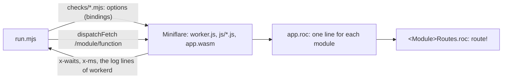

# Conformance app

The app of `PLAN.md` 8c: one route for each function of a phase A module and for its `Io` twin, run in Miniflare (used as a library, with local bindings). The app is on the bench platform (`bench/platform/main.roc`), so the worker can read the waits of each task (the bench export `task_waits`) and the task table.

| File | What |
| --- | --- |
| `app.roc` | The dispatcher: `/<module>/...` goes to `<Module>Routes.route!` (one `import` line and one `match` line for each module) |
| `<Module>Routes.roc` | The routes of one module: `route! : Request, List(Str) => Response`. Each route gives a text that the check compares. |
| `Q.roc` | Query parameters: `Q.text(req, name)`, `Q.num(req, name)` |
| `worker.js` | `makeHandler` of the app, the option `ops`, and the headers `x-waits` (waits of the task) and `x-ms` on each response. `GET /__stats`: the task table. |
| `run.mjs` | Starts a local HTTP server and Miniflare, runs each check of `checks/*.mjs` (in name order), then the check `end` (no task, ref, context, alarm or live byte). One line for each check: `PASS <name>` or `FAIL <name>: <why>`. Exit 1 on a failure. |
| `checks/<module>.mjs` | `options`: the Miniflare options of the module (its bindings). `checks`: a list of `[name, async (t) => detail]`. |
| `assert.mjs` | `eq`, `ok`, `answer(r, text)` (a 200 with that body) |
| `reverts.mjs` | The revert checks: a real edit, a build, a run, a restore (`PLAN.md` 8c, "Status of step 8c, wave 1") |
| `must-not-compile.sh`, `must-not-compile/` | A `Secret` in `Log` fields and in a CBOR encode does not compile; the controls with `s.reveal()` do |

Run:

| Command | Does |
| --- | --- |
| `bench/build.sh` | Builds `bench/out/conformance.wasm` with the other apps |
| `node conformance/run.mjs [wasm] [filter]` | All checks, or the checks whose name has the filter. Env `MINIFLARE`: the miniflare package (default: the one of the global wrangler of this node). |
| `ROC=... node conformance/reverts.mjs [filter]` | The revert checks |
| `ROC=... conformance/must-not-compile.sh` | The must-not-compile checks |

What a check gets (`t`):

| Field | What |
| --- | --- |
| `t.get(path, init)` | `{ status, body, waits, ms }` of `dispatchFetch` |
| `t.server` | The URL of the local server: `/hello`, `/ten`, `/slow` (2 s), `/echo` (method, header `x-test`, body), `/status/<n>` |
| `t.logs` | The structured log lines of workerd (`{ level, message }`) since the start |
| `t.mf` | The Miniflare instance (`getD1Database`, `getR2Bucket`, ... to set up or read data) |

Local facts: Miniflare 5 takes the V4 options through `convertV4MiniflareOptions` (the runner does it). `request.cf` is the object in `run.mjs` (the placeholder of Miniflare with no `metroCode`), so the run needs no network. Storage is in memory: each run starts empty. `port: 0`: Miniflare takes a free port, so a run does not clash with the workerd tests.

## Add a module

Example: `D1` with a binding `DB`.

1. `conformance/D1Routes.roc`: a type module `D1Routes :: [].{ route! : Request, List(Str) => Response }`, one route for each function and for each `Io` twin (`["all"]`, `["all_io"]`, ...). Import the module from the platform (`import pf.D1`). Give a text that shows the result, for example `Str.inspect` of the `Try`.
2. `conformance/app.roc`: one `import D1Routes` line, and one line in the `match`: `["d1", .. as rest] => D1Routes.route!(req, rest)`.
3. `conformance/checks/d1.mjs`: `export const options = { d1Databases: ['DB'] }` (the Miniflare V4 option of the binding: `r2Buckets`, `kvNamespaces`, `bindings`, `ratelimits`, ...) and `export const checks = [['d1 all!', async (t) => answer(await t.get('/d1/all'), '...')], ...]`. Arrays of options from two files are joined, objects are merged, and a name in two files is an error. Name each check `<module> <function>`, so the filter of `run.mjs` and the revert list can find it.
4. `conformance/reverts.mjs`: one `R(...)` line for each revert of the plan (for each module, a wrong JS method name in one function: its route fails). A Roc edit is in `bench/platform/<Module>.roc`, the copy that the app uses.
5. Run `node conformance/run.mjs` and `node conformance/reverts.mjs <module>`.

Two agents that add modules at the same time touch `app.roc` (two lines each) and `reverts.mjs` (their lines). The other files are new.
