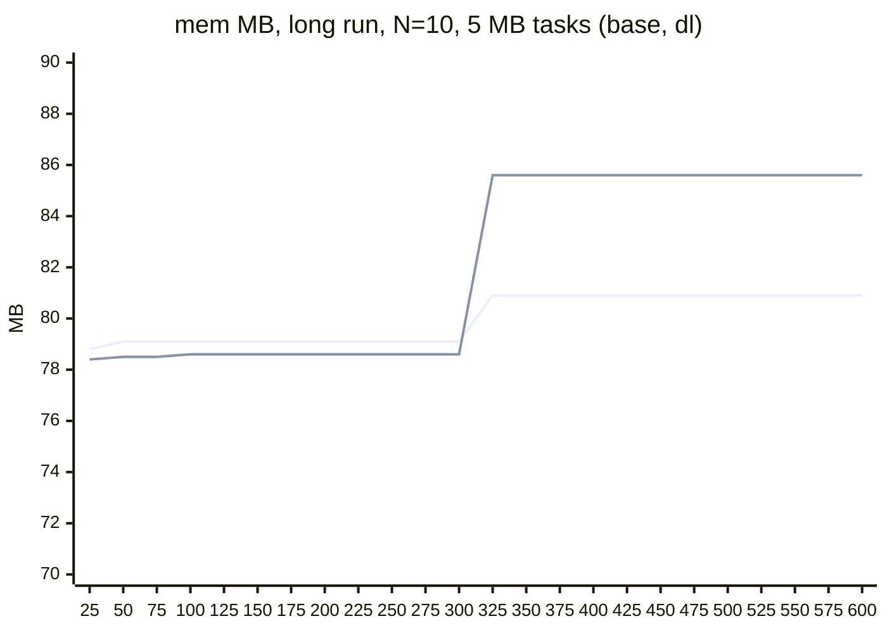

# Heavy long-lived tasks in one isolate: wasm memory, base against dlmalloc and zig (2026-11-07)

Local only. One workerd process (one isolate) per run. The gap that `../sustained/results.md` left open: tasks that hold 5 to 20 MB for about 1.3 s, many at the same time.

## Files

| File | Use |
|---|---|
| `app/main.roc` | The app. One request = one heavy task (query: `kb`, `chunk`, `waits`, `ms`, `mix`, `grow`, `keep`, `seed`) |
| `build.sh` | `ZIG=<zig 0.17> heavy/build.sh base fa_dl fa_zig alloc_c1360.zig`: platform copy (own work dir `.cache/hostvar-heavy`, sums off) and app in `out/<v>/` |
| `alloc_c1360.zig` | Research copy of `hostlib/alloc.zig` with one more size class (1360 B). Not for production |
| `alloc_spans.zig`, `spans.sh` | Copy of the changed `hostlib/alloc.zig` (2026-11-08) and its runs (section "After") |
| `heavy.mjs` | Driver: `startApp` of the shim, closed loop of N tasks, phases by time, one JSON line per task. Stops a run after 100 failures in a row |
| `run.sh`, `extra.sh` | The matrix; the fit search, `keep2`, `bs`, `bonly`, `lonly`, `long` sets |
| `report.mjs` | The tables below; `--csv out/series.csv` (mem in 10 s bins) |
| `out/` | Raw JSONL and logs (gitignored, 189 MB) |

## Setup

| Item | Value |
|---|---|
| Task | Build `kb` KB in chunks of 256 KB with a 1 ms sleep after each chunk (tasks interleave while they build), hold it for 4 waits of 250 ms, keep 1 item of 16, wait 250 ms, return. About 1.3 s per task |
| Structure | `List(Chunk)`; `Chunk = { items : List({ i : U64, s : Str }), nums : List(U64) }`. `items` and `nums` grow by append (realloc); `nums` gets 512 appends per chunk |
| Mixes (string length) | `s`: 12..63 B; `b`: 200..1999 B; `l`: 2100..8099 B; `m`: 3 of 4 `s`, 1 of 4 `b` |
| Phases | Matrix and fit: `s`, `b`, `m`, equal time (180 s or 120 s). `bs`: `b` then `s`. `long`: 600 s, `s,b,m,s,b,m` |
| Load | Closed loop: N tasks at once for the whole run, a new task starts when one ends (no idle) |
| Shim options | `stats` on, `resumeCheck: "off"`, global check off, `isolateBytes` 128 MB with `jsReserveBytes` 0, so the wasm limit is the 128 MB of the allocator. The production default leaves 80 MB for wasm |
| Variants | `base` (`hostlib/alloc.zig`), `fa_dl` (dlmalloc), `fa_zig` (`std.heap.wasm_allocator`), `alloc_c1360` (base + class 1360) |
| True live | The global live peak of `fa_dl` (its count is the usable size: request + at most 8 to 16 B). `livePeak` of the header is the global peak of the instance in the window of one task, so the max over all tasks is the global peak (no sum needed). base counts class capacity, so its own count is higher |
| N x held | The app's own count (string bytes + 20 B per item + 8 B per `nums` item) times N. It is lower than the true live (refcounts, list capacity) |

## Results: matrix (180 s, phases s, b, m)

mem = max wasm memory. All rows that fit: mem is flat after the first seconds and does not grow at the end (column "Growth" of `report.mjs` is 0.0 in every base and dl row).

| MB per task (app count) | N | base mem MB | dl mem MB | zig mem MB | True live MB (dl) | base / true live | dl / true live | zig / true live | Failed tasks (base, dl, zig) |
|---|---|---|---|---|---|---|---|---|---|
| 5 | 2 | 17.8 | 16.6 | 43.3 | 14.7 | 1.21 | 1.13 | 2.95 | 0, 0, 0 |
| 5 | 5 | 41.1 | 39.8 | 105.8 | 36.9 | 1.11 | 1.08 | 2.87 | 0, 0, 0 |
| 5 | 10 | 79.0 | 78.5 | 209.6 | 73.7 | 1.07 | 1.07 | 2.84 | 0, 0, 0 |
| 5 | 20 | 128 (limit) | 128 (limit) | 417.1 | - | - | - | - | 103, all, 0 |
| 10 | 2 | 33.5 | 32.0 | 85.0 | 29.5 | 1.14 | 1.08 | 2.88 | 0, 0, 0 |
| 10 | 5 | 78.6 | 78.4 | 209.4 | 73.7 | 1.07 | 1.06 | 2.84 | 0, 0, 0 |
| 10 | 10 | 128 (limit) | 128 (limit) | 417.0 | - | - | - | - | 101, all, 0 |
| 10 | 20 | 128 (limit) | 128 (limit) | 831.3 | - | - | - | - | 112, all, 0 |
| 20 | 2 | 62.9 | 62.1 | 165.8 | 58.2 | 1.08 | 1.07 | 2.85 | 0, 0, 0 |
| 20 | 5 | 128 (limit) | 128 (limit) | 411.6 | - | - | - | - | 1292, all, 0 |
| 20 | 10 | 128 (limit) | 128 (limit) | 821.0 | - | - | - | - | 105, all, 0 |
| 20 | 20 | 128 (limit) | 128 (limit) | 1639.9 | - | - | - | - | 115, all, 0 |

The peak of every s,b,m run is in phase `s` (true live 7.4 MB per 5 MB task; phase `b` needs 5.2 MB per task with dl, 6.8 MB with base).

## Results: size mix (5 MB per task, 120 s, one mix)

| Mix | N | base mem MB | base + 1360 mem MB | dl mem MB | True live MB (dl) | base / true live | base + 1360 / true live | dl / true live | Failed (base, +1360, dl) |
|---|---|---|---|---|---|---|---|---|---|
| `b` (200..1999 B) | 10 | 70.4 | 64.6 | 53.2 | 51.8 | 1.36 | 1.25 | 1.03 | 0, 0, 0 |
| `b` | 16 | 111.4 | 102.1 | 84.4 | 82.9 | 1.34 | 1.23 | 1.02 | 0, 0, 0 |
| `b` | 20 | 128 (limit) | 127.2 | 105.4 | 103.6 | - | 1.23 | 1.02 | 406, 0, 0 |
| `l` (2100..8099 B) | 10 | 71.9 | 71.9 | 52.9 | 51.7 | 1.39 | 1.39 | 1.02 | 0, 0, 0 |
| `l` | 16 | 113.6 | 113.6 | 84.1 | 82.6 | 1.38 | 1.38 | 1.02 | 0, 0, 0 |
| `s,b,m` | 10 | 79.0 | 79.1 | 78.5 | 73.7 | 1.07 | 1.07 | 1.07 | 0, 0, 0 |

## Results: other runs (N = 10, 5 MB)

| Run | base mem MB | dl mem MB | Note |
|---|---|---|---|
| `keep2` (keep 1 of 2 after the hold: each page stays half full until the task ends) | 78.4 | 78.3 | No cost: the peak is in the hold, before the free |
| `bs` (phase `b`, then `s`) | 70.3, then 79.1 | 53.1, then 78.6 | Pages of the `b` classes go back and serve the `s` classes |
| `long` (600 s, `s,b,m,s,b,m`) | 79.1, then 80.9 from the 2nd `s` phase on (+1.8 MB) | 78.6, then 85.6 from the 2nd `s` phase on (+7.1 MB) | One step at the return to `s`, then flat for 300 s in both. dl fragments more than base |

## Largest N x size with no failed task in 128 MB

| Mix | base | dl | zig | base + 1360 |
|---|---|---|---|---|
| s,b,m, 5 MB tasks | N = 16 (125.6 MB) | N = 16 (124.8 MB) | N = 6 (126.5 MB) | not run |
| s,b,m, 10 MB tasks | N = 8 (124.6 MB) | N = 8 (124.8 MB) | N = 3 (126.4 MB) | not run |
| s,b,m, 20 MB tasks | N = 4 (122.5 MB) | N = 4 (123.1 MB) | N = 1 (83.8 MB) | not run |
| `b` only, 5 MB tasks | N = 16 (111.4 MB), 20 fails | N = 20 (105.4 MB), about 24 by scale | not run | N = 20 (127.2 MB) |
| `l` only, 5 MB tasks | N = 16 (113.6 MB), about 18 by scale | N = 16 (84.1 MB), about 24 by scale | not run | as base |

With the production budget (80 MB of wasm): s,b,m 5 MB N = 10 (base 79.0 MB) and 10 MB N = 5 (78.6 MB) fit, for base and dl.

## mem over time (MB), worst growth case: `long`, N = 10, 5 MB, 25 s bins

Phases: `s` 0 to 100 s, `b` 100 to 200 s, `m` 200 to 300 s, then again. Line 1: base; line 2: dl.

zig at a phase change (N = 5, 5 MB, 15 s bins, phases change at 60 s and 120 s): 67.9, 67.9, 67.9, 68.0, 102.6, 102.8, 102.8, 102.8, 105.8, 105.8, 105.8, 105.8. Its power-of-2 classes keep their pages: each new size mix adds memory. base and dl are flat in the same run (41.1 and 39.8 MB).

## Failures

| Variant | What happens at the limit | Cause |
|---|---|---|
| base | A task gets `503 trap out of memory`. Its pages go back (`taskEnd`, `hostlib/alloc.zig:921`; `freeOwner`, `:963`), the others go on. The failures are all in the first 30 s (the N tasks start in step and build at the same time); after that the tasks are out of step and 0 fail at 128 MB. Only N = 5 x 20 MB failed until about 70 s, and `b` N = 20 failed about 2 per s for the whole run | The design: a trap frees the task |
| dl | The first trap leaks the blocks of the task, then every task fails at once (`trap out of memory: request block`): 589,840 fast failures in one run; later runs stop after 100 in a row | `../fa.zig` (research adapter): "a trap leaks the task's blocks". Not dlmalloc. Before the first trap, dl fits the same N as base on s,b,m |
| zig | Never fails: memory goes above 128 MB (up to 1,640 MB) | `../fa.zig:114`: `std.heap.wasm_allocator` grows memory itself, not through `brkMove` (`../fa.zig:56`), so it skips the 128 MB cap and the JS budget. Compare its mem with 128 MB |

## Where base uses more than dl (item 4)

base and dl are equal (within 1 % to 8 %) on the mixed workload, and base does not grow. base uses 34 % to 39 % more than dl when most blocks are 200 B to 8 KB. Cause: rounding, not pages stuck in a class or a task.

| Size range | Cause in `hostlib/alloc.zig` | Waste, computed (cap / request, page level) | Measured base / dl |
|---|---|---|---|
| 200..2048 B | `CLASSES` (`:309`): above 256 B the classes step by 1.33x to 2x, and no class is between 1024 and 2048. A block of 1,100 B takes 2,048 B. The live count shows it (`:676`, `cap = CLASSES[class]`) | 1.31 | 1.34 (`b`, N = 16) |
| 2049..8 KB and more | `SMALL_MAX = 2048` (`:25`): bigger blocks are large blocks of whole 4 KB units (`largeAlloc`, `:580` to `:581`, `n = (len + CH - 1) >> CH_SHIFT`). A block of 4,200 B takes 8 KB | 1.34 | 1.36 (`l`, N = 16) |
| 12..63 B | 16-B steps (`16, 32, 48, 64, 96`) plus the 8 B refcount; dl has a similar header and alignment cost | 1.22 | about 1.0 |
| Pages per task and class (`Task.avail`, `:333`), page reserve (`CACHE_MAX`, `:82`) | At most 13 partly used pages per task (N = 20: about 1 MB) and 1 MB of reserve | small | not visible (`keep2` 78.4 against 78.3) |

What a fix would gain (estimates from the waste model, one measured):

| Fix (not done) | `b` mix | `l` mix | Mixed (s,b,m) |
|---|---|---|---|
| Add class 1360 (3 blocks per 4 KB page; a class such as 1536 gives nothing: 2 per page, the same as 2048) | Measured: -8 % mem (111.4 to 102.1 MB at N = 16); `b` N = 20 fits (406 failures to 0) | 0 | 0 (79.0 to 79.1 MB) |
| Classes at 4096 / k for k = 2..16 (288, 336, 400, 448, 576, 672, 816, 1360) | Model 1.31 to 1.17: about -11 % | 0 | `s` phase 1.22 to 1.17: about -4 % |
| Large blocks in 1 KB units (in place of 4 KB) | 0 | Model 1.34 to 1.10: about -18 % | 0 |
| Remaining gap to dl after those | about 1.17 against 1.02 (pages of 4 KB limit the classes from 1,024 to 2,048 B; to close it, pages of 8 or 16 KB for those classes) | about 1.10 against 1.02 | none |

## Conclusion

| Question | Answer |
|---|---|
| Does base grow with heavy, overlapping tasks and turnover? | No. Flat in every run that fits; one step of +1.8 MB (2 %) when the size mix comes back in the 600 s run, then flat. dl had a larger step (+7.1 MB, 9 %) |
| Pages stuck in one class or one task? | Not seen. An empty page goes back at once, a task's pages go back at its end, and pages move between classes (`bs` run) |
| base against dl, mixed sizes | Equal: base / true live 1.07 to 1.21 (small N has more fixed overhead), dl 1.06 to 1.13. Same largest N at 5, 10 and 20 MB per task |
| base against dl, blocks of 200 B to 8 KB | base uses 34 % to 39 % more (class and 4 KB-unit rounding). Largest N for `b` 5 MB tasks: 16 against about 24 |
| zig | 2.8x to 3.0x the true live and it grows at each size change. Largest N about 1/3 of base |
| At the limit | base frees a trapped task and recovers (failures only while tasks start in step). The dl adapter leaks at a trap; this is the research adapter, not dlmalloc |

## After: the size class change of `hostlib/alloc.zig` (2026-11-08)

Variant `alloc_spans` (`alloc_spans.zig`, a copy of the changed `hostlib/alloc.zig`; `spans.sh` runs it). Classes at 4096 / k up to 2048 B (288, 336, 400, 448, 576, 672, 816, 1360 added, 384 and 768 out), and classes in 1 KB steps from 3072 to 8192 B in spans of 1 to 7 task-owned units (3072: 3 units, 5120: 5, 6144: 3, 7168: 7, 8192: 2). A block that a realloc moves above 2048 B stays a large block of 4 KB units. Base `-re` rows: `out/base` again, at the same time.

| Mix, 5 MB tasks | N | base mem MB | alloc_spans mem MB | Change | dl mem MB (above) | Failed (base, spans) |
|---|---|---|---|---|---|---|
| `b` (200..1999 B) | 16 | 111.3 | 100.6 | -9.7 % | 84.4 | 0, 0 |
| `b` | 20 | 128 (limit) | 125.2 | fits | 105.4 | 406, 0 |
| `l` (2100..8099 B) | 16 | 113.6 | 94.8 | -16.6 % | 84.1 | 0, 0 |
| `l` | 20 | not run | 118.1 | | | -, 0 |
| `s,b,m` | 10 | 79.2 | 79.1 | -0.1 % | 78.5 | 0, 0 |
| `s,b,m` | 16 | 125.6 | 125.2 | -0.3 % | 124.8 | 0, 0 |

| Largest N in 128 MB, 5 MB tasks | base | alloc_spans | dl |
|---|---|---|---|
| `b` | 16 (N = 20: 406 fails) | 20 (125.2 MB; N = 21: 302 fails) | about 24 |
| `l` | 18 (127.7 MB) | 21 (124.3 MB; N = 22: 197 fails) | about 24 |
| `s,b,m` | 16 | 16 (125.2 MB) | 16 |
