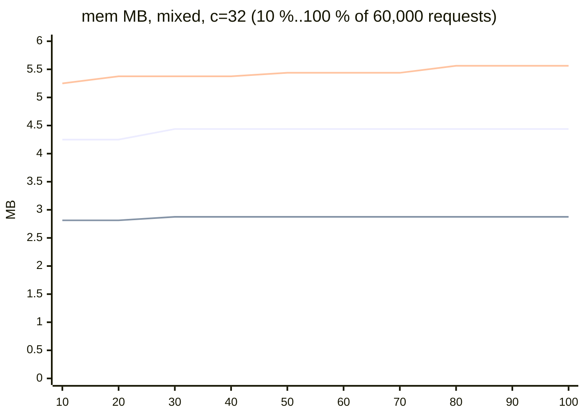

# Sustained concurrent load: wasm memory, base against dlmalloc and zig (2026-11-07)

Local only. One workerd process (one isolate) per run, closed loop of c requests at once, stats header on, sums and global check off.
Driver: `sustained.mjs`; all runs: `run.sh`; tables and CSV: `report.mjs`; raw samples: `out/*.jsonl` (one line per response); log: `run.log`.

## Setup

| Item | Value |
|---|---|
| Builds | `../edge/base`, `../edge/fa_dl`, `../edge/fa_zig` (not rebuilt) |
| Scenario `mixed` | `regprof/scenarios/mixed.jsonl` (400 lines, cycled), 60,000 requests |
| Scenario `closure+releases` (large responses) | closure and releases lines interleaved, 40,000 requests. Largest bodies: 156 KB (closure), 90 KB (releases) |
| Concurrency | 10 and 32 requests at once, for the whole run |
| Order of samples | by `served` (server order), not client completion order |
| Memory | `mem` = wasm memory bytes, it cannot shrink. It includes static data and stack, so mem / livePeak is larger than the heap overhead alone |
| livePeak | peak of live bytes in the window of one request. At c > 1 the window overlaps other requests |

## Results (table: `results-table.md`)

Growth columns = rise of `mem` in the 2nd and in the last third of the requests.

| Scenario | Variant | c | Final = max mem MB | Max livePeak KB | mem / livePeak | Growth 2nd third KB | Growth last third KB | Still growing |
|---|---|---|---|---|---|---|---|---|
| mixed | base | 10 | 3.38 | 871 | 3.97 | 0 | 0 | no |
| mixed | fa_dl | 10 | 2.19 | 848 | 2.64 | 64 | 0 | no |
| mixed | fa_zig | 10 | 4.31 | 847 | 5.21 | 64 | 0 | no |
| mixed | base | 32 | 4.44 | 1486 | 3.06 | 0 | 0 | no |
| mixed | fa_dl | 32 | 2.88 | 1343 | 2.19 | 0 | 0 | no |
| mixed | fa_zig | 32 | 5.56 | 1604 | 3.55 | 64 | 128 | one 128 KB step at the end |
| closure+releases | base | 10 | 3.06 | 599 | 5.24 | 0 | 0 | no |
| closure+releases | fa_dl | 10 | 1.94 | 617 | 3.21 | 0 | 0 | no |
| closure+releases | fa_zig | 10 | 4.31 | 597 | 7.40 | 0 | 0 | no |
| closure+releases | base | 32 | 4.25 | 1347 | 3.23 | 0 | 0 | no |
| closure+releases | fa_dl | 32 | 2.81 | 1335 | 2.16 | 192 | 0 | no |
| closure+releases | fa_zig | 32 | 5.50 | 1249 | 4.51 | 64 | 0 | no |

No 5xx in any run. Base reaches 90 % of its max within 2 to 115 requests (mixed: 42 and 54) and then does not grow in 60,000 requests. Max is 4.44 MB of 128 MB (3.5 %).

## mem (MB) over the mixed run, c = 32 (every 10 % of 60,000 requests)

Full series (100 points per run): `series.csv`.

## After: the size class change of `hostlib/alloc.zig` (2026-11-08)

`V="base_re alloc_spans" ./run.sh` (log `run-spans.log`). Both builds from the same registry copy: `../edge/base_re` (the allocator of HEAD a9005cf) and `../edge/alloc_spans` (`../heavy/alloc_spans.zig`).

| Scenario | c | base_re max mem MB | alloc_spans max mem MB | 5xx |
|---|---|---|---|---|
| mixed | 10 | 3.31 | 3.44 | 0, 0 |
| mixed | 32 | 4.75 | 4.75 | 0, 0 |
| closure+releases | 10 | 3.31 | 3.25 | 0, 0 |
| closure+releases | 32 | 4.56 | 4.50 | 0, 0 |
